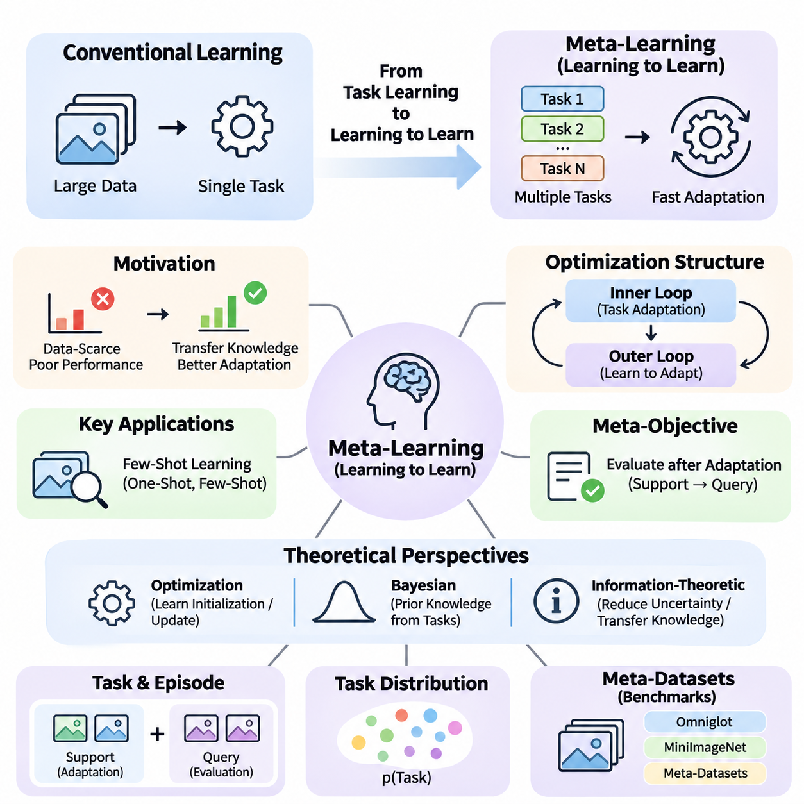
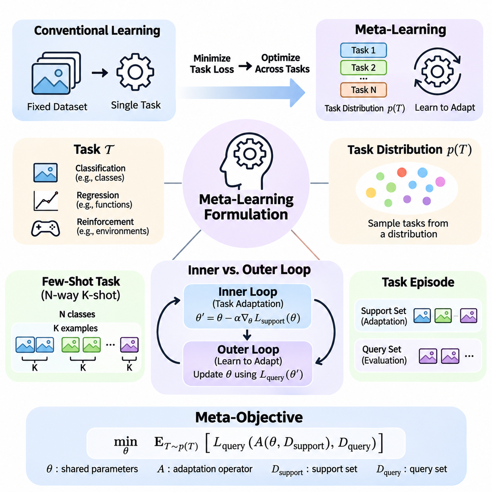
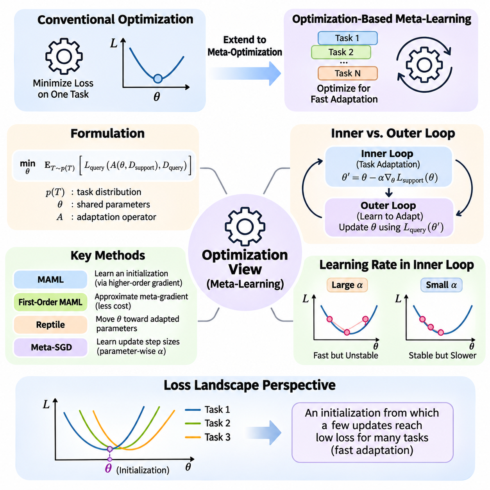
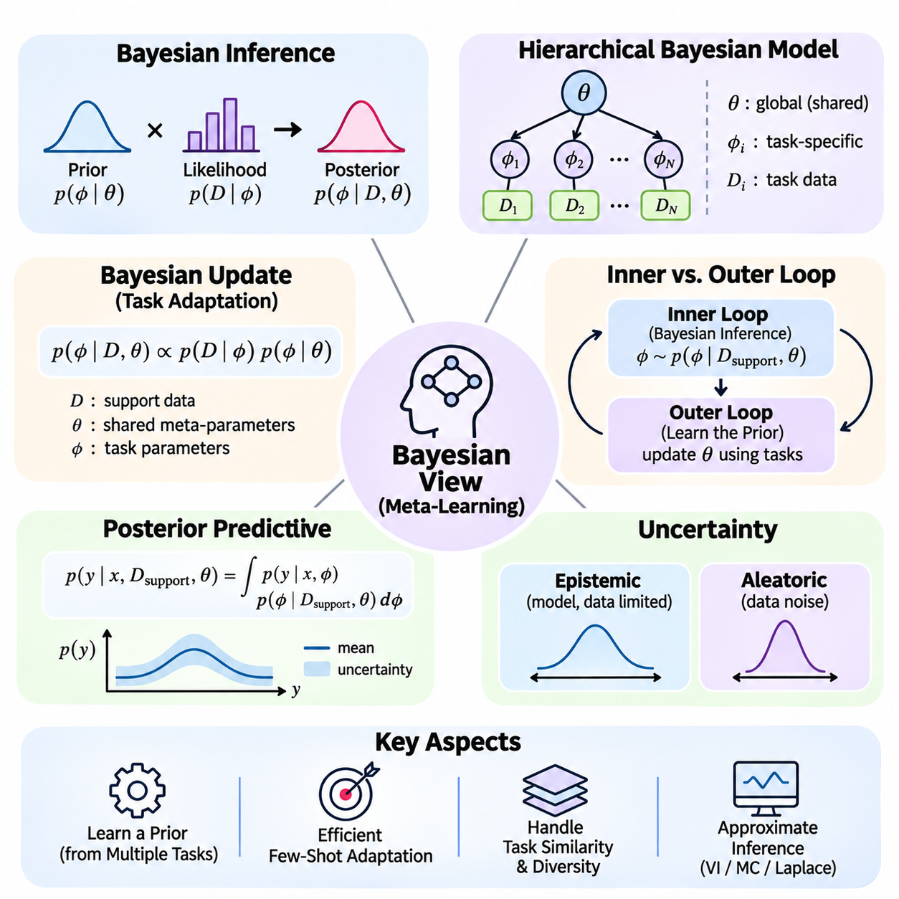
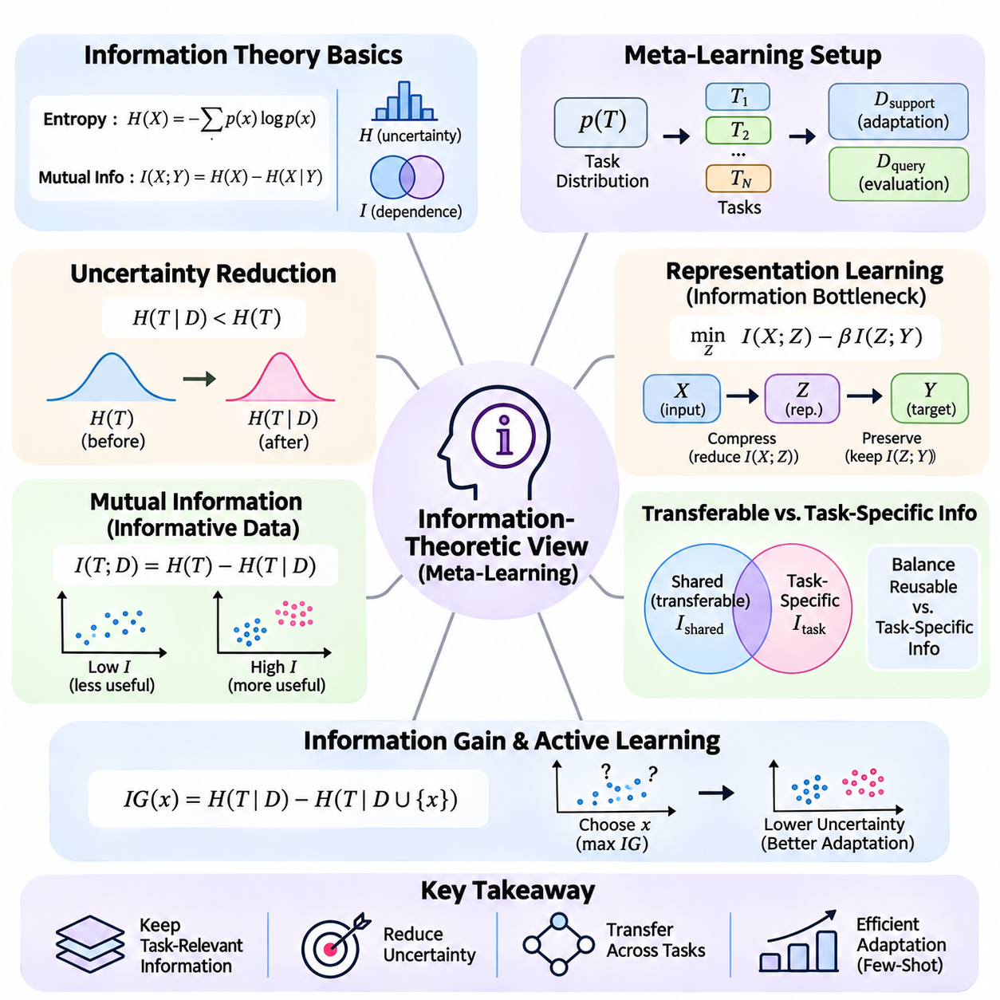
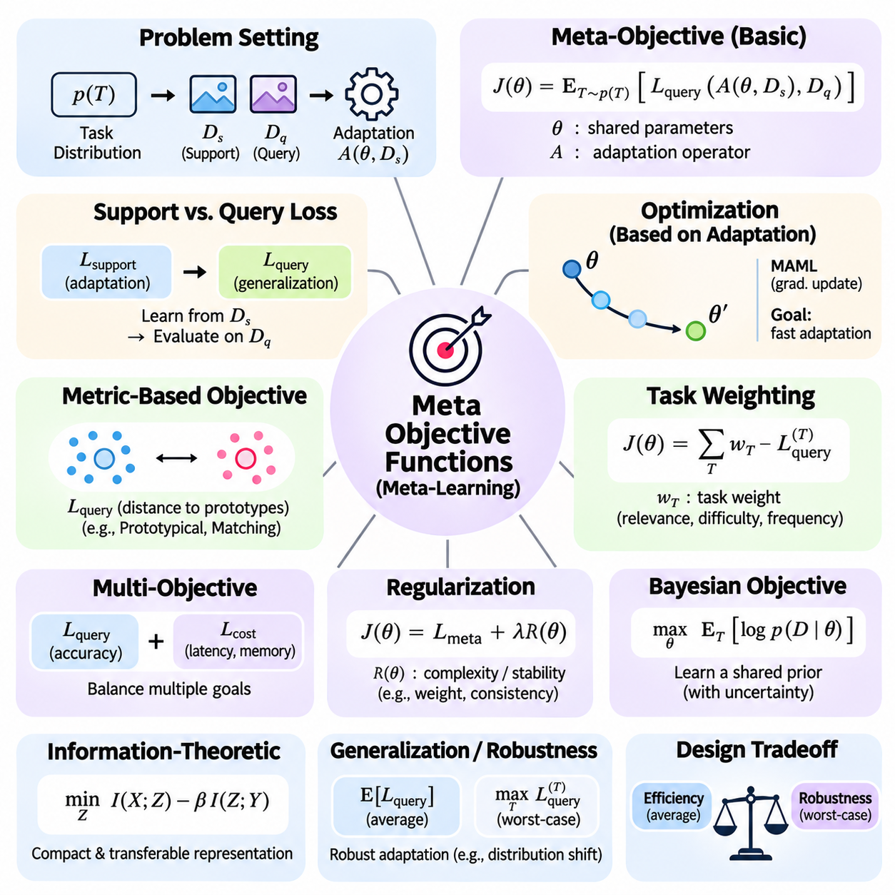
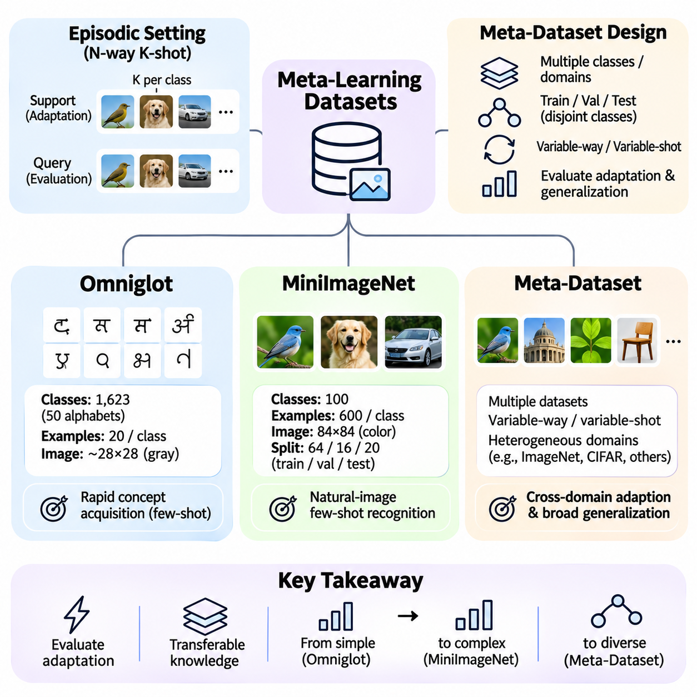
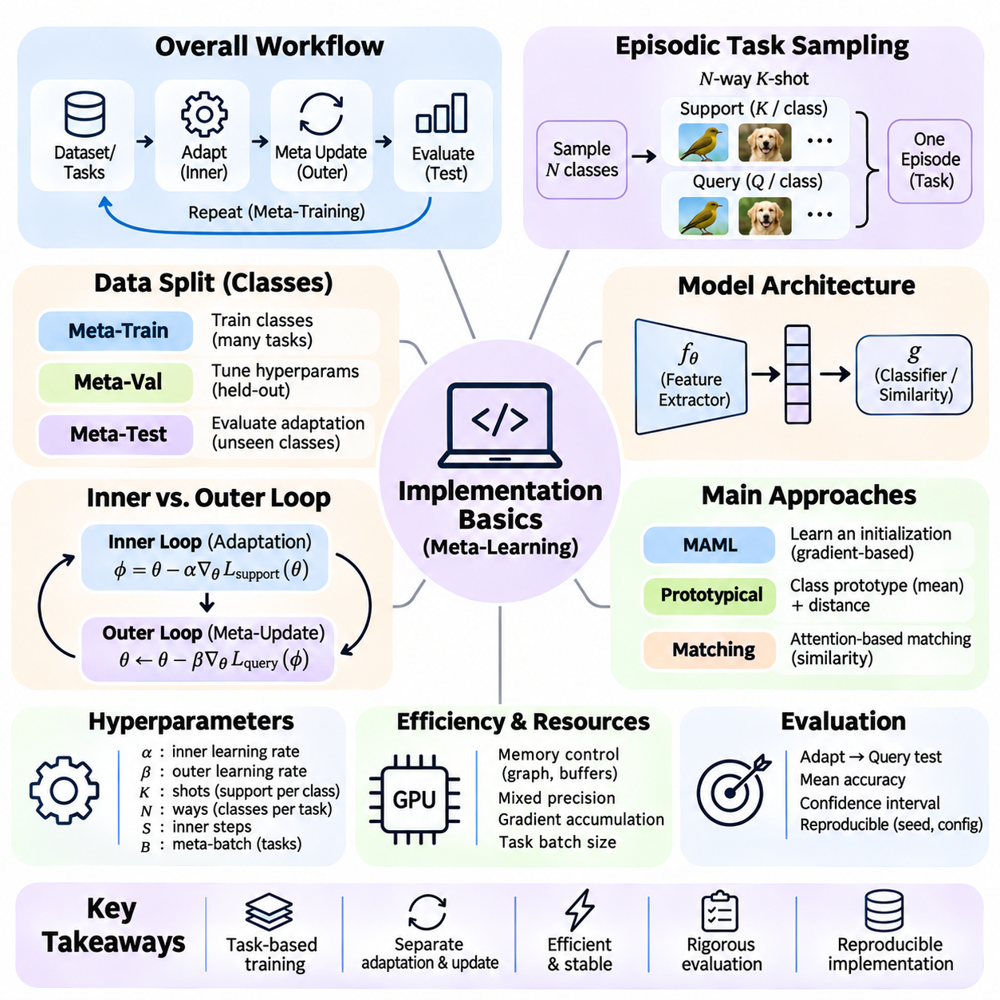

**Volume 36. Meta Learning and Few Shot Adaptation**


# 01. Learning to Learn

## 01.00 Overview

{width="7.268055555555556in" height="7.268055555555556in"}

Traditional machine learning typically focuses on optimizing a model for a particular task using a sufficiently large training dataset. Although this approach has achieved remarkable success, it often requires substantial computational resources and extensive labeled examples when encountering unfamiliar problems. Learning to learn introduces a different perspective by developing systems that improve their ability to acquire new knowledge through experience across multiple tasks.

Meta-learning, commonly described as learning to learn, aims to discover transferable learning mechanisms rather than merely memorizing solutions to individual problems. Instead of training a model exclusively for one prediction objective, meta-learning exposes it to a distribution of related tasks. Through repeated adaptation, the system learns representations, parameter initializations, or learning strategies that enable faster and more effective responses to previously unseen tasks.

The central motivation for meta-learning arises from the limitations of conventional supervised learning in data-scarce environments. A model trained on thousands of labeled examples may perform poorly when introduced to a new category represented by only a few observations. Meta-learning addresses this challenge by extracting common structures across previous learning experiences, allowing knowledge acquired from earlier tasks to guide adaptation to unfamiliar situations.

The distinction between ordinary learning and meta-learning lies primarily in the level at which optimization occurs. Conventional learning adjusts model parameters to minimize prediction errors within a particular task. Meta-learning additionally optimizes the learning process across tasks, seeking parameters or mechanisms that produce strong performance after limited adaptation. Consequently, the objective extends beyond immediate accuracy toward adaptability and learning efficiency.

A fundamental assumption in many meta-learning systems is that tasks are sampled from an underlying task distribution. Each task may involve different classes, environments, objectives, or data characteristics while sharing sufficient statistical structure with other tasks. By learning across this distribution, a model can identify reusable patterns that support rapid adaptation. Its effectiveness depends strongly on how closely future tasks relate to those encountered during meta-training.

Meta-learning commonly distinguishes between an inner learning process and an outer optimization process. The inner loop adapts a model to an individual task using a limited collection of examples. The outer loop evaluates the results of these adaptations and updates shared knowledge to improve future learning. This hierarchical arrangement enables the system to optimize not only task-specific performance but also the effectiveness of its adaptation procedure.

Few-shot learning represents one of the most important applications of meta-learning. In a few-shot setting, a model must recognize new categories or solve unfamiliar problems using only a small number of labeled examples. One-shot learning restricts this requirement to a single example per category. Rather than depending entirely on extensive task-specific training, successful systems exploit previously learned representations, similarities, and adaptation mechanisms.

Meta-learning can be understood through several complementary theoretical perspectives. The optimization perspective emphasizes learning parameter initializations or update procedures that facilitate rapid convergence. The Bayesian perspective interprets previous task experience as information about useful prior beliefs. The information-theoretic perspective investigates how transferable knowledge reduces uncertainty and improves adaptation under limited observations.

These perspectives provide different explanations for how knowledge can transfer between learning experiences. Optimization-based methods focus on efficient parameter adjustment, while probabilistic approaches model uncertainty about tasks and their underlying structures. Information-theoretic approaches examine the amount and relevance of knowledge retained across tasks. Together, these viewpoints establish a broader foundation for understanding adaptive intelligence.

The design of a meta-learning objective differs from conventional empirical risk minimization because performance must be evaluated after adaptation. A model may achieve excellent accuracy on previously observed tasks without learning an effective adaptation strategy. Meta-objectives therefore commonly measure performance on task-specific query examples after learning from limited support examples, encouraging representations and parameters that generalize to new learning situations.

Task construction plays a critical role in the development of effective meta-learning systems. Training examples are commonly organized into episodes that simulate the conditions expected during deployment. Each episode contains a support set used for adaptation and a query set used for evaluation. By repeatedly encountering different combinations of classes and examples, the model learns to operate under limited-data conditions rather than relying on conventional large-batch supervision alone.

The quality and diversity of meta-training tasks strongly influence generalization. If tasks are too similar, the model may learn shortcuts that perform well during training but fail under unfamiliar conditions. Conversely, tasks that are excessively heterogeneous may provide insufficient common structure for meaningful transfer. Effective meta-dataset design therefore requires a balance between task diversity, shared characteristics, and the intended deployment environment.

Benchmark datasets provide controlled environments for studying learning-to-learn capabilities. Omniglot contains handwritten characters from numerous alphabets and has historically supported few-shot character recognition experiments. MiniImageNet introduces more complex natural-image classification tasks, while Meta-Dataset emphasizes evaluation across multiple image datasets. These benchmarks help researchers investigate adaptation accuracy, robustness, and generalization under standardized episodic settings.

Learning-to-learn methods can be categorized according to the knowledge they transfer between tasks. Optimization-based approaches learn favorable initial parameters or adaptation rules. Metric-based approaches construct representation spaces in which unfamiliar examples can be classified through similarity comparisons. Model-based approaches use architectural mechanisms, memory, or task-conditioned computation to incorporate new information rapidly.

Optimization-based meta-learning includes Model-Agnostic Meta-Learning, which seeks model parameters that can adapt effectively through a small number of gradient updates. Related approaches simplify gradient calculations or modify adaptation procedures to improve computational efficiency. Their central principle is that a carefully learned initialization can make subsequent task-specific optimization more effective than beginning from arbitrary or conventionally pretrained parameters.

Metric-based meta-learning follows a different strategy by emphasizing relationships between observations. Siamese Networks, Matching Networks, and Prototypical Networks learn representations that support classification through distances or similarities. Instead of requiring extensive parameter updates for every new task, these methods can use support examples directly to construct decision rules, making them particularly attractive for rapid few-shot recognition.

Fast adaptation extends beyond classification into environments where tasks, objectives, or operating conditions change over time. Techniques such as fine-tuning, parameter sharing, meta-initialization, latent-space adaptation, and task conditioning provide different mechanisms for responding to these changes. Online adaptation and lifelong learning introduce additional requirements because knowledge must evolve continuously without unnecessarily disrupting previously acquired capabilities.

Meta-reinforcement learning applies learning-to-learn principles to sequential decision-making problems. An agent encounters multiple environments or tasks and learns how to adapt its behavior using limited interaction experience. Rather than optimizing a fixed policy for one environment, the system seeks transferable exploration and decision-making strategies. This approach is relevant to robotic control, adaptive systems, and interactive environments with changing dynamics.

The relationship between meta-learning and transfer learning requires careful consideration. Transfer learning generally reuses knowledge acquired from a source task or dataset, often through pretrained representations and fine-tuning. Meta-learning explicitly trains across tasks to improve subsequent adaptation. These approaches are not mutually exclusive, and practical systems may combine pretrained foundation models with meta-learning objectives to achieve stronger adaptation under limited data.

Generalization remains a central challenge because success on meta-training tasks does not guarantee reliable performance under distribution shifts. New environments may contain unfamiliar visual patterns, different causal relationships, or task structures absent from previous experience. Robust meta-learning therefore requires evaluation beyond familiar benchmark conditions, including domain generalization, out-of-distribution testing, and systematic analysis of adaptation failures.

Recent research directions connect meta-learning with large language models, multimodal learning, hypernetworks, and foundation model adaptation. These approaches investigate whether task-specific behavior can emerge through contextual information, learned parameter generation, or efficient modification of pretrained representations. However, not every form of in-context learning constitutes explicit meta-learning, and their underlying training objectives and adaptation mechanisms must be distinguished.

Engineering considerations become increasingly important when meta-learning moves from controlled experiments into operational systems. Task sampling, data pipelines, distributed training, adaptation latency, memory consumption, and reproducibility all affect practical feasibility. Edge AI applications introduce additional constraints because adaptation may need to occur with limited computational resources, restricted communication bandwidth, and strict real-time performance requirements.

Reliable evaluation must measure more than final predictive accuracy. Adaptation speed, sample efficiency, computational cost, uncertainty calibration, and performance across unseen tasks provide complementary indicators of learning capability. Experiments should also control task distributions, support-set sizes, random seeds, and evaluation protocols. Without these precautions, apparent improvements may reflect favorable task sampling or experimental inconsistencies rather than genuine learning-to-learn progress.

The broader significance of meta-learning lies in its attempt to make artificial intelligence less dependent on repeated large-scale training for every new problem. By learning reusable adaptation mechanisms, systems may become more flexible, data-efficient, and responsive to changing environments. Nevertheless, successful adaptation still depends on appropriate prior experience, reliable task identification, and the availability of sufficient information to distinguish among possible solutions.

Learning to learn ultimately establishes a framework in which previous experience shapes the efficiency of future learning. Its foundations connect task distributions, hierarchical optimization, probabilistic inference, information transfer, and few-shot evaluation into a unified research direction. Understanding these principles provides the conceptual basis for studying advanced meta-learning algorithms, rapid adaptation strategies, and their practical implementation in increasingly autonomous intelligent systems.

전통적인 기계학습(Machine Learning)은 일반적으로 충분히 큰 학습 데이터셋(Training Dataset)을 사용하여 특정 작업(Task)에 대한 모델(Model)을 최적화하는 데 중점을 둔다. 이러한 접근법은 놀라운 성과를 달성했지만, 익숙하지 않은 문제를 해결할 때 상당한 컴퓨팅 자원(Computational Resources)과 방대한 레이블 데이터(Labeled Data)를 요구하는 경우가 많다. 학습하는 방법을 학습하는 것(Learning to Learn)은 여러 작업에서 축적된 경험을 통해 새로운 지식을 습득하는 능력 자체를 향상시키는 새로운 관점을 제시한다.

메타학습(Meta-Learning)은 일반적으로 학습하는 방법을 학습하는 것(Learning to Learn)으로 설명되며, 개별 문제의 해결책을 단순히 암기하는 대신 전이 가능한 학습 메커니즘(Transferable Learning Mechanisms)을 발견하는 것을 목표로 한다. 하나의 예측 목표(Prediction Objective)에 대해서만 모델을 학습시키는 대신, 다양한 관련 작업으로 구성된 작업 분포(Task Distribution)에 모델을 노출한다. 반복적인 적응(Adaptation)을 통해 시스템은 이전에 경험하지 못한 작업에도 빠르고 효과적으로 대응할 수 있는 표현(Representation), 매개변수 초기화(Parameter Initialization), 학습 전략(Learning Strategy)을 습득한다.

메타학습(Meta-Learning)의 핵심적인 동기는 데이터가 부족한 환경(Data-Scarce Environment)에서 나타나는 기존 지도학습(Supervised Learning)의 한계에서 비롯된다. 수천 개의 레이블 예제로 학습한 모델도 소수의 관측값만 제공되는 새로운 범주(Category)에 대해서는 성능이 저하될 수 있다. 메타학습은 이전 학습 경험에서 공통 구조(Common Structure)를 추출하여 이러한 문제를 해결하며, 과거 작업에서 획득한 지식이 익숙하지 않은 상황에 대한 적응을 지원하도록 한다.

일반적인 학습(Conventional Learning)과 메타학습(Meta-Learning)의 차이는 주로 최적화(Optimization)가 수행되는 수준에 있다. 기존 학습은 특정 작업에서 예측 오차(Prediction Error)를 최소화하도록 모델 매개변수(Model Parameters)를 조정한다. 반면 메타학습은 여러 작업에 걸쳐 학습 과정(Learning Process) 자체를 추가로 최적화하여 제한된 적응 과정 이후에도 우수한 성능을 제공하는 매개변수나 메커니즘을 탐색한다. 따라서 목표는 즉각적인 정확도(Accuracy)를 넘어 적응 능력(Adaptability)과 학습 효율성(Learning Efficiency)까지 확장된다.

많은 메타학습 시스템의 기본 가정은 작업(Task)이 기저의 작업 분포(Task Distribution)에서 표본 추출(Sampling)된다는 것이다. 각 작업은 서로 다른 클래스(Class), 환경(Environment), 목표(Objective), 데이터 특성(Data Characteristics)을 가질 수 있지만, 다른 작업과 충분한 통계적 구조(Statistical Structure)를 공유한다. 모델은 이러한 분포를 학습하면서 빠른 적응을 지원하는 재사용 가능한 패턴(Reusable Patterns)을 발견하며, 실제 효과는 미래 작업이 메타학습 과정에서 경험한 작업과 얼마나 관련되어 있는지에 크게 좌우된다.

메타학습(Meta-Learning)은 일반적으로 내부 학습 과정(Inner Learning Process)과 외부 최적화 과정(Outer Optimization Process)을 구분한다. 내부 루프(Inner Loop)는 제한된 예제를 사용하여 개별 작업에 모델을 적응시키며, 외부 루프(Outer Loop)는 이러한 적응 결과를 평가하고 향후 학습 성능을 개선하도록 공유 지식(Shared Knowledge)을 갱신한다. 이러한 계층적 구조(Hierarchical Structure)는 작업별 성능뿐 아니라 적응 절차(Adaptation Procedure) 자체의 효과까지 최적화할 수 있도록 한다.

소수 예제 학습(Few-Shot Learning)은 메타학습(Meta-Learning)의 가장 중요한 응용 분야 중 하나이다. 소수 예제 환경(Few-Shot Setting)에서는 모델이 매우 적은 수의 레이블 예제(Labeled Examples)만으로 새로운 범주를 인식하거나 익숙하지 않은 문제를 해결해야 한다. 단일 예제 학습(One-Shot Learning)은 이러한 조건을 범주당 하나의 예제로 제한한다. 성공적인 시스템은 대규모 작업별 학습에 전적으로 의존하지 않고, 이전에 학습한 표현(Representation), 유사성(Similarity), 적응 메커니즘(Adaptation Mechanism)을 활용한다.

메타학습(Meta-Learning)은 여러 상호보완적인 이론적 관점(Theoretical Perspectives)에서 이해할 수 있다. 최적화 관점(Optimization Perspective)은 빠른 수렴(Convergence)을 지원하는 매개변수 초기화(Parameter Initialization)나 갱신 절차(Update Procedure)의 학습을 강조한다. 베이지안 관점(Bayesian Perspective)은 이전 작업 경험을 유용한 사전 믿음(Prior Beliefs)에 관한 정보로 해석한다. 정보이론적 관점(Information-Theoretic Perspective)은 전이 가능한 지식이 불확실성(Uncertainty)을 감소시키고 제한된 관측값에서도 적응을 개선하는 방식을 분석한다.

이러한 관점들은 지식이 서로 다른 학습 경험 사이에서 전이되는 원리를 각기 다르게 설명한다. 최적화 기반 방법(Optimization-Based Methods)은 효율적인 매개변수 조정(Parameter Adjustment)에 중점을 두며, 확률적 접근법(Probabilistic Approaches)은 작업과 그 기저 구조에 관한 불확실성을 모델링한다. 정보이론적 접근법(Information-Theoretic Approaches)은 작업 사이에 유지되는 지식의 양과 관련성을 분석한다. 이러한 관점들은 함께 적응형 지능(Adaptive Intelligence)을 이해하기 위한 폭넓은 이론적 기반을 형성한다.

메타학습 목적함수(Meta-Learning Objective)는 적응 이후의 성능을 평가해야 한다는 점에서 기존의 경험적 위험 최소화(Empirical Risk Minimization)와 구별된다. 모델은 이미 관측한 작업에서 높은 정확도를 달성하더라도 효과적인 적응 전략(Adaptation Strategy)을 학습하지 못할 수 있다. 따라서 메타 목적함수(Meta-Objective)는 일반적으로 제한된 지원 예제(Support Examples)를 학습한 이후 작업별 질의 예제(Query Examples)에 대한 성능을 측정하여 새로운 학습 상황에 일반화할 수 있는 표현과 매개변수를 유도한다.

작업 구성(Task Construction)은 효과적인 메타학습 시스템을 개발하는 데 중요한 역할을 한다. 학습 예제는 일반적으로 실제 배포(Deployment) 환경에서 예상되는 조건을 모사하는 에피소드(Episode)로 구성된다. 각 에피소드는 적응에 사용되는 지원 집합(Support Set)과 평가에 사용되는 질의 집합(Query Set)을 포함한다. 모델은 서로 다른 클래스와 예제 조합을 반복적으로 경험하면서 기존의 대규모 배치 지도학습(Large-Batch Supervision)에만 의존하지 않고 제한된 데이터 조건에서 작동하는 능력을 습득한다.

메타학습 작업(Meta-Training Tasks)의 품질과 다양성(Diversity)은 일반화(Generalization)에 큰 영향을 미친다. 작업들이 지나치게 유사하면 모델은 학습 중에는 우수하게 작동하지만 익숙하지 않은 조건에서는 실패하는 단축 패턴(Shortcuts)을 학습할 수 있다. 반대로 작업들이 지나치게 이질적(Heterogeneous)이면 의미 있는 지식 전이에 필요한 공통 구조가 부족할 수 있다. 따라서 효과적인 메타 데이터셋 설계(Meta-Dataset Design)는 작업 다양성, 공유 특성, 실제 배포 환경 사이의 균형을 필요로 한다.

벤치마크 데이터셋(Benchmark Datasets)은 학습하는 방법을 학습하는 능력을 연구하기 위한 통제된 실험 환경을 제공한다. 옴니글롯(Omniglot)은 다양한 문자 체계의 손글씨 문자를 포함하며, 역사적으로 소수 예제 문자 인식(Few-Shot Character Recognition) 연구에 활용되어 왔다. 미니이미지넷(MiniImageNet)은 더욱 복잡한 자연 이미지 분류(Natural-Image Classification) 작업을 제공하며, 메타 데이터셋(Meta-Dataset)은 여러 이미지 데이터셋에 걸친 평가를 강조한다. 이러한 벤치마크는 표준화된 에피소드 환경에서 적응 정확도, 강건성(Robustness), 일반화를 분석하는 데 도움을 준다.

학습하는 방법을 학습하는 방법론(Learning-to-Learn Methods)은 작업 사이에 전이하는 지식의 형태에 따라 분류할 수 있다. 최적화 기반 접근법(Optimization-Based Approaches)은 유리한 초기 매개변수나 적응 규칙을 학습한다. 거리 기반 접근법(Metric-Based Approaches)은 익숙하지 않은 예제를 유사성 비교(Similarity Comparison)로 분류할 수 있는 표현 공간(Representation Space)을 구축한다. 모델 기반 접근법(Model-Based Approaches)은 아키텍처 메커니즘(Architectural Mechanisms), 메모리(Memory), 작업 조건부 계산(Task-Conditioned Computation)을 활용하여 새로운 정보를 빠르게 통합한다.

최적화 기반 메타학습(Optimization-Based Meta-Learning)에는 소수의 경사 갱신(Gradient Updates)만으로 효과적으로 적응할 수 있는 모델 매개변수를 탐색하는 모델 불가지론적 메타학습(Model-Agnostic Meta-Learning, MAML)이 포함된다. 관련 접근법들은 계산 효율성(Computational Efficiency)을 개선하기 위해 경사 계산(Gradient Computation)을 단순화하거나 적응 절차를 수정한다. 핵심 원리는 적절하게 학습된 초기화(Learned Initialization)가 임의의 초기 매개변수나 일반적인 사전학습 매개변수보다 후속 작업별 최적화를 효과적으로 수행하도록 지원한다는 것이다.

거리 기반 메타학습(Metric-Based Meta-Learning)은 관측값 사이의 관계를 강조하는 다른 전략을 따른다. 샴 네트워크(Siamese Networks), 매칭 네트워크(Matching Networks), 프로토타입 네트워크(Prototypical Networks)는 거리(Distance)나 유사성(Similarity)을 이용한 분류를 지원하는 표현을 학습한다. 이러한 방법들은 새로운 작업마다 광범위한 매개변수 갱신을 요구하는 대신 지원 예제를 직접 활용하여 결정 규칙(Decision Rules)을 구성할 수 있으므로 빠른 소수 예제 인식(Few-Shot Recognition)에 특히 유용하다.

빠른 적응(Fast Adaptation)은 분류 문제를 넘어 작업, 목표 또는 운영 조건이 시간에 따라 변화하는 환경으로 확장된다. 미세조정(Fine-Tuning), 매개변수 공유(Parameter Sharing), 메타 초기화(Meta-Initialization), 잠재공간 적응(Latent-Space Adaptation), 작업 조건화(Task Conditioning)는 이러한 변화에 대응하기 위한 서로 다른 메커니즘을 제공한다. 온라인 적응(Online Adaptation)과 평생학습(Lifelong Learning)은 기존에 획득한 능력을 불필요하게 손상시키지 않으면서 지식을 지속적으로 발전시켜야 한다는 추가적인 요구사항을 제시한다.

메타 강화학습(Meta-Reinforcement Learning)은 학습하는 방법을 학습하는 원리를 순차적 의사결정 문제(Sequential Decision-Making Problems)에 적용한다. 에이전트(Agent)는 여러 환경이나 작업을 경험하면서 제한된 상호작용 경험(Interaction Experience)을 통해 행동을 적응시키는 방법을 학습한다. 하나의 환경에 고정된 정책(Policy)을 최적화하는 대신, 시스템은 전이 가능한 탐색 전략(Exploration Strategy)과 의사결정 전략(Decision-Making Strategy)을 추구한다. 이러한 접근법은 로봇 제어(Robotic Control), 적응형 시스템(Adaptive Systems), 동적 상호작용 환경(Interactive Environments)에 중요하다.

메타학습(Meta-Learning)과 전이학습(Transfer Learning)의 관계는 신중하게 구분할 필요가 있다. 전이학습은 일반적으로 원천 작업(Source Task)이나 데이터셋에서 획득한 지식을 재사용하며, 사전학습 표현(Pretrained Representations)과 미세조정(Fine-Tuning)을 활용하는 경우가 많다. 반면 메타학습은 후속 적응 능력을 향상시키기 위해 여러 작업에 걸쳐 명시적으로 학습한다. 두 접근법은 상호 배타적이지 않으며, 실제 시스템에서는 제한된 데이터 환경에서 더 강력한 적응 능력을 확보하기 위해 사전학습된 기반 모델(Foundation Models)과 메타학습 목적함수를 결합할 수 있다.

일반화(Generalization)는 여전히 핵심적인 과제로 남아 있다. 메타학습 작업에서의 성공이 분포 변화(Distribution Shift)가 발생한 환경에서도 안정적인 성능을 보장하지는 않기 때문이다. 새로운 환경에는 이전에 경험하지 못한 시각적 패턴(Visual Patterns), 서로 다른 인과관계(Causal Relationships), 새로운 작업 구조(Task Structures)가 존재할 수 있다. 따라서 강건한 메타학습(Robust Meta-Learning)은 익숙한 벤치마크 조건을 넘어 도메인 일반화(Domain Generalization), 분포 외 테스트(Out-of-Distribution Testing), 적응 실패 분석(Adaptation Failure Analysis)을 포함한 평가를 요구한다.

최근 연구 방향은 메타학습(Meta-Learning)을 대규모 언어 모델(Large Language Models), 다중모달 학습(Multimodal Learning), 하이퍼네트워크(Hypernetworks), 기반 모델 적응(Foundation Model Adaptation)과 연결하고 있다. 이러한 접근법들은 문맥 정보(Contextual Information), 학습된 매개변수 생성(Learned Parameter Generation), 사전학습 표현의 효율적인 수정(Efficient Modification)을 통해 작업별 행동이 형성될 수 있는지 탐구한다. 그러나 모든 문맥 내 학습(In-Context Learning)이 명시적인 메타학습에 해당하는 것은 아니며, 각각의 학습 목표와 적응 메커니즘을 구분해야 한다.

메타학습(Meta-Learning)이 통제된 실험 환경에서 실제 운영 시스템(Operational Systems)으로 이동하면서 공학적 고려사항(Engineering Considerations)의 중요성이 더욱 커진다. 작업 표본 추출(Task Sampling), 데이터 파이프라인(Data Pipeline), 분산학습(Distributed Training), 적응 지연시간(Adaptation Latency), 메모리 사용량(Memory Consumption), 재현성(Reproducibility)은 모두 실용적인 구현 가능성에 영향을 미친다. 엣지 인공지능(Edge AI) 응용에서는 제한된 컴퓨팅 자원, 통신 대역폭(Communication Bandwidth), 엄격한 실시간 성능(Real-Time Performance) 조건에서도 적응이 수행되어야 하므로 추가적인 제약이 발생한다.

신뢰할 수 있는 평가(Reliable Evaluation)는 최종 예측 정확도(Predictive Accuracy) 이상의 지표를 측정해야 한다. 적응 속도(Adaptation Speed), 표본 효율성(Sample Efficiency), 계산 비용(Computational Cost), 불확실성 보정(Uncertainty Calibration), 미관측 작업(Unseen Tasks)에 대한 성능은 학습 능력을 평가하는 상호보완적인 지표를 제공한다. 또한 실험에서는 작업 분포, 지원 집합 크기(Support-Set Size), 난수 시드(Random Seeds), 평가 프로토콜(Evaluation Protocols)을 통제해야 한다. 이러한 조치가 없으면 겉으로 나타나는 성능 향상이 실제 학습 능력의 개선이 아니라 유리한 작업 표본 추출이나 실험적 불일치에서 비롯될 수 있다.

메타학습(Meta-Learning)의 광범위한 의의는 새로운 문제마다 반복적인 대규모 학습에 의존하는 인공지능(Artificial Intelligence)의 한계를 줄이려는 시도에 있다. 재사용 가능한 적응 메커니즘(Reusable Adaptation Mechanisms)을 학습함으로써 시스템은 더욱 유연하고 데이터 효율적이며 변화하는 환경에 민감하게 대응할 수 있다. 그러나 성공적인 적응은 여전히 적절한 사전 경험(Prior Experience), 신뢰할 수 있는 작업 식별(Task Identification), 가능한 해결책들을 구분하기에 충분한 정보의 확보에 의존한다.

학습하는 방법을 학습하는 것(Learning to Learn)은 궁극적으로 이전 경험이 미래 학습의 효율성을 형성하는 프레임워크(Framework)를 확립한다. 그 기반은 작업 분포(Task Distribution), 계층적 최적화(Hierarchical Optimization), 확률적 추론(Probabilistic Inference), 정보 전이(Information Transfer), 소수 예제 평가(Few-Shot Evaluation)를 통합된 연구 방향으로 연결한다. 이러한 원리를 이해하는 것은 고급 메타학습 알고리즘(Advanced Meta-Learning Algorithms), 빠른 적응 전략(Fast Adaptation Strategies), 그리고 점차 자율성이 높아지는 지능형 시스템(Intelligent Systems)에서의 실제 구현을 연구하기 위한 개념적 토대가 된다.

## 01.01 Meta Learning Formulation

{width="7.268055555555556in" height="7.268055555555556in"}

Meta-learning formulation establishes a mathematical framework for understanding how learning systems acquire transferable adaptation capabilities across multiple tasks. Unlike conventional machine learning, which minimizes prediction errors on a fixed dataset, meta-learning optimizes performance over a distribution of learning problems. Its central objective is to develop shared knowledge that enables rapid adaptation when a new task is encountered with limited training examples.

A task in meta-learning represents a self-contained learning problem characterized by its data distribution, prediction objective, and evaluation criteria. For supervised classification, a task may involve recognizing a particular subset of categories, while regression tasks may require estimating different underlying functions. In reinforcement learning, tasks can correspond to environments with varying dynamics, reward functions, or operational constraints.

The task distribution, commonly denoted as p(T), defines the probability of encountering different tasks within a learning environment. Rather than sampling individual observations from one fixed dataset, meta-learning samples complete tasks from this distribution. Each sampled task provides an opportunity to practice adaptation, allowing the system to identify learning principles that remain useful across related problems.

A formal meta-learning setting considers a collection of tasks T sampled from p(T), where each task contains a support dataset and a query dataset. The support dataset provides observations used to adapt the model, while the query dataset measures performance after adaptation. This separation is essential because successful meta-learning requires generalization beyond the examples directly used for task-specific parameter updates.

The task distribution determines which forms of knowledge can be transferred between learning problems. When tasks share underlying representations, causal structures, or statistical regularities, experience from one task can improve performance on another. However, when tasks differ substantially, previously acquired knowledge may provide little benefit or introduce negative transfer, reducing adaptation effectiveness in unfamiliar environments.

Task diversity is therefore an important consideration in meta-learning formulation. A narrow task distribution may encourage specialization and strong performance on closely related problems, whereas a broader distribution can expose the model to more varied learning conditions. The appropriate balance depends on deployment requirements, because excessive diversity may make it difficult to identify transferable patterns shared across tasks.

In few-shot classification, tasks are frequently organized using an N-way K-shot formulation. Here, N represents the number of categories within an episode, while K specifies the number of labeled support examples available for each category. A five-way one-shot task, for example, requires distinguishing five categories using one labeled example per category, followed by evaluation on separate query observations.

Episodic training approximates the expected conditions of future adaptation by repeatedly constructing small learning problems. Each episode samples task-specific classes, support observations, and query observations according to a defined sampling procedure. This organization encourages the model to learn transferable representations and adaptation strategies rather than relying exclusively on patterns associated with fixed training labels.

The mathematical objective of meta-learning can be expressed as minimizing expected query loss across tasks sampled from p(T). If theta represents shared model parameters and A denotes a task-specific adaptation operator, the objective becomes minimizing E[T \\\~ p(T)] L_query(A(theta, D_support), D_query). This formulation emphasizes that the quality of shared parameters must be evaluated through their effectiveness after adaptation.

The adaptation operator A describes how task-specific information modifies the model or its predictions. Depending on the algorithm, adaptation may involve gradient-based optimization, construction of class prototypes, Bayesian posterior inference, or modification of internal memory states. Consequently, the meta-learning framework accommodates different algorithmic families while preserving the common objective of effective learning from limited task-specific information.

The inner loop performs adaptation within an individual task. Starting from shared parameters theta, the model uses support observations to construct task-adapted parameters or representations. In gradient-based meta-learning, a typical update takes the form theta_prime = theta - alpha \\\* gradient_theta L_support(theta), where alpha denotes the inner-loop learning rate and L_support measures task-specific training error.

Multiple inner-loop updates may be performed when additional adaptation is necessary. The number of updates, learning rate, support-set size, and optimization method collectively determine adaptation behavior. A small number of updates encourages rapid learning, while excessive adaptation can increase computational cost or cause overfitting to limited support examples, particularly when observations contain noise.

The outer loop operates across multiple tasks and evaluates whether the shared learning mechanism supports successful adaptation. After each task undergoes inner-loop learning, the adapted model is evaluated on its query dataset. The resulting query losses are aggregated across a batch of tasks, and shared parameters are updated to improve expected performance on future tasks sampled from the same distribution.

In gradient-based formulations such as Model-Agnostic Meta-Learning, the outer update differentiates query losses through the inner adaptation procedure. This process may involve higher-order derivatives because adapted parameters depend on the original initialization. First-order approximations reduce computational complexity by omitting selected derivative terms, although they may alter the optimization trajectory and final performance.

The distinction between inner and outer loops is fundamental because the two processes optimize different objectives at different levels. The inner loop seeks effective solutions for individual tasks using limited observations. The outer loop seeks shared parameters or learning mechanisms that make those individual solutions easier to obtain. Their interaction transforms repeated task experience into improved adaptation capability.

Support and query datasets must remain appropriately separated to prevent information leakage during evaluation. If query labels influence task adaptation, the measured performance may no longer represent genuine generalization from limited support information. Reliable experimental protocols therefore preserve the intended information boundaries between adaptation and evaluation while ensuring that task sampling remains consistent with the stated learning objective.

Meta-training, meta-validation, and meta-testing introduce an additional level of separation. Meta-training tasks are used to optimize shared learning mechanisms, while meta-validation tasks support model selection and hyperparameter tuning. Meta-testing tasks evaluate adaptation to previously unseen problems. In classification benchmarks, disjoint category sets are often used to test whether the model can learn unfamiliar classes rather than recognize previously trained categories.

The relationship between task distributions during training and deployment directly affects generalization. When meta-test tasks follow a distribution similar to meta-training tasks, learned adaptation strategies may transfer effectively. Under substantial distribution shifts, however, the learned initialization, representation, or adaptation rule may become less suitable, requiring additional robustness mechanisms or broader training experience.

From a Bayesian perspective, shared meta-knowledge can be interpreted as prior information about likely task structures. The support dataset updates this prior into task-specific beliefs, while query observations assess the quality of resulting predictions. This interpretation connects hierarchical probabilistic modeling with the inner-versus-outer learning structure and provides a framework for representing uncertainty during adaptation.

From an optimization perspective, meta-learning seeks parameter configurations that occupy regions of the model space favorable for adaptation across tasks. A useful initialization need not minimize training loss for every task before adaptation. Instead, it should enable a small number of updates to reach solutions with strong query performance, thereby prioritizing learning efficiency over immediate task-specific optimality.

The formulation also supports non-gradient adaptation mechanisms. Metric-based methods may construct prototypes or similarity-based decision rules directly from support embeddings, while recurrent or memory-based systems may encode task information within hidden states. In these cases, the inner loop represents task conditioning rather than conventional parameter optimization, but the outer objective still rewards effective performance on unseen query examples.

Practical implementation requires careful coordination of task sampling, computational graphs, gradient accumulation, and parameter updates. Inner-loop computations may be expensive when multiple tasks and adaptation steps are processed simultaneously. Engineering choices such as vectorized execution, first-order approximations, memory-efficient differentiation, and distributed task processing can substantially influence scalability and reproducibility.

Ultimately, meta-learning formulation connects task distributions with hierarchical adaptation and optimization. The task distribution defines the family of problems from which transferable knowledge is acquired, while the inner loop converts that knowledge into task-specific behavior. The outer loop improves the shared learning mechanism through repeated evaluation, establishing the foundation for optimization-based, metric-based, Bayesian, and reinforcement-based meta-learning systems.

메타학습 정식화(Meta-Learning Formulation)는 학습 시스템(Learning Systems)이 여러 작업(Task)에 걸쳐 전이 가능한 적응 능력(Transferable Adaptation Capabilities)을 획득하는 방식을 이해하기 위한 수학적 프레임워크(Mathematical Framework)를 확립한다. 고정된 데이터셋(Dataset)에서 예측 오차(Prediction Error)를 최소화하는 기존 기계학습(Machine Learning)과 달리, 메타학습(Meta-Learning)은 학습 문제의 분포(Distribution)에 대한 성능을 최적화한다. 핵심 목표는 제한된 학습 예제(Training Examples)만으로 새로운 작업을 접했을 때 빠르게 적응할 수 있도록 지원하는 공유 지식(Shared Knowledge)을 개발하는 것이다.

메타학습(Meta-Learning)에서 작업(Task)은 데이터 분포(Data Distribution), 예측 목표(Prediction Objective), 평가 기준(Evaluation Criteria)으로 정의되는 독립적인 학습 문제를 의미한다. 지도 분류(Supervised Classification)에서는 특정 범주(Category)의 부분집합을 인식하는 문제가 하나의 작업이 될 수 있으며, 회귀 작업(Regression Tasks)에서는 서로 다른 기저 함수(Underlying Functions)를 추정해야 할 수 있다. 강화학습(Reinforcement Learning)에서는 작업이 서로 다른 동역학(Dynamics), 보상함수(Reward Functions), 운영 제약조건(Operational Constraints)을 가진 환경에 해당할 수 있다.

일반적으로 p(T)로 표시되는 작업 분포(Task Distribution)는 학습 환경에서 서로 다른 작업이 발생할 확률을 정의한다. 메타학습(Meta-Learning)은 하나의 고정된 데이터셋에서 개별 관측값(Observations)을 추출하는 대신, 이러한 분포에서 완전한 작업을 표본 추출(Sampling)한다. 표본 추출된 각 작업은 적응을 연습할 기회를 제공하며, 시스템이 서로 관련된 문제 전반에서 유용하게 활용할 수 있는 학습 원리(Learning Principles)를 발견하도록 한다.

형식적인 메타학습 환경(Formal Meta-Learning Setting)에서는 p(T)에서 추출된 작업 T의 집합을 고려하며, 각 작업은 지원 데이터셋(Support Dataset)과 질의 데이터셋(Query Dataset)을 포함한다. 지원 데이터셋은 모델을 적응시키는 데 사용되는 관측값을 제공하고, 질의 데이터셋은 적응 이후의 성능을 측정한다. 이러한 구분은 성공적인 메타학습이 작업별 매개변수 갱신(Task-Specific Parameter Updates)에 직접 사용된 예제를 넘어 일반화(Generalization)할 수 있어야 하기 때문에 필수적이다.

작업 분포(Task Distribution)는 학습 문제 사이에서 어떤 형태의 지식이 전이될 수 있는지를 결정한다. 작업들이 기저 표현(Underlying Representations), 인과 구조(Causal Structures), 통계적 규칙성(Statistical Regularities)을 공유하면 하나의 작업에서 얻은 경험이 다른 작업의 성능을 향상시킬 수 있다. 그러나 작업 간 차이가 상당히 크면 이전에 획득한 지식의 효과가 제한되거나 부정적 전이(Negative Transfer)가 발생하여 익숙하지 않은 환경에서 적응 효과(Adaptation Effectiveness)가 감소할 수 있다.

따라서 작업 다양성(Task Diversity)은 메타학습 정식화(Meta-Learning Formulation)에서 중요한 고려사항이다. 좁은 작업 분포(Narrow Task Distribution)는 전문화(Specialization)를 촉진하여 밀접하게 관련된 문제에서 높은 성능을 제공할 수 있으며, 더 넓은 분포(Broader Distribution)는 모델을 다양한 학습 조건에 노출할 수 있다. 적절한 균형은 실제 배포 요구사항(Deployment Requirements)에 따라 달라지며, 지나치게 높은 다양성은 작업 사이에 공유되는 전이 가능한 패턴(Transferable Patterns)을 식별하기 어렵게 만들 수 있다.

소수 예제 분류(Few-Shot Classification)에서는 작업을 N-방향 K-샷 정식화(N-Way K-Shot Formulation)로 구성하는 경우가 많다. 여기서 N은 하나의 에피소드(Episode)에 포함된 범주(Category)의 수를 의미하며, K는 각 범주에 제공되는 레이블이 있는 지원 예제(Labeled Support Examples)의 수를 나타낸다. 예를 들어 5-방향 1-샷 작업(Five-Way One-Shot Task)은 범주당 하나의 레이블 예제만 사용하여 다섯 범주를 구분하고, 이후 별도의 질의 관측값(Query Observations)에 대해 평가하는 문제이다.

에피소드 기반 학습(Episodic Training)은 작은 학습 문제를 반복적으로 구성하여 미래의 적응 환경에서 예상되는 조건을 근사한다. 각 에피소드(Episode)는 정의된 표본 추출 절차(Sampling Procedure)에 따라 작업별 클래스(Task-Specific Classes), 지원 관측값(Support Observations), 질의 관측값(Query Observations)을 추출한다. 이러한 구성은 모델이 고정된 학습 레이블(Training Labels)에 연결된 패턴에만 의존하지 않고 전이 가능한 표현(Transferable Representations)과 적응 전략(Adaptation Strategies)을 학습하도록 유도한다.

메타학습(Meta-Learning)의 수학적 목적(Mathematical Objective)은 p(T)에서 표본 추출된 작업 전반의 기대 질의 손실(Expected Query Loss)을 최소화하는 것으로 표현할 수 있다. 세타(theta)가 공유 모델 매개변수(Shared Model Parameters)를 나타내고 A가 작업별 적응 연산자(Task-Specific Adaptation Operator)를 의미한다면, 목적은 E[T \\\~ p(T)] L_query(A(theta, D_support), D_query)를 최소화하는 것이다. 이러한 정식화는 공유 매개변수의 품질을 적응 이후의 효과를 통해 평가해야 한다는 점을 강조한다.

적응 연산자(Adaptation Operator) A는 작업별 정보(Task-Specific Information)가 모델이나 예측 결과를 어떻게 수정하는지를 설명한다. 알고리즘(Algorithm)에 따라 적응에는 경사 기반 최적화(Gradient-Based Optimization), 클래스 프로토타입(Class Prototypes)의 구성, 베이지안 사후 추론(Bayesian Posterior Inference), 내부 메모리 상태(Internal Memory States)의 수정이 포함될 수 있다. 따라서 메타학습 프레임워크(Meta-Learning Framework)는 제한된 작업별 정보로 효과적인 학습을 수행한다는 공통 목표를 유지하면서 다양한 알고리즘 계열(Algorithmic Families)을 수용한다.

내부 루프(Inner Loop)는 개별 작업 내에서 적응(Adaptation)을 수행한다. 공유 매개변수(Shared Parameters) theta에서 시작하여 모델은 지원 관측값(Support Observations)을 사용해 작업에 적응된 매개변수(Task-Adapted Parameters)나 표현(Representations)을 구성한다. 경사 기반 메타학습(Gradient-Based Meta-Learning)에서 일반적인 갱신은 theta_prime = theta - alpha \\\* gradient_theta L_support(theta)로 표현되며, alpha는 내부 루프 학습률(Inner-Loop Learning Rate), L_support는 작업별 학습 오차(Task-Specific Training Error)를 나타낸다.

추가적인 적응이 필요한 경우 여러 번의 내부 루프 갱신(Inner-Loop Updates)을 수행할 수 있다. 갱신 횟수(Number of Updates), 학습률(Learning Rate), 지원 집합 크기(Support-Set Size), 최적화 방법(Optimization Method)은 함께 적응 동작(Adaptation Behavior)을 결정한다. 적은 수의 갱신은 빠른 학습을 촉진하지만, 과도한 적응은 계산 비용(Computational Cost)을 증가시키거나 제한된 지원 예제에 대한 과적합(Overfitting)을 유발할 수 있으며, 특히 관측값에 잡음(Noise)이 포함된 경우 이러한 문제가 두드러진다.

외부 루프(Outer Loop)는 여러 작업에 걸쳐 작동하며 공유 학습 메커니즘(Shared Learning Mechanism)이 성공적인 적응을 지원하는지 평가한다. 각 작업에서 내부 루프 학습(Inner-Loop Learning)이 수행된 후, 적응된 모델(Adapted Model)은 해당 질의 데이터셋(Query Dataset)에서 평가된다. 이후 질의 손실(Query Losses)을 작업 배치(Task Batch) 전체에 걸쳐 집계하고, 동일한 분포에서 추출되는 미래 작업의 기대 성능(Expected Performance)을 개선하도록 공유 매개변수를 갱신한다.

모델 불가지론적 메타학습(Model-Agnostic Meta-Learning, MAML)과 같은 경사 기반 정식화(Gradient-Based Formulations)에서는 외부 갱신(Outer Update)이 내부 적응 절차(Inner Adaptation Procedure)를 통과하여 질의 손실(Query Losses)을 미분한다. 적응된 매개변수가 원래의 초기화(Initialization)에 의존하기 때문에 이 과정에는 고차 미분(Higher-Order Derivatives)이 포함될 수 있다. 1차 근사(First-Order Approximations)는 일부 미분 항(Derivative Terms)을 생략하여 계산 복잡도(Computational Complexity)를 줄이지만, 최적화 경로(Optimization Trajectory)와 최종 성능에 영향을 줄 수 있다.

내부 루프(Inner Loop)와 외부 루프(Outer Loop)의 구분은 두 과정이 서로 다른 수준에서 서로 다른 목표를 최적화한다는 점에서 근본적으로 중요하다. 내부 루프는 제한된 관측값을 사용하여 개별 작업에 대한 효과적인 해결책을 찾는다. 외부 루프는 이러한 개별 해결책을 더 쉽게 얻을 수 있도록 하는 공유 매개변수(Shared Parameters)나 학습 메커니즘(Learning Mechanisms)을 탐색한다. 두 과정의 상호작용은 반복적인 작업 경험을 향상된 적응 능력(Adaptation Capability)으로 전환한다.

지원 데이터셋(Support Dataset)과 질의 데이터셋(Query Dataset)은 평가 과정에서 정보 누출(Information Leakage)을 방지하기 위해 적절하게 분리되어야 한다. 질의 레이블(Query Labels)이 작업 적응(Task Adaptation)에 영향을 미치면 측정된 성능은 제한된 지원 정보로부터 얻어진 진정한 일반화(Generalization)를 나타내지 못할 수 있다. 따라서 신뢰할 수 있는 실험 프로토콜(Experimental Protocols)은 적응과 평가 사이의 정보 경계(Information Boundaries)를 유지하면서 작업 표본 추출(Task Sampling)이 명시된 학습 목표와 일치하도록 해야 한다.

메타학습(Meta-Learning)에서는 메타훈련(Meta-Training), 메타검증(Meta-Validation), 메타테스트(Meta-Testing)를 통해 추가적인 분리 수준을 도입한다. 메타훈련 작업은 공유 학습 메커니즘을 최적화하는 데 사용되며, 메타검증 작업은 모델 선택(Model Selection)과 하이퍼파라미터 조정(Hyperparameter Tuning)을 지원한다. 메타테스트 작업은 이전에 경험하지 못한 문제에 대한 적응을 평가한다. 분류 벤치마크(Classification Benchmarks)에서는 모델이 기존 학습 범주를 인식하는 것이 아니라 새로운 클래스를 학습할 수 있는지 검증하기 위해 서로 겹치지 않는 범주 집합(Disjoint Category Sets)을 사용하는 경우가 많다.

학습과 실제 배포 과정에서의 작업 분포(Task Distributions) 사이의 관계는 일반화(Generalization)에 직접적인 영향을 미친다. 메타테스트 작업(Meta-Test Tasks)이 메타훈련 작업(Meta-Training Tasks)과 유사한 분포를 따르면 학습된 적응 전략(Adaptation Strategies)이 효과적으로 전이될 수 있다. 그러나 상당한 분포 변화(Distribution Shifts)가 발생하면 학습된 초기화(Learned Initialization), 표현(Representation), 적응 규칙(Adaptation Rule)의 적합성이 감소할 수 있으며, 추가적인 강건성 메커니즘(Robustness Mechanisms)이나 더 폭넓은 학습 경험이 필요할 수 있다.

베이지안 관점(Bayesian Perspective)에서 공유 메타지식(Shared Meta-Knowledge)은 발생 가능성이 높은 작업 구조에 관한 사전 정보(Prior Information)로 해석할 수 있다. 지원 데이터셋(Support Dataset)은 이러한 사전 정보에 기반한 믿음을 작업별 믿음(Task-Specific Beliefs)으로 갱신하며, 질의 관측값(Query Observations)은 그 결과로 생성된 예측의 품질을 평가한다. 이러한 해석은 계층적 확률 모델링(Hierarchical Probabilistic Modeling)을 내부 루프와 외부 루프의 학습 구조에 연결하고, 적응 과정에서 불확실성(Uncertainty)을 표현하기 위한 프레임워크를 제공한다.

최적화 관점(Optimization Perspective)에서 메타학습(Meta-Learning)은 여러 작업에 걸친 적응에 유리한 모델 공간(Model Space)의 영역에 위치하는 매개변수 구성(Parameter Configurations)을 탐색한다. 유용한 초기화(Useful Initialization)가 반드시 적응 이전의 모든 작업에서 학습 손실(Training Loss)을 최소화할 필요는 없다. 대신 소수의 갱신만으로 우수한 질의 성능(Query Performance)을 갖는 해결책에 도달할 수 있어야 하며, 이를 통해 즉각적인 작업별 최적성(Task-Specific Optimality)보다 학습 효율성(Learning Efficiency)을 우선시한다.

이러한 정식화(Formulation)는 경사 기반이 아닌 적응 메커니즘(Non-Gradient Adaptation Mechanisms)도 지원한다. 거리 기반 방법(Metric-Based Methods)은 지원 임베딩(Support Embeddings)으로부터 프로토타입(Prototypes)이나 유사성 기반 결정 규칙(Similarity-Based Decision Rules)을 직접 구성할 수 있으며, 순환 신경망 기반 시스템(Recurrent Systems)이나 메모리 기반 시스템(Memory-Based Systems)은 은닉 상태(Hidden States)에 작업 정보를 인코딩할 수 있다. 이러한 경우 내부 루프는 기존의 매개변수 최적화보다 작업 조건화(Task Conditioning)를 의미하지만, 외부 목적함수(Outer Objective)는 여전히 미관측 질의 예제(Unseen Query Examples)에 대한 효과적인 성능을 보상한다.

실제 구현(Practical Implementation)에서는 작업 표본 추출(Task Sampling), 계산 그래프(Computational Graphs), 경사 누적(Gradient Accumulation), 매개변수 갱신(Parameter Updates)을 신중하게 조정해야 한다. 여러 작업과 적응 단계(Adaptation Steps)를 동시에 처리하면 내부 루프 계산(Inner-Loop Computations)에 상당한 비용이 발생할 수 있다. 벡터화 실행(Vectorized Execution), 1차 근사(First-Order Approximations), 메모리 효율적 미분(Memory-Efficient Differentiation), 분산 작업 처리(Distributed Task Processing)와 같은 공학적 선택은 확장성(Scalability)과 재현성(Reproducibility)에 큰 영향을 미칠 수 있다.

궁극적으로 메타학습 정식화(Meta-Learning Formulation)는 작업 분포(Task Distributions)를 계층적 적응(Hierarchical Adaptation) 및 최적화(Optimization)와 연결한다. 작업 분포는 전이 가능한 지식(Transferable Knowledge)을 획득하는 문제의 집합을 정의하며, 내부 루프(Inner Loop)는 이러한 지식을 작업별 행동(Task-Specific Behavior)으로 변환한다. 외부 루프(Outer Loop)는 반복적인 평가를 통해 공유 학습 메커니즘을 개선하며, 이를 통해 최적화 기반(Optimization-Based), 거리 기반(Metric-Based), 베이지안 기반(Bayesian-Based), 강화학습 기반(Reinforcement-Based) 메타학습 시스템의 기초를 확립한다.

## 01.02 Optimization View

{width="7.268055555555556in" height="7.268055555555556in"}

The optimization perspective of meta-learning interprets learning to learn as the process of discovering parameters, update rules, or optimization strategies that enable efficient adaptation across tasks. Unlike conventional optimization, which minimizes a loss function for a single problem, meta-optimization seeks configurations that perform well after limited task-specific learning. The primary objective is not immediate optimality but the ability to reach effective solutions rapidly.

In conventional machine learning, optimization typically adjusts model parameters through gradient descent to minimize empirical loss. The resulting parameters are specialized for the training distribution and may require substantial retraining when conditions change. Meta-learning extends this framework by optimizing how parameters respond to new information, allowing the learning process itself to become an object of optimization.

The mathematical foundation of optimization-based meta-learning involves a distribution of tasks p(T), shared parameters theta, and an adaptation operator A. For each sampled task, the operator transforms the shared parameters into task-specific parameters using support data. The outer objective minimizes the expected query loss after adaptation, commonly expressed as E[T \\\~ p(T)] L_query(A(theta, D_support), D_query).

This formulation creates a hierarchical optimization problem in which two interconnected processes operate at different levels. The inner optimization process adapts the model to a particular task, while the outer optimization process improves the shared initialization or learning strategy. Their interaction allows experience accumulated across tasks to influence the speed, stability, and effectiveness of future adaptation.

The inner optimization loop typically begins with shared parameters and performs one or more gradient updates using task-specific support examples. A standard update can be written as theta_prime = theta - alpha \\\* gradient_theta L_support(theta), where alpha represents the adaptation learning rate. Repeated updates generate task-adapted parameters that are subsequently evaluated on query examples not used during adaptation.

The outer optimization loop evaluates how effectively the adapted parameters generalize to query observations across multiple tasks. Query losses are aggregated to construct a meta-objective, and the original shared parameters are updated accordingly. This process encourages parameter configurations that may not be optimal before adaptation but become highly effective after a small number of learning steps.

Model-Agnostic Meta-Learning, commonly known as MAML, provides a representative example of this optimization perspective. MAML learns a parameter initialization that can be adapted to different tasks through a few gradient steps. Because the method operates through gradient-based updates, it can be applied to various differentiable models and learning problems, including classification, regression, and reinforcement learning.

A distinctive feature of MAML is that the outer optimization differentiates through the inner adaptation process. Since task-adapted parameters depend on the initial parameters, calculating the exact meta-gradient generally involves second-order derivative information. This dependency allows the optimization process to account for how changes in initialization influence subsequent learning behavior rather than only immediate prediction performance.

The computational cost of higher-order differentiation motivates simplified approaches such as First-Order MAML. These methods approximate meta-gradients by ignoring selected second-order terms, reducing memory requirements and computational overhead. Although the approximation may change optimization dynamics, it often provides a practical alternative when large neural networks or numerous adaptation tasks make exact differentiation expensive.

Reptile offers another optimization-based approach that avoids explicitly differentiating through the complete inner learning trajectory. It repeatedly samples tasks, performs task-specific optimization, and moves the shared initialization toward the resulting adapted parameters. This strategy encourages an initialization that supports effective learning across tasks while maintaining a comparatively simple optimization procedure.

The geometry of the loss landscape provides an intuitive explanation for optimization-based meta-learning. Different tasks correspond to different loss surfaces, each containing regions associated with favorable solutions. Meta-optimization seeks an initialization from which a small number of updates can reach low-loss regions for many tasks, rather than finding a single parameter configuration that simultaneously minimizes every task loss.

This geometric interpretation highlights the distinction between joint training and meta-learning. Joint training minimizes average loss across tasks using shared parameters, while optimization-based meta-learning evaluates performance after task-specific adaptation. Consequently, a parameter configuration with moderate initial performance may be preferable if it enables rapid improvement across diverse tasks through limited optimization steps.

The choice of inner-loop learning rate strongly influences adaptation behavior. Large learning rates can accelerate movement toward task-specific solutions but may produce instability or overshooting. Small learning rates offer more conservative updates but may require additional steps. Meta-learning systems must therefore balance adaptation speed, numerical stability, and generalization when selecting or learning optimization hyperparameters.

Some approaches extend the optimization perspective by learning the adaptation mechanism itself. Meta-SGD, for example, learns parameter-specific update rates alongside model initialization, allowing different parameters to adapt at different speeds and directions. More general learned optimizers can use neural networks to generate update rules, potentially capturing optimization behaviors beyond conventional gradient descent.

Optimization-based meta-learning also introduces challenges related to gradient alignment across tasks. When task gradients point in compatible directions, shared updates may improve adaptation for multiple problems. Conflicting gradients can produce interference, reducing the effectiveness of a common initialization. Task sampling, gradient aggregation, and regularization strategies influence how the meta-optimizer balances competing adaptation requirements.

The number of inner-loop steps determines the adaptation horizon considered during meta-training. Training with very few steps emphasizes immediate adaptability, whereas longer adaptation trajectories allow more extensive task-specific optimization. However, increasing the adaptation horizon raises computational cost and may complicate gradient propagation, particularly when higher-order derivatives are retained throughout the optimization process.

Generalization in optimization-based meta-learning depends on whether the learned initialization remains useful for unseen tasks. Strong performance on meta-training episodes does not guarantee effective adaptation under distribution shifts. Robust evaluation therefore requires separate meta-training, meta-validation, and meta-testing tasks, together with careful control of support-set sizes, adaptation steps, and task sampling procedures.

The optimization perspective is particularly relevant to applications where models must adapt quickly with limited observations. In robotics, a controller may need to adjust to changing dynamics or operating conditions. In computer vision, a classifier may encounter unfamiliar categories with few labeled examples. In personalized systems, adaptation may involve learning individual preferences without retraining an entire model from scratch.

Practical deployment requires consideration of adaptation latency, memory consumption, and computational efficiency. Exact higher-order meta-gradients can be expensive during training, while repeated inner-loop updates may introduce delays during inference. First-order approximations, parameter-efficient adaptation, and selective updating of model components can reduce these costs while preserving useful learning capabilities.

Optimization-based meta-learning must also address overfitting during rapid adaptation. Because support datasets are often small, aggressive parameter updates may memorize task-specific observations rather than capture transferable patterns. Regularization, early stopping, constrained adaptation, and appropriate meta-training task diversity can help maintain generalization while allowing the model to respond efficiently to new information.

Ultimately, the optimization view establishes meta-learning as a framework for improving the process of parameter adaptation rather than merely optimizing static predictions. By coordinating inner-loop task learning with outer-loop meta-optimization, systems acquire initializations and update strategies that support efficient learning across related problems. This foundation motivates advanced algorithms for fast adaptation, learned optimization, and scalable intelligent systems.

메타학습(Meta-Learning)의 최적화 관점(Optimization Perspective)은 학습하는 방법을 학습하는 것(Learning to Learn)을 여러 작업(Task)에 걸쳐 효율적인 적응(Adaptation)을 가능하게 하는 매개변수(Parameters), 갱신 규칙(Update Rules), 최적화 전략(Optimization Strategies)을 발견하는 과정으로 해석한다. 단일 문제의 손실함수(Loss Function)를 최소화하는 기존 최적화(Conventional Optimization)와 달리, 메타 최적화(Meta-Optimization)는 제한된 작업별 학습 이후에도 우수한 성능을 발휘하는 구성을 탐색한다. 주요 목표는 즉각적인 최적성(Immediate Optimality)이 아니라 효과적인 해결책에 빠르게 도달하는 능력을 확보하는 것이다.

기존 기계학습(Machine Learning)에서 최적화(Optimization)는 일반적으로 경사하강법(Gradient Descent)을 통해 모델 매개변수(Model Parameters)를 조정하여 경험적 손실(Empirical Loss)을 최소화한다. 이렇게 얻어진 매개변수는 학습 분포(Training Distribution)에 특화되며, 조건이 변화하면 상당한 재학습(Retraining)이 필요할 수 있다. 메타학습(Meta-Learning)은 새로운 정보에 대한 매개변수의 반응 방식을 최적화함으로써 이러한 프레임워크를 확장하며, 학습 과정(Learning Process) 자체를 최적화의 대상으로 만든다.

최적화 기반 메타학습(Optimization-Based Meta-Learning)의 수학적 기반은 작업 분포(Task Distribution) p(T), 공유 매개변수(Shared Parameters) theta, 적응 연산자(Adaptation Operator) A로 구성된다. 표본 추출된 각 작업에서 적응 연산자는 지원 데이터(Support Data)를 사용하여 공유 매개변수를 작업별 매개변수(Task-Specific Parameters)로 변환한다. 외부 목적함수(Outer Objective)는 적응 이후의 기대 질의 손실(Expected Query Loss)을 최소화하며, 일반적으로 E[T \\\~ p(T)] L_query(A(theta, D_support), D_query)로 표현된다.

이러한 정식화(Formulation)는 서로 연결된 두 최적화 과정이 서로 다른 수준에서 작동하는 계층적 최적화 문제(Hierarchical Optimization Problem)를 형성한다. 내부 최적화 과정(Inner Optimization Process)은 모델을 특정 작업에 적응시키며, 외부 최적화 과정(Outer Optimization Process)은 공유 초기화(Shared Initialization) 또는 학습 전략(Learning Strategy)을 개선한다. 두 과정의 상호작용은 여러 작업에서 축적된 경험이 미래 적응의 속도, 안정성(Stability), 효과성(Effectiveness)에 영향을 미치도록 한다.

내부 최적화 루프(Inner Optimization Loop)는 일반적으로 공유 매개변수(Shared Parameters)에서 시작하여 작업별 지원 예제(Task-Specific Support Examples)를 사용해 하나 이상의 경사 갱신(Gradient Updates)을 수행한다. 표준적인 갱신은 theta_prime = theta - alpha \\\* gradient_theta L_support(theta)로 표현되며, 여기서 alpha는 적응 학습률(Adaptation Learning Rate)을 의미한다. 반복적인 갱신을 통해 작업에 적응된 매개변수(Task-Adapted Parameters)가 생성되며, 이후 적응 과정에 사용되지 않은 질의 예제(Query Examples)를 통해 평가된다.

외부 최적화 루프(Outer Optimization Loop)는 적응된 매개변수가 여러 작업의 질의 관측값(Query Observations)에 얼마나 효과적으로 일반화(Generalization)되는지를 평가한다. 질의 손실(Query Losses)을 집계하여 메타 목적함수(Meta-Objective)를 구성하고, 이에 따라 원래의 공유 매개변수를 갱신한다. 이러한 과정은 적응 이전에는 최적이 아닐 수 있지만, 소수의 학습 단계(Learning Steps)를 거친 후 매우 효과적인 성능을 발휘하는 매개변수 구성을 유도한다.

일반적으로 MAML로 알려진 모델 불가지론적 메타학습(Model-Agnostic Meta-Learning)은 이러한 최적화 관점(Optimization Perspective)을 대표하는 사례이다. MAML은 소수의 경사 단계(Gradient Steps)를 통해 서로 다른 작업에 적응할 수 있는 매개변수 초기화(Parameter Initialization)를 학습한다. 이 방법은 경사 기반 갱신(Gradient-Based Updates)을 활용하므로 분류(Classification), 회귀(Regression), 강화학습(Reinforcement Learning)을 포함한 다양한 미분 가능한 모델(Differentiable Models)과 학습 문제에 적용할 수 있다.

MAML의 특징적인 요소는 외부 최적화(Outer Optimization)가 내부 적응 과정(Inner Adaptation Process)을 통과하여 미분을 수행한다는 점이다. 작업에 적응된 매개변수(Task-Adapted Parameters)가 초기 매개변수(Initial Parameters)에 의존하기 때문에 정확한 메타 경사(Meta-Gradient)를 계산하려면 일반적으로 2차 미분 정보(Second-Order Derivative Information)가 필요하다. 이러한 의존성은 최적화 과정이 즉각적인 예측 성능뿐 아니라 초기화의 변화가 후속 학습 동작에 미치는 영향까지 고려하도록 한다.

고차 미분(Higher-Order Differentiation)의 계산 비용(Computational Cost)은 1차 MAML(First-Order MAML)과 같은 단순화된 접근법의 개발 동기가 된다. 이러한 방법은 일부 2차 미분 항(Second-Order Terms)을 무시하여 메타 경사(Meta-Gradients)를 근사함으로써 메모리 요구량(Memory Requirements)과 계산 부담(Computational Overhead)을 줄인다. 근사 과정이 최적화 동역학(Optimization Dynamics)을 변화시킬 수 있지만, 대규모 신경망(Large Neural Networks)이나 많은 적응 작업으로 인해 정확한 미분 계산이 부담스러운 경우 실용적인 대안이 된다.

렙타일(Reptile)은 전체 내부 학습 경로(Inner Learning Trajectory)를 명시적으로 미분하지 않는 또 다른 최적화 기반 접근법(Optimization-Based Approach)이다. 이 방법은 작업을 반복적으로 표본 추출하고 작업별 최적화(Task-Specific Optimization)를 수행한 다음, 공유 초기화(Shared Initialization)를 적응된 매개변수(Adapted Parameters) 방향으로 이동시킨다. 이러한 전략은 비교적 단순한 최적화 절차를 유지하면서 여러 작업에 걸쳐 효과적인 학습을 지원하는 초기화를 유도한다.

손실 지형(Loss Landscape)의 기하학적 구조(Geometry)는 최적화 기반 메타학습(Optimization-Based Meta-Learning)을 직관적으로 설명한다. 서로 다른 작업은 각각 유리한 해결책과 관련된 영역을 포함하는 서로 다른 손실 표면(Loss Surfaces)에 대응한다. 메타 최적화(Meta-Optimization)는 모든 작업의 손실을 동시에 최소화하는 단일 매개변수 구성을 찾기보다, 소수의 갱신만으로 많은 작업의 낮은 손실 영역(Low-Loss Regions)에 도달할 수 있는 초기화를 탐색한다.

이러한 기하학적 해석(Geometric Interpretation)은 공동학습(Joint Training)과 메타학습(Meta-Learning)의 차이를 강조한다. 공동학습은 공유 매개변수(Shared Parameters)를 사용하여 여러 작업의 평균 손실(Average Loss)을 최소화하는 반면, 최적화 기반 메타학습은 작업별 적응(Task-Specific Adaptation) 이후의 성능을 평가한다. 따라서 초기 성능이 보통 수준인 매개변수 구성이라도 제한된 최적화 단계(Optimization Steps)를 통해 다양한 작업에서 빠른 성능 향상을 가능하게 한다면 더 유리할 수 있다.

내부 루프 학습률(Inner-Loop Learning Rate)의 선택은 적응 동작(Adaptation Behavior)에 큰 영향을 미친다. 높은 학습률(Large Learning Rates)은 작업별 해결책(Task-Specific Solutions)을 향한 이동을 가속할 수 있지만, 불안정성(Instability)이나 목표 지점 초과(Overshooting)를 유발할 수 있다. 낮은 학습률(Small Learning Rates)은 보다 보수적인 갱신을 제공하지만 추가적인 학습 단계가 필요할 수 있다. 따라서 메타학습 시스템은 최적화 하이퍼파라미터(Optimization Hyperparameters)를 선택하거나 학습할 때 적응 속도, 수치적 안정성(Numerical Stability), 일반화(Generalization) 사이의 균형을 고려해야 한다.

일부 접근법은 적응 메커니즘(Adaptation Mechanism) 자체를 학습함으로써 최적화 관점(Optimization Perspective)을 확장한다. 예를 들어 메타-SGD(Meta-SGD)는 모델 초기화(Model Initialization)와 함께 매개변수별 갱신률(Parameter-Specific Update Rates)을 학습하여 서로 다른 매개변수가 각기 다른 속도와 방향으로 적응하도록 한다. 보다 일반적인 학습된 최적화기(Learned Optimizers)는 신경망(Neural Networks)을 사용하여 갱신 규칙(Update Rules)을 생성하며, 기존 경사하강법(Gradient Descent)을 넘어서는 최적화 동작을 포착할 가능성을 제공한다.

최적화 기반 메타학습(Optimization-Based Meta-Learning)은 작업 간 경사 정렬(Gradient Alignment)과 관련된 과제도 제시한다. 작업 경사(Task Gradients)가 서로 양립 가능한 방향을 가리키면 공유 갱신(Shared Updates)이 여러 문제의 적응 성능을 동시에 개선할 수 있다. 반대로 경사가 충돌하면 간섭(Interference)이 발생하여 공통 초기화(Common Initialization)의 효과가 감소할 수 있다. 작업 표본 추출(Task Sampling), 경사 집계(Gradient Aggregation), 정규화 전략(Regularization Strategies)은 메타 최적화기(Meta-Optimizer)가 상충하는 적응 요구사항을 조정하는 방식에 영향을 미친다.

내부 루프 단계 수(Number of Inner-Loop Steps)는 메타훈련(Meta-Training) 과정에서 고려되는 적응 범위(Adaptation Horizon)를 결정한다. 매우 적은 단계로 학습하면 즉각적인 적응 능력(Immediate Adaptability)이 강조되며, 더 긴 적응 경로(Adaptation Trajectories)는 광범위한 작업별 최적화를 가능하게 한다. 그러나 적응 범위가 증가하면 계산 비용이 상승하고 경사 전파(Gradient Propagation)가 복잡해질 수 있으며, 특히 최적화 과정 전체에서 고차 미분(Higher-Order Derivatives)을 유지하는 경우 이러한 문제가 더욱 두드러진다.

최적화 기반 메타학습(Optimization-Based Meta-Learning)의 일반화(Generalization)는 학습된 초기화(Learned Initialization)가 이전에 경험하지 못한 작업(Unseen Tasks)에서도 유용하게 유지되는지에 달려 있다. 메타훈련 에피소드(Meta-Training Episodes)에서 높은 성능을 달성했다고 해서 분포 변화(Distribution Shifts) 상황에서도 효과적인 적응이 보장되는 것은 아니다. 따라서 강건한 평가(Robust Evaluation)를 위해서는 메타훈련(Meta-Training), 메타검증(Meta-Validation), 메타테스트(Meta-Testing) 작업을 분리하고 지원 집합 크기(Support-Set Sizes), 적응 단계(Adaptation Steps), 작업 표본 추출 절차(Task Sampling Procedures)를 신중하게 통제해야 한다.

최적화 관점(Optimization Perspective)은 제한된 관측값(Observations)으로 빠르게 적응해야 하는 응용 분야에서 특히 중요하다. 로봇공학(Robotics)에서는 제어기(Controller)가 변화하는 동역학(Dynamics)이나 운영 조건(Operating Conditions)에 적응해야 할 수 있다. 컴퓨터 비전(Computer Vision)에서는 분류기(Classifier)가 소수의 레이블 예제(Labeled Examples)만으로 익숙하지 않은 범주를 인식해야 할 수 있다. 개인화 시스템(Personalized Systems)에서는 전체 모델을 처음부터 재학습하지 않고 개인의 선호도(Individual Preferences)를 학습하는 적응이 필요할 수 있다.

실제 배포(Practical Deployment)에서는 적응 지연시간(Adaptation Latency), 메모리 사용량(Memory Consumption), 계산 효율성(Computational Efficiency)을 고려해야 한다. 정확한 고차 메타 경사(Exact Higher-Order Meta-Gradients)는 학습 과정에서 높은 계산 비용을 발생시킬 수 있으며, 반복적인 내부 루프 갱신(Inner-Loop Updates)은 추론(Inference) 과정에서 지연을 유발할 수 있다. 1차 근사(First-Order Approximations), 매개변수 효율적 적응(Parameter-Efficient Adaptation), 모델 구성요소의 선택적 갱신(Selective Updating)은 유용한 학습 능력을 유지하면서 이러한 비용을 줄일 수 있다.

최적화 기반 메타학습(Optimization-Based Meta-Learning)은 빠른 적응 과정에서 발생하는 과적합(Overfitting) 문제도 해결해야 한다. 지원 데이터셋(Support Datasets)은 일반적으로 크기가 작기 때문에 공격적인 매개변수 갱신(Aggressive Parameter Updates)은 전이 가능한 패턴(Transferable Patterns)을 포착하기보다 작업별 관측값(Task-Specific Observations)을 암기하도록 만들 수 있다. 정규화(Regularization), 조기 종료(Early Stopping), 제약된 적응(Constrained Adaptation), 적절한 메타훈련 작업 다양성(Meta-Training Task Diversity)은 모델이 새로운 정보에 효율적으로 대응하면서 일반화를 유지하도록 지원한다.

궁극적으로 최적화 관점(Optimization View)은 메타학습(Meta-Learning)을 정적인 예측(Static Predictions)을 단순히 최적화하는 것이 아니라 매개변수 적응(Parameter Adaptation) 과정 자체를 개선하는 프레임워크(Framework)로 정립한다. 내부 루프 작업 학습(Inner-Loop Task Learning)과 외부 루프 메타 최적화(Outer-Loop Meta-Optimization)를 조정함으로써 시스템은 관련된 문제 전반에서 효율적인 학습을 지원하는 초기화(Initializations)와 갱신 전략(Update Strategies)을 획득한다. 이러한 기반은 빠른 적응(Fast Adaptation), 학습된 최적화(Learned Optimization), 확장 가능한 지능형 시스템(Scalable Intelligent Systems)을 위한 고급 알고리즘(Advanced Algorithms)의 발전을 촉진한다.

## 01.03 Bayesian View

{width="7.268055555555556in" height="7.268055555555556in"}

The Bayesian perspective of meta-learning interprets learning to learn as the acquisition of prior knowledge that supports efficient inference across related tasks. Instead of treating model parameters as fixed quantities to be optimized independently for every problem, Bayesian meta-learning represents uncertainty about task-specific parameters and underlying structures. Previous learning experiences shape probabilistic beliefs that can be updated when limited observations from a new task become available.

Bayesian inference provides a natural foundation for understanding how knowledge transfers between tasks. A prior distribution represents beliefs about possible model parameters before observing task-specific data, while a likelihood function describes how observations arise under those parameters. Bayes\' rule combines these components to produce a posterior distribution, allowing the learning system to revise its beliefs as new evidence becomes available.

In a meta-learning environment, tasks are sampled from a distribution p(T), and each task contains a support dataset and a query dataset. The Bayesian formulation assumes that task-specific parameters are related through shared probabilistic structure. Rather than learning completely independent models, the system estimates a common prior or hierarchical distribution that captures regularities across previously observed tasks.

A hierarchical Bayesian model introduces global variables that describe shared knowledge and local variables that characterize individual tasks. Global parameters may control the mean, variance, or structure of task-specific parameter distributions. Local parameters are inferred from each task\'s support observations. This hierarchical organization provides a mathematical explanation for how information accumulated across tasks can influence learning within a new task.

The central Bayesian update can be expressed as p(phi \| D, theta) proportional to p(D \| phi) p(phi \| theta), where phi denotes task-specific parameters, theta represents shared meta-parameters, and D contains task observations. The prior p(phi \| theta) encodes knowledge acquired across tasks, while the likelihood p(D \| phi) measures compatibility with observed data. Their combination produces a task-adapted posterior distribution.

The distinction between prior and posterior knowledge is particularly important in few-shot learning. When only a few labeled examples are available, the likelihood provides limited information about the underlying task. A well-calibrated prior can therefore stabilize inference and reduce the number of observations required for useful predictions. As additional data becomes available, the posterior increasingly reflects task-specific evidence rather than prior assumptions.

Bayesian meta-learning can be formulated as learning shared hyperparameters that maximize the marginal likelihood of observations across tasks. This process is often called empirical Bayes or hierarchical Bayesian estimation, depending on how uncertainty over global parameters is treated. The resulting prior is not manually specified in isolation but is informed by statistical patterns extracted from a population of related learning problems.

The inner adaptation process corresponds to Bayesian posterior inference for an individual task. Given support observations, the learner updates its beliefs about task-specific parameters while preserving uncertainty where evidence remains insufficient. The outer learning process improves the shared prior or hyperparameters using information from multiple tasks, creating a probabilistic counterpart to the inner-loop and outer-loop structure of optimization-based meta-learning.

Posterior predictive inference connects Bayesian adaptation directly to task performance. Instead of generating predictions from a single estimated parameter vector, the model integrates predictions over plausible task-specific parameters. Formally, p(y \| x, D_support, theta) equals the integral of p(y \| x, phi) p(phi \| D_support, theta) over phi. This integration accounts for uncertainty in the adapted model and can improve predictive reliability.

Uncertainty representation is a major advantage of the Bayesian perspective. Epistemic uncertainty reflects limited knowledge about model parameters and can decrease as informative observations accumulate. Aleatoric uncertainty arises from inherent randomness or ambiguity in the data-generating process. Distinguishing these sources helps determine whether additional task-specific observations are likely to improve predictions or whether uncertainty is fundamentally irreducible.

The quality of a learned prior strongly influences adaptation behavior. A prior that is excessively concentrated may prevent the model from responding adequately to unfamiliar tasks, while an overly diffuse prior may provide insufficient guidance when data is scarce. Effective Bayesian meta-learning must balance prior informativeness with flexibility, ensuring that shared knowledge accelerates adaptation without overwhelming new evidence.

Task similarity determines how effectively hierarchical Bayesian knowledge can be transferred. When tasks share latent structure, a common prior can summarize meaningful regularities and improve posterior inference. However, substantial distribution shifts may invalidate prior assumptions and lead to misleading confidence. Mixture priors, task-dependent priors, and hierarchical latent-variable models provide possible mechanisms for representing heterogeneous task families.

Exact Bayesian inference is often computationally intractable for complex neural networks. The posterior distribution may involve high-dimensional parameter spaces and integrals that cannot be evaluated analytically. Approximate inference methods, including variational inference, Monte Carlo sampling, and Laplace approximations, are therefore used to estimate posterior beliefs while managing computational requirements.

Variational Bayesian meta-learning approximates an intractable posterior with a parameterized distribution that can be optimized efficiently. The approximation is commonly trained by maximizing an evidence lower bound, which balances data likelihood against divergence from a prior distribution. Across tasks, shared variational components can capture transferable probabilistic structure, while task-specific inference adapts the approximation to new observations.

Amortized inference offers another approach to efficient Bayesian adaptation. Instead of performing extensive iterative optimization for every new task, an inference network learns to map support observations directly into parameters of an approximate posterior distribution. This mechanism reduces adaptation latency and is particularly useful when many tasks must be processed rapidly, although inference quality depends on the diversity of tasks encountered during meta-training.

Bayesian meta-learning is closely related to probabilistic interpretations of gradient-based adaptation. A learned initialization can sometimes be viewed as the center of a prior distribution, while regularized task-specific optimization resembles maximum a posteriori estimation. However, point-estimate adaptation does not generally preserve the full posterior uncertainty, so optimization-based methods and Bayesian inference should not be treated as mathematically identical.

In few-shot classification, Bayesian approaches can represent uncertainty over class prototypes, feature representations, or classifier parameters. Support examples update beliefs about unfamiliar categories, while posterior predictive distributions determine query classifications. This framework is particularly valuable when classes overlap, examples are noisy, or incorrect predictions carry significant consequences.

Bayesian principles also extend to meta-reinforcement learning, where agents must infer hidden task characteristics from sequential interaction. A belief distribution over environment dynamics, reward functions, or latent task identities can guide exploration and decision-making. As observations accumulate, the agent updates its task beliefs and adjusts its policy, connecting probabilistic inference with adaptive control under uncertainty.

Practical deployment introduces challenges involving posterior approximation, calibration, memory consumption, and computational latency. Maintaining probability distributions over large model parameter spaces may be expensive, especially in resource-constrained systems. Structured approximations, low-dimensional latent variables, and selective uncertainty modeling can reduce these costs while retaining important benefits of probabilistic adaptation.

Reliable evaluation must examine both predictive performance and uncertainty quality. Accuracy alone cannot determine whether a Bayesian meta-learner assigns appropriate confidence to unfamiliar tasks. Calibration error, negative log-likelihood, predictive coverage, and performance under distribution shifts provide complementary evidence. Evaluation should also distinguish uncertainty arising from limited support data from failures caused by incorrect prior assumptions.

Ultimately, the Bayesian view establishes meta-learning as a process of acquiring transferable probabilistic knowledge and updating it through task-specific evidence. Shared priors encode regularities across learning problems, posterior inference supports rapid adaptation, and predictive distributions express remaining uncertainty. This perspective provides a principled foundation for few-shot learning, probabilistic adaptation, uncertainty-aware decision-making, and robust intelligent systems.

메타학습(Meta-Learning)의 베이지안 관점(Bayesian Perspective)은 학습하는 방법을 학습하는 것(Learning to Learn)을 관련된 여러 작업(Task)에서 효율적인 추론(Inference)을 지원하는 사전 지식(Prior Knowledge)을 획득하는 과정으로 해석한다. 모델 매개변수(Model Parameters)를 각 문제에 대해 독립적으로 최적화해야 하는 고정된 값으로 취급하는 대신, 베이지안 메타학습(Bayesian Meta-Learning)은 작업별 매개변수(Task-Specific Parameters)와 기저 구조(Underlying Structures)에 대한 불확실성(Uncertainty)을 표현한다. 이전 학습 경험은 새로운 작업에서 제한된 관측값(Observations)이 제공될 때 갱신할 수 있는 확률적 믿음(Probabilistic Beliefs)을 형성한다.

베이지안 추론(Bayesian Inference)은 작업 간 지식 전이(Knowledge Transfer)를 이해하기 위한 자연스러운 이론적 기반을 제공한다. 사전분포(Prior Distribution)는 작업별 데이터를 관측하기 전 가능한 모델 매개변수에 대한 믿음을 나타내며, 우도함수(Likelihood Function)는 해당 매개변수 아래에서 관측값이 생성되는 방식을 설명한다. 베이즈 정리(Bayes\' Rule)는 이러한 구성요소를 결합하여 사후분포(Posterior Distribution)를 생성하며, 학습 시스템이 새로운 증거(Evidence)를 확보할 때 자신의 믿음을 수정할 수 있도록 한다.

메타학습 환경(Meta-Learning Environment)에서는 작업이 분포 p(T)에서 표본 추출(Sampling)되며, 각 작업은 지원 데이터셋(Support Dataset)과 질의 데이터셋(Query Dataset)을 포함한다. 베이지안 정식화(Bayesian Formulation)는 작업별 매개변수가 공유된 확률적 구조(Shared Probabilistic Structure)를 통해 서로 관련되어 있다고 가정한다. 완전히 독립적인 모델을 학습하는 대신, 시스템은 이전에 관측한 작업 전반의 규칙성(Regularities)을 포착하는 공통 사전분포(Common Prior) 또는 계층적 분포(Hierarchical Distribution)를 추정한다.

계층적 베이지안 모델(Hierarchical Bayesian Model)은 공유 지식(Shared Knowledge)을 설명하는 전역 변수(Global Variables)와 개별 작업을 특성화하는 지역 변수(Local Variables)를 도입한다. 전역 매개변수(Global Parameters)는 작업별 매개변수 분포의 평균(Mean), 분산(Variance), 구조(Structure)를 제어할 수 있다. 지역 매개변수(Local Parameters)는 각 작업의 지원 관측값(Support Observations)으로부터 추론된다. 이러한 계층적 구성은 여러 작업에서 축적된 정보가 새로운 작업의 학습에 영향을 미치는 방식을 수학적으로 설명한다.

핵심적인 베이지안 갱신(Bayesian Update)은 p(phi \| D, theta) ∝ p(D \| phi) p(phi \| theta)로 표현할 수 있으며, 여기서 phi는 작업별 매개변수(Task-Specific Parameters), theta는 공유 메타매개변수(Shared Meta-Parameters), D는 작업 관측값(Task Observations)을 의미한다. 사전분포 p(phi \| theta)는 여러 작업에서 획득한 지식을 인코딩하며, 우도 p(D \| phi)는 관측 데이터와의 적합성(Compatibility)을 측정한다. 이들을 결합하면 작업에 적응된 사후분포(Task-Adapted Posterior Distribution)가 생성된다.

사전 지식(Prior Knowledge)과 사후 지식(Posterior Knowledge)의 구분은 소수 예제 학습(Few-Shot Learning)에서 특히 중요하다. 레이블이 있는 예제(Labeled Examples)가 소수만 제공되면 우도(Likelihood)는 기저 작업(Underlying Task)에 대한 제한된 정보만 제공한다. 따라서 적절하게 보정된 사전분포(Well-Calibrated Prior)는 추론을 안정화하고 유용한 예측에 필요한 관측값의 수를 줄일 수 있다. 추가 데이터가 확보될수록 사후분포는 사전 가정보다 작업별 증거(Task-Specific Evidence)를 더욱 강하게 반영한다.

베이지안 메타학습(Bayesian Meta-Learning)은 여러 작업에 걸친 관측값의 주변우도(Marginal Likelihood)를 최대화하는 공유 초매개변수(Shared Hyperparameters)를 학습하는 문제로 정식화할 수 있다. 이러한 과정은 전역 매개변수(Global Parameters)의 불확실성을 처리하는 방식에 따라 경험적 베이즈(Empirical Bayes) 또는 계층적 베이지안 추정(Hierarchical Bayesian Estimation)이라고 불린다. 그 결과 생성되는 사전분포는 독립적으로 수동 지정되는 것이 아니라 관련된 학습 문제 집단에서 추출한 통계적 패턴(Statistical Patterns)을 반영한다.

내부 적응 과정(Inner Adaptation Process)은 개별 작업에 대한 베이지안 사후 추론(Bayesian Posterior Inference)에 해당한다. 지원 관측값(Support Observations)이 주어지면 학습기(Learner)는 작업별 매개변수에 대한 믿음을 갱신하면서 증거가 불충분한 영역의 불확실성을 유지한다. 외부 학습 과정(Outer Learning Process)은 여러 작업에서 얻은 정보를 활용하여 공유 사전분포(Shared Prior)나 초매개변수(Hyperparameters)를 개선하며, 최적화 기반 메타학습(Optimization-Based Meta-Learning)의 내부 루프(Inner Loop)와 외부 루프(Outer Loop) 구조에 대응하는 확률적 체계를 형성한다.

사후 예측 추론(Posterior Predictive Inference)은 베이지안 적응(Bayesian Adaptation)을 작업 성능(Task Performance)과 직접 연결한다. 모델은 하나의 추정된 매개변수 벡터(Estimated Parameter Vector)에서 예측을 생성하는 대신, 가능한 작업별 매개변수 전반에 걸쳐 예측을 적분한다. 수학적으로 p(y \| x, D_support, theta)는 phi에 대한 p(y \| x, phi) p(phi \| D_support, theta)의 적분과 같다. 이러한 적분은 적응된 모델의 불확실성을 고려하므로 예측 신뢰성(Predictive Reliability)을 개선할 수 있다.

불확실성 표현(Uncertainty Representation)은 베이지안 관점(Bayesian Perspective)의 주요 장점이다. 인식론적 불확실성(Epistemic Uncertainty)은 모델 매개변수에 대한 지식 부족을 반영하며, 유용한 관측값이 축적되면서 감소할 수 있다. 우연적 불확실성(Aleatoric Uncertainty)은 데이터 생성 과정(Data-Generating Process)에 내재된 무작위성(Randomness)이나 모호성(Ambiguity)에서 발생한다. 이러한 불확실성의 원인을 구분하면 추가적인 작업별 관측값이 예측을 개선할 가능성이 있는지, 아니면 불확실성이 본질적으로 제거 불가능한지를 판단하는 데 도움이 된다.

학습된 사전분포(Learned Prior)의 품질은 적응 동작(Adaptation Behavior)에 큰 영향을 미친다. 지나치게 집중된 사전분포(Concentrated Prior)는 모델이 익숙하지 않은 작업에 충분히 대응하지 못하게 할 수 있으며, 지나치게 확산된 사전분포(Diffuse Prior)는 데이터가 부족한 상황에서 충분한 지침을 제공하지 못할 수 있다. 효과적인 베이지안 메타학습은 사전 정보의 유용성(Prior Informativeness)과 유연성(Flexibility) 사이에서 균형을 유지하여 공유 지식이 새로운 증거를 압도하지 않으면서 적응을 가속하도록 해야 한다.

작업 유사성(Task Similarity)은 계층적 베이지안 지식(Hierarchical Bayesian Knowledge)이 얼마나 효과적으로 전이될 수 있는지를 결정한다. 작업들이 공통의 잠재 구조(Latent Structure)를 공유하면 공통 사전분포(Common Prior)가 의미 있는 규칙성을 요약하고 사후 추론(Posterior Inference)을 개선할 수 있다. 그러나 상당한 분포 변화(Distribution Shifts)는 사전 가정(Prior Assumptions)을 무효화하여 잘못된 확신(Misleading Confidence)을 유발할 수 있다. 혼합 사전분포(Mixture Priors), 작업 의존적 사전분포(Task-Dependent Priors), 계층적 잠재변수 모델(Hierarchical Latent-Variable Models)은 이질적인 작업 계열(Heterogeneous Task Families)을 표현하기 위한 가능한 메커니즘을 제공한다.

복잡한 신경망(Neural Networks)에서는 정확한 베이지안 추론(Exact Bayesian Inference)이 계산적으로 다루기 어려운 경우가 많다. 사후분포(Posterior Distribution)는 고차원 매개변수 공간(High-Dimensional Parameter Spaces)과 해석적으로 계산할 수 없는 적분(Integrals)을 포함할 수 있다. 따라서 변분 추론(Variational Inference), 몬테카를로 표본 추출(Monte Carlo Sampling), 라플라스 근사(Laplace Approximations)를 포함한 근사 추론 방법(Approximate Inference Methods)을 사용하여 계산 요구사항(Computational Requirements)을 관리하면서 사후 믿음(Posterior Beliefs)을 추정한다.

변분 베이지안 메타학습(Variational Bayesian Meta-Learning)은 계산하기 어려운 사후분포(Intractable Posterior)를 효율적으로 최적화할 수 있는 매개변수화된 분포(Parameterized Distribution)로 근사한다. 이러한 근사는 일반적으로 데이터 우도(Data Likelihood)와 사전분포로부터의 발산(Divergence) 사이에서 균형을 유지하는 증거 하한(Evidence Lower Bound, ELBO)을 최대화하여 학습한다. 여러 작업에 걸쳐 공유되는 변분 구성요소(Shared Variational Components)는 전이 가능한 확률적 구조(Transferable Probabilistic Structure)를 포착하며, 작업별 추론(Task-Specific Inference)은 새로운 관측값에 맞추어 근사를 적응시킨다.

상각 추론(Amortized Inference)은 효율적인 베이지안 적응(Bayesian Adaptation)을 위한 또 다른 접근법이다. 새로운 작업마다 광범위한 반복 최적화(Iterative Optimization)를 수행하는 대신, 추론 네트워크(Inference Network)는 지원 관측값(Support Observations)을 근사 사후분포(Approximate Posterior Distribution)의 매개변수로 직접 매핑하도록 학습한다. 이러한 메커니즘은 적응 지연시간(Adaptation Latency)을 줄이며 많은 작업을 빠르게 처리해야 하는 상황에서 특히 유용하지만, 추론 품질(Inference Quality)은 메타훈련(Meta-Training) 중 경험한 작업의 다양성에 영향을 받는다.

베이지안 메타학습(Bayesian Meta-Learning)은 경사 기반 적응(Gradient-Based Adaptation)의 확률적 해석(Probabilistic Interpretations)과도 밀접하게 관련된다. 학습된 초기화(Learned Initialization)는 경우에 따라 사전분포(Prior Distribution)의 중심으로 해석할 수 있으며, 정규화된 작업별 최적화(Regularized Task-Specific Optimization)는 최대 사후확률 추정(Maximum a Posteriori Estimation, MAP)과 유사하다. 그러나 점추정 기반 적응(Point-Estimate Adaptation)은 일반적으로 전체 사후 불확실성(Posterior Uncertainty)을 유지하지 않으므로, 최적화 기반 방법과 베이지안 추론을 수학적으로 동일한 것으로 취급해서는 안 된다.

소수 예제 분류(Few-Shot Classification)에서 베이지안 접근법(Bayesian Approaches)은 클래스 프로토타입(Class Prototypes), 특징 표현(Feature Representations), 분류기 매개변수(Classifier Parameters)에 대한 불확실성을 표현할 수 있다. 지원 예제(Support Examples)는 익숙하지 않은 범주에 대한 믿음을 갱신하며, 사후 예측 분포(Posterior Predictive Distributions)는 질의 분류(Query Classifications)를 결정한다. 이러한 프레임워크는 클래스가 서로 중첩되거나 예제에 잡음(Noise)이 포함되거나 잘못된 예측이 중대한 결과를 초래할 수 있는 경우 특히 유용하다.

베이지안 원리(Bayesian Principles)는 에이전트(Agent)가 순차적 상호작용(Sequential Interaction)을 통해 숨겨진 작업 특성(Hidden Task Characteristics)을 추론해야 하는 메타 강화학습(Meta-Reinforcement Learning)으로도 확장된다. 환경 동역학(Environment Dynamics), 보상함수(Reward Functions), 잠재 작업 정체성(Latent Task Identities)에 대한 믿음 분포(Belief Distribution)는 탐색(Exploration)과 의사결정(Decision-Making)을 안내할 수 있다. 관측값이 축적되면 에이전트는 작업에 대한 믿음을 갱신하고 정책(Policy)을 조정하며, 이를 통해 확률적 추론(Probabilistic Inference)을 불확실성 아래의 적응형 제어(Adaptive Control)와 연결한다.

실제 배포(Practical Deployment)에서는 사후분포 근사(Posterior Approximation), 보정(Calibration), 메모리 사용량(Memory Consumption), 계산 지연시간(Computational Latency)과 관련된 문제가 발생한다. 대규모 모델 매개변수 공간에 대한 확률분포(Probability Distributions)를 유지하는 것은 특히 자원이 제한된 시스템(Resource-Constrained Systems)에서 높은 비용을 요구할 수 있다. 구조화된 근사(Structured Approximations), 저차원 잠재변수(Low-Dimensional Latent Variables), 선택적 불확실성 모델링(Selective Uncertainty Modeling)은 확률적 적응의 중요한 장점을 유지하면서 이러한 비용을 줄일 수 있다.

신뢰할 수 있는 평가(Reliable Evaluation)는 예측 성능(Predictive Performance)과 불확실성 품질(Uncertainty Quality)을 모두 검토해야 한다. 정확도(Accuracy)만으로는 베이지안 메타학습기(Bayesian Meta-Learner)가 익숙하지 않은 작업에 적절한 신뢰도(Confidence)를 부여하는지 판단할 수 없다. 보정 오차(Calibration Error), 음의 로그우도(Negative Log-Likelihood), 예측 포함률(Predictive Coverage), 분포 변화 상황에서의 성능(Performance Under Distribution Shifts)은 상호보완적인 평가 근거를 제공한다. 또한 제한된 지원 데이터에서 발생하는 불확실성과 잘못된 사전 가정으로 인한 실패를 구분해야 한다.

궁극적으로 베이지안 관점(Bayesian View)은 메타학습(Meta-Learning)을 전이 가능한 확률적 지식(Transferable Probabilistic Knowledge)을 획득하고 작업별 증거(Task-Specific Evidence)를 통해 이를 갱신하는 과정으로 정립한다. 공유 사전분포(Shared Priors)는 학습 문제 전반의 규칙성(Regularities)을 인코딩하고, 사후 추론(Posterior Inference)은 빠른 적응(Rapid Adaptation)을 지원하며, 예측 분포(Predictive Distributions)는 남아 있는 불확실성을 표현한다. 이러한 관점은 소수 예제 학습(Few-Shot Learning), 확률적 적응(Probabilistic Adaptation), 불확실성 인식 의사결정(Uncertainty-Aware Decision-Making), 강건한 지능형 시스템(Robust Intelligent Systems)을 위한 원리적 기반을 제공한다.

## 01.04 Information Theoretic View

{width="7.268055555555556in" height="7.268055555555556in"}

The information-theoretic perspective of meta-learning examines how knowledge acquired across tasks reduces uncertainty and improves adaptation to unfamiliar problems. Rather than focusing exclusively on parameter optimization or probabilistic inference, this perspective investigates the amount, relevance, and transferability of information contained in learning experiences. Its central objective is to identify information that enables efficient generalization from limited task-specific observations.

Information theory provides mathematical tools for quantifying uncertainty, dependence, and information transfer. Entropy measures uncertainty associated with a random variable, while mutual information measures the statistical dependence between two variables. In meta-learning, these concepts help explain how task observations reveal underlying structures and how shared representations preserve knowledge that remains useful across different learning problems.

A meta-learning environment can be described through a task distribution p(T), task-specific datasets, and a shared representation or learning mechanism. Each task provides observations containing both transferable information and task-specific variation. The learner must identify which aspects of these observations should be retained across tasks and which should be inferred separately during adaptation to a new problem.

Entropy offers a useful interpretation of uncertainty before and after observing task-specific evidence. If T represents an unknown task identity and D denotes support observations, the conditional entropy H(T \| D) describes the remaining uncertainty about the task after observing D. Effective adaptation reduces uncertainty about relevant task characteristics, although complete identification of the task is not always necessary for accurate predictions.

Mutual information provides a quantitative measure of how much one variable reveals about another. The relationship I(T; D) = H(T) - H(T \| D) describes the reduction in uncertainty about task identity obtained from support observations. In practical meta-learning, this quantity helps characterize the informativeness of limited examples and motivates learning strategies that extract useful task information efficiently.

The information-theoretic view distinguishes transferable knowledge from information that is specific to individual tasks. Shared knowledge captures regularities that remain stable across the task distribution, while task-specific information explains variations encountered during adaptation. An effective meta-learner balances these components, preserving reusable structure without suppressing distinctions necessary for solving unfamiliar problems.

Representation learning plays a central role in this balance. A representation should retain information relevant to prediction while discarding unnecessary details that encourage overfitting or poor transfer. Information-theoretic objectives can encourage compact representations that preserve task-relevant structure. However, excessive compression may remove features needed for adaptation, making the tradeoff between information retention and compression essential.

The information bottleneck principle formalizes this tradeoff by seeking representations that compress observations while preserving predictive information. In a simplified formulation, an objective may minimize I(X; Z) - beta I(Z; Y), where X denotes observations, Z represents learned features, Y denotes prediction targets, and beta controls the balance. Meta-learning extends this reasoning by considering information useful across tasks and information required for task-specific adaptation.

Task-conditioned representations provide a mechanism for adapting information processing to different learning problems. Instead of learning one fixed representation for every task, a model can use support observations to infer a task embedding that modifies subsequent predictions. Information-theoretic analysis examines whether this embedding captures relevant task characteristics while avoiding unnecessary dependence on individual training examples.

The relationship between meta-training and meta-testing can also be understood through information transfer. Meta-training extracts statistical regularities from a population of tasks, while meta-testing evaluates whether these regularities reduce the information required to solve new problems. Successful transfer occurs when previously acquired knowledge lowers the uncertainty that must be resolved through limited support observations.

Sample efficiency is closely related to the information content of training examples. Two support datasets containing the same number of observations may provide different amounts of useful information about a task. Examples that reveal decision boundaries, underlying dynamics, or distinctive class characteristics can support faster adaptation than redundant observations. Consequently, the number of examples alone does not fully determine learning difficulty.

Active learning and experimental design extend this perspective by selecting observations that maximize expected information gain. An adaptive learner may choose queries or interactions that reduce uncertainty about task-relevant variables. In sequential environments, this principle can guide exploration toward observations that distinguish competing task hypotheses, improving adaptation while reducing unnecessary data collection.

The information gain associated with an observation can be measured through the difference between prior and posterior uncertainty. In probabilistic models, this reduction may be expressed using entropy differences or the Kullback-Leibler divergence between posterior and prior distributions. Such measures help quantify how strongly new evidence changes the learner\'s beliefs and whether additional observations are likely to improve task performance.

Information-theoretic regularization offers another mechanism for improving meta-learning generalization. By constraining the information that model parameters or representations retain about particular training examples, a learner may reduce memorization and encourage transferable patterns. These constraints must be chosen carefully because overly restrictive information budgets can prevent the model from capturing meaningful task-specific structure.

Generalization bounds based on mutual information connect information theory with statistical learning guarantees. Such analyses investigate relationships between the information a learning algorithm extracts from training data and its expected generalization error. Under suitable assumptions, controlling information dependence can help characterize overfitting, although practical guarantees depend on the learning setting and the validity of the underlying mathematical conditions.

The information-theoretic perspective also clarifies why task diversity matters. If meta-training tasks contain only narrow variations, the learner may acquire representations that encode incidental correlations rather than broadly useful structure. Diverse tasks can reveal which characteristics remain stable across environments, but excessive heterogeneity may reduce the amount of shared information available for transfer.

In meta-reinforcement learning, information acquisition becomes part of sequential decision-making. An agent must balance actions that produce immediate rewards with actions that reveal unknown task characteristics. Information-theoretic exploration objectives can reward observations that reduce uncertainty about environment dynamics, reward functions, or latent task identities, supporting faster adaptation to changing conditions.

Information theory also provides tools for analyzing distribution shifts. When new tasks differ from the meta-training distribution, previously learned representations may preserve information that is no longer predictive. Measures of distributional divergence can help characterize these differences, although a large divergence does not automatically imply poor performance. Robust adaptation requires identifying which information remains relevant under changed conditions.

Practical information-theoretic meta-learning faces challenges because entropy and mutual information are difficult to estimate accurately in high-dimensional neural representations. Variational bounds, contrastive objectives, density estimators, and probabilistic approximations provide computational alternatives. However, estimation bias, numerical instability, and sensitivity to model assumptions can influence the reliability of these methods.

Evaluation should therefore consider both predictive performance and the effectiveness of information utilization. Relevant measures include adaptation accuracy, sample efficiency, uncertainty reduction, representation robustness, and performance under task distribution shifts. Ablation studies can help determine whether information-theoretic constraints genuinely improve transferable learning or merely alter optimization behavior without providing consistent benefits.

Ultimately, the information-theoretic view interprets meta-learning as the acquisition, compression, and transfer of knowledge that reduces the difficulty of future learning problems. Shared representations preserve reusable information, task observations resolve remaining uncertainty, and adaptation mechanisms combine both sources to support effective predictions. This perspective provides a foundation for information-efficient learning, active adaptation, uncertainty-aware exploration, and generalization across diverse tasks.

메타학습(Meta-Learning)의 정보이론적 관점(Information-Theoretic Perspective)은 여러 작업(Task)에서 획득한 지식이 불확실성(Uncertainty)을 감소시키고 익숙하지 않은 문제에 대한 적응(Adaptation)을 개선하는 방식을 연구한다. 이 관점은 매개변수 최적화(Parameter Optimization)나 확률적 추론(Probabilistic Inference)에만 집중하는 대신, 학습 경험에 포함된 정보의 양(Information Quantity), 관련성(Relevance), 전이 가능성(Transferability)을 분석한다. 핵심 목표는 제한된 작업별 관측값(Task-Specific Observations)으로 효율적인 일반화(Generalization)를 가능하게 하는 정보를 식별하는 것이다.

정보이론(Information Theory)은 불확실성(Uncertainty), 의존성(Dependence), 정보 전이(Information Transfer)를 정량화하기 위한 수학적 도구를 제공한다. 엔트로피(Entropy)는 확률변수(Random Variable)와 관련된 불확실성을 측정하며, 상호정보량(Mutual Information)은 두 변수 사이의 통계적 의존성(Statistical Dependence)을 측정한다. 메타학습(Meta-Learning)에서 이러한 개념은 작업 관측값(Task Observations)이 기저 구조(Underlying Structures)를 드러내는 방식과 공유 표현(Shared Representations)이 서로 다른 학습 문제에서 유용한 지식을 보존하는 방식을 설명하는 데 도움을 준다.

메타학습 환경(Meta-Learning Environment)은 작업 분포(Task Distribution) p(T), 작업별 데이터셋(Task-Specific Datasets), 공유 표현(Shared Representation) 또는 학습 메커니즘(Learning Mechanism)을 통해 설명할 수 있다. 각 작업은 전이 가능한 정보(Transferable Information)와 작업별 변동(Task-Specific Variation)을 모두 포함하는 관측값을 제공한다. 학습기(Learner)는 이러한 관측값에서 어떤 측면을 여러 작업에 걸쳐 유지해야 하는지, 어떤 측면을 새로운 문제에 적응하는 과정에서 별도로 추론해야 하는지 식별해야 한다.

엔트로피(Entropy)는 작업별 증거(Task-Specific Evidence)를 관측하기 전후의 불확실성을 해석하는 데 유용하다. T가 알려지지 않은 작업 정체성(Task Identity)을 나타내고 D가 지원 관측값(Support Observations)을 의미한다면, 조건부 엔트로피(Conditional Entropy) H(T \| D)는 D를 관측한 이후에도 남아 있는 작업에 대한 불확실성을 설명한다. 효과적인 적응(Effective Adaptation)은 관련된 작업 특성(Task Characteristics)에 대한 불확실성을 감소시키지만, 정확한 예측을 위해 작업을 항상 완전하게 식별해야 하는 것은 아니다.

상호정보량(Mutual Information)은 하나의 변수가 다른 변수에 관해 얼마나 많은 정보를 제공하는지를 정량적으로 측정한다. I(T; D) = H(T) - H(T \| D)라는 관계는 지원 관측값(Support Observations)으로부터 얻어진 작업 정체성(Task Identity)에 대한 불확실성 감소량을 설명한다. 실제 메타학습(Meta-Learning)에서 이 값은 제한된 예제의 정보성(Informativeness)을 특성화하는 데 도움을 주며, 유용한 작업 정보(Task Information)를 효율적으로 추출하는 학습 전략(Learning Strategies)의 개발 동기가 된다.

정보이론적 관점(Information-Theoretic View)은 전이 가능한 지식(Transferable Knowledge)과 개별 작업에 특화된 정보(Task-Specific Information)를 구분한다. 공유 지식(Shared Knowledge)은 작업 분포(Task Distribution) 전반에서 안정적으로 유지되는 규칙성(Regularities)을 포착하며, 작업별 정보는 적응 과정에서 발생하는 변동을 설명한다. 효과적인 메타학습기(Meta-Learner)는 이러한 구성요소 사이의 균형을 유지하여 재사용 가능한 구조(Reusable Structure)를 보존하면서도 익숙하지 않은 문제를 해결하는 데 필요한 차이를 억제하지 않아야 한다.

표현학습(Representation Learning)은 이러한 균형에서 핵심적인 역할을 수행한다. 표현(Representation)은 예측(Prediction)에 관련된 정보를 유지하면서 과적합(Overfitting)이나 부적절한 전이(Poor Transfer)를 유발하는 불필요한 세부 정보를 제거해야 한다. 정보이론적 목적함수(Information-Theoretic Objectives)는 작업 관련 구조(Task-Relevant Structure)를 보존하는 압축된 표현(Compact Representations)의 학습을 유도할 수 있다. 그러나 과도한 압축(Excessive Compression)은 적응에 필요한 특징(Features)을 제거할 수 있으므로 정보 보존(Information Retention)과 압축 사이의 균형이 필수적이다.

정보 병목 원리(Information Bottleneck Principle)는 예측 정보(Predictive Information)를 보존하면서 관측값을 압축하는 표현을 탐색함으로써 이러한 절충관계(Tradeoff)를 정식화한다. 단순화된 정식화에서는 I(X; Z) - beta I(Z; Y)를 최소화할 수 있으며, X는 관측값(Observations), Z는 학습된 특징(Learned Features), Y는 예측 대상(Prediction Targets), beta는 균형을 제어하는 매개변수이다. 메타학습(Meta-Learning)은 여러 작업에서 유용한 정보와 작업별 적응에 필요한 정보를 함께 고려하여 이러한 원리를 확장한다.

작업 조건부 표현(Task-Conditioned Representations)은 서로 다른 학습 문제에 맞추어 정보 처리(Information Processing)를 적응시키는 메커니즘을 제공한다. 모든 작업에 하나의 고정된 표현(Fixed Representation)을 학습하는 대신, 모델은 지원 관측값(Support Observations)을 사용하여 후속 예측을 수정하는 작업 임베딩(Task Embedding)을 추론할 수 있다. 정보이론적 분석(Information-Theoretic Analysis)은 이러한 임베딩이 개별 학습 예제(Training Examples)에 불필요하게 의존하지 않으면서 관련된 작업 특성을 포착하는지 검토한다.

메타훈련(Meta-Training)과 메타테스트(Meta-Testing)의 관계도 정보 전이(Information Transfer)를 통해 이해할 수 있다. 메타훈련은 작업 집단(Task Population)에서 통계적 규칙성(Statistical Regularities)을 추출하며, 메타테스트는 이러한 규칙성이 새로운 문제를 해결하는 데 필요한 정보량을 감소시키는지 평가한다. 성공적인 전이(Successful Transfer)는 이전에 획득한 지식이 제한된 지원 관측값(Support Observations)을 통해 해결해야 하는 불확실성을 줄일 때 발생한다.

표본 효율성(Sample Efficiency)은 학습 예제(Training Examples)에 포함된 정보량(Information Content)과 밀접하게 관련된다. 동일한 수의 관측값을 포함하는 두 지원 데이터셋(Support Datasets)이라도 작업에 관한 유용한 정보의 양은 서로 다를 수 있다. 결정 경계(Decision Boundaries), 기저 동역학(Underlying Dynamics), 구별되는 클래스 특성(Distinctive Class Characteristics)을 드러내는 예제는 중복된 관측값보다 빠른 적응을 지원할 수 있다. 따라서 예제의 수만으로는 학습 난이도(Learning Difficulty)를 완전히 결정할 수 없다.

능동학습(Active Learning)과 실험 설계(Experimental Design)는 기대 정보 이득(Expected Information Gain)을 최대화하는 관측값을 선택함으로써 이러한 관점을 확장한다. 적응형 학습기(Adaptive Learner)는 작업 관련 변수(Task-Relevant Variables)에 대한 불확실성을 줄이는 질의(Query)나 상호작용(Interactions)을 선택할 수 있다. 순차적 환경(Sequential Environments)에서는 이러한 원리가 서로 경쟁하는 작업 가설(Task Hypotheses)을 구분하는 관측값을 향해 탐색(Exploration)을 유도하여 불필요한 데이터 수집을 줄이면서 적응을 개선할 수 있다.

관측값과 관련된 정보 이득(Information Gain)은 사전 불확실성(Prior Uncertainty)과 사후 불확실성(Posterior Uncertainty)의 차이를 통해 측정할 수 있다. 확률 모델(Probabilistic Models)에서는 이러한 감소량을 엔트로피 차이(Entropy Differences)나 사후분포(Posterior Distribution)와 사전분포(Prior Distribution) 사이의 쿨백-라이블러 발산(Kullback-Leibler Divergence)을 이용하여 표현할 수 있다. 이러한 측정값은 새로운 증거가 학습기의 믿음(Beliefs)을 얼마나 강하게 변화시키는지, 추가 관측값이 작업 성능을 개선할 가능성이 있는지를 정량화하는 데 도움을 준다.

정보이론적 정규화(Information-Theoretic Regularization)는 메타학습(Meta-Learning)의 일반화(Generalization)를 개선하기 위한 또 다른 메커니즘을 제공한다. 모델 매개변수(Model Parameters)나 표현(Representations)이 특정 학습 예제에 관해 유지하는 정보량을 제한하면, 학습기는 암기(Memorization)를 줄이고 전이 가능한 패턴(Transferable Patterns)을 학습하도록 유도될 수 있다. 그러나 지나치게 제한적인 정보 예산(Information Budgets)은 모델이 의미 있는 작업별 구조(Task-Specific Structure)를 포착하지 못하게 할 수 있으므로 이러한 제약조건을 신중하게 선택해야 한다.

상호정보량(Mutual Information)에 기반한 일반화 경계(Generalization Bounds)는 정보이론(Information Theory)을 통계적 학습 보장(Statistical Learning Guarantees)과 연결한다. 이러한 분석은 학습 알고리즘(Learning Algorithm)이 훈련 데이터(Training Data)에서 추출하는 정보와 기대 일반화 오차(Expected Generalization Error) 사이의 관계를 연구한다. 적절한 가정(Assumptions) 아래에서 정보 의존성(Information Dependence)을 제어하면 과적합(Overfitting)을 특성화하는 데 도움이 될 수 있지만, 실제 보장은 학습 환경과 기저 수학적 조건(Mathematical Conditions)의 타당성에 따라 달라진다.

정보이론적 관점(Information-Theoretic Perspective)은 작업 다양성(Task Diversity)이 중요한 이유도 명확하게 설명한다. 메타훈련 작업(Meta-Training Tasks)이 제한된 변동만 포함하면 학습기는 광범위하게 유용한 구조보다 우연한 상관관계(Incidental Correlations)를 인코딩하는 표현을 획득할 수 있다. 다양한 작업은 환경 전반에서 안정적으로 유지되는 특성을 드러낼 수 있지만, 지나치게 높은 이질성(Heterogeneity)은 전이에 활용할 수 있는 공유 정보(Shared Information)의 양을 감소시킬 수 있다.

메타 강화학습(Meta-Reinforcement Learning)에서는 정보 획득(Information Acquisition)이 순차적 의사결정(Sequential Decision-Making)의 일부가 된다. 에이전트(Agent)는 즉각적인 보상(Immediate Rewards)을 생성하는 행동과 알려지지 않은 작업 특성(Unknown Task Characteristics)을 드러내는 행동 사이에서 균형을 유지해야 한다. 정보이론적 탐색 목적함수(Information-Theoretic Exploration Objectives)는 환경 동역학(Environment Dynamics), 보상함수(Reward Functions), 잠재 작업 정체성(Latent Task Identities)에 대한 불확실성을 줄이는 관측값에 보상을 부여하여 변화하는 조건에 대한 빠른 적응을 지원할 수 있다.

정보이론(Information Theory)은 분포 변화(Distribution Shifts)를 분석하기 위한 도구도 제공한다. 새로운 작업이 메타훈련 분포(Meta-Training Distribution)와 다르면 이전에 학습한 표현(Representations)은 더 이상 예측에 유용하지 않은 정보를 보존할 수 있다. 분포 발산(Distributional Divergence)의 측정값은 이러한 차이를 특성화하는 데 도움을 주지만, 큰 발산이 반드시 낮은 성능을 의미하는 것은 아니다. 강건한 적응(Robust Adaptation)을 위해서는 변화된 조건에서도 어떤 정보가 여전히 관련성을 유지하는지 식별해야 한다.

실제 정보이론적 메타학습(Information-Theoretic Meta-Learning)은 고차원 신경망 표현(High-Dimensional Neural Representations)에서 엔트로피(Entropy)와 상호정보량(Mutual Information)을 정확하게 추정하기 어렵다는 문제에 직면한다. 변분 경계(Variational Bounds), 대조 목적함수(Contrastive Objectives), 밀도 추정기(Density Estimators), 확률적 근사(Probabilistic Approximations)는 계산 가능한 대안을 제공한다. 그러나 추정 편향(Estimation Bias), 수치적 불안정성(Numerical Instability), 모델 가정(Model Assumptions)에 대한 민감성은 이러한 방법의 신뢰성에 영향을 미칠 수 있다.

따라서 평가(Evaluation)에서는 예측 성능(Predictive Performance)과 정보 활용의 효과성(Effectiveness of Information Utilization)을 모두 고려해야 한다. 관련 지표에는 적응 정확도(Adaptation Accuracy), 표본 효율성(Sample Efficiency), 불확실성 감소(Uncertainty Reduction), 표현 강건성(Representation Robustness), 작업 분포 변화(Task Distribution Shifts) 상황에서의 성능이 포함된다. 절제 연구(Ablation Studies)는 정보이론적 제약조건(Information-Theoretic Constraints)이 실제로 전이 가능한 학습을 개선하는지, 아니면 일관된 이점 없이 최적화 동작만 변화시키는지 판단하는 데 도움을 준다.

궁극적으로 정보이론적 관점(Information-Theoretic View)은 메타학습(Meta-Learning)을 미래 학습 문제의 난이도를 줄이는 지식의 획득(Acquisition), 압축(Compression), 전이(Transfer) 과정으로 해석한다. 공유 표현(Shared Representations)은 재사용 가능한 정보(Reusable Information)를 보존하고, 작업 관측값(Task Observations)은 남아 있는 불확실성을 해소하며, 적응 메커니즘(Adaptation Mechanisms)은 두 정보원을 결합하여 효과적인 예측을 지원한다. 이러한 관점은 정보 효율적 학습(Information-Efficient Learning), 능동적 적응(Active Adaptation), 불확실성 인식 탐색(Uncertainty-Aware Exploration), 다양한 작업 전반의 일반화(Generalization)를 위한 이론적 기반을 제공한다.

## 01.05 Meta Objective Functions

{width="7.268055555555556in" height="7.268055555555556in"}

Meta-objective functions define what a meta-learning system should optimize across a distribution of tasks. Unlike conventional loss functions that measure performance on a fixed training dataset, meta-objectives evaluate how effectively a model learns from limited task-specific information. Their purpose is to transform experience across related problems into shared parameters, representations, or adaptation mechanisms that improve future learning.

A meta-learning objective typically involves tasks sampled from a distribution p(T), an adaptation operator A, and shared parameters theta. Each task provides a support dataset for adaptation and a query dataset for evaluation. The objective can be written as J(theta) = E[T \\\~ p(T)] L_query(A(theta, D_support), D_query), expressing the expected prediction loss after task-specific adaptation.

The distinction between support loss and query loss is fundamental to meta-objective design. Support loss guides the adaptation process within an individual task, while query loss measures whether the adapted model generalizes beyond its adaptation examples. Minimizing support loss alone may encourage memorization, whereas optimizing post-adaptation query performance promotes learning mechanisms that transfer across tasks.

In optimization-based meta-learning, the meta-objective evaluates the consequences of parameter updates performed during adaptation. Model-Agnostic Meta-Learning uses query losses computed after one or more gradient steps to improve the shared initialization. This objective encourages parameters that can move rapidly toward effective task-specific solutions rather than parameters that simply minimize average training loss before adaptation.

Meta-objectives are not restricted to gradient-based adaptation. Metric-based methods optimize representations that support reliable similarity comparisons between support and query examples. Prototypical approaches may minimize query classification loss using distances to class prototypes, while matching-based methods use attention-weighted relationships. The common principle is that task-level performance determines the quality of shared knowledge.

The expectation over tasks is usually approximated using a finite meta-batch containing multiple sampled episodes. For each episode, the learner performs adaptation, computes query loss, and contributes to the overall objective. The meta-batch size influences gradient variance, computational cost, and training stability. Representative task sampling is therefore essential for obtaining useful estimates of expected adaptation performance.

Task weighting modifies the meta-objective when different learning problems have unequal importance. A weighted formulation assigns larger contributions to selected tasks based on relevance, difficulty, frequency, or operational priorities. However, excessive weighting can reduce performance on underrepresented tasks. Effective weighting strategies must balance specialization with broad adaptation capability across the intended task distribution.

Multi-objective meta-learning extends the basic formulation by combining prediction accuracy with additional requirements. A composite objective may include adaptation latency, computational cost, robustness, calibration, or memory consumption. Weighting coefficients determine the relative importance of these terms. Such formulations are particularly relevant when rapid adaptation must operate within strict resource or reliability constraints.

Regularization terms can improve meta-learning by discouraging overly complex or unstable adaptation behavior. Parameter penalties, representation constraints, and consistency objectives may reduce overfitting to meta-training tasks. Regularization can also restrict excessive movement from shared parameters during adaptation. Its effectiveness depends on whether the imposed constraints preserve the flexibility required for unfamiliar tasks.

Bayesian meta-objectives provide a probabilistic interpretation of transferable learning. Shared priors are learned across tasks, while support observations produce task-specific posterior distributions. Objectives may maximize predictive likelihood or an evidence lower bound while controlling divergence between posterior and prior beliefs. This approach incorporates uncertainty into the optimization criterion rather than relying exclusively on point predictions.

Information-theoretic meta-objectives examine how representations preserve useful knowledge while limiting unnecessary dependence on training observations. Information bottleneck formulations may penalize excessive information retention while rewarding predictive relevance. In meta-learning, these objectives can encourage compact transferable representations, although excessive compression may eliminate task-specific information needed for successful adaptation.

Generalization-oriented objectives seek to improve performance on tasks that differ from those encountered during meta-training. Instead of optimizing only average performance, robust formulations may emphasize difficult tasks, worst-case losses, or distributional uncertainty. Distributionally robust meta-learning attempts to maintain adaptation quality under plausible shifts, although stronger robustness requirements can reduce average performance on familiar tasks.

The relationship between average-case and worst-case optimization introduces an important design tradeoff. Expected-risk objectives prioritize performance across frequently sampled tasks, while worst-case objectives emphasize difficult or poorly performing tasks. A risk-sensitive formulation may combine average query loss with a penalty for high-loss episodes. The appropriate choice depends on whether overall efficiency or protection against severe adaptation failures is more important.

Meta-objectives can also optimize the learning process itself rather than only the final adapted model. Learned optimizers may be trained to generate update directions, learning rates, or parameter transformations that improve future query performance. Such objectives treat adaptation rules as trainable components, allowing the system to discover learning behaviors that differ from conventional fixed optimization algorithms.

The adaptation horizon affects how meta-objectives evaluate learning efficiency. When query loss is measured after only one update, the objective emphasizes immediate adaptation. Evaluating after multiple steps rewards longer learning trajectories and may produce different parameter initializations. Some formulations evaluate intermediate states as well as final performance, encouraging stable improvement throughout the adaptation process.

In meta-reinforcement learning, objective functions must account for sequential interaction and cumulative rewards. A meta-policy may be optimized for expected return across tasks after limited exploration or adaptation. The objective can incorporate information gathering, exploration costs, and task identification. This creates a connection between learning efficiency and decision-making, because actions influence both immediate rewards and future knowledge.

Practical meta-objective design must address the computational expense of nested optimization. Differentiating through multiple adaptation steps can require substantial memory and higher-order derivatives. First-order approximations, implicit differentiation, and truncated optimization trajectories offer alternative approaches. These methods reduce computational requirements but may introduce approximation errors or alter the optimization behavior.

Objective scaling and numerical stability are additional implementation concerns. Different tasks may produce losses with substantially different magnitudes, causing certain episodes to dominate meta-gradient updates. Loss normalization, gradient clipping, adaptive optimization, and carefully selected learning rates can improve stability. Nevertheless, normalization must preserve meaningful differences between tasks when those differences reflect genuine deployment priorities.

Evaluation metrics should remain distinct from the training objective, even when they measure related properties. A system optimized for average query accuracy may still exhibit poor uncertainty calibration, excessive adaptation cost, or unstable performance on rare tasks. Comprehensive evaluation therefore includes adaptation accuracy, sample efficiency, computational requirements, robustness, and variability across independently sampled tasks.

Ultimately, meta-objective functions determine which adaptation capabilities a learning system acquires. By evaluating performance after task-specific learning, they connect shared knowledge with future generalization. Their design governs the balance among accuracy, efficiency, uncertainty, and robustness, providing the optimization foundation for diverse meta-learning algorithms and practical systems that must learn effectively from limited experience.

메타 목적함수(Meta-Objective Functions)는 메타학습 시스템(Meta-Learning System)이 작업 분포(Task Distribution) 전반에서 무엇을 최적화해야 하는지를 정의한다. 고정된 학습 데이터셋(Training Dataset)에 대한 성능을 측정하는 기존 손실함수(Conventional Loss Functions)와 달리, 메타 목적함수는 모델이 제한된 작업별 정보(Task-Specific Information)로부터 얼마나 효과적으로 학습하는지를 평가한다. 그 목적은 관련된 문제에서 축적한 경험을 미래 학습을 개선하는 공유 매개변수(Shared Parameters), 표현(Representations), 적응 메커니즘(Adaptation Mechanisms)으로 전환하는 것이다.

메타학습 목적함수(Meta-Learning Objective)는 일반적으로 분포 p(T)에서 표본 추출된 작업(Task), 적응 연산자(Adaptation Operator) A, 공유 매개변수(Shared Parameters) theta로 구성된다. 각 작업은 적응을 위한 지원 데이터셋(Support Dataset)과 평가를 위한 질의 데이터셋(Query Dataset)을 제공한다. 목적함수는 J(theta) = E[T \\\~ p(T)] L_query(A(theta, D_support), D_query)로 표현할 수 있으며, 이는 작업별 적응 이후의 기대 예측 손실(Expected Prediction Loss)을 의미한다.

지원 손실(Support Loss)과 질의 손실(Query Loss)의 구분은 메타 목적함수 설계(Meta-Objective Design)의 핵심이다. 지원 손실은 개별 작업 내에서 적응 과정(Adaptation Process)을 안내하며, 질의 손실은 적응된 모델(Adapted Model)이 적응에 사용된 예제를 넘어 일반화(Generalization)할 수 있는지를 측정한다. 지원 손실만 최소화하면 암기(Memorization)가 촉진될 수 있지만, 적응 이후의 질의 성능(Post-Adaptation Query Performance)을 최적화하면 여러 작업에 걸쳐 전이 가능한 학습 메커니즘(Learning Mechanisms)을 개발하도록 유도한다.

최적화 기반 메타학습(Optimization-Based Meta-Learning)에서 메타 목적함수(Meta-Objective)는 적응 과정에서 수행되는 매개변수 갱신(Parameter Updates)의 결과를 평가한다. 모델 불가지론적 메타학습(Model-Agnostic Meta-Learning, MAML)은 하나 이상의 경사 단계(Gradient Steps) 이후 계산된 질의 손실(Query Losses)을 사용하여 공유 초기화(Shared Initialization)를 개선한다. 이러한 목적함수는 적응 이전의 평균 학습 손실(Average Training Loss)을 단순히 최소화하는 매개변수보다 효과적인 작업별 해결책(Task-Specific Solutions)으로 빠르게 이동할 수 있는 매개변수를 선호한다.

메타 목적함수(Meta-Objectives)는 경사 기반 적응(Gradient-Based Adaptation)에만 제한되지 않는다. 거리 기반 방법(Metric-Based Methods)은 지원 예제(Support Examples)와 질의 예제(Query Examples) 사이의 신뢰할 수 있는 유사성 비교(Similarity Comparisons)를 지원하는 표현을 최적화한다. 프로토타입 기반 접근법(Prototypical Approaches)은 클래스 프로토타입(Class Prototypes)까지의 거리를 사용하여 질의 분류 손실(Query Classification Loss)을 최소화할 수 있으며, 매칭 기반 방법(Matching-Based Methods)은 주의 가중 관계(Attention-Weighted Relationships)를 활용한다. 공통 원리는 작업 수준의 성능(Task-Level Performance)이 공유 지식(Shared Knowledge)의 품질을 결정한다는 것이다.

작업 전반의 기댓값(Expectation Over Tasks)은 일반적으로 여러 개의 표본 추출된 에피소드(Sampled Episodes)를 포함하는 유한한 메타 배치(Meta-Batch)를 사용하여 근사한다. 각 에피소드에서 학습기(Learner)는 적응을 수행하고 질의 손실(Query Loss)을 계산하여 전체 목적함수(Overall Objective)에 기여한다. 메타 배치 크기(Meta-Batch Size)는 경사 분산(Gradient Variance), 계산 비용(Computational Cost), 학습 안정성(Training Stability)에 영향을 미친다. 따라서 기대 적응 성능(Expected Adaptation Performance)을 유용하게 추정하려면 대표성 있는 작업 표본 추출(Representative Task Sampling)이 필수적이다.

작업 가중치(Task Weighting)는 서로 다른 학습 문제의 중요도가 동일하지 않을 때 메타 목적함수(Meta-Objective)를 수정한다. 가중 정식화(Weighted Formulation)는 관련성(Relevance), 난이도(Difficulty), 발생 빈도(Frequency), 운영 우선순위(Operational Priorities)에 따라 선택된 작업에 더 큰 기여도를 부여한다. 그러나 과도한 가중치는 대표성이 낮은 작업(Underrepresented Tasks)의 성능을 저하시킬 수 있다. 효과적인 가중치 전략(Weighting Strategies)은 목표 작업 분포(Intended Task Distribution) 전반에서 전문화(Specialization)와 폭넓은 적응 능력(Broad Adaptation Capability) 사이의 균형을 유지해야 한다.

다목적 메타학습(Multi-Objective Meta-Learning)은 예측 정확도(Prediction Accuracy)와 추가 요구사항을 결합하여 기본 정식화를 확장한다. 복합 목적함수(Composite Objective)는 적응 지연시간(Adaptation Latency), 계산 비용(Computational Cost), 강건성(Robustness), 보정(Calibration), 메모리 사용량(Memory Consumption)을 포함할 수 있다. 가중 계수(Weighting Coefficients)는 이러한 항목의 상대적 중요도를 결정한다. 이러한 정식화는 엄격한 자원 제약(Resource Constraints)이나 신뢰성 제약(Reliability Constraints) 아래에서 빠른 적응이 필요한 경우 특히 중요하다.

정규화 항(Regularization Terms)은 지나치게 복잡하거나 불안정한 적응 동작(Adaptation Behavior)을 억제하여 메타학습(Meta-Learning)을 개선할 수 있다. 매개변수 페널티(Parameter Penalties), 표현 제약(Representation Constraints), 일관성 목적함수(Consistency Objectives)는 메타훈련 작업(Meta-Training Tasks)에 대한 과적합(Overfitting)을 줄이는 데 도움이 될 수 있다. 정규화는 적응 과정에서 공유 매개변수(Shared Parameters)로부터 지나치게 멀리 이동하는 것도 제한할 수 있다. 그 효과는 부과된 제약조건이 익숙하지 않은 작업에 필요한 유연성(Flexibility)을 유지하는지에 따라 달라진다.

베이지안 메타 목적함수(Bayesian Meta-Objectives)는 전이 가능한 학습(Transferable Learning)에 대한 확률적 해석(Probabilistic Interpretation)을 제공한다. 공유 사전분포(Shared Priors)는 여러 작업에서 학습되며, 지원 관측값(Support Observations)은 작업별 사후분포(Task-Specific Posterior Distributions)를 생성한다. 목적함수는 사후분포와 사전분포 사이의 발산(Divergence)을 제어하면서 예측 우도(Predictive Likelihood)나 증거 하한(Evidence Lower Bound)을 최대화할 수 있다. 이러한 접근법은 점추정(Point Predictions)에만 의존하지 않고 불확실성(Uncertainty)을 최적화 기준에 통합한다.

정보이론적 메타 목적함수(Information-Theoretic Meta-Objectives)는 표현(Representations)이 유용한 지식을 보존하면서 학습 관측값(Training Observations)에 대한 불필요한 의존성을 어떻게 제한하는지 분석한다. 정보 병목 정식화(Information Bottleneck Formulations)는 예측 관련성(Predictive Relevance)에 보상을 부여하면서 과도한 정보 보존(Excessive Information Retention)에 페널티를 부과할 수 있다. 메타학습에서 이러한 목적함수는 압축된 전이 가능 표현(Compact Transferable Representations)을 유도할 수 있지만, 지나친 압축은 성공적인 적응에 필요한 작업별 정보를 제거할 수 있다.

일반화 지향 목적함수(Generalization-Oriented Objectives)는 메타훈련(Meta-Training) 과정에서 경험한 작업과 다른 작업에 대한 성능을 개선하려고 한다. 평균 성능(Average Performance)만 최적화하는 대신, 강건한 정식화(Robust Formulations)는 어려운 작업(Difficult Tasks), 최악 사례 손실(Worst-Case Losses), 분포 불확실성(Distributional Uncertainty)을 강조할 수 있다. 분포적으로 강건한 메타학습(Distributionally Robust Meta-Learning)은 발생 가능한 분포 변화(Distribution Shifts) 아래에서도 적응 품질(Adaptation Quality)을 유지하려고 하지만, 더 강한 강건성 요구사항은 익숙한 작업의 평균 성능을 감소시킬 수 있다.

평균 사례 최적화(Average-Case Optimization)와 최악 사례 최적화(Worst-Case Optimization)의 관계는 중요한 설계 절충관계(Design Tradeoff)를 제시한다. 기대 위험 목적함수(Expected-Risk Objectives)는 자주 표본 추출되는 작업 전반의 성능을 우선시하는 반면, 최악 사례 목적함수(Worst-Case Objectives)는 어렵거나 성능이 낮은 작업을 강조한다. 위험 민감형 정식화(Risk-Sensitive Formulation)는 평균 질의 손실(Average Query Loss)과 높은 손실을 보이는 에피소드(High-Loss Episodes)에 대한 페널티를 결합할 수 있다. 적절한 선택은 전체 효율성과 심각한 적응 실패(Severe Adaptation Failures)에 대한 보호 중 무엇이 더 중요한지에 따라 달라진다.

메타 목적함수(Meta-Objectives)는 최종 적응 모델(Final Adapted Model)뿐 아니라 학습 과정(Learning Process) 자체를 최적화할 수도 있다. 학습된 최적화기(Learned Optimizers)는 미래의 질의 성능(Future Query Performance)을 개선하는 갱신 방향(Update Directions), 학습률(Learning Rates), 매개변수 변환(Parameter Transformations)을 생성하도록 훈련될 수 있다. 이러한 목적함수는 적응 규칙(Adaptation Rules)을 학습 가능한 구성요소(Trainable Components)로 취급하여 기존의 고정된 최적화 알고리즘(Fixed Optimization Algorithms)과 다른 학습 동작을 발견하도록 한다.

적응 범위(Adaptation Horizon)는 메타 목적함수(Meta-Objectives)가 학습 효율성(Learning Efficiency)을 평가하는 방식에 영향을 미친다. 단 한 번의 갱신 이후 질의 손실(Query Loss)을 측정하면 즉각적인 적응(Immediate Adaptation)을 강조한다. 여러 단계 이후 평가하면 더 긴 학습 경로(Longer Learning Trajectories)에 보상을 부여하며, 서로 다른 매개변수 초기화(Parameter Initializations)를 생성할 수 있다. 일부 정식화는 최종 성능뿐 아니라 중간 상태(Intermediate States)도 평가하여 적응 과정 전반에서 안정적인 개선(Stable Improvement)을 유도한다.

메타 강화학습(Meta-Reinforcement Learning)에서 목적함수(Objective Functions)는 순차적 상호작용(Sequential Interaction)과 누적 보상(Cumulative Rewards)을 고려해야 한다. 메타 정책(Meta-Policy)은 제한된 탐색(Exploration)이나 적응 이후 여러 작업에서 기대 수익(Expected Return)을 최대화하도록 최적화될 수 있다. 목적함수에는 정보 수집(Information Gathering), 탐색 비용(Exploration Costs), 작업 식별(Task Identification)이 포함될 수 있다. 이는 행동이 즉각적인 보상뿐 아니라 미래 지식(Future Knowledge)에도 영향을 미치므로 학습 효율성과 의사결정(Decision-Making) 사이의 연결을 형성한다.

실용적인 메타 목적함수 설계(Practical Meta-Objective Design)는 중첩 최적화(Nested Optimization)의 계산 비용을 해결해야 한다. 여러 적응 단계(Adaptation Steps)를 통과하여 미분하면 상당한 메모리와 고차 미분(Higher-Order Derivatives)이 필요할 수 있다. 1차 근사(First-Order Approximations), 암시적 미분(Implicit Differentiation), 절단된 최적화 경로(Truncated Optimization Trajectories)는 대안적인 접근법을 제공한다. 이러한 방법은 계산 요구사항을 줄이지만 근사 오차(Approximation Errors)를 도입하거나 최적화 동작(Optimization Behavior)을 변화시킬 수 있다.

목적함수 스케일링(Objective Scaling)과 수치적 안정성(Numerical Stability)도 중요한 구현 고려사항이다. 서로 다른 작업은 손실 크기(Loss Magnitudes)가 크게 다를 수 있으며, 이로 인해 특정 에피소드가 메타 경사 갱신(Meta-Gradient Updates)을 지배할 수 있다. 손실 정규화(Loss Normalization), 경사 클리핑(Gradient Clipping), 적응형 최적화(Adaptive Optimization), 신중하게 선택한 학습률(Learning Rates)은 안정성을 개선할 수 있다. 그러나 손실 크기의 차이가 실제 배포 우선순위(Deployment Priorities)를 반영한다면 정규화 과정에서도 이러한 의미 있는 차이를 보존해야 한다.

평가 지표(Evaluation Metrics)는 관련된 특성을 측정하더라도 학습 목적함수(Training Objective)와 구분되어야 한다. 평균 질의 정확도(Average Query Accuracy)를 최적화한 시스템도 불확실성 보정(Uncertainty Calibration)이 부족하거나 적응 비용(Adaptation Cost)이 지나치게 높거나 드문 작업(Rare Tasks)에서 불안정한 성능을 보일 수 있다. 따라서 종합적인 평가(Comprehensive Evaluation)에는 적응 정확도(Adaptation Accuracy), 표본 효율성(Sample Efficiency), 계산 요구사항(Computational Requirements), 강건성(Robustness), 독립적으로 표본 추출된 작업 사이의 성능 변동성(Performance Variability)이 포함된다.

궁극적으로 메타 목적함수(Meta-Objective Functions)는 학습 시스템(Learning System)이 어떤 적응 능력(Adaptation Capabilities)을 획득하는지 결정한다. 작업별 학습(Task-Specific Learning) 이후의 성능을 평가함으로써 공유 지식(Shared Knowledge)을 미래 일반화(Future Generalization)와 연결한다. 목적함수의 설계는 정확도(Accuracy), 효율성(Efficiency), 불확실성(Uncertainty), 강건성(Robustness) 사이의 균형을 결정하며, 다양한 메타학습 알고리즘(Meta-Learning Algorithms)과 제한된 경험으로 효과적으로 학습해야 하는 실제 시스템(Practical Systems)을 위한 최적화 기반(Optimization Foundation)을 제공한다.

## 01.06 Meta Datasets

{width="7.268055555555556in" height="7.268055555555556in"}

Meta-learning datasets provide the experimental foundation for evaluating how effectively models acquire transferable knowledge and adapt to unfamiliar tasks. Unlike conventional datasets organized around fixed training and testing categories, meta-learning benchmarks support episodic evaluation across related learning problems. Their design determines which adaptation capabilities can be measured and how reliably experimental results reflect generalization.

A meta-dataset typically contains multiple classes, domains, or task families from which learning episodes are constructed. Each episode includes a support set for task-specific adaptation and a query set for evaluating predictions. Classes assigned to meta-training, meta-validation, and meta-testing are generally separated to assess adaptation to previously unseen categories rather than memorization of familiar labels.

Episodic sampling is central to benchmark construction. An N-way K-shot classification episode selects N classes and K labeled support examples per class, followed by query examples drawn from the selected classes. Repeated sampling generates diverse learning problems from a finite dataset. This structure approximates the conditions under which a deployed learner must recognize unfamiliar categories using limited supervision.

Omniglot is a foundational benchmark for few-shot learning and early meta-learning research. It contains 1,623 handwritten character classes collected from 50 writing systems, with 20 examples per character. The dataset was designed to study rapid concept acquisition from limited observations. Its compact grayscale images and large number of categories make it suitable for investigating adaptation mechanisms under controlled experimental conditions.

Omniglot characters exhibit substantial differences in stroke structure, orientation, and visual complexity. These characteristics encourage models to learn representations that distinguish unfamiliar symbols from only a few examples. Common evaluations include 5-way and 20-way classification with one or five labeled examples per class. Rotations are sometimes treated as additional classes, but this convention must be specified because it changes the effective task distribution.

The relative simplicity of Omniglot enables rapid experimentation with optimization-based, metric-based, and probabilistic meta-learning algorithms. Researchers can compare learned initializations, similarity functions, and adaptation strategies without the computational demands of large natural-image datasets. However, high performance on handwritten characters does not necessarily indicate equivalent effectiveness on complex visual environments.

Omniglot evaluation requires careful separation of character identities across training and testing partitions. Some protocols additionally separate alphabets, while others use character-level splits. Image augmentation, rotation handling, and the number of query examples can substantially influence reported results. Consequently, benchmark comparisons are meaningful only when preprocessing and episodic evaluation conventions are aligned.

MiniImageNet extends few-shot learning evaluation to natural-image recognition. It is commonly constructed from 100 ImageNet classes, with 600 images per class resized to 84 by 84 pixels. A widely used partition allocates 64 classes to meta-training, 16 to meta-validation, and 20 to meta-testing. This organization enables evaluation on unseen object categories while retaining manageable computational requirements.

Compared with Omniglot, MiniImageNet introduces greater variation in backgrounds, object appearance, lighting, pose, and visual context. These factors make representation learning and adaptation more challenging. Models must identify discriminative visual features that remain useful across categories while avoiding dependence on incidental correlations present in the meta-training classes.

Standard MiniImageNet experiments frequently use 5-way 1-shot and 5-way 5-shot classification. Each episode samples five categories and provides either one or five labeled examples per category. Query predictions measure how effectively the model adapts to those categories. Results are commonly summarized using mean episodic accuracy and confidence intervals computed across independently sampled test episodes.

MiniImageNet performance depends strongly on implementation details, including image preprocessing, backbone architecture, data augmentation, optimizer configuration, and adaptation steps. Different dataset versions and split conventions can also complicate comparisons. A reliable experiment must document the precise class partition, evaluation protocol, model capacity, and whether any external pretrained representations were used.

Although MiniImageNet is more visually complex than Omniglot, it still evaluates adaptation within a relatively narrow natural-image classification setting. Training and testing classes originate from a related source distribution, so strong performance may reflect transferable visual features rather than broad domain adaptability. This limitation motivates benchmarks that include substantially different datasets and task families.

Meta-Dataset was introduced to evaluate few-shot learning across multiple image datasets rather than a single fixed classification collection. It combines heterogeneous visual recognition sources with different category structures and visual characteristics. The benchmark examines whether meta-learners can adapt across varied classification problems, including tasks whose statistical properties differ substantially from those encountered during training.

Meta-Dataset uses variable-way and variable-shot episodes instead of relying exclusively on fixed N-way K-shot configurations. The number of classes, support examples, and query examples can vary according to the episode-generation protocol. This flexibility creates more realistic variation in task difficulty and support-set composition, requiring adaptation mechanisms that handle changing classification structures.

Cross-domain evaluation is an important feature of Meta-Dataset. A model may encounter categories from familiar source datasets or be evaluated on datasets excluded from meta-training. These settings distinguish adaptation to unseen classes within known domains from adaptation to unfamiliar visual domains. Performance differences reveal whether learned knowledge is broadly transferable or primarily specialized to particular data distributions.

The heterogeneous structure of Meta-Dataset introduces additional challenges involving class imbalance, variable image statistics, domain-specific features, and inconsistent task complexity. Models must process support sets of different sizes while maintaining reliable predictions. Task-conditioned representations, flexible classifiers, and adaptive normalization strategies can help accommodate this variability, although their effectiveness must be verified experimentally.

Benchmark selection should reflect the intended research question. Omniglot is useful for studying rapid adaptation under relatively simple visual conditions, while MiniImageNet evaluates few-shot recognition with more complex natural images. Meta-Dataset emphasizes heterogeneous tasks and cross-domain transfer. Using multiple benchmarks provides stronger evidence than relying on a single dataset, but results must be interpreted within each benchmark\'s assumptions.

Experimental reliability requires strict separation between meta-training, meta-validation, and meta-testing information. Hyperparameter tuning should use validation tasks rather than test episodes, and test categories must not leak into training through preprocessing or representation learning. External pretraining, duplicate images, and overlapping semantic categories should be disclosed because they may influence conclusions about unseen-task generalization.

Statistical reporting is equally important because episodic accuracy varies with sampled classes and support examples. Researchers should evaluate sufficiently many episodes, report uncertainty intervals, and repeat training with independent random seeds when feasible. Comparisons should control model architecture, training data, computational budget, and evaluation conditions to distinguish genuine algorithmic improvements from experimental advantages.

Dataset diversity also affects the interpretation of meta-learning generalization. A benchmark with many classes does not automatically contain many fundamentally different tasks. Meaningful diversity depends on variation in visual structure, category relationships, observation conditions, and underlying data-generating processes. Evaluating both within-domain and cross-domain performance helps determine which aspects of learned knowledge remain reusable.

Ultimately, Omniglot, MiniImageNet, and Meta-Dataset represent complementary stages in the evaluation of few-shot adaptation. Omniglot supports controlled investigation, MiniImageNet introduces challenging natural-image recognition, and Meta-Dataset broadens evaluation toward heterogeneous domains and variable task structures. Together, they provide a foundation for assessing adaptation accuracy, sample efficiency, transferability, and generalization across unfamiliar learning problems.

메타학습 데이터셋(Meta-Learning Datasets)은 모델이 전이 가능한 지식(Transferable Knowledge)을 얼마나 효과적으로 획득하고 익숙하지 않은 작업(Unfamiliar Tasks)에 적응하는지를 평가하기 위한 실험적 기반(Experimental Foundation)을 제공한다. 고정된 훈련 및 테스트 범주(Training and Testing Categories)를 중심으로 구성되는 기존 데이터셋(Conventional Datasets)과 달리, 메타학습 벤치마크(Meta-Learning Benchmarks)는 관련된 학습 문제 전반에서 에피소드 기반 평가(Episodic Evaluation)를 지원한다. 데이터셋의 설계는 어떤 적응 능력(Adaptation Capabilities)을 측정할 수 있는지와 실험 결과가 일반화(Generalization)를 얼마나 신뢰성 있게 반영하는지를 결정한다.

메타 데이터셋(Meta-Dataset)은 일반적으로 학습 에피소드(Learning Episodes)를 구성할 수 있는 여러 클래스(Classes), 도메인(Domains), 작업 계열(Task Families)을 포함한다. 각 에피소드는 작업별 적응(Task-Specific Adaptation)을 위한 지원 집합(Support Set)과 예측 평가를 위한 질의 집합(Query Set)으로 구성된다. 메타훈련(Meta-Training), 메타검증(Meta-Validation), 메타테스트(Meta-Testing)에 할당되는 클래스는 일반적으로 서로 분리되며, 이를 통해 익숙한 레이블(Familiar Labels)의 암기가 아니라 이전에 보지 못한 범주(Unseen Categories)에 대한 적응을 평가한다.

에피소드 표본 추출(Episodic Sampling)은 벤치마크 구성(Benchmark Construction)의 핵심이다. N-way K-shot 분류 에피소드(N-Way K-Shot Classification Episode)는 N개의 클래스와 클래스당 K개의 레이블이 있는 지원 예제(Labeled Support Examples)를 선택한 다음, 선택된 클래스에서 질의 예제(Query Examples)를 추출한다. 반복적인 표본 추출은 유한한 데이터셋(Finite Dataset)에서 다양한 학습 문제를 생성한다. 이러한 구조는 실제 배포된 학습기(Deployed Learner)가 제한된 지도 정보(Limited Supervision)를 사용하여 익숙하지 않은 범주를 인식해야 하는 조건을 근사한다.

옴니글롯(Omniglot)은 소수 예제 학습(Few-Shot Learning)과 초기 메타학습 연구(Early Meta-Learning Research)의 기초적인 벤치마크(Foundational Benchmark)이다. 이 데이터셋은 50개의 문자 체계(Writing Systems)에서 수집한 1,623개의 손글씨 문자 클래스(Handwritten Character Classes)를 포함하며, 각 문자당 20개의 예제를 제공한다. 옴니글롯은 제한된 관측값으로부터 빠르게 개념을 획득하는 과정(Rapid Concept Acquisition)을 연구하도록 설계되었다. 작은 크기의 회색조 이미지(Grayscale Images)와 많은 범주는 통제된 실험 조건에서 적응 메커니즘을 연구하는 데 적합하다.

옴니글롯(Omniglot)의 문자들은 획 구조(Stroke Structure), 방향(Orientation), 시각적 복잡성(Visual Complexity)에서 상당한 차이를 보인다. 이러한 특성은 모델이 소수의 예제만으로 익숙하지 않은 기호를 구별하는 표현(Representations)을 학습하도록 유도한다. 일반적인 평가에는 클래스당 하나 또는 다섯 개의 레이블 예제를 사용하는 5-way 및 20-way 분류가 포함된다. 회전(Rotations)을 추가 클래스로 취급하는 경우도 있지만, 이러한 관례는 유효 작업 분포(Effective Task Distribution)를 변화시키므로 반드시 명시해야 한다.

옴니글롯(Omniglot)의 상대적인 단순성(Relative Simplicity)은 최적화 기반(Optimization-Based), 거리 기반(Metric-Based), 확률적 메타학습(Probabilistic Meta-Learning) 알고리즘을 빠르게 실험할 수 있도록 한다. 연구자는 대규모 자연 이미지 데이터셋(Natural-Image Datasets)의 계산 부담 없이 학습된 초기화(Learned Initializations), 유사도 함수(Similarity Functions), 적응 전략(Adaptation Strategies)을 비교할 수 있다. 그러나 손글씨 문자에서 높은 성능을 달성했다고 해서 복잡한 시각 환경(Complex Visual Environments)에서도 동등한 효과를 보장하는 것은 아니다.

옴니글롯 평가(Omniglot Evaluation)에서는 훈련 및 테스트 분할(Training and Testing Partitions) 사이에서 문자 정체성(Character Identities)을 신중하게 분리해야 한다. 일부 평가 프로토콜(Evaluation Protocols)은 문자 체계(Alphabets)도 추가로 분리하지만, 다른 프로토콜은 문자 수준 분할(Character-Level Splits)을 사용한다. 이미지 증강(Image Augmentation), 회전 처리(Rotation Handling), 질의 예제 수(Number of Query Examples)는 보고되는 결과에 상당한 영향을 미칠 수 있다. 따라서 전처리(Preprocessing)와 에피소드 평가 관례(Episodic Evaluation Conventions)가 일치할 때만 벤치마크 비교가 의미를 가진다.

미니이미지넷(MiniImageNet)은 소수 예제 학습(Few-Shot Learning)의 평가를 자연 이미지 인식(Natural-Image Recognition)으로 확장한다. 일반적으로 이미지넷(ImageNet)의 100개 클래스에서 구성되며, 클래스당 600개의 이미지를 포함하고 각 이미지는 84×84픽셀로 크기가 조정된다. 널리 사용되는 분할 방식은 메타훈련(Meta-Training)에 64개 클래스, 메타검증(Meta-Validation)에 16개 클래스, 메타테스트(Meta-Testing)에 20개 클래스를 할당한다. 이러한 구성은 계산 요구사항을 관리 가능한 수준으로 유지하면서 이전에 보지 못한 객체 범주(Unseen Object Categories)에 대한 평가를 가능하게 한다.

옴니글롯(Omniglot)과 비교하면 미니이미지넷(MiniImageNet)은 배경(Backgrounds), 객체 외형(Object Appearance), 조명(Lighting), 자세(Pose), 시각적 맥락(Visual Context)에서 더 큰 변동을 포함한다. 이러한 요인들은 표현학습(Representation Learning)과 적응(Adaptation)을 더욱 어렵게 만든다. 모델은 메타훈련 클래스(Meta-Training Classes)에 존재하는 우연한 상관관계(Incidental Correlations)에 의존하지 않으면서 여러 범주에서 유용하게 유지되는 판별적 시각 특징(Discriminative Visual Features)을 식별해야 한다.

표준 미니이미지넷 실험(Standard MiniImageNet Experiments)에서는 5-way 1-shot 및 5-way 5-shot 분류를 자주 사용한다. 각 에피소드는 다섯 개의 범주를 표본 추출하고 범주당 하나 또는 다섯 개의 레이블 예제를 제공한다. 질의 예측(Query Predictions)은 모델이 해당 범주에 얼마나 효과적으로 적응하는지를 측정한다. 결과는 일반적으로 독립적으로 표본 추출된 테스트 에피소드(Independently Sampled Test Episodes) 전반에서 계산한 평균 에피소드 정확도(Mean Episodic Accuracy)와 신뢰구간(Confidence Intervals)으로 요약된다.

미니이미지넷(MiniImageNet)의 성능은 이미지 전처리(Image Preprocessing), 백본 아키텍처(Backbone Architecture), 데이터 증강(Data Augmentation), 최적화기 설정(Optimizer Configuration), 적응 단계(Adaptation Steps)를 포함한 구현 세부사항(Implementation Details)에 크게 좌우된다. 서로 다른 데이터셋 버전(Dataset Versions)과 분할 관례(Split Conventions)도 비교를 어렵게 만들 수 있다. 신뢰할 수 있는 실험에서는 정확한 클래스 분할(Class Partition), 평가 프로토콜(Evaluation Protocol), 모델 용량(Model Capacity), 외부 사전학습 표현(Externally Pretrained Representations)의 사용 여부를 문서화해야 한다.

미니이미지넷(MiniImageNet)은 옴니글롯(Omniglot)보다 시각적으로 복잡하지만, 여전히 비교적 제한된 자연 이미지 분류 환경(Natural-Image Classification Setting)에서 적응을 평가한다. 훈련 클래스와 테스트 클래스는 관련된 원천 분포(Source Distribution)에서 생성되므로, 높은 성능은 광범위한 도메인 적응 능력(Broad Domain Adaptability)보다 전이 가능한 시각 특징(Transferable Visual Features)을 반영할 수 있다. 이러한 한계는 실질적으로 다른 데이터셋과 작업 계열(Task Families)을 포함하는 벤치마크의 필요성을 제기한다.

메타 데이터셋(Meta-Dataset)은 단일한 고정 분류 데이터셋(Fixed Classification Collection)이 아니라 여러 이미지 데이터셋(Multiple Image Datasets)에 걸친 소수 예제 학습(Few-Shot Learning)을 평가하기 위해 도입되었다. 이 벤치마크는 서로 다른 범주 구조(Category Structures)와 시각적 특성(Visual Characteristics)을 가진 이질적인 시각 인식 데이터 소스(Heterogeneous Visual Recognition Sources)를 결합한다. 메타 데이터셋은 학습 중 경험한 작업과 통계적 특성(Statistical Properties)이 상당히 다른 작업을 포함하여 다양한 분류 문제에 메타학습기(Meta-Learners)가 적응할 수 있는지를 조사한다.

메타 데이터셋(Meta-Dataset)은 고정된 N-way K-shot 구성에만 의존하지 않고 가변 클래스 수 및 가변 예제 수 에피소드(Variable-Way and Variable-Shot Episodes)를 사용한다. 클래스 수(Number of Classes), 지원 예제 수(Number of Support Examples), 질의 예제 수(Number of Query Examples)는 에피소드 생성 프로토콜(Episode-Generation Protocol)에 따라 달라질 수 있다. 이러한 유연성은 작업 난이도(Task Difficulty)와 지원 집합 구성(Support-Set Composition)에 더욱 현실적인 변동을 제공하며, 변화하는 분류 구조(Classification Structures)를 처리할 수 있는 적응 메커니즘을 요구한다.

교차 도메인 평가(Cross-Domain Evaluation)는 메타 데이터셋(Meta-Dataset)의 중요한 특징이다. 모델은 익숙한 원천 데이터셋(Source Datasets)의 범주를 접하거나 메타훈련(Meta-Training)에서 제외된 데이터셋으로 평가받을 수 있다. 이러한 설정은 알려진 도메인(Known Domains) 내에서 보지 못한 클래스(Unseen Classes)에 적응하는 능력과 익숙하지 않은 시각 도메인(Unfamiliar Visual Domains)에 적응하는 능력을 구분한다. 성능 차이는 학습된 지식(Learned Knowledge)이 광범위하게 전이 가능한지, 아니면 특정 데이터 분포(Data Distributions)에 주로 특화되어 있는지를 보여준다.

메타 데이터셋(Meta-Dataset)의 이질적 구조(Heterogeneous Structure)는 클래스 불균형(Class Imbalance), 가변적인 이미지 통계(Image Statistics), 도메인별 특징(Domain-Specific Features), 일관되지 않은 작업 복잡성(Task Complexity)과 관련된 추가적인 문제를 제기한다. 모델은 서로 다른 크기의 지원 집합(Support Sets)을 처리하면서 신뢰할 수 있는 예측을 유지해야 한다. 작업 조건부 표현(Task-Conditioned Representations), 유연한 분류기(Flexible Classifiers), 적응형 정규화 전략(Adaptive Normalization Strategies)은 이러한 변동에 대응하는 데 도움이 될 수 있지만, 그 효과는 실험적으로 검증해야 한다.

벤치마크 선택(Benchmark Selection)은 의도한 연구 질문(Research Question)을 반영해야 한다. 옴니글롯(Omniglot)은 비교적 단순한 시각 조건에서 빠른 적응(Rapid Adaptation)을 연구하는 데 유용하며, 미니이미지넷(MiniImageNet)은 더 복잡한 자연 이미지에서 소수 예제 인식(Few-Shot Recognition)을 평가한다. 메타 데이터셋(Meta-Dataset)은 이질적인 작업(Heterogeneous Tasks)과 교차 도메인 전이(Cross-Domain Transfer)를 강조한다. 여러 벤치마크를 사용하면 단일 데이터셋에 의존하는 것보다 강한 근거를 확보할 수 있지만, 결과는 각 벤치마크의 가정(Assumptions) 안에서 해석해야 한다.

실험 신뢰성(Experimental Reliability)을 확보하려면 메타훈련(Meta-Training), 메타검증(Meta-Validation), 메타테스트(Meta-Testing) 정보 사이의 엄격한 분리가 필요하다. 초매개변수 조정(Hyperparameter Tuning)은 테스트 에피소드(Test Episodes)가 아닌 검증 작업(Validation Tasks)을 사용해야 하며, 테스트 범주(Test Categories)가 전처리(Preprocessing)나 표현학습(Representation Learning)을 통해 훈련에 유입되어서는 안 된다. 외부 사전학습(External Pretraining), 중복 이미지(Duplicate Images), 중첩되는 의미적 범주(Overlapping Semantic Categories)는 보지 못한 작업에 대한 일반화(Unseen-Task Generalization)의 결론에 영향을 미칠 수 있으므로 공개해야 한다.

에피소드 정확도(Episodic Accuracy)는 표본 추출된 클래스와 지원 예제(Support Examples)에 따라 달라지므로 통계적 보고(Statistical Reporting)도 중요하다. 연구자는 충분한 수의 에피소드를 평가하고 불확실성 구간(Uncertainty Intervals)을 보고하며, 가능하다면 독립적인 난수 시드(Independent Random Seeds)를 사용하여 훈련을 반복해야 한다. 비교에서는 모델 아키텍처(Model Architecture), 훈련 데이터(Training Data), 계산 예산(Computational Budget), 평가 조건(Evaluation Conditions)을 통제하여 실제 알고리즘 개선(Algorithmic Improvements)과 실험 조건의 이점(Experimental Advantages)을 구분해야 한다.

데이터셋 다양성(Dataset Diversity)은 메타학습 일반화(Meta-Learning Generalization)의 해석에도 영향을 미친다. 클래스가 많은 벤치마크라고 해서 반드시 근본적으로 서로 다른 작업(Fundamentally Different Tasks)이 많은 것은 아니다. 의미 있는 다양성(Meaningful Diversity)은 시각적 구조(Visual Structure), 범주 간 관계(Category Relationships), 관측 조건(Observation Conditions), 기저 데이터 생성 과정(Underlying Data-Generating Processes)의 변동에 따라 결정된다. 도메인 내 성능(Within-Domain Performance)과 교차 도메인 성능(Cross-Domain Performance)을 모두 평가하면 학습된 지식의 어떤 측면이 재사용 가능한지를 판단하는 데 도움이 된다.

궁극적으로 옴니글롯(Omniglot), 미니이미지넷(MiniImageNet), 메타 데이터셋(Meta-Dataset)은 소수 예제 적응(Few-Shot Adaptation)을 평가하는 상호보완적인 단계(Complementary Stages)를 나타낸다. 옴니글롯은 통제된 연구(Controlled Investigation)를 지원하고, 미니이미지넷은 도전적인 자연 이미지 인식(Natural-Image Recognition)을 도입하며, 메타 데이터셋은 이질적인 도메인(Heterogeneous Domains)과 가변적인 작업 구조(Variable Task Structures)로 평가 범위를 확장한다. 이들은 함께 익숙하지 않은 학습 문제 전반에서 적응 정확도(Adaptation Accuracy), 표본 효율성(Sample Efficiency), 전이 가능성(Transferability), 일반화(Generalization)를 평가하기 위한 기반을 제공한다.

## 01.07 Implementation Basics [w/Code]

{width="7.268055555555556in" height="7.268055555555556in"}

Implementing meta-learning requires organizing the training process around tasks rather than individual observations. A conventional model learns from batches sampled from a fixed dataset, whereas a meta-learner repeatedly encounters small learning problems that require adaptation. The implementation must coordinate task sampling, support-set learning, query-set evaluation, and updates to shared parameters while preserving separation between task-specific and cross-task information.

A practical implementation begins with a dataset interface capable of generating independent learning episodes. Each episode contains a support set used for adaptation and a query set used to measure generalization. In N-way K-shot classification, the sampler selects N classes and K labeled examples per class, then constructs query examples from those classes. Labels are usually remapped to local class indices so that every episode defines a self-contained classification problem.

Dataset partitioning is essential for evaluating adaptation to unseen tasks. Meta-training episodes should use training classes, while meta-validation and meta-testing episodes use their respective held-out classes. Preprocessing and augmentation must be applied consistently without transferring information from query examples into support-based adaptation. Deterministic partition definitions and documented random seeds make experiments easier to reproduce and compare.

The model architecture typically consists of a feature extractor and a task-dependent prediction component. Convolutional networks, residual networks, or transformer encoders can provide reusable representations, while a classifier or similarity function produces task predictions. The architecture should support repeated adaptation without excessive computational overhead. Its complexity must match the available data, hardware resources, and intended evaluation protocol.

Optimization-based meta-learning introduces an explicit distinction between inner-loop and outer-loop computation. The inner loop updates task-specific parameters using support loss, while the outer loop improves shared initialization or adaptation rules using query loss. Implementations must ensure that temporary task updates do not unintentionally overwrite shared parameters. Functional parameter updates or isolated model copies can maintain this separation.

A simple gradient-based adaptation step can be represented as phi = theta - alpha grad_theta L_support(theta), where theta denotes shared parameters, phi denotes adapted parameters, and alpha is the inner-loop learning rate. Query loss is then evaluated using phi rather than theta. Repeating this process across sampled tasks produces a meta-objective that rewards parameters capable of adapting effectively from limited observations.

In Model-Agnostic Meta-Learning, the outer update differentiates query loss through the inner adaptation process. Exact differentiation may require second-order derivatives and retention of intermediate computation graphs. Automatic differentiation frameworks such as PyTorch can construct these dependencies, but memory requirements increase with adaptation depth. First-order approximations reduce overhead by ignoring selected higher-order terms.

A functional implementation can express model predictions as outputs of a network evaluated with an explicit parameter collection. This design allows each task to maintain adapted parameters without modifying the original model state. In PyTorch, functional parameter evaluation and automatic differentiation provide useful building blocks. Careful handling of parameter names, buffers, and gradient tracking is necessary to preserve correct adaptation behavior.

Metric-based meta-learning uses a different implementation pattern because adaptation may occur without gradient updates. A shared encoder transforms support and query examples into feature vectors. Prototypical Networks compute a representation for each class by averaging its support embeddings, then classify queries using distances to these prototypes. The query classification loss updates the encoder across episodes.

Distance calculations and feature normalization influence metric-based performance. Euclidean distance, cosine similarity, and learned similarity functions impose different geometric assumptions on the embedding space. Implementations should maintain consistent tensor shapes and avoid unintended broadcasting errors. Query labels must correspond to the same episode-local class ordering used to construct prototypes or matching relationships.

Meta-batching combines information from several episodes before updating shared parameters. Each task produces a query loss after its adaptation procedure, and these losses are averaged or otherwise aggregated into a meta-loss. Larger meta-batches may reduce gradient variance but increase memory usage and execution time. The implementation should distinguish the number of tasks per meta-batch from the number of examples within each task.

Learning-rate configuration is particularly important because meta-learning may involve multiple optimization processes. The inner-loop learning rate determines how rapidly a model adapts to individual tasks, while the outer-loop learning rate controls changes to shared knowledge. The number of adaptation steps also affects performance. These hyperparameters should be selected using meta-validation tasks rather than optimized against held-out test episodes.

Efficient execution requires careful management of computational graphs, model buffers, and accelerator memory. Retaining unnecessary intermediate tensors can make nested optimization prohibitively expensive. Gradient accumulation, mixed-precision computation, and smaller task batches may reduce resource demands. However, numerical stability must be verified, especially when higher-order gradients or very small support sets are involved.

Evaluation should reproduce the intended adaptation procedure without updating shared meta-parameters. For each test episode, the learner initializes from its trained state, adapts using support examples, and evaluates predictions on query examples. Task-specific changes must be reset before processing the next independent episode. This prevents information leakage between test tasks and ensures that measured accuracy reflects the intended adaptation setting.

Experimental results should be aggregated across many independently sampled episodes. Mean query accuracy provides a basic performance measure, while confidence intervals characterize uncertainty caused by task sampling. Repeating training with different random seeds helps assess optimization variability. Reports should identify the dataset split, backbone architecture, episode configuration, adaptation steps, and computational budget.

Implementation errors often arise from subtle violations of the intended learning protocol. Examples include reusing adapted parameters across unrelated tasks, computing meta-loss on support examples instead of queries, incorrect label remapping, and accidentally detaching required gradients. Validation tests should verify that episode classes are correct, task updates remain isolated, and outer-loop gradients reach the intended shared parameters.

Debugging is easier when the implementation begins with small synthetic tasks. Simple classification or regression problems allow developers to inspect whether adaptation reduces task-specific loss and whether meta-training improves performance on new tasks. Gradient checks, parameter comparisons, and controlled overfitting experiments can reveal errors before larger benchmarks are introduced. Complexity should increase only after basic adaptation behavior is verified.

Reproducibility requires recording configuration settings and preserving the exact relationship between datasets, models, and optimization procedures. Random seeds, package versions, preprocessing rules, optimizer states, and model checkpoints should be tracked. Checkpoints must include sufficient information to resume training consistently. Clear experiment identifiers help prevent accidental comparisons between incompatible configurations.

Scalable implementations may use vectorized task processing, parallel episode generation, or distributed training. These approaches improve throughput but introduce challenges involving task independence, gradient aggregation, and synchronization. Vectorization is especially useful when tasks share compatible tensor shapes, whereas variable-way and variable-shot episodes may require padding or dynamic batching. Efficiency improvements must preserve the mathematical meaning of the meta-objective.

Ultimately, implementation basics translate meta-learning theory into a reliable experimental workflow. Correct episodic sampling defines the learning problems, isolated adaptation enables task-specific learning, and query-based meta-optimization develops transferable knowledge. Careful evaluation, debugging, and reproducibility practices ensure that observed improvements reflect genuine adaptation capability rather than implementation artifacts or information leakage.

메타학습(Meta-Learning)을 구현하려면 개별 관측값(Individual Observations)이 아니라 작업(Task)을 중심으로 학습 과정(Training Process)을 구성해야 한다. 기존 모델(Conventional Model)은 고정된 데이터셋(Fixed Dataset)에서 추출한 배치(Batches)를 통해 학습하지만, 메타학습기(Meta-Learner)는 적응(Adaptation)이 필요한 작은 학습 문제(Learning Problems)를 반복적으로 경험한다. 구현 과정에서는 작업 표본 추출(Task Sampling), 지원 집합 학습(Support-Set Learning), 질의 집합 평가(Query-Set Evaluation), 공유 매개변수 갱신(Shared Parameter Updates)을 조정하면서 작업별 정보(Task-Specific Information)와 작업 간 정보(Cross-Task Information)를 분리해야 한다.

실용적인 구현(Practical Implementation)은 독립적인 학습 에피소드(Learning Episodes)를 생성할 수 있는 데이터셋 인터페이스(Dataset Interface)에서 시작한다. 각 에피소드는 적응에 사용되는 지원 집합(Support Set)과 일반화(Generalization)를 측정하는 질의 집합(Query Set)을 포함한다. N-way K-shot 분류(N-Way K-Shot Classification)에서 표본 추출기(Sampler)는 N개의 클래스와 클래스당 K개의 레이블이 있는 예제를 선택한 다음, 해당 클래스에서 질의 예제(Query Examples)를 구성한다. 레이블(Labels)은 일반적으로 지역 클래스 인덱스(Local Class Indices)로 다시 매핑되어 각 에피소드가 독립적인 분류 문제(Self-Contained Classification Problem)를 정의하도록 한다.

데이터셋 분할(Dataset Partitioning)은 이전에 보지 못한 작업(Unseen Tasks)에 대한 적응을 평가하는 데 필수적이다. 메타훈련 에피소드(Meta-Training Episodes)는 훈련 클래스(Training Classes)를 사용해야 하며, 메타검증(Meta-Validation)과 메타테스트(Meta-Testing) 에피소드는 각각 별도로 보류된 클래스(Held-Out Classes)를 사용해야 한다. 전처리(Preprocessing)와 데이터 증강(Augmentation)은 질의 예제의 정보가 지원 집합 기반 적응(Support-Based Adaptation)에 전달되지 않도록 일관되게 적용해야 한다. 결정적인 분할 정의(Deterministic Partition Definitions)와 문서화된 난수 시드(Random Seeds)는 실험의 재현성과 비교 가능성을 높인다.

모델 아키텍처(Model Architecture)는 일반적으로 특징 추출기(Feature Extractor)와 작업 의존적 예측 구성요소(Task-Dependent Prediction Component)로 구성된다. 합성곱 신경망(Convolutional Networks), 잔차 신경망(Residual Networks), 트랜스포머 인코더(Transformer Encoders)는 재사용 가능한 표현(Reusable Representations)을 제공할 수 있으며, 분류기(Classifier)나 유사도 함수(Similarity Function)는 작업별 예측을 생성한다. 아키텍처는 과도한 계산 부담 없이 반복적인 적응을 지원해야 한다. 모델의 복잡성은 사용 가능한 데이터, 하드웨어 자원(Hardware Resources), 목표 평가 프로토콜(Evaluation Protocol)에 적합해야 한다.

최적화 기반 메타학습(Optimization-Based Meta-Learning)은 내부 루프(Inner Loop)와 외부 루프(Outer Loop) 계산을 명시적으로 구분한다. 내부 루프는 지원 손실(Support Loss)을 사용하여 작업별 매개변수(Task-Specific Parameters)를 갱신하고, 외부 루프는 질의 손실(Query Loss)을 사용하여 공유 초기화(Shared Initialization)나 적응 규칙(Adaptation Rules)을 개선한다. 구현 과정에서는 임시 작업 갱신(Temporary Task Updates)이 공유 매개변수(Shared Parameters)를 의도치 않게 덮어쓰지 않도록 해야 한다. 함수형 매개변수 갱신(Functional Parameter Updates)이나 분리된 모델 복사본(Isolated Model Copies)을 사용하면 이러한 구분을 유지할 수 있다.

간단한 경사 기반 적응 단계(Gradient-Based Adaptation Step)는 phi = theta - alpha grad_theta L_support(theta)로 표현할 수 있으며, theta는 공유 매개변수(Shared Parameters), phi는 적응된 매개변수(Adapted Parameters), alpha는 내부 루프 학습률(Inner-Loop Learning Rate)을 의미한다. 이후 질의 손실(Query Loss)은 theta가 아니라 phi를 사용하여 평가한다. 표본 추출된 여러 작업에서 이 과정을 반복하면 제한된 관측값으로 효과적으로 적응할 수 있는 매개변수에 보상을 부여하는 메타 목적함수(Meta-Objective)가 형성된다.

모델 불가지론적 메타학습(Model-Agnostic Meta-Learning, MAML)에서는 외부 갱신(Outer Update)이 내부 적응 과정(Inner Adaptation Process)을 통과하여 질의 손실(Query Loss)을 미분한다. 정확한 미분(Exact Differentiation)에는 2차 미분(Second-Order Derivatives)과 중간 계산 그래프(Intermediate Computation Graphs)의 유지가 필요할 수 있다. 파이토치(PyTorch)와 같은 자동 미분 프레임워크(Automatic Differentiation Frameworks)는 이러한 의존 관계를 구성할 수 있지만, 적응 단계가 깊어질수록 메모리 요구량(Memory Requirements)이 증가한다. 1차 근사(First-Order Approximations)는 일부 고차 항(Higher-Order Terms)을 무시하여 계산 부담을 줄인다.

함수형 구현(Functional Implementation)은 명시적인 매개변수 집합(Explicit Parameter Collection)을 사용하여 평가한 신경망의 출력으로 모델 예측을 표현할 수 있다. 이러한 설계는 원본 모델 상태(Original Model State)를 수정하지 않고 각 작업이 적응된 매개변수(Adapted Parameters)를 유지하도록 한다. 파이토치(PyTorch)에서는 함수형 매개변수 평가(Functional Parameter Evaluation)와 자동 미분(Automatic Differentiation)이 유용한 구성요소를 제공한다. 올바른 적응 동작(Adaptation Behavior)을 유지하려면 매개변수 이름(Parameter Names), 버퍼(Buffers), 경사 추적(Gradient Tracking)을 신중하게 처리해야 한다.

거리 기반 메타학습(Metric-Based Meta-Learning)은 경사 갱신(Gradient Updates) 없이도 적응이 이루어질 수 있으므로 다른 구현 방식을 사용한다. 공유 인코더(Shared Encoder)는 지원 예제(Support Examples)와 질의 예제(Query Examples)를 특징 벡터(Feature Vectors)로 변환한다. 프로토타입 네트워크(Prototypical Networks)는 클래스별 지원 임베딩(Support Embeddings)의 평균을 계산하여 클래스 표현(Class Representations)을 생성한 다음, 이러한 프로토타입(Prototypes)까지의 거리를 사용하여 질의를 분류한다. 질의 분류 손실(Query Classification Loss)은 여러 에피소드에 걸쳐 인코더를 갱신한다.

거리 계산(Distance Calculations)과 특징 정규화(Feature Normalization)는 거리 기반 성능(Metric-Based Performance)에 영향을 미친다. 유클리드 거리(Euclidean Distance), 코사인 유사도(Cosine Similarity), 학습된 유사도 함수(Learned Similarity Functions)는 임베딩 공간(Embedding Space)에 서로 다른 기하학적 가정(Geometric Assumptions)을 부여한다. 구현에서는 일관된 텐서 형태(Tensor Shapes)를 유지하고 의도하지 않은 브로드캐스팅 오류(Broadcasting Errors)를 방지해야 한다. 질의 레이블(Query Labels)은 프로토타입이나 매칭 관계(Matching Relationships)를 구성할 때 사용한 에피소드별 지역 클래스 순서(Episode-Local Class Ordering)와 일치해야 한다.

메타 배칭(Meta-Batching)은 공유 매개변수(Shared Parameters)를 갱신하기 전에 여러 에피소드의 정보를 결합한다. 각 작업은 적응 절차(Adaptation Procedure) 이후 질의 손실(Query Loss)을 생성하며, 이러한 손실을 평균하거나 다른 방식으로 집계하여 메타 손실(Meta-Loss)을 구성한다. 메타 배치(Meta-Batch)가 커지면 경사 분산(Gradient Variance)이 감소할 수 있지만 메모리 사용량(Memory Usage)과 실행 시간(Execution Time)은 증가한다. 구현에서는 메타 배치당 작업 수(Number of Tasks per Meta-Batch)와 각 작업 내 예제 수(Number of Examples per Task)를 구분해야 한다.

학습률 설정(Learning-Rate Configuration)은 메타학습(Meta-Learning)에 여러 최적화 과정(Optimization Processes)이 포함될 수 있으므로 특히 중요하다. 내부 루프 학습률(Inner-Loop Learning Rate)은 모델이 개별 작업에 얼마나 빠르게 적응하는지를 결정하며, 외부 루프 학습률(Outer-Loop Learning Rate)은 공유 지식(Shared Knowledge)의 변화 속도를 제어한다. 적응 단계 수(Number of Adaptation Steps)도 성능에 영향을 미친다. 이러한 초매개변수(Hyperparameters)는 보류된 테스트 에피소드(Held-Out Test Episodes)가 아니라 메타검증 작업(Meta-Validation Tasks)을 사용하여 선택해야 한다.

효율적인 실행(Efficient Execution)을 위해서는 계산 그래프(Computational Graphs), 모델 버퍼(Model Buffers), 가속기 메모리(Accelerator Memory)를 신중하게 관리해야 한다. 불필요한 중간 텐서(Intermediate Tensors)를 유지하면 중첩 최적화(Nested Optimization)의 계산 비용이 지나치게 커질 수 있다. 경사 누적(Gradient Accumulation), 혼합 정밀도 연산(Mixed-Precision Computation), 작은 작업 배치(Smaller Task Batches)는 자원 요구량(Resource Demands)을 줄일 수 있다. 그러나 특히 고차 경사(Higher-Order Gradients)나 매우 작은 지원 집합(Support Sets)을 사용하는 경우 수치적 안정성(Numerical Stability)을 검증해야 한다.

평가(Evaluation)는 공유 메타매개변수(Shared Meta-Parameters)를 갱신하지 않으면서 의도한 적응 절차(Adaptation Procedure)를 재현해야 한다. 각 테스트 에피소드(Test Episode)에서 학습기(Learner)는 훈련된 상태(Trained State)에서 초기화하고 지원 예제(Support Examples)를 사용하여 적응한 다음 질의 예제(Query Examples)에 대한 예측을 평가한다. 다음 독립적인 에피소드(Independent Episode)를 처리하기 전에 작업별 변경사항(Task-Specific Changes)을 초기화해야 한다. 이를 통해 테스트 작업 사이의 정보 누출(Information Leakage)을 방지하고 측정된 정확도가 의도한 적응 환경(Adaptation Setting)을 반영하도록 한다.

실험 결과(Experimental Results)는 독립적으로 표본 추출된 많은 에피소드(Independently Sampled Episodes)에 걸쳐 집계해야 한다. 평균 질의 정확도(Mean Query Accuracy)는 기본적인 성능 지표(Performance Measure)를 제공하며, 신뢰구간(Confidence Intervals)은 작업 표본 추출(Task Sampling)로 발생하는 불확실성을 나타낸다. 서로 다른 난수 시드(Random Seeds)를 사용하여 훈련을 반복하면 최적화 변동성(Optimization Variability)을 평가하는 데 도움이 된다. 보고서에는 데이터셋 분할(Dataset Split), 백본 아키텍처(Backbone Architecture), 에피소드 구성(Episode Configuration), 적응 단계(Adaptation Steps), 계산 예산(Computational Budget)을 명시해야 한다.

구현 오류(Implementation Errors)는 의도한 학습 프로토콜(Learning Protocol)을 미묘하게 위반하는 과정에서 자주 발생한다. 관련 없는 작업 사이에서 적응된 매개변수(Adapted Parameters)를 재사용하거나, 질의 예제 대신 지원 예제에서 메타 손실(Meta-Loss)을 계산하거나, 레이블을 잘못 재매핑(Label Remapping)하거나, 필요한 경사(Gradients)를 실수로 분리(Detaching)하는 경우가 대표적이다. 검증 테스트(Validation Tests)는 에피소드 클래스(Episode Classes)가 올바른지, 작업 갱신(Task Updates)이 분리되어 있는지, 외부 루프 경사(Outer-Loop Gradients)가 의도한 공유 매개변수에 도달하는지 확인해야 한다.

구현을 작은 합성 작업(Synthetic Tasks)에서 시작하면 디버깅(Debugging)이 쉬워진다. 간단한 분류(Classification)나 회귀(Regression) 문제를 사용하면 적응이 작업별 손실(Task-Specific Loss)을 감소시키는지, 메타훈련(Meta-Training)이 새로운 작업의 성능을 개선하는지 확인할 수 있다. 경사 검사(Gradient Checks), 매개변수 비교(Parameter Comparisons), 통제된 과적합 실험(Controlled Overfitting Experiments)은 더 큰 벤치마크를 도입하기 전에 오류를 발견하는 데 도움이 된다. 기본적인 적응 동작(Basic Adaptation Behavior)이 검증된 이후에만 복잡성을 높여야 한다.

재현성(Reproducibility)을 확보하려면 설정값(Configuration Settings)을 기록하고 데이터셋(Datasets), 모델(Models), 최적화 절차(Optimization Procedures) 사이의 정확한 관계를 보존해야 한다. 난수 시드(Random Seeds), 패키지 버전(Package Versions), 전처리 규칙(Preprocessing Rules), 최적화기 상태(Optimizer States), 모델 체크포인트(Model Checkpoints)를 추적해야 한다. 체크포인트(Checkpoints)에는 일관되게 훈련을 재개할 수 있는 충분한 정보가 포함되어야 한다. 명확한 실험 식별자(Experiment Identifiers)는 서로 호환되지 않는 설정(Incompatible Configurations)을 실수로 비교하는 것을 방지하는 데 도움이 된다.

확장 가능한 구현(Scalable Implementations)에서는 벡터화된 작업 처리(Vectorized Task Processing), 병렬 에피소드 생성(Parallel Episode Generation), 분산 학습(Distributed Training)을 사용할 수 있다. 이러한 접근법은 처리량(Throughput)을 개선하지만 작업 독립성(Task Independence), 경사 집계(Gradient Aggregation), 동기화(Synchronization)와 관련된 문제를 발생시킨다. 벡터화(Vectorization)는 작업들이 호환 가능한 텐서 형태(Compatible Tensor Shapes)를 공유할 때 특히 유용하지만, 가변 클래스 수 및 가변 예제 수 에피소드(Variable-Way and Variable-Shot Episodes)는 패딩(Padding)이나 동적 배칭(Dynamic Batching)이 필요할 수 있다. 효율성 개선은 메타 목적함수(Meta-Objective)의 수학적 의미를 유지해야 한다.

궁극적으로 구현 기초(Implementation Basics)는 메타학습 이론(Meta-Learning Theory)을 신뢰할 수 있는 실험 작업 흐름(Experimental Workflow)으로 전환한다. 올바른 에피소드 표본 추출(Episodic Sampling)은 학습 문제를 정의하고, 분리된 적응(Isolated Adaptation)은 작업별 학습(Task-Specific Learning)을 가능하게 하며, 질의 기반 메타최적화(Query-Based Meta-Optimization)는 전이 가능한 지식(Transferable Knowledge)을 개발한다. 신중한 평가(Evaluation), 디버깅(Debugging), 재현성 관리(Reproducibility Practices)는 관측된 개선이 구현상의 인공적 결과(Implementation Artifacts)나 정보 누출(Information Leakage)이 아니라 실제 적응 능력(Genuine Adaptation Capability)을 반영하도록 보장한다.
