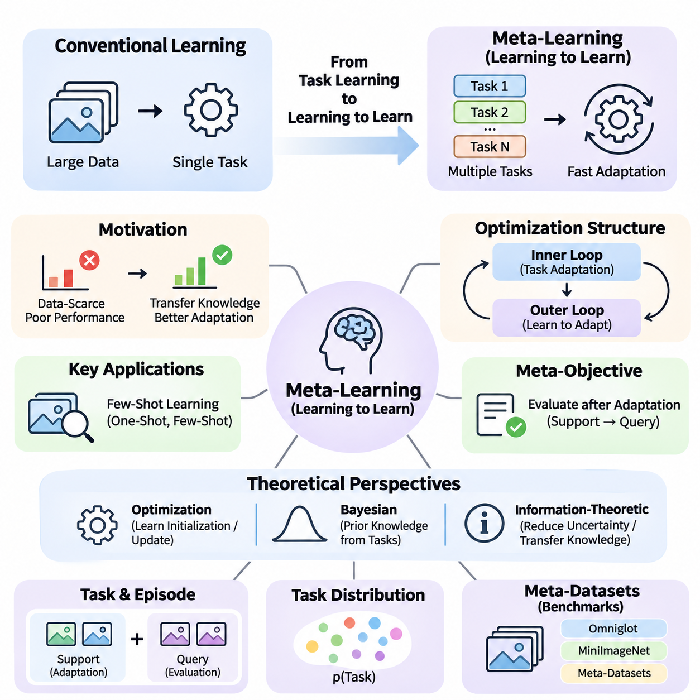
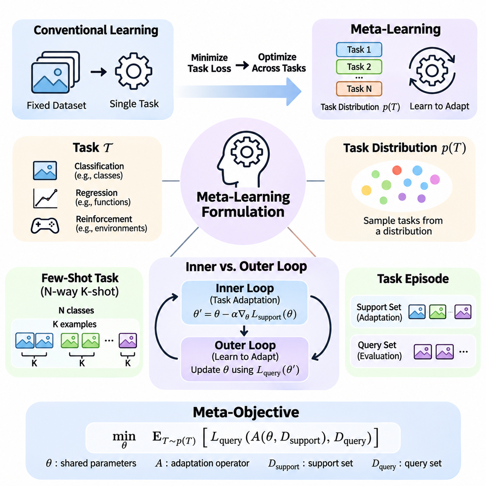
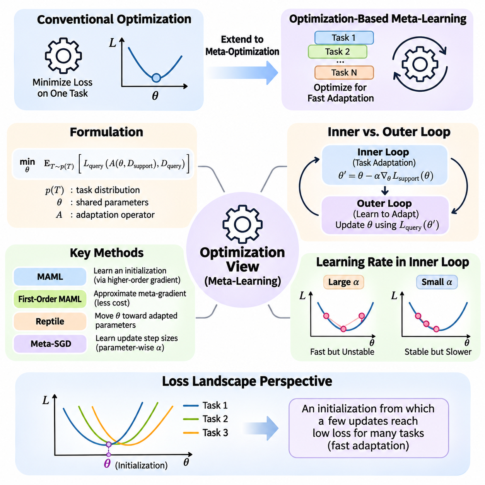
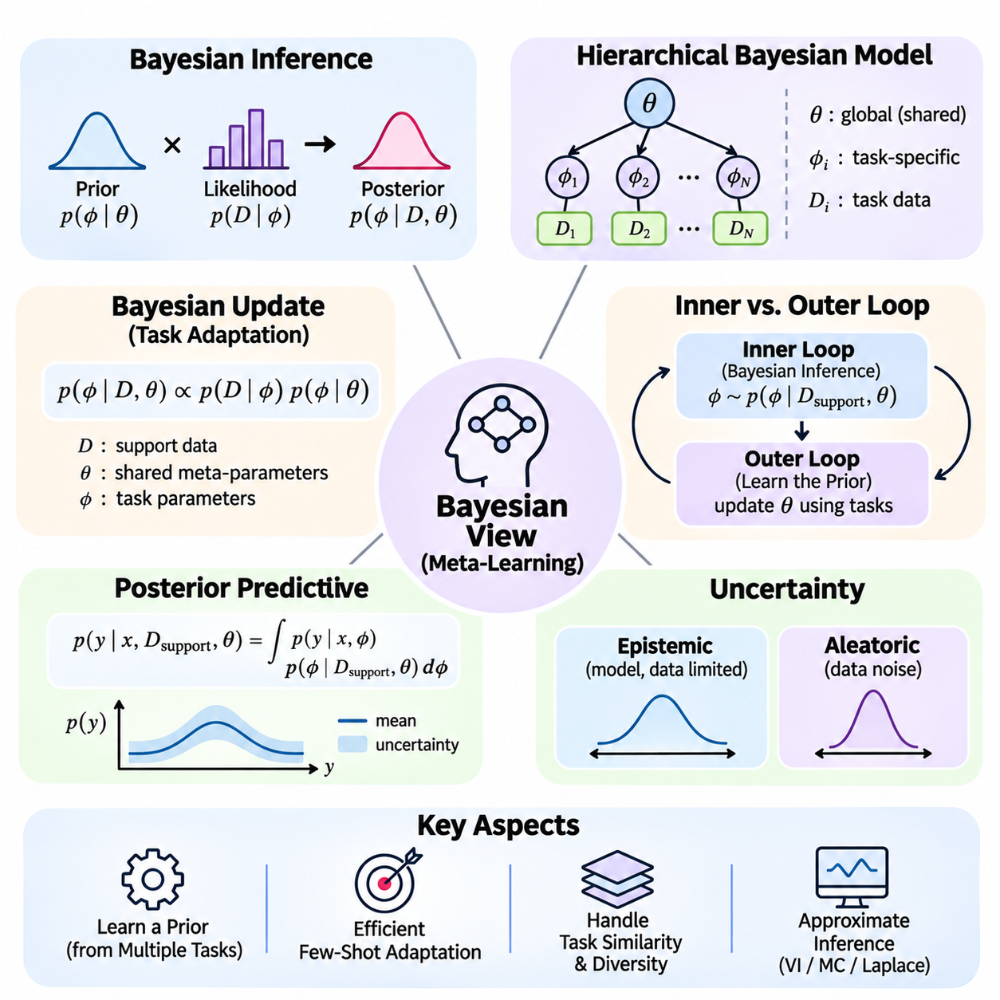
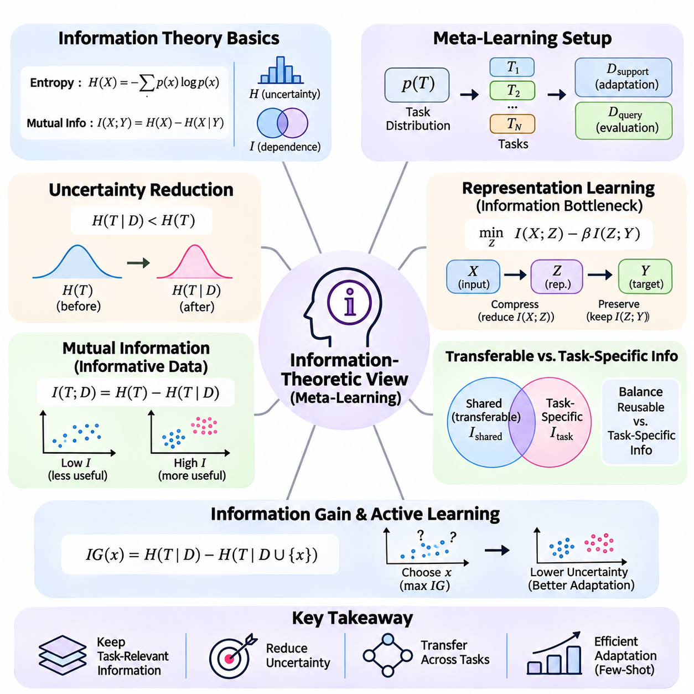
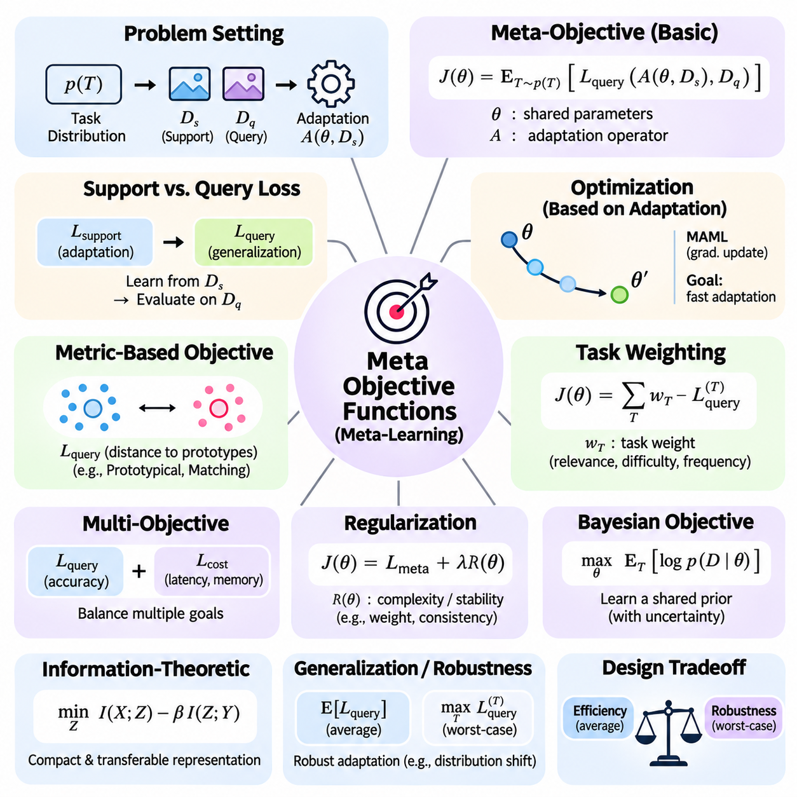
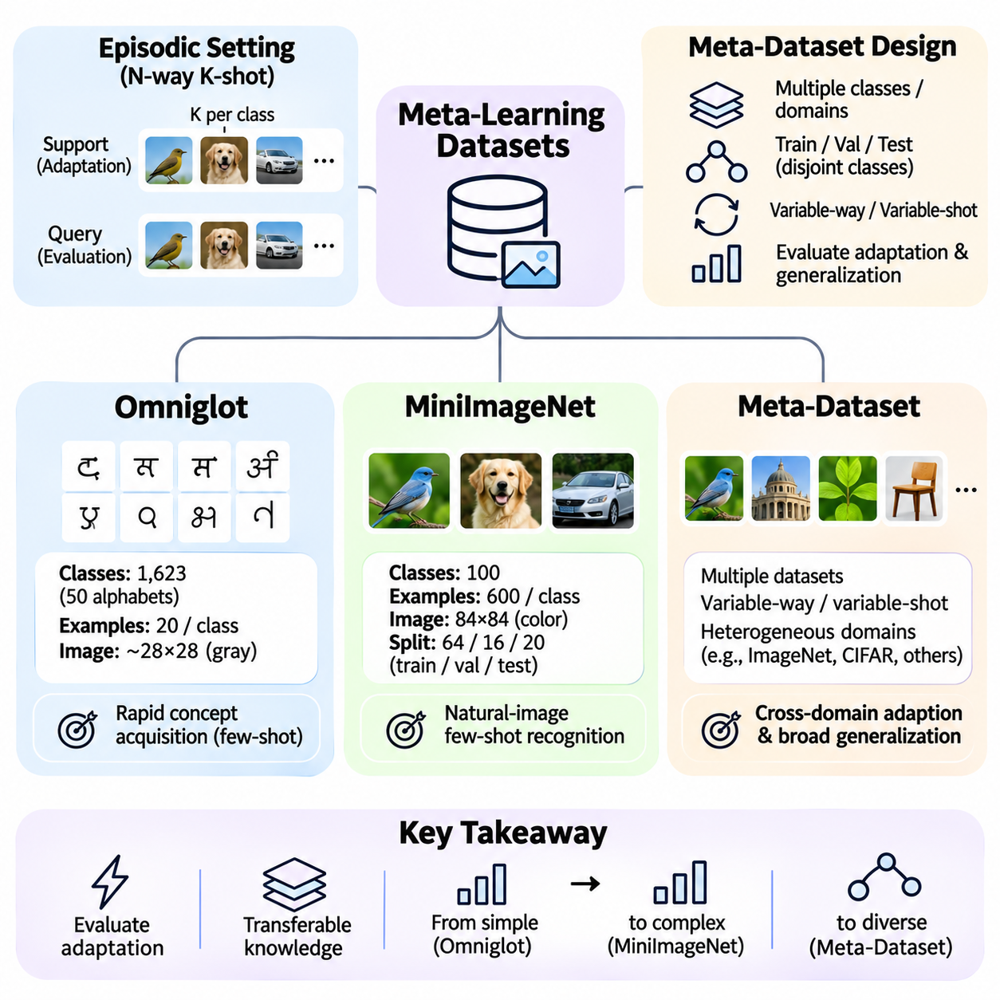
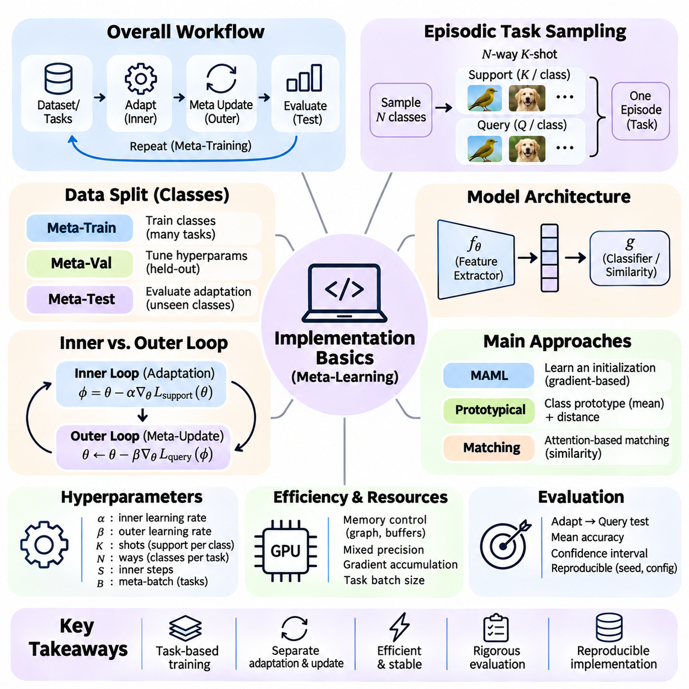

**Volume 36. Meta Learning and Few Shot Adaptation**

# 01. Learning to Learn

## 01.00 Overview

{width="7.268055555555556in" height="7.268055555555556in"}

Traditional machine learning typically focuses on optimizing a model for a particular task using a sufficiently large training dataset. Although this approach has achieved remarkable success, it often requires substantial computational resources and extensive labeled examples when encountering unfamiliar problems. Learning to learn introduces a different perspective by developing systems that improve their ability to acquire new knowledge through experience across multiple tasks.

Meta-learning, commonly described as learning to learn, aims to discover transferable learning mechanisms rather than merely memorizing solutions to individual problems. Instead of training a model exclusively for one prediction objective, meta-learning exposes it to a distribution of related tasks. Through repeated adaptation, the system learns representations, parameter initializations, or learning strategies that enable faster and more effective responses to previously unseen tasks.

The central motivation for meta-learning arises from the limitations of conventional supervised learning in data-scarce environments. A model trained on thousands of labeled examples may perform poorly when introduced to a new category represented by only a few observations. Meta-learning addresses this challenge by extracting common structures across previous learning experiences, allowing knowledge acquired from earlier tasks to guide adaptation to unfamiliar situations.

The distinction between ordinary learning and meta-learning lies primarily in the level at which optimization occurs. Conventional learning adjusts model parameters to minimize prediction errors within a particular task. Meta-learning additionally optimizes the learning process across tasks, seeking parameters or mechanisms that produce strong performance after limited adaptation. Consequently, the objective extends beyond immediate accuracy toward adaptability and learning efficiency.

A fundamental assumption in many meta-learning systems is that tasks are sampled from an underlying task distribution. Each task may involve different classes, environments, objectives, or data characteristics while sharing sufficient statistical structure with other tasks. By learning across this distribution, a model can identify reusable patterns that support rapid adaptation. Its effectiveness depends strongly on how closely future tasks relate to those encountered during meta-training.

Meta-learning commonly distinguishes between an inner learning process and an outer optimization process. The inner loop adapts a model to an individual task using a limited collection of examples. The outer loop evaluates the results of these adaptations and updates shared knowledge to improve future learning. This hierarchical arrangement enables the system to optimize not only task-specific performance but also the effectiveness of its adaptation procedure.

Few-shot learning represents one of the most important applications of meta-learning. In a few-shot setting, a model must recognize new categories or solve unfamiliar problems using only a small number of labeled examples. One-shot learning restricts this requirement to a single example per category. Rather than depending entirely on extensive task-specific training, successful systems exploit previously learned representations, similarities, and adaptation mechanisms.

Meta-learning can be understood through several complementary theoretical perspectives. The optimization perspective emphasizes learning parameter initializations or update procedures that facilitate rapid convergence. The Bayesian perspective interprets previous task experience as information about useful prior beliefs. The information-theoretic perspective investigates how transferable knowledge reduces uncertainty and improves adaptation under limited observations.

These perspectives provide different explanations for how knowledge can transfer between learning experiences. Optimization-based methods focus on efficient parameter adjustment, while probabilistic approaches model uncertainty about tasks and their underlying structures. Information-theoretic approaches examine the amount and relevance of knowledge retained across tasks. Together, these viewpoints establish a broader foundation for understanding adaptive intelligence.

The design of a meta-learning objective differs from conventional empirical risk minimization because performance must be evaluated after adaptation. A model may achieve excellent accuracy on previously observed tasks without learning an effective adaptation strategy. Meta-objectives therefore commonly measure performance on task-specific query examples after learning from limited support examples, encouraging representations and parameters that generalize to new learning situations.

Task construction plays a critical role in the development of effective meta-learning systems. Training examples are commonly organized into episodes that simulate the conditions expected during deployment. Each episode contains a support set used for adaptation and a query set used for evaluation. By repeatedly encountering different combinations of classes and examples, the model learns to operate under limited-data conditions rather than relying on conventional large-batch supervision alone.

The quality and diversity of meta-training tasks strongly influence generalization. If tasks are too similar, the model may learn shortcuts that perform well during training but fail under unfamiliar conditions. Conversely, tasks that are excessively heterogeneous may provide insufficient common structure for meaningful transfer. Effective meta-dataset design therefore requires a balance between task diversity, shared characteristics, and the intended deployment environment.

Benchmark datasets provide controlled environments for studying learning-to-learn capabilities. Omniglot contains handwritten characters from numerous alphabets and has historically supported few-shot character recognition experiments. MiniImageNet introduces more complex natural-image classification tasks, while Meta-Dataset emphasizes evaluation across multiple image datasets. These benchmarks help researchers investigate adaptation accuracy, robustness, and generalization under standardized episodic settings.

Learning-to-learn methods can be categorized according to the knowledge they transfer between tasks. Optimization-based approaches learn favorable initial parameters or adaptation rules. Metric-based approaches construct representation spaces in which unfamiliar examples can be classified through similarity comparisons. Model-based approaches use architectural mechanisms, memory, or task-conditioned computation to incorporate new information rapidly.

Optimization-based meta-learning includes Model-Agnostic Meta-Learning, which seeks model parameters that can adapt effectively through a small number of gradient updates. Related approaches simplify gradient calculations or modify adaptation procedures to improve computational efficiency. Their central principle is that a carefully learned initialization can make subsequent task-specific optimization more effective than beginning from arbitrary or conventionally pretrained parameters.

Metric-based meta-learning follows a different strategy by emphasizing relationships between observations. Siamese Networks, Matching Networks, and Prototypical Networks learn representations that support classification through distances or similarities. Instead of requiring extensive parameter updates for every new task, these methods can use support examples directly to construct decision rules, making them particularly attractive for rapid few-shot recognition.

Fast adaptation extends beyond classification into environments where tasks, objectives, or operating conditions change over time. Techniques such as fine-tuning, parameter sharing, meta-initialization, latent-space adaptation, and task conditioning provide different mechanisms for responding to these changes. Online adaptation and lifelong learning introduce additional requirements because knowledge must evolve continuously without unnecessarily disrupting previously acquired capabilities.

Meta-reinforcement learning applies learning-to-learn principles to sequential decision-making problems. An agent encounters multiple environments or tasks and learns how to adapt its behavior using limited interaction experience. Rather than optimizing a fixed policy for one environment, the system seeks transferable exploration and decision-making strategies. This approach is relevant to robotic control, adaptive systems, and interactive environments with changing dynamics.

The relationship between meta-learning and transfer learning requires careful consideration. Transfer learning generally reuses knowledge acquired from a source task or dataset, often through pretrained representations and fine-tuning. Meta-learning explicitly trains across tasks to improve subsequent adaptation. These approaches are not mutually exclusive, and practical systems may combine pretrained foundation models with meta-learning objectives to achieve stronger adaptation under limited data.

Generalization remains a central challenge because success on meta-training tasks does not guarantee reliable performance under distribution shifts. New environments may contain unfamiliar visual patterns, different causal relationships, or task structures absent from previous experience. Robust meta-learning therefore requires evaluation beyond familiar benchmark conditions, including domain generalization, out-of-distribution testing, and systematic analysis of adaptation failures.

Recent research directions connect meta-learning with large language models, multimodal learning, hypernetworks, and foundation model adaptation. These approaches investigate whether task-specific behavior can emerge through contextual information, learned parameter generation, or efficient modification of pretrained representations. However, not every form of in-context learning constitutes explicit meta-learning, and their underlying training objectives and adaptation mechanisms must be distinguished.

Engineering considerations become increasingly important when meta-learning moves from controlled experiments into operational systems. Task sampling, data pipelines, distributed training, adaptation latency, memory consumption, and reproducibility all affect practical feasibility. Edge AI applications introduce additional constraints because adaptation may need to occur with limited computational resources, restricted communication bandwidth, and strict real-time performance requirements.

Reliable evaluation must measure more than final predictive accuracy. Adaptation speed, sample efficiency, computational cost, uncertainty calibration, and performance across unseen tasks provide complementary indicators of learning capability. Experiments should also control task distributions, support-set sizes, random seeds, and evaluation protocols. Without these precautions, apparent improvements may reflect favorable task sampling or experimental inconsistencies rather than genuine learning-to-learn progress.

The broader significance of meta-learning lies in its attempt to make artificial intelligence less dependent on repeated large-scale training for every new problem. By learning reusable adaptation mechanisms, systems may become more flexible, data-efficient, and responsive to changing environments. Nevertheless, successful adaptation still depends on appropriate prior experience, reliable task identification, and the availability of sufficient information to distinguish among possible solutions.

Learning to learn ultimately establishes a framework in which previous experience shapes the efficiency of future learning. Its foundations connect task distributions, hierarchical optimization, probabilistic inference, information transfer, and few-shot evaluation into a unified research direction. Understanding these principles provides the conceptual basis for studying advanced meta-learning algorithms, rapid adaptation strategies, and their practical implementation in increasingly autonomous intelligent systems.

## 01.01 Meta Learning Formulation

{width="7.268055555555556in" height="7.268055555555556in"}

Meta-learning formulation establishes a mathematical framework for understanding how learning systems acquire transferable adaptation capabilities across multiple tasks. Unlike conventional machine learning, which minimizes prediction errors on a fixed dataset, meta-learning optimizes performance over a distribution of learning problems. Its central objective is to develop shared knowledge that enables rapid adaptation when a new task is encountered with limited training examples.

A task in meta-learning represents a self-contained learning problem characterized by its data distribution, prediction objective, and evaluation criteria. For supervised classification, a task may involve recognizing a particular subset of categories, while regression tasks may require estimating different underlying functions. In reinforcement learning, tasks can correspond to environments with varying dynamics, reward functions, or operational constraints.

The task distribution, commonly denoted as p(T), defines the probability of encountering different tasks within a learning environment. Rather than sampling individual observations from one fixed dataset, meta-learning samples complete tasks from this distribution. Each sampled task provides an opportunity to practice adaptation, allowing the system to identify learning principles that remain useful across related problems.

A formal meta-learning setting considers a collection of tasks T sampled from p(T), where each task contains a support dataset and a query dataset. The support dataset provides observations used to adapt the model, while the query dataset measures performance after adaptation. This separation is essential because successful meta-learning requires generalization beyond the examples directly used for task-specific parameter updates.

The task distribution determines which forms of knowledge can be transferred between learning problems. When tasks share underlying representations, causal structures, or statistical regularities, experience from one task can improve performance on another. However, when tasks differ substantially, previously acquired knowledge may provide little benefit or introduce negative transfer, reducing adaptation effectiveness in unfamiliar environments.

Task diversity is therefore an important consideration in meta-learning formulation. A narrow task distribution may encourage specialization and strong performance on closely related problems, whereas a broader distribution can expose the model to more varied learning conditions. The appropriate balance depends on deployment requirements, because excessive diversity may make it difficult to identify transferable patterns shared across tasks.

In few-shot classification, tasks are frequently organized using an N-way K-shot formulation. Here, N represents the number of categories within an episode, while K specifies the number of labeled support examples available for each category. A five-way one-shot task, for example, requires distinguishing five categories using one labeled example per category, followed by evaluation on separate query observations.

Episodic training approximates the expected conditions of future adaptation by repeatedly constructing small learning problems. Each episode samples task-specific classes, support observations, and query observations according to a defined sampling procedure. This organization encourages the model to learn transferable representations and adaptation strategies rather than relying exclusively on patterns associated with fixed training labels.

The mathematical objective of meta-learning can be expressed as minimizing expected query loss across tasks sampled from p(T). If theta represents shared model parameters and A denotes a task-specific adaptation operator, the objective becomes minimizing E[T \\\~ p(T)] L_query(A(theta, D_support), D_query). This formulation emphasizes that the quality of shared parameters must be evaluated through their effectiveness after adaptation.

The adaptation operator A describes how task-specific information modifies the model or its predictions. Depending on the algorithm, adaptation may involve gradient-based optimization, construction of class prototypes, Bayesian posterior inference, or modification of internal memory states. Consequently, the meta-learning framework accommodates different algorithmic families while preserving the common objective of effective learning from limited task-specific information.

The inner loop performs adaptation within an individual task. Starting from shared parameters theta, the model uses support observations to construct task-adapted parameters or representations. In gradient-based meta-learning, a typical update takes the form theta_prime = theta - alpha \\\* gradient_theta L_support(theta), where alpha denotes the inner-loop learning rate and L_support measures task-specific training error.

Multiple inner-loop updates may be performed when additional adaptation is necessary. The number of updates, learning rate, support-set size, and optimization method collectively determine adaptation behavior. A small number of updates encourages rapid learning, while excessive adaptation can increase computational cost or cause overfitting to limited support examples, particularly when observations contain noise.

The outer loop operates across multiple tasks and evaluates whether the shared learning mechanism supports successful adaptation. After each task undergoes inner-loop learning, the adapted model is evaluated on its query dataset. The resulting query losses are aggregated across a batch of tasks, and shared parameters are updated to improve expected performance on future tasks sampled from the same distribution.

In gradient-based formulations such as Model-Agnostic Meta-Learning, the outer update differentiates query losses through the inner adaptation procedure. This process may involve higher-order derivatives because adapted parameters depend on the original initialization. First-order approximations reduce computational complexity by omitting selected derivative terms, although they may alter the optimization trajectory and final performance.

The distinction between inner and outer loops is fundamental because the two processes optimize different objectives at different levels. The inner loop seeks effective solutions for individual tasks using limited observations. The outer loop seeks shared parameters or learning mechanisms that make those individual solutions easier to obtain. Their interaction transforms repeated task experience into improved adaptation capability.

Support and query datasets must remain appropriately separated to prevent information leakage during evaluation. If query labels influence task adaptation, the measured performance may no longer represent genuine generalization from limited support information. Reliable experimental protocols therefore preserve the intended information boundaries between adaptation and evaluation while ensuring that task sampling remains consistent with the stated learning objective.

Meta-training, meta-validation, and meta-testing introduce an additional level of separation. Meta-training tasks are used to optimize shared learning mechanisms, while meta-validation tasks support model selection and hyperparameter tuning. Meta-testing tasks evaluate adaptation to previously unseen problems. In classification benchmarks, disjoint category sets are often used to test whether the model can learn unfamiliar classes rather than recognize previously trained categories.

The relationship between task distributions during training and deployment directly affects generalization. When meta-test tasks follow a distribution similar to meta-training tasks, learned adaptation strategies may transfer effectively. Under substantial distribution shifts, however, the learned initialization, representation, or adaptation rule may become less suitable, requiring additional robustness mechanisms or broader training experience.

From a Bayesian perspective, shared meta-knowledge can be interpreted as prior information about likely task structures. The support dataset updates this prior into task-specific beliefs, while query observations assess the quality of resulting predictions. This interpretation connects hierarchical probabilistic modeling with the inner-versus-outer learning structure and provides a framework for representing uncertainty during adaptation.

From an optimization perspective, meta-learning seeks parameter configurations that occupy regions of the model space favorable for adaptation across tasks. A useful initialization need not minimize training loss for every task before adaptation. Instead, it should enable a small number of updates to reach solutions with strong query performance, thereby prioritizing learning efficiency over immediate task-specific optimality.

The formulation also supports non-gradient adaptation mechanisms. Metric-based methods may construct prototypes or similarity-based decision rules directly from support embeddings, while recurrent or memory-based systems may encode task information within hidden states. In these cases, the inner loop represents task conditioning rather than conventional parameter optimization, but the outer objective still rewards effective performance on unseen query examples.

Practical implementation requires careful coordination of task sampling, computational graphs, gradient accumulation, and parameter updates. Inner-loop computations may be expensive when multiple tasks and adaptation steps are processed simultaneously. Engineering choices such as vectorized execution, first-order approximations, memory-efficient differentiation, and distributed task processing can substantially influence scalability and reproducibility.

Ultimately, meta-learning formulation connects task distributions with hierarchical adaptation and optimization. The task distribution defines the family of problems from which transferable knowledge is acquired, while the inner loop converts that knowledge into task-specific behavior. The outer loop improves the shared learning mechanism through repeated evaluation, establishing the foundation for optimization-based, metric-based, Bayesian, and reinforcement-based meta-learning systems.

## 01.02 Optimization View

{width="7.268055555555556in" height="7.268055555555556in"}

The optimization perspective of meta-learning interprets learning to learn as the process of discovering parameters, update rules, or optimization strategies that enable efficient adaptation across tasks. Unlike conventional optimization, which minimizes a loss function for a single problem, meta-optimization seeks configurations that perform well after limited task-specific learning. The primary objective is not immediate optimality but the ability to reach effective solutions rapidly.

In conventional machine learning, optimization typically adjusts model parameters through gradient descent to minimize empirical loss. The resulting parameters are specialized for the training distribution and may require substantial retraining when conditions change. Meta-learning extends this framework by optimizing how parameters respond to new information, allowing the learning process itself to become an object of optimization.

The mathematical foundation of optimization-based meta-learning involves a distribution of tasks p(T), shared parameters theta, and an adaptation operator A. For each sampled task, the operator transforms the shared parameters into task-specific parameters using support data. The outer objective minimizes the expected query loss after adaptation, commonly expressed as E[T \\\~ p(T)] L_query(A(theta, D_support), D_query).

This formulation creates a hierarchical optimization problem in which two interconnected processes operate at different levels. The inner optimization process adapts the model to a particular task, while the outer optimization process improves the shared initialization or learning strategy. Their interaction allows experience accumulated across tasks to influence the speed, stability, and effectiveness of future adaptation.

The inner optimization loop typically begins with shared parameters and performs one or more gradient updates using task-specific support examples. A standard update can be written as theta_prime = theta - alpha \\\* gradient_theta L_support(theta), where alpha represents the adaptation learning rate. Repeated updates generate task-adapted parameters that are subsequently evaluated on query examples not used during adaptation.

The outer optimization loop evaluates how effectively the adapted parameters generalize to query observations across multiple tasks. Query losses are aggregated to construct a meta-objective, and the original shared parameters are updated accordingly. This process encourages parameter configurations that may not be optimal before adaptation but become highly effective after a small number of learning steps.

Model-Agnostic Meta-Learning, commonly known as MAML, provides a representative example of this optimization perspective. MAML learns a parameter initialization that can be adapted to different tasks through a few gradient steps. Because the method operates through gradient-based updates, it can be applied to various differentiable models and learning problems, including classification, regression, and reinforcement learning.

A distinctive feature of MAML is that the outer optimization differentiates through the inner adaptation process. Since task-adapted parameters depend on the initial parameters, calculating the exact meta-gradient generally involves second-order derivative information. This dependency allows the optimization process to account for how changes in initialization influence subsequent learning behavior rather than only immediate prediction performance.

The computational cost of higher-order differentiation motivates simplified approaches such as First-Order MAML. These methods approximate meta-gradients by ignoring selected second-order terms, reducing memory requirements and computational overhead. Although the approximation may change optimization dynamics, it often provides a practical alternative when large neural networks or numerous adaptation tasks make exact differentiation expensive.

Reptile offers another optimization-based approach that avoids explicitly differentiating through the complete inner learning trajectory. It repeatedly samples tasks, performs task-specific optimization, and moves the shared initialization toward the resulting adapted parameters. This strategy encourages an initialization that supports effective learning across tasks while maintaining a comparatively simple optimization procedure.

The geometry of the loss landscape provides an intuitive explanation for optimization-based meta-learning. Different tasks correspond to different loss surfaces, each containing regions associated with favorable solutions. Meta-optimization seeks an initialization from which a small number of updates can reach low-loss regions for many tasks, rather than finding a single parameter configuration that simultaneously minimizes every task loss.

This geometric interpretation highlights the distinction between joint training and meta-learning. Joint training minimizes average loss across tasks using shared parameters, while optimization-based meta-learning evaluates performance after task-specific adaptation. Consequently, a parameter configuration with moderate initial performance may be preferable if it enables rapid improvement across diverse tasks through limited optimization steps.

The choice of inner-loop learning rate strongly influences adaptation behavior. Large learning rates can accelerate movement toward task-specific solutions but may produce instability or overshooting. Small learning rates offer more conservative updates but may require additional steps. Meta-learning systems must therefore balance adaptation speed, numerical stability, and generalization when selecting or learning optimization hyperparameters.

Some approaches extend the optimization perspective by learning the adaptation mechanism itself. Meta-SGD, for example, learns parameter-specific update rates alongside model initialization, allowing different parameters to adapt at different speeds and directions. More general learned optimizers can use neural networks to generate update rules, potentially capturing optimization behaviors beyond conventional gradient descent.

Optimization-based meta-learning also introduces challenges related to gradient alignment across tasks. When task gradients point in compatible directions, shared updates may improve adaptation for multiple problems. Conflicting gradients can produce interference, reducing the effectiveness of a common initialization. Task sampling, gradient aggregation, and regularization strategies influence how the meta-optimizer balances competing adaptation requirements.

The number of inner-loop steps determines the adaptation horizon considered during meta-training. Training with very few steps emphasizes immediate adaptability, whereas longer adaptation trajectories allow more extensive task-specific optimization. However, increasing the adaptation horizon raises computational cost and may complicate gradient propagation, particularly when higher-order derivatives are retained throughout the optimization process.

Generalization in optimization-based meta-learning depends on whether the learned initialization remains useful for unseen tasks. Strong performance on meta-training episodes does not guarantee effective adaptation under distribution shifts. Robust evaluation therefore requires separate meta-training, meta-validation, and meta-testing tasks, together with careful control of support-set sizes, adaptation steps, and task sampling procedures.

The optimization perspective is particularly relevant to applications where models must adapt quickly with limited observations. In robotics, a controller may need to adjust to changing dynamics or operating conditions. In computer vision, a classifier may encounter unfamiliar categories with few labeled examples. In personalized systems, adaptation may involve learning individual preferences without retraining an entire model from scratch.

Practical deployment requires consideration of adaptation latency, memory consumption, and computational efficiency. Exact higher-order meta-gradients can be expensive during training, while repeated inner-loop updates may introduce delays during inference. First-order approximations, parameter-efficient adaptation, and selective updating of model components can reduce these costs while preserving useful learning capabilities.

Optimization-based meta-learning must also address overfitting during rapid adaptation. Because support datasets are often small, aggressive parameter updates may memorize task-specific observations rather than capture transferable patterns. Regularization, early stopping, constrained adaptation, and appropriate meta-training task diversity can help maintain generalization while allowing the model to respond efficiently to new information.

Ultimately, the optimization view establishes meta-learning as a framework for improving the process of parameter adaptation rather than merely optimizing static predictions. By coordinating inner-loop task learning with outer-loop meta-optimization, systems acquire initializations and update strategies that support efficient learning across related problems. This foundation motivates advanced algorithms for fast adaptation, learned optimization, and scalable intelligent systems.

## 01.03 Bayesian View

{width="7.268055555555556in" height="7.268055555555556in"}

The Bayesian perspective of meta-learning interprets learning to learn as the acquisition of prior knowledge that supports efficient inference across related tasks. Instead of treating model parameters as fixed quantities to be optimized independently for every problem, Bayesian meta-learning represents uncertainty about task-specific parameters and underlying structures. Previous learning experiences shape probabilistic beliefs that can be updated when limited observations from a new task become available.

Bayesian inference provides a natural foundation for understanding how knowledge transfers between tasks. A prior distribution represents beliefs about possible model parameters before observing task-specific data, while a likelihood function describes how observations arise under those parameters. Bayes\' rule combines these components to produce a posterior distribution, allowing the learning system to revise its beliefs as new evidence becomes available.

In a meta-learning environment, tasks are sampled from a distribution p(T), and each task contains a support dataset and a query dataset. The Bayesian formulation assumes that task-specific parameters are related through shared probabilistic structure. Rather than learning completely independent models, the system estimates a common prior or hierarchical distribution that captures regularities across previously observed tasks.

A hierarchical Bayesian model introduces global variables that describe shared knowledge and local variables that characterize individual tasks. Global parameters may control the mean, variance, or structure of task-specific parameter distributions. Local parameters are inferred from each task\'s support observations. This hierarchical organization provides a mathematical explanation for how information accumulated across tasks can influence learning within a new task.

The central Bayesian update can be expressed as p(phi \| D, theta) proportional to p(D \| phi) p(phi \| theta), where phi denotes task-specific parameters, theta represents shared meta-parameters, and D contains task observations. The prior p(phi \| theta) encodes knowledge acquired across tasks, while the likelihood p(D \| phi) measures compatibility with observed data. Their combination produces a task-adapted posterior distribution.

The distinction between prior and posterior knowledge is particularly important in few-shot learning. When only a few labeled examples are available, the likelihood provides limited information about the underlying task. A well-calibrated prior can therefore stabilize inference and reduce the number of observations required for useful predictions. As additional data becomes available, the posterior increasingly reflects task-specific evidence rather than prior assumptions.

Bayesian meta-learning can be formulated as learning shared hyperparameters that maximize the marginal likelihood of observations across tasks. This process is often called empirical Bayes or hierarchical Bayesian estimation, depending on how uncertainty over global parameters is treated. The resulting prior is not manually specified in isolation but is informed by statistical patterns extracted from a population of related learning problems.

The inner adaptation process corresponds to Bayesian posterior inference for an individual task. Given support observations, the learner updates its beliefs about task-specific parameters while preserving uncertainty where evidence remains insufficient. The outer learning process improves the shared prior or hyperparameters using information from multiple tasks, creating a probabilistic counterpart to the inner-loop and outer-loop structure of optimization-based meta-learning.

Posterior predictive inference connects Bayesian adaptation directly to task performance. Instead of generating predictions from a single estimated parameter vector, the model integrates predictions over plausible task-specific parameters. Formally, p(y \| x, D_support, theta) equals the integral of p(y \| x, phi) p(phi \| D_support, theta) over phi. This integration accounts for uncertainty in the adapted model and can improve predictive reliability.

Uncertainty representation is a major advantage of the Bayesian perspective. Epistemic uncertainty reflects limited knowledge about model parameters and can decrease as informative observations accumulate. Aleatoric uncertainty arises from inherent randomness or ambiguity in the data-generating process. Distinguishing these sources helps determine whether additional task-specific observations are likely to improve predictions or whether uncertainty is fundamentally irreducible.

The quality of a learned prior strongly influences adaptation behavior. A prior that is excessively concentrated may prevent the model from responding adequately to unfamiliar tasks, while an overly diffuse prior may provide insufficient guidance when data is scarce. Effective Bayesian meta-learning must balance prior informativeness with flexibility, ensuring that shared knowledge accelerates adaptation without overwhelming new evidence.

Task similarity determines how effectively hierarchical Bayesian knowledge can be transferred. When tasks share latent structure, a common prior can summarize meaningful regularities and improve posterior inference. However, substantial distribution shifts may invalidate prior assumptions and lead to misleading confidence. Mixture priors, task-dependent priors, and hierarchical latent-variable models provide possible mechanisms for representing heterogeneous task families.

Exact Bayesian inference is often computationally intractable for complex neural networks. The posterior distribution may involve high-dimensional parameter spaces and integrals that cannot be evaluated analytically. Approximate inference methods, including variational inference, Monte Carlo sampling, and Laplace approximations, are therefore used to estimate posterior beliefs while managing computational requirements.

Variational Bayesian meta-learning approximates an intractable posterior with a parameterized distribution that can be optimized efficiently. The approximation is commonly trained by maximizing an evidence lower bound, which balances data likelihood against divergence from a prior distribution. Across tasks, shared variational components can capture transferable probabilistic structure, while task-specific inference adapts the approximation to new observations.

Amortized inference offers another approach to efficient Bayesian adaptation. Instead of performing extensive iterative optimization for every new task, an inference network learns to map support observations directly into parameters of an approximate posterior distribution. This mechanism reduces adaptation latency and is particularly useful when many tasks must be processed rapidly, although inference quality depends on the diversity of tasks encountered during meta-training.

Bayesian meta-learning is closely related to probabilistic interpretations of gradient-based adaptation. A learned initialization can sometimes be viewed as the center of a prior distribution, while regularized task-specific optimization resembles maximum a posteriori estimation. However, point-estimate adaptation does not generally preserve the full posterior uncertainty, so optimization-based methods and Bayesian inference should not be treated as mathematically identical.

In few-shot classification, Bayesian approaches can represent uncertainty over class prototypes, feature representations, or classifier parameters. Support examples update beliefs about unfamiliar categories, while posterior predictive distributions determine query classifications. This framework is particularly valuable when classes overlap, examples are noisy, or incorrect predictions carry significant consequences.

Bayesian principles also extend to meta-reinforcement learning, where agents must infer hidden task characteristics from sequential interaction. A belief distribution over environment dynamics, reward functions, or latent task identities can guide exploration and decision-making. As observations accumulate, the agent updates its task beliefs and adjusts its policy, connecting probabilistic inference with adaptive control under uncertainty.

Practical deployment introduces challenges involving posterior approximation, calibration, memory consumption, and computational latency. Maintaining probability distributions over large model parameter spaces may be expensive, especially in resource-constrained systems. Structured approximations, low-dimensional latent variables, and selective uncertainty modeling can reduce these costs while retaining important benefits of probabilistic adaptation.

Reliable evaluation must examine both predictive performance and uncertainty quality. Accuracy alone cannot determine whether a Bayesian meta-learner assigns appropriate confidence to unfamiliar tasks. Calibration error, negative log-likelihood, predictive coverage, and performance under distribution shifts provide complementary evidence. Evaluation should also distinguish uncertainty arising from limited support data from failures caused by incorrect prior assumptions.

Ultimately, the Bayesian view establishes meta-learning as a process of acquiring transferable probabilistic knowledge and updating it through task-specific evidence. Shared priors encode regularities across learning problems, posterior inference supports rapid adaptation, and predictive distributions express remaining uncertainty. This perspective provides a principled foundation for few-shot learning, probabilistic adaptation, uncertainty-aware decision-making, and robust intelligent systems.

## 01.04 Information Theoretic View

{width="7.268055555555556in" height="7.268055555555556in"}

The information-theoretic perspective of meta-learning examines how knowledge acquired across tasks reduces uncertainty and improves adaptation to unfamiliar problems. Rather than focusing exclusively on parameter optimization or probabilistic inference, this perspective investigates the amount, relevance, and transferability of information contained in learning experiences. Its central objective is to identify information that enables efficient generalization from limited task-specific observations.

Information theory provides mathematical tools for quantifying uncertainty, dependence, and information transfer. Entropy measures uncertainty associated with a random variable, while mutual information measures the statistical dependence between two variables. In meta-learning, these concepts help explain how task observations reveal underlying structures and how shared representations preserve knowledge that remains useful across different learning problems.

A meta-learning environment can be described through a task distribution p(T), task-specific datasets, and a shared representation or learning mechanism. Each task provides observations containing both transferable information and task-specific variation. The learner must identify which aspects of these observations should be retained across tasks and which should be inferred separately during adaptation to a new problem.

Entropy offers a useful interpretation of uncertainty before and after observing task-specific evidence. If T represents an unknown task identity and D denotes support observations, the conditional entropy H(T \| D) describes the remaining uncertainty about the task after observing D. Effective adaptation reduces uncertainty about relevant task characteristics, although complete identification of the task is not always necessary for accurate predictions.

Mutual information provides a quantitative measure of how much one variable reveals about another. The relationship I(T; D) = H(T) - H(T \| D) describes the reduction in uncertainty about task identity obtained from support observations. In practical meta-learning, this quantity helps characterize the informativeness of limited examples and motivates learning strategies that extract useful task information efficiently.

The information-theoretic view distinguishes transferable knowledge from information that is specific to individual tasks. Shared knowledge captures regularities that remain stable across the task distribution, while task-specific information explains variations encountered during adaptation. An effective meta-learner balances these components, preserving reusable structure without suppressing distinctions necessary for solving unfamiliar problems.

Representation learning plays a central role in this balance. A representation should retain information relevant to prediction while discarding unnecessary details that encourage overfitting or poor transfer. Information-theoretic objectives can encourage compact representations that preserve task-relevant structure. However, excessive compression may remove features needed for adaptation, making the tradeoff between information retention and compression essential.

The information bottleneck principle formalizes this tradeoff by seeking representations that compress observations while preserving predictive information. In a simplified formulation, an objective may minimize I(X; Z) - beta I(Z; Y), where X denotes observations, Z represents learned features, Y denotes prediction targets, and beta controls the balance. Meta-learning extends this reasoning by considering information useful across tasks and information required for task-specific adaptation.

Task-conditioned representations provide a mechanism for adapting information processing to different learning problems. Instead of learning one fixed representation for every task, a model can use support observations to infer a task embedding that modifies subsequent predictions. Information-theoretic analysis examines whether this embedding captures relevant task characteristics while avoiding unnecessary dependence on individual training examples.

The relationship between meta-training and meta-testing can also be understood through information transfer. Meta-training extracts statistical regularities from a population of tasks, while meta-testing evaluates whether these regularities reduce the information required to solve new problems. Successful transfer occurs when previously acquired knowledge lowers the uncertainty that must be resolved through limited support observations.

Sample efficiency is closely related to the information content of training examples. Two support datasets containing the same number of observations may provide different amounts of useful information about a task. Examples that reveal decision boundaries, underlying dynamics, or distinctive class characteristics can support faster adaptation than redundant observations. Consequently, the number of examples alone does not fully determine learning difficulty.

Active learning and experimental design extend this perspective by selecting observations that maximize expected information gain. An adaptive learner may choose queries or interactions that reduce uncertainty about task-relevant variables. In sequential environments, this principle can guide exploration toward observations that distinguish competing task hypotheses, improving adaptation while reducing unnecessary data collection.

The information gain associated with an observation can be measured through the difference between prior and posterior uncertainty. In probabilistic models, this reduction may be expressed using entropy differences or the Kullback-Leibler divergence between posterior and prior distributions. Such measures help quantify how strongly new evidence changes the learner\'s beliefs and whether additional observations are likely to improve task performance.

Information-theoretic regularization offers another mechanism for improving meta-learning generalization. By constraining the information that model parameters or representations retain about particular training examples, a learner may reduce memorization and encourage transferable patterns. These constraints must be chosen carefully because overly restrictive information budgets can prevent the model from capturing meaningful task-specific structure.

Generalization bounds based on mutual information connect information theory with statistical learning guarantees. Such analyses investigate relationships between the information a learning algorithm extracts from training data and its expected generalization error. Under suitable assumptions, controlling information dependence can help characterize overfitting, although practical guarantees depend on the learning setting and the validity of the underlying mathematical conditions.

The information-theoretic perspective also clarifies why task diversity matters. If meta-training tasks contain only narrow variations, the learner may acquire representations that encode incidental correlations rather than broadly useful structure. Diverse tasks can reveal which characteristics remain stable across environments, but excessive heterogeneity may reduce the amount of shared information available for transfer.

In meta-reinforcement learning, information acquisition becomes part of sequential decision-making. An agent must balance actions that produce immediate rewards with actions that reveal unknown task characteristics. Information-theoretic exploration objectives can reward observations that reduce uncertainty about environment dynamics, reward functions, or latent task identities, supporting faster adaptation to changing conditions.

Information theory also provides tools for analyzing distribution shifts. When new tasks differ from the meta-training distribution, previously learned representations may preserve information that is no longer predictive. Measures of distributional divergence can help characterize these differences, although a large divergence does not automatically imply poor performance. Robust adaptation requires identifying which information remains relevant under changed conditions.

Practical information-theoretic meta-learning faces challenges because entropy and mutual information are difficult to estimate accurately in high-dimensional neural representations. Variational bounds, contrastive objectives, density estimators, and probabilistic approximations provide computational alternatives. However, estimation bias, numerical instability, and sensitivity to model assumptions can influence the reliability of these methods.

Evaluation should therefore consider both predictive performance and the effectiveness of information utilization. Relevant measures include adaptation accuracy, sample efficiency, uncertainty reduction, representation robustness, and performance under task distribution shifts. Ablation studies can help determine whether information-theoretic constraints genuinely improve transferable learning or merely alter optimization behavior without providing consistent benefits.

Ultimately, the information-theoretic view interprets meta-learning as the acquisition, compression, and transfer of knowledge that reduces the difficulty of future learning problems. Shared representations preserve reusable information, task observations resolve remaining uncertainty, and adaptation mechanisms combine both sources to support effective predictions. This perspective provides a foundation for information-efficient learning, active adaptation, uncertainty-aware exploration, and generalization across diverse tasks.

## 01.05 Meta Objective Functions

{width="7.268055555555556in" height="7.268055555555556in"}

Meta-objective functions define what a meta-learning system should optimize across a distribution of tasks. Unlike conventional loss functions that measure performance on a fixed training dataset, meta-objectives evaluate how effectively a model learns from limited task-specific information. Their purpose is to transform experience across related problems into shared parameters, representations, or adaptation mechanisms that improve future learning.

A meta-learning objective typically involves tasks sampled from a distribution p(T), an adaptation operator A, and shared parameters theta. Each task provides a support dataset for adaptation and a query dataset for evaluation. The objective can be written as J(theta) = E[T \\\~ p(T)] L_query(A(theta, D_support), D_query), expressing the expected prediction loss after task-specific adaptation.

The distinction between support loss and query loss is fundamental to meta-objective design. Support loss guides the adaptation process within an individual task, while query loss measures whether the adapted model generalizes beyond its adaptation examples. Minimizing support loss alone may encourage memorization, whereas optimizing post-adaptation query performance promotes learning mechanisms that transfer across tasks.

In optimization-based meta-learning, the meta-objective evaluates the consequences of parameter updates performed during adaptation. Model-Agnostic Meta-Learning uses query losses computed after one or more gradient steps to improve the shared initialization. This objective encourages parameters that can move rapidly toward effective task-specific solutions rather than parameters that simply minimize average training loss before adaptation.

Meta-objectives are not restricted to gradient-based adaptation. Metric-based methods optimize representations that support reliable similarity comparisons between support and query examples. Prototypical approaches may minimize query classification loss using distances to class prototypes, while matching-based methods use attention-weighted relationships. The common principle is that task-level performance determines the quality of shared knowledge.

The expectation over tasks is usually approximated using a finite meta-batch containing multiple sampled episodes. For each episode, the learner performs adaptation, computes query loss, and contributes to the overall objective. The meta-batch size influences gradient variance, computational cost, and training stability. Representative task sampling is therefore essential for obtaining useful estimates of expected adaptation performance.

Task weighting modifies the meta-objective when different learning problems have unequal importance. A weighted formulation assigns larger contributions to selected tasks based on relevance, difficulty, frequency, or operational priorities. However, excessive weighting can reduce performance on underrepresented tasks. Effective weighting strategies must balance specialization with broad adaptation capability across the intended task distribution.

Multi-objective meta-learning extends the basic formulation by combining prediction accuracy with additional requirements. A composite objective may include adaptation latency, computational cost, robustness, calibration, or memory consumption. Weighting coefficients determine the relative importance of these terms. Such formulations are particularly relevant when rapid adaptation must operate within strict resource or reliability constraints.

Regularization terms can improve meta-learning by discouraging overly complex or unstable adaptation behavior. Parameter penalties, representation constraints, and consistency objectives may reduce overfitting to meta-training tasks. Regularization can also restrict excessive movement from shared parameters during adaptation. Its effectiveness depends on whether the imposed constraints preserve the flexibility required for unfamiliar tasks.

Bayesian meta-objectives provide a probabilistic interpretation of transferable learning. Shared priors are learned across tasks, while support observations produce task-specific posterior distributions. Objectives may maximize predictive likelihood or an evidence lower bound while controlling divergence between posterior and prior beliefs. This approach incorporates uncertainty into the optimization criterion rather than relying exclusively on point predictions.

Information-theoretic meta-objectives examine how representations preserve useful knowledge while limiting unnecessary dependence on training observations. Information bottleneck formulations may penalize excessive information retention while rewarding predictive relevance. In meta-learning, these objectives can encourage compact transferable representations, although excessive compression may eliminate task-specific information needed for successful adaptation.

Generalization-oriented objectives seek to improve performance on tasks that differ from those encountered during meta-training. Instead of optimizing only average performance, robust formulations may emphasize difficult tasks, worst-case losses, or distributional uncertainty. Distributionally robust meta-learning attempts to maintain adaptation quality under plausible shifts, although stronger robustness requirements can reduce average performance on familiar tasks.

The relationship between average-case and worst-case optimization introduces an important design tradeoff. Expected-risk objectives prioritize performance across frequently sampled tasks, while worst-case objectives emphasize difficult or poorly performing tasks. A risk-sensitive formulation may combine average query loss with a penalty for high-loss episodes. The appropriate choice depends on whether overall efficiency or protection against severe adaptation failures is more important.

Meta-objectives can also optimize the learning process itself rather than only the final adapted model. Learned optimizers may be trained to generate update directions, learning rates, or parameter transformations that improve future query performance. Such objectives treat adaptation rules as trainable components, allowing the system to discover learning behaviors that differ from conventional fixed optimization algorithms.

The adaptation horizon affects how meta-objectives evaluate learning efficiency. When query loss is measured after only one update, the objective emphasizes immediate adaptation. Evaluating after multiple steps rewards longer learning trajectories and may produce different parameter initializations. Some formulations evaluate intermediate states as well as final performance, encouraging stable improvement throughout the adaptation process.

In meta-reinforcement learning, objective functions must account for sequential interaction and cumulative rewards. A meta-policy may be optimized for expected return across tasks after limited exploration or adaptation. The objective can incorporate information gathering, exploration costs, and task identification. This creates a connection between learning efficiency and decision-making, because actions influence both immediate rewards and future knowledge.

Practical meta-objective design must address the computational expense of nested optimization. Differentiating through multiple adaptation steps can require substantial memory and higher-order derivatives. First-order approximations, implicit differentiation, and truncated optimization trajectories offer alternative approaches. These methods reduce computational requirements but may introduce approximation errors or alter the optimization behavior.

Objective scaling and numerical stability are additional implementation concerns. Different tasks may produce losses with substantially different magnitudes, causing certain episodes to dominate meta-gradient updates. Loss normalization, gradient clipping, adaptive optimization, and carefully selected learning rates can improve stability. Nevertheless, normalization must preserve meaningful differences between tasks when those differences reflect genuine deployment priorities.

Evaluation metrics should remain distinct from the training objective, even when they measure related properties. A system optimized for average query accuracy may still exhibit poor uncertainty calibration, excessive adaptation cost, or unstable performance on rare tasks. Comprehensive evaluation therefore includes adaptation accuracy, sample efficiency, computational requirements, robustness, and variability across independently sampled tasks.

Ultimately, meta-objective functions determine which adaptation capabilities a learning system acquires. By evaluating performance after task-specific learning, they connect shared knowledge with future generalization. Their design governs the balance among accuracy, efficiency, uncertainty, and robustness, providing the optimization foundation for diverse meta-learning algorithms and practical systems that must learn effectively from limited experience.

## 01.06 Meta Datasets

{width="7.268055555555556in" height="7.268055555555556in"}

Meta-learning datasets provide the experimental foundation for evaluating how effectively models acquire transferable knowledge and adapt to unfamiliar tasks. Unlike conventional datasets organized around fixed training and testing categories, meta-learning benchmarks support episodic evaluation across related learning problems. Their design determines which adaptation capabilities can be measured and how reliably experimental results reflect generalization.

A meta-dataset typically contains multiple classes, domains, or task families from which learning episodes are constructed. Each episode includes a support set for task-specific adaptation and a query set for evaluating predictions. Classes assigned to meta-training, meta-validation, and meta-testing are generally separated to assess adaptation to previously unseen categories rather than memorization of familiar labels.

Episodic sampling is central to benchmark construction. An N-way K-shot classification episode selects N classes and K labeled support examples per class, followed by query examples drawn from the selected classes. Repeated sampling generates diverse learning problems from a finite dataset. This structure approximates the conditions under which a deployed learner must recognize unfamiliar categories using limited supervision.

Omniglot is a foundational benchmark for few-shot learning and early meta-learning research. It contains 1,623 handwritten character classes collected from 50 writing systems, with 20 examples per character. The dataset was designed to study rapid concept acquisition from limited observations. Its compact grayscale images and large number of categories make it suitable for investigating adaptation mechanisms under controlled experimental conditions.

Omniglot characters exhibit substantial differences in stroke structure, orientation, and visual complexity. These characteristics encourage models to learn representations that distinguish unfamiliar symbols from only a few examples. Common evaluations include 5-way and 20-way classification with one or five labeled examples per class. Rotations are sometimes treated as additional classes, but this convention must be specified because it changes the effective task distribution.

The relative simplicity of Omniglot enables rapid experimentation with optimization-based, metric-based, and probabilistic meta-learning algorithms. Researchers can compare learned initializations, similarity functions, and adaptation strategies without the computational demands of large natural-image datasets. However, high performance on handwritten characters does not necessarily indicate equivalent effectiveness on complex visual environments.

Omniglot evaluation requires careful separation of character identities across training and testing partitions. Some protocols additionally separate alphabets, while others use character-level splits. Image augmentation, rotation handling, and the number of query examples can substantially influence reported results. Consequently, benchmark comparisons are meaningful only when preprocessing and episodic evaluation conventions are aligned.

MiniImageNet extends few-shot learning evaluation to natural-image recognition. It is commonly constructed from 100 ImageNet classes, with 600 images per class resized to 84 by 84 pixels. A widely used partition allocates 64 classes to meta-training, 16 to meta-validation, and 20 to meta-testing. This organization enables evaluation on unseen object categories while retaining manageable computational requirements.

Compared with Omniglot, MiniImageNet introduces greater variation in backgrounds, object appearance, lighting, pose, and visual context. These factors make representation learning and adaptation more challenging. Models must identify discriminative visual features that remain useful across categories while avoiding dependence on incidental correlations present in the meta-training classes.

Standard MiniImageNet experiments frequently use 5-way 1-shot and 5-way 5-shot classification. Each episode samples five categories and provides either one or five labeled examples per category. Query predictions measure how effectively the model adapts to those categories. Results are commonly summarized using mean episodic accuracy and confidence intervals computed across independently sampled test episodes.

MiniImageNet performance depends strongly on implementation details, including image preprocessing, backbone architecture, data augmentation, optimizer configuration, and adaptation steps. Different dataset versions and split conventions can also complicate comparisons. A reliable experiment must document the precise class partition, evaluation protocol, model capacity, and whether any external pretrained representations were used.

Although MiniImageNet is more visually complex than Omniglot, it still evaluates adaptation within a relatively narrow natural-image classification setting. Training and testing classes originate from a related source distribution, so strong performance may reflect transferable visual features rather than broad domain adaptability. This limitation motivates benchmarks that include substantially different datasets and task families.

Meta-Dataset was introduced to evaluate few-shot learning across multiple image datasets rather than a single fixed classification collection. It combines heterogeneous visual recognition sources with different category structures and visual characteristics. The benchmark examines whether meta-learners can adapt across varied classification problems, including tasks whose statistical properties differ substantially from those encountered during training.

Meta-Dataset uses variable-way and variable-shot episodes instead of relying exclusively on fixed N-way K-shot configurations. The number of classes, support examples, and query examples can vary according to the episode-generation protocol. This flexibility creates more realistic variation in task difficulty and support-set composition, requiring adaptation mechanisms that handle changing classification structures.

Cross-domain evaluation is an important feature of Meta-Dataset. A model may encounter categories from familiar source datasets or be evaluated on datasets excluded from meta-training. These settings distinguish adaptation to unseen classes within known domains from adaptation to unfamiliar visual domains. Performance differences reveal whether learned knowledge is broadly transferable or primarily specialized to particular data distributions.

The heterogeneous structure of Meta-Dataset introduces additional challenges involving class imbalance, variable image statistics, domain-specific features, and inconsistent task complexity. Models must process support sets of different sizes while maintaining reliable predictions. Task-conditioned representations, flexible classifiers, and adaptive normalization strategies can help accommodate this variability, although their effectiveness must be verified experimentally.

Benchmark selection should reflect the intended research question. Omniglot is useful for studying rapid adaptation under relatively simple visual conditions, while MiniImageNet evaluates few-shot recognition with more complex natural images. Meta-Dataset emphasizes heterogeneous tasks and cross-domain transfer. Using multiple benchmarks provides stronger evidence than relying on a single dataset, but results must be interpreted within each benchmark\'s assumptions.

Experimental reliability requires strict separation between meta-training, meta-validation, and meta-testing information. Hyperparameter tuning should use validation tasks rather than test episodes, and test categories must not leak into training through preprocessing or representation learning. External pretraining, duplicate images, and overlapping semantic categories should be disclosed because they may influence conclusions about unseen-task generalization.

Statistical reporting is equally important because episodic accuracy varies with sampled classes and support examples. Researchers should evaluate sufficiently many episodes, report uncertainty intervals, and repeat training with independent random seeds when feasible. Comparisons should control model architecture, training data, computational budget, and evaluation conditions to distinguish genuine algorithmic improvements from experimental advantages.

Dataset diversity also affects the interpretation of meta-learning generalization. A benchmark with many classes does not automatically contain many fundamentally different tasks. Meaningful diversity depends on variation in visual structure, category relationships, observation conditions, and underlying data-generating processes. Evaluating both within-domain and cross-domain performance helps determine which aspects of learned knowledge remain reusable.

Ultimately, Omniglot, MiniImageNet, and Meta-Dataset represent complementary stages in the evaluation of few-shot adaptation. Omniglot supports controlled investigation, MiniImageNet introduces challenging natural-image recognition, and Meta-Dataset broadens evaluation toward heterogeneous domains and variable task structures. Together, they provide a foundation for assessing adaptation accuracy, sample efficiency, transferability, and generalization across unfamiliar learning problems.

## 01.07 Implementation Basics [w/Code]

{width="7.268055555555556in" height="7.268055555555556in"}

Implementing meta-learning requires organizing the training process around tasks rather than individual observations. A conventional model learns from batches sampled from a fixed dataset, whereas a meta-learner repeatedly encounters small learning problems that require adaptation. The implementation must coordinate task sampling, support-set learning, query-set evaluation, and updates to shared parameters while preserving separation between task-specific and cross-task information.

A practical implementation begins with a dataset interface capable of generating independent learning episodes. Each episode contains a support set used for adaptation and a query set used to measure generalization. In N-way K-shot classification, the sampler selects N classes and K labeled examples per class, then constructs query examples from those classes. Labels are usually remapped to local class indices so that every episode defines a self-contained classification problem.

Dataset partitioning is essential for evaluating adaptation to unseen tasks. Meta-training episodes should use training classes, while meta-validation and meta-testing episodes use their respective held-out classes. Preprocessing and augmentation must be applied consistently without transferring information from query examples into support-based adaptation. Deterministic partition definitions and documented random seeds make experiments easier to reproduce and compare.

The model architecture typically consists of a feature extractor and a task-dependent prediction component. Convolutional networks, residual networks, or transformer encoders can provide reusable representations, while a classifier or similarity function produces task predictions. The architecture should support repeated adaptation without excessive computational overhead. Its complexity must match the available data, hardware resources, and intended evaluation protocol.

Optimization-based meta-learning introduces an explicit distinction between inner-loop and outer-loop computation. The inner loop updates task-specific parameters using support loss, while the outer loop improves shared initialization or adaptation rules using query loss. Implementations must ensure that temporary task updates do not unintentionally overwrite shared parameters. Functional parameter updates or isolated model copies can maintain this separation.

A simple gradient-based adaptation step can be represented as phi = theta - alpha grad_theta L_support(theta), where theta denotes shared parameters, phi denotes adapted parameters, and alpha is the inner-loop learning rate. Query loss is then evaluated using phi rather than theta. Repeating this process across sampled tasks produces a meta-objective that rewards parameters capable of adapting effectively from limited observations.

In Model-Agnostic Meta-Learning, the outer update differentiates query loss through the inner adaptation process. Exact differentiation may require second-order derivatives and retention of intermediate computation graphs. Automatic differentiation frameworks such as PyTorch can construct these dependencies, but memory requirements increase with adaptation depth. First-order approximations reduce overhead by ignoring selected higher-order terms.

A functional implementation can express model predictions as outputs of a network evaluated with an explicit parameter collection. This design allows each task to maintain adapted parameters without modifying the original model state. In PyTorch, functional parameter evaluation and automatic differentiation provide useful building blocks. Careful handling of parameter names, buffers, and gradient tracking is necessary to preserve correct adaptation behavior.

Metric-based meta-learning uses a different implementation pattern because adaptation may occur without gradient updates. A shared encoder transforms support and query examples into feature vectors. Prototypical Networks compute a representation for each class by averaging its support embeddings, then classify queries using distances to these prototypes. The query classification loss updates the encoder across episodes.

Distance calculations and feature normalization influence metric-based performance. Euclidean distance, cosine similarity, and learned similarity functions impose different geometric assumptions on the embedding space. Implementations should maintain consistent tensor shapes and avoid unintended broadcasting errors. Query labels must correspond to the same episode-local class ordering used to construct prototypes or matching relationships.

Meta-batching combines information from several episodes before updating shared parameters. Each task produces a query loss after its adaptation procedure, and these losses are averaged or otherwise aggregated into a meta-loss. Larger meta-batches may reduce gradient variance but increase memory usage and execution time. The implementation should distinguish the number of tasks per meta-batch from the number of examples within each task.

Learning-rate configuration is particularly important because meta-learning may involve multiple optimization processes. The inner-loop learning rate determines how rapidly a model adapts to individual tasks, while the outer-loop learning rate controls changes to shared knowledge. The number of adaptation steps also affects performance. These hyperparameters should be selected using meta-validation tasks rather than optimized against held-out test episodes.

Efficient execution requires careful management of computational graphs, model buffers, and accelerator memory. Retaining unnecessary intermediate tensors can make nested optimization prohibitively expensive. Gradient accumulation, mixed-precision computation, and smaller task batches may reduce resource demands. However, numerical stability must be verified, especially when higher-order gradients or very small support sets are involved.

Evaluation should reproduce the intended adaptation procedure without updating shared meta-parameters. For each test episode, the learner initializes from its trained state, adapts using support examples, and evaluates predictions on query examples. Task-specific changes must be reset before processing the next independent episode. This prevents information leakage between test tasks and ensures that measured accuracy reflects the intended adaptation setting.

Experimental results should be aggregated across many independently sampled episodes. Mean query accuracy provides a basic performance measure, while confidence intervals characterize uncertainty caused by task sampling. Repeating training with different random seeds helps assess optimization variability. Reports should identify the dataset split, backbone architecture, episode configuration, adaptation steps, and computational budget.

Implementation errors often arise from subtle violations of the intended learning protocol. Examples include reusing adapted parameters across unrelated tasks, computing meta-loss on support examples instead of queries, incorrect label remapping, and accidentally detaching required gradients. Validation tests should verify that episode classes are correct, task updates remain isolated, and outer-loop gradients reach the intended shared parameters.

Debugging is easier when the implementation begins with small synthetic tasks. Simple classification or regression problems allow developers to inspect whether adaptation reduces task-specific loss and whether meta-training improves performance on new tasks. Gradient checks, parameter comparisons, and controlled overfitting experiments can reveal errors before larger benchmarks are introduced. Complexity should increase only after basic adaptation behavior is verified.

Reproducibility requires recording configuration settings and preserving the exact relationship between datasets, models, and optimization procedures. Random seeds, package versions, preprocessing rules, optimizer states, and model checkpoints should be tracked. Checkpoints must include sufficient information to resume training consistently. Clear experiment identifiers help prevent accidental comparisons between incompatible configurations.

Scalable implementations may use vectorized task processing, parallel episode generation, or distributed training. These approaches improve throughput but introduce challenges involving task independence, gradient aggregation, and synchronization. Vectorization is especially useful when tasks share compatible tensor shapes, whereas variable-way and variable-shot episodes may require padding or dynamic batching. Efficiency improvements must preserve the mathematical meaning of the meta-objective.

Ultimately, implementation basics translate meta-learning theory into a reliable experimental workflow. Correct episodic sampling defines the learning problems, isolated adaptation enables task-specific learning, and query-based meta-optimization develops transferable knowledge. Careful evaluation, debugging, and reproducibility practices ensure that observed improvements reflect genuine adaptation capability rather than implementation artifacts or information leakage.
