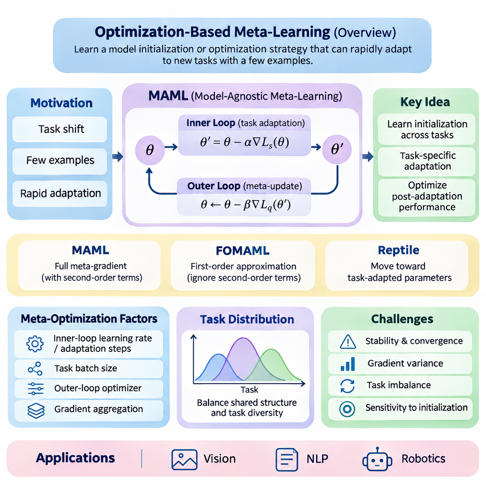
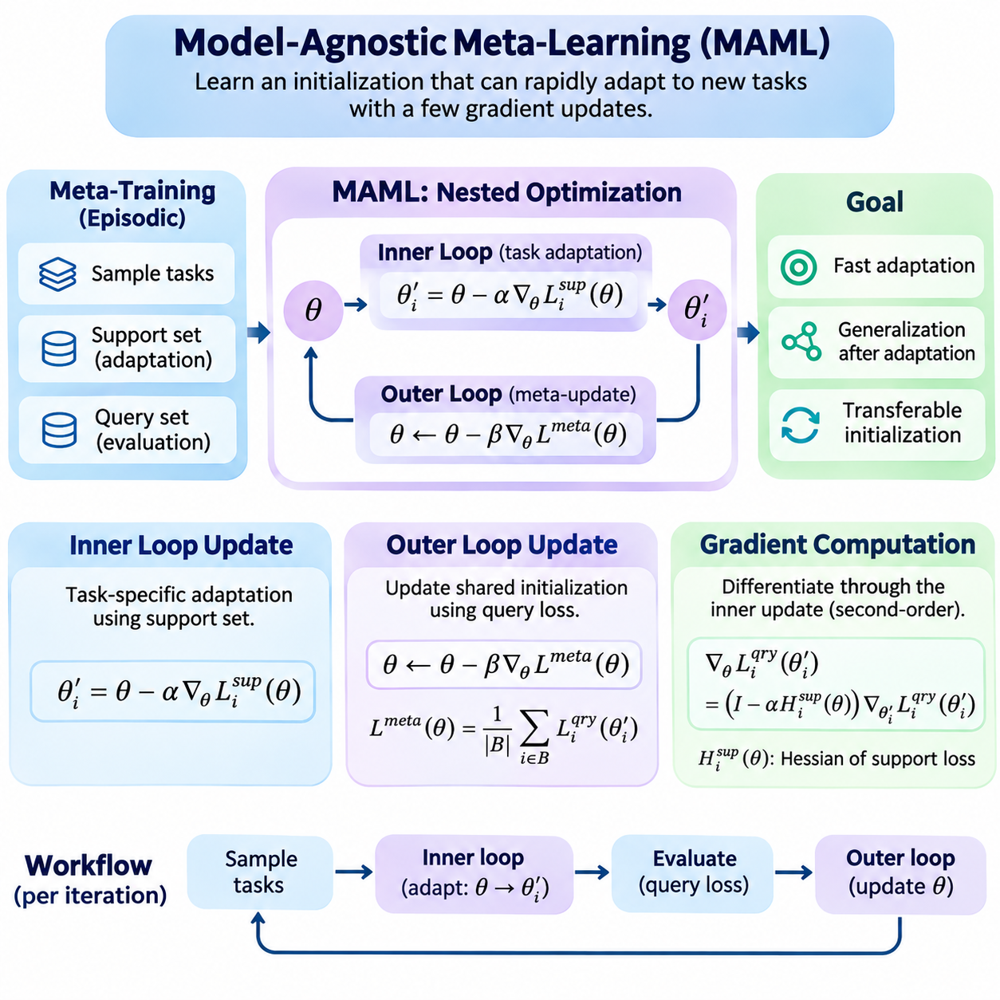
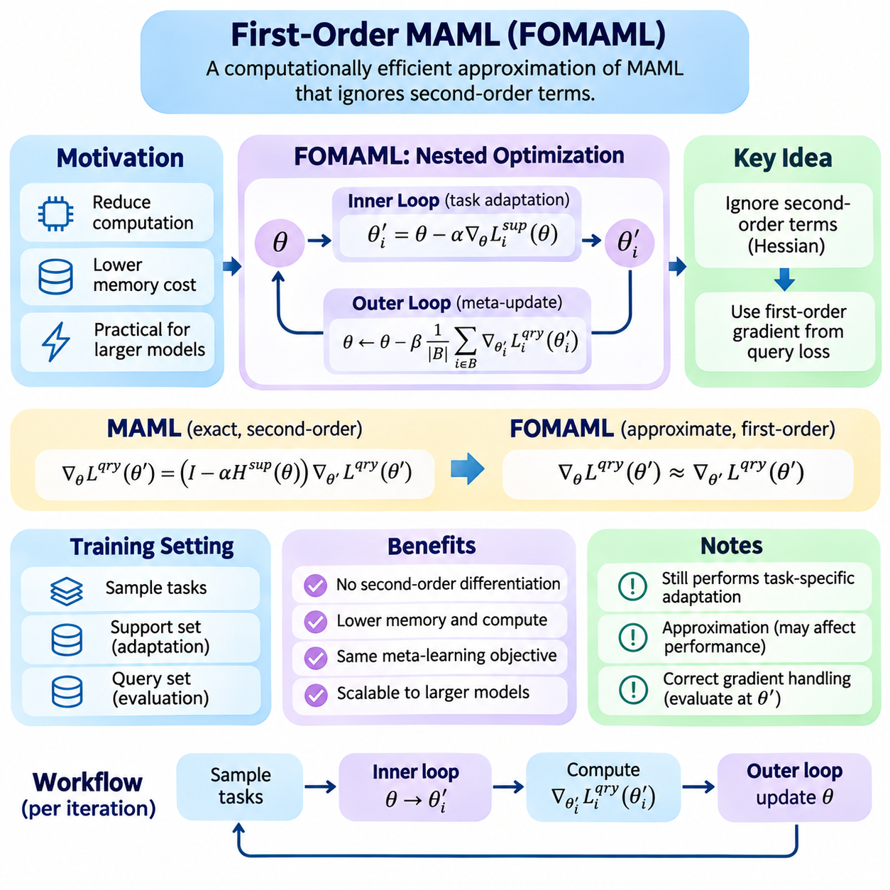
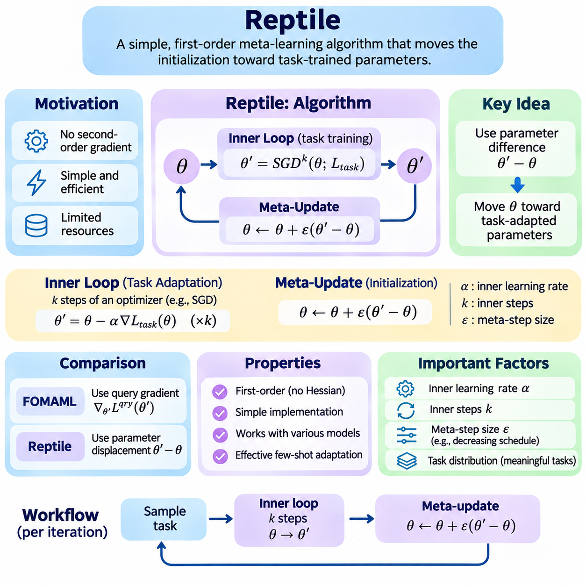
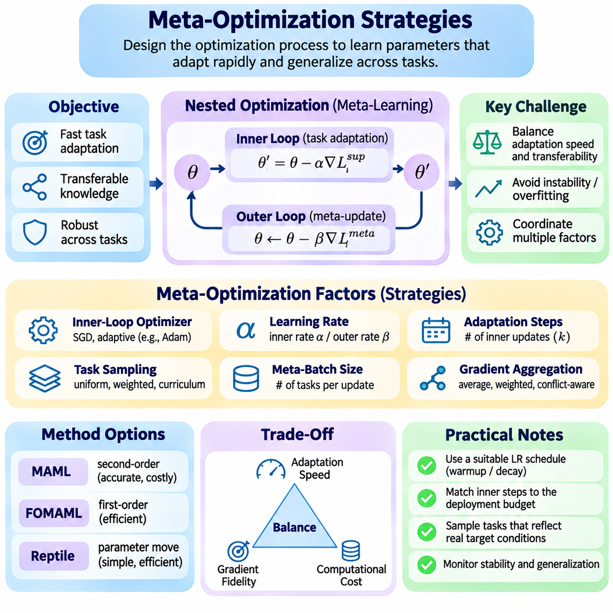
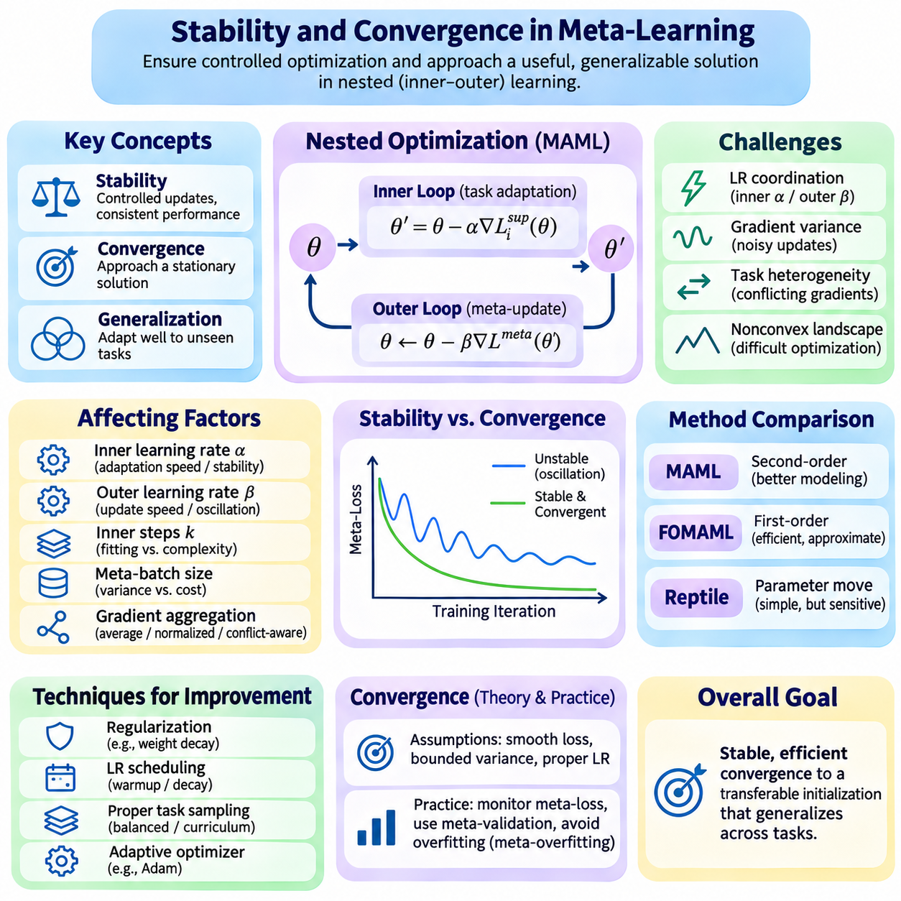
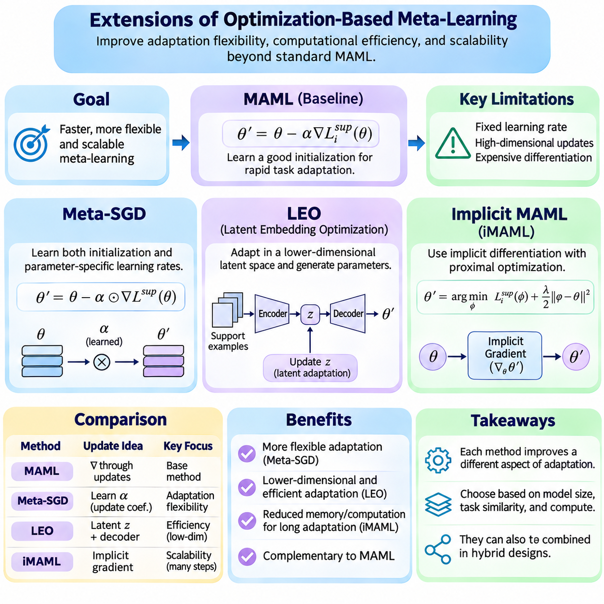
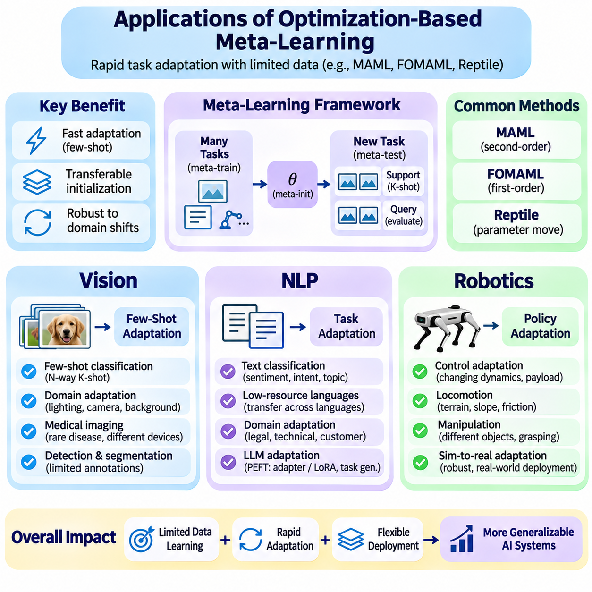

**Volume 36. Meta Learning and Few Shot Adaptation**


# 02. MAML and Optimization Based Meta Learning

## 02.00 Overview

{width="7.268055555555556in" height="7.268055555555556in"}

Optimization-based meta-learning provides a systematic framework for training models that can adapt rapidly to unfamiliar tasks using only a small number of examples. Rather than optimizing a model exclusively for performance on a fixed dataset, this approach optimizes the learning process itself. Its central objective is to discover model parameters, update mechanisms, or optimization strategies that support efficient adaptation across a distribution of related tasks.

Traditional supervised learning typically assumes that training and evaluation examples originate from sufficiently similar distributions. When a new task introduces different classes, objectives, or operating conditions, substantial retraining may be necessary. Optimization-based meta-learning addresses this limitation by exposing a model to many learning episodes, encouraging it to acquire an initialization or adaptation procedure that transfers effectively to previously unseen tasks.

Model-Agnostic Meta-Learning, commonly known as MAML, represents a foundational approach within this family. MAML seeks an initial parameter configuration from which a neural network can achieve strong task-specific performance after only a few gradient updates. Its model-agnostic property means that the underlying method can be applied to different differentiable architectures and learning objectives, including classification, regression, and reinforcement learning.

The conceptual foundation of MAML is a hierarchical optimization process involving an inner loop and an outer loop. The inner loop performs task-specific adaptation using a limited support dataset, while the outer loop evaluates the adapted models and updates their shared initialization. By optimizing performance after adaptation rather than before adaptation, the system learns parameters that are particularly responsive to new task information.

During meta-training, tasks are sampled from a task distribution representing the expected range of learning problems. Each task typically contains a support set for adaptation and a query set for evaluating the resulting model. The support examples determine task-specific parameter updates, while query performance contributes to the meta-objective. This episodic structure closely reflects the conditions encountered during few-shot evaluation.

The distinction between ordinary parameter optimization and meta-optimization is fundamental. Conventional training minimizes a loss function directly with respect to model parameters. MAML instead minimizes the expected query loss obtained after applying a task-dependent optimization procedure. Consequently, the meta-objective depends not only on the initial parameters but also on how those parameters change during adaptation.

In its standard formulation, MAML uses gradient descent for inner-loop adaptation and differentiates the outer-loop objective through the adaptation process. This introduces second-order derivative information when a gradient-based inner update is used. Such computations capture how changes in the initial parameters influence subsequent learning, but they can increase memory requirements, computational cost, and implementation complexity.

First-Order MAML, or FOMAML, reduces this computational burden by ignoring second-order terms in the meta-gradient calculation. The resulting approximation simplifies optimization and can improve practical efficiency, particularly when deep architectures or multiple adaptation steps are involved. However, eliminating higher-order information changes the optimization dynamics and may affect performance depending on the task distribution.

Reptile offers another influential optimization-based meta-learning strategy. Instead of explicitly differentiating through the inner optimization trajectory, Reptile repeatedly trains on sampled tasks and moves the shared initialization toward the resulting task-adapted parameters. This approach avoids higher-order differentiation and provides a relatively simple mechanism for encouraging rapid adaptation across related learning problems.

Although MAML, FOMAML, and Reptile share the objective of improving adaptation, they differ in how meta-updates are constructed. MAML explicitly optimizes post-adaptation query performance through differentiation, FOMAML approximates this process using first-order gradients, and Reptile relies on parameter differences after task-specific training. These distinctions influence computational requirements, optimization behavior, and empirical generalization.

Meta-optimization strategies extend beyond selecting a particular algorithm. Inner-loop learning rates, adaptation steps, task batch sizes, outer-loop optimizers, and gradient aggregation methods all influence learning effectiveness. Their interactions determine whether a meta-learned initialization remains broadly transferable or becomes excessively specialized to the tasks encountered during training.

The relationship between task diversity and adaptation quality is especially important. A narrow task distribution may produce an initialization that adapts efficiently within a limited domain but generalizes poorly to substantially different problems. Conversely, excessive task heterogeneity can create conflicting optimization directions. Effective meta-training therefore requires a carefully constructed task distribution that balances shared structure with meaningful variation.

Stability and convergence present additional challenges because meta-learning involves nested optimization processes. Large inner-loop learning rates may produce unstable adaptation, while aggressive outer-loop updates can disrupt previously learned transfer properties. Gradient variance, task imbalance, and sensitivity to initialization can further complicate training. Reliable implementations must monitor both meta-training behavior and performance on held-out tasks.

Computational efficiency becomes particularly significant when the inner loop contains multiple gradient steps. Higher-order differentiation may require retaining intermediate computational graphs, increasing memory consumption as adaptation depth grows. Practical systems can address these limitations through first-order approximations, gradient checkpointing, carefully controlled adaptation horizons, and alternative formulations that avoid explicitly storing the complete optimization trajectory.

Meta-SGD extends the basic MAML framework by learning not only an initialization but also parameter-specific update coefficients. These coefficients determine the magnitude and direction of adaptation for individual model parameters. By incorporating learned update behavior into the meta-training objective, Meta-SGD introduces additional flexibility that may improve adaptation efficiency when the task distribution supports consistent update patterns.

Latent Embedding Optimization, or LEO, approaches adaptation through a lower-dimensional latent representation. Instead of performing all task-specific optimization directly in the original high-dimensional parameter space, LEO learns a latent space in which adaptation can be performed more efficiently. A decoding mechanism then maps adapted latent variables into model parameters, potentially improving adaptation in high-dimensional few-shot settings.

Implicit MAML investigates an alternative method for computing meta-gradients without explicitly differentiating through every inner-loop optimization step. By using implicit differentiation under appropriate mathematical conditions, it can reduce dependence on the length of the adaptation trajectory. This approach illustrates how optimization theory can improve the scalability of meta-learning while preserving sensitivity to task-specific solutions.

Optimization-based meta-learning also has important connections to transfer learning and conventional fine-tuning. Both approaches reuse information acquired from previous tasks, but their training objectives differ. Standard transfer learning generally seeks reusable representations or pretrained parameters, whereas optimization-based meta-learning explicitly rewards parameters that produce favorable results after a prescribed adaptation procedure.

In computer vision, these methods can support few-shot image classification when only a limited number of labeled examples are available for new categories. Meta-training across classification episodes encourages the model to acquire parameters that adapt efficiently to unfamiliar visual distinctions. Performance depends on the diversity of training tasks, representation quality, adaptation configuration, and similarity between training and evaluation conditions.

Natural language processing provides another application domain where optimization-based meta-learning can address limited task-specific supervision. Potential applications include adapting text classifiers to new categories, domains, or linguistic conditions. However, language models introduce challenges associated with large parameter spaces, heterogeneous task structures, and computationally expensive updates, making efficient adaptation strategies especially relevant.

Robotics presents a particularly demanding environment because adaptation must often occur under changing physical conditions and limited interaction budgets. Optimization-based meta-learning can support rapid adjustment to variations in dynamics, control objectives, or operating environments. Nevertheless, practical deployment requires attention to sample efficiency, real-time constraints, system identification, and the safety implications of exploratory adaptation.

Evaluating optimization-based meta-learning requires more than measuring final predictive accuracy. Important considerations include adaptation speed, performance before and after updating, computational cost, memory consumption, and robustness across different task distributions. Comparisons should use consistent support and query protocols, controlled optimization budgets, and multiple random seeds to distinguish genuine adaptation improvements from experimental variability.

The broader significance of optimization-based meta-learning lies in its treatment of learning dynamics as an explicit optimization target. MAML establishes the central framework, while FOMAML, Reptile, Meta-SGD, LEO, and Implicit MAML explore different tradeoffs between flexibility, efficiency, and mathematical complexity. Together, these methods provide a foundation for understanding how intelligent systems can acquire transferable learning procedures rather than relying solely on fixed knowledge.

최적화 기반 메타 학습(Optimization-Based Meta-Learning)은 소수의 예제만으로 새로운 작업에 신속하게 적응할 수 있는 모델을 학습시키기 위한 체계적인 프레임워크(Framework)를 제공한다. 이 접근법은 고정된 데이터셋(Dataset)에 대한 성능만을 최적화하는 대신 학습 과정(Learning Process) 자체를 최적화한다. 핵심 목표는 관련 작업들의 분포 전반에서 효율적인 적응을 지원하는 모델 매개변수(Model Parameters), 갱신 메커니즘(Update Mechanisms), 최적화 전략(Optimization Strategies)을 발견하는 것이다.

전통적인 지도 학습(Supervised Learning)은 일반적으로 학습 데이터와 평가 데이터가 충분히 유사한 분포에서 생성된다고 가정한다. 새로운 작업에서 서로 다른 클래스(Class), 목표(Objectives), 운영 조건(Operating Conditions)이 도입되면 상당한 재학습(Retraining)이 필요할 수 있다. 최적화 기반 메타 학습은 모델을 다양한 학습 에피소드(Learning Episodes)에 노출하여 이러한 한계를 해결하며, 이전에 경험하지 못한 작업에도 효과적으로 전이되는 초기화(Initialization) 또는 적응 절차(Adaptation Procedure)를 학습하도록 유도한다.

모델 불가지론적 메타 학습(Model-Agnostic Meta-Learning, MAML)은 이러한 계열을 대표하는 핵심 접근법이다. MAML은 신경망(Neural Network)이 단 몇 번의 경사 갱신(Gradient Updates)만으로 높은 작업별 성능(Task-Specific Performance)을 달성할 수 있는 초기 매개변수 구성(Initial Parameter Configuration)을 탐색한다. 모델 불가지론적(Model-Agnostic)이라는 특성은 분류(Classification), 회귀(Regression), 강화 학습(Reinforcement Learning)을 포함한 다양한 미분 가능한 아키텍처(Differentiable Architectures)와 학습 목표에 적용할 수 있음을 의미한다.

MAML의 개념적 기반은 내부 루프(Inner Loop)와 외부 루프(Outer Loop)로 구성되는 계층적 최적화 과정(Hierarchical Optimization Process)이다. 내부 루프는 제한된 지원 데이터셋(Support Dataset)을 사용하여 작업별 적응(Task-Specific Adaptation)을 수행하고, 외부 루프는 적응된 모델을 평가하여 공유 초기화(Shared Initialization)를 갱신한다. 적응 이전이 아니라 적응 이후의 성능을 최적화함으로써 새로운 작업 정보에 특히 민감하게 반응하는 매개변수를 학습한다.

메타 학습 과정(Meta-Training)에서는 예상되는 학습 문제의 범위를 나타내는 작업 분포(Task Distribution)에서 작업을 표본 추출(Sampling)한다. 각 작업은 일반적으로 적응을 위한 지원 집합(Support Set)과 결과 모델을 평가하기 위한 질의 집합(Query Set)으로 구성된다. 지원 예제(Support Examples)는 작업별 매개변수 갱신을 결정하고, 질의 성능(Query Performance)은 메타 목적함수(Meta-Objective)에 반영된다. 이러한 에피소드 구조(Episodic Structure)는 소수 샷 평가(Few-Shot Evaluation)에서 발생하는 조건을 밀접하게 반영한다.

일반적인 매개변수 최적화(Parameter Optimization)와 메타 최적화(Meta-Optimization)의 차이는 근본적이다. 전통적인 학습은 모델 매개변수에 대한 손실함수(Loss Function)를 직접 최소화한다. 반면 MAML은 작업에 따라 달라지는 최적화 절차(Task-Dependent Optimization Procedure)를 적용한 이후 발생하는 기대 질의 손실(Expected Query Loss)을 최소화한다. 따라서 메타 목적함수는 초기 매개변수뿐 아니라 적응 과정에서 해당 매개변수가 어떻게 변화하는지에도 의존한다.

표준 MAML 구성에서는 내부 루프 적응에 경사 하강법(Gradient Descent)을 사용하고, 적응 과정을 통해 외부 루프 목적함수를 미분한다. 경사 기반 내부 갱신을 사용하는 경우 이러한 과정에는 이차 미분 정보(Second-Order Derivative Information)가 포함된다. 이 계산은 초기 매개변수의 변화가 이후 학습에 미치는 영향을 포착하지만, 메모리 요구량(Memory Requirements), 계산 비용(Computational Cost), 구현 복잡도(Implementation Complexity)를 증가시킬 수 있다.

일차 MAML(First-Order MAML, FOMAML)은 메타 경사 계산(Meta-Gradient Computation)에서 이차 항(Second-Order Terms)을 무시하여 계산 부담을 줄인다. 이러한 근사(Approximation)는 최적화를 단순화하며, 특히 깊은 신경망 아키텍처(Deep Neural Architectures)나 여러 적응 단계(Adaptation Steps)를 사용하는 경우 실질적인 효율성을 향상시킬 수 있다. 그러나 고차 정보(Higher-Order Information)를 제거하면 최적화 동역학(Optimization Dynamics)이 달라지므로 작업 분포에 따라 성능에 영향을 줄 수 있다.

렙타일(Reptile)은 또 다른 영향력 있는 최적화 기반 메타 학습 전략이다. Reptile은 내부 최적화 경로(Inner Optimization Trajectory)를 명시적으로 미분하는 대신, 표본 추출된 작업에서 반복적으로 학습하고 공유 초기화를 작업 적응 매개변수(Task-Adapted Parameters) 방향으로 이동시킨다. 이 접근법은 고차 미분(Higher-Order Differentiation)을 피하면서 관련 작업 전반에서 빠른 적응을 촉진하는 비교적 단순한 메커니즘을 제공한다.

MAML, FOMAML, Reptile은 모두 적응 성능 향상을 목표로 하지만 메타 갱신(Meta-Updates)을 구성하는 방식은 서로 다르다. MAML은 미분을 통해 적응 이후의 질의 성능을 명시적으로 최적화하고, FOMAML은 일차 경사(First-Order Gradients)를 사용하여 이 과정을 근사한다. Reptile은 작업별 학습 이후의 매개변수 차이(Parameter Differences)를 활용한다. 이러한 차이는 계산 요구량, 최적화 동작, 경험적 일반화(Empirical Generalization)에 영향을 미친다.

메타 최적화 전략(Meta-Optimization Strategies)은 특정 알고리즘(Algorithm)을 선택하는 것 이상으로 확장된다. 내부 루프 학습률(Inner-Loop Learning Rates), 적응 단계 수, 작업 배치 크기(Task Batch Sizes), 외부 루프 최적화기(Outer-Loop Optimizers), 경사 집계 방법(Gradient Aggregation Methods)은 모두 학습 효과에 영향을 준다. 이러한 요소들의 상호작용은 메타 학습된 초기화(Meta-Learned Initialization)가 폭넓은 전이 가능성을 유지할지, 학습 중 경험한 작업에 지나치게 특화될지를 결정한다.

작업 다양성(Task Diversity)과 적응 품질(Adaptation Quality)의 관계는 특히 중요하다. 좁은 작업 분포는 제한된 영역에서는 효율적으로 적응하지만 상당히 다른 문제에서는 일반화 성능이 낮은 초기화를 생성할 수 있다. 반대로 지나치게 이질적인 작업 구성(Task Heterogeneity)은 서로 충돌하는 최적화 방향(Optimization Directions)을 만들어낼 수 있다. 따라서 효과적인 메타 학습에는 공통 구조(Shared Structure)와 의미 있는 다양성(Meaningful Variation)의 균형을 유지하는 작업 분포 설계가 필요하다.

안정성(Stability)과 수렴(Convergence)은 메타 학습이 중첩된 최적화 과정(Nested Optimization Processes)을 포함하기 때문에 추가적인 과제를 제시한다. 높은 내부 루프 학습률은 불안정한 적응을 유발할 수 있으며, 과도한 외부 루프 갱신은 이전에 학습한 전이 특성(Transfer Properties)을 손상시킬 수 있다. 경사 분산(Gradient Variance), 작업 불균형(Task Imbalance), 초기화 민감도(Initialization Sensitivity)도 학습을 복잡하게 만든다. 신뢰할 수 있는 구현에는 메타 학습 동작과 보류된 작업(Held-Out Tasks)에 대한 성능을 함께 모니터링하는 과정이 필요하다.

내부 루프가 여러 경사 갱신 단계를 포함하면 계산 효율성(Computational Efficiency)이 특히 중요해진다. 고차 미분은 중간 계산 그래프(Intermediate Computational Graphs)를 유지해야 할 수 있으므로 적응 깊이(Adaptation Depth)가 증가할수록 메모리 사용량도 증가한다. 실제 시스템에서는 일차 근사(First-Order Approximations), 경사 체크포인팅(Gradient Checkpointing), 적응 단계 범위(Adaptation Horizons)의 신중한 제어, 전체 최적화 경로의 명시적 저장을 피하는 대체 수식화를 통해 이러한 한계를 완화할 수 있다.

메타 확률적 경사 하강법(Meta-SGD)은 초기화뿐 아니라 매개변수별 갱신 계수(Parameter-Specific Update Coefficients)까지 학습하도록 기본 MAML 프레임워크를 확장한다. 이러한 계수는 개별 모델 매개변수의 적응 크기와 방향을 결정한다. Meta-SGD는 학습된 갱신 동작(Learned Update Behavior)을 메타 학습 목적함수에 포함함으로써 추가적인 유연성을 제공하며, 작업 분포에서 일관된 갱신 패턴이 나타나는 경우 적응 효율성을 향상시킬 수 있다.

잠재 임베딩 최적화(Latent Embedding Optimization, LEO)는 저차원 잠재 표현(Lower-Dimensional Latent Representation)을 통해 적응을 수행한다. LEO는 원래의 고차원 매개변수 공간(High-Dimensional Parameter Space)에서 모든 작업별 최적화를 직접 수행하는 대신, 더욱 효율적인 적응이 가능한 잠재 공간(Latent Space)을 학습한다. 이후 디코딩 메커니즘(Decoding Mechanism)을 통해 적응된 잠재 변수(Adapted Latent Variables)를 모델 매개변수로 변환하여 고차원 소수 샷 학습 환경에서 적응 성능을 개선할 가능성을 제공한다.

암시적 MAML(Implicit MAML)은 모든 내부 루프 최적화 단계를 명시적으로 미분하지 않고 메타 경사(Meta-Gradients)를 계산하는 대체 방법을 연구한다. 적절한 수학적 조건에서 암시적 미분(Implicit Differentiation)을 사용하면 적응 경로의 길이에 대한 의존성을 줄일 수 있다. 이러한 접근법은 작업별 해(Task-Specific Solutions)에 대한 민감도를 유지하면서 최적화 이론(Optimization Theory)을 활용하여 메타 학습의 확장성(Scalability)을 개선할 수 있음을 보여준다.

최적화 기반 메타 학습은 전이 학습(Transfer Learning) 및 전통적인 미세 조정(Fine-Tuning)과도 중요한 연관성을 가진다. 두 접근법 모두 이전 작업에서 획득한 정보를 재사용하지만 학습 목표는 서로 다르다. 표준 전이 학습은 일반적으로 재사용 가능한 표현(Reusable Representations)이나 사전 학습된 매개변수(Pretrained Parameters)를 추구하는 반면, 최적화 기반 메타 학습은 정해진 적응 절차 이후 우수한 결과를 생성하는 매개변수에 명시적으로 보상을 부여한다.

컴퓨터 비전(Computer Vision) 분야에서는 새로운 범주(New Categories)에 대해 제한된 수의 레이블이 지정된 예제(Labeled Examples)만 제공되는 경우 소수 샷 이미지 분류(Few-Shot Image Classification)를 지원할 수 있다. 분류 에피소드(Classification Episodes)에 걸친 메타 학습은 모델이 익숙하지 않은 시각적 차이에 효율적으로 적응할 수 있는 매개변수를 획득하도록 유도한다. 성능은 학습 작업의 다양성, 표현 품질(Representation Quality), 적응 구성(Adaptation Configuration), 학습 및 평가 조건의 유사성에 따라 달라진다.

자연어 처리(Natural Language Processing, NLP)는 최적화 기반 메타 학습이 제한된 작업별 지도 정보(Task-Specific Supervision)를 해결할 수 있는 또 다른 응용 분야이다. 잠재적인 응용 사례에는 새로운 범주, 도메인(Domains), 언어적 조건(Linguistic Conditions)에 대한 텍스트 분류기(Text Classifiers)의 적응이 포함된다. 그러나 언어 모델(Language Models)은 대규모 매개변수 공간, 이질적인 작업 구조, 계산 비용이 높은 갱신 과정이라는 과제를 수반하므로 효율적인 적응 전략이 특히 중요하다.

로보틱스(Robotics)는 변화하는 물리적 조건과 제한된 상호작용 예산(Interaction Budgets) 아래에서 적응이 이루어져야 하므로 특히 까다로운 환경을 제공한다. 최적화 기반 메타 학습은 동역학(Dynamics), 제어 목표(Control Objectives), 운영 환경(Operating Environments)의 변화에 대한 신속한 조정을 지원할 수 있다. 그러나 실제 배포(Deployment)에서는 샘플 효율성(Sample Efficiency), 실시간 제약(Real-Time Constraints), 시스템 식별(System Identification), 탐색적 적응(Exploratory Adaptation)의 안전성 영향을 고려해야 한다.

최적화 기반 메타 학습을 평가하려면 최종 예측 정확도(Predictive Accuracy)를 측정하는 것만으로는 충분하지 않다. 중요한 평가 요소에는 적응 속도(Adaptation Speed), 갱신 전후의 성능, 계산 비용, 메모리 사용량, 서로 다른 작업 분포에서의 강건성(Robustness)이 포함된다. 비교 실험에서는 일관된 지원 및 질의 프로토콜(Support and Query Protocols), 통제된 최적화 예산(Optimization Budgets), 여러 무작위 시드(Random Seeds)를 사용하여 실제 적응 성능 향상과 실험적 변동성을 구분해야 한다.

최적화 기반 메타 학습의 광범위한 의의는 학습 동역학(Learning Dynamics)을 명시적인 최적화 대상(Optimization Target)으로 취급한다는 점에 있다. MAML은 핵심 프레임워크를 확립하고, FOMAML, Reptile, Meta-SGD, LEO, Implicit MAML은 유연성(Flexibility), 효율성(Efficiency), 수학적 복잡도(Mathematical Complexity) 사이의 다양한 절충 관계(Tradeoffs)를 탐구한다. 이러한 방법들은 지능형 시스템(Intelligent Systems)이 고정된 지식에만 의존하지 않고 전이 가능한 학습 절차(Transferable Learning Procedures)를 획득하는 방식을 이해하기 위한 기반을 제공한다.

## 02.01 Model Agnostic Meta Learning (MAML) [w/Code]

{width="7.268055555555556in" height="7.268055555555556in"}

Model-Agnostic Meta-Learning (MAML) is an optimization-based meta-learning algorithm designed to identify model parameters that can adapt rapidly to new tasks through a small number of gradient updates. Unlike conventional training, which minimizes loss on a fixed dataset, MAML optimizes an initialization for effective future learning. Its central principle is that a useful initialization should enable strong generalization after limited task-specific adaptation.

MAML operates over a distribution of related tasks rather than individual training examples. Each task contains a support set used for adaptation and a query set used to evaluate the adapted model. During meta-training, multiple tasks are sampled to expose the model to diverse learning conditions. The resulting optimization process encourages the initial parameters to capture transferable structure while remaining responsive to task-specific information.

The algorithm consists of two interconnected optimization stages known as the inner loop and outer loop. The inner loop performs task-specific parameter updates using support examples, while the outer loop improves the shared initialization by evaluating adapted models on query examples. These stages form a nested optimization framework in which the effectiveness of learning is itself the primary optimization target.

The inner-loop update begins with a shared parameter vector, typically represented by theta, and a task-specific support loss. For each sampled task, gradient descent adjusts the parameters according to the local training objective. A single update can be expressed as theta_i_prime = theta - alpha \\\* grad_theta L_support_i(theta), where alpha represents the inner-loop learning rate and i identifies the sampled task.

The adapted parameters produced by the inner loop are specific to the corresponding task. Although all tasks begin from the same initialization, their support examples generate different gradients and therefore different adaptation trajectories. This mechanism allows a single meta-learned initialization to support multiple specialized models without requiring an independently pretrained network for every task.

Multiple inner-loop updates can be performed when one gradient step is insufficient. At each step, the current task-specific parameters are updated using the gradient of the support loss. Increasing the number of adaptation steps can improve task fitting, but it also raises computational cost and may increase overfitting when support sets are small. The adaptation horizon must therefore reflect the intended deployment conditions.

The inner-loop learning rate plays a critical role in determining adaptation behavior. A small learning rate may produce insufficient parameter changes, while an excessively large rate can cause unstable updates or destroy transferable representations. MAML commonly treats the learning rate as a hyperparameter, although extensions can learn parameter-specific update coefficients. Appropriate tuning depends on model architecture, task diversity, and loss geometry.

A practical implementation must preserve the computational relationship between the initial parameters and their adapted values. In PyTorch, this can be achieved through differentiable gradient operations using torch.autograd.grad with create_graph=True. The adapted parameters are then constructed through functional updates rather than detached parameter assignments, allowing the outer-loop objective to propagate gradients through the adaptation process.

The outer-loop update evaluates how effectively the shared initialization supports learning across sampled tasks. After inner-loop adaptation, each task-specific model is evaluated using its query set. The corresponding query losses are aggregated into a meta-objective, typically through averaging across the task batch. This objective measures performance after adaptation rather than performance at the original initialization.

The meta-objective can be expressed as minimizing the expected query loss over sampled tasks after applying the inner-loop adaptation operator. In simplified notation, the objective is min_theta E_task[L_query_task(U_task(theta))], where U_task represents task-specific gradient updates. This formulation explicitly connects the initial parameters, adaptation dynamics, and final generalization performance.

During the outer-loop update, the gradient of the aggregated meta-objective is computed with respect to the original initialization. A meta-optimizer such as stochastic gradient descent or Adam then modifies the shared parameters. The update can be represented as theta_new = theta - beta \\\* grad_theta L_meta(theta), where beta denotes the outer-loop learning rate and L_meta is the aggregated post-adaptation query loss.

The outer-loop learning rate determines how rapidly the shared initialization changes across meta-training iterations. Aggressive updates may cause oscillation or instability when task gradients disagree, while conservative updates may slow convergence. Task batch size also influences optimization behavior because averaging gradients across more tasks can reduce sampling variance at the expense of additional computation and memory.

Gradient computation is the defining technical characteristic of standard MAML. Because adapted parameters depend on the initial parameters through gradient descent, differentiating the query loss requires applying the chain rule through the inner-loop update. For a single gradient step, this introduces a Hessian-related term that captures how the support-loss gradient changes with respect to the initialization.

For one-step adaptation, the meta-gradient can be written conceptually as grad_theta L_query(theta_prime) = (I - alpha \\\* H_support(theta)) \\\* grad_theta_prime L_query(theta_prime), where H_support is the Hessian of the support loss. This expression shows that standard MAML incorporates second-order information when differentiating through gradient-based adaptation, rather than relying only on ordinary query gradients.

Explicitly constructing a full Hessian matrix is generally unnecessary. Automatic differentiation frameworks can compute the required Hessian-vector products through nested gradient operations. This approach avoids materializing a potentially enormous second-order matrix, although retaining differentiable inner-loop operations still increases computational and memory requirements compared with ordinary supervised learning.

In PyTorch, a differentiable inner-loop gradient can be obtained using torch.autograd.grad(support_loss, parameters, create_graph=True). Updated parameters are calculated from these gradients, and the query loss is evaluated using the adapted values. Calling backward on the aggregated query loss then computes gradients with respect to the original meta-parameters, provided that the computational graph remains connected.

Functional model execution is particularly useful for implementing MAML correctly. Instead of modifying neural network parameters in place, the implementation passes adapted parameter tensors into the model\'s forward computation. PyTorch facilities such as torch.func.functional_call support this pattern, helping maintain a clear distinction between shared initialization parameters and temporary task-adapted parameters.

A complete meta-training iteration begins by sampling a batch of tasks and dividing each task into support and query examples. The model performs differentiable adaptation separately for every task, evaluates the corresponding query losses, and averages those losses. The meta-optimizer then updates the shared initialization. Repeating this procedure gradually improves the model\'s ability to learn unfamiliar tasks from limited supervision.

A common implementation error occurs when adapted parameters are detached from the computational graph or overwritten using operations that break differentiability. Such mistakes prevent the outer-loop gradient from capturing the influence of the initialization on adaptation. Correct implementations must also avoid unintended gradient accumulation and ensure that each task begins from the same shared initialization within a meta-training iteration.

Memory consumption can become substantial when many tasks, adaptation steps, or large neural networks are involved. Each differentiable inner-loop update may retain intermediate information required for higher-order differentiation. Practical implementations must balance task batch size, adaptation depth, model complexity, and available accelerator memory. First-order approximations or implicit differentiation can provide alternatives when full MAML becomes computationally prohibitive.

Numerical stability is another important consideration because nested optimization can amplify poorly conditioned gradients. Gradient clipping, suitable learning-rate schedules, normalized inputs, and careful loss scaling may improve training reliability. However, these techniques must be evaluated experimentally because their effects depend on task characteristics and model architecture. Monitoring both inner-loop losses and outer-loop validation performance helps identify unstable adaptation.

Meta-validation should use tasks that are distinct from those sampled during meta-training. Each validation task follows the same adaptation protocol, using its support set for parameter updates and its query set for performance measurement. This separation helps determine whether the learned initialization supports genuine task-level generalization rather than memorization of recurring training tasks or examples.

The distinction between meta-training and meta-testing is essential. During meta-training, query losses update the shared initialization through the outer loop. During meta-testing, the initialization is fixed, and only task-specific adaptation is performed using the new task\'s support examples. Query examples are reserved for evaluation and must not influence adaptation unless the experimental protocol explicitly defines an additional learning stage.

MAML can be applied to supervised learning problems such as few-shot classification and regression, where tasks differ in their labels, target functions, or data distributions. It can also be extended to reinforcement learning, where task-specific adaptation uses policy optimization objectives derived from collected trajectories. In all cases, the central requirement is a suitable differentiable adaptation process and a meaningful distribution of related tasks.

The effectiveness of MAML depends strongly on the relationship between meta-training tasks and future adaptation problems. If tasks share useful underlying structure, a common initialization can provide substantial adaptation benefits. When tasks are highly heterogeneous or differ significantly from the training distribution, optimization may become difficult and generalization may deteriorate. Task construction is therefore as important as the optimization algorithm itself.

MAML establishes a general framework in which inner-loop updates acquire task-specific knowledge, outer-loop updates improve transferable initialization, and gradient computation connects these two learning processes. Understanding their mathematical relationships and implementation requirements provides the foundation for first-order MAML, Reptile, learned optimization strategies, and advanced meta-learning systems designed for rapid adaptation under limited data and computational resources.

모델 불가지론적 메타 학습(Model-Agnostic Meta-Learning, MAML)은 소수의 경사 갱신(Gradient Updates)을 통해 새로운 작업에 신속하게 적응할 수 있는 모델 매개변수(Model Parameters)를 찾도록 설계된 최적화 기반 메타 학습(Optimization-Based Meta-Learning) 알고리즘이다. 고정된 데이터셋(Dataset)의 손실을 최소화하는 기존 학습과 달리, MAML은 향후 효과적인 학습을 가능하게 하는 초기화(Initialization)를 최적화한다. 핵심 원리는 유용한 초기화가 제한된 작업별 적응(Task-Specific Adaptation) 이후에도 우수한 일반화(Generalization)를 가능하게 해야 한다는 것이다.

MAML은 개별 학습 예제(Training Examples)가 아니라 관련 작업들의 분포(Task Distribution)를 대상으로 작동한다. 각 작업은 적응에 사용되는 지원 집합(Support Set)과 적응된 모델을 평가하는 질의 집합(Query Set)으로 구성된다. 메타 학습(Meta-Training) 과정에서는 다양한 학습 조건을 경험하도록 여러 작업을 표본 추출(Sampling)한다. 이러한 최적화 과정은 초기 매개변수가 전이 가능한 구조(Transferable Structure)를 포착하면서도 작업별 정보(Task-Specific Information)에 민감하게 반응하도록 유도한다.

이 알고리즘은 내부 루프(Inner Loop)와 외부 루프(Outer Loop)라는 두 가지 상호 연결된 최적화 단계(Optimization Stages)로 구성된다. 내부 루프는 지원 예제(Support Examples)를 사용하여 작업별 매개변수 갱신을 수행하고, 외부 루프는 적응된 모델을 질의 예제(Query Examples)로 평가하여 공유 초기화(Shared Initialization)를 개선한다. 이러한 단계들은 학습의 효과성 자체를 주요 최적화 대상으로 삼는 중첩 최적화 프레임워크(Nested Optimization Framework)를 형성한다.

내부 루프 갱신(Inner-Loop Update)은 일반적으로 세타(Theta)로 표현되는 공유 매개변수 벡터(Shared Parameter Vector)와 작업별 지원 손실(Task-Specific Support Loss)에서 시작된다. 표본 추출된 각 작업에 대해 경사 하강법(Gradient Descent)은 해당 작업의 학습 목표에 따라 매개변수를 조정한다. 단일 갱신은 theta_i_prime = theta - alpha \\\* grad_theta L_support_i(theta)로 표현할 수 있으며, 여기서 alpha는 내부 루프 학습률(Inner-Loop Learning Rate), i는 표본 추출된 작업을 나타낸다.

내부 루프에서 생성된 적응 매개변수(Adapted Parameters)는 해당 작업에 특화된다. 모든 작업이 동일한 초기화에서 시작하지만, 지원 예제에 따라 서로 다른 경사(Gradients)가 생성되므로 적응 경로(Adaptation Trajectories)도 달라진다. 이러한 메커니즘을 통해 하나의 메타 학습된 초기화(Meta-Learned Initialization)는 각 작업마다 독립적으로 사전 학습된 신경망(Pretrained Neural Network)을 요구하지 않으면서 여러 특화 모델(Specialized Models)을 지원할 수 있다.

한 번의 경사 갱신만으로 충분하지 않은 경우 여러 차례의 내부 루프 갱신을 수행할 수 있다. 각 단계에서는 현재 작업별 매개변수를 지원 손실의 경사를 사용하여 갱신한다. 적응 단계 수를 늘리면 작업 적합도(Task Fitting)가 향상될 수 있지만, 계산 비용이 증가하고 지원 집합이 작은 경우 과적합(Overfitting) 위험도 커질 수 있다. 따라서 적응 단계 범위(Adaptation Horizon)는 실제 배포 환경(Deployment Conditions)에 맞게 설정해야 한다.

내부 루프 학습률은 적응 동작(Adaptation Behavior)을 결정하는 데 중요한 역할을 한다. 학습률이 너무 작으면 매개변수 변화가 충분하지 않을 수 있으며, 지나치게 크면 불안정한 갱신을 유발하거나 전이 가능한 표현(Transferable Representations)을 손상시킬 수 있다. MAML은 일반적으로 학습률을 하이퍼파라미터(Hyperparameter)로 취급하지만, 확장된 방법에서는 매개변수별 갱신 계수(Parameter-Specific Update Coefficients)를 학습할 수도 있다. 적절한 조정은 모델 아키텍처(Model Architecture), 작업 다양성(Task Diversity), 손실 기하학(Loss Geometry)에 따라 달라진다.

실제 구현에서는 초기 매개변수와 적응된 매개변수 사이의 계산 관계(Computational Relationship)를 유지해야 한다. 파이토치(PyTorch)에서는 create_graph=True 옵션을 사용하는 torch.autograd.grad를 통해 미분 가능한 경사 연산(Differentiable Gradient Operations)을 수행할 수 있다. 이후 적응된 매개변수는 분리된 매개변수 할당이 아니라 함수형 갱신(Functional Updates)을 통해 구성되며, 이를 통해 외부 루프 목적함수(Outer-Loop Objective)의 경사가 적응 과정 전체로 전파될 수 있다.

외부 루프 갱신(Outer-Loop Update)은 공유 초기화가 여러 표본 추출 작업에서 얼마나 효과적으로 학습을 지원하는지 평가한다. 내부 루프 적응이 완료되면 각 작업별 모델(Task-Specific Model)을 질의 집합으로 평가한다. 해당 질의 손실(Query Losses)은 일반적으로 작업 배치(Task Batch) 전체에 대한 평균을 통해 메타 목적함수(Meta-Objective)로 집계된다. 이 목적함수는 초기 상태의 성능이 아니라 적응 이후의 성능을 측정한다.

메타 목적함수는 내부 루프 적응 연산자(Inner-Loop Adaptation Operator)를 적용한 이후 작업 전반에서 발생하는 기대 질의 손실(Expected Query Loss)을 최소화하는 형태로 표현할 수 있다. 단순화된 표기법으로 목적함수는 min_theta E_task[L_query_task(U_task(theta))]이며, 여기서 U_task는 작업별 경사 갱신(Task-Specific Gradient Updates)을 나타낸다. 이러한 수식은 초기 매개변수, 적응 동역학(Adaptation Dynamics), 최종 일반화 성능(Final Generalization Performance)을 명시적으로 연결한다.

외부 루프 갱신 과정에서는 집계된 메타 목적함수의 경사를 원래 초기 매개변수에 대해 계산한다. 이후 확률적 경사 하강법(Stochastic Gradient Descent, SGD)이나 아담(Adam)과 같은 메타 최적화기(Meta-Optimizer)가 공유 매개변수를 수정한다. 갱신은 theta_new = theta - beta \\\* grad_theta L_meta(theta)로 표현할 수 있으며, 여기서 beta는 외부 루프 학습률(Outer-Loop Learning Rate), L_meta는 적응 이후 집계된 질의 손실(Aggregated Post-Adaptation Query Loss)을 의미한다.

외부 루프 학습률은 메타 학습 반복(Meta-Training Iterations) 과정에서 공유 초기화가 얼마나 빠르게 변화하는지 결정한다. 작업별 경사가 서로 충돌할 때 공격적인 갱신(Aggressive Updates)은 진동(Oscillation)이나 불안정성을 유발할 수 있으며, 보수적인 갱신(Conservative Updates)은 수렴(Convergence)을 지연시킬 수 있다. 작업 배치 크기(Task Batch Size)도 최적화 동작에 영향을 미치는데, 더 많은 작업의 경사를 평균화하면 표본 추출 분산(Sampling Variance)을 줄일 수 있지만 추가적인 계산과 메모리가 필요하다.

경사 계산(Gradient Computation)은 표준 MAML을 정의하는 핵심 기술적 특징이다. 적응된 매개변수는 경사 하강법을 통해 초기 매개변수에 의존하므로, 질의 손실을 미분하려면 내부 루프 갱신 전체에 연쇄 법칙(Chain Rule)을 적용해야 한다. 단일 경사 갱신의 경우 지원 손실의 경사가 초기화에 따라 어떻게 변화하는지를 포착하는 헤시안 관련 항(Hessian-Related Term)이 도입된다.

단일 단계 적응(One-Step Adaptation)에서 메타 경사(Meta-Gradient)는 개념적으로 grad_theta L_query(theta_prime) = (I - alpha \\\* H_support(theta)) \\\* grad_theta_prime L_query(theta_prime)로 표현할 수 있으며, 여기서 H_support는 지원 손실의 헤시안 행렬(Hessian Matrix)을 의미한다. 이 수식은 표준 MAML이 경사 기반 적응을 통해 미분할 때 일반적인 질의 경사만 사용하는 것이 아니라 이차 정보(Second-Order Information)를 포함한다는 사실을 보여준다.

전체 헤시안 행렬(Full Hessian Matrix)을 명시적으로 구성할 필요는 일반적으로 없다. 자동 미분 프레임워크(Automatic Differentiation Frameworks)는 중첩된 경사 연산(Nested Gradient Operations)을 통해 필요한 헤시안-벡터 곱(Hessian-Vector Products)을 계산할 수 있다. 이러한 접근법은 잠재적으로 매우 큰 이차 행렬을 직접 생성하지 않지만, 미분 가능한 내부 루프 연산을 유지해야 하므로 일반적인 지도 학습(Supervised Learning)보다 계산량과 메모리 요구량이 증가한다.

파이토치(PyTorch)에서는 torch.autograd.grad(support_loss, parameters, create_graph=True)를 사용하여 미분 가능한 내부 루프 경사(Differentiable Inner-Loop Gradients)를 얻을 수 있다. 갱신된 매개변수는 이러한 경사로 계산되며, 질의 손실은 적응된 매개변수 값을 사용하여 평가된다. 계산 그래프(Computational Graph)의 연결이 유지되어 있다면 집계된 질의 손실에 backward를 호출하여 원래 메타 매개변수(Meta-Parameters)에 대한 경사를 계산할 수 있다.

함수형 모델 실행(Functional Model Execution)은 MAML을 올바르게 구현하는 데 특히 유용하다. 신경망 매개변수를 제자리에서 수정(In-Place Modification)하는 대신, 구현에서는 적응된 매개변수 텐서(Parameter Tensors)를 모델의 순전파 계산(Forward Computation)에 전달한다. torch.func.functional_call과 같은 파이토치 기능은 이러한 패턴을 지원하며, 공유 초기화 매개변수와 임시 작업 적응 매개변수(Temporary Task-Adapted Parameters)를 명확하게 구분하는 데 도움이 된다.

완전한 메타 학습 반복(Meta-Training Iteration)은 작업 배치를 표본 추출하고 각 작업을 지원 예제와 질의 예제로 분리하는 과정에서 시작된다. 모델은 각 작업에 대해 독립적으로 미분 가능한 적응을 수행하고, 해당 질의 손실을 평가한 다음 평균을 계산한다. 이후 메타 최적화기가 공유 초기화를 갱신한다. 이러한 절차를 반복하면 제한된 지도 정보(Limited Supervision)만으로 새로운 작업을 학습하는 모델의 능력이 점진적으로 향상된다.

일반적인 구현 오류(Common Implementation Error)는 적응된 매개변수가 계산 그래프에서 분리(Detached)되거나 미분 가능성을 손상시키는 연산으로 덮어써질 때 발생한다. 이러한 오류는 외부 루프 경사가 초기화가 적응에 미치는 영향을 포착하지 못하도록 만든다. 올바른 구현에서는 의도하지 않은 경사 누적(Unintended Gradient Accumulation)도 방지해야 하며, 하나의 메타 학습 반복 안에서 각 작업이 동일한 공유 초기화로부터 시작하도록 보장해야 한다.

많은 작업, 여러 적응 단계, 대규모 신경망이 포함되면 메모리 소비(Memory Consumption)가 상당히 증가할 수 있다. 미분 가능한 각 내부 루프 갱신은 고차 미분(Higher-Order Differentiation)에 필요한 중간 정보를 유지해야 할 수 있다. 실제 구현에서는 작업 배치 크기, 적응 깊이, 모델 복잡도, 사용 가능한 가속기 메모리(Accelerator Memory) 사이의 균형을 고려해야 한다. 전체 MAML의 계산 부담이 지나치게 커지면 일차 근사(First-Order Approximations)나 암시적 미분(Implicit Differentiation)이 대안이 될 수 있다.

수치적 안정성(Numerical Stability) 역시 중요한 고려 사항이다. 중첩 최적화(Nested Optimization)는 조건이 좋지 않은 경사(Poorly Conditioned Gradients)의 영향을 증폭시킬 수 있기 때문이다. 경사 클리핑(Gradient Clipping), 적절한 학습률 스케줄(Learning-Rate Schedules), 정규화된 입력(Normalized Inputs), 신중한 손실 스케일링(Loss Scaling)은 학습 신뢰성(Training Reliability)을 향상시킬 수 있다. 다만 이러한 기법의 효과는 작업 특성과 모델 아키텍처에 따라 달라지므로 실험적으로 평가해야 한다. 내부 루프 손실과 외부 루프 검증 성능을 함께 모니터링하면 불안정한 적응을 식별하는 데 도움이 된다.

메타 검증(Meta-Validation)에는 메타 학습 과정에서 표본 추출된 작업과 구별되는 작업을 사용해야 한다. 각 검증 작업(Validation Task)은 동일한 적응 프로토콜(Adaptation Protocol)을 따르며, 지원 집합을 사용하여 매개변수를 갱신하고 질의 집합으로 성능을 측정한다. 이러한 분리는 학습된 초기화가 반복적으로 등장하는 학습 작업이나 예제를 암기(Memorization)한 것이 아니라 실제 작업 수준의 일반화(Task-Level Generalization)를 지원하는지 판단하는 데 도움이 된다.

메타 학습(Meta-Training)과 메타 테스트(Meta-Testing)의 차이는 매우 중요하다. 메타 학습 중에는 질의 손실이 외부 루프를 통해 공유 초기화를 갱신한다. 반면 메타 테스트에서는 초기화를 고정하고 새로운 작업의 지원 예제만 사용하여 작업별 적응을 수행한다. 질의 예제는 평가를 위해 보존되어야 하며, 실험 프로토콜이 추가 학습 단계를 명시적으로 정의하지 않는 한 적응 과정에 영향을 주어서는 안 된다.

MAML은 작업마다 레이블(Labels), 목표 함수(Target Functions), 데이터 분포(Data Distributions)가 다른 소수 샷 분류(Few-Shot Classification)와 회귀(Regression) 같은 지도 학습 문제에 적용할 수 있다. 또한 강화 학습(Reinforcement Learning)으로 확장할 수 있으며, 이 경우 작업별 적응은 수집된 궤적(Trajectories)에서 도출한 정책 최적화 목적함수(Policy Optimization Objectives)를 사용한다. 모든 경우에 핵심 요구사항은 적절한 미분 가능한 적응 과정(Differentiable Adaptation Process)과 의미 있는 관련 작업 분포를 확보하는 것이다.

MAML의 효과는 메타 학습 작업과 향후 적응 문제 사이의 관계에 크게 의존한다. 작업들이 유용한 기본 구조(Underlying Structure)를 공유한다면 공통 초기화(Common Initialization)는 상당한 적응 이점을 제공할 수 있다. 반면 작업들이 매우 이질적이거나 학습 분포(Training Distribution)와 크게 다르면 최적화가 어려워지고 일반화 성능이 저하될 수 있다. 따라서 작업 구성(Task Construction)은 최적화 알고리즘 자체만큼 중요하다.

MAML은 내부 루프 갱신이 작업별 지식(Task-Specific Knowledge)을 획득하고, 외부 루프 갱신이 전이 가능한 초기화(Transferable Initialization)를 개선하며, 경사 계산이 두 학습 과정을 연결하는 일반적인 프레임워크를 확립한다. 이러한 요소들의 수학적 관계(Mathematical Relationships)와 구현 요구사항(Implementation Requirements)을 이해하는 것은 일차 MAML(First-Order MAML), 렙타일(Reptile), 학습된 최적화 전략(Learned Optimization Strategies), 제한된 데이터와 계산 자원에서 신속한 적응을 수행하도록 설계된 고급 메타 학습 시스템(Advanced Meta-Learning Systems)을 이해하기 위한 기초가 된다.

## 02.02 First Order MAML (FOMAML) [w/Code]

{width="7.268055555555556in" height="7.268055555555556in"}

First-Order Model-Agnostic Meta-Learning (FOMAML) is a computationally efficient approximation of Model-Agnostic Meta-Learning (MAML) designed to reduce the complexity of meta-gradient computation. Standard MAML differentiates through task-specific gradient updates, introducing second-order derivative terms. FOMAML simplifies this process by ignoring these terms while preserving the fundamental objective of learning an initialization that supports rapid adaptation to new tasks.

The motivation for FOMAML arises from the computational demands of nested optimization. In standard MAML, the outer-loop gradient depends on how the inner-loop optimization changes with respect to the initial parameters. Calculating this dependency requires higher-order automatic differentiation, which increases memory consumption and computational overhead. FOMAML approximates the meta-gradient using first-order information, making meta-training more practical for larger models.

FOMAML retains the same episodic learning framework as standard MAML. Tasks are sampled from a distribution, and each task is divided into a support set and a query set. The support set provides examples for task-specific adaptation, while the query set evaluates performance after adaptation. This separation ensures that meta-training emphasizes the ability to generalize from limited task-specific observations rather than merely fitting the available support examples.

The inner-loop optimization procedure in FOMAML is conceptually identical to that of standard MAML. Starting from shared parameters theta, each task performs one or more gradient descent updates using its support loss. A single adaptation step can be expressed as theta_i_prime = theta - alpha \\\* grad_theta L_support_i(theta), where alpha denotes the inner-loop learning rate and theta_i_prime represents the adapted parameters for task i.

Although the inner-loop update uses ordinary gradient descent, the key difference appears during outer-loop differentiation. Standard MAML accounts for the derivative of the adapted parameters with respect to their initialization, including Hessian-related information. FOMAML approximates this derivative as the identity transformation, effectively treating the adaptation mapping as locally constant in its derivative contribution beyond the direct parameter relationship.

For one-step adaptation, the exact MAML meta-gradient contains the factor I - alpha \\\* H_support(theta), where H_support denotes the Hessian of the support loss. FOMAML replaces this factor with the identity matrix I. Consequently, the approximate meta-gradient becomes grad_theta L_meta approximately equal to grad_theta_prime L_query(theta_prime), avoiding explicit Hessian-vector products while retaining the query-loss gradient evaluated at the adapted parameters.

This approximation does not mean that FOMAML ignores task-specific adaptation. The adapted parameters still depend on the support examples, and the query gradient is evaluated after those updates have occurred. What is omitted is the second-order sensitivity of the adaptation trajectory to the initial parameters. FOMAML therefore preserves the central meta-learning mechanism while simplifying how information is propagated through the optimization process.

During meta-training, a batch of tasks is sampled and independently adapted from the same shared initialization. Each task produces adapted parameters and an associated query loss. The gradient of each query loss is calculated with respect to its adapted parameters, and these gradients are aggregated across tasks. The resulting first-order meta-gradient is used by the outer-loop optimizer to update the shared initialization.

The outer-loop update can be represented as theta_new = theta - beta \\\* average_i[grad_theta_i_prime L_query_i(theta_i_prime)], where beta is the meta-learning rate. This expression emphasizes that the update direction reflects query performance across multiple adapted tasks. Although the gradient is approximate, the shared initialization is still optimized to improve the expected effectiveness of subsequent task-specific learning.

A practical FOMAML implementation can use PyTorch automatic differentiation without retaining higher-order computational graphs. Inner-loop gradients may be computed with torch.autograd.grad using create_graph=False. Adapted parameters are then constructed for each task, and query gradients are calculated with respect to those adapted values. The resulting gradients can be accumulated into the original meta-parameters before applying the outer-loop optimizer.

Correct gradient handling is essential because detaching the adaptation trajectory changes how gradients propagate. In FOMAML, the intended approximation deliberately removes higher-order dependencies, but the implementation must still calculate query gradients at the correct adapted parameters. Simply detaching every tensor without reconstructing differentiable query evaluation can eliminate required gradients and produce an incorrect training procedure.

Functional parameter updates provide a convenient implementation strategy. A model can be evaluated using explicitly supplied parameter tensors rather than modifying its stored weights directly. This approach separates the shared initialization from temporary task-specific parameters and simplifies gradient aggregation. PyTorch utilities such as torch.func.functional_call can support this design when combined with appropriate parameter management.

FOMAML can substantially reduce the computational overhead associated with second-order differentiation, particularly when inner-loop adaptation contains multiple updates. However, it still requires task-specific optimization and query evaluation for every sampled task. Its computational cost therefore remains greater than that of many conventional single-task training procedures, especially when large task batches or deep networks are involved.

The accuracy of the first-order approximation depends on the local geometry of the task losses and the magnitude of adaptation updates. When curvature effects are relatively small, ignoring Hessian-related terms may have limited influence on the meta-gradient direction. When the loss landscape exhibits strong curvature or adaptation steps are large, the approximation may differ substantially from the exact MAML gradient.

Inner-loop learning rates influence both adaptation quality and approximation accuracy. Small learning rates generally produce modest parameter changes and may reduce the importance of neglected curvature terms. Larger learning rates can accelerate adaptation but may amplify discrepancies between first-order and second-order meta-gradients. Appropriate learning-rate selection therefore requires balancing rapid task adaptation against stable meta-optimization.

The number of inner-loop steps introduces another important tradeoff. Additional steps may allow the model to fit task-specific support examples more effectively, but they also increase computational requirements and alter the relationship between the initialization and adapted parameters. With multiple updates, the exact MAML gradient involves products of Jacobian factors, whereas FOMAML approximates these factors by identity transformations.

Task batch size influences the statistical reliability of FOMAML updates. Because different tasks may generate conflicting query gradients, averaging across multiple tasks can reduce gradient variance and improve training stability. However, larger batches require additional task adaptations and query evaluations. Practical configurations must balance computational resources, task diversity, and the desired stability of the meta-learning process.

FOMAML is closely related to Reptile, another first-order optimization-based meta-learning algorithm, but their update mechanisms differ. FOMAML uses query-loss gradients evaluated at adapted parameters, whereas Reptile updates the initialization toward parameters obtained after task-specific training. Both avoid explicit second-order differentiation, yet they represent different approximations and may exhibit distinct behavior across task distributions.

The distinction between FOMAML and ordinary joint training is equally important. Joint training optimizes shared parameters directly across multiple tasks without explicitly targeting post-adaptation query performance. FOMAML instead evaluates each task after support-set adaptation and constructs its meta-update from the resulting query gradients. This encourages an initialization that facilitates future learning rather than merely performing well before adaptation.

Meta-validation provides an essential mechanism for evaluating whether the learned initialization generalizes beyond the meta-training tasks. Validation tasks should remain separate from training tasks, and each should use a consistent support-query protocol. Performance can be measured before adaptation and after different numbers of gradient updates, revealing whether the initialization supports rapid improvement under limited supervision.

Experimental comparisons between MAML and FOMAML should control model architecture, task sampling, support-set size, query-set size, adaptation steps, and optimization settings. Relevant metrics include post-adaptation accuracy, adaptation speed, training time, memory consumption, and variability across random seeds. Such comparisons help determine whether the computational savings justify any reduction in adaptation performance.

In few-shot computer vision, FOMAML can support rapid adaptation to previously unseen image categories using a limited number of labeled examples. Its reduced differentiation cost can be useful when convolutional or transformer-based feature extractors are involved. Nevertheless, representation quality, task construction, and the number of trainable parameters strongly influence whether first-order adaptation delivers practical advantages.

Natural language processing offers additional applications involving rapid adaptation to new classification tasks, domains, or linguistic conditions. FOMAML can reduce the cost of meta-training compared with full second-order MAML, although large language architectures may still require substantial memory and computation. Parameter-efficient adaptation and selective fine-tuning can be combined with first-order meta-learning to improve scalability.

In robotics and reinforcement learning, FOMAML can facilitate adaptation to changing dynamics, control objectives, or environmental conditions. Reduced differentiation overhead is attractive when task-specific policy updates are expensive. However, reinforcement learning introduces additional challenges involving noisy gradient estimates, trajectory sampling, exploration, and safety constraints, which may limit the practical benefits of computational simplification.

FOMAML demonstrates that effective meta-learning does not always require exact differentiation through the complete adaptation process. By retaining task-specific inner-loop learning and post-adaptation query evaluation while approximating higher-order dependencies, it provides a practical balance between computational efficiency and adaptation capability. Its principles form an important foundation for scalable optimization-based meta-learning and efficient few-shot adaptation systems.

일차 모델 불가지론적 메타 학습(First-Order Model-Agnostic Meta-Learning, FOMAML)은 메타 경사 계산(Meta-Gradient Computation)의 복잡성을 줄이기 위해 설계된 모델 불가지론적 메타 학습(Model-Agnostic Meta-Learning, MAML)의 계산 효율적인 근사 방법(Computationally Efficient Approximation)이다. 표준 MAML은 작업별 경사 갱신(Task-Specific Gradient Updates)을 통해 미분을 수행하므로 이차 미분 항(Second-Order Derivative Terms)이 도입된다. FOMAML은 이러한 항을 무시하여 계산 과정을 단순화하면서도 새로운 작업에 신속하게 적응할 수 있는 초기화(Initialization)를 학습한다는 기본 목표를 유지한다.

FOMAML의 개발 동기는 중첩 최적화(Nested Optimization)의 높은 계산 요구량에서 비롯된다. 표준 MAML에서 외부 루프 경사(Outer-Loop Gradient)는 내부 루프 최적화(Inner-Loop Optimization)가 초기 매개변수(Initial Parameters)에 따라 어떻게 변화하는지에 의존한다. 이러한 의존성을 계산하려면 고차 자동 미분(Higher-Order Automatic Differentiation)이 필요하며, 이는 메모리 소비와 계산 오버헤드(Computational Overhead)를 증가시킨다. FOMAML은 일차 정보(First-Order Information)를 사용하여 메타 경사를 근사함으로써 대규모 모델에서도 메타 학습(Meta-Training)을 더욱 실용적으로 수행할 수 있도록 한다.

FOMAML은 표준 MAML과 동일한 에피소드 학습 프레임워크(Episodic Learning Framework)를 유지한다. 작업은 작업 분포(Task Distribution)에서 표본 추출(Sampling)되며, 각 작업은 지원 집합(Support Set)과 질의 집합(Query Set)으로 구분된다. 지원 집합은 작업별 적응(Task-Specific Adaptation)에 필요한 예제를 제공하고, 질의 집합은 적응 이후의 성능을 평가한다. 이러한 분리는 메타 학습이 지원 예제에 단순히 적합하는 것이 아니라 제한된 작업별 관측 정보로부터 일반화(Generalization)하는 능력을 강조하도록 한다.

FOMAML의 내부 루프 최적화 절차(Inner-Loop Optimization Procedure)는 개념적으로 표준 MAML과 동일하다. 공유 매개변수(Shared Parameters) theta에서 시작하여 각 작업은 지원 손실(Support Loss)을 사용해 한 번 이상의 경사 하강 갱신(Gradient Descent Updates)을 수행한다. 단일 적응 단계(Single Adaptation Step)는 theta_i_prime = theta - alpha \\\* grad_theta L_support_i(theta)로 표현할 수 있으며, 여기서 alpha는 내부 루프 학습률(Inner-Loop Learning Rate), theta_i_prime은 작업 i에 대해 적응된 매개변수(Adapted Parameters)를 의미한다.

내부 루프 갱신은 일반적인 경사 하강법(Gradient Descent)을 사용하지만, 핵심적인 차이는 외부 루프 미분(Outer-Loop Differentiation) 과정에서 나타난다. 표준 MAML은 적응된 매개변수가 초기화에 대해 갖는 도함수(Derivative)를 계산하며, 여기에는 헤시안 관련 정보(Hessian-Related Information)가 포함된다. 반면 FOMAML은 이러한 도함수를 항등 변환(Identity Transformation)으로 근사하여 직접적인 매개변수 관계를 제외한 적응 매핑(Adaptation Mapping)의 추가적인 미분 기여를 무시한다.

단일 단계 적응(One-Step Adaptation)에서 정확한 MAML 메타 경사(Exact MAML Meta-Gradient)는 I - alpha \\\* H_support(theta) 항을 포함하며, 여기서 H_support는 지원 손실의 헤시안 행렬(Hessian Matrix)을 나타낸다. FOMAML은 이 항을 항등 행렬(Identity Matrix) I로 대체한다. 따라서 근사 메타 경사는 grad_theta L_meta approximately equal to grad_theta_prime L_query(theta_prime)로 표현되며, 명시적인 헤시안-벡터 곱(Hessian-Vector Products)을 피하면서 적응된 매개변수에서 평가한 질의 손실 경사(Query-Loss Gradient)를 유지한다.

이러한 근사가 FOMAML이 작업별 적응을 무시한다는 의미는 아니다. 적응된 매개변수는 여전히 지원 예제(Support Examples)에 의존하며, 질의 경사(Query Gradient)는 해당 갱신이 완료된 이후에 평가된다. 생략되는 것은 초기 매개변수에 대한 적응 경로(Adaptation Trajectory)의 이차 민감도(Second-Order Sensitivity)이다. 따라서 FOMAML은 최적화 과정을 통해 정보가 전파되는 방식을 단순화하면서도 핵심적인 메타 학습 메커니즘(Meta-Learning Mechanism)을 유지한다.

메타 학습 과정에서는 작업 배치(Task Batch)를 표본 추출하고 동일한 공유 초기화(Shared Initialization)에서 각 작업을 독립적으로 적응시킨다. 각 작업은 적응된 매개변수와 이에 대응하는 질의 손실(Query Loss)을 생성한다. 각 질의 손실의 경사는 적응된 매개변수에 대해 계산되며, 이러한 경사들은 작업 전반에 걸쳐 집계(Aggregation)된다. 그 결과 생성된 일차 메타 경사(First-Order Meta-Gradient)는 외부 루프 최적화기(Outer-Loop Optimizer)가 공유 초기화를 갱신하는 데 사용된다.

외부 루프 갱신(Outer-Loop Update)은 theta_new = theta - beta \\\* average_i[grad_theta_i_prime L_query_i(theta_i_prime)]로 표현할 수 있으며, 여기서 beta는 메타 학습률(Meta-Learning Rate)을 의미한다. 이 수식은 갱신 방향(Update Direction)이 여러 적응된 작업의 질의 성능을 반영한다는 점을 강조한다. 경사는 근사값이지만, 공유 초기화는 이후 작업별 학습의 기대 효과(Expected Effectiveness)를 향상시키도록 계속 최적화된다.

실제 FOMAML 구현에서는 고차 계산 그래프(Higher-Order Computational Graphs)를 유지하지 않고 파이토치 자동 미분(PyTorch Automatic Differentiation)을 사용할 수 있다. 내부 루프 경사는 create_graph=False를 설정한 torch.autograd.grad를 통해 계산할 수 있다. 이후 각 작업에 대해 적응된 매개변수를 구성하고, 해당 값에 대한 질의 경사를 계산한다. 생성된 경사는 외부 루프 최적화기를 적용하기 전에 원래 메타 매개변수(Meta-Parameters)에 누적할 수 있다.

올바른 경사 처리(Gradient Handling)는 적응 경로를 분리(Detaching)하면 경사 전파 방식이 달라지기 때문에 필수적이다. FOMAML에서는 의도적으로 고차 의존성(Higher-Order Dependencies)을 제거하지만, 구현에서는 여전히 올바른 적응 매개변수에서 질의 경사를 계산해야 한다. 미분 가능한 질의 평가(Differentiable Query Evaluation)를 다시 구성하지 않은 상태에서 모든 텐서를 단순히 분리하면 필요한 경사까지 제거되어 잘못된 학습 절차가 만들어질 수 있다.

함수형 매개변수 갱신(Functional Parameter Updates)은 편리한 구현 전략을 제공한다. 모델은 저장된 가중치(Stored Weights)를 직접 수정하는 대신 명시적으로 전달된 매개변수 텐서(Parameter Tensors)를 사용하여 평가할 수 있다. 이러한 접근법은 공유 초기화와 임시 작업별 매개변수(Temporary Task-Specific Parameters)를 분리하고 경사 집계를 단순화한다. 파이토치의 torch.func.functional_call과 같은 기능은 적절한 매개변수 관리(Parameter Management)와 결합하여 이러한 설계를 지원할 수 있다.

FOMAML은 특히 내부 루프 적응에 여러 갱신 단계가 포함되는 경우 이차 미분(Second-Order Differentiation)과 관련된 계산 오버헤드를 상당히 줄일 수 있다. 그러나 표본 추출된 모든 작업에 대해 작업별 최적화와 질의 평가(Query Evaluation)를 수행해야 한다. 따라서 대규모 작업 배치나 깊은 신경망(Deep Networks)을 사용하는 경우 계산 비용은 여전히 일반적인 단일 작업 학습(Single-Task Training) 절차보다 높을 수 있다.

일차 근사(First-Order Approximation)의 정확도는 작업 손실(Task Losses)의 국소 기하학(Local Geometry)과 적응 갱신의 크기에 따라 달라진다. 곡률 효과(Curvature Effects)가 상대적으로 작다면 헤시안 관련 항을 무시해도 메타 경사 방향(Meta-Gradient Direction)에 미치는 영향이 제한적일 수 있다. 반면 손실 지형(Loss Landscape)의 곡률이 크거나 적응 단계의 갱신 폭이 크면 근사 경사는 정확한 MAML 경사와 상당히 달라질 수 있다.

내부 루프 학습률(Inner-Loop Learning Rates)은 적응 품질(Adaptation Quality)과 근사 정확도(Approximation Accuracy) 모두에 영향을 준다. 작은 학습률은 일반적으로 제한적인 매개변수 변화를 생성하므로 생략된 곡률 항(Neglected Curvature Terms)의 중요성을 줄일 수 있다. 큰 학습률은 적응 속도를 높일 수 있지만 일차 메타 경사와 이차 메타 경사(Second-Order Meta-Gradients) 사이의 차이를 확대할 수 있다. 따라서 적절한 학습률 선택에는 빠른 작업 적응과 안정적인 메타 최적화(Meta-Optimization) 사이의 균형이 필요하다.

내부 루프 단계 수(Number of Inner-Loop Steps)는 또 다른 중요한 절충 관계(Tradeoff)를 만든다. 추가적인 갱신 단계는 모델이 작업별 지원 예제에 더욱 효과적으로 적합하도록 도울 수 있지만, 계산 요구량을 증가시키고 초기화와 적응된 매개변수 사이의 관계를 변화시킨다. 여러 번의 갱신을 수행하는 경우 정확한 MAML 경사는 야코비안 인자(Jacobian Factors)의 곱을 포함하지만, FOMAML은 이러한 인자들을 항등 변환으로 근사한다.

작업 배치 크기(Task Batch Size)는 FOMAML 갱신의 통계적 신뢰성(Statistical Reliability)에 영향을 준다. 서로 다른 작업이 상충하는 질의 경사(Conflicting Query Gradients)를 생성할 수 있으므로 여러 작업에 걸쳐 평균을 계산하면 경사 분산(Gradient Variance)을 줄이고 학습 안정성(Training Stability)을 향상시킬 수 있다. 그러나 큰 배치는 추가적인 작업 적응과 질의 평가를 요구한다. 실제 구성에서는 계산 자원(Computational Resources), 작업 다양성(Task Diversity), 메타 학습 과정의 안정성 사이에서 균형을 유지해야 한다.

FOMAML은 또 다른 일차 최적화 기반 메타 학습(First-Order Optimization-Based Meta-Learning) 알고리즘인 렙타일(Reptile)과 밀접한 관련이 있지만, 갱신 메커니즘(Update Mechanisms)은 서로 다르다. FOMAML은 적응된 매개변수에서 평가한 질의 손실 경사를 사용하는 반면, Reptile은 작업별 학습 이후 얻어진 매개변수 방향으로 초기화를 갱신한다. 두 방법 모두 명시적인 이차 미분을 피하지만 서로 다른 근사 방식을 나타내며, 작업 분포에 따라 다른 동작 특성을 보일 수 있다.

FOMAML과 일반적인 공동 학습(Joint Training)의 차이도 중요하다. 공동 학습은 적응 이후의 질의 성능(Post-Adaptation Query Performance)을 명시적으로 목표로 하지 않고 여러 작업에 걸쳐 공유 매개변수를 직접 최적화한다. 반면 FOMAML은 지원 집합 적응 이후 각 작업을 평가하고, 그 결과 생성된 질의 경사를 통해 메타 갱신(Meta-Update)을 구성한다. 이는 적응 이전에 단순히 높은 성능을 보이는 것보다 향후 학습을 촉진하는 초기화를 유도한다.

메타 검증(Meta-Validation)은 학습된 초기화가 메타 학습 작업을 넘어 일반화되는지 평가하기 위한 필수적인 메커니즘이다. 검증 작업(Validation Tasks)은 학습 작업과 분리되어야 하며, 각 작업은 일관된 지원-질의 프로토콜(Support-Query Protocol)을 사용해야 한다. 적응 이전과 서로 다른 경사 갱신 횟수 이후의 성능을 측정하면 제한된 지도 정보(Limited Supervision) 아래에서 초기화가 빠른 성능 향상을 지원하는지 확인할 수 있다.

MAML과 FOMAML의 실험적 비교(Experimental Comparisons)에서는 모델 아키텍처(Model Architecture), 작업 표본 추출(Task Sampling), 지원 집합 크기(Support-Set Size), 질의 집합 크기(Query-Set Size), 적응 단계 수(Adaptation Steps), 최적화 설정(Optimization Settings)을 통제해야 한다. 관련 평가 지표(Evaluation Metrics)에는 적응 이후 정확도(Post-Adaptation Accuracy), 적응 속도(Adaptation Speed), 학습 시간(Training Time), 메모리 소비(Memory Consumption), 무작위 시드(Random Seeds)에 따른 변동성이 포함된다. 이러한 비교는 계산 비용 절감이 적응 성능의 잠재적 감소를 정당화하는지 판단하는 데 도움이 된다.

소수 샷 컴퓨터 비전(Few-Shot Computer Vision)에서 FOMAML은 제한된 수의 레이블이 지정된 예제(Labeled Examples)를 사용하여 이전에 보지 못한 이미지 범주(Image Categories)에 신속하게 적응하도록 지원할 수 있다. 미분 계산 비용이 감소한다는 특성은 합성곱 신경망(Convolutional Neural Networks)이나 트랜스포머 기반 특징 추출기(Transformer-Based Feature Extractors)를 사용하는 경우 유용할 수 있다. 그러나 표현 품질(Representation Quality), 작업 구성(Task Construction), 학습 가능한 매개변수 수(Number of Trainable Parameters)는 일차 적응이 실질적인 이점을 제공하는지에 큰 영향을 미친다.

자연어 처리(Natural Language Processing, NLP)는 새로운 분류 작업, 도메인(Domains), 언어적 조건(Linguistic Conditions)에 대한 신속한 적응과 관련된 추가적인 응용 분야를 제공한다. FOMAML은 전체 이차 MAML(Full Second-Order MAML)에 비해 메타 학습 비용을 줄일 수 있지만, 대규모 언어 아키텍처(Large Language Architectures)는 여전히 상당한 메모리와 계산 자원을 요구할 수 있다. 매개변수 효율적 적응(Parameter-Efficient Adaptation)과 선택적 미세 조정(Selective Fine-Tuning)을 일차 메타 학습과 결합하면 확장성(Scalability)을 개선할 수 있다.

로보틱스(Robotics)와 강화 학습(Reinforcement Learning)에서 FOMAML은 변화하는 동역학(Dynamics), 제어 목표(Control Objectives), 환경 조건(Environmental Conditions)에 대한 적응을 촉진할 수 있다. 작업별 정책 갱신(Task-Specific Policy Updates)에 높은 계산 비용이 필요한 경우 미분 오버헤드(Differentiation Overhead)의 감소는 매력적인 장점이다. 그러나 강화 학습에는 잡음이 많은 경사 추정(Noisy Gradient Estimates), 궤적 표본 추출(Trajectory Sampling), 탐색(Exploration), 안전 제약(Safety Constraints)과 관련된 추가적인 과제가 존재하며, 이러한 요소는 계산 단순화의 실질적인 이점을 제한할 수 있다.

FOMAML은 효과적인 메타 학습이 반드시 전체 적응 과정에 대한 정확한 미분(Exact Differentiation)을 요구하지는 않는다는 사실을 보여준다. 작업별 내부 루프 학습과 적응 이후 질의 평가를 유지하면서 고차 의존성을 근사함으로써 계산 효율성(Computational Efficiency)과 적응 능력(Adaptation Capability) 사이에서 실용적인 균형을 제공한다. 이러한 원리는 확장 가능한 최적화 기반 메타 학습(Scalable Optimization-Based Meta-Learning)과 효율적인 소수 샷 적응 시스템(Efficient Few-Shot Adaptation Systems)을 위한 중요한 기반을 형성한다.

## 02.03 Reptile [w/Code]

{width="7.268055555555556in" height="7.268055555555556in"}

Reptile is a first-order optimization-based meta-learning algorithm designed to learn model initializations that enable rapid adaptation to new tasks. Unlike Model-Agnostic Meta-Learning (MAML), which differentiates through task-specific optimization, Reptile updates the initialization toward parameters obtained after ordinary task training. This simple mechanism reduces implementation complexity while retaining the objective of improving few-shot learning across related tasks.

The central motivation behind Reptile is that effective meta-learning does not necessarily require explicit second-order derivatives or differentiation through an entire optimization trajectory. Instead, useful transferable parameters can emerge by repeatedly training on sampled tasks and moving the shared initialization toward their adapted solutions. This approach makes Reptile particularly attractive when computational resources or automatic differentiation capabilities are limited.

Reptile operates over a distribution of related learning tasks, each representing a distinct classification, regression, or control problem. During meta-training, a task is sampled and a temporary model is initialized using the current shared parameters. Several optimization steps are then performed on examples from that task. The resulting parameters provide information about a region of parameter space that supports successful task-specific learning.

The inner-loop procedure begins with shared parameters theta and applies k steps of an optimizer such as stochastic gradient descent. After adaptation, the resulting task-specific parameters are denoted by theta_prime. The Reptile meta-update is expressed as theta_new = theta + epsilon \\\* (theta_prime - theta), where epsilon represents the meta-step size. This update moves the initialization toward the parameters reached through task-specific optimization.

The parameter difference theta_prime - theta is the defining signal used by Reptile. Rather than calculating a query-loss gradient through the adaptation process, the algorithm measures how far and in which direction the task-specific optimizer moved. Repeated updates across different tasks encourage the shared initialization to approach parameter regions from which multiple tasks can be learned efficiently with limited additional training.

A typical meta-training iteration samples a task, copies the shared model parameters, and performs several gradient updates on task-specific examples. After adaptation, the temporary parameters are compared with the original initialization. The shared parameters are then interpolated toward the adapted values using the meta-step size. Repeating this procedure across many tasks gradually produces an initialization that supports rapid adaptation.

Reptile can also operate with batches of tasks. Each sampled task begins from the same shared initialization and undergoes independent adaptation. The parameter differences obtained from these tasks are averaged before updating the shared model. This approach reduces variability caused by individual task samples and can improve the stability of meta-optimization, although it increases the computational cost of each meta-training iteration.

The number of inner-loop optimization steps is an important design parameter. With only one stochastic gradient step, Reptile closely resembles ordinary joint training because the parameter difference is proportional to a training gradient. Multiple steps introduce interactions among gradients computed from different examples within the same task. These interactions help the algorithm favor initializations that support effective within-task generalization.

The theoretical interpretation of Reptile involves gradient alignment across examples from the same task. When gradients from different minibatches point in compatible directions, optimization on one minibatch tends to improve performance on another. Reptile\'s multi-step parameter updates implicitly encourage this alignment, providing a mechanism for learning representations and initializations that transfer efficiently to previously unseen examples.

This gradient-alignment perspective explains why task construction matters. If examples grouped into a task share meaningful structure, their gradients may reveal consistent adaptation directions. If task definitions are arbitrary or internally inconsistent, the resulting updates may provide weak or conflicting meta-learning signals. Reptile therefore depends on a task distribution that reflects the intended few-shot adaptation problems.

The inner-loop learning rate controls the magnitude of task-specific parameter changes. Small values may produce limited adaptation and weak meta-update signals, while excessively large values can cause unstable optimization or movement toward poorly generalized solutions. The meta-step size separately determines how strongly the shared initialization moves toward each adapted model. Both parameters must be tuned to balance adaptation speed and training stability.

A decreasing meta-step schedule can help stabilize Reptile as meta-training progresses. Early iterations may use relatively large interpolation steps to explore useful parameter regions, while later iterations apply smaller changes to refine the initialization. However, convergence behavior depends on task similarity, stochastic gradient noise, model architecture, and the properties of the underlying loss functions.

Reptile differs from First-Order MAML (FOMAML) in the information used for its outer update. FOMAML computes query-loss gradients at task-adapted parameters and uses those gradients to update the initialization. Reptile instead relies on the displacement between initial and adapted parameters. Consequently, Reptile can avoid a separate query-gradient calculation during its basic meta-training procedure.

Although Reptile does not require separate support and query sets for its basic update, evaluation should still distinguish adaptation examples from held-out examples. During meta-testing, a new task is sampled, its support data are used for adaptation, and its query data are reserved for performance measurement. This separation ensures that improvements reflect generalization rather than memorization of the examples used during optimization.

Reptile is relatively straightforward to implement in PyTorch because its inner loop can use ordinary optimizers without retaining higher-order computational graphs. A temporary copy of the model is trained on each sampled task, and its updated parameters are retrieved after adaptation. The shared model is then updated using parameter interpolation, which can be implemented without differentiating through the inner-loop training process.

Careful parameter management remains essential despite the algorithm\'s simplicity. Each task must begin from the current shared initialization rather than from parameters adapted to a previous task. Optimizer states, including momentum buffers, should also be handled consistently to prevent unintended information transfer between tasks. Incorrect state reuse can change the effective adaptation procedure and distort meta-training results.

Computational efficiency is a major advantage of Reptile, particularly when compared with second-order MAML. The algorithm avoids Hessian-vector products and does not need to preserve the complete inner-loop computation graph. Nevertheless, it still requires repeated task-specific optimization, and total training cost can become substantial when many tasks, adaptation steps, or large neural networks are involved.

The effectiveness of Reptile depends on the geometry of the parameter space and the relationship among task-specific solutions. When related tasks have compatible regions of good performance, moving toward their adapted parameters can produce a useful shared initialization. When task solutions are highly conflicting, parameter averaging may become less effective, and adaptation quality may deteriorate.

In few-shot image classification, Reptile can learn an initialization that adapts quickly to new categories using only a small number of labeled examples. Episodic training exposes the model to many classification problems with different class combinations. After meta-training, the model can specialize to unseen categories through a limited number of gradient updates, provided the new tasks share useful structure with the training distribution.

Natural language processing provides applications involving rapid adaptation to new text categories, domains, and language-specific objectives. Reptile\'s simple update mechanism can reduce the engineering complexity of meta-learning compared with methods requiring higher-order differentiation. However, large language models may still impose substantial computational costs, motivating selective parameter updates or parameter-efficient adaptation strategies.

In robotics, Reptile can support adaptation across related control tasks, changing dynamics, or operating conditions. A shared policy initialization may be trained across multiple simulated environments and subsequently adapted to new configurations. Practical deployment requires additional consideration of sample efficiency, safety constraints, and differences between simulated and physical environments, particularly when adaptation requires real-world interaction.

Experimental evaluation should compare Reptile with conventional pretraining, joint training, MAML, and FOMAML under consistent adaptation budgets. Relevant measurements include post-adaptation accuracy or reward, adaptation speed, computational time, memory usage, and performance variation across task samples. Multiple random seeds and held-out task distributions help distinguish reliable improvements from stochastic optimization effects.

Reptile illustrates how simple parameter-space updates can produce meaningful meta-learning behavior without explicitly computing higher-order derivatives. Its effectiveness arises from repeated task-specific adaptation and the aggregation of information contained in the resulting parameter movements. By combining implementation simplicity with the ability to learn transferable initializations, Reptile provides an important foundation for scalable few-shot learning and optimization-based meta-learning systems.

렙타일(Reptile)은 새로운 작업에 신속하게 적응할 수 있는 모델 초기화(Model Initialization)를 학습하도록 설계된 일차 최적화 기반 메타 학습(First-Order Optimization-Based Meta-Learning) 알고리즘이다. 작업별 최적화(Task-Specific Optimization) 과정을 통해 미분을 수행하는 모델 불가지론적 메타 학습(Model-Agnostic Meta-Learning, MAML)과 달리, Reptile은 일반적인 작업별 학습 이후 얻어진 매개변수 방향으로 초기화를 갱신한다. 이러한 단순한 메커니즘은 구현 복잡성(Implementation Complexity)을 줄이면서 관련 작업 전반에서 소수 샷 학습(Few-Shot Learning)을 개선한다는 목표를 유지한다.

Reptile의 핵심 개발 동기는 효과적인 메타 학습(Meta-Learning)이 반드시 명시적인 이차 미분(Second-Order Derivatives)이나 전체 최적화 경로(Optimization Trajectory)에 대한 미분을 필요로 하지는 않는다는 점에 있다. 대신 표본 추출된 작업에서 반복적으로 학습하고 공유 초기화(Shared Initialization)를 적응된 해(Adapted Solutions) 방향으로 이동시키면 유용한 전이 가능 매개변수(Transferable Parameters)를 얻을 수 있다. 이러한 접근법은 계산 자원(Computational Resources)이나 자동 미분(Automatic Differentiation) 기능이 제한된 환경에서 특히 매력적이다.

Reptile은 관련 학습 작업들의 분포(Task Distribution)를 대상으로 작동하며, 각 작업은 서로 다른 분류(Classification), 회귀(Regression), 제어(Control) 문제를 나타낸다. 메타 학습(Meta-Training) 과정에서는 작업을 표본 추출하고 현재 공유 매개변수(Current Shared Parameters)를 사용하여 임시 모델(Temporary Model)을 초기화한다. 이후 해당 작업의 예제를 사용하여 여러 최적화 단계를 수행한다. 그 결과 생성된 매개변수는 성공적인 작업별 학습을 지원하는 매개변수 공간(Parameter Space)의 영역에 대한 정보를 제공한다.

내부 루프 절차(Inner-Loop Procedure)는 공유 매개변수 theta에서 시작하여 확률적 경사 하강법(Stochastic Gradient Descent, SGD)과 같은 최적화기(Optimizer)를 사용해 k번의 갱신 단계를 수행한다. 적응 이후 생성된 작업별 매개변수는 theta_prime으로 표시한다. Reptile의 메타 갱신(Meta-Update)은 theta_new = theta + epsilon \\\* (theta_prime - theta)로 표현되며, 여기서 epsilon은 메타 단계 크기(Meta-Step Size)를 의미한다. 이 갱신은 작업별 최적화를 통해 도달한 매개변수 방향으로 초기화를 이동시킨다.

매개변수 차이(Parameter Difference)인 theta_prime - theta는 Reptile이 사용하는 핵심 신호이다. 이 알고리즘은 적응 과정을 통해 질의 손실 경사(Query-Loss Gradient)를 계산하는 대신 작업별 최적화기가 얼마나 멀리, 어느 방향으로 이동했는지를 측정한다. 서로 다른 작업에 걸쳐 이러한 갱신을 반복하면 공유 초기화가 제한된 추가 학습만으로 여러 작업을 효율적으로 학습할 수 있는 매개변수 영역에 가까워지도록 유도한다.

일반적인 메타 학습 반복(Meta-Training Iteration)에서는 작업을 표본 추출하고 공유 모델 매개변수를 복사한 다음 작업별 예제를 사용하여 여러 경사 갱신(Gradient Updates)을 수행한다. 적응이 완료되면 임시 매개변수(Temporary Parameters)를 원래 초기화와 비교한다. 이후 메타 단계 크기를 사용하여 공유 매개변수를 적응된 값 방향으로 보간(Interpolation)한다. 이러한 절차를 여러 작업에 걸쳐 반복하면 신속한 적응을 지원하는 초기화가 점진적으로 형성된다.

Reptile은 작업 배치(Task Batches)를 사용하여 작동할 수도 있다. 표본 추출된 각 작업은 동일한 공유 초기화에서 시작하여 독립적인 적응을 수행한다. 이러한 작업에서 얻어진 매개변수 차이를 평균화한 후 공유 모델을 갱신한다. 이 접근법은 개별 작업 표본으로 인해 발생하는 변동성(Variability)을 줄이고 메타 최적화(Meta-Optimization)의 안정성을 향상시킬 수 있지만, 각 메타 학습 반복의 계산 비용(Computational Cost)을 증가시킨다.

내부 루프 최적화 단계 수(Number of Inner-Loop Optimization Steps)는 중요한 설계 매개변수(Design Parameter)이다. 단 한 번의 확률적 경사 갱신만 수행하면 매개변수 차이가 학습 경사(Training Gradient)에 비례하므로 Reptile은 일반적인 공동 학습(Joint Training)과 매우 유사해진다. 여러 단계를 수행하면 동일한 작업 내 서로 다른 예제에서 계산된 경사 사이의 상호작용(Gradient Interactions)이 발생한다. 이러한 상호작용은 작업 내부 일반화(Within-Task Generalization)를 효과적으로 지원하는 초기화를 선호하도록 알고리즘을 유도한다.

Reptile의 이론적 해석(Theoretical Interpretation)은 동일한 작업에 속한 예제들 사이의 경사 정렬(Gradient Alignment)을 포함한다. 서로 다른 미니배치(Minibatches)에서 계산된 경사가 서로 양립 가능한 방향을 가리키면, 하나의 미니배치에서 수행한 최적화가 다른 미니배치의 성능도 향상시키는 경향이 있다. Reptile의 다단계 매개변수 갱신(Multi-Step Parameter Updates)은 이러한 정렬을 암묵적으로 촉진하며, 이전에 보지 못한 예제로 효율적으로 전이되는 표현(Representations)과 초기화를 학습하는 메커니즘을 제공한다.

이러한 경사 정렬 관점(Gradient-Alignment Perspective)은 작업 구성(Task Construction)이 중요한 이유를 설명한다. 하나의 작업으로 묶인 예제들이 의미 있는 구조(Meaningful Structure)를 공유한다면, 해당 예제들의 경사는 일관된 적응 방향(Consistent Adaptation Directions)을 나타낼 수 있다. 반면 작업 정의(Task Definitions)가 임의적이거나 내부적으로 일관성이 부족하면 갱신 결과가 약하거나 상충하는 메타 학습 신호(Meta-Learning Signals)를 제공할 수 있다. 따라서 Reptile은 목표로 하는 소수 샷 적응 문제를 반영하는 작업 분포에 의존한다.

내부 루프 학습률(Inner-Loop Learning Rate)은 작업별 매개변수 변화의 크기를 제어한다. 작은 값은 제한적인 적응과 약한 메타 갱신 신호(Meta-Update Signals)를 생성할 수 있으며, 지나치게 큰 값은 불안정한 최적화나 일반화 성능이 낮은 해(Poorly Generalized Solutions)로의 이동을 유발할 수 있다. 메타 단계 크기는 공유 초기화가 각 적응 모델 방향으로 얼마나 강하게 이동하는지를 별도로 결정한다. 두 매개변수 모두 적응 속도(Adaptation Speed)와 학습 안정성(Training Stability)의 균형을 위해 조정해야 한다.

감소하는 메타 단계 스케줄(Decreasing Meta-Step Schedule)은 메타 학습이 진행됨에 따라 Reptile을 안정화하는 데 도움이 될 수 있다. 초기 반복에서는 상대적으로 큰 보간 단계(Interpolation Steps)를 사용하여 유용한 매개변수 영역을 탐색하고, 이후 반복에서는 더 작은 변화를 적용하여 초기화를 정교하게 개선할 수 있다. 그러나 수렴 동작(Convergence Behavior)은 작업 유사성(Task Similarity), 확률적 경사 잡음(Stochastic Gradient Noise), 모델 아키텍처(Model Architecture), 기본 손실함수(Loss Functions)의 특성에 따라 달라진다.

Reptile은 외부 갱신(Outer Update)에 사용하는 정보 측면에서 일차 MAML(First-Order MAML, FOMAML)과 차이가 있다. FOMAML은 작업에 적응된 매개변수에서 질의 손실 경사를 계산하고 이를 사용하여 초기화를 갱신한다. 반면 Reptile은 초기 매개변수와 적응된 매개변수 사이의 변위(Displacement)에 의존한다. 따라서 Reptile은 기본적인 메타 학습 절차에서 별도의 질의 경사 계산(Query-Gradient Calculation)을 생략할 수 있다.

Reptile은 기본 갱신 과정에서 지원 집합(Support Set)과 질의 집합(Query Set)을 별도로 요구하지 않지만, 평가 과정에서는 적응 예제(Adaptation Examples)와 보류된 예제(Held-Out Examples)를 구분해야 한다. 메타 테스트(Meta-Testing)에서는 새로운 작업을 표본 추출하고 지원 데이터를 사용하여 적응한 다음 질의 데이터는 성능 측정을 위해 보존한다. 이러한 분리는 성능 향상이 최적화에 사용된 예제의 암기(Memorization)가 아니라 일반화(Generalization)를 반영하도록 보장한다.

Reptile은 내부 루프에서 고차 계산 그래프(Higher-Order Computational Graphs)를 유지하지 않고 일반적인 최적화기를 사용할 수 있으므로 파이토치(PyTorch)에서 비교적 간단하게 구현할 수 있다. 표본 추출된 각 작업에 대해 모델의 임시 복사본(Temporary Copy)을 학습시키고, 적응 이후 갱신된 매개변수를 가져온다. 이후 매개변수 보간(Parameter Interpolation)을 사용하여 공유 모델을 갱신하며, 이 과정은 내부 루프 학습에 대한 미분 없이 구현할 수 있다.

알고리즘이 단순하더라도 신중한 매개변수 관리(Parameter Management)는 필수적이다. 각 작업은 이전 작업에서 적응된 매개변수가 아니라 현재 공유 초기화에서 시작해야 한다. 모멘텀 버퍼(Momentum Buffers)를 포함한 최적화기 상태(Optimizer States)도 작업 간 의도하지 않은 정보 전이(Information Transfer)를 방지하도록 일관되게 처리해야 한다. 잘못된 상태 재사용(State Reuse)은 실제 적응 절차를 변화시키고 메타 학습 결과를 왜곡할 수 있다.

계산 효율성(Computational Efficiency)은 특히 이차 MAML(Second-Order MAML)과 비교할 때 Reptile의 주요 장점이다. 이 알고리즘은 헤시안-벡터 곱(Hessian-Vector Products)을 사용하지 않으며 전체 내부 루프 계산 그래프(Inner-Loop Computation Graph)를 보존할 필요도 없다. 그러나 반복적인 작업별 최적화는 여전히 필요하므로 많은 작업, 여러 적응 단계, 대규모 신경망(Large Neural Networks)이 포함되면 전체 학습 비용이 상당히 증가할 수 있다.

Reptile의 효과는 매개변수 공간의 기하학(Geometry of Parameter Space)과 작업별 해(Task-Specific Solutions) 사이의 관계에 따라 달라진다. 관련 작업들이 우수한 성능을 제공하는 양립 가능한 영역(Compatible Regions)을 가지고 있다면, 적응된 매개변수 방향으로 이동하는 과정이 유용한 공유 초기화를 생성할 수 있다. 반면 작업별 해가 심하게 충돌하면 매개변수 평균화(Parameter Averaging)의 효과가 감소하고 적응 품질(Adaptation Quality)이 저하될 수 있다.

소수 샷 이미지 분류(Few-Shot Image Classification)에서 Reptile은 적은 수의 레이블이 지정된 예제(Labeled Examples)만으로 새로운 범주(New Categories)에 신속하게 적응하는 초기화를 학습할 수 있다. 에피소드 학습(Episodic Training)은 서로 다른 클래스 조합(Class Combinations)을 가진 여러 분류 문제에 모델을 노출한다. 메타 학습 이후 새로운 작업이 학습 분포와 유용한 구조를 공유한다면, 모델은 제한된 경사 갱신만으로 이전에 보지 못한 범주에 특화될 수 있다.

자연어 처리(Natural Language Processing, NLP)는 새로운 텍스트 범주(Text Categories), 도메인(Domains), 언어별 목표(Language-Specific Objectives)에 대한 신속한 적응과 관련된 응용 분야를 제공한다. Reptile의 단순한 갱신 메커니즘은 고차 미분이 필요한 방법에 비해 메타 학습의 엔지니어링 복잡성(Engineering Complexity)을 줄일 수 있다. 그러나 대규모 언어 모델(Large Language Models)은 여전히 상당한 계산 비용을 요구할 수 있으므로 선택적 매개변수 갱신(Selective Parameter Updates)이나 매개변수 효율적 적응(Parameter-Efficient Adaptation) 전략이 필요할 수 있다.

로보틱스(Robotics)에서 Reptile은 관련 제어 작업(Control Tasks), 변화하는 동역학(Changing Dynamics), 운영 조건(Operating Conditions)에 걸친 적응을 지원할 수 있다. 공유 정책 초기화(Shared Policy Initialization)를 여러 시뮬레이션 환경(Simulated Environments)에서 학습한 다음 새로운 구성에 적응시킬 수 있다. 실제 배포(Practical Deployment)에서는 특히 적응 과정에 실제 환경과의 상호작용(Real-World Interaction)이 필요한 경우 샘플 효율성(Sample Efficiency), 안전 제약(Safety Constraints), 시뮬레이션과 물리적 환경 사이의 차이를 추가로 고려해야 한다.

실험적 평가(Experimental Evaluation)에서는 일관된 적응 예산(Adaptation Budgets) 아래에서 Reptile을 기존 사전 학습(Conventional Pretraining), 공동 학습(Joint Training), MAML, FOMAML과 비교해야 한다. 관련 측정 항목에는 적응 이후 정확도(Post-Adaptation Accuracy) 또는 보상(Reward), 적응 속도, 계산 시간(Computational Time), 메모리 사용량(Memory Usage), 작업 표본에 따른 성능 변동(Performance Variation)이 포함된다. 여러 무작위 시드(Random Seeds)와 보류된 작업 분포(Held-Out Task Distributions)를 사용하면 신뢰할 수 있는 개선 효과와 확률적 최적화(Stochastic Optimization)에 따른 변동을 구분하는 데 도움이 된다.

Reptile은 단순한 매개변수 공간 갱신(Parameter-Space Updates)만으로도 고차 미분을 명시적으로 계산하지 않고 의미 있는 메타 학습 동작(Meta-Learning Behavior)을 구현할 수 있음을 보여준다. 그 효과는 반복적인 작업별 적응과 그 결과 생성되는 매개변수 이동(Parameter Movements)에 포함된 정보의 집계에서 비롯된다. Reptile은 구현의 단순성과 전이 가능한 초기화(Transferable Initializations)를 학습하는 능력을 결합함으로써 확장 가능한 소수 샷 학습(Scalable Few-Shot Learning)과 최적화 기반 메타 학습 시스템(Optimization-Based Meta-Learning Systems)을 위한 중요한 기반을 제공한다.

## 02.04 Meta Optimization Strategies

{width="7.268055555555556in" height="7.268055555555556in"}

Meta-optimization strategies determine how a meta-learning system acquires parameters that support rapid adaptation across diverse tasks. Unlike conventional optimization, which minimizes a loss function for a single dataset, meta-optimization evaluates how effectively a model learns after task-specific updates. Its design involves coordinating adaptation dynamics, shared parameter updates, task sampling, and computational efficiency.

The central challenge of meta-optimization is balancing fast task-specific learning with transferable knowledge. An initialization that performs well before adaptation may not be ideal for learning unfamiliar tasks. Conversely, parameters optimized exclusively for rapid changes may become unstable or overly sensitive to limited examples. Effective strategies therefore optimize post-adaptation performance while maintaining robustness across task distributions.

Optimization-based meta-learning commonly employs nested learning processes consisting of inner-loop adaptation and outer-loop meta-updates. The inner loop adjusts parameters using task-specific support examples, while the outer loop evaluates adapted models and improves shared parameters. These processes interact because the choice of inner-loop optimizer, learning rate, and adaptation duration directly influences the meta-objective.

Inner-loop optimization strategies determine how quickly a model responds to task-specific information. Stochastic gradient descent provides a simple and interpretable baseline, while adaptive optimizers can adjust update magnitudes according to gradient statistics. However, adaptive methods introduce additional optimizer states that may complicate differentiation and task isolation. Their suitability depends on adaptation requirements and computational constraints.

Learning-rate selection is especially important because meta-learning operates across multiple optimization timescales. The inner-loop learning rate controls adaptation within each task, whereas the outer-loop learning rate determines how rapidly transferable parameters change across tasks. Poor coordination between these rates can cause unstable adaptation, slow convergence, or excessive specialization to frequently sampled tasks.

Fixed learning rates provide predictable optimization behavior but may be inefficient when different parameters require different adaptation speeds. Learned learning-rate methods address this limitation by optimizing update coefficients alongside the initial model parameters. Meta-SGD, for example, learns parameter-specific step sizes that can control both the magnitude and direction of task-specific gradient updates.

Learning-rate scheduling can improve stability throughout meta-training. Larger initial meta-learning rates may accelerate exploration of useful parameter regions, while smaller rates can refine the initialization during later stages. Warmup, gradual decay, and adaptive scheduling are possible approaches, although their effectiveness depends on task heterogeneity, gradient variance, and the underlying optimization landscape.

The number of inner-loop adaptation steps is another critical design variable. Too few steps may prevent the model from acquiring sufficient task-specific information, while excessive adaptation can increase computational cost and overfit small support sets. Meta-training should therefore reflect the adaptation budget expected during deployment, including the number of available examples and permitted gradient updates.

Task sampling strategies strongly influence the quality of meta-optimization. Uniform sampling treats tasks equally, whereas weighted sampling can emphasize difficult, rare, or operationally important tasks. Curriculum-based approaches may begin with simpler tasks before introducing more challenging conditions. However, biased sampling can reduce generalization if the resulting training distribution no longer represents expected deployment tasks.

Meta-batch construction determines how many independently adapted tasks contribute to each outer-loop update. Larger task batches generally reduce gradient variance and provide more stable estimates of the meta-objective. Smaller batches require less memory and allow more frequent updates but may produce noisy optimization directions. The appropriate batch size depends on task diversity, model complexity, and available computational resources.

Gradient aggregation strategies influence how information from multiple tasks is combined. Standard approaches average task-level meta-gradients, implicitly assigning equal importance to each sampled task. Alternative strategies may apply task-dependent weights or adjust conflicting gradients. Such methods can improve performance in heterogeneous environments but require safeguards against suppressing useful minority-task information.

Gradient conflicts occur when improvements for one task produce unfavorable changes for another. These conflicts are particularly common when tasks differ substantially in objectives, data distributions, or adaptation requirements. Gradient normalization, conflict-aware aggregation, and balanced task sampling can help manage these interactions. Nevertheless, excessive gradient modification may distort the intended meta-learning objective.

Second-order optimization methods such as standard MAML differentiate through inner-loop updates to capture the sensitivity of adaptation to initialization. This provides a more complete meta-gradient but increases computational and memory requirements. First-order alternatives, including FOMAML and Reptile, simplify gradient computation and can offer favorable efficiency when exact higher-order information is unnecessary.

The choice between first-order and second-order methods involves a tradeoff between gradient fidelity and computational scalability. Second-order methods may capture important curvature effects, particularly when adaptation steps are large or task losses are strongly nonlinear. First-order approximations can support larger task batches and deeper models, but their effectiveness must be verified under the intended adaptation conditions.

Regularization strategies help prevent meta-learned parameters from becoming excessively specialized. Weight decay, dropout, data augmentation, and constraints on adaptation magnitude can improve generalization when applied appropriately. However, regularization interacts with both inner-loop learning and outer-loop optimization. Excessive constraints may prevent the model from adapting sufficiently to genuinely different tasks.

Meta-overfitting occurs when the shared initialization becomes highly effective for sampled training tasks but performs poorly on unseen tasks. This can happen even when individual task-level losses decrease consistently. Independent meta-validation tasks are therefore essential for monitoring generalization. Early stopping and task-distribution diversification can help prevent the outer loop from memorizing recurring training conditions.

Computational efficiency can be improved through gradient checkpointing, mixed-precision computation, selective parameter adaptation, and reduced-order gradient approximations. These techniques address different bottlenecks, including memory retention, arithmetic cost, and optimizer complexity. Their benefits must be evaluated against possible numerical instability and changes in adaptation behavior.

Parameter-efficient meta-optimization limits task-specific updates to selected layers, adapters, or low-rank parameter structures. This reduces the number of variables modified during adaptation and can make large models more manageable. However, restricting the adaptation space may reduce flexibility when new tasks require substantial representational changes. The optimal strategy depends on how much structure tasks share.

Stability monitoring should examine both inner-loop and outer-loop behavior. Useful indicators include support-loss reduction, query-loss improvement, gradient norms, parameter displacement, and variation across sampled tasks. A decreasing training loss alone does not guarantee successful meta-learning. Consistent improvement on held-out tasks provides stronger evidence that the optimization strategy produces transferable adaptation capabilities.

Optimization strategies should also account for differences between meta-training and meta-testing conditions. If deployment tasks provide fewer examples, different class distributions, or stricter adaptation budgets, an initialization optimized under mismatched conditions may perform poorly. Aligning task construction, adaptation steps, and evaluation protocols with operational requirements is therefore essential for reliable generalization.

In reinforcement learning and robotics, meta-optimization must address additional uncertainty arising from stochastic trajectories and environment interactions. Policy-gradient estimates can have high variance, while unsafe exploration may be unacceptable in physical systems. Conservative updates, simulation-based meta-training, and constrained adaptation can improve practicality, although computational efficiency alone cannot guarantee safe behavior.

Experimental comparison of meta-optimization strategies requires consistent architectures, task distributions, adaptation budgets, and evaluation procedures. Performance should be measured through post-adaptation accuracy or reward, convergence speed, memory consumption, and robustness across unseen tasks. Multiple random seeds and controlled ablation studies help identify which optimization choices genuinely improve adaptation.

Effective meta-optimization emerges from coordinating task sampling, learning rates, adaptation depth, gradient computation, regularization, and resource allocation. No single configuration is universally optimal because task similarity, model architecture, and deployment constraints vary considerably. The overarching objective is to learn parameters and update procedures that achieve reliable generalization through efficient task-specific adaptation.

메타 최적화 전략(Meta-Optimization Strategies)은 메타 학습 시스템(Meta-Learning System)이 다양한 작업에 신속하게 적응할 수 있는 매개변수를 획득하는 방식을 결정한다. 단일 데이터셋(Dataset)에 대한 손실함수(Loss Function)를 최소화하는 기존 최적화(Conventional Optimization)와 달리, 메타 최적화(Meta-Optimization)는 작업별 갱신(Task-Specific Updates) 이후 모델이 얼마나 효과적으로 학습하는지를 평가한다. 이러한 전략의 설계에는 적응 동역학(Adaptation Dynamics), 공유 매개변수 갱신(Shared Parameter Updates), 작업 표본 추출(Task Sampling), 계산 효율성(Computational Efficiency)의 조정이 포함된다.

메타 최적화의 핵심 과제는 신속한 작업별 학습(Fast Task-Specific Learning)과 전이 가능한 지식(Transferable Knowledge) 사이의 균형을 유지하는 것이다. 적응 이전에 높은 성능을 보이는 초기화(Initialization)가 새로운 작업을 학습하는 데 반드시 이상적인 것은 아니다. 반대로 빠른 매개변수 변화에만 최적화된 매개변수는 불안정해지거나 제한된 예제에 지나치게 민감해질 수 있다. 따라서 효과적인 전략은 작업 분포(Task Distributions) 전반에서 강건성(Robustness)을 유지하면서 적응 이후 성능(Post-Adaptation Performance)을 최적화한다.

최적화 기반 메타 학습(Optimization-Based Meta-Learning)은 일반적으로 내부 루프 적응(Inner-Loop Adaptation)과 외부 루프 메타 갱신(Outer-Loop Meta-Updates)으로 구성된 중첩 학습 과정(Nested Learning Processes)을 사용한다. 내부 루프는 작업별 지원 예제(Task-Specific Support Examples)를 사용하여 매개변수를 조정하고, 외부 루프는 적응된 모델을 평가하여 공유 매개변수를 개선한다. 내부 루프 최적화기(Inner-Loop Optimizer), 학습률(Learning Rate), 적응 기간(Adaptation Duration)의 선택이 메타 목적함수(Meta-Objective)에 직접적인 영향을 미치므로 두 과정은 서로 긴밀하게 상호작용한다.

내부 루프 최적화 전략(Inner-Loop Optimization Strategies)은 모델이 작업별 정보에 얼마나 빠르게 반응하는지를 결정한다. 확률적 경사 하강법(Stochastic Gradient Descent, SGD)은 단순하고 해석하기 쉬운 기준 방법(Baseline)을 제공하며, 적응형 최적화기(Adaptive Optimizers)는 경사 통계(Gradient Statistics)에 따라 갱신 크기를 조정할 수 있다. 그러나 적응형 방법은 추가적인 최적화기 상태(Optimizer States)를 도입하므로 미분과 작업 간 독립성(Task Isolation)을 복잡하게 만들 수 있다. 적합성은 적응 요구사항과 계산 제약(Computational Constraints)에 따라 달라진다.

학습률 선택(Learning-Rate Selection)은 메타 학습이 여러 최적화 시간 척도(Optimization Timescales)에서 작동하기 때문에 특히 중요하다. 내부 루프 학습률(Inner-Loop Learning Rate)은 각 작업 내부의 적응을 제어하고, 외부 루프 학습률(Outer-Loop Learning Rate)은 작업 전반에서 전이 가능한 매개변수가 얼마나 빠르게 변화하는지를 결정한다. 두 학습률의 조정이 적절하지 않으면 불안정한 적응, 느린 수렴(Slow Convergence), 자주 표본 추출되는 작업에 대한 과도한 특화(Excessive Specialization)가 발생할 수 있다.

고정 학습률(Fixed Learning Rates)은 예측 가능한 최적화 동작(Optimization Behavior)을 제공하지만, 서로 다른 매개변수에 다른 적응 속도가 필요한 경우 비효율적일 수 있다. 학습된 학습률 방법(Learned Learning-Rate Methods)은 초기 모델 매개변수와 함께 갱신 계수(Update Coefficients)를 최적화하여 이러한 한계를 해결한다. 예를 들어 메타 확률적 경사 하강법(Meta-SGD)은 작업별 경사 갱신의 크기와 방향을 모두 제어할 수 있는 매개변수별 단계 크기(Parameter-Specific Step Sizes)를 학습한다.

학습률 스케줄링(Learning-Rate Scheduling)은 메타 학습 전반의 안정성을 향상시킬 수 있다. 초기의 높은 메타 학습률(Meta-Learning Rates)은 유용한 매개변수 영역(Parameter Regions)의 탐색을 가속할 수 있으며, 이후 낮은 학습률은 초기화를 정교하게 개선하는 데 도움이 된다. 워밍업(Warmup), 점진적 감소(Gradual Decay), 적응형 스케줄링(Adaptive Scheduling) 등이 가능한 접근법이지만, 그 효과는 작업 이질성(Task Heterogeneity), 경사 분산(Gradient Variance), 기본 최적화 지형(Optimization Landscape)에 따라 달라진다.

내부 루프 적응 단계 수(Number of Inner-Loop Adaptation Steps)는 또 다른 중요한 설계 변수(Design Variable)이다. 단계 수가 너무 적으면 모델이 충분한 작업별 정보를 획득하지 못할 수 있으며, 지나친 적응은 계산 비용을 증가시키고 작은 지원 집합(Support Sets)에 대한 과적합(Overfitting)을 유발할 수 있다. 따라서 메타 학습은 사용 가능한 예제 수와 허용되는 경사 갱신 횟수를 포함하여 실제 배포(Deployment)에서 예상되는 적응 예산(Adaptation Budget)을 반영해야 한다.

작업 표본 추출 전략(Task Sampling Strategies)은 메타 최적화의 품질에 큰 영향을 미친다. 균등 표본 추출(Uniform Sampling)은 모든 작업을 동등하게 취급하지만, 가중 표본 추출(Weighted Sampling)은 어렵거나 드물거나 운영상 중요한 작업을 강조할 수 있다. 커리큘럼 기반 접근법(Curriculum-Based Approaches)은 간단한 작업에서 시작하여 점차 어려운 조건을 도입할 수 있다. 그러나 편향된 표본 추출(Biased Sampling)은 학습 분포가 예상 배포 작업을 더 이상 대표하지 못하게 되면 일반화 성능을 저하시킬 수 있다.

메타 배치 구성(Meta-Batch Construction)은 각 외부 루프 갱신에 독립적으로 적응된 작업이 얼마나 많이 기여하는지를 결정한다. 큰 작업 배치(Task Batches)는 일반적으로 경사 분산을 줄이고 메타 목적함수의 안정적인 추정값을 제공한다. 작은 배치는 메모리 요구량이 낮고 더 빈번한 갱신이 가능하지만, 잡음이 많은 최적화 방향(Noisy Optimization Directions)을 생성할 수 있다. 적절한 배치 크기는 작업 다양성, 모델 복잡도(Model Complexity), 사용 가능한 계산 자원에 따라 결정된다.

경사 집계 전략(Gradient Aggregation Strategies)은 여러 작업에서 얻어진 정보를 결합하는 방식에 영향을 미친다. 표준 접근법은 작업 수준의 메타 경사(Task-Level Meta-Gradients)를 평균화하여 표본 추출된 각 작업에 암묵적으로 동일한 중요도를 부여한다. 대안적인 전략은 작업별 가중치(Task-Dependent Weights)를 적용하거나 상충하는 경사(Conflicting Gradients)를 조정할 수 있다. 이러한 방법은 이질적인 환경(Heterogeneous Environments)에서 성능을 향상시킬 수 있지만, 소수 작업(Minority Tasks)의 유용한 정보가 억제되지 않도록 보호 장치가 필요하다.

경사 충돌(Gradient Conflicts)은 한 작업의 성능 향상이 다른 작업에 불리한 변화를 초래할 때 발생한다. 이러한 충돌은 작업별 목표(Objectives), 데이터 분포(Data Distributions), 적응 요구사항(Adaptation Requirements)이 크게 다를 때 특히 자주 나타난다. 경사 정규화(Gradient Normalization), 충돌 인식 집계(Conflict-Aware Aggregation), 균형 잡힌 작업 표본 추출(Balanced Task Sampling)은 이러한 상호작용을 관리하는 데 도움이 될 수 있다. 그러나 지나친 경사 수정(Gradient Modification)은 의도한 메타 학습 목적함수를 왜곡할 수 있다.

표준 MAML과 같은 이차 최적화 방법(Second-Order Optimization Methods)은 내부 루프 갱신을 통해 미분하여 초기화에 대한 적응의 민감도(Sensitivity)를 포착한다. 이는 더욱 완전한 메타 경사(Meta-Gradient)를 제공하지만 계산 및 메모리 요구량을 증가시킨다. 일차 MAML(First-Order MAML, FOMAML)과 렙타일(Reptile)을 포함한 일차 대안(First-Order Alternatives)은 경사 계산을 단순화하며, 정확한 고차 정보(Higher-Order Information)가 필요하지 않은 경우 효율성 측면에서 유리할 수 있다.

일차 방법과 이차 방법 사이의 선택에는 경사 충실도(Gradient Fidelity)와 계산 확장성(Computational Scalability) 사이의 절충 관계(Tradeoff)가 존재한다. 이차 방법은 특히 적응 단계의 갱신 폭이 크거나 작업 손실(Task Losses)이 강한 비선형성(Nonlinearity)을 보일 때 중요한 곡률 효과(Curvature Effects)를 포착할 수 있다. 일차 근사(First-Order Approximations)는 더 큰 작업 배치와 깊은 모델(Deep Models)을 지원할 수 있지만, 의도한 적응 조건에서 그 효과를 검증해야 한다.

정규화 전략(Regularization Strategies)은 메타 학습된 매개변수가 지나치게 특화되는 것을 방지하는 데 도움이 된다. 가중치 감쇠(Weight Decay), 드롭아웃(Dropout), 데이터 증강(Data Augmentation), 적응 크기에 대한 제약(Constraints on Adaptation Magnitude)은 적절하게 적용하면 일반화 성능을 향상시킬 수 있다. 그러나 정규화는 내부 루프 학습과 외부 루프 최적화 모두에 영향을 미친다. 지나친 제약은 모델이 실제로 다른 작업에 충분히 적응하는 것을 방해할 수 있다.

메타 과적합(Meta-Overfitting)은 공유 초기화가 표본 추출된 학습 작업에서는 매우 효과적이지만 이전에 보지 못한 작업에서는 낮은 성능을 보일 때 발생한다. 이는 개별 작업 수준의 손실(Task-Level Losses)이 지속적으로 감소하더라도 발생할 수 있다. 따라서 일반화 성능을 모니터링하려면 독립적인 메타 검증 작업(Meta-Validation Tasks)이 필수적이다. 조기 종료(Early Stopping)와 작업 분포 다양화(Task-Distribution Diversification)는 외부 루프가 반복적으로 등장하는 학습 조건을 암기하는 것을 방지하는 데 도움이 될 수 있다.

계산 효율성은 경사 체크포인팅(Gradient Checkpointing), 혼합 정밀도 연산(Mixed-Precision Computation), 선택적 매개변수 적응(Selective Parameter Adaptation), 저차 경사 근사(Reduced-Order Gradient Approximations)를 통해 개선할 수 있다. 이러한 기법들은 메모리 유지(Memory Retention), 산술 연산 비용(Arithmetic Cost), 최적화기 복잡도(Optimizer Complexity) 등 서로 다른 병목 현상(Bottlenecks)을 해결한다. 다만 그 이점은 잠재적인 수치적 불안정성(Numerical Instability)과 적응 동작의 변화 가능성을 함께 고려하여 평가해야 한다.

매개변수 효율적 메타 최적화(Parameter-Efficient Meta-Optimization)는 작업별 갱신을 선택된 계층(Layers), 어댑터(Adapters), 저랭크 매개변수 구조(Low-Rank Parameter Structures)로 제한한다. 이는 적응 과정에서 수정되는 변수의 수를 줄여 대규모 모델을 더욱 효율적으로 관리할 수 있게 한다. 그러나 적응 공간(Adaptation Space)을 제한하면 새로운 작업에서 상당한 표현 변화(Representational Changes)가 필요한 경우 유연성이 감소할 수 있다. 최적의 전략은 작업들이 얼마나 많은 구조를 공유하는지에 따라 달라진다.

안정성 모니터링(Stability Monitoring)은 내부 루프와 외부 루프의 동작을 모두 검토해야 한다. 유용한 지표에는 지원 손실 감소(Support-Loss Reduction), 질의 손실 개선(Query-Loss Improvement), 경사 노름(Gradient Norms), 매개변수 변위(Parameter Displacement), 표본 추출된 작업 간 변동성(Variation Across Sampled Tasks)이 포함된다. 학습 손실이 감소한다는 사실만으로 성공적인 메타 학습을 보장할 수는 없다. 보류된 작업(Held-Out Tasks)에서 일관된 성능 향상이 나타나는 것이 최적화 전략이 전이 가능한 적응 능력(Transferable Adaptation Capabilities)을 생성한다는 더욱 강력한 증거가 된다.

최적화 전략은 메타 학습(Meta-Training)과 메타 테스트(Meta-Testing) 조건 사이의 차이도 고려해야 한다. 실제 배포 작업에서 제공되는 예제 수가 더 적거나 클래스 분포(Class Distributions)가 다르거나 적응 예산이 더 엄격하다면, 일치하지 않는 조건에서 최적화된 초기화는 낮은 성능을 보일 수 있다. 따라서 작업 구성(Task Construction), 적응 단계(Adaptation Steps), 평가 프로토콜(Evaluation Protocols)을 운영 요구사항(Operational Requirements)에 맞추는 것이 신뢰할 수 있는 일반화를 위해 필수적이다.

강화 학습(Reinforcement Learning)과 로보틱스(Robotics)에서는 메타 최적화가 확률적 궤적(Stochastic Trajectories)과 환경 상호작용(Environment Interactions)에서 발생하는 추가적인 불확실성(Uncertainty)을 해결해야 한다. 정책 경사 추정(Policy-Gradient Estimates)은 높은 분산을 가질 수 있으며, 물리적 시스템에서는 안전하지 않은 탐색(Unsafe Exploration)을 허용하기 어려울 수 있다. 보수적인 갱신(Conservative Updates), 시뮬레이션 기반 메타 학습(Simulation-Based Meta-Training), 제약된 적응(Constrained Adaptation)은 실용성을 향상시킬 수 있지만, 계산 효율성만으로 안전한 동작을 보장할 수는 없다.

메타 최적화 전략의 실험적 비교(Experimental Comparison)에는 일관된 모델 아키텍처(Model Architectures), 작업 분포(Task Distributions), 적응 예산(Adaptation Budgets), 평가 절차(Evaluation Procedures)가 필요하다. 성능은 적응 이후 정확도(Post-Adaptation Accuracy) 또는 보상(Reward), 수렴 속도(Convergence Speed), 메모리 소비(Memory Consumption), 이전에 보지 못한 작업에 대한 강건성(Robustness)을 통해 측정해야 한다. 여러 무작위 시드(Random Seeds)와 통제된 제거 실험(Ablation Studies)은 어떤 최적화 선택이 실제로 적응 성능을 개선하는지 식별하는 데 도움이 된다.

효과적인 메타 최적화는 작업 표본 추출, 학습률, 적응 깊이(Adaptation Depth), 경사 계산(Gradient Computation), 정규화, 자원 할당(Resource Allocation)을 조정하는 과정에서 형성된다. 작업 유사성(Task Similarity), 모델 아키텍처, 배포 제약(Deployment Constraints)이 크게 달라지므로 모든 상황에 보편적으로 최적인 단일 구성은 존재하지 않는다. 궁극적인 목표는 효율적인 작업별 적응을 통해 신뢰할 수 있는 일반화를 달성하는 매개변수와 갱신 절차(Update Procedures)를 학습하는 것이다.

## 02.05 Stability and Convergence

{width="7.268055555555556in" height="7.268055555555556in"}

Stability and convergence are fundamental challenges in optimization-based meta-learning because training involves multiple interacting optimization processes. Unlike conventional learning, where parameters are updated to minimize a single objective, meta-learning optimizes how effectively parameters adapt to different tasks. This nested structure introduces dependencies between adaptation dynamics, meta-gradients, and task distributions.

Stability refers to the ability of a meta-learning algorithm to maintain controlled parameter updates and consistent performance under variations in tasks, data, and optimization conditions. Convergence describes whether the learning process approaches a stationary solution or another well-defined optimization target. These properties are related but distinct, since a numerically stable algorithm may still converge slowly or toward a poorly generalizing initialization.

In Model-Agnostic Meta-Learning (MAML), stability depends on interactions between inner-loop adaptation and outer-loop optimization. The inner loop modifies parameters using task-specific support data, while the outer loop updates the shared initialization according to post-adaptation query losses. Instability in either process can influence the other, making learning-rate coordination and gradient behavior particularly important.

Inner-loop learning rates determine the magnitude of task-specific adaptation. Excessively large values can produce unstable parameter trajectories, overshooting, or divergence, particularly when task losses exhibit strong curvature. Very small values may prevent meaningful adaptation and weaken the meta-learning signal. Appropriate learning rates must balance rapid learning with predictable optimization behavior across diverse tasks.

Outer-loop learning rates control how quickly the shared initialization changes across meta-training iterations. Aggressive updates may cause oscillations when task gradients disagree, while conservative updates can slow progress toward useful parameter regions. Adaptive optimizers such as Adam can improve practical optimization behavior, but their effectiveness depends on gradient statistics and does not guarantee convergence.

The number of inner-loop steps influences both stability and computational complexity. Additional adaptation steps may improve task-specific fitting but can amplify sensitivity to initialization and gradient noise. In second-order MAML, differentiating through longer adaptation trajectories also increases computational demands. Selecting an appropriate adaptation horizon requires considering task difficulty, available data, and expected deployment conditions.

Gradient variance is a major source of instability in meta-learning. Different tasks may produce substantially different gradients because their objectives, data distributions, and support sets vary. Small meta-batches can amplify this variability, producing noisy outer-loop updates. Increasing task batch size or improving task sampling can reduce variance, although additional computation and memory are required.

Task heterogeneity creates another challenge because different tasks may favor incompatible parameter updates. When task gradients point in opposing directions, their aggregation can slow convergence or produce oscillatory behavior. Balanced task sampling, gradient normalization, and conflict-aware aggregation may help manage these effects, but modifying gradients can also change the effective optimization objective.

The curvature of task-specific loss functions influences the stability of gradient-based adaptation. Highly curved directions can cause large changes in gradients even after small parameter updates. Standard MAML captures curvature-related information through higher-order differentiation, but this does not automatically improve numerical stability. Poor conditioning can still produce unreliable gradients and difficult optimization landscapes.

First-Order MAML (FOMAML) reduces computational complexity by ignoring higher-order derivatives during meta-gradient calculation. This approximation can improve memory efficiency and simplify implementation, but it changes the optimization direction. When neglected curvature terms are significant, first-order gradients may deviate substantially from exact MAML gradients, potentially affecting convergence speed and final adaptation quality.

Reptile uses parameter differences between the shared initialization and task-adapted models instead of explicitly differentiating query losses through adaptation. Its simple update mechanism avoids higher-order computation, but stability still depends on inner-loop learning rates, adaptation steps, and meta-step size. Large parameter displacements or conflicting task solutions can produce unstable or inefficient meta-updates.

Convergence analysis often assumes smooth loss functions, bounded gradient variance, and appropriately controlled learning rates. Under suitable mathematical conditions, stochastic optimization methods may approach stationary points in expectation. However, deep neural networks introduce nonconvex objectives, and nested adaptation complicates theoretical guarantees. Practical convergence should therefore be evaluated alongside formal assumptions.

The distinction between convergence and generalization is especially important. A meta-learning algorithm may achieve a low training meta-loss while performing poorly on unseen tasks. This phenomenon, known as meta-overfitting, can arise when the initialization becomes specialized to recurring task structures. Independent meta-validation tasks are necessary to determine whether optimization progress translates into transferable adaptation capabilities.

Regularization can improve stability by limiting excessive parameter growth or sensitivity to individual examples. Weight decay, gradient clipping, data augmentation, and constraints on adaptation magnitude may reduce unstable updates. However, overly strong regularization can restrict task-specific learning and weaken adaptation. Its effectiveness must be assessed through both training behavior and held-out task performance.

Gradient clipping is particularly useful when nested differentiation produces unusually large gradient norms. By limiting update magnitudes, clipping can prevent individual tasks from dominating the meta-optimization process. Nevertheless, clipping does not correct the underlying causes of poor conditioning or conflicting objectives. Persistent clipping may also distort optimization directions and slow convergence.

Numerical precision affects stability when meta-learning involves repeated gradient operations. Mixed-precision training can reduce memory usage and accelerate computation, but insufficient precision may amplify numerical errors during adaptation or higher-order differentiation. Appropriate loss scaling, stable mathematical operations, and selective use of higher precision can help maintain reliable training.

Initialization quality strongly influences convergence because meta-learning explicitly optimizes the starting point for future adaptation. Random initialization may require extensive meta-training before useful transferable structure emerges. Pretrained representations can sometimes accelerate optimization, although they may also constrain adaptation toward previously learned features. The best initialization strategy depends on task similarity and model architecture.

Monitoring convergence requires more than observing a decreasing training loss. Useful indicators include support-loss trajectories, post-adaptation query losses, meta-gradient norms, parameter displacement, and performance variability across tasks. Stable improvement on held-out tasks provides stronger evidence of successful meta-learning than convergence of the training objective alone.

Robust evaluation should include multiple random seeds, independent task samples, and consistent adaptation budgets. Confidence intervals or variability estimates help distinguish systematic improvements from stochastic fluctuations. Comparisons between MAML, FOMAML, and Reptile should control learning rates, model architectures, task distributions, and computational resources whenever possible.

In robotics and reinforcement learning, stability becomes especially important because adaptation may influence physical actions or policy behavior. Noisy trajectory estimates, changing dynamics, and limited interaction budgets can amplify optimization uncertainty. Conservative learning rates, simulation-based validation, and constrained adaptation may reduce risk, but numerical convergence alone does not establish operational safety.

Practical stabilization strategies should address both optimization levels rather than treating the inner and outer loops independently. Coordinated learning-rate schedules, carefully selected adaptation steps, balanced task batches, and systematic validation can improve reliability. When computational resources are constrained, first-order approximations may provide useful alternatives, provided their effects on adaptation quality are measured.

Stability and convergence ultimately determine whether optimization-based meta-learning can produce reliable, transferable initializations. Their successful management requires understanding nested optimization, gradient variance, task heterogeneity, curvature, and generalization. A robust meta-learning system must not only approach a useful optimization solution but also maintain predictable adaptation performance across previously unseen tasks.

안정성(Stability)과 수렴(Convergence)은 최적화 기반 메타 학습(Optimization-Based Meta-Learning)에서 근본적인 과제이다. 학습 과정에 서로 상호작용하는 여러 최적화 과정(Optimization Processes)이 포함되기 때문이다. 단일 목적함수(Objective Function)를 최소화하도록 매개변수를 갱신하는 기존 학습(Conventional Learning)과 달리, 메타 학습(Meta-Learning)은 매개변수가 서로 다른 작업에 얼마나 효과적으로 적응하는지를 최적화한다. 이러한 중첩 구조(Nested Structure)는 적응 동역학(Adaptation Dynamics), 메타 경사(Meta-Gradients), 작업 분포(Task Distributions) 사이에 복잡한 의존 관계를 형성한다.

안정성은 작업, 데이터, 최적화 조건의 변화에도 메타 학습 알고리즘(Meta-Learning Algorithm)이 통제된 매개변수 갱신(Parameter Updates)과 일관된 성능을 유지하는 능력을 의미한다. 수렴은 학습 과정이 정지해(Stationary Solution) 또는 명확하게 정의된 다른 최적화 목표(Optimization Target)에 접근하는지를 나타낸다. 두 특성은 서로 관련되어 있지만 구별되며, 수치적으로 안정적인 알고리즘(Numerically Stable Algorithm)이라도 수렴 속도가 느리거나 일반화 성능이 낮은 초기화(Initialization)로 수렴할 수 있다.

모델 불가지론적 메타 학습(Model-Agnostic Meta-Learning, MAML)에서 안정성은 내부 루프 적응(Inner-Loop Adaptation)과 외부 루프 최적화(Outer-Loop Optimization) 사이의 상호작용에 의존한다. 내부 루프는 작업별 지원 데이터(Task-Specific Support Data)를 사용하여 매개변수를 수정하고, 외부 루프는 적응 이후 질의 손실(Post-Adaptation Query Losses)에 따라 공유 초기화(Shared Initialization)를 갱신한다. 어느 한 과정에서 발생한 불안정성도 다른 과정에 영향을 미칠 수 있으므로 학습률 조정(Learning-Rate Coordination)과 경사 동작(Gradient Behavior)이 특히 중요하다.

내부 루프 학습률(Inner-Loop Learning Rates)은 작업별 적응의 크기를 결정한다. 지나치게 큰 값은 특히 작업 손실(Task Losses)이 강한 곡률(Strong Curvature)을 나타낼 때 불안정한 매개변수 경로(Parameter Trajectories), 목표 지점 초과(Overshooting), 발산(Divergence)을 유발할 수 있다. 반대로 매우 작은 값은 의미 있는 적응을 방해하고 메타 학습 신호(Meta-Learning Signal)를 약화시킬 수 있다. 적절한 학습률은 다양한 작업에서 신속한 학습과 예측 가능한 최적화 동작(Optimization Behavior) 사이의 균형을 유지해야 한다.

외부 루프 학습률(Outer-Loop Learning Rates)은 메타 학습 반복(Meta-Training Iterations) 과정에서 공유 초기화가 얼마나 빠르게 변화하는지를 제어한다. 공격적인 갱신(Aggressive Updates)은 작업별 경사가 서로 일치하지 않을 때 진동(Oscillations)을 유발할 수 있으며, 보수적인 갱신(Conservative Updates)은 유용한 매개변수 영역(Parameter Regions)으로의 진행 속도를 늦출 수 있다. 아담(Adam)과 같은 적응형 최적화기(Adaptive Optimizers)는 실제 최적화 동작을 개선할 수 있지만, 그 효과는 경사 통계(Gradient Statistics)에 따라 달라지며 수렴을 보장하지는 않는다.

내부 루프 단계 수(Number of Inner-Loop Steps)는 안정성과 계산 복잡도(Computational Complexity) 모두에 영향을 미친다. 적응 단계를 추가하면 작업별 적합도(Task-Specific Fitting)가 향상될 수 있지만, 초기화와 경사 잡음(Gradient Noise)에 대한 민감도가 증폭될 수 있다. 이차 MAML(Second-Order MAML)에서는 더 긴 적응 경로(Adaptation Trajectories)를 통해 미분할 때 계산 요구량도 증가한다. 적절한 적응 단계 범위(Adaptation Horizon)를 선택하려면 작업 난이도(Task Difficulty), 사용 가능한 데이터, 예상 배포 조건(Deployment Conditions)을 고려해야 한다.

경사 분산(Gradient Variance)은 메타 학습에서 불안정성을 유발하는 주요 원인이다. 서로 다른 작업은 목표(Objectives), 데이터 분포(Data Distributions), 지원 집합(Support Sets)이 다르기 때문에 상당히 다른 경사를 생성할 수 있다. 작은 메타 배치(Meta-Batches)는 이러한 변동성을 증폭시켜 잡음이 많은 외부 루프 갱신(Noisy Outer-Loop Updates)을 발생시킬 수 있다. 작업 배치 크기(Task Batch Size)를 늘리거나 작업 표본 추출(Task Sampling)을 개선하면 분산을 줄일 수 있지만, 추가적인 계산과 메모리가 필요하다.

작업 이질성(Task Heterogeneity)은 서로 다른 작업이 양립하기 어려운 매개변수 갱신을 선호할 수 있기 때문에 또 다른 과제를 만든다. 작업별 경사가 서로 반대 방향을 가리키면 경사 집계(Gradient Aggregation)가 수렴을 지연시키거나 진동하는 동작(Oscillatory Behavior)을 유발할 수 있다. 균형 잡힌 작업 표본 추출(Balanced Task Sampling), 경사 정규화(Gradient Normalization), 충돌 인식 집계(Conflict-Aware Aggregation)는 이러한 영향을 관리하는 데 도움이 될 수 있다. 그러나 경사를 수정하면 실제 최적화 목적함수도 달라질 수 있다.

작업별 손실함수(Task-Specific Loss Functions)의 곡률(Curvature)은 경사 기반 적응(Gradient-Based Adaptation)의 안정성에 영향을 미친다. 곡률이 높은 방향에서는 작은 매개변수 갱신만으로도 경사가 크게 변화할 수 있다. 표준 MAML은 고차 미분(Higher-Order Differentiation)을 통해 곡률 관련 정보(Curvature-Related Information)를 포착하지만, 이것이 자동으로 수치적 안정성(Numerical Stability)을 개선하는 것은 아니다. 나쁜 조건 상태(Poor Conditioning)는 여전히 신뢰하기 어려운 경사와 최적화하기 어려운 손실 지형(Loss Landscapes)을 생성할 수 있다.

일차 MAML(First-Order MAML, FOMAML)은 메타 경사 계산(Meta-Gradient Calculation)에서 고차 도함수(Higher-Order Derivatives)를 무시하여 계산 복잡도를 줄인다. 이러한 근사는 메모리 효율성(Memory Efficiency)을 향상시키고 구현을 단순화할 수 있지만, 최적화 방향(Optimization Direction)을 변화시킨다. 생략된 곡률 항(Neglected Curvature Terms)이 중요한 경우 일차 경사(First-Order Gradients)는 정확한 MAML 경사(Exact MAML Gradients)와 크게 달라질 수 있으며, 이는 수렴 속도와 최종 적응 품질(Final Adaptation Quality)에 영향을 미칠 수 있다.

렙타일(Reptile)은 적응 과정을 통해 질의 손실(Query Losses)을 명시적으로 미분하는 대신 공유 초기화와 작업 적응 모델(Task-Adapted Models) 사이의 매개변수 차이(Parameter Differences)를 사용한다. 단순한 갱신 메커니즘(Update Mechanism)은 고차 계산을 피하지만, 안정성은 여전히 내부 루프 학습률, 적응 단계 수, 메타 단계 크기(Meta-Step Size)에 의존한다. 큰 매개변수 변위(Parameter Displacements)나 상충하는 작업별 해(Conflicting Task Solutions)는 불안정하거나 비효율적인 메타 갱신(Meta-Updates)을 유발할 수 있다.

수렴 분석(Convergence Analysis)은 일반적으로 매끄러운 손실함수(Smooth Loss Functions), 제한된 경사 분산(Bounded Gradient Variance), 적절하게 제어된 학습률을 가정한다. 적합한 수학적 조건(Mathematical Conditions)에서는 확률적 최적화 방법(Stochastic Optimization Methods)이 기대값 관점에서 정지점(Stationary Points)에 접근할 수 있다. 그러나 심층 신경망(Deep Neural Networks)은 비볼록 목적함수(Nonconvex Objectives)를 포함하며, 중첩 적응(Nested Adaptation)은 이론적 보장(Theoretical Guarantees)을 복잡하게 만든다. 따라서 실제 수렴은 형식적인 가정과 함께 평가해야 한다.

수렴과 일반화(Generalization)의 차이는 특히 중요하다. 메타 학습 알고리즘은 낮은 학습 메타 손실(Training Meta-Loss)을 달성하더라도 이전에 보지 못한 작업에서는 낮은 성능을 보일 수 있다. 메타 과적합(Meta-Overfitting)으로 알려진 이러한 현상은 초기화가 반복적으로 등장하는 작업 구조(Task Structures)에 특화될 때 발생할 수 있다. 최적화 과정의 진전이 전이 가능한 적응 능력(Transferable Adaptation Capabilities)으로 이어지는지 판단하려면 독립적인 메타 검증 작업(Meta-Validation Tasks)이 필요하다.

정규화(Regularization)는 과도한 매개변수 증가나 개별 예제에 대한 민감도를 제한하여 안정성을 개선할 수 있다. 가중치 감쇠(Weight Decay), 경사 클리핑(Gradient Clipping), 데이터 증강(Data Augmentation), 적응 크기에 대한 제약(Constraints on Adaptation Magnitude)은 불안정한 갱신을 줄이는 데 도움이 될 수 있다. 그러나 지나치게 강한 정규화는 작업별 학습을 제한하고 적응 능력을 약화시킬 수 있다. 따라서 학습 동작과 보류된 작업(Held-Out Tasks)의 성능을 함께 평가해야 한다.

경사 클리핑은 중첩 미분(Nested Differentiation) 과정에서 비정상적으로 큰 경사 노름(Gradient Norms)이 발생할 때 특히 유용하다. 갱신 크기를 제한함으로써 개별 작업이 메타 최적화 과정(Meta-Optimization Process)을 지나치게 지배하는 것을 방지할 수 있다. 그러나 경사 클리핑이 나쁜 조건 상태나 상충하는 목표의 근본적인 원인을 해결하는 것은 아니다. 지속적인 클리핑은 최적화 방향을 왜곡하고 수렴을 지연시킬 수도 있다.

수치 정밀도(Numerical Precision)는 메타 학습에 반복적인 경사 연산(Repeated Gradient Operations)이 포함될 때 안정성에 영향을 미친다. 혼합 정밀도 학습(Mixed-Precision Training)은 메모리 사용량을 줄이고 계산 속도를 높일 수 있지만, 정밀도가 충분하지 않으면 적응이나 고차 미분 과정에서 수치 오차(Numerical Errors)가 증폭될 수 있다. 적절한 손실 스케일링(Loss Scaling), 안정적인 수학 연산(Stable Mathematical Operations), 선택적인 고정밀도 사용(Selective Use of Higher Precision)은 신뢰할 수 있는 학습을 유지하는 데 도움이 된다.

초기화 품질(Initialization Quality)은 메타 학습이 향후 적응을 위한 시작점(Starting Point)을 명시적으로 최적화하기 때문에 수렴에 큰 영향을 미친다. 무작위 초기화(Random Initialization)는 유용한 전이 가능 구조(Transferable Structure)가 형성되기까지 상당한 메타 학습을 필요로 할 수 있다. 사전 학습된 표현(Pretrained Representations)은 최적화를 가속할 수 있지만, 적응을 이전에 학습된 특징(Previously Learned Features)으로 제한할 가능성도 있다. 가장 적합한 초기화 전략은 작업 유사성(Task Similarity)과 모델 아키텍처(Model Architecture)에 따라 달라진다.

수렴 모니터링(Convergence Monitoring)은 학습 손실이 감소하는지 관찰하는 것만으로는 충분하지 않다. 유용한 지표에는 지원 손실 경로(Support-Loss Trajectories), 적응 이후 질의 손실(Post-Adaptation Query Losses), 메타 경사 노름(Meta-Gradient Norms), 매개변수 변위(Parameter Displacement), 작업 간 성능 변동성(Performance Variability)이 포함된다. 보류된 작업에서 안정적인 성능 향상이 나타나는 것은 학습 목적함수의 수렴만을 관찰하는 것보다 성공적인 메타 학습을 뒷받침하는 더욱 강력한 증거가 된다.

강건한 평가(Robust Evaluation)에는 여러 무작위 시드(Random Seeds), 독립적인 작업 표본(Independent Task Samples), 일관된 적응 예산(Adaptation Budgets)이 포함되어야 한다. 신뢰 구간(Confidence Intervals)이나 변동성 추정치(Variability Estimates)는 체계적인 개선(Systematic Improvements)과 확률적 변동(Stochastic Fluctuations)을 구분하는 데 도움이 된다. MAML, FOMAML, Reptile을 비교할 때는 가능한 한 학습률, 모델 아키텍처, 작업 분포, 계산 자원(Computational Resources)을 통제해야 한다.

로보틱스(Robotics)와 강화 학습(Reinforcement Learning)에서는 적응이 물리적 동작(Physical Actions)이나 정책 동작(Policy Behavior)에 영향을 미칠 수 있으므로 안정성이 특히 중요하다. 잡음이 많은 궤적 추정(Noisy Trajectory Estimates), 변화하는 동역학(Changing Dynamics), 제한된 상호작용 예산(Interaction Budgets)은 최적화 불확실성(Optimization Uncertainty)을 증폭시킬 수 있다. 보수적인 학습률(Conservative Learning Rates), 시뮬레이션 기반 검증(Simulation-Based Validation), 제약된 적응(Constrained Adaptation)은 위험을 줄일 수 있지만, 수치적 수렴만으로 운영 안전성(Operational Safety)이 입증되는 것은 아니다.

실용적인 안정화 전략(Practical Stabilization Strategies)은 내부 루프와 외부 루프를 독립적으로 취급하지 않고 두 최적화 수준을 모두 고려해야 한다. 조정된 학습률 스케줄(Coordinated Learning-Rate Schedules), 신중하게 선택된 적응 단계, 균형 잡힌 작업 배치(Balanced Task Batches), 체계적인 검증(Systematic Validation)은 신뢰성을 개선할 수 있다. 계산 자원이 제한된 경우 일차 근사(First-Order Approximations)가 유용한 대안이 될 수 있지만, 적응 품질에 미치는 영향을 측정해야 한다.

안정성과 수렴은 궁극적으로 최적화 기반 메타 학습이 신뢰할 수 있고 전이 가능한 초기화(Reliable and Transferable Initializations)를 생성할 수 있는지를 결정한다. 이를 성공적으로 관리하려면 중첩 최적화, 경사 분산, 작업 이질성, 곡률, 일반화에 대한 이해가 필요하다. 강건한 메타 학습 시스템(Robust Meta-Learning System)은 유용한 최적화 해(Optimization Solution)에 접근할 뿐만 아니라 이전에 보지 못한 작업 전반에서도 예측 가능한 적응 성능(Predictable Adaptation Performance)을 유지해야 한다.

## 02.06 Extensions

{width="7.268055555555556in" height="7.268055555555556in"}

Extensions of optimization-based meta-learning address limitations in adaptation flexibility, computational efficiency, and scalability. Standard Model-Agnostic Meta-Learning (MAML) learns an initialization from which task-specific gradient updates can achieve rapid adaptation. However, fixed learning rates, high-dimensional optimization, and expensive differentiation can restrict its effectiveness. Meta-SGD, Latent Embedding Optimization (LEO), and Implicit MAML provide complementary solutions.

Meta-SGD extends MAML by learning not only the initial model parameters but also the learning rates used during task-specific adaptation. Conventional gradient descent typically applies a manually selected scalar learning rate across parameters. Meta-SGD replaces this restriction with trainable parameter-specific update coefficients. This enables the meta-learning system to discover how different components of the model should respond to new task information.

The Meta-SGD adaptation rule can be expressed as theta_prime = theta - alpha \\\* gradient(L_support(theta)), where theta represents the learned initialization and alpha contains trainable update coefficients. The multiplication is performed elementwise, allowing different parameters to have distinct adaptation magnitudes. Because alpha may contain negative values, the method can also learn update directions that differ from conventional gradient descent.

During meta-training, Meta-SGD jointly optimizes theta and alpha using losses evaluated after task-specific adaptation. Each sampled task supplies support examples for the inner update and query examples for the outer objective. Gradients of the query loss are propagated through the adaptation operation to improve both the initialization and update coefficients. The resulting parameters encode where adaptation begins and how its first gradient step is performed.

A major advantage of Meta-SGD is its ability to represent heterogeneous adaptation behavior across neural network parameters. Some parameters may require substantial updates, while others should remain nearly unchanged. Learned coefficients can capture these differences without manually defining separate learning rates for individual layers. This flexibility can improve few-shot adaptation when tasks share useful representations but require different degrees of specialization.

Meta-SGD also introduces additional optimization challenges. Learning one coefficient per parameter increases the number of meta-learned variables and may amplify sensitivity to noisy support gradients. Large coefficients can produce unstable adaptation, while negative coefficients require careful interpretation. Regularization, coefficient constraints, and validation across unseen tasks can help maintain stable and transferable update behavior.

Latent Embedding Optimization (LEO) addresses a different limitation by moving task-specific adaptation from the full model parameter space into a lower-dimensional latent space. High-dimensional neural networks may contain millions of parameters, making direct adaptation expensive and statistically difficult with few examples. LEO instead learns compact latent representations that can generate task-specific model parameters through a decoder.

The LEO architecture typically combines an encoder, a latent representation, and a decoder. The encoder processes task-specific examples and produces a distribution over latent variables. Samples from this distribution are transformed by the decoder into parameters for a task-specific prediction model. Adaptation is performed by updating the latent variables, allowing the model to search a compact space rather than modifying every generated parameter directly.

In few-shot classification, LEO can generate classifier parameters from representations of the available support examples. The latent variables are optimized using task-specific losses, and the decoder maps their updated values into classifier weights. Query examples then evaluate the adapted classifier during meta-training. This procedure encourages the latent space to capture variations that are useful for rapidly distinguishing unfamiliar classes.

LEO\'s dimensionality reduction can improve adaptation efficiency and provide a structured form of regularization. By constraining task-specific solutions to a learned latent manifold, the method can reduce the effective search space. However, this advantage depends on the decoder\'s ability to represent suitable task solutions. An overly restrictive latent space may prevent adaptation when new tasks require parameters outside the learned manifold.

Training LEO requires coordinating representation learning, latent-variable optimization, and parameter generation. Its objective may include query prediction losses, latent-distribution regularization, and reconstruction-related constraints. These components help prevent degenerate representations and encourage meaningful latent structure. Nevertheless, encoder and decoder complexity can offset some savings obtained from lower-dimensional adaptation.

Implicit MAML, commonly associated with implicit gradient methods such as iMAML, addresses the computational cost of differentiating through many inner-loop optimization steps. Standard MAML computes meta-gradients by tracking how task-adapted parameters depend on their initialization. When adaptation involves long optimization trajectories, retaining or reconstructing these dependencies can become expensive in both memory and computation.

The central idea of implicit MAML is to characterize task adaptation through an optimization condition rather than explicitly differentiating through every update. A typical formulation adds a proximal regularization term that keeps adapted parameters near the shared initialization. The adapted solution approximately minimizes the task loss plus a penalty proportional to the squared distance from the initialization, providing a structured relationship between both parameter sets.

Implicit differentiation uses the optimality condition of the inner objective to estimate how the adapted solution changes when the initialization changes. Instead of storing the complete optimization trajectory, the method solves a linear system involving curvature information. Hessian-vector products and iterative solvers, such as conjugate gradient, can compute the required meta-gradient components without explicitly constructing a full Hessian matrix.

This approach can substantially reduce memory requirements when many inner-loop updates are necessary. It also separates the method used to solve each task from the procedure used to calculate the meta-gradient. However, implicit differentiation introduces assumptions about the adapted solution and the local curvature of the regularized objective. Inaccurate inner solutions or poorly conditioned linear systems can weaken gradient estimates.

The proximal regularization strength is an important design parameter in implicit MAML. Strong regularization keeps task-adapted parameters close to the initialization and may improve numerical conditioning, but it can restrict adaptation. Weak regularization permits larger task-specific changes while potentially making the implicit linear system harder to solve. Selecting this coefficient requires balancing adaptation flexibility, stability, and computational efficiency.

Meta-SGD, LEO, and implicit MAML improve different aspects of the adaptation process. Meta-SGD learns how individual parameters should change, LEO learns a compact space in which adaptation occurs, and implicit MAML changes how meta-gradients are computed. These methods are not interchangeable because they address different bottlenecks. Their suitability depends on parameter dimensionality, task similarity, adaptation depth, and available computational resources.

The extensions can also inspire hybrid architectures. Learned update coefficients may be applied to selected parameter groups, while latent adaptation can be combined with efficient gradient estimation. Implicit differentiation may support optimization problems that are too expensive to unroll explicitly. However, combining mechanisms increases implementation complexity and may introduce interactions that require careful theoretical and experimental analysis.

Experimental evaluation should compare these extensions against MAML, FOMAML, Reptile, and conventional pretraining under consistent task distributions. Relevant measurements include post-adaptation accuracy, adaptation steps, memory consumption, computational time, and robustness to task shifts. Ablation studies can isolate the effects of learned learning rates, latent dimensionality, decoder capacity, and implicit solver accuracy.

These extensions illustrate the evolution of optimization-based meta-learning from learning a useful initialization toward learning richer adaptation mechanisms. Meta-SGD introduces trainable update rules, LEO restructures the space of adaptation, and implicit MAML improves differentiation through optimized solutions. Together, they provide complementary foundations for building flexible, scalable, and computationally efficient few-shot learning systems.

최적화 기반 메타 학습(Optimization-Based Meta-Learning)의 확장 기법(Extensions)은 적응 유연성(Adaptation Flexibility), 계산 효율성(Computational Efficiency), 확장성(Scalability)의 한계를 해결하기 위해 개발되었다. 표준 모델 불가지론적 메타 학습(Model-Agnostic Meta-Learning, MAML)은 작업별 경사 갱신(Task-Specific Gradient Updates)을 통해 신속한 적응이 가능한 초기화(Initialization)를 학습한다. 그러나 고정 학습률(Fixed Learning Rates), 고차원 최적화(High-Dimensional Optimization), 높은 미분 계산 비용(Expensive Differentiation)은 효과를 제한할 수 있다. Meta-SGD, 잠재 임베딩 최적화(Latent Embedding Optimization, LEO), 암묵적 MAML(Implicit MAML)은 이러한 문제에 대해 상호 보완적인 해결책을 제공한다.

메타 확률적 경사 하강법(Meta-SGD)은 초기 모델 매개변수(Initial Model Parameters)뿐만 아니라 작업별 적응에 사용되는 학습률(Learning Rates)까지 학습하도록 MAML을 확장한다. 기존 경사 하강법(Conventional Gradient Descent)은 일반적으로 수동으로 선택한 단일 스칼라 학습률(Scalar Learning Rate)을 매개변수 전반에 적용한다. Meta-SGD는 이러한 제약을 학습 가능한 매개변수별 갱신 계수(Trainable Parameter-Specific Update Coefficients)로 대체한다. 이를 통해 메타 학습 시스템은 모델의 서로 다른 구성 요소가 새로운 작업 정보에 어떻게 반응해야 하는지를 학습할 수 있다.

Meta-SGD의 적응 규칙(Adaptation Rule)은 theta_prime = theta - alpha \\\* gradient(L_support(theta))로 표현할 수 있으며, 여기서 theta는 학습된 초기화(Learned Initialization)를 나타내고 alpha는 학습 가능한 갱신 계수(Trainable Update Coefficients)를 포함한다. 곱셈은 원소별 연산(Elementwise Multiplication)으로 수행되므로 서로 다른 매개변수가 각기 다른 적응 크기(Adaptation Magnitudes)를 가질 수 있다. alpha에는 음수 값(Negative Values)도 포함될 수 있으므로 기존 경사 하강법과 다른 갱신 방향(Update Directions)도 학습할 수 있다.

메타 학습(Meta-Training) 과정에서 Meta-SGD는 작업별 적응 이후 평가된 손실(Losses)을 사용하여 theta와 alpha를 공동 최적화(Joint Optimization)한다. 표본 추출된 각 작업은 내부 갱신(Inner Update)을 위한 지원 예제(Support Examples)와 외부 목적함수(Outer Objective)를 위한 질의 예제(Query Examples)를 제공한다. 질의 손실 경사(Query-Loss Gradients)는 적응 연산(Adaptation Operation)을 통해 역전파되어 초기화와 갱신 계수를 모두 개선한다. 결과적으로 학습된 매개변수는 적응의 시작점과 첫 번째 경사 갱신을 수행하는 방법을 함께 인코딩한다.

Meta-SGD의 주요 장점은 신경망 매개변수(Neural Network Parameters) 전반에서 서로 다른 적응 동작(Heterogeneous Adaptation Behavior)을 표현할 수 있다는 점이다. 일부 매개변수는 상당한 갱신이 필요한 반면, 다른 매개변수는 거의 변경되지 않아야 할 수 있다. 학습된 계수(Learned Coefficients)는 개별 계층(Layers)에 별도의 학습률을 수동으로 정의하지 않고도 이러한 차이를 포착할 수 있다. 이러한 유연성은 작업들이 유용한 표현(Representations)을 공유하지만 서로 다른 수준의 특화(Specialization)를 필요로 할 때 소수 샷 적응(Few-Shot Adaptation)을 개선할 수 있다.

Meta-SGD는 추가적인 최적화 과제(Optimization Challenges)도 도입한다. 매개변수마다 하나의 계수를 학습하면 메타 학습 변수(Meta-Learned Variables)의 수가 증가하고 잡음이 포함된 지원 경사(Noisy Support Gradients)에 대한 민감도가 증폭될 수 있다. 큰 계수는 불안정한 적응을 유발할 수 있으며, 음수 계수(Negative Coefficients)는 신중한 해석이 필요하다. 정규화(Regularization), 계수 제약(Coefficient Constraints), 이전에 보지 못한 작업에 대한 검증(Validation)은 안정적이고 전이 가능한 갱신 동작(Transferable Update Behavior)을 유지하는 데 도움이 된다.

잠재 임베딩 최적화(Latent Embedding Optimization, LEO)는 작업별 적응을 전체 모델 매개변수 공간(Full Model Parameter Space)에서 저차원 잠재 공간(Lower-Dimensional Latent Space)으로 이동시켜 다른 종류의 한계를 해결한다. 고차원 신경망(High-Dimensional Neural Networks)은 수백만 개의 매개변수를 포함할 수 있으므로 소수의 예제만으로 직접 적응하는 것은 계산 비용이 높고 통계적으로 어려울 수 있다. LEO는 대신 디코더(Decoder)를 통해 작업별 모델 매개변수를 생성할 수 있는 압축된 잠재 표현(Compact Latent Representations)을 학습한다.

LEO 아키텍처(LEO Architecture)는 일반적으로 인코더(Encoder), 잠재 표현(Latent Representation), 디코더(Decoder)를 결합한다. 인코더는 작업별 예제(Task-Specific Examples)를 처리하고 잠재 변수(Latent Variables)에 대한 분포를 생성한다. 이 분포에서 추출한 표본(Samples)은 디코더를 통해 작업별 예측 모델(Task-Specific Prediction Model)의 매개변수로 변환된다. 적응은 잠재 변수를 갱신하는 방식으로 수행되므로 생성된 모든 매개변수를 직접 수정하는 대신 압축된 공간에서 탐색할 수 있다.

소수 샷 분류(Few-Shot Classification)에서 LEO는 사용 가능한 지원 예제의 표현을 바탕으로 분류기 매개변수(Classifier Parameters)를 생성할 수 있다. 잠재 변수는 작업별 손실(Task-Specific Losses)을 사용하여 최적화되며, 디코더는 갱신된 잠재 변수를 분류기 가중치(Classifier Weights)로 변환한다. 이후 질의 예제는 메타 학습 과정에서 적응된 분류기를 평가한다. 이러한 절차는 잠재 공간이 익숙하지 않은 클래스(Unfamiliar Classes)를 신속하게 구별하는 데 유용한 변화를 포착하도록 유도한다.

LEO의 차원 축소(Dimensionality Reduction)는 적응 효율성(Adaptation Efficiency)을 개선하고 구조화된 정규화(Structured Regularization)를 제공할 수 있다. 작업별 해(Task-Specific Solutions)를 학습된 잠재 다양체(Learned Latent Manifold)로 제한함으로써 실질적인 탐색 공간(Effective Search Space)을 줄일 수 있다. 그러나 이러한 장점은 디코더가 적절한 작업별 해를 표현할 수 있는 능력에 달려 있다. 잠재 공간이 지나치게 제한적이면 새로운 작업에 학습된 다양체 외부의 매개변수가 필요할 때 적응이 어려워질 수 있다.

LEO의 학습에는 표현 학습(Representation Learning), 잠재 변수 최적화(Latent-Variable Optimization), 매개변수 생성(Parameter Generation)의 조정이 필요하다. 목적함수(Objective Function)에는 질의 예측 손실(Query Prediction Losses), 잠재 분포 정규화(Latent-Distribution Regularization), 재구성 관련 제약(Reconstruction-Related Constraints)이 포함될 수 있다. 이러한 구성 요소는 퇴화된 표현(Degenerate Representations)을 방지하고 의미 있는 잠재 구조(Latent Structure)를 형성하도록 돕는다. 그러나 인코더와 디코더의 복잡성은 저차원 적응으로 얻는 계산 비용 절감 효과의 일부를 상쇄할 수 있다.

암묵적 MAML(Implicit MAML)은 일반적으로 iMAML과 같은 암묵적 경사 방법(Implicit Gradient Methods)과 관련되며, 많은 내부 루프 최적화 단계(Inner-Loop Optimization Steps)를 통해 미분할 때 발생하는 계산 비용을 해결한다. 표준 MAML은 작업에 적응된 매개변수(Task-Adapted Parameters)가 초기화에 어떻게 의존하는지를 추적하여 메타 경사(Meta-Gradients)를 계산한다. 적응에 긴 최적화 경로(Optimization Trajectories)가 포함되면 이러한 의존 관계를 유지하거나 재구성하는 데 상당한 메모리와 계산 비용이 필요할 수 있다.

암묵적 MAML의 핵심 개념은 모든 갱신 단계를 명시적으로 미분하는 대신 최적화 조건(Optimization Condition)을 통해 작업 적응(Task Adaptation)을 특성화하는 것이다. 일반적인 정식화(Formulation)는 적응된 매개변수가 공유 초기화에 가깝게 유지되도록 근접 정규화 항(Proximal Regularization Term)을 추가한다. 적응된 해(Adapted Solution)는 작업 손실과 초기화로부터의 거리 제곱에 비례하는 벌점(Penalty)의 합을 근사적으로 최소화하며, 이를 통해 두 매개변수 집합 사이에 구조화된 관계가 형성된다.

암묵적 미분(Implicit Differentiation)은 내부 목적함수(Inner Objective)의 최적성 조건(Optimality Condition)을 사용하여 초기화가 변할 때 적응된 해가 어떻게 변화하는지를 추정한다. 전체 최적화 경로를 저장하는 대신 곡률 정보(Curvature Information)가 포함된 선형 시스템(Linear System)을 해결한다. 헤시안-벡터 곱(Hessian-Vector Products)과 켤레 경사법(Conjugate Gradient) 같은 반복 해법(Iterative Solvers)을 사용하면 전체 헤시안 행렬(Full Hessian Matrix)을 명시적으로 구성하지 않고도 필요한 메타 경사 구성 요소를 계산할 수 있다.

이러한 접근법은 많은 내부 루프 갱신이 필요한 경우 메모리 요구량(Memory Requirements)을 크게 줄일 수 있다. 또한 각 작업을 해결하는 데 사용하는 방법과 메타 경사를 계산하는 절차를 분리한다. 그러나 암묵적 미분은 적응된 해와 정규화된 목적함수(Regularized Objective)의 국소 곡률(Local Curvature)에 관한 가정을 도입한다. 부정확한 내부 해(Inaccurate Inner Solutions)나 조건 상태가 나쁜 선형 시스템(Poorly Conditioned Linear Systems)은 경사 추정(Gradient Estimates)의 품질을 저하시킬 수 있다.

근접 정규화 강도(Proximal Regularization Strength)는 암묵적 MAML에서 중요한 설계 매개변수(Design Parameter)이다. 강한 정규화는 작업에 적응된 매개변수를 초기화 가까이에 유지하고 수치적 조건 상태(Numerical Conditioning)를 개선할 수 있지만, 적응을 제한할 수 있다. 약한 정규화는 더 큰 작업별 변화를 허용하지만 암묵적 선형 시스템(Implicit Linear System)을 해결하기 어렵게 만들 수 있다. 이 계수를 선택하려면 적응 유연성, 안정성(Stability), 계산 효율성 사이의 균형을 고려해야 한다.

Meta-SGD, LEO, 암묵적 MAML은 적응 과정(Adaptation Process)의 서로 다른 측면을 개선한다. Meta-SGD는 개별 매개변수가 어떻게 변화해야 하는지를 학습하고, LEO는 적응이 이루어지는 압축된 공간(Compact Space)을 학습하며, 암묵적 MAML은 메타 경사를 계산하는 방식을 변경한다. 이 방법들은 서로 다른 병목 현상(Bottlenecks)을 해결하므로 상호 대체 가능한 기법은 아니다. 적합성은 매개변수 차원(Parameter Dimensionality), 작업 유사성(Task Similarity), 적응 깊이(Adaptation Depth), 사용 가능한 계산 자원에 따라 달라진다.

이러한 확장 기법들은 하이브리드 아키텍처(Hybrid Architectures)의 설계에도 활용될 수 있다. 학습된 갱신 계수(Learned Update Coefficients)를 선택된 매개변수 그룹(Parameter Groups)에 적용하거나, 잠재 공간 적응(Latent Adaptation)을 효율적인 경사 추정(Efficient Gradient Estimation)과 결합할 수 있다. 암묵적 미분은 명시적으로 전개(Unrolling)하기에 계산 비용이 지나치게 높은 최적화 문제를 지원할 수 있다. 그러나 여러 메커니즘을 결합하면 구현 복잡성이 증가하고 신중한 이론적 분석(Theoretical Analysis)과 실험적 분석(Experimental Analysis)이 필요한 상호작용이 발생할 수 있다.

실험적 평가(Experimental Evaluation)에서는 일관된 작업 분포(Task Distributions)를 기준으로 이러한 확장 기법들을 MAML, 일차 MAML(First-Order MAML, FOMAML), 렙타일(Reptile), 기존 사전 학습(Conventional Pretraining)과 비교해야 한다. 관련 측정 항목에는 적응 이후 정확도(Post-Adaptation Accuracy), 적응 단계 수(Adaptation Steps), 메모리 소비(Memory Consumption), 계산 시간(Computational Time), 작업 분포 변화(Task Shifts)에 대한 강건성(Robustness)이 포함된다. 제거 실험(Ablation Studies)은 학습된 학습률, 잠재 차원(Latent Dimensionality), 디코더 용량(Decoder Capacity), 암묵적 해법의 정확도(Implicit Solver Accuracy)가 미치는 영향을 개별적으로 식별할 수 있다.

이러한 확장 기법들은 유용한 초기화를 학습하는 단계에서 더욱 풍부한 적응 메커니즘(Adaptation Mechanisms)을 학습하는 방향으로 최적화 기반 메타 학습이 발전하고 있음을 보여준다. Meta-SGD는 학습 가능한 갱신 규칙(Trainable Update Rules)을 도입하고, LEO는 적응 공간(Adaptation Space)을 재구성하며, 암묵적 MAML은 최적화된 해(Optimized Solutions)를 통한 미분 과정을 개선한다. 이들은 함께 유연하고 확장 가능하며 계산 효율적인 소수 샷 학습 시스템(Few-Shot Learning Systems)을 구축하기 위한 상호 보완적인 기반을 제공한다.

## 02.07 Applications

{width="7.268055555555556in" height="7.268055555555556in"}

Optimization-based meta-learning provides practical mechanisms for adapting machine learning models to new tasks with limited data. Model-Agnostic Meta-Learning (MAML), First-Order MAML (FOMAML), and Reptile learn transferable initializations that support rapid task-specific optimization. Their applications are particularly important in computer vision, natural language processing, and robotics, where changing environments and limited labeled examples create adaptation challenges.

The central advantage of these methods is their ability to transfer learning experience rather than simply transferring fixed predictions. During meta-training, models encounter many related tasks and learn parameters that can be updated efficiently. During meta-testing, a previously unseen task provides a small support set for adaptation. Performance is then measured on separate query examples, allowing researchers to evaluate whether the learned initialization supports genuine generalization.

In computer vision, few-shot image classification is one of the most established applications of optimization-based meta-learning. A model is trained across episodes containing different combinations of visual categories. Each episode represents a small classification problem with limited labeled examples. Through repeated adaptation, the model learns an initialization that can distinguish previously unseen categories after only a few gradient updates.

Few-shot classification is commonly organized into N-way K-shot tasks, where N represents the number of classes and K denotes the number of labeled examples per class. The support set guides task-specific adaptation, while the query set evaluates classification performance. MAML optimizes the initialization through post-adaptation query losses, enabling the model to acquire representations that can be rapidly specialized to new visual categories.

Visual recognition under domain shift presents another important application. Models trained on one collection of images may encounter different lighting, camera characteristics, backgrounds, or object appearances during deployment. Meta-learning can simulate such variations by constructing tasks from multiple visual domains. This encourages an initialization that adapts efficiently when the target environment differs from the original training conditions.

Medical image analysis can benefit from few-shot adaptation when annotated examples are scarce or expensive to obtain. Tasks may involve recognizing uncommon abnormalities, adapting to different imaging devices, or learning institution-specific image characteristics. Meta-learning can transfer experience across related datasets, although clinical validation, dataset bias, and uncertainty estimation remain essential before deployment in healthcare environments.

Object detection and semantic segmentation extend meta-learning beyond image-level classification. Detection requires identifying object locations and categories, while segmentation assigns labels to individual pixels or regions. Few-shot adaptation can modify prediction heads or selected feature layers using limited annotated examples. However, dense prediction tasks often involve greater computational complexity and more demanding adaptation objectives.

In natural language processing, optimization-based meta-learning supports adaptation to new text classification tasks, domains, and linguistic conditions. A shared language representation can be meta-trained across related objectives, such as sentiment analysis, intent recognition, and topic classification. When a new task becomes available, a small number of labeled sentences can guide adaptation without requiring complete training from scratch.

Low-resource language processing is especially relevant because many languages lack extensive annotated datasets. Meta-learning can use tasks from related languages or domains to establish transferable initializations. Adaptation may then rely on a limited set of examples in the target language. Its effectiveness depends on linguistic similarity, tokenizer coverage, representation quality, and differences between source and target distributions.

Domain adaptation in NLP addresses changes in vocabulary, writing style, terminology, and communication context. A model trained on general text may perform poorly on legal documents, technical reports, or customer-service conversations. Meta-training across heterogeneous domains can encourage rapid specialization. However, substantial domain differences may require additional representation learning or parameter-efficient fine-tuning.

Large language models introduce opportunities and constraints for optimization-based meta-learning. Full-model adaptation can be computationally expensive because millions or billions of parameters may require gradient updates. Parameter-efficient methods can restrict adaptation to adapters, low-rank components, or selected layers. Meta-optimization can then learn initializations or update procedures for these smaller parameter groups.

Task adaptation in language generation requires evaluation beyond conventional classification accuracy. Relevant measurements may include task completion, factual consistency, semantic similarity, and robustness to unfamiliar instructions. Meta-learning can improve adaptation efficiency, but limited examples may also encourage memorization or unstable generation behavior. Independent evaluation is necessary to establish reliable transfer.

Robotics provides a particularly challenging application because adaptation must account for changing physical dynamics and uncertain environments. A robot may encounter variations in payload, friction, terrain, actuator response, or sensor characteristics. Optimization-based meta-learning can train policies across multiple related conditions, producing an initialization that adapts rapidly when operating circumstances change.

In reinforcement learning, MAML can optimize policy parameters so that a small amount of task-specific experience produces useful behavioral changes. During meta-training, tasks may represent different goals, reward functions, or environment dynamics. Inner-loop adaptation uses collected trajectories to update the policy, while outer-loop optimization evaluates performance after adaptation. This structure supports learning policies designed for rapid specialization.

Locomotion is a representative robotics application involving adaptation to different terrains and movement conditions. A legged robot may need to adjust its behavior when encountering slopes, uneven surfaces, or changes in ground friction. Meta-training across simulated environments can produce adaptable control policies. However, successful simulation results do not guarantee reliable physical performance because real-world dynamics may differ.

Robotic manipulation also benefits from task-level adaptation when objects vary in geometry, mass, surface properties, or grasping requirements. A shared manipulation policy may be trained across different object configurations and subsequently adapted using limited demonstrations or interaction data. Such methods can reduce the need to train separate controllers for every object, provided the underlying tasks share transferable structure.

Sample efficiency is especially important in physical robotics because collecting real-world interaction data requires time, energy, and equipment wear. Meta-learning seeks to reduce the number of interactions needed for adaptation, but gradient-based policy optimization can still require substantial experience. Simulation, offline datasets, and carefully designed task distributions can reduce this burden while supporting systematic evaluation.

Safety constraints distinguish robotic meta-learning from many purely digital applications. Exploratory actions during adaptation may cause collisions, unstable movement, or equipment damage. Practical systems therefore require safety monitoring, constrained policy updates, and independent protective control mechanisms. A rapidly adapting policy should not be assumed safe merely because it performs well during meta-training.

The simulation-to-reality gap presents an additional challenge for robotic deployment. Policies trained in simulation may encounter unmodeled actuator delays, sensor noise, mechanical compliance, or environmental disturbances. Domain randomization can expose meta-learning algorithms to varied simulated conditions, while limited real-world adaptation can compensate for residual differences. Validation must measure both performance and operational reliability.

Across vision, NLP, and robotics, application success depends strongly on how meta-training tasks represent future adaptation requirements. Tasks that are too similar may encourage narrow specialization, while excessively diverse tasks can produce conflicting optimization signals. Effective task construction should preserve meaningful shared structure while exposing the model to variations likely to occur during deployment.

Experimental evaluation should compare meta-learning methods with conventional pretraining, fine-tuning, and joint training under matched adaptation budgets. Important metrics include post-adaptation accuracy or reward, adaptation speed, computational cost, and performance under distribution shifts. Multiple random seeds and held-out tasks help determine whether improvements are consistent rather than artifacts of task sampling.

The broader significance of optimization-based meta-learning lies in its ability to convert experience across related tasks into efficient future adaptation. Computer vision emphasizes recognition from limited annotations, NLP emphasizes linguistic and domain transfer, and robotics emphasizes adaptation under physical uncertainty. Together, these applications demonstrate how transferable initializations can support flexible learning systems while highlighting the importance of reliability, efficiency, and generalization.

최적화 기반 메타 학습(Optimization-Based Meta-Learning)은 제한된 데이터로 새로운 작업에 기계 학습 모델(Machine Learning Models)을 적응시키는 실용적인 메커니즘을 제공한다. 모델 불가지론적 메타 학습(Model-Agnostic Meta-Learning, MAML), 일차 MAML(First-Order MAML, FOMAML), 렙타일(Reptile)은 신속한 작업별 최적화(Task-Specific Optimization)를 지원하는 전이 가능한 초기화(Transferable Initializations)를 학습한다. 이러한 방법은 변화하는 환경과 제한된 레이블 예제(Labeled Examples)로 인해 적응 문제가 발생하는 컴퓨터 비전(Computer Vision), 자연어 처리(Natural Language Processing), 로보틱스(Robotics)에서 특히 중요하다.

이러한 방법의 핵심 장점은 고정된 예측(Fixed Predictions)을 단순히 전이하는 것이 아니라 학습 경험(Learning Experience)을 전이할 수 있다는 점이다. 메타 학습(Meta-Training) 과정에서 모델은 관련된 여러 작업을 경험하면서 효율적으로 갱신할 수 있는 매개변수를 학습한다. 메타 테스트(Meta-Testing)에서는 이전에 보지 못한 작업이 적응을 위한 작은 지원 집합(Support Set)을 제공한다. 이후 별도의 질의 예제(Query Examples)에서 성능을 측정하여 학습된 초기화가 실제 일반화(Genuine Generalization)를 지원하는지 평가할 수 있다.

컴퓨터 비전에서 소수 샷 이미지 분류(Few-Shot Image Classification)는 최적화 기반 메타 학습의 가장 확립된 응용 분야 중 하나이다. 모델은 서로 다른 시각적 범주(Visual Categories)의 조합을 포함하는 에피소드(Episodes)를 통해 학습된다. 각 에피소드는 제한된 레이블 예제로 구성된 작은 분류 문제(Classification Problem)를 나타낸다. 반복적인 적응을 통해 모델은 몇 번의 경사 갱신(Gradient Updates)만으로 이전에 보지 못한 범주를 구별할 수 있는 초기화를 학습한다.

소수 샷 분류는 일반적으로 N-way K-shot 작업으로 구성되며, 여기서 N은 클래스 수(Number of Classes)를 나타내고 K는 클래스당 레이블 예제 수(Number of Labeled Examples per Class)를 의미한다. 지원 집합은 작업별 적응(Task-Specific Adaptation)을 안내하고, 질의 집합(Query Set)은 분류 성능을 평가한다. MAML은 적응 이후 질의 손실(Post-Adaptation Query Losses)을 통해 초기화를 최적화하여 새로운 시각적 범주에 신속하게 특화할 수 있는 표현(Representations)을 획득하도록 한다.

도메인 변화(Domain Shift)가 발생하는 시각 인식(Visual Recognition)은 또 다른 중요한 응용 분야이다. 특정 이미지 집합에서 학습된 모델은 배포 과정에서 다른 조명(Lighting), 카메라 특성(Camera Characteristics), 배경(Backgrounds), 객체 외형(Object Appearances)을 접할 수 있다. 메타 학습은 여러 시각적 도메인(Visual Domains)에서 작업을 구성하여 이러한 변화를 시뮬레이션할 수 있다. 이를 통해 목표 환경(Target Environment)이 기존 학습 조건과 다를 때도 효율적으로 적응하는 초기화를 학습하도록 유도한다.

의료 영상 분석(Medical Image Analysis)은 주석이 달린 예제(Annotated Examples)가 부족하거나 확보 비용이 높은 경우 소수 샷 적응의 이점을 얻을 수 있다. 작업에는 드문 이상 징후(Uncommon Abnormalities)의 인식, 서로 다른 영상 장비(Imaging Devices)에 대한 적응, 의료기관별 영상 특성(Institution-Specific Image Characteristics)의 학습 등이 포함될 수 있다. 메타 학습은 관련 데이터셋 사이에서 경험을 전이할 수 있지만, 의료 환경에 배포하기 전에는 임상 검증(Clinical Validation), 데이터셋 편향(Dataset Bias), 불확실성 추정(Uncertainty Estimation)이 여전히 필수적이다.

객체 탐지(Object Detection)와 의미론적 분할(Semantic Segmentation)은 메타 학습을 이미지 수준 분류(Image-Level Classification) 이상의 영역으로 확장한다. 객체 탐지는 객체의 위치와 범주를 식별해야 하며, 분할은 개별 픽셀(Pixels)이나 영역(Regions)에 레이블을 할당한다. 소수 샷 적응은 제한된 주석 예제를 사용하여 예측 헤드(Prediction Heads)나 선택된 특징 계층(Feature Layers)을 수정할 수 있다. 그러나 밀집 예측 작업(Dense Prediction Tasks)은 일반적으로 계산 복잡도가 높고 적응 목적함수(Adaptation Objectives)도 더욱 까다롭다.

자연어 처리에서 최적화 기반 메타 학습은 새로운 텍스트 분류 작업(Text Classification Tasks), 도메인(Domains), 언어적 조건(Linguistic Conditions)에 대한 적응을 지원한다. 공유 언어 표현(Shared Language Representation)은 감성 분석(Sentiment Analysis), 의도 인식(Intent Recognition), 주제 분류(Topic Classification)와 같은 관련 목표를 통해 메타 학습될 수 있다. 새로운 작업이 주어지면 소수의 레이블 문장(Labeled Sentences)을 사용하여 처음부터 전체 학습을 다시 수행하지 않고도 적응할 수 있다.

저자원 언어 처리(Low-Resource Language Processing)는 많은 언어에서 대규모 주석 데이터셋(Annotated Datasets)이 부족하다는 점에서 특히 중요하다. 메타 학습은 관련 언어나 도메인의 작업을 활용하여 전이 가능한 초기화를 구축할 수 있다. 이후 목표 언어(Target Language)의 제한된 예제를 사용하여 적응을 수행할 수 있다. 그 효과는 언어적 유사성(Linguistic Similarity), 토크나이저 적용 범위(Tokenizer Coverage), 표현 품질(Representation Quality), 원본 분포와 목표 분포 사이의 차이에 따라 달라진다.

자연어 처리의 도메인 적응(Domain Adaptation)은 어휘(Vocabulary), 문체(Writing Style), 전문 용어(Terminology), 의사소통 맥락(Communication Context)의 변화를 다룬다. 일반 텍스트로 학습된 모델은 법률 문서(Legal Documents), 기술 보고서(Technical Reports), 고객 서비스 대화(Customer-Service Conversations)에서 낮은 성능을 보일 수 있다. 이질적인 도메인(Heterogeneous Domains)에 걸친 메타 학습은 신속한 특화를 촉진할 수 있다. 그러나 도메인 차이가 상당한 경우 추가적인 표현 학습(Representation Learning)이나 매개변수 효율적 미세 조정(Parameter-Efficient Fine-Tuning)이 필요할 수 있다.

대규모 언어 모델(Large Language Models)은 최적화 기반 메타 학습에 새로운 기회와 제약을 동시에 제공한다. 수백만 또는 수십억 개의 매개변수에 경사 갱신이 필요할 수 있으므로 전체 모델 적응(Full-Model Adaptation)은 계산 비용이 높다. 매개변수 효율적 방법(Parameter-Efficient Methods)은 적응을 어댑터(Adapters), 저랭크 구성 요소(Low-Rank Components), 선택된 계층(Selected Layers)으로 제한할 수 있다. 이후 메타 최적화(Meta-Optimization)는 이러한 작은 매개변수 그룹을 위한 초기화나 갱신 절차(Update Procedures)를 학습할 수 있다.

언어 생성(Language Generation)의 작업 적응(Task Adaptation)은 기존 분류 정확도(Classification Accuracy)를 넘어서는 평가가 필요하다. 관련 측정 항목에는 작업 완료(Task Completion), 사실적 일관성(Factual Consistency), 의미적 유사성(Semantic Similarity), 익숙하지 않은 지시문(Unfamiliar Instructions)에 대한 강건성(Robustness)이 포함될 수 있다. 메타 학습은 적응 효율성을 개선할 수 있지만, 제한된 예제는 암기(Memorization)나 불안정한 생성 동작(Unstable Generation Behavior)을 유발할 수도 있다. 신뢰할 수 있는 전이(Reliable Transfer)를 입증하려면 독립적인 평가가 필요하다.

로보틱스는 변화하는 물리적 동역학(Physical Dynamics)과 불확실한 환경(Uncertain Environments)을 고려해야 하므로 특히 어려운 응용 분야이다. 로봇은 탑재 하중(Payload), 마찰(Friction), 지형(Terrain), 액추에이터 응답(Actuator Response), 센서 특성(Sensor Characteristics)의 변화를 경험할 수 있다. 최적화 기반 메타 학습은 관련된 여러 조건에서 정책(Policies)을 학습하여 운영 환경(Operating Circumstances)이 변화할 때 신속하게 적응하는 초기화를 생성할 수 있다.

강화 학습(Reinforcement Learning)에서 MAML은 소량의 작업별 경험(Task-Specific Experience)만으로 유용한 행동 변화(Behavioral Changes)가 발생하도록 정책 매개변수(Policy Parameters)를 최적화할 수 있다. 메타 학습 과정에서 작업은 서로 다른 목표(Goals), 보상함수(Reward Functions), 환경 동역학(Environment Dynamics)을 나타낼 수 있다. 내부 루프 적응은 수집된 궤적(Trajectories)을 사용하여 정책을 갱신하고, 외부 루프 최적화는 적응 이후 성능을 평가한다. 이러한 구조는 신속한 특화를 목적으로 설계된 정책 학습을 지원한다.

이동 운동(Locomotion)은 서로 다른 지형과 이동 조건에 대한 적응을 포함하는 대표적인 로보틱스 응용 분야이다. 다족 로봇(Legged Robot)은 경사면(Slopes), 불규칙한 표면(Uneven Surfaces), 지면 마찰(Ground Friction)의 변화를 만났을 때 동작을 조정해야 할 수 있다. 여러 시뮬레이션 환경(Simulated Environments)에 걸친 메타 학습은 적응 가능한 제어 정책(Adaptable Control Policies)을 생성할 수 있다. 그러나 실제 환경의 동역학이 다를 수 있으므로 성공적인 시뮬레이션 결과가 신뢰할 수 있는 물리적 성능을 보장하지는 않는다.

로봇 조작(Robotic Manipulation) 역시 객체의 형상(Geometry), 질량(Mass), 표면 특성(Surface Properties), 파지 요구사항(Grasping Requirements)이 달라질 때 작업 수준 적응(Task-Level Adaptation)의 이점을 얻을 수 있다. 공유 조작 정책(Shared Manipulation Policy)은 다양한 객체 구성(Object Configurations)에 걸쳐 학습된 후 제한된 시연(Demonstrations)이나 상호작용 데이터(Interaction Data)를 사용하여 적응할 수 있다. 이러한 방법은 기본 작업들이 전이 가능한 구조(Transferable Structure)를 공유한다면 객체마다 별도의 제어기(Controllers)를 학습해야 하는 필요성을 줄일 수 있다.

샘플 효율성(Sample Efficiency)은 실제 환경에서 상호작용 데이터를 수집할 때 시간, 에너지, 장비 마모(Equipment Wear)가 발생하므로 물리적 로보틱스에서 특히 중요하다. 메타 학습은 적응에 필요한 상호작용 횟수를 줄이는 것을 목표로 하지만, 경사 기반 정책 최적화(Gradient-Based Policy Optimization)는 여전히 상당한 경험을 요구할 수 있다. 시뮬레이션(Simulation), 오프라인 데이터셋(Offline Datasets), 신중하게 설계된 작업 분포(Task Distributions)는 이러한 부담을 줄이면서 체계적인 평가(Systematic Evaluation)를 지원할 수 있다.

안전 제약(Safety Constraints)은 로봇 메타 학습을 많은 순수 디지털 응용 분야와 구별하는 중요한 요소이다. 적응 과정의 탐색적 행동(Exploratory Actions)은 충돌(Collisions), 불안정한 움직임(Unstable Movement), 장비 손상(Equipment Damage)을 유발할 수 있다. 따라서 실제 시스템에는 안전 모니터링(Safety Monitoring), 제약된 정책 갱신(Constrained Policy Updates), 독립적인 보호 제어 메커니즘(Independent Protective Control Mechanisms)이 필요하다. 신속하게 적응하는 정책이 메타 학습에서 높은 성능을 보였다는 이유만으로 안전하다고 가정해서는 안 된다.

시뮬레이션과 현실 사이의 격차(Simulation-to-Reality Gap)는 로봇 배포(Robotic Deployment)에서 추가적인 과제를 제시한다. 시뮬레이션에서 학습된 정책은 모델링되지 않은 액추에이터 지연(Unmodeled Actuator Delays), 센서 잡음(Sensor Noise), 기계적 유연성(Mechanical Compliance), 환경 교란(Environmental Disturbances)을 경험할 수 있다. 도메인 무작위화(Domain Randomization)는 메타 학습 알고리즘을 다양한 시뮬레이션 조건에 노출할 수 있으며, 제한된 실제 환경 적응(Real-World Adaptation)은 남아 있는 차이를 보완할 수 있다. 검증에서는 성능과 운영 신뢰성(Operational Reliability)을 모두 측정해야 한다.

컴퓨터 비전, 자연어 처리, 로보틱스 전반에서 응용 성공 여부는 메타 학습 작업(Meta-Training Tasks)이 미래의 적응 요구사항(Future Adaptation Requirements)을 얼마나 잘 나타내는지에 크게 의존한다. 작업들이 지나치게 유사하면 제한적인 특화(Narrow Specialization)가 촉진될 수 있으며, 지나치게 다양한 작업은 상충하는 최적화 신호(Conflicting Optimization Signals)를 생성할 수 있다. 효과적인 작업 구성(Task Construction)은 의미 있는 공유 구조(Shared Structure)를 유지하면서 실제 배포에서 발생할 가능성이 높은 변화에 모델을 노출해야 한다.

실험적 평가(Experimental Evaluation)에서는 동일한 적응 예산(Adaptation Budgets)을 적용하여 메타 학습 방법을 기존 사전 학습(Conventional Pretraining), 미세 조정(Fine-Tuning), 공동 학습(Joint Training)과 비교해야 한다. 중요한 지표에는 적응 이후 정확도(Post-Adaptation Accuracy) 또는 보상(Reward), 적응 속도(Adaptation Speed), 계산 비용(Computational Cost), 분포 변화(Distribution Shifts) 상황에서의 성능이 포함된다. 여러 무작위 시드(Random Seeds)와 보류된 작업(Held-Out Tasks)은 성능 개선이 작업 표본 추출의 우연한 결과가 아니라 일관된 효과인지 판단하는 데 도움이 된다.

최적화 기반 메타 학습의 더 넓은 의의는 관련 작업 전반에서 축적한 경험을 효율적인 미래 적응(Future Adaptation)으로 전환할 수 있다는 데 있다. 컴퓨터 비전은 제한된 주석(Limited Annotations)을 이용한 인식에 중점을 두고, 자연어 처리는 언어적 전이(Linguistic Transfer)와 도메인 전이(Domain Transfer)를 강조하며, 로보틱스는 물리적 불확실성(Physical Uncertainty) 아래에서의 적응을 중시한다. 이러한 응용 분야들은 전이 가능한 초기화가 유연한 학습 시스템(Flexible Learning Systems)을 지원할 수 있음을 보여주는 동시에 신뢰성(Reliability), 효율성(Efficiency), 일반화(Generalization)의 중요성을 강조한다.
