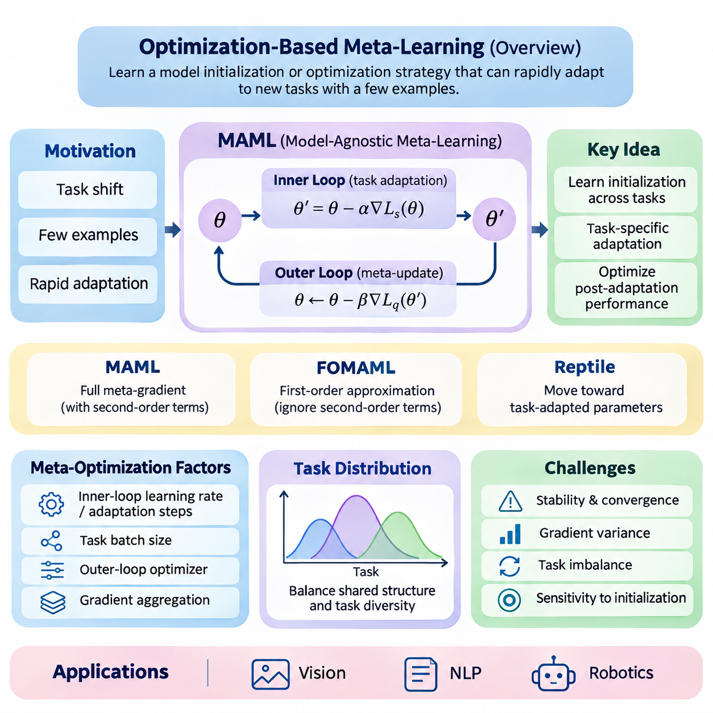
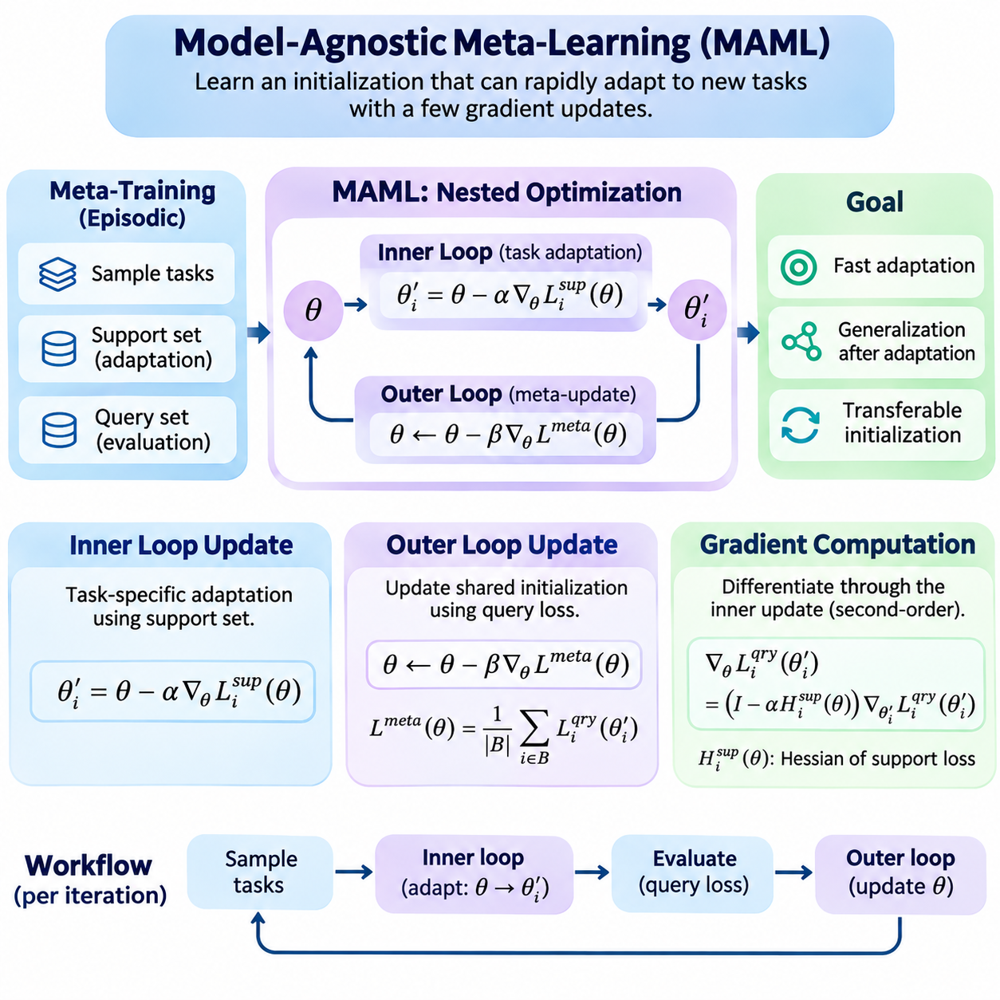
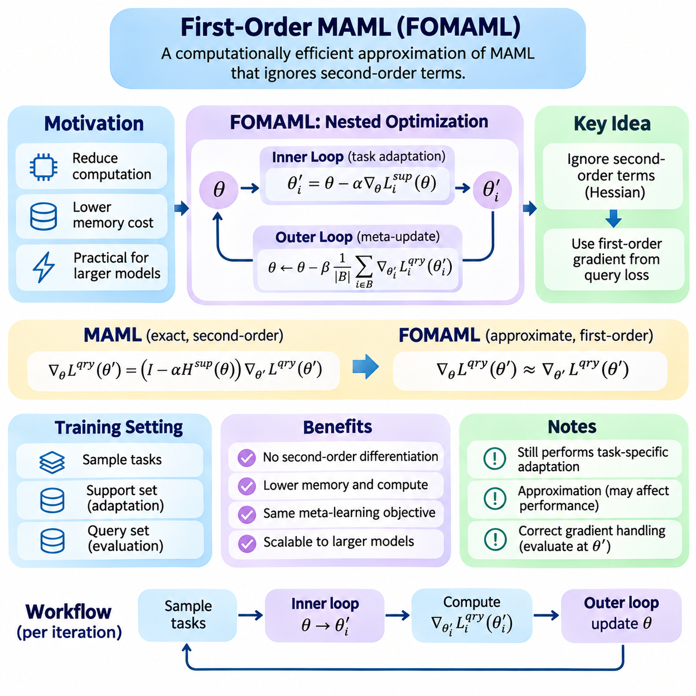
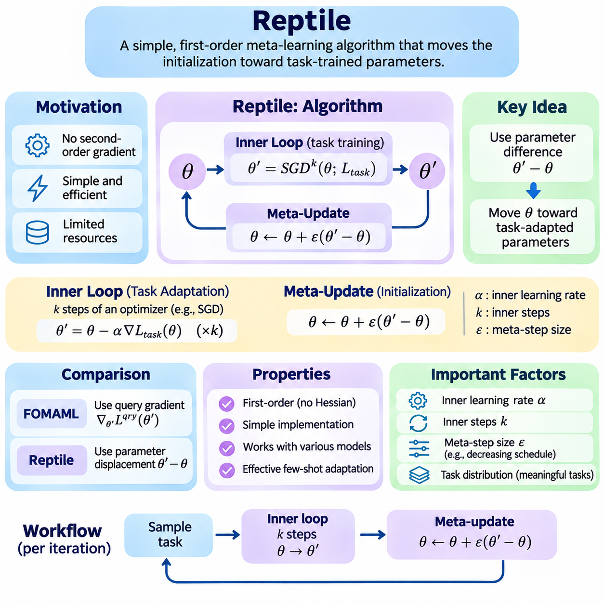
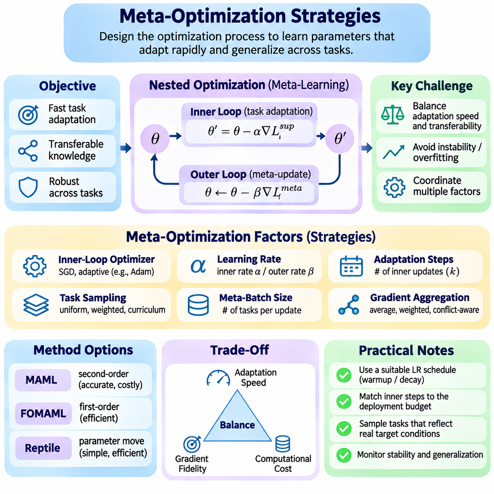
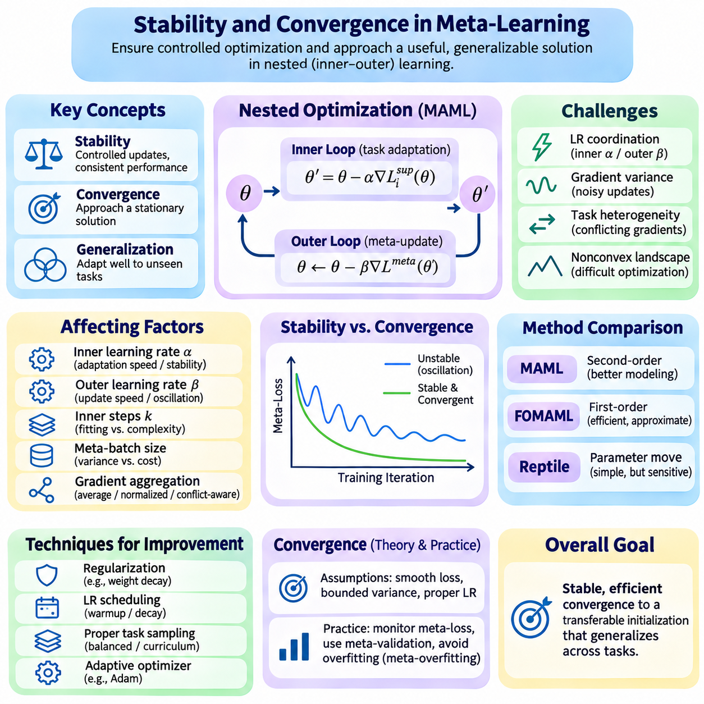
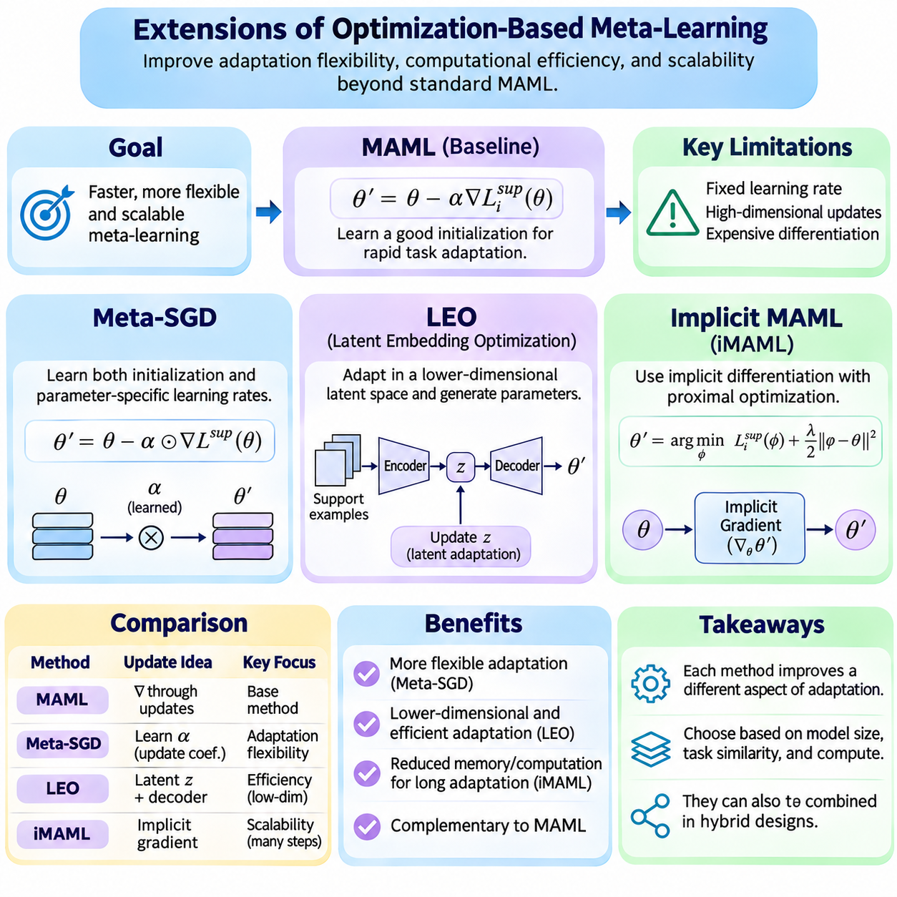
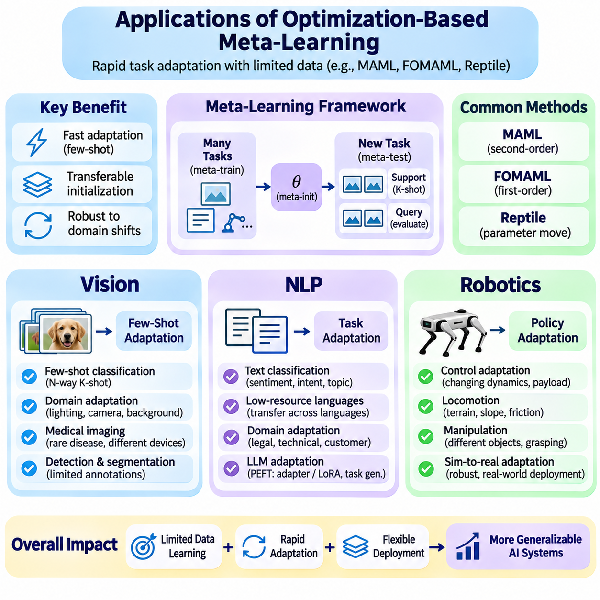

**Volume 36. Meta Learning and Few Shot Adaptation**

# 02. MAML and Optimization Based Meta Learning

## 02.00 Overview

{width="7.268055555555556in" height="7.268055555555556in"}

Optimization-based meta-learning provides a systematic framework for training models that can adapt rapidly to unfamiliar tasks using only a small number of examples. Rather than optimizing a model exclusively for performance on a fixed dataset, this approach optimizes the learning process itself. Its central objective is to discover model parameters, update mechanisms, or optimization strategies that support efficient adaptation across a distribution of related tasks.

Traditional supervised learning typically assumes that training and evaluation examples originate from sufficiently similar distributions. When a new task introduces different classes, objectives, or operating conditions, substantial retraining may be necessary. Optimization-based meta-learning addresses this limitation by exposing a model to many learning episodes, encouraging it to acquire an initialization or adaptation procedure that transfers effectively to previously unseen tasks.

Model-Agnostic Meta-Learning, commonly known as MAML, represents a foundational approach within this family. MAML seeks an initial parameter configuration from which a neural network can achieve strong task-specific performance after only a few gradient updates. Its model-agnostic property means that the underlying method can be applied to different differentiable architectures and learning objectives, including classification, regression, and reinforcement learning.

The conceptual foundation of MAML is a hierarchical optimization process involving an inner loop and an outer loop. The inner loop performs task-specific adaptation using a limited support dataset, while the outer loop evaluates the adapted models and updates their shared initialization. By optimizing performance after adaptation rather than before adaptation, the system learns parameters that are particularly responsive to new task information.

During meta-training, tasks are sampled from a task distribution representing the expected range of learning problems. Each task typically contains a support set for adaptation and a query set for evaluating the resulting model. The support examples determine task-specific parameter updates, while query performance contributes to the meta-objective. This episodic structure closely reflects the conditions encountered during few-shot evaluation.

The distinction between ordinary parameter optimization and meta-optimization is fundamental. Conventional training minimizes a loss function directly with respect to model parameters. MAML instead minimizes the expected query loss obtained after applying a task-dependent optimization procedure. Consequently, the meta-objective depends not only on the initial parameters but also on how those parameters change during adaptation.

In its standard formulation, MAML uses gradient descent for inner-loop adaptation and differentiates the outer-loop objective through the adaptation process. This introduces second-order derivative information when a gradient-based inner update is used. Such computations capture how changes in the initial parameters influence subsequent learning, but they can increase memory requirements, computational cost, and implementation complexity.

First-Order MAML, or FOMAML, reduces this computational burden by ignoring second-order terms in the meta-gradient calculation. The resulting approximation simplifies optimization and can improve practical efficiency, particularly when deep architectures or multiple adaptation steps are involved. However, eliminating higher-order information changes the optimization dynamics and may affect performance depending on the task distribution.

Reptile offers another influential optimization-based meta-learning strategy. Instead of explicitly differentiating through the inner optimization trajectory, Reptile repeatedly trains on sampled tasks and moves the shared initialization toward the resulting task-adapted parameters. This approach avoids higher-order differentiation and provides a relatively simple mechanism for encouraging rapid adaptation across related learning problems.

Although MAML, FOMAML, and Reptile share the objective of improving adaptation, they differ in how meta-updates are constructed. MAML explicitly optimizes post-adaptation query performance through differentiation, FOMAML approximates this process using first-order gradients, and Reptile relies on parameter differences after task-specific training. These distinctions influence computational requirements, optimization behavior, and empirical generalization.

Meta-optimization strategies extend beyond selecting a particular algorithm. Inner-loop learning rates, adaptation steps, task batch sizes, outer-loop optimizers, and gradient aggregation methods all influence learning effectiveness. Their interactions determine whether a meta-learned initialization remains broadly transferable or becomes excessively specialized to the tasks encountered during training.

The relationship between task diversity and adaptation quality is especially important. A narrow task distribution may produce an initialization that adapts efficiently within a limited domain but generalizes poorly to substantially different problems. Conversely, excessive task heterogeneity can create conflicting optimization directions. Effective meta-training therefore requires a carefully constructed task distribution that balances shared structure with meaningful variation.

Stability and convergence present additional challenges because meta-learning involves nested optimization processes. Large inner-loop learning rates may produce unstable adaptation, while aggressive outer-loop updates can disrupt previously learned transfer properties. Gradient variance, task imbalance, and sensitivity to initialization can further complicate training. Reliable implementations must monitor both meta-training behavior and performance on held-out tasks.

Computational efficiency becomes particularly significant when the inner loop contains multiple gradient steps. Higher-order differentiation may require retaining intermediate computational graphs, increasing memory consumption as adaptation depth grows. Practical systems can address these limitations through first-order approximations, gradient checkpointing, carefully controlled adaptation horizons, and alternative formulations that avoid explicitly storing the complete optimization trajectory.

Meta-SGD extends the basic MAML framework by learning not only an initialization but also parameter-specific update coefficients. These coefficients determine the magnitude and direction of adaptation for individual model parameters. By incorporating learned update behavior into the meta-training objective, Meta-SGD introduces additional flexibility that may improve adaptation efficiency when the task distribution supports consistent update patterns.

Latent Embedding Optimization, or LEO, approaches adaptation through a lower-dimensional latent representation. Instead of performing all task-specific optimization directly in the original high-dimensional parameter space, LEO learns a latent space in which adaptation can be performed more efficiently. A decoding mechanism then maps adapted latent variables into model parameters, potentially improving adaptation in high-dimensional few-shot settings.

Implicit MAML investigates an alternative method for computing meta-gradients without explicitly differentiating through every inner-loop optimization step. By using implicit differentiation under appropriate mathematical conditions, it can reduce dependence on the length of the adaptation trajectory. This approach illustrates how optimization theory can improve the scalability of meta-learning while preserving sensitivity to task-specific solutions.

Optimization-based meta-learning also has important connections to transfer learning and conventional fine-tuning. Both approaches reuse information acquired from previous tasks, but their training objectives differ. Standard transfer learning generally seeks reusable representations or pretrained parameters, whereas optimization-based meta-learning explicitly rewards parameters that produce favorable results after a prescribed adaptation procedure.

In computer vision, these methods can support few-shot image classification when only a limited number of labeled examples are available for new categories. Meta-training across classification episodes encourages the model to acquire parameters that adapt efficiently to unfamiliar visual distinctions. Performance depends on the diversity of training tasks, representation quality, adaptation configuration, and similarity between training and evaluation conditions.

Natural language processing provides another application domain where optimization-based meta-learning can address limited task-specific supervision. Potential applications include adapting text classifiers to new categories, domains, or linguistic conditions. However, language models introduce challenges associated with large parameter spaces, heterogeneous task structures, and computationally expensive updates, making efficient adaptation strategies especially relevant.

Robotics presents a particularly demanding environment because adaptation must often occur under changing physical conditions and limited interaction budgets. Optimization-based meta-learning can support rapid adjustment to variations in dynamics, control objectives, or operating environments. Nevertheless, practical deployment requires attention to sample efficiency, real-time constraints, system identification, and the safety implications of exploratory adaptation.

Evaluating optimization-based meta-learning requires more than measuring final predictive accuracy. Important considerations include adaptation speed, performance before and after updating, computational cost, memory consumption, and robustness across different task distributions. Comparisons should use consistent support and query protocols, controlled optimization budgets, and multiple random seeds to distinguish genuine adaptation improvements from experimental variability.

The broader significance of optimization-based meta-learning lies in its treatment of learning dynamics as an explicit optimization target. MAML establishes the central framework, while FOMAML, Reptile, Meta-SGD, LEO, and Implicit MAML explore different tradeoffs between flexibility, efficiency, and mathematical complexity. Together, these methods provide a foundation for understanding how intelligent systems can acquire transferable learning procedures rather than relying solely on fixed knowledge.

## 02.01 Model Agnostic Meta Learning (MAML) [w/Code]

{width="7.268055555555556in" height="7.268055555555556in"}

Model-Agnostic Meta-Learning (MAML) is an optimization-based meta-learning algorithm designed to identify model parameters that can adapt rapidly to new tasks through a small number of gradient updates. Unlike conventional training, which minimizes loss on a fixed dataset, MAML optimizes an initialization for effective future learning. Its central principle is that a useful initialization should enable strong generalization after limited task-specific adaptation.

MAML operates over a distribution of related tasks rather than individual training examples. Each task contains a support set used for adaptation and a query set used to evaluate the adapted model. During meta-training, multiple tasks are sampled to expose the model to diverse learning conditions. The resulting optimization process encourages the initial parameters to capture transferable structure while remaining responsive to task-specific information.

The algorithm consists of two interconnected optimization stages known as the inner loop and outer loop. The inner loop performs task-specific parameter updates using support examples, while the outer loop improves the shared initialization by evaluating adapted models on query examples. These stages form a nested optimization framework in which the effectiveness of learning is itself the primary optimization target.

The inner-loop update begins with a shared parameter vector, typically represented by theta, and a task-specific support loss. For each sampled task, gradient descent adjusts the parameters according to the local training objective. A single update can be expressed as theta_i_prime = theta - alpha \\\* grad_theta L_support_i(theta), where alpha represents the inner-loop learning rate and i identifies the sampled task.

The adapted parameters produced by the inner loop are specific to the corresponding task. Although all tasks begin from the same initialization, their support examples generate different gradients and therefore different adaptation trajectories. This mechanism allows a single meta-learned initialization to support multiple specialized models without requiring an independently pretrained network for every task.

Multiple inner-loop updates can be performed when one gradient step is insufficient. At each step, the current task-specific parameters are updated using the gradient of the support loss. Increasing the number of adaptation steps can improve task fitting, but it also raises computational cost and may increase overfitting when support sets are small. The adaptation horizon must therefore reflect the intended deployment conditions.

The inner-loop learning rate plays a critical role in determining adaptation behavior. A small learning rate may produce insufficient parameter changes, while an excessively large rate can cause unstable updates or destroy transferable representations. MAML commonly treats the learning rate as a hyperparameter, although extensions can learn parameter-specific update coefficients. Appropriate tuning depends on model architecture, task diversity, and loss geometry.

A practical implementation must preserve the computational relationship between the initial parameters and their adapted values. In PyTorch, this can be achieved through differentiable gradient operations using torch.autograd.grad with create_graph=True. The adapted parameters are then constructed through functional updates rather than detached parameter assignments, allowing the outer-loop objective to propagate gradients through the adaptation process.

The outer-loop update evaluates how effectively the shared initialization supports learning across sampled tasks. After inner-loop adaptation, each task-specific model is evaluated using its query set. The corresponding query losses are aggregated into a meta-objective, typically through averaging across the task batch. This objective measures performance after adaptation rather than performance at the original initialization.

The meta-objective can be expressed as minimizing the expected query loss over sampled tasks after applying the inner-loop adaptation operator. In simplified notation, the objective is min_theta E_task[L_query_task(U_task(theta))], where U_task represents task-specific gradient updates. This formulation explicitly connects the initial parameters, adaptation dynamics, and final generalization performance.

During the outer-loop update, the gradient of the aggregated meta-objective is computed with respect to the original initialization. A meta-optimizer such as stochastic gradient descent or Adam then modifies the shared parameters. The update can be represented as theta_new = theta - beta \\\* grad_theta L_meta(theta), where beta denotes the outer-loop learning rate and L_meta is the aggregated post-adaptation query loss.

The outer-loop learning rate determines how rapidly the shared initialization changes across meta-training iterations. Aggressive updates may cause oscillation or instability when task gradients disagree, while conservative updates may slow convergence. Task batch size also influences optimization behavior because averaging gradients across more tasks can reduce sampling variance at the expense of additional computation and memory.

Gradient computation is the defining technical characteristic of standard MAML. Because adapted parameters depend on the initial parameters through gradient descent, differentiating the query loss requires applying the chain rule through the inner-loop update. For a single gradient step, this introduces a Hessian-related term that captures how the support-loss gradient changes with respect to the initialization.

For one-step adaptation, the meta-gradient can be written conceptually as grad_theta L_query(theta_prime) = (I - alpha \\\* H_support(theta)) \\\* grad_theta_prime L_query(theta_prime), where H_support is the Hessian of the support loss. This expression shows that standard MAML incorporates second-order information when differentiating through gradient-based adaptation, rather than relying only on ordinary query gradients.

Explicitly constructing a full Hessian matrix is generally unnecessary. Automatic differentiation frameworks can compute the required Hessian-vector products through nested gradient operations. This approach avoids materializing a potentially enormous second-order matrix, although retaining differentiable inner-loop operations still increases computational and memory requirements compared with ordinary supervised learning.

In PyTorch, a differentiable inner-loop gradient can be obtained using torch.autograd.grad(support_loss, parameters, create_graph=True). Updated parameters are calculated from these gradients, and the query loss is evaluated using the adapted values. Calling backward on the aggregated query loss then computes gradients with respect to the original meta-parameters, provided that the computational graph remains connected.

Functional model execution is particularly useful for implementing MAML correctly. Instead of modifying neural network parameters in place, the implementation passes adapted parameter tensors into the model\'s forward computation. PyTorch facilities such as torch.func.functional_call support this pattern, helping maintain a clear distinction between shared initialization parameters and temporary task-adapted parameters.

A complete meta-training iteration begins by sampling a batch of tasks and dividing each task into support and query examples. The model performs differentiable adaptation separately for every task, evaluates the corresponding query losses, and averages those losses. The meta-optimizer then updates the shared initialization. Repeating this procedure gradually improves the model\'s ability to learn unfamiliar tasks from limited supervision.

A common implementation error occurs when adapted parameters are detached from the computational graph or overwritten using operations that break differentiability. Such mistakes prevent the outer-loop gradient from capturing the influence of the initialization on adaptation. Correct implementations must also avoid unintended gradient accumulation and ensure that each task begins from the same shared initialization within a meta-training iteration.

Memory consumption can become substantial when many tasks, adaptation steps, or large neural networks are involved. Each differentiable inner-loop update may retain intermediate information required for higher-order differentiation. Practical implementations must balance task batch size, adaptation depth, model complexity, and available accelerator memory. First-order approximations or implicit differentiation can provide alternatives when full MAML becomes computationally prohibitive.

Numerical stability is another important consideration because nested optimization can amplify poorly conditioned gradients. Gradient clipping, suitable learning-rate schedules, normalized inputs, and careful loss scaling may improve training reliability. However, these techniques must be evaluated experimentally because their effects depend on task characteristics and model architecture. Monitoring both inner-loop losses and outer-loop validation performance helps identify unstable adaptation.

Meta-validation should use tasks that are distinct from those sampled during meta-training. Each validation task follows the same adaptation protocol, using its support set for parameter updates and its query set for performance measurement. This separation helps determine whether the learned initialization supports genuine task-level generalization rather than memorization of recurring training tasks or examples.

The distinction between meta-training and meta-testing is essential. During meta-training, query losses update the shared initialization through the outer loop. During meta-testing, the initialization is fixed, and only task-specific adaptation is performed using the new task\'s support examples. Query examples are reserved for evaluation and must not influence adaptation unless the experimental protocol explicitly defines an additional learning stage.

MAML can be applied to supervised learning problems such as few-shot classification and regression, where tasks differ in their labels, target functions, or data distributions. It can also be extended to reinforcement learning, where task-specific adaptation uses policy optimization objectives derived from collected trajectories. In all cases, the central requirement is a suitable differentiable adaptation process and a meaningful distribution of related tasks.

The effectiveness of MAML depends strongly on the relationship between meta-training tasks and future adaptation problems. If tasks share useful underlying structure, a common initialization can provide substantial adaptation benefits. When tasks are highly heterogeneous or differ significantly from the training distribution, optimization may become difficult and generalization may deteriorate. Task construction is therefore as important as the optimization algorithm itself.

MAML establishes a general framework in which inner-loop updates acquire task-specific knowledge, outer-loop updates improve transferable initialization, and gradient computation connects these two learning processes. Understanding their mathematical relationships and implementation requirements provides the foundation for first-order MAML, Reptile, learned optimization strategies, and advanced meta-learning systems designed for rapid adaptation under limited data and computational resources.

## 02.02 First Order MAML (FOMAML) [w/Code]

{width="7.268055555555556in" height="7.268055555555556in"}

First-Order Model-Agnostic Meta-Learning (FOMAML) is a computationally efficient approximation of Model-Agnostic Meta-Learning (MAML) designed to reduce the complexity of meta-gradient computation. Standard MAML differentiates through task-specific gradient updates, introducing second-order derivative terms. FOMAML simplifies this process by ignoring these terms while preserving the fundamental objective of learning an initialization that supports rapid adaptation to new tasks.

The motivation for FOMAML arises from the computational demands of nested optimization. In standard MAML, the outer-loop gradient depends on how the inner-loop optimization changes with respect to the initial parameters. Calculating this dependency requires higher-order automatic differentiation, which increases memory consumption and computational overhead. FOMAML approximates the meta-gradient using first-order information, making meta-training more practical for larger models.

FOMAML retains the same episodic learning framework as standard MAML. Tasks are sampled from a distribution, and each task is divided into a support set and a query set. The support set provides examples for task-specific adaptation, while the query set evaluates performance after adaptation. This separation ensures that meta-training emphasizes the ability to generalize from limited task-specific observations rather than merely fitting the available support examples.

The inner-loop optimization procedure in FOMAML is conceptually identical to that of standard MAML. Starting from shared parameters theta, each task performs one or more gradient descent updates using its support loss. A single adaptation step can be expressed as theta_i_prime = theta - alpha \\\* grad_theta L_support_i(theta), where alpha denotes the inner-loop learning rate and theta_i_prime represents the adapted parameters for task i.

Although the inner-loop update uses ordinary gradient descent, the key difference appears during outer-loop differentiation. Standard MAML accounts for the derivative of the adapted parameters with respect to their initialization, including Hessian-related information. FOMAML approximates this derivative as the identity transformation, effectively treating the adaptation mapping as locally constant in its derivative contribution beyond the direct parameter relationship.

For one-step adaptation, the exact MAML meta-gradient contains the factor I - alpha \\\* H_support(theta), where H_support denotes the Hessian of the support loss. FOMAML replaces this factor with the identity matrix I. Consequently, the approximate meta-gradient becomes grad_theta L_meta approximately equal to grad_theta_prime L_query(theta_prime), avoiding explicit Hessian-vector products while retaining the query-loss gradient evaluated at the adapted parameters.

This approximation does not mean that FOMAML ignores task-specific adaptation. The adapted parameters still depend on the support examples, and the query gradient is evaluated after those updates have occurred. What is omitted is the second-order sensitivity of the adaptation trajectory to the initial parameters. FOMAML therefore preserves the central meta-learning mechanism while simplifying how information is propagated through the optimization process.

During meta-training, a batch of tasks is sampled and independently adapted from the same shared initialization. Each task produces adapted parameters and an associated query loss. The gradient of each query loss is calculated with respect to its adapted parameters, and these gradients are aggregated across tasks. The resulting first-order meta-gradient is used by the outer-loop optimizer to update the shared initialization.

The outer-loop update can be represented as theta_new = theta - beta \\\* average_i[grad_theta_i_prime L_query_i(theta_i_prime)], where beta is the meta-learning rate. This expression emphasizes that the update direction reflects query performance across multiple adapted tasks. Although the gradient is approximate, the shared initialization is still optimized to improve the expected effectiveness of subsequent task-specific learning.

A practical FOMAML implementation can use PyTorch automatic differentiation without retaining higher-order computational graphs. Inner-loop gradients may be computed with torch.autograd.grad using create_graph=False. Adapted parameters are then constructed for each task, and query gradients are calculated with respect to those adapted values. The resulting gradients can be accumulated into the original meta-parameters before applying the outer-loop optimizer.

Correct gradient handling is essential because detaching the adaptation trajectory changes how gradients propagate. In FOMAML, the intended approximation deliberately removes higher-order dependencies, but the implementation must still calculate query gradients at the correct adapted parameters. Simply detaching every tensor without reconstructing differentiable query evaluation can eliminate required gradients and produce an incorrect training procedure.

Functional parameter updates provide a convenient implementation strategy. A model can be evaluated using explicitly supplied parameter tensors rather than modifying its stored weights directly. This approach separates the shared initialization from temporary task-specific parameters and simplifies gradient aggregation. PyTorch utilities such as torch.func.functional_call can support this design when combined with appropriate parameter management.

FOMAML can substantially reduce the computational overhead associated with second-order differentiation, particularly when inner-loop adaptation contains multiple updates. However, it still requires task-specific optimization and query evaluation for every sampled task. Its computational cost therefore remains greater than that of many conventional single-task training procedures, especially when large task batches or deep networks are involved.

The accuracy of the first-order approximation depends on the local geometry of the task losses and the magnitude of adaptation updates. When curvature effects are relatively small, ignoring Hessian-related terms may have limited influence on the meta-gradient direction. When the loss landscape exhibits strong curvature or adaptation steps are large, the approximation may differ substantially from the exact MAML gradient.

Inner-loop learning rates influence both adaptation quality and approximation accuracy. Small learning rates generally produce modest parameter changes and may reduce the importance of neglected curvature terms. Larger learning rates can accelerate adaptation but may amplify discrepancies between first-order and second-order meta-gradients. Appropriate learning-rate selection therefore requires balancing rapid task adaptation against stable meta-optimization.

The number of inner-loop steps introduces another important tradeoff. Additional steps may allow the model to fit task-specific support examples more effectively, but they also increase computational requirements and alter the relationship between the initialization and adapted parameters. With multiple updates, the exact MAML gradient involves products of Jacobian factors, whereas FOMAML approximates these factors by identity transformations.

Task batch size influences the statistical reliability of FOMAML updates. Because different tasks may generate conflicting query gradients, averaging across multiple tasks can reduce gradient variance and improve training stability. However, larger batches require additional task adaptations and query evaluations. Practical configurations must balance computational resources, task diversity, and the desired stability of the meta-learning process.

FOMAML is closely related to Reptile, another first-order optimization-based meta-learning algorithm, but their update mechanisms differ. FOMAML uses query-loss gradients evaluated at adapted parameters, whereas Reptile updates the initialization toward parameters obtained after task-specific training. Both avoid explicit second-order differentiation, yet they represent different approximations and may exhibit distinct behavior across task distributions.

The distinction between FOMAML and ordinary joint training is equally important. Joint training optimizes shared parameters directly across multiple tasks without explicitly targeting post-adaptation query performance. FOMAML instead evaluates each task after support-set adaptation and constructs its meta-update from the resulting query gradients. This encourages an initialization that facilitates future learning rather than merely performing well before adaptation.

Meta-validation provides an essential mechanism for evaluating whether the learned initialization generalizes beyond the meta-training tasks. Validation tasks should remain separate from training tasks, and each should use a consistent support-query protocol. Performance can be measured before adaptation and after different numbers of gradient updates, revealing whether the initialization supports rapid improvement under limited supervision.

Experimental comparisons between MAML and FOMAML should control model architecture, task sampling, support-set size, query-set size, adaptation steps, and optimization settings. Relevant metrics include post-adaptation accuracy, adaptation speed, training time, memory consumption, and variability across random seeds. Such comparisons help determine whether the computational savings justify any reduction in adaptation performance.

In few-shot computer vision, FOMAML can support rapid adaptation to previously unseen image categories using a limited number of labeled examples. Its reduced differentiation cost can be useful when convolutional or transformer-based feature extractors are involved. Nevertheless, representation quality, task construction, and the number of trainable parameters strongly influence whether first-order adaptation delivers practical advantages.

Natural language processing offers additional applications involving rapid adaptation to new classification tasks, domains, or linguistic conditions. FOMAML can reduce the cost of meta-training compared with full second-order MAML, although large language architectures may still require substantial memory and computation. Parameter-efficient adaptation and selective fine-tuning can be combined with first-order meta-learning to improve scalability.

In robotics and reinforcement learning, FOMAML can facilitate adaptation to changing dynamics, control objectives, or environmental conditions. Reduced differentiation overhead is attractive when task-specific policy updates are expensive. However, reinforcement learning introduces additional challenges involving noisy gradient estimates, trajectory sampling, exploration, and safety constraints, which may limit the practical benefits of computational simplification.

FOMAML demonstrates that effective meta-learning does not always require exact differentiation through the complete adaptation process. By retaining task-specific inner-loop learning and post-adaptation query evaluation while approximating higher-order dependencies, it provides a practical balance between computational efficiency and adaptation capability. Its principles form an important foundation for scalable optimization-based meta-learning and efficient few-shot adaptation systems.

## 02.03 Reptile [w/Code]

{width="7.268055555555556in" height="7.268055555555556in"}

Reptile is a first-order optimization-based meta-learning algorithm designed to learn model initializations that enable rapid adaptation to new tasks. Unlike Model-Agnostic Meta-Learning (MAML), which differentiates through task-specific optimization, Reptile updates the initialization toward parameters obtained after ordinary task training. This simple mechanism reduces implementation complexity while retaining the objective of improving few-shot learning across related tasks.

The central motivation behind Reptile is that effective meta-learning does not necessarily require explicit second-order derivatives or differentiation through an entire optimization trajectory. Instead, useful transferable parameters can emerge by repeatedly training on sampled tasks and moving the shared initialization toward their adapted solutions. This approach makes Reptile particularly attractive when computational resources or automatic differentiation capabilities are limited.

Reptile operates over a distribution of related learning tasks, each representing a distinct classification, regression, or control problem. During meta-training, a task is sampled and a temporary model is initialized using the current shared parameters. Several optimization steps are then performed on examples from that task. The resulting parameters provide information about a region of parameter space that supports successful task-specific learning.

The inner-loop procedure begins with shared parameters theta and applies k steps of an optimizer such as stochastic gradient descent. After adaptation, the resulting task-specific parameters are denoted by theta_prime. The Reptile meta-update is expressed as theta_new = theta + epsilon \\\* (theta_prime - theta), where epsilon represents the meta-step size. This update moves the initialization toward the parameters reached through task-specific optimization.

The parameter difference theta_prime - theta is the defining signal used by Reptile. Rather than calculating a query-loss gradient through the adaptation process, the algorithm measures how far and in which direction the task-specific optimizer moved. Repeated updates across different tasks encourage the shared initialization to approach parameter regions from which multiple tasks can be learned efficiently with limited additional training.

A typical meta-training iteration samples a task, copies the shared model parameters, and performs several gradient updates on task-specific examples. After adaptation, the temporary parameters are compared with the original initialization. The shared parameters are then interpolated toward the adapted values using the meta-step size. Repeating this procedure across many tasks gradually produces an initialization that supports rapid adaptation.

Reptile can also operate with batches of tasks. Each sampled task begins from the same shared initialization and undergoes independent adaptation. The parameter differences obtained from these tasks are averaged before updating the shared model. This approach reduces variability caused by individual task samples and can improve the stability of meta-optimization, although it increases the computational cost of each meta-training iteration.

The number of inner-loop optimization steps is an important design parameter. With only one stochastic gradient step, Reptile closely resembles ordinary joint training because the parameter difference is proportional to a training gradient. Multiple steps introduce interactions among gradients computed from different examples within the same task. These interactions help the algorithm favor initializations that support effective within-task generalization.

The theoretical interpretation of Reptile involves gradient alignment across examples from the same task. When gradients from different minibatches point in compatible directions, optimization on one minibatch tends to improve performance on another. Reptile\'s multi-step parameter updates implicitly encourage this alignment, providing a mechanism for learning representations and initializations that transfer efficiently to previously unseen examples.

This gradient-alignment perspective explains why task construction matters. If examples grouped into a task share meaningful structure, their gradients may reveal consistent adaptation directions. If task definitions are arbitrary or internally inconsistent, the resulting updates may provide weak or conflicting meta-learning signals. Reptile therefore depends on a task distribution that reflects the intended few-shot adaptation problems.

The inner-loop learning rate controls the magnitude of task-specific parameter changes. Small values may produce limited adaptation and weak meta-update signals, while excessively large values can cause unstable optimization or movement toward poorly generalized solutions. The meta-step size separately determines how strongly the shared initialization moves toward each adapted model. Both parameters must be tuned to balance adaptation speed and training stability.

A decreasing meta-step schedule can help stabilize Reptile as meta-training progresses. Early iterations may use relatively large interpolation steps to explore useful parameter regions, while later iterations apply smaller changes to refine the initialization. However, convergence behavior depends on task similarity, stochastic gradient noise, model architecture, and the properties of the underlying loss functions.

Reptile differs from First-Order MAML (FOMAML) in the information used for its outer update. FOMAML computes query-loss gradients at task-adapted parameters and uses those gradients to update the initialization. Reptile instead relies on the displacement between initial and adapted parameters. Consequently, Reptile can avoid a separate query-gradient calculation during its basic meta-training procedure.

Although Reptile does not require separate support and query sets for its basic update, evaluation should still distinguish adaptation examples from held-out examples. During meta-testing, a new task is sampled, its support data are used for adaptation, and its query data are reserved for performance measurement. This separation ensures that improvements reflect generalization rather than memorization of the examples used during optimization.

Reptile is relatively straightforward to implement in PyTorch because its inner loop can use ordinary optimizers without retaining higher-order computational graphs. A temporary copy of the model is trained on each sampled task, and its updated parameters are retrieved after adaptation. The shared model is then updated using parameter interpolation, which can be implemented without differentiating through the inner-loop training process.

Careful parameter management remains essential despite the algorithm\'s simplicity. Each task must begin from the current shared initialization rather than from parameters adapted to a previous task. Optimizer states, including momentum buffers, should also be handled consistently to prevent unintended information transfer between tasks. Incorrect state reuse can change the effective adaptation procedure and distort meta-training results.

Computational efficiency is a major advantage of Reptile, particularly when compared with second-order MAML. The algorithm avoids Hessian-vector products and does not need to preserve the complete inner-loop computation graph. Nevertheless, it still requires repeated task-specific optimization, and total training cost can become substantial when many tasks, adaptation steps, or large neural networks are involved.

The effectiveness of Reptile depends on the geometry of the parameter space and the relationship among task-specific solutions. When related tasks have compatible regions of good performance, moving toward their adapted parameters can produce a useful shared initialization. When task solutions are highly conflicting, parameter averaging may become less effective, and adaptation quality may deteriorate.

In few-shot image classification, Reptile can learn an initialization that adapts quickly to new categories using only a small number of labeled examples. Episodic training exposes the model to many classification problems with different class combinations. After meta-training, the model can specialize to unseen categories through a limited number of gradient updates, provided the new tasks share useful structure with the training distribution.

Natural language processing provides applications involving rapid adaptation to new text categories, domains, and language-specific objectives. Reptile\'s simple update mechanism can reduce the engineering complexity of meta-learning compared with methods requiring higher-order differentiation. However, large language models may still impose substantial computational costs, motivating selective parameter updates or parameter-efficient adaptation strategies.

In robotics, Reptile can support adaptation across related control tasks, changing dynamics, or operating conditions. A shared policy initialization may be trained across multiple simulated environments and subsequently adapted to new configurations. Practical deployment requires additional consideration of sample efficiency, safety constraints, and differences between simulated and physical environments, particularly when adaptation requires real-world interaction.

Experimental evaluation should compare Reptile with conventional pretraining, joint training, MAML, and FOMAML under consistent adaptation budgets. Relevant measurements include post-adaptation accuracy or reward, adaptation speed, computational time, memory usage, and performance variation across task samples. Multiple random seeds and held-out task distributions help distinguish reliable improvements from stochastic optimization effects.

Reptile illustrates how simple parameter-space updates can produce meaningful meta-learning behavior without explicitly computing higher-order derivatives. Its effectiveness arises from repeated task-specific adaptation and the aggregation of information contained in the resulting parameter movements. By combining implementation simplicity with the ability to learn transferable initializations, Reptile provides an important foundation for scalable few-shot learning and optimization-based meta-learning systems.

## 02.04 Meta Optimization Strategies

{width="7.268055555555556in" height="7.268055555555556in"}

Meta-optimization strategies determine how a meta-learning system acquires parameters that support rapid adaptation across diverse tasks. Unlike conventional optimization, which minimizes a loss function for a single dataset, meta-optimization evaluates how effectively a model learns after task-specific updates. Its design involves coordinating adaptation dynamics, shared parameter updates, task sampling, and computational efficiency.

The central challenge of meta-optimization is balancing fast task-specific learning with transferable knowledge. An initialization that performs well before adaptation may not be ideal for learning unfamiliar tasks. Conversely, parameters optimized exclusively for rapid changes may become unstable or overly sensitive to limited examples. Effective strategies therefore optimize post-adaptation performance while maintaining robustness across task distributions.

Optimization-based meta-learning commonly employs nested learning processes consisting of inner-loop adaptation and outer-loop meta-updates. The inner loop adjusts parameters using task-specific support examples, while the outer loop evaluates adapted models and improves shared parameters. These processes interact because the choice of inner-loop optimizer, learning rate, and adaptation duration directly influences the meta-objective.

Inner-loop optimization strategies determine how quickly a model responds to task-specific information. Stochastic gradient descent provides a simple and interpretable baseline, while adaptive optimizers can adjust update magnitudes according to gradient statistics. However, adaptive methods introduce additional optimizer states that may complicate differentiation and task isolation. Their suitability depends on adaptation requirements and computational constraints.

Learning-rate selection is especially important because meta-learning operates across multiple optimization timescales. The inner-loop learning rate controls adaptation within each task, whereas the outer-loop learning rate determines how rapidly transferable parameters change across tasks. Poor coordination between these rates can cause unstable adaptation, slow convergence, or excessive specialization to frequently sampled tasks.

Fixed learning rates provide predictable optimization behavior but may be inefficient when different parameters require different adaptation speeds. Learned learning-rate methods address this limitation by optimizing update coefficients alongside the initial model parameters. Meta-SGD, for example, learns parameter-specific step sizes that can control both the magnitude and direction of task-specific gradient updates.

Learning-rate scheduling can improve stability throughout meta-training. Larger initial meta-learning rates may accelerate exploration of useful parameter regions, while smaller rates can refine the initialization during later stages. Warmup, gradual decay, and adaptive scheduling are possible approaches, although their effectiveness depends on task heterogeneity, gradient variance, and the underlying optimization landscape.

The number of inner-loop adaptation steps is another critical design variable. Too few steps may prevent the model from acquiring sufficient task-specific information, while excessive adaptation can increase computational cost and overfit small support sets. Meta-training should therefore reflect the adaptation budget expected during deployment, including the number of available examples and permitted gradient updates.

Task sampling strategies strongly influence the quality of meta-optimization. Uniform sampling treats tasks equally, whereas weighted sampling can emphasize difficult, rare, or operationally important tasks. Curriculum-based approaches may begin with simpler tasks before introducing more challenging conditions. However, biased sampling can reduce generalization if the resulting training distribution no longer represents expected deployment tasks.

Meta-batch construction determines how many independently adapted tasks contribute to each outer-loop update. Larger task batches generally reduce gradient variance and provide more stable estimates of the meta-objective. Smaller batches require less memory and allow more frequent updates but may produce noisy optimization directions. The appropriate batch size depends on task diversity, model complexity, and available computational resources.

Gradient aggregation strategies influence how information from multiple tasks is combined. Standard approaches average task-level meta-gradients, implicitly assigning equal importance to each sampled task. Alternative strategies may apply task-dependent weights or adjust conflicting gradients. Such methods can improve performance in heterogeneous environments but require safeguards against suppressing useful minority-task information.

Gradient conflicts occur when improvements for one task produce unfavorable changes for another. These conflicts are particularly common when tasks differ substantially in objectives, data distributions, or adaptation requirements. Gradient normalization, conflict-aware aggregation, and balanced task sampling can help manage these interactions. Nevertheless, excessive gradient modification may distort the intended meta-learning objective.

Second-order optimization methods such as standard MAML differentiate through inner-loop updates to capture the sensitivity of adaptation to initialization. This provides a more complete meta-gradient but increases computational and memory requirements. First-order alternatives, including FOMAML and Reptile, simplify gradient computation and can offer favorable efficiency when exact higher-order information is unnecessary.

The choice between first-order and second-order methods involves a tradeoff between gradient fidelity and computational scalability. Second-order methods may capture important curvature effects, particularly when adaptation steps are large or task losses are strongly nonlinear. First-order approximations can support larger task batches and deeper models, but their effectiveness must be verified under the intended adaptation conditions.

Regularization strategies help prevent meta-learned parameters from becoming excessively specialized. Weight decay, dropout, data augmentation, and constraints on adaptation magnitude can improve generalization when applied appropriately. However, regularization interacts with both inner-loop learning and outer-loop optimization. Excessive constraints may prevent the model from adapting sufficiently to genuinely different tasks.

Meta-overfitting occurs when the shared initialization becomes highly effective for sampled training tasks but performs poorly on unseen tasks. This can happen even when individual task-level losses decrease consistently. Independent meta-validation tasks are therefore essential for monitoring generalization. Early stopping and task-distribution diversification can help prevent the outer loop from memorizing recurring training conditions.

Computational efficiency can be improved through gradient checkpointing, mixed-precision computation, selective parameter adaptation, and reduced-order gradient approximations. These techniques address different bottlenecks, including memory retention, arithmetic cost, and optimizer complexity. Their benefits must be evaluated against possible numerical instability and changes in adaptation behavior.

Parameter-efficient meta-optimization limits task-specific updates to selected layers, adapters, or low-rank parameter structures. This reduces the number of variables modified during adaptation and can make large models more manageable. However, restricting the adaptation space may reduce flexibility when new tasks require substantial representational changes. The optimal strategy depends on how much structure tasks share.

Stability monitoring should examine both inner-loop and outer-loop behavior. Useful indicators include support-loss reduction, query-loss improvement, gradient norms, parameter displacement, and variation across sampled tasks. A decreasing training loss alone does not guarantee successful meta-learning. Consistent improvement on held-out tasks provides stronger evidence that the optimization strategy produces transferable adaptation capabilities.

Optimization strategies should also account for differences between meta-training and meta-testing conditions. If deployment tasks provide fewer examples, different class distributions, or stricter adaptation budgets, an initialization optimized under mismatched conditions may perform poorly. Aligning task construction, adaptation steps, and evaluation protocols with operational requirements is therefore essential for reliable generalization.

In reinforcement learning and robotics, meta-optimization must address additional uncertainty arising from stochastic trajectories and environment interactions. Policy-gradient estimates can have high variance, while unsafe exploration may be unacceptable in physical systems. Conservative updates, simulation-based meta-training, and constrained adaptation can improve practicality, although computational efficiency alone cannot guarantee safe behavior.

Experimental comparison of meta-optimization strategies requires consistent architectures, task distributions, adaptation budgets, and evaluation procedures. Performance should be measured through post-adaptation accuracy or reward, convergence speed, memory consumption, and robustness across unseen tasks. Multiple random seeds and controlled ablation studies help identify which optimization choices genuinely improve adaptation.

Effective meta-optimization emerges from coordinating task sampling, learning rates, adaptation depth, gradient computation, regularization, and resource allocation. No single configuration is universally optimal because task similarity, model architecture, and deployment constraints vary considerably. The overarching objective is to learn parameters and update procedures that achieve reliable generalization through efficient task-specific adaptation.

## 02.05 Stability and Convergence

{width="7.268055555555556in" height="7.268055555555556in"}

Stability and convergence are fundamental challenges in optimization-based meta-learning because training involves multiple interacting optimization processes. Unlike conventional learning, where parameters are updated to minimize a single objective, meta-learning optimizes how effectively parameters adapt to different tasks. This nested structure introduces dependencies between adaptation dynamics, meta-gradients, and task distributions.

Stability refers to the ability of a meta-learning algorithm to maintain controlled parameter updates and consistent performance under variations in tasks, data, and optimization conditions. Convergence describes whether the learning process approaches a stationary solution or another well-defined optimization target. These properties are related but distinct, since a numerically stable algorithm may still converge slowly or toward a poorly generalizing initialization.

In Model-Agnostic Meta-Learning (MAML), stability depends on interactions between inner-loop adaptation and outer-loop optimization. The inner loop modifies parameters using task-specific support data, while the outer loop updates the shared initialization according to post-adaptation query losses. Instability in either process can influence the other, making learning-rate coordination and gradient behavior particularly important.

Inner-loop learning rates determine the magnitude of task-specific adaptation. Excessively large values can produce unstable parameter trajectories, overshooting, or divergence, particularly when task losses exhibit strong curvature. Very small values may prevent meaningful adaptation and weaken the meta-learning signal. Appropriate learning rates must balance rapid learning with predictable optimization behavior across diverse tasks.

Outer-loop learning rates control how quickly the shared initialization changes across meta-training iterations. Aggressive updates may cause oscillations when task gradients disagree, while conservative updates can slow progress toward useful parameter regions. Adaptive optimizers such as Adam can improve practical optimization behavior, but their effectiveness depends on gradient statistics and does not guarantee convergence.

The number of inner-loop steps influences both stability and computational complexity. Additional adaptation steps may improve task-specific fitting but can amplify sensitivity to initialization and gradient noise. In second-order MAML, differentiating through longer adaptation trajectories also increases computational demands. Selecting an appropriate adaptation horizon requires considering task difficulty, available data, and expected deployment conditions.

Gradient variance is a major source of instability in meta-learning. Different tasks may produce substantially different gradients because their objectives, data distributions, and support sets vary. Small meta-batches can amplify this variability, producing noisy outer-loop updates. Increasing task batch size or improving task sampling can reduce variance, although additional computation and memory are required.

Task heterogeneity creates another challenge because different tasks may favor incompatible parameter updates. When task gradients point in opposing directions, their aggregation can slow convergence or produce oscillatory behavior. Balanced task sampling, gradient normalization, and conflict-aware aggregation may help manage these effects, but modifying gradients can also change the effective optimization objective.

The curvature of task-specific loss functions influences the stability of gradient-based adaptation. Highly curved directions can cause large changes in gradients even after small parameter updates. Standard MAML captures curvature-related information through higher-order differentiation, but this does not automatically improve numerical stability. Poor conditioning can still produce unreliable gradients and difficult optimization landscapes.

First-Order MAML (FOMAML) reduces computational complexity by ignoring higher-order derivatives during meta-gradient calculation. This approximation can improve memory efficiency and simplify implementation, but it changes the optimization direction. When neglected curvature terms are significant, first-order gradients may deviate substantially from exact MAML gradients, potentially affecting convergence speed and final adaptation quality.

Reptile uses parameter differences between the shared initialization and task-adapted models instead of explicitly differentiating query losses through adaptation. Its simple update mechanism avoids higher-order computation, but stability still depends on inner-loop learning rates, adaptation steps, and meta-step size. Large parameter displacements or conflicting task solutions can produce unstable or inefficient meta-updates.

Convergence analysis often assumes smooth loss functions, bounded gradient variance, and appropriately controlled learning rates. Under suitable mathematical conditions, stochastic optimization methods may approach stationary points in expectation. However, deep neural networks introduce nonconvex objectives, and nested adaptation complicates theoretical guarantees. Practical convergence should therefore be evaluated alongside formal assumptions.

The distinction between convergence and generalization is especially important. A meta-learning algorithm may achieve a low training meta-loss while performing poorly on unseen tasks. This phenomenon, known as meta-overfitting, can arise when the initialization becomes specialized to recurring task structures. Independent meta-validation tasks are necessary to determine whether optimization progress translates into transferable adaptation capabilities.

Regularization can improve stability by limiting excessive parameter growth or sensitivity to individual examples. Weight decay, gradient clipping, data augmentation, and constraints on adaptation magnitude may reduce unstable updates. However, overly strong regularization can restrict task-specific learning and weaken adaptation. Its effectiveness must be assessed through both training behavior and held-out task performance.

Gradient clipping is particularly useful when nested differentiation produces unusually large gradient norms. By limiting update magnitudes, clipping can prevent individual tasks from dominating the meta-optimization process. Nevertheless, clipping does not correct the underlying causes of poor conditioning or conflicting objectives. Persistent clipping may also distort optimization directions and slow convergence.

Numerical precision affects stability when meta-learning involves repeated gradient operations. Mixed-precision training can reduce memory usage and accelerate computation, but insufficient precision may amplify numerical errors during adaptation or higher-order differentiation. Appropriate loss scaling, stable mathematical operations, and selective use of higher precision can help maintain reliable training.

Initialization quality strongly influences convergence because meta-learning explicitly optimizes the starting point for future adaptation. Random initialization may require extensive meta-training before useful transferable structure emerges. Pretrained representations can sometimes accelerate optimization, although they may also constrain adaptation toward previously learned features. The best initialization strategy depends on task similarity and model architecture.

Monitoring convergence requires more than observing a decreasing training loss. Useful indicators include support-loss trajectories, post-adaptation query losses, meta-gradient norms, parameter displacement, and performance variability across tasks. Stable improvement on held-out tasks provides stronger evidence of successful meta-learning than convergence of the training objective alone.

Robust evaluation should include multiple random seeds, independent task samples, and consistent adaptation budgets. Confidence intervals or variability estimates help distinguish systematic improvements from stochastic fluctuations. Comparisons between MAML, FOMAML, and Reptile should control learning rates, model architectures, task distributions, and computational resources whenever possible.

In robotics and reinforcement learning, stability becomes especially important because adaptation may influence physical actions or policy behavior. Noisy trajectory estimates, changing dynamics, and limited interaction budgets can amplify optimization uncertainty. Conservative learning rates, simulation-based validation, and constrained adaptation may reduce risk, but numerical convergence alone does not establish operational safety.

Practical stabilization strategies should address both optimization levels rather than treating the inner and outer loops independently. Coordinated learning-rate schedules, carefully selected adaptation steps, balanced task batches, and systematic validation can improve reliability. When computational resources are constrained, first-order approximations may provide useful alternatives, provided their effects on adaptation quality are measured.

Stability and convergence ultimately determine whether optimization-based meta-learning can produce reliable, transferable initializations. Their successful management requires understanding nested optimization, gradient variance, task heterogeneity, curvature, and generalization. A robust meta-learning system must not only approach a useful optimization solution but also maintain predictable adaptation performance across previously unseen tasks.

## 02.06 Extensions

{width="7.268055555555556in" height="7.268055555555556in"}

Extensions of optimization-based meta-learning address limitations in adaptation flexibility, computational efficiency, and scalability. Standard Model-Agnostic Meta-Learning (MAML) learns an initialization from which task-specific gradient updates can achieve rapid adaptation. However, fixed learning rates, high-dimensional optimization, and expensive differentiation can restrict its effectiveness. Meta-SGD, Latent Embedding Optimization (LEO), and Implicit MAML provide complementary solutions.

Meta-SGD extends MAML by learning not only the initial model parameters but also the learning rates used during task-specific adaptation. Conventional gradient descent typically applies a manually selected scalar learning rate across parameters. Meta-SGD replaces this restriction with trainable parameter-specific update coefficients. This enables the meta-learning system to discover how different components of the model should respond to new task information.

The Meta-SGD adaptation rule can be expressed as theta_prime = theta - alpha \\\* gradient(L_support(theta)), where theta represents the learned initialization and alpha contains trainable update coefficients. The multiplication is performed elementwise, allowing different parameters to have distinct adaptation magnitudes. Because alpha may contain negative values, the method can also learn update directions that differ from conventional gradient descent.

During meta-training, Meta-SGD jointly optimizes theta and alpha using losses evaluated after task-specific adaptation. Each sampled task supplies support examples for the inner update and query examples for the outer objective. Gradients of the query loss are propagated through the adaptation operation to improve both the initialization and update coefficients. The resulting parameters encode where adaptation begins and how its first gradient step is performed.

A major advantage of Meta-SGD is its ability to represent heterogeneous adaptation behavior across neural network parameters. Some parameters may require substantial updates, while others should remain nearly unchanged. Learned coefficients can capture these differences without manually defining separate learning rates for individual layers. This flexibility can improve few-shot adaptation when tasks share useful representations but require different degrees of specialization.

Meta-SGD also introduces additional optimization challenges. Learning one coefficient per parameter increases the number of meta-learned variables and may amplify sensitivity to noisy support gradients. Large coefficients can produce unstable adaptation, while negative coefficients require careful interpretation. Regularization, coefficient constraints, and validation across unseen tasks can help maintain stable and transferable update behavior.

Latent Embedding Optimization (LEO) addresses a different limitation by moving task-specific adaptation from the full model parameter space into a lower-dimensional latent space. High-dimensional neural networks may contain millions of parameters, making direct adaptation expensive and statistically difficult with few examples. LEO instead learns compact latent representations that can generate task-specific model parameters through a decoder.

The LEO architecture typically combines an encoder, a latent representation, and a decoder. The encoder processes task-specific examples and produces a distribution over latent variables. Samples from this distribution are transformed by the decoder into parameters for a task-specific prediction model. Adaptation is performed by updating the latent variables, allowing the model to search a compact space rather than modifying every generated parameter directly.

In few-shot classification, LEO can generate classifier parameters from representations of the available support examples. The latent variables are optimized using task-specific losses, and the decoder maps their updated values into classifier weights. Query examples then evaluate the adapted classifier during meta-training. This procedure encourages the latent space to capture variations that are useful for rapidly distinguishing unfamiliar classes.

LEO\'s dimensionality reduction can improve adaptation efficiency and provide a structured form of regularization. By constraining task-specific solutions to a learned latent manifold, the method can reduce the effective search space. However, this advantage depends on the decoder\'s ability to represent suitable task solutions. An overly restrictive latent space may prevent adaptation when new tasks require parameters outside the learned manifold.

Training LEO requires coordinating representation learning, latent-variable optimization, and parameter generation. Its objective may include query prediction losses, latent-distribution regularization, and reconstruction-related constraints. These components help prevent degenerate representations and encourage meaningful latent structure. Nevertheless, encoder and decoder complexity can offset some savings obtained from lower-dimensional adaptation.

Implicit MAML, commonly associated with implicit gradient methods such as iMAML, addresses the computational cost of differentiating through many inner-loop optimization steps. Standard MAML computes meta-gradients by tracking how task-adapted parameters depend on their initialization. When adaptation involves long optimization trajectories, retaining or reconstructing these dependencies can become expensive in both memory and computation.

The central idea of implicit MAML is to characterize task adaptation through an optimization condition rather than explicitly differentiating through every update. A typical formulation adds a proximal regularization term that keeps adapted parameters near the shared initialization. The adapted solution approximately minimizes the task loss plus a penalty proportional to the squared distance from the initialization, providing a structured relationship between both parameter sets.

Implicit differentiation uses the optimality condition of the inner objective to estimate how the adapted solution changes when the initialization changes. Instead of storing the complete optimization trajectory, the method solves a linear system involving curvature information. Hessian-vector products and iterative solvers, such as conjugate gradient, can compute the required meta-gradient components without explicitly constructing a full Hessian matrix.

This approach can substantially reduce memory requirements when many inner-loop updates are necessary. It also separates the method used to solve each task from the procedure used to calculate the meta-gradient. However, implicit differentiation introduces assumptions about the adapted solution and the local curvature of the regularized objective. Inaccurate inner solutions or poorly conditioned linear systems can weaken gradient estimates.

The proximal regularization strength is an important design parameter in implicit MAML. Strong regularization keeps task-adapted parameters close to the initialization and may improve numerical conditioning, but it can restrict adaptation. Weak regularization permits larger task-specific changes while potentially making the implicit linear system harder to solve. Selecting this coefficient requires balancing adaptation flexibility, stability, and computational efficiency.

Meta-SGD, LEO, and implicit MAML improve different aspects of the adaptation process. Meta-SGD learns how individual parameters should change, LEO learns a compact space in which adaptation occurs, and implicit MAML changes how meta-gradients are computed. These methods are not interchangeable because they address different bottlenecks. Their suitability depends on parameter dimensionality, task similarity, adaptation depth, and available computational resources.

The extensions can also inspire hybrid architectures. Learned update coefficients may be applied to selected parameter groups, while latent adaptation can be combined with efficient gradient estimation. Implicit differentiation may support optimization problems that are too expensive to unroll explicitly. However, combining mechanisms increases implementation complexity and may introduce interactions that require careful theoretical and experimental analysis.

Experimental evaluation should compare these extensions against MAML, FOMAML, Reptile, and conventional pretraining under consistent task distributions. Relevant measurements include post-adaptation accuracy, adaptation steps, memory consumption, computational time, and robustness to task shifts. Ablation studies can isolate the effects of learned learning rates, latent dimensionality, decoder capacity, and implicit solver accuracy.

These extensions illustrate the evolution of optimization-based meta-learning from learning a useful initialization toward learning richer adaptation mechanisms. Meta-SGD introduces trainable update rules, LEO restructures the space of adaptation, and implicit MAML improves differentiation through optimized solutions. Together, they provide complementary foundations for building flexible, scalable, and computationally efficient few-shot learning systems.

## 02.07 Applications

{width="7.268055555555556in" height="7.268055555555556in"}

Optimization-based meta-learning provides practical mechanisms for adapting machine learning models to new tasks with limited data. Model-Agnostic Meta-Learning (MAML), First-Order MAML (FOMAML), and Reptile learn transferable initializations that support rapid task-specific optimization. Their applications are particularly important in computer vision, natural language processing, and robotics, where changing environments and limited labeled examples create adaptation challenges.

The central advantage of these methods is their ability to transfer learning experience rather than simply transferring fixed predictions. During meta-training, models encounter many related tasks and learn parameters that can be updated efficiently. During meta-testing, a previously unseen task provides a small support set for adaptation. Performance is then measured on separate query examples, allowing researchers to evaluate whether the learned initialization supports genuine generalization.

In computer vision, few-shot image classification is one of the most established applications of optimization-based meta-learning. A model is trained across episodes containing different combinations of visual categories. Each episode represents a small classification problem with limited labeled examples. Through repeated adaptation, the model learns an initialization that can distinguish previously unseen categories after only a few gradient updates.

Few-shot classification is commonly organized into N-way K-shot tasks, where N represents the number of classes and K denotes the number of labeled examples per class. The support set guides task-specific adaptation, while the query set evaluates classification performance. MAML optimizes the initialization through post-adaptation query losses, enabling the model to acquire representations that can be rapidly specialized to new visual categories.

Visual recognition under domain shift presents another important application. Models trained on one collection of images may encounter different lighting, camera characteristics, backgrounds, or object appearances during deployment. Meta-learning can simulate such variations by constructing tasks from multiple visual domains. This encourages an initialization that adapts efficiently when the target environment differs from the original training conditions.

Medical image analysis can benefit from few-shot adaptation when annotated examples are scarce or expensive to obtain. Tasks may involve recognizing uncommon abnormalities, adapting to different imaging devices, or learning institution-specific image characteristics. Meta-learning can transfer experience across related datasets, although clinical validation, dataset bias, and uncertainty estimation remain essential before deployment in healthcare environments.

Object detection and semantic segmentation extend meta-learning beyond image-level classification. Detection requires identifying object locations and categories, while segmentation assigns labels to individual pixels or regions. Few-shot adaptation can modify prediction heads or selected feature layers using limited annotated examples. However, dense prediction tasks often involve greater computational complexity and more demanding adaptation objectives.

In natural language processing, optimization-based meta-learning supports adaptation to new text classification tasks, domains, and linguistic conditions. A shared language representation can be meta-trained across related objectives, such as sentiment analysis, intent recognition, and topic classification. When a new task becomes available, a small number of labeled sentences can guide adaptation without requiring complete training from scratch.

Low-resource language processing is especially relevant because many languages lack extensive annotated datasets. Meta-learning can use tasks from related languages or domains to establish transferable initializations. Adaptation may then rely on a limited set of examples in the target language. Its effectiveness depends on linguistic similarity, tokenizer coverage, representation quality, and differences between source and target distributions.

Domain adaptation in NLP addresses changes in vocabulary, writing style, terminology, and communication context. A model trained on general text may perform poorly on legal documents, technical reports, or customer-service conversations. Meta-training across heterogeneous domains can encourage rapid specialization. However, substantial domain differences may require additional representation learning or parameter-efficient fine-tuning.

Large language models introduce opportunities and constraints for optimization-based meta-learning. Full-model adaptation can be computationally expensive because millions or billions of parameters may require gradient updates. Parameter-efficient methods can restrict adaptation to adapters, low-rank components, or selected layers. Meta-optimization can then learn initializations or update procedures for these smaller parameter groups.

Task adaptation in language generation requires evaluation beyond conventional classification accuracy. Relevant measurements may include task completion, factual consistency, semantic similarity, and robustness to unfamiliar instructions. Meta-learning can improve adaptation efficiency, but limited examples may also encourage memorization or unstable generation behavior. Independent evaluation is necessary to establish reliable transfer.

Robotics provides a particularly challenging application because adaptation must account for changing physical dynamics and uncertain environments. A robot may encounter variations in payload, friction, terrain, actuator response, or sensor characteristics. Optimization-based meta-learning can train policies across multiple related conditions, producing an initialization that adapts rapidly when operating circumstances change.

In reinforcement learning, MAML can optimize policy parameters so that a small amount of task-specific experience produces useful behavioral changes. During meta-training, tasks may represent different goals, reward functions, or environment dynamics. Inner-loop adaptation uses collected trajectories to update the policy, while outer-loop optimization evaluates performance after adaptation. This structure supports learning policies designed for rapid specialization.

Locomotion is a representative robotics application involving adaptation to different terrains and movement conditions. A legged robot may need to adjust its behavior when encountering slopes, uneven surfaces, or changes in ground friction. Meta-training across simulated environments can produce adaptable control policies. However, successful simulation results do not guarantee reliable physical performance because real-world dynamics may differ.

Robotic manipulation also benefits from task-level adaptation when objects vary in geometry, mass, surface properties, or grasping requirements. A shared manipulation policy may be trained across different object configurations and subsequently adapted using limited demonstrations or interaction data. Such methods can reduce the need to train separate controllers for every object, provided the underlying tasks share transferable structure.

Sample efficiency is especially important in physical robotics because collecting real-world interaction data requires time, energy, and equipment wear. Meta-learning seeks to reduce the number of interactions needed for adaptation, but gradient-based policy optimization can still require substantial experience. Simulation, offline datasets, and carefully designed task distributions can reduce this burden while supporting systematic evaluation.

Safety constraints distinguish robotic meta-learning from many purely digital applications. Exploratory actions during adaptation may cause collisions, unstable movement, or equipment damage. Practical systems therefore require safety monitoring, constrained policy updates, and independent protective control mechanisms. A rapidly adapting policy should not be assumed safe merely because it performs well during meta-training.

The simulation-to-reality gap presents an additional challenge for robotic deployment. Policies trained in simulation may encounter unmodeled actuator delays, sensor noise, mechanical compliance, or environmental disturbances. Domain randomization can expose meta-learning algorithms to varied simulated conditions, while limited real-world adaptation can compensate for residual differences. Validation must measure both performance and operational reliability.

Across vision, NLP, and robotics, application success depends strongly on how meta-training tasks represent future adaptation requirements. Tasks that are too similar may encourage narrow specialization, while excessively diverse tasks can produce conflicting optimization signals. Effective task construction should preserve meaningful shared structure while exposing the model to variations likely to occur during deployment.

Experimental evaluation should compare meta-learning methods with conventional pretraining, fine-tuning, and joint training under matched adaptation budgets. Important metrics include post-adaptation accuracy or reward, adaptation speed, computational cost, and performance under distribution shifts. Multiple random seeds and held-out tasks help determine whether improvements are consistent rather than artifacts of task sampling.

The broader significance of optimization-based meta-learning lies in its ability to convert experience across related tasks into efficient future adaptation. Computer vision emphasizes recognition from limited annotations, NLP emphasizes linguistic and domain transfer, and robotics emphasizes adaptation under physical uncertainty. Together, these applications demonstrate how transferable initializations can support flexible learning systems while highlighting the importance of reliability, efficiency, and generalization.
