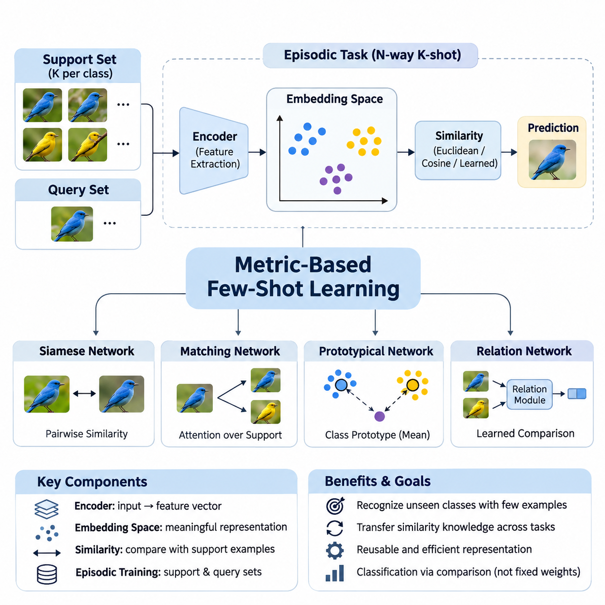
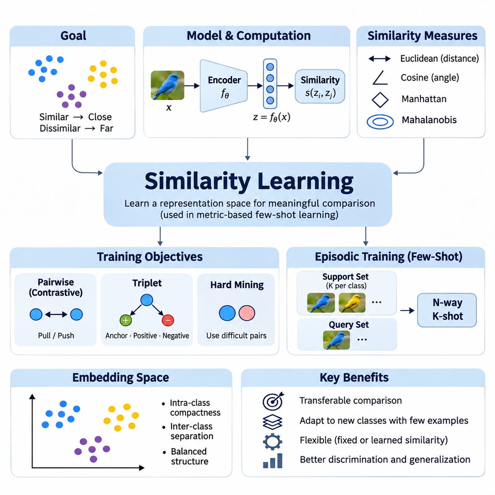
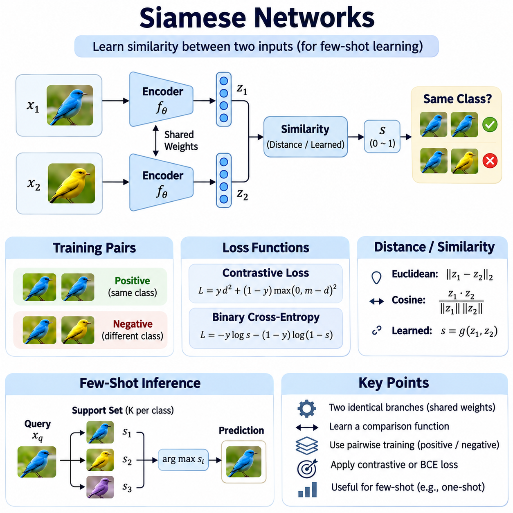
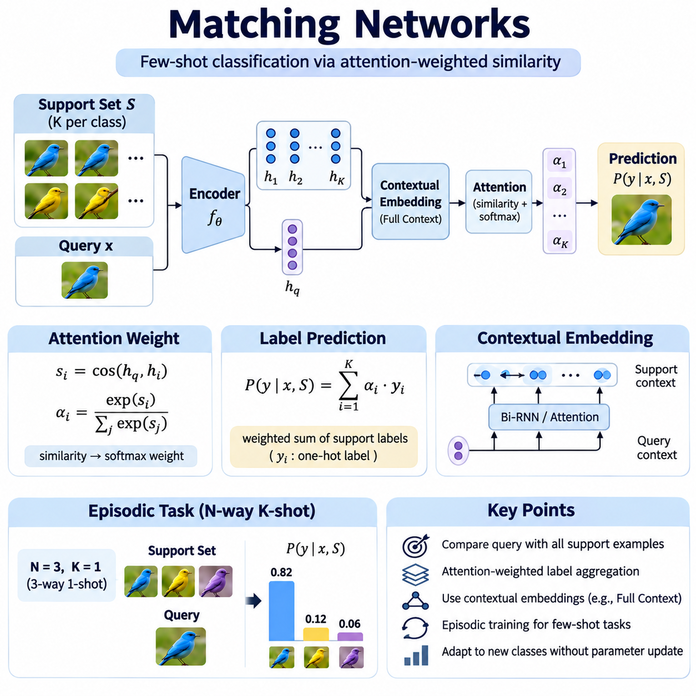
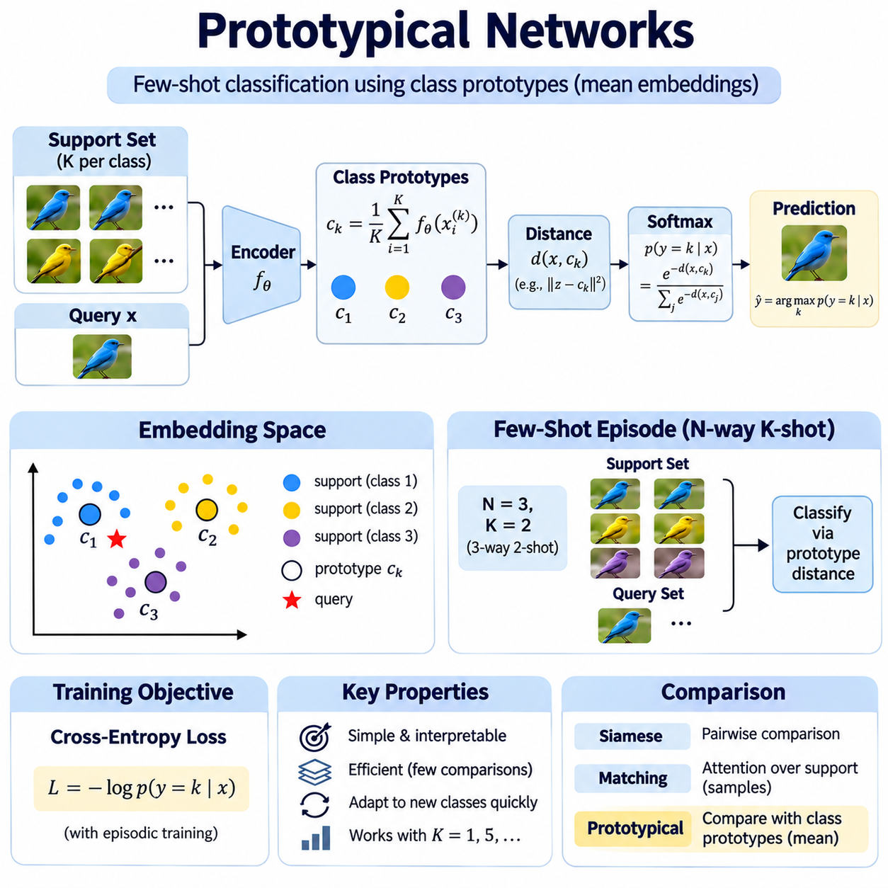
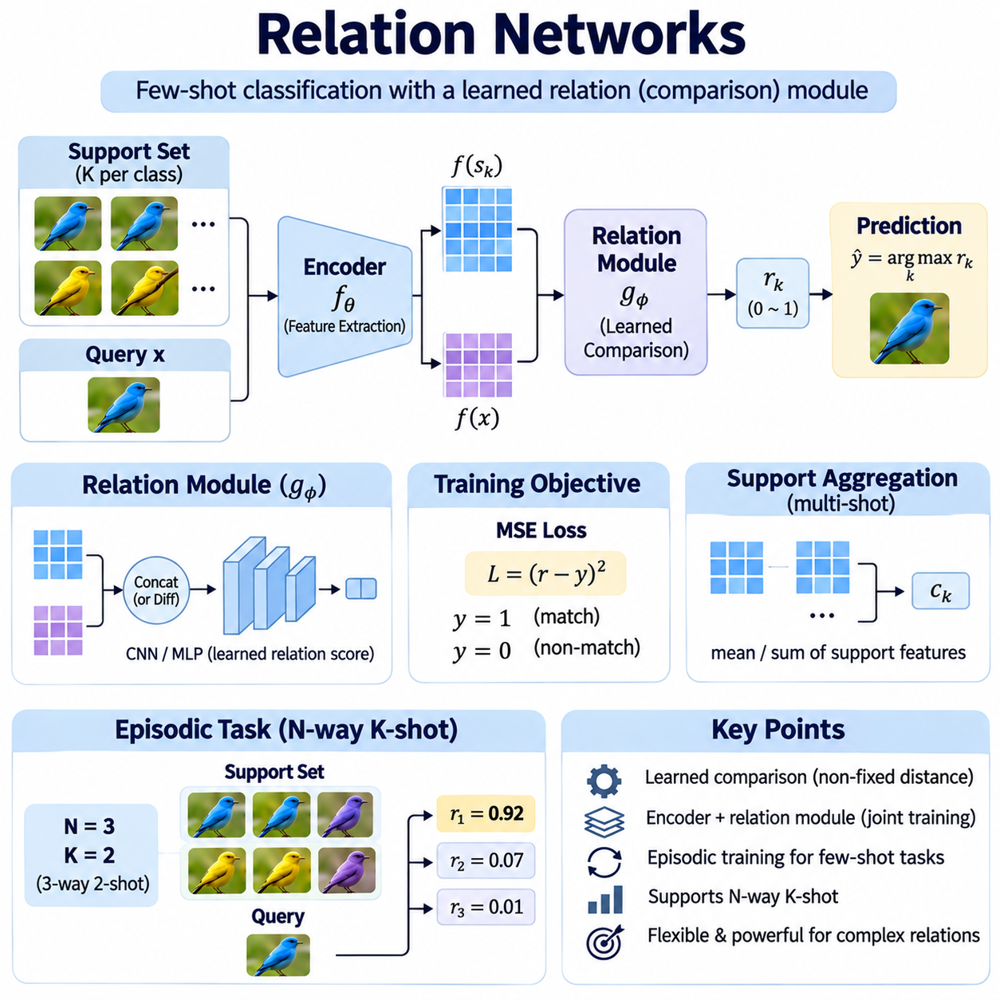
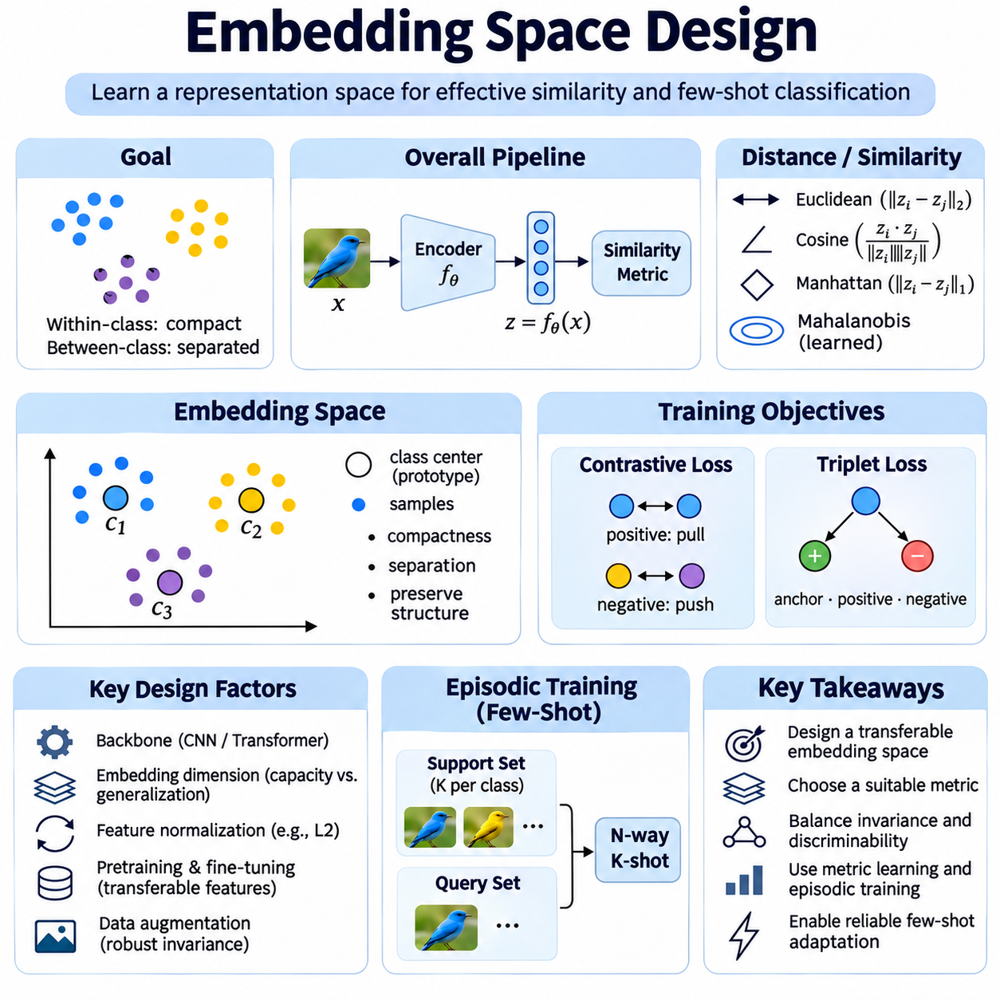
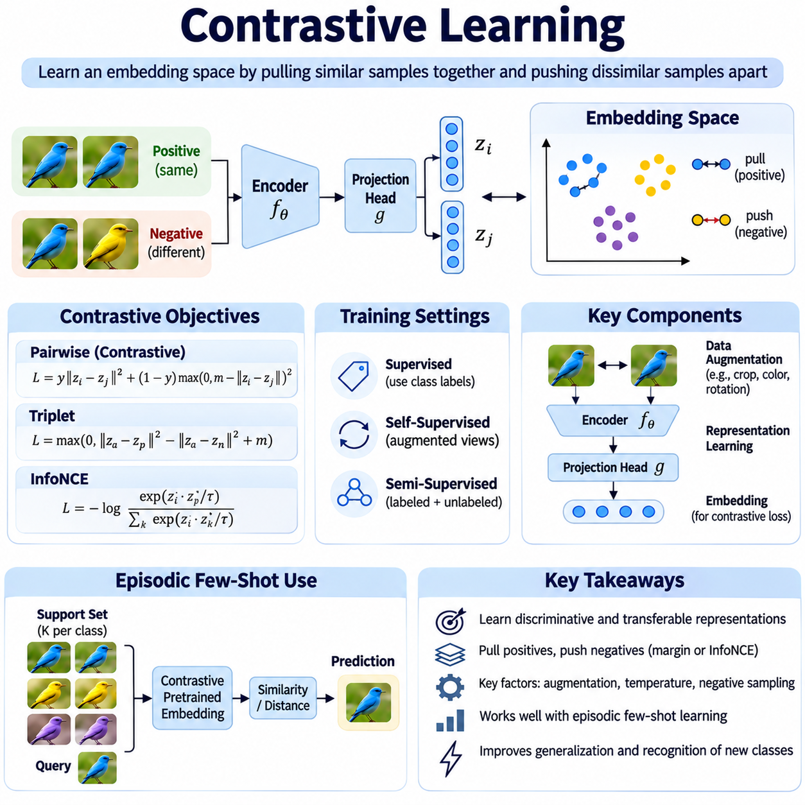
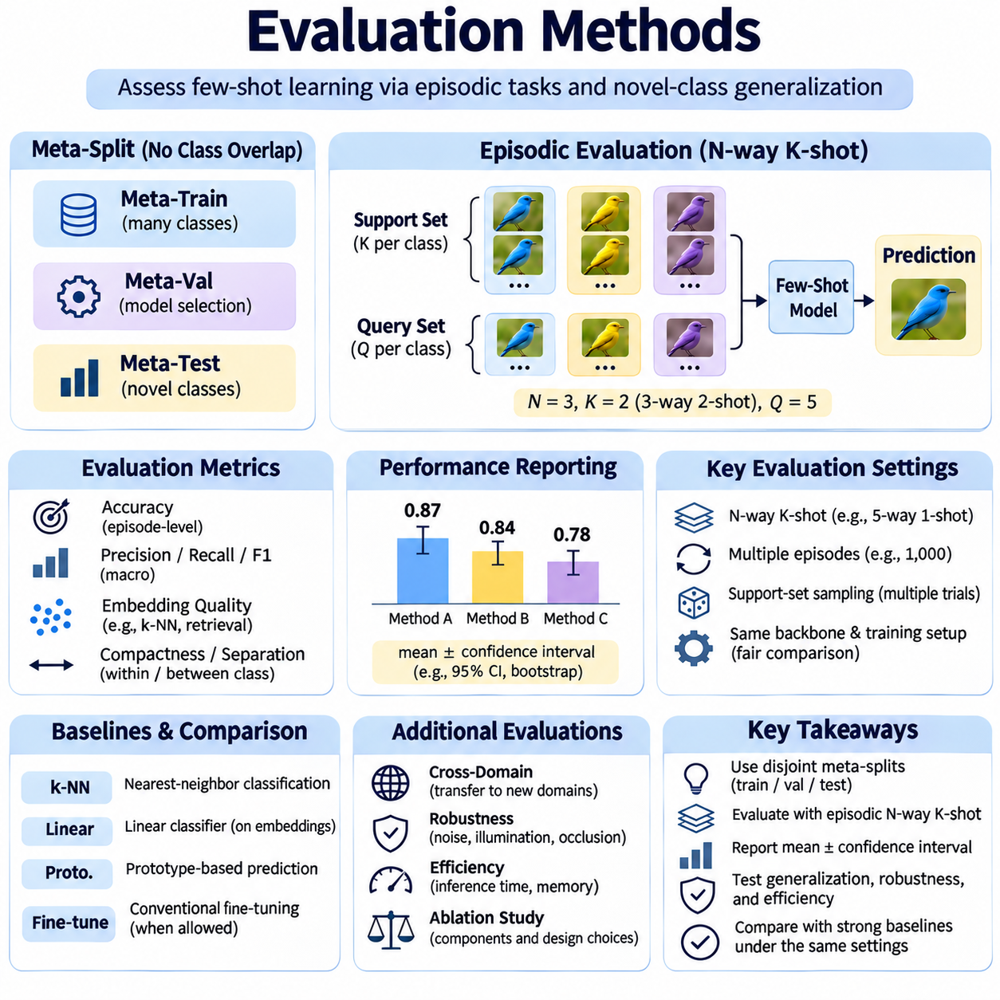
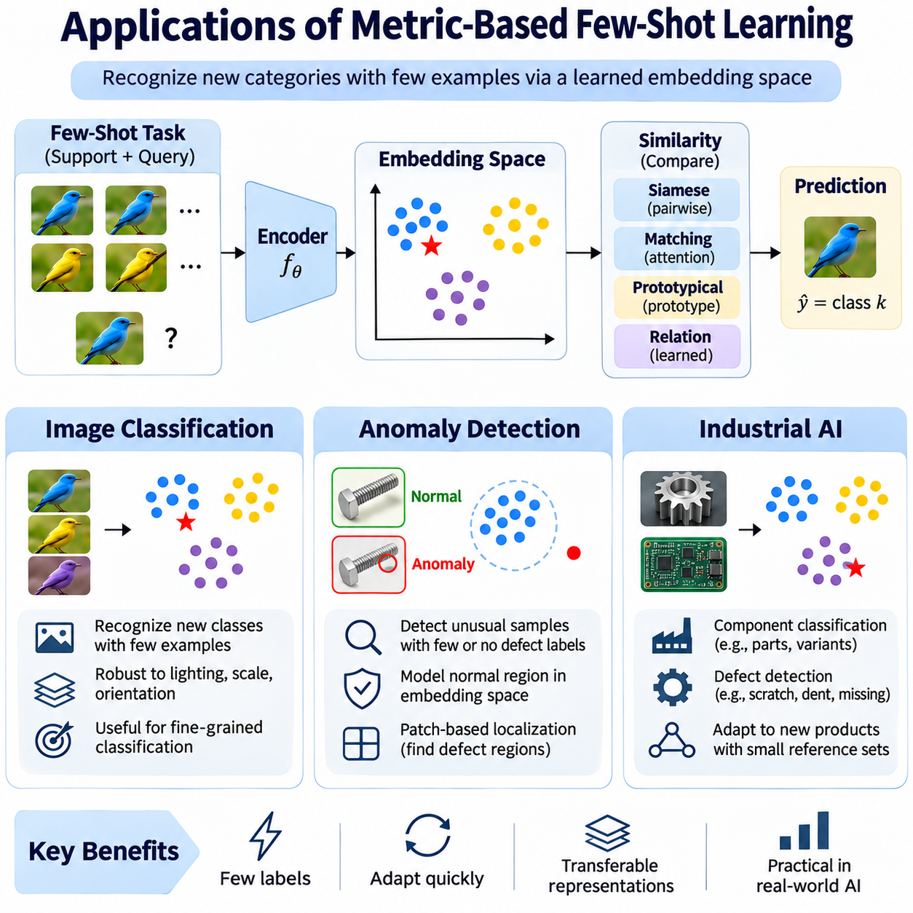

**Volume 36. Meta Learning and Few Shot Adaptation**


# 03. Metric Based Few Shot Learning

## 03.00 Overview

{width="7.268055555555556in" height="7.268055555555556in"}

Metric-based few-shot learning is a branch of meta-learning that enables models to recognize previously unseen classes from only a small number of labeled examples. Instead of learning a separate classifier for every new task, the model learns a representation space in which similarities between examples become meaningful. This approach transforms classification into a comparison problem and reduces the need for extensive task-specific training.

Traditional supervised learning typically requires substantial labeled datasets to establish reliable decision boundaries. However, many practical environments provide only a few examples of newly introduced categories. Metric-based methods address this limitation by transferring knowledge about similarity relationships from previously encountered tasks. Their central objective is to learn reusable representations that support classification under limited supervision.

The fundamental architecture generally consists of a feature extraction network, an embedding space, and a similarity-based decision mechanism. An encoder transforms raw inputs into compact feature vectors that preserve discriminative information. A distance or similarity function then compares these vectors with labeled reference examples. Predictions are generated from relative relationships rather than relying exclusively on fixed classification weights.

Few-shot learning tasks are commonly organized into episodes containing a support set and a query set. The support set provides a small collection of labeled examples representing the classes available within a particular episode. The query set contains additional examples whose labels must be predicted. Episodic training exposes the model to repeated classification problems designed to resemble the conditions encountered during evaluation.

An N-way K-shot classification task contains N candidate classes and K labeled support examples per class. For instance, a five-way one-shot task requires distinguishing five classes using only one labeled example from each category. The trained embedding network maps both support and query examples into a shared feature space. Classification then depends on identifying the most relevant support representations or class-level summaries.

Similarity learning provides the mathematical foundation for this approach. Common comparison functions include Euclidean distance, cosine similarity, and learned nonlinear similarity measures. Euclidean distance evaluates geometric separation, while cosine similarity emphasizes directional alignment between feature vectors. The choice of metric influences decision boundaries, sensitivity to feature magnitude, and robustness across different tasks.

Siamese Networks represent an early and influential approach to metric-based learning. Their architecture processes pairs of examples through shared feature extraction networks and learns whether the examples belong to the same category. Training encourages similar examples to produce compatible representations while separating unrelated examples. Once trained, the network can compare unfamiliar categories without requiring a conventional classifier trained specifically for those classes.

Matching Networks extend similarity-based classification by comparing query representations with labeled examples in the support set. Their prediction mechanism uses attention-weighted relationships between query and support embeddings. Rather than assigning a query to a single nearest example, the model aggregates evidence across multiple support instances. This mechanism allows the classification decision to incorporate the relative relevance of available labeled observations.

Prototypical Networks simplify few-shot classification by constructing a representative prototype for each class. A prototype is commonly calculated as the mean embedding of the corresponding support examples. Query samples are classified according to their distances from these class representatives. This approach combines computational simplicity with an interpretable geometric structure, making it attractive for efficient adaptation to new categories.

Relation Networks introduce a learned comparison mechanism instead of relying exclusively on predefined distance functions. A feature extractor generates representations for support and query examples, while a relation module estimates their compatibility. The relation module can capture nonlinear interactions that conventional geometric distances may overlook. However, this additional flexibility introduces model complexity and potentially greater computational requirements.

Embedding space design is critical because the effectiveness of every comparison mechanism depends on the quality of the underlying representations. A useful embedding space places semantically related examples near one another while maintaining separation between distinct categories. Feature normalization, dimensionality selection, backbone architecture, and regularization all influence this organization. Poorly structured embeddings can undermine classification even when the similarity function is appropriate.

Contrastive learning offers a complementary strategy for improving representation quality. Its objective encourages positive pairs to develop similar embeddings while pushing negative pairs apart. Related approaches use contrastive, triplet, or supervised contrastive objectives to establish discriminative geometric relationships. These techniques can improve metric-based few-shot performance, although their effectiveness depends on pair selection, sampling strategies, and training conditions.

The relationship between metric-based learning and optimization-based meta-learning highlights two different adaptation philosophies. Optimization-based methods, including Model-Agnostic Meta-Learning, generally adapt model parameters through task-specific updates. Metric-based methods primarily adapt predictions through comparisons with newly provided examples. Consequently, many metric-based systems can recognize new categories without performing gradient updates during inference.

This distinction creates practical advantages in applications where rapid adaptation and predictable inference costs are important. New classes can often be introduced by adding labeled support embeddings rather than retraining the complete model. However, the computational cost of comparing queries against large support collections may become significant. Prototype aggregation, embedding caching, and efficient nearest-neighbor retrieval can help manage these limitations.

Evaluation requires careful separation between the classes used for meta-training and those reserved for meta-testing. A model should demonstrate that its learned similarity structure transfers to unfamiliar categories rather than merely memorizing training labels. Episodic evaluation commonly reports average classification accuracy across numerous sampled tasks. Confidence intervals, repeated random seeds, and consistent episode construction improve the reliability of comparisons between different methods.

Few-shot benchmarks frequently include datasets such as Omniglot and MiniImageNet, which provide controlled environments for investigating generalization to unseen classes. Nevertheless, benchmark performance does not automatically establish robustness in production settings. Changes in illumination, background, sensor characteristics, or class distributions may alter embedding relationships. Evaluation should therefore include realistic distribution shifts and representative operational conditions.

Class imbalance and support-set quality introduce additional challenges. When some classes contain fewer or less representative examples, their embeddings may provide unreliable evidence for classification. Noisy labels and outliers can distort prototypes or similarity estimates. Robust aggregation, uncertainty estimation, and careful support-example selection can improve performance, but these mechanisms must be validated against the characteristics of the intended application.

Metric-based learning also faces difficulties when previously unseen classes are extremely similar to classes encountered during training. An embedding network may emphasize features that were discriminative in earlier tasks but fail to capture subtle differences required by new categories. This limitation illustrates the importance of representation transferability. Strong performance requires features that remain meaningful beyond the particular class distinctions present during meta-training.

Image classification is a natural application because visual encoders can transform images into feature representations suitable for comparison. A model trained across diverse visual categories may recognize new object types from a small reference collection. This capability is valuable when collecting extensive labeled examples is expensive or impractical. Performance nevertheless depends on visual similarity, domain consistency, and the representativeness of the reference images.

Anomaly detection provides another important application area, particularly when examples of defective or abnormal conditions are scarce. A metric-based system can learn representations of normal operating conditions and compare incoming observations against reference patterns. Significant deviations may indicate potential anomalies requiring further inspection. However, distance thresholds must be calibrated carefully because unfamiliar but acceptable variations can also produce large embedding distances.

Industrial AI systems can benefit from metric-based few-shot learning when production lines introduce new products, components, or defect categories. Instead of rebuilding an entire classification model whenever specifications change, engineers may update reference embeddings using a limited number of validated samples. This approach can reduce adaptation effort and accelerate deployment. Reliable operation still requires controlled data collection, traceable labels, and systematic validation.

Deployment considerations extend beyond predictive accuracy to include latency, memory consumption, hardware constraints, and operational maintainability. Lightweight embedding networks may support edge inference, while larger architectures can provide stronger representations at higher computational cost. Reference databases must remain synchronized with approved class definitions. Monitoring embedding drift and classification confidence is essential when operating conditions evolve over time.

The broader significance of metric-based few-shot learning lies in its ability to separate reusable representation learning from task-specific decision making. By learning how examples relate to one another, a system can transfer prior experience to unfamiliar classification problems with limited supervision. Siamese Networks, Matching Networks, Prototypical Networks, and Relation Networks provide complementary implementations of this principle, establishing a foundation for efficient and adaptable intelligent systems.

메트릭 기반 소수 샘플 학습(Metric-Based Few-Shot Learning)은 소수의 레이블이 지정된 예제(Labeled Examples)만으로 이전에 접하지 못한 클래스를 인식할 수 있도록 하는 메타 학습(Meta-Learning)의 한 분야이다. 새로운 작업(Task)마다 별도의 분류기(Classifier)를 학습하는 대신, 모델은 예제 간 유사성(Similarity)이 의미 있게 표현되는 표현 공간(Representation Space)을 학습한다. 이러한 접근 방식은 분류 문제를 비교 문제(Comparison Problem)로 전환하여 작업별 학습(Task-Specific Training)에 필요한 데이터와 연산 부담을 줄인다.

전통적인 지도 학습(Supervised Learning)은 일반적으로 신뢰할 수 있는 결정 경계(Decision Boundary)를 형성하기 위해 상당한 양의 레이블 데이터셋(Labeled Dataset)을 필요로 한다. 그러나 실제 환경에서는 새롭게 도입되는 범주(Category)에 대해 소수의 예제만 확보할 수 있는 경우가 많다. 메트릭 기반 학습(Metric-Based Learning)은 이전에 경험한 작업에서 학습한 유사성 관계(Similarity Relationships)를 새로운 작업에 전이함으로써 이러한 한계를 해결한다. 핵심 목표는 제한된 지도 정보(Limited Supervision)에서도 분류를 수행할 수 있는 재사용 가능한 표현(Reusable Representations)을 학습하는 것이다.

기본 아키텍처(Architecture)는 일반적으로 특징 추출 네트워크(Feature Extraction Network), 임베딩 공간(Embedding Space), 유사성 기반 의사결정 메커니즘(Similarity-Based Decision Mechanism)으로 구성된다. 인코더(Encoder)는 원시 입력(Raw Input)을 식별 정보를 유지하는 압축된 특징 벡터(Feature Vector)로 변환한다. 이후 거리 함수(Distance Function) 또는 유사도 함수(Similarity Function)를 사용하여 레이블이 지정된 참조 예제(Reference Examples)와 비교한다. 예측은 고정된 분류 가중치(Classification Weights)에만 의존하지 않고 표현 간 상대적 관계를 기반으로 생성된다.

소수 샘플 학습(Few-Shot Learning)의 작업은 일반적으로 지원 집합(Support Set)과 질의 집합(Query Set)을 포함하는 에피소드(Episode)로 구성된다. 지원 집합은 특정 에피소드에서 사용할 수 있는 클래스들을 나타내는 소수의 레이블 예제를 제공한다. 질의 집합에는 레이블을 예측해야 하는 추가 예제가 포함된다. 에피소드 학습(Episodic Training)은 평가 단계에서 발생하는 조건과 유사하도록 구성된 분류 문제를 반복적으로 경험하게 하여 모델의 적응 능력을 향상시킨다.

N방향 K샷 분류(N-Way K-Shot Classification)는 N개의 후보 클래스와 각 클래스당 K개의 레이블이 지정된 지원 예제로 구성된다. 예를 들어 5방향 1샷 작업(Five-Way One-Shot Task)은 각 클래스에서 단 하나의 예제만 사용하여 다섯 개의 클래스를 구분해야 한다. 학습된 임베딩 네트워크(Embedding Network)는 지원 예제와 질의 예제를 공통 특징 공간(Shared Feature Space)에 매핑한다. 이후 가장 관련성이 높은 지원 표현 또는 클래스 수준의 요약 표현을 식별하여 분류를 수행한다.

유사성 학습(Similarity Learning)은 이러한 접근 방식의 수학적 기반을 제공한다. 대표적인 비교 함수에는 유클리드 거리(Euclidean Distance), 코사인 유사도(Cosine Similarity), 학습된 비선형 유사도 함수(Learned Nonlinear Similarity Function)가 있다. 유클리드 거리는 기하학적 분리 정도를 평가하고, 코사인 유사도는 특징 벡터 간 방향의 일치 정도를 강조한다. 메트릭(Metric)의 선택은 결정 경계, 특징 크기에 대한 민감도, 서로 다른 작업에서의 강건성(Robustness)에 영향을 미친다.

샴 네트워크(Siamese Networks)는 메트릭 기반 학습의 초기이자 영향력 있는 접근 방식이다. 이 아키텍처는 공유 특징 추출 네트워크(Shared Feature Extraction Network)를 통해 예제 쌍을 처리하고, 두 예제가 동일한 범주에 속하는지 학습한다. 학습 과정에서는 유사한 예제들이 서로 가까운 표현을 생성하도록 유도하는 동시에 관련성이 낮은 예제들을 분리한다. 학습이 완료되면 해당 네트워크는 새로운 클래스 전용 분류기를 학습하지 않고도 이전에 접하지 못한 범주를 비교할 수 있다.

매칭 네트워크(Matching Networks)는 질의 표현(Query Representation)을 지원 집합의 레이블 예제들과 비교하여 유사성 기반 분류를 확장한다. 예측 메커니즘은 질의 임베딩과 지원 임베딩 사이의 어텐션 가중 관계(Attention-Weighted Relationships)를 활용한다. 질의를 단일 최근접 예제(Nearest Example)에 할당하는 대신, 여러 지원 인스턴스(Support Instances)의 증거를 통합한다. 이러한 메커니즘은 사용 가능한 레이블 관측값의 상대적 관련성을 분류 결정에 반영할 수 있도록 한다.

프로토타입 네트워크(Prototypical Networks)는 각 클래스에 대한 대표 프로토타입(Prototype)을 구성하여 소수 샘플 분류를 단순화한다. 프로토타입은 일반적으로 해당 클래스의 지원 예제 임베딩을 평균하여 계산한다. 질의 샘플은 이러한 클래스 대표 벡터와의 거리를 기준으로 분류된다. 이 접근 방식은 계산상의 단순성과 해석 가능한 기하학적 구조(Geometric Structure)를 결합하므로 새로운 범주에 효율적으로 적응해야 하는 환경에서 유용하다.

관계 네트워크(Relation Networks)는 사전에 정의된 거리 함수에만 의존하지 않고 학습 가능한 비교 메커니즘(Learned Comparison Mechanism)을 도입한다. 특징 추출기(Feature Extractor)는 지원 예제와 질의 예제의 표현을 생성하고, 관계 모듈(Relation Module)은 두 표현 간의 적합성을 추정한다. 관계 모듈은 기존 기하학적 거리 함수가 포착하지 못하는 비선형 상호작용(Nonlinear Interactions)을 학습할 수 있다. 그러나 이러한 유연성은 모델 복잡도와 계산 요구량을 증가시킬 수 있다.

임베딩 공간 설계(Embedding Space Design)는 모든 비교 메커니즘의 효과가 기본 표현의 품질에 의존하기 때문에 매우 중요하다. 유용한 임베딩 공간은 의미적으로 관련된 예제를 서로 가깝게 배치하면서 서로 다른 범주 사이의 분리성을 유지한다. 특징 정규화(Feature Normalization), 차원 선택(Dimensionality Selection), 백본 아키텍처(Backbone Architecture), 정규화 기법(Regularization)은 이러한 공간 구조에 영향을 미친다. 임베딩 구조가 부적절하면 유사도 함수가 적절하더라도 분류 성능이 저하될 수 있다.

대조 학습(Contrastive Learning)은 표현 품질을 개선하기 위한 보완적인 전략을 제공한다. 이 학습의 목적은 양성 쌍(Positive Pairs)의 임베딩을 서로 가깝게 만들고 음성 쌍(Negative Pairs)을 멀리 분리하는 것이다. 관련 접근 방식에서는 대조 손실(Contrastive Loss), 삼중항 손실(Triplet Loss), 지도 대조 학습 목적 함수(Supervised Contrastive Objectives)를 활용하여 식별 가능한 기하학적 관계를 형성한다. 이러한 기법은 메트릭 기반 소수 샘플 학습의 성능을 개선할 수 있지만, 효과는 예제 쌍 선택, 샘플링 전략(Sampling Strategies), 학습 조건에 따라 달라진다.

메트릭 기반 학습과 최적화 기반 메타 학습(Optimization-Based Meta-Learning)의 관계는 서로 다른 두 가지 적응 철학을 보여준다. 모델 불가지론적 메타 학습(Model-Agnostic Meta-Learning, MAML)을 포함한 최적화 기반 방법은 일반적으로 작업별 매개변수 갱신(Task-Specific Parameter Updates)을 통해 모델을 적응시킨다. 반면 메트릭 기반 방법은 새롭게 제공된 예제와의 비교를 통해 예측을 적응시킨다. 따라서 많은 메트릭 기반 시스템은 추론(Inference) 과정에서 기울기 갱신(Gradient Updates) 없이 새로운 범주를 인식할 수 있다.

이러한 차이는 빠른 적응(Fast Adaptation)과 예측 가능한 추론 비용(Inference Cost)이 중요한 응용 분야에서 실질적인 장점을 제공한다. 새로운 클래스는 전체 모델을 재학습하는 대신 레이블이 지정된 지원 임베딩(Support Embeddings)을 추가하여 도입할 수 있다. 그러나 대규모 지원 집합과 질의를 비교하는 계산 비용은 상당해질 수 있다. 프로토타입 집계(Prototype Aggregation), 임베딩 캐싱(Embedding Caching), 효율적인 최근접 이웃 검색(Nearest-Neighbor Retrieval)은 이러한 한계를 관리하는 데 도움이 된다.

평가(Evaluation)에서는 메타 학습에 사용된 클래스와 메타 테스트(Meta-Testing)에 사용되는 클래스를 명확하게 분리해야 한다. 모델은 단순히 학습 레이블을 암기하는 것이 아니라 학습된 유사성 구조가 새로운 범주에도 전이된다는 사실을 입증해야 한다. 에피소드 평가(Episodic Evaluation)는 일반적으로 다수의 샘플링된 작업에 대한 평균 분류 정확도(Average Classification Accuracy)를 보고한다. 신뢰 구간(Confidence Intervals), 반복된 난수 시드(Random Seeds), 일관된 에피소드 구성은 서로 다른 방법 간 비교의 신뢰성을 높인다.

소수 샘플 학습 벤치마크(Few-Shot Benchmarks)에는 옴니글롯(Omniglot)과 미니이미지넷(MiniImageNet) 같은 데이터셋이 자주 사용되며, 이러한 데이터셋은 미지의 클래스에 대한 일반화(Generalization)를 조사할 수 있는 통제된 환경을 제공한다. 그러나 벤치마크 성능이 실제 운영 환경에서의 강건성을 자동으로 보장하지는 않는다. 조명, 배경, 센서 특성, 클래스 분포의 변화는 임베딩 관계를 변경할 수 있다. 따라서 평가에는 현실적인 분포 변화(Distribution Shifts)와 대표적인 운영 조건을 포함해야 한다.

클래스 불균형(Class Imbalance)과 지원 집합 품질(Support-Set Quality)은 추가적인 문제를 발생시킨다. 일부 클래스의 예제가 부족하거나 대표성이 낮으면 해당 임베딩은 신뢰하기 어려운 분류 근거를 제공할 수 있다. 잡음이 포함된 레이블(Noisy Labels)과 이상치(Outliers)는 프로토타입 또는 유사도 추정값을 왜곡할 수 있다. 강건한 집계(Robust Aggregation), 불확실성 추정(Uncertainty Estimation), 신중한 지원 예제 선택(Support-Example Selection)은 성능 개선에 도움이 되지만, 실제 적용 환경의 특성에 맞춰 검증해야 한다.

메트릭 기반 학습은 이전에 접하지 못한 클래스가 학습 과정에서 경험한 클래스와 매우 유사한 경우에도 어려움을 겪는다. 임베딩 네트워크는 기존 작업에서 식별력이 높았던 특징을 강조하지만, 새로운 범주를 구분하는 데 필요한 미세한 차이를 포착하지 못할 수 있다. 이러한 한계는 표현 전이 가능성(Representation Transferability)의 중요성을 보여준다. 우수한 성능을 위해서는 메타 학습 과정에서 나타난 특정 클래스 구분을 넘어 의미를 유지하는 특징이 필요하다.

이미지 분류(Image Classification)는 시각 인코더(Visual Encoder)가 이미지를 비교에 적합한 특징 표현으로 변환할 수 있기 때문에 자연스러운 응용 분야이다. 다양한 시각 범주에서 학습된 모델은 소규모 참조 이미지 집합만으로 새로운 객체 유형을 인식할 수 있다. 이러한 능력은 대규모 레이블 예제를 수집하는 데 많은 비용이 들거나 현실적으로 어려운 경우에 유용하다. 그러나 성능은 시각적 유사성, 도메인 일관성(Domain Consistency), 참조 이미지의 대표성에 영향을 받는다.

이상 탐지(Anomaly Detection)는 결함 또는 비정상 상태의 예제가 부족한 환경에서 특히 중요한 응용 분야이다. 메트릭 기반 시스템은 정상 작동 조건(Normal Operating Conditions)의 표현을 학습하고 새로운 관측값을 참조 패턴(Reference Patterns)과 비교할 수 있다. 큰 편차는 추가 검사가 필요한 잠재적 이상을 나타낼 수 있다. 그러나 익숙하지 않지만 허용 가능한 변동도 큰 임베딩 거리를 발생시킬 수 있으므로 거리 임계값(Distance Thresholds)을 신중하게 보정해야 한다.

산업 인공지능(Industrial AI) 시스템은 생산 라인에 새로운 제품, 부품, 결함 범주가 도입되는 경우 메트릭 기반 소수 샘플 학습의 이점을 활용할 수 있다. 사양이 변경될 때마다 전체 분류 모델을 다시 구축하는 대신, 엔지니어는 소수의 검증된 샘플을 사용하여 참조 임베딩을 갱신할 수 있다. 이러한 접근 방식은 적응 작업을 줄이고 배포(Deployment)를 가속할 수 있다. 다만 신뢰할 수 있는 운영을 위해서는 통제된 데이터 수집, 추적 가능한 레이블(Traceable Labels), 체계적인 검증(Systematic Validation)이 필요하다.

배포 고려사항(Deployment Considerations)은 예측 정확도뿐만 아니라 지연 시간(Latency), 메모리 사용량(Memory Consumption), 하드웨어 제약(Hardware Constraints), 운영 유지보수성(Operational Maintainability)까지 포함한다. 경량 임베딩 네트워크(Lightweight Embedding Networks)는 엣지 추론(Edge Inference)을 지원할 수 있으며, 더 큰 아키텍처는 높은 계산 비용을 감수하는 대신 우수한 표현을 제공할 수 있다. 참조 데이터베이스(Reference Database)는 승인된 클래스 정의와 동기화된 상태를 유지해야 한다. 운영 조건이 시간에 따라 변화할 때는 임베딩 드리프트(Embedding Drift)와 분류 신뢰도(Classification Confidence)를 지속적으로 모니터링하는 것이 중요하다.

메트릭 기반 소수 샘플 학습의 폭넓은 의의는 재사용 가능한 표현 학습(Reusable Representation Learning)과 작업별 의사결정(Task-Specific Decision Making)을 분리할 수 있다는 점에 있다. 시스템은 예제들이 서로 어떤 관계를 가지는지 학습함으로써 제한된 지도 정보만으로 과거 경험을 새로운 분류 문제에 전이할 수 있다. 샴 네트워크(Siamese Networks), 매칭 네트워크(Matching Networks), 프로토타입 네트워크(Prototypical Networks), 관계 네트워크(Relation Networks)는 이러한 원리를 구현하는 상호 보완적인 접근 방식으로서 효율적이고 적응 가능한 지능형 시스템(Intelligent Systems)의 기반을 형성한다.

## 03.01 Similarity Learning

{width="7.268055555555556in" height="7.268055555555556in"}

Similarity learning is a fundamental approach in metric-based few-shot learning that enables models to recognize relationships between examples rather than relying exclusively on predefined class boundaries. Its primary objective is to learn representations in which semantically related samples exhibit high similarity while unrelated samples remain distinguishable. This capability allows knowledge acquired from previously observed categories to support classification of unfamiliar classes.

Conventional classification models typically associate input features with a fixed set of output labels. Such models may require additional training when new categories are introduced. Similarity learning addresses this limitation by learning a transferable comparison mechanism that can operate across different classification tasks. Instead of memorizing individual categories, the model develops a representation structure that captures relationships shared among multiple tasks.

The mathematical foundation of similarity learning involves mapping input observations into an embedding space through a parameterized feature extractor. Given an input x, an encoder fθ produces a representation z = fθ(x), where θ denotes the learned parameters. A similarity function compares two embeddings and estimates their degree of correspondence. The resulting score provides a basis for deciding whether examples belong to the same category or share meaningful characteristics.

Distance functions and similarity measures determine how relationships are evaluated within the embedding space. Euclidean distance measures geometric separation between feature vectors, while cosine similarity evaluates directional alignment. Manhattan distance and Mahalanobis distance provide alternative geometric interpretations. Each measure introduces different assumptions about feature distributions, dimensional relationships, and the importance of vector magnitude.

Euclidean distance is commonly applied when embedding dimensions have comparable scales and geometric proximity reflects semantic relationships. It calculates the square root of the sum of squared differences between corresponding vector components. Smaller distances indicate greater similarity under the learned representation. However, the measure can become sensitive to feature scaling and irrelevant dimensions, making normalization and representation quality important.

Cosine similarity compares vectors according to the angle between them rather than their absolute magnitudes. This property is useful when feature direction carries more discriminative information than feature amplitude. Normalized embeddings often simplify comparisons and stabilize training behavior. Nevertheless, cosine similarity may overlook magnitude information that is relevant to particular applications, so its suitability depends on the representation and task.

Learned similarity functions extend beyond fixed mathematical distances by allowing neural networks to estimate relationships directly. A relation module can receive two embeddings and produce a compatibility score through nonlinear transformations. This approach provides flexibility for modeling complex interactions between features. However, additional parameters increase training requirements and may introduce overfitting when the available task diversity is limited.

Pairwise learning is a common training strategy in which models receive pairs of examples labeled as similar or dissimilar. Positive pairs typically represent samples belonging to the same category, while negative pairs represent different categories. The training objective encourages the model to preserve meaningful relationships across these comparisons. Pair construction is therefore an important factor influencing the discriminative structure of the resulting embedding space.

Contrastive loss provides a mechanism for optimizing pairwise relationships by reducing distances between positive pairs and penalizing negative pairs that are insufficiently separated. A margin parameter often defines the minimum desired separation between dissimilar examples. This objective encourages compact within-class representations and larger between-class distances. The effectiveness of contrastive learning depends on margin selection, sample diversity, and the distribution of training pairs.

Triplet-based learning introduces an anchor example, a positive example from the same category, and a negative example from a different category. The objective encourages the anchor to remain closer to the positive example than to the negative example by a specified margin. This relative comparison can establish useful ranking relationships within the embedding space. Selecting informative triplets is essential because many randomly generated triplets contribute little to optimization.

Hard example mining focuses training on pairs or triplets that are difficult for the current model to distinguish. Hard negatives are examples from different classes that appear unusually similar, while hard positives belong to the same class despite substantial variation. These examples can improve discrimination near decision boundaries. Excessively difficult or incorrectly labeled samples, however, may destabilize optimization and reduce generalization.

The quality of an embedding space depends on both intra-class compactness and inter-class separation. Intra-class compactness describes how closely examples from the same category are grouped, while inter-class separation measures the distinction between different categories. Effective similarity learning balances these properties without eliminating meaningful variation. Excessive compression can obscure important subclasses, whereas insufficient separation produces ambiguous classification decisions.

Episodic training adapts similarity learning to few-shot classification by constructing repeated tasks from a distribution of available classes. Each episode contains a support set with labeled examples and a query set requiring classification. The model learns to compare query embeddings against support representations under changing class combinations. This process encourages transferable similarity relationships rather than dependence on a fixed collection of training labels.

During inference, a query example is encoded into the same representation space as the support examples. The model calculates similarity scores or distances between the query and available reference representations. Predictions may rely on the nearest support example, aggregated class scores, or distances to class prototypes. These alternatives offer different tradeoffs between computational efficiency, sensitivity to outliers, and classification stability.

Similarity learning provides the conceptual foundation for several established few-shot architectures. Siamese Networks learn pairwise relationships through shared encoders, while Matching Networks aggregate support information through attention-based comparisons. Prototypical Networks represent classes using mean embeddings, and Relation Networks learn nonlinear compatibility functions. Although their mechanisms differ, all depend on transferable representations that preserve useful relationships between examples.

Feature extractor design strongly influences similarity learning performance because distance calculations cannot recover discriminative information discarded during encoding. Convolutional neural networks are frequently used for image representations, while transformer-based architectures can capture broader contextual relationships. Pretrained encoders may provide useful initialization when labeled data is limited. Backbone selection should consider representation quality, computational cost, and domain characteristics.

High-dimensional embedding spaces introduce challenges associated with distance concentration and irrelevant feature variation. As dimensionality increases, differences between nearest and distant examples may become less informative under certain data distributions. Dimensionality reduction, feature normalization, and regularization can help maintain useful geometric relationships. The appropriate embedding dimension should be determined through validation rather than assuming that larger representations are always superior.

Similarity learning must also address variations caused by lighting, viewpoint, background, sensor noise, and other environmental factors. A robust representation should preserve category-relevant characteristics while reducing sensitivity to irrelevant transformations. Data augmentation and diverse training episodes can encourage such invariance. However, excessive invariance may remove subtle features needed to distinguish visually similar classes, particularly in fine-grained recognition tasks.

Evaluation should measure whether learned relationships generalize to categories that were not encountered during training. Class-disjoint training, validation, and testing partitions help prevent misleading performance estimates. Few-shot accuracy is commonly evaluated across multiple N-way K-shot episodes, with confidence intervals reflecting variation between sampled tasks. Retrieval metrics and distance-distribution analysis can provide additional evidence about the quality of learned representations.

Industrial applications demonstrate the practical value of similarity learning when labeled examples are scarce or categories change frequently. Manufacturing inspection systems can compare newly observed components with reference samples to identify product types or potential defects. Similarity-based representations may also support anomaly detection by measuring deviations from normal operating patterns. Reliable deployment requires representative reference data, calibrated thresholds, and monitoring of environmental changes.

Computational efficiency becomes important when similarity learning systems operate on edge devices or process large reference collections. Embedding vectors can be calculated in advance and stored for repeated comparisons, reducing unnecessary encoder execution. Approximate nearest-neighbor search can accelerate retrieval when the reference database grows. Nevertheless, indexing methods introduce accuracy and memory tradeoffs that must be evaluated against application requirements.

A major limitation of similarity learning is that geometric proximity does not always correspond to semantic equivalence. Samples from different categories may share visual characteristics, while examples within the same category may exhibit substantial variation. Dataset bias, noisy labels, and distribution shifts can further distort learned relationships. Addressing these limitations requires careful task construction, robust representation learning, and evaluation under realistic conditions.

Similarity learning establishes a reusable framework for transferring knowledge across classification tasks by emphasizing relationships instead of fixed label assignments. Its effectiveness depends on the interaction between embedding architecture, comparison metrics, training objectives, sampling strategies, and evaluation methodology. By learning meaningful similarity structures, metric-based few-shot systems can recognize unfamiliar categories with limited supervision and support adaptable AI applications across diverse environments.

유사성 학습(Similarity Learning)은 메트릭 기반 소수 샘플 학습(Metric-Based Few-Shot Learning)의 핵심 접근 방식으로, 모델이 사전에 정의된 클래스 경계(Class Boundaries)에만 의존하지 않고 예제 간 관계를 인식할 수 있도록 한다. 주요 목표는 의미적으로 관련된 샘플들이 높은 유사성을 나타내고, 관련성이 낮은 샘플들은 서로 구별되는 표현(Representation)을 학습하는 것이다. 이러한 능력을 통해 기존 범주에서 획득한 지식을 새로운 클래스의 분류에 활용할 수 있다.

전통적인 분류 모델(Classification Models)은 일반적으로 입력 특징(Input Features)을 고정된 출력 레이블(Output Labels) 집합과 연결한다. 이러한 모델은 새로운 범주가 도입될 때 추가 학습이 필요할 수 있다. 유사성 학습은 서로 다른 분류 작업에 적용할 수 있는 전이 가능한 비교 메커니즘(Transferable Comparison Mechanism)을 학습하여 이러한 한계를 해결한다. 개별 범주를 암기하는 대신 여러 작업에서 공통으로 나타나는 관계를 포착하는 표현 구조(Representation Structure)를 형성한다.

유사성 학습의 수학적 기반은 매개변수화된 특징 추출기(Parameterized Feature Extractor)를 통해 입력 관측값을 임베딩 공간(Embedding Space)에 매핑하는 과정이다. 입력 x가 주어지면 인코더(Encoder) fθ는 표현 z = fθ(x)를 생성하며, 여기서 θ는 학습된 매개변수(Learned Parameters)를 나타낸다. 유사도 함수(Similarity Function)는 두 임베딩을 비교하여 대응 정도를 추정한다. 이렇게 계산된 점수는 예제들이 동일한 범주에 속하거나 의미 있는 특성을 공유하는지 판단하는 기준이 된다.

거리 함수(Distance Functions)와 유사도 측정 방법(Similarity Measures)은 임베딩 공간에서 관계를 평가하는 방식을 결정한다. 유클리드 거리(Euclidean Distance)는 특징 벡터(Feature Vectors) 간 기하학적 분리 정도를 측정하고, 코사인 유사도(Cosine Similarity)는 방향의 일치 정도를 평가한다. 맨해튼 거리(Manhattan Distance)와 마할라노비스 거리(Mahalanobis Distance)는 대안적인 기하학적 해석을 제공한다. 각 측정 방법은 특징 분포, 차원 간 관계, 벡터 크기의 중요성에 대해 서로 다른 가정을 적용한다.

유클리드 거리(Euclidean Distance)는 임베딩 차원들이 비슷한 척도를 가지며 기하학적 근접성이 의미적 관계를 반영할 때 일반적으로 사용된다. 이 방법은 대응하는 벡터 성분 간 차이를 제곱하여 합산한 후 제곱근을 계산한다. 학습된 표현에서 거리가 작을수록 유사성이 높다는 것을 의미한다. 그러나 특징 스케일링(Feature Scaling)과 관련성이 낮은 차원에 민감할 수 있으므로 정규화(Normalization)와 표현 품질이 중요하다.

코사인 유사도(Cosine Similarity)는 벡터의 절대적인 크기보다 벡터 사이의 각도를 기준으로 비교한다. 이러한 특성은 특징의 크기보다 방향이 더 높은 식별 정보(Discriminative Information)를 제공하는 경우에 유용하다. 정규화된 임베딩(Normalized Embeddings)은 비교 과정을 단순화하고 학습 동작을 안정화하는 데 도움이 된다. 그러나 코사인 유사도는 특정 응용 분야에서 중요한 크기 정보를 무시할 수 있으므로 표현과 작업의 특성에 따라 적합성을 판단해야 한다.

학습된 유사도 함수(Learned Similarity Functions)는 신경망(Neural Networks)이 관계를 직접 추정하도록 하여 고정된 수학적 거리 함수를 확장한다. 관계 모듈(Relation Module)은 두 임베딩을 입력받아 비선형 변환(Nonlinear Transformations)을 통해 적합성 점수(Compatibility Score)를 생성할 수 있다. 이러한 접근 방식은 특징 간 복잡한 상호작용을 모델링하는 유연성을 제공한다. 그러나 추가 매개변수는 학습 요구량을 증가시키며, 작업 다양성이 제한된 경우 과적합(Overfitting)을 유발할 수 있다.

쌍별 학습(Pairwise Learning)은 모델에 유사하거나 유사하지 않은 것으로 레이블이 지정된 예제 쌍을 제공하는 일반적인 학습 전략이다. 양성 쌍(Positive Pairs)은 일반적으로 동일한 범주에 속하는 샘플을 나타내고, 음성 쌍(Negative Pairs)은 서로 다른 범주의 샘플을 나타낸다. 학습 목적은 이러한 비교 과정에서 의미 있는 관계를 유지하도록 모델을 유도하는 것이다. 따라서 예제 쌍 구성(Pair Construction)은 결과적으로 형성되는 임베딩 공간의 식별 구조에 중요한 영향을 미친다.

대조 손실(Contrastive Loss)은 양성 쌍 사이의 거리를 줄이고 충분히 분리되지 않은 음성 쌍에 페널티를 부여하여 쌍별 관계를 최적화하는 메커니즘을 제공한다. 마진 매개변수(Margin Parameter)는 일반적으로 서로 다른 예제 사이에 요구되는 최소 분리 거리를 정의한다. 이러한 목적 함수는 클래스 내부 표현의 응집도를 높이고 클래스 간 거리를 확대하도록 유도한다. 대조 학습의 효과는 마진 선택, 샘플 다양성, 학습 쌍의 분포에 따라 달라진다.

삼중항 기반 학습(Triplet-Based Learning)은 기준 예제(Anchor Example), 동일한 범주의 양성 예제(Positive Example), 서로 다른 범주의 음성 예제(Negative Example)를 사용한다. 학습 목적은 지정된 마진만큼 기준 예제가 음성 예제보다 양성 예제에 더 가깝게 위치하도록 유도하는 것이다. 이러한 상대적 비교는 임베딩 공간에서 유용한 순위 관계(Ranking Relationships)를 형성할 수 있다. 무작위로 생성된 많은 삼중항은 최적화에 거의 기여하지 않으므로 정보량이 높은 삼중항을 선택하는 것이 중요하다.

어려운 예제 마이닝(Hard Example Mining)은 현재 모델이 구별하기 어려운 예제 쌍이나 삼중항에 학습을 집중한다. 어려운 음성 예제(Hard Negatives)는 서로 다른 클래스에 속하지만 매우 유사하게 보이는 예제이며, 어려운 양성 예제(Hard Positives)는 상당한 변동에도 불구하고 동일한 클래스에 속하는 예제이다. 이러한 예제는 결정 경계(Decision Boundaries) 근처의 식별 능력을 개선할 수 있다. 그러나 지나치게 어렵거나 레이블이 잘못된 샘플은 최적화를 불안정하게 만들고 일반화 성능을 저하시킬 수 있다.

임베딩 공간의 품질은 클래스 내부 응집도(Intra-Class Compactness)와 클래스 간 분리도(Inter-Class Separation)에 의해 결정된다. 클래스 내부 응집도는 동일한 범주의 예제들이 얼마나 가깝게 모여 있는지를 나타내며, 클래스 간 분리도는 서로 다른 범주 사이의 구별 정도를 측정한다. 효과적인 유사성 학습은 의미 있는 변동을 제거하지 않으면서 두 특성의 균형을 유지한다. 지나친 압축은 중요한 하위 클래스를 구별하기 어렵게 만들고, 분리가 부족하면 모호한 분류 결과를 발생시킨다.

에피소드 학습(Episodic Training)은 사용 가능한 클래스의 분포에서 반복적인 작업을 구성하여 유사성 학습을 소수 샘플 분류에 적용한다. 각 에피소드는 레이블이 지정된 예제를 포함하는 지원 집합(Support Set)과 분류가 필요한 질의 집합(Query Set)으로 구성된다. 모델은 변화하는 클래스 조합에서 질의 임베딩(Query Embeddings)을 지원 표현(Support Representations)과 비교하는 방법을 학습한다. 이러한 과정은 고정된 학습 레이블에 대한 의존보다 전이 가능한 유사성 관계를 학습하도록 유도한다.

추론(Inference) 과정에서는 질의 예제가 지원 예제와 동일한 표현 공간으로 인코딩된다. 모델은 질의와 사용 가능한 참조 표현 사이의 유사도 점수(Similarity Scores) 또는 거리를 계산한다. 예측은 가장 가까운 지원 예제, 집계된 클래스 점수(Aggregated Class Scores), 클래스 프로토타입(Class Prototypes)과의 거리를 기반으로 수행될 수 있다. 이러한 대안들은 계산 효율성, 이상치에 대한 민감도, 분류 안정성 측면에서 서로 다른 절충 관계(Tradeoffs)를 제공한다.

유사성 학습은 여러 대표적인 소수 샘플 학습 아키텍처(Few-Shot Learning Architectures)의 개념적 기반을 제공한다. 샴 네트워크(Siamese Networks)는 공유 인코더(Shared Encoders)를 통해 쌍별 관계를 학습하고, 매칭 네트워크(Matching Networks)는 어텐션 기반 비교(Attention-Based Comparisons)를 통해 지원 정보를 통합한다. 프로토타입 네트워크(Prototypical Networks)는 평균 임베딩으로 클래스를 표현하며, 관계 네트워크(Relation Networks)는 비선형 적합성 함수를 학습한다. 메커니즘은 서로 다르지만 모두 유용한 관계를 유지하는 전이 가능한 표현에 의존한다.

특징 추출기 설계(Feature Extractor Design)는 유사성 학습 성능에 큰 영향을 미친다. 인코딩 과정에서 손실된 식별 정보는 거리 계산만으로 복원할 수 없기 때문이다. 합성곱 신경망(Convolutional Neural Networks)은 이미지 표현에 자주 사용되며, 트랜스포머 기반 아키텍처(Transformer-Based Architectures)는 더 넓은 문맥적 관계를 포착할 수 있다. 사전 학습된 인코더(Pretrained Encoders)는 레이블 데이터가 제한된 경우 유용한 초기화를 제공할 수 있다. 백본 선택(Backbone Selection)은 표현 품질, 계산 비용, 도메인 특성을 고려해야 한다.

고차원 임베딩 공간(High-Dimensional Embedding Spaces)은 거리 집중(Distance Concentration)과 관련성이 낮은 특징 변동으로 인한 문제를 발생시킨다. 차원이 증가하면 특정 데이터 분포에서 가장 가까운 예제와 먼 예제 사이의 거리 차이가 정보력을 잃을 수 있다. 차원 축소(Dimensionality Reduction), 특징 정규화(Feature Normalization), 정규화 기법(Regularization)은 유용한 기하학적 관계를 유지하는 데 도움이 된다. 적절한 임베딩 차원은 더 큰 표현이 항상 우수하다고 가정하기보다 검증을 통해 결정해야 한다.

유사성 학습은 조명, 시점(Viewpoint), 배경, 센서 잡음(Sensor Noise), 기타 환경적 요인으로 발생하는 변동도 처리해야 한다. 강건한 표현(Robust Representation)은 범주와 관련된 특성을 유지하면서 관련성이 낮은 변환에 대한 민감도를 줄여야 한다. 데이터 증강(Data Augmentation)과 다양한 학습 에피소드는 이러한 불변성(Invariance)을 형성하도록 유도할 수 있다. 그러나 지나친 불변성은 특히 세밀한 인식(Fine-Grained Recognition) 작업에서 시각적으로 유사한 클래스를 구별하는 데 필요한 미세한 특징을 제거할 수 있다.

평가(Evaluation)는 학습된 관계가 학습 과정에서 경험하지 못한 범주에도 일반화되는지 측정해야 한다. 클래스가 겹치지 않는 학습, 검증, 테스트 분할(Class-Disjoint Training, Validation, and Testing Partitions)은 잘못된 성능 추정을 방지하는 데 도움이 된다. 소수 샘플 정확도(Few-Shot Accuracy)는 일반적으로 여러 N방향 K샷 에피소드(N-Way K-Shot Episodes)에 걸쳐 평가하며, 신뢰 구간(Confidence Intervals)은 샘플링된 작업 간 변동을 반영한다. 검색 평가 지표(Retrieval Metrics)와 거리 분포 분석(Distance-Distribution Analysis)은 학습된 표현의 품질에 대한 추가적인 근거를 제공할 수 있다.

산업 응용 분야(Industrial Applications)는 레이블 예제가 부족하거나 범주가 자주 변경되는 환경에서 유사성 학습의 실용적 가치를 보여준다. 제조 검사 시스템(Manufacturing Inspection Systems)은 새롭게 관측된 부품을 참조 샘플과 비교하여 제품 유형이나 잠재적 결함을 식별할 수 있다. 유사성 기반 표현은 정상 작동 패턴에서 벗어난 정도를 측정하여 이상 탐지(Anomaly Detection)도 지원할 수 있다. 신뢰할 수 있는 배포를 위해서는 대표성 있는 참조 데이터, 보정된 임계값(Calibrated Thresholds), 환경 변화에 대한 모니터링이 필요하다.

유사성 학습 시스템이 엣지 장치(Edge Devices)에서 작동하거나 대규모 참조 데이터 집합을 처리할 때는 계산 효율성(Computational Efficiency)이 중요해진다. 임베딩 벡터(Embedding Vectors)를 사전에 계산하고 저장하면 반복적인 비교 과정에서 불필요한 인코더 실행을 줄일 수 있다. 근사 최근접 이웃 검색(Approximate Nearest-Neighbor Search)은 참조 데이터베이스가 증가할 때 검색 속도를 높일 수 있다. 그러나 인덱싱 방법(Indexing Methods)은 정확도와 메모리 사용량 사이의 절충 관계를 발생시키므로 응용 요구사항에 맞춰 평가해야 한다.

유사성 학습의 주요 한계는 기하학적 근접성(Geometric Proximity)이 항상 의미적 동등성(Semantic Equivalence)에 대응하지 않는다는 점이다. 서로 다른 범주의 샘플이 시각적 특성을 공유할 수 있으며, 동일한 범주의 예제도 상당한 변동을 나타낼 수 있다. 데이터셋 편향(Dataset Bias), 잡음이 포함된 레이블(Noisy Labels), 분포 변화(Distribution Shifts)는 학습된 관계를 더욱 왜곡할 수 있다. 이러한 한계를 해결하려면 신중한 작업 구성, 강건한 표현 학습(Robust Representation Learning), 현실적인 조건에서의 평가가 필요하다.

유사성 학습은 고정된 레이블 할당(Fixed Label Assignments)보다 관계를 강조함으로써 분류 작업 간 지식 전이를 위한 재사용 가능한 프레임워크(Reusable Framework)를 구축한다. 그 효과는 임베딩 아키텍처(Embedding Architecture), 비교 메트릭(Comparison Metrics), 학습 목적 함수(Training Objectives), 샘플링 전략(Sampling Strategies), 평가 방법론(Evaluation Methodology) 사이의 상호작용에 의해 결정된다. 의미 있는 유사성 구조를 학습함으로써 메트릭 기반 소수 샘플 시스템은 제한된 지도 정보만으로 새로운 범주를 인식하고 다양한 환경에서 적응 가능한 인공지능 응용 시스템을 지원할 수 있다.

## 03.02 Siamese Networks [w/Code]

{width="7.268055555555556in" height="7.268055555555556in"}

Siamese Networks are neural architectures designed to learn similarity relationships between pairs of inputs rather than directly predicting fixed class labels. They are particularly valuable in few-shot learning, where only a small number of labeled examples are available for unfamiliar categories. By learning a transferable comparison function, Siamese Networks can determine whether two observations belong to the same class without requiring extensive retraining for every new classification task.

The defining characteristic of a Siamese Network is its use of two identical feature extraction branches that share the same model parameters. Each branch processes an input independently and transforms it into a feature representation. Because the branches share weights, identical inputs produce identical embeddings under deterministic inference conditions. This parameter-sharing mechanism ensures consistent feature extraction and enables meaningful comparisons between different observations.

Given two inputs x1 and x2, a shared encoder fθ generates embeddings z1 = fθ(x1) and z2 = fθ(x2). A distance function or learned similarity module evaluates the relationship between these representations. The resulting score indicates whether the inputs are likely to belong to the same category. Training adjusts the encoder parameters θ so that semantically similar inputs become closer in the embedding space while dissimilar inputs become more distinguishable.

The feature extraction backbone can be selected according to the characteristics of the input data. Convolutional neural networks are commonly employed for images because they capture local spatial patterns and hierarchical visual features. Transformer-based encoders can model broader contextual relationships, while recurrent or temporal architectures may process sequential observations. The Siamese principle remains applicable as long as both branches produce comparable representations using shared parameters.

Pairwise training requires examples labeled according to their relationship rather than exclusively according to individual categories. Positive pairs contain inputs belonging to the same class, while negative pairs contain inputs from different classes. A balanced and diverse collection of pairs helps the model distinguish meaningful similarities from incidental correlations. Pair sampling is especially important because the number of possible combinations can grow rapidly with dataset size.

Contrastive loss is a widely used objective for training Siamese Networks. It encourages embeddings from positive pairs to move closer together while penalizing negative pairs that fall within a specified separation margin. A common formulation uses squared Euclidean distance for positive examples and a margin-based penalty for negative examples. This optimization produces an embedding space where geometric relationships can support classification of categories not encountered during training.

Binary cross-entropy provides an alternative training objective when a Siamese architecture includes a similarity prediction head. The model combines the two embeddings through a comparison operation and estimates the probability that the inputs belong to the same category. Training minimizes disagreement between predicted similarity scores and pairwise labels. This formulation supports flexible nonlinear comparison mechanisms, although predicted probabilities may require calibration before operational use.

The choice of distance metric influences the behavior of Siamese Networks during training and inference. Euclidean distance emphasizes absolute geometric separation, while cosine similarity focuses on angular relationships between embeddings. Learned comparison functions can model interactions that fixed distances may not capture. Feature normalization often improves numerical consistency, but the appropriate metric depends on whether magnitude, direction, or nonlinear feature relationships contain useful information.

Hard negative mining can improve Siamese Network training by emphasizing examples from different classes that appear highly similar. These difficult comparisons encourage the model to learn more discriminative representations near ambiguous class boundaries. Hard positive mining similarly identifies examples from the same class that exhibit substantial variation. However, excessively aggressive mining can amplify label noise and produce unstable optimization, making sampling strategies an important design consideration.

In few-shot classification, a trained Siamese Network compares an unfamiliar query example with labeled support examples representing newly introduced classes. Each comparison produces a similarity score or distance, and the query can be assigned to the class associated with the strongest matching evidence. Multiple support examples may be combined through nearest-neighbor selection or class-level score aggregation. This process enables adaptation without necessarily updating the encoder parameters.

One-shot learning represents an especially important application because only one labeled reference example is available for each candidate class. The model must rely on previously learned similarity relationships to distinguish new categories from minimal evidence. Successful one-shot recognition requires an embedding space that captures transferable characteristics rather than memorizing training identities. Performance can deteriorate when the reference example fails to represent the natural variation of its class.

Siamese Networks differ from conventional classification networks in how they represent knowledge and generate predictions. A standard classifier typically maps inputs to a predefined set of class outputs, whereas a Siamese model learns how to compare observations. This distinction allows new categories to be introduced through reference examples rather than complete classifier retraining. Nevertheless, the comparison mechanism must generalize beyond the specific categories and conditions encountered during training.

The architecture also differs from Prototypical Networks and Matching Networks in its typical classification strategy. Siamese Networks emphasize pairwise comparisons, while Prototypical Networks summarize support examples into class representatives. Matching Networks incorporate attention-based relationships across support examples. These approaches share the principle of metric-based adaptation but differ in how they aggregate evidence and organize classification decisions.

Embedding dimensionality is an important architectural parameter because it affects representation capacity, computational cost, and distance reliability. Very small embeddings may discard useful discriminative information, while unnecessarily large embeddings can introduce redundancy and sensitivity to irrelevant features. Regularization, normalization, and dimensionality validation help maintain an effective representation space. The optimal configuration depends on task complexity and available computational resources.

Data augmentation can improve Siamese Network robustness by exposing the encoder to realistic variations in input appearance. Image transformations may include changes in illumination, rotation, scale, and background conditions. These transformations encourage the model to preserve identity-relevant characteristics while reducing sensitivity to irrelevant differences. However, augmentation must respect class semantics because excessive transformations can remove the features needed for accurate discrimination.

Training stability depends on several interacting factors, including learning rate, batch composition, pair balance, margin selection, and encoder initialization. A model trained with mostly easy pairs may achieve low training loss without learning sufficiently discriminative representations. Conversely, training dominated by difficult or mislabeled pairs can produce unstable gradients. Monitoring positive and negative distance distributions helps identify whether the embedding space is developing useful separation.

Implementation commonly begins with a shared encoder module that processes both inputs through the same computational parameters. The resulting embeddings are compared using a differentiable distance function or similarity head. A training loop calculates pairwise loss, performs backpropagation, and updates the shared encoder. Modern frameworks such as PyTorch support this architecture through reusable modules, automatic differentiation, and efficient batch processing.

Efficient implementation can avoid redundant computation when multiple pairs contain repeated examples. Instead of independently encoding every occurrence, the system can calculate embeddings once and reuse them across comparisons. This strategy becomes particularly useful during inference when a query must be compared against a large reference collection. Embedding caching and vectorized distance computation can substantially reduce processing overhead without changing the underlying similarity model.

Evaluation should use categories that are separate from those encountered during training to determine whether learned similarity relationships transfer to unfamiliar classes. Common evaluation settings include one-shot and few-shot classification across repeated N-way K-shot episodes. Accuracy should be reported alongside variability across sampled tasks. Pairwise verification metrics, including precision, recall, and receiver operating characteristic analysis, can provide complementary evidence about similarity discrimination.

Threshold calibration is important when Siamese Networks are used for verification rather than closed-set classification. A similarity threshold determines whether two observations are accepted as belonging to the same category. Selecting this threshold involves balancing false acceptance and false rejection according to application requirements. In security-sensitive or industrial environments, incorrect acceptance may have substantially different consequences from incorrect rejection.

Industrial inspection provides a practical application in which Siamese Networks compare newly captured images with validated reference samples. A manufacturing system may recognize unfamiliar components or identify visual deviations without collecting thousands of examples for each new product. Similar methods can support defect verification, product matching, and quality control. Their reliability depends on reference quality, environmental consistency, and the ability to distinguish acceptable variation from meaningful defects.

Siamese Networks are also applicable to biometric verification, document matching, medical image comparison, and anomaly detection. In biometric systems, the network can compare identity representations without requiring a fixed classifier for every enrolled individual. In anomaly detection, distances from normal reference examples may indicate unusual observations. These applications require careful handling of uncertainty, distribution shifts, and domain-specific risks rather than assuming that embedding distance alone guarantees reliable decisions.

Despite their flexibility, Siamese Networks face limitations when different classes share similar appearances or when individual classes exhibit substantial internal variation. Pairwise similarity scores may also become computationally expensive when the reference collection grows. Distribution shifts can weaken the relationship between learned distances and semantic similarity. Robust deployment therefore requires representative training episodes, efficient retrieval mechanisms, calibrated decisions, and continuous performance monitoring.

Siamese Networks establish an important foundation for metric-based few-shot learning by transforming recognition into a transferable similarity estimation problem. Their shared-weight architecture, pairwise objectives, and embedding-based comparisons enable unfamiliar categories to be recognized from limited labeled evidence. When combined with appropriate sampling, representation learning, evaluation, and inference optimization, they provide a practical framework for adaptable classification and verification systems.

샴 네트워크(Siamese Networks)는 고정된 클래스 레이블(Class Labels)을 직접 예측하는 대신 입력 쌍 사이의 유사성 관계(Similarity Relationships)를 학습하도록 설계된 신경망 아키텍처(Neural Architectures)이다. 이러한 네트워크는 새로운 범주에 대해 소수의 레이블 예제(Labeled Examples)만 사용할 수 있는 소수 샘플 학습(Few-Shot Learning)에서 특히 유용하다. 전이 가능한 비교 함수(Transferable Comparison Function)를 학습함으로써 새로운 분류 작업마다 광범위한 재학습을 수행하지 않고도 두 관측값이 동일한 클래스에 속하는지 판단할 수 있다.

샴 네트워크의 핵심적인 특징은 동일한 모델 매개변수(Model Parameters)를 공유하는 두 개의 동일한 특징 추출 분기(Feature Extraction Branches)를 사용한다는 점이다. 각 분기는 입력을 독립적으로 처리하여 특징 표현(Feature Representation)으로 변환한다. 두 분기가 가중치(Weights)를 공유하므로 결정론적 추론(Deterministic Inference) 조건에서는 동일한 입력이 동일한 임베딩(Embedding)을 생성한다. 이러한 매개변수 공유(Parameter Sharing) 메커니즘은 일관된 특징 추출을 보장하고 서로 다른 관측값 사이의 의미 있는 비교를 가능하게 한다.

두 입력 x1과 x2가 주어지면 공유 인코더(Shared Encoder) fθ는 임베딩 z1 = fθ(x1)과 z2 = fθ(x2)를 생성한다. 거리 함수(Distance Function) 또는 학습된 유사도 모듈(Learned Similarity Module)은 이러한 표현 사이의 관계를 평가한다. 결과 점수는 입력들이 동일한 범주에 속할 가능성을 나타낸다. 학습 과정에서는 의미적으로 유사한 입력들이 임베딩 공간(Embedding Space)에서 가까워지고, 유사하지 않은 입력들은 더욱 명확하게 구별되도록 인코더 매개변수 θ를 조정한다.

특징 추출 백본(Feature Extraction Backbone)은 입력 데이터의 특성에 따라 선택할 수 있다. 합성곱 신경망(Convolutional Neural Networks)은 국소적인 공간 패턴(Local Spatial Patterns)과 계층적 시각 특징(Hierarchical Visual Features)을 포착하므로 이미지 처리에 널리 사용된다. 트랜스포머 기반 인코더(Transformer-Based Encoders)는 더 넓은 문맥적 관계를 모델링할 수 있으며, 순환 신경망(Recurrent Neural Networks)이나 시간적 아키텍처(Temporal Architectures)는 순차적 관측값을 처리할 수 있다. 두 분기가 공유 매개변수를 사용하여 비교 가능한 표현을 생성한다면 샴 네트워크의 기본 원리는 그대로 적용된다.

쌍별 학습(Pairwise Training)에서는 개별 범주의 레이블만 사용하는 대신 예제 사이의 관계에 따라 레이블이 지정된 데이터가 필요하다. 양성 쌍(Positive Pairs)은 동일한 클래스에 속하는 입력으로 구성되고, 음성 쌍(Negative Pairs)은 서로 다른 클래스의 입력으로 구성된다. 균형 있고 다양한 예제 쌍은 모델이 의미 있는 유사성과 우연한 상관관계(Incidental Correlations)를 구별하도록 돕는다. 데이터셋 크기가 증가하면 가능한 조합의 수가 빠르게 증가하므로 예제 쌍 샘플링(Pair Sampling)이 특히 중요하다.

대조 손실(Contrastive Loss)은 샴 네트워크를 학습시키는 데 널리 사용되는 목적 함수(Objective Function)이다. 이 방법은 양성 쌍의 임베딩을 서로 가깝게 이동시키는 동시에 지정된 분리 마진(Separation Margin) 안에 위치한 음성 쌍에 페널티를 부여한다. 일반적인 수식에서는 양성 예제에 대해 유클리드 거리의 제곱(Squared Euclidean Distance)을 사용하고, 음성 예제에는 마진 기반 페널티(Margin-Based Penalty)를 적용한다. 이러한 최적화는 학습 과정에서 경험하지 못한 범주도 기하학적 관계를 통해 분류할 수 있는 임베딩 공간을 형성한다.

이진 교차 엔트로피(Binary Cross-Entropy)는 샴 아키텍처에 유사도 예측 헤드(Similarity Prediction Head)가 포함된 경우 사용할 수 있는 대안적인 학습 목적 함수이다. 모델은 비교 연산(Comparison Operation)을 통해 두 임베딩을 결합하고 입력들이 동일한 범주에 속할 확률을 추정한다. 학습 과정에서는 예측된 유사도 점수와 쌍별 레이블(Pairwise Labels) 사이의 불일치를 최소화한다. 이러한 구성은 유연한 비선형 비교 메커니즘(Nonlinear Comparison Mechanisms)을 지원하지만, 실제 운영에 사용하기 전에 예측 확률을 보정(Calibration)해야 할 수 있다.

거리 메트릭(Distance Metric)의 선택은 학습과 추론 과정에서 샴 네트워크의 동작에 영향을 미친다. 유클리드 거리(Euclidean Distance)는 절대적인 기하학적 분리를 강조하고, 코사인 유사도(Cosine Similarity)는 임베딩 사이의 각도 관계에 초점을 맞춘다. 학습된 비교 함수(Learned Comparison Functions)는 고정된 거리 함수가 포착하지 못하는 상호작용을 모델링할 수 있다. 특징 정규화(Feature Normalization)는 수치적 일관성을 개선하는 경우가 많지만, 적절한 메트릭은 크기, 방향, 비선형 특징 관계 중 어떤 정보가 중요한지에 따라 달라진다.

어려운 음성 예제 마이닝(Hard Negative Mining)은 서로 다른 클래스에 속하지만 매우 유사하게 보이는 예제를 강조하여 샴 네트워크의 학습 성능을 개선할 수 있다. 이러한 어려운 비교는 모호한 클래스 경계(Class Boundaries) 부근에서 더욱 식별력 있는 표현을 학습하도록 유도한다. 어려운 양성 예제 마이닝(Hard Positive Mining)은 동일한 클래스에 속하면서도 상당한 변동을 나타내는 예제를 식별한다. 그러나 지나치게 공격적인 마이닝은 레이블 잡음(Label Noise)을 증폭시키고 최적화를 불안정하게 만들 수 있으므로 샘플링 전략(Sampling Strategies)이 중요한 설계 요소가 된다.

소수 샘플 분류(Few-Shot Classification)에서 학습된 샴 네트워크는 새로운 질의 예제(Query Example)를 새롭게 도입된 클래스를 나타내는 레이블 지원 예제(Labeled Support Examples)와 비교한다. 각 비교에서는 유사도 점수(Similarity Score) 또는 거리가 생성되며, 질의는 가장 강한 일치 근거를 제공하는 클래스에 할당될 수 있다. 여러 지원 예제는 최근접 이웃 선택(Nearest-Neighbor Selection)이나 클래스 수준 점수 집계(Class-Level Score Aggregation)를 통해 결합할 수 있다. 이러한 과정은 인코더 매개변수를 반드시 갱신하지 않고도 새로운 작업에 적응할 수 있도록 한다.

원샷 학습(One-Shot Learning)은 각 후보 클래스에 대해 단 하나의 레이블 참조 예제(Labeled Reference Example)만 사용할 수 있기 때문에 특히 중요한 응용 분야이다. 모델은 이전에 학습한 유사성 관계에 의존하여 최소한의 정보로 새로운 범주를 구별해야 한다. 성공적인 원샷 인식(One-Shot Recognition)을 위해서는 학습 클래스의 정체성을 단순히 암기하는 대신 전이 가능한 특성을 포착하는 임베딩 공간이 필요하다. 참조 예제가 해당 클래스의 자연스러운 변동을 충분히 대표하지 못하면 성능이 저하될 수 있다.

샴 네트워크는 지식을 표현하고 예측을 생성하는 방식에서 전통적인 분류 네트워크(Conventional Classification Networks)와 차이가 있다. 표준 분류기(Standard Classifier)는 일반적으로 입력을 사전에 정의된 클래스 출력에 매핑하지만, 샴 모델(Siamese Model)은 관측값을 비교하는 방법을 학습한다. 이러한 차이로 인해 분류기를 완전히 재학습하는 대신 참조 예제를 통해 새로운 범주를 도입할 수 있다. 그러나 비교 메커니즘은 학습 과정에서 경험한 특정 범주와 조건을 넘어 일반화되어야 한다.

샴 네트워크는 일반적인 분류 전략 측면에서도 프로토타입 네트워크(Prototypical Networks) 및 매칭 네트워크(Matching Networks)와 차이가 있다. 샴 네트워크는 쌍별 비교(Pairwise Comparisons)를 강조하는 반면, 프로토타입 네트워크는 지원 예제를 클래스 대표 표현(Class Representatives)으로 요약한다. 매칭 네트워크는 지원 예제 전반에 걸친 어텐션 기반 관계(Attention-Based Relationships)를 통합한다. 이러한 접근 방식은 메트릭 기반 적응(Metric-Based Adaptation)이라는 공통 원리를 공유하지만, 근거를 집계하고 분류 결정을 구성하는 방식은 서로 다르다.

임베딩 차원(Embedding Dimensionality)은 표현 용량(Representation Capacity), 계산 비용(Computational Cost), 거리 신뢰성(Distance Reliability)에 영향을 미치므로 중요한 아키텍처 매개변수이다. 지나치게 작은 임베딩은 유용한 식별 정보를 손실할 수 있으며, 불필요하게 큰 임베딩은 중복성과 관련성이 낮은 특징에 대한 민감도를 증가시킬 수 있다. 정규화 기법(Regularization), 특징 정규화(Normalization), 차원 검증(Dimensionality Validation)은 효과적인 표현 공간을 유지하는 데 도움이 된다. 최적의 구성은 작업 복잡도와 사용 가능한 계산 자원에 따라 달라진다.

데이터 증강(Data Augmentation)은 인코더가 실제적인 입력 변화에 노출되도록 하여 샴 네트워크의 강건성(Robustness)을 개선할 수 있다. 이미지 변환에는 조명, 회전, 크기, 배경 조건의 변화가 포함될 수 있다. 이러한 변환은 모델이 관련성이 낮은 차이에 대한 민감도를 줄이면서 정체성 식별에 중요한 특성(Identity-Relevant Characteristics)을 유지하도록 유도한다. 그러나 과도한 변환은 정확한 구별에 필요한 특징을 제거할 수 있으므로 데이터 증강은 클래스의 의미적 특성(Class Semantics)을 유지해야 한다.

학습 안정성(Training Stability)은 학습률(Learning Rate), 배치 구성(Batch Composition), 예제 쌍 균형(Pair Balance), 마진 선택(Margin Selection), 인코더 초기화(Encoder Initialization) 등 여러 요소의 상호작용에 의해 결정된다. 쉬운 예제 쌍 위주로 학습된 모델은 충분한 식별 표현을 학습하지 못했더라도 낮은 학습 손실(Training Loss)을 달성할 수 있다. 반대로 어렵거나 잘못 레이블이 지정된 예제 쌍이 학습을 지배하면 불안정한 기울기(Gradients)가 발생할 수 있다. 양성 및 음성 거리 분포를 모니터링하면 임베딩 공간이 유용한 분리 구조를 형성하고 있는지 확인할 수 있다.

구현(Implementation)은 일반적으로 동일한 계산 매개변수를 사용하여 두 입력을 처리하는 공유 인코더 모듈(Shared Encoder Module)에서 시작한다. 생성된 임베딩은 미분 가능한 거리 함수(Differentiable Distance Function) 또는 유사도 헤드(Similarity Head)를 사용하여 비교된다. 학습 루프(Training Loop)는 쌍별 손실(Pairwise Loss)을 계산하고 역전파(Backpropagation)를 수행하여 공유 인코더를 갱신한다. 파이토치(PyTorch)와 같은 현대적인 프레임워크는 재사용 가능한 모듈, 자동 미분(Automatic Differentiation), 효율적인 배치 처리(Batch Processing)를 통해 이러한 아키텍처를 지원한다.

효율적인 구현에서는 여러 예제 쌍에 동일한 예제가 반복적으로 포함될 때 중복 계산을 방지할 수 있다. 각 예제를 등장할 때마다 독립적으로 인코딩하는 대신 임베딩을 한 번 계산하고 여러 비교에서 재사용할 수 있다. 이러한 전략은 질의를 대규모 참조 데이터 집합과 비교해야 하는 추론 과정에서 특히 유용하다. 임베딩 캐싱(Embedding Caching)과 벡터화된 거리 계산(Vectorized Distance Computation)은 기본 유사도 모델을 변경하지 않으면서 처리 부담을 상당히 줄일 수 있다.

평가(Evaluation)에서는 학습된 유사성 관계가 새로운 클래스에 전이되는지 확인하기 위해 학습 과정에서 사용하지 않은 별도의 범주를 사용해야 한다. 일반적인 평가 환경에는 반복적인 N방향 K샷 에피소드(N-Way K-Shot Episodes)를 통한 원샷 분류(One-Shot Classification)와 소수 샘플 분류(Few-Shot Classification)가 포함된다. 정확도(Accuracy)는 샘플링된 작업 사이의 변동성과 함께 보고해야 한다. 정밀도(Precision), 재현율(Recall), 수신자 조작 특성 분석(Receiver Operating Characteristic Analysis)을 포함한 쌍별 검증 지표(Pairwise Verification Metrics)는 유사성 식별 능력에 대한 보완적인 근거를 제공할 수 있다.

임계값 보정(Threshold Calibration)은 샴 네트워크가 폐쇄 집합 분류(Closed-Set Classification)가 아닌 검증(Verification)에 사용되는 경우 중요하다. 유사도 임계값(Similarity Threshold)은 두 관측값이 동일한 범주에 속하는 것으로 인정할지 결정한다. 임계값을 선택할 때는 응용 요구사항에 따라 잘못된 수락(False Acceptance)과 잘못된 거부(False Rejection) 사이의 균형을 고려해야 한다. 보안에 민감한 환경이나 산업 환경에서는 잘못된 수락이 잘못된 거부와 상당히 다른 결과를 초래할 수 있다.

산업 검사(Industrial Inspection)는 샴 네트워크가 새롭게 촬영된 이미지를 검증된 참조 샘플(Validated Reference Samples)과 비교하는 실용적인 응용 분야이다. 제조 시스템은 새로운 제품마다 수천 개의 예제를 수집하지 않고도 이전에 접하지 못한 부품을 인식하거나 시각적 편차(Visual Deviations)를 식별할 수 있다. 유사한 방법은 결함 검증(Defect Verification), 제품 매칭(Product Matching), 품질 관리(Quality Control)를 지원할 수 있다. 신뢰성은 참조 데이터의 품질, 환경적 일관성, 허용 가능한 변동과 의미 있는 결함을 구별하는 능력에 따라 달라진다.

샴 네트워크는 생체인식 검증(Biometric Verification), 문서 매칭(Document Matching), 의료 영상 비교(Medical Image Comparison), 이상 탐지(Anomaly Detection)에도 적용할 수 있다. 생체인식 시스템에서는 등록된 모든 개인에 대해 고정된 분류기를 구축하지 않고도 신원 표현(Identity Representations)을 비교할 수 있다. 이상 탐지에서는 정상 참조 예제와의 거리를 통해 비정상적인 관측값을 식별할 수 있다. 이러한 응용 분야에서는 임베딩 거리만으로 신뢰할 수 있는 결정을 보장한다고 가정하기보다 불확실성(Uncertainty), 분포 변화(Distribution Shifts), 도메인별 위험(Domain-Specific Risks)을 신중하게 처리해야 한다.

샴 네트워크는 유연성에도 불구하고 서로 다른 클래스가 유사한 외형을 공유하거나 개별 클래스 내부에 상당한 변동이 존재하는 경우 한계에 직면한다. 참조 데이터 집합이 증가하면 쌍별 유사도 계산(Pairwise Similarity Computation)의 비용도 커질 수 있다. 분포 변화는 학습된 거리와 의미적 유사성(Semantic Similarity) 사이의 관계를 약화시킬 수 있다. 따라서 강건한 배포(Robust Deployment)를 위해서는 대표성 있는 학습 에피소드, 효율적인 검색 메커니즘, 보정된 의사결정, 지속적인 성능 모니터링이 필요하다.

샴 네트워크는 인식 문제를 전이 가능한 유사도 추정 문제(Transferable Similarity Estimation Problem)로 전환함으로써 메트릭 기반 소수 샘플 학습의 중요한 기반을 형성한다. 공유 가중치 아키텍처(Shared-Weight Architecture), 쌍별 학습 목적 함수(Pairwise Objectives), 임베딩 기반 비교(Embedding-Based Comparisons)를 통해 제한된 레이블 정보만으로 새로운 범주를 인식할 수 있다. 적절한 샘플링, 표현 학습(Representation Learning), 평가, 추론 최적화(Inference Optimization)를 결합하면 적응 가능한 분류 및 검증 시스템을 위한 실용적인 프레임워크를 제공한다.

## 03.03 Matching Networks [w/Code]

{width="7.268055555555556in" height="7.268055555555556in"}

Matching Networks are a metric-based few-shot learning architecture designed to classify unfamiliar examples by comparing them with a small collection of labeled reference samples. Instead of learning fixed classification boundaries for every category, the model predicts labels through attention-weighted similarities between query and support examples. This approach enables rapid adaptation to new classes without requiring conventional parameter updates during inference.

The central principle of Matching Networks is that classification can be performed by retrieving relevant information from a support set. Each support example contains an input observation and its associated class label. When a query arrives, the model evaluates its relationship with every support example and combines their labels according to similarity scores. This mechanism transforms few-shot recognition into a differentiable attention-based retrieval problem.

A Matching Network typically consists of a feature extraction system, contextual embedding functions, an attention mechanism, and a label prediction module. The feature extractor maps raw observations into continuous vector representations. Contextual embeddings may refine these representations using information from other support examples. The attention mechanism then assigns weights to support samples, allowing the model to construct predictions from their labeled evidence.

Given a support set S containing labeled pairs (xi, yi) and a query input x, the model estimates the conditional probability P(y\|x,S). This probability is calculated by summing the labels of support examples weighted by attention coefficients. Each coefficient represents the relative similarity between the query embedding and a support embedding. The resulting prediction is therefore conditioned on the current task rather than a permanent classifier.

The attention mechanism commonly uses cosine similarity to compare query and support embeddings. Similarity scores are passed through a softmax function to produce nonnegative weights that sum to one. Support examples with greater similarity receive larger weights and contribute more strongly to the predicted label distribution. This differentiable weighting mechanism allows the complete system to learn representations that improve task-specific classification.

Unlike nearest-neighbor classification, which often relies on a single closest reference example, Matching Networks can aggregate information from multiple labeled observations. Several support examples belonging to the same class may jointly strengthen the corresponding prediction. However, misleading or unusually similar examples can also influence the result. The effectiveness of attention aggregation therefore depends on the quality and distribution of the support set.

The original Matching Networks architecture introduced Full Context Embeddings to improve the representation of support and query examples. Rather than encoding each observation independently, contextual embedding functions incorporate relationships among available support samples. This enables the representation of an example to depend partly on the classification task in which it appears. Contextual processing can improve discrimination when different tasks require attention to different features.

Support-set contextualization can be implemented through bidirectional recurrent neural networks that process the collection of support embeddings. The resulting representations capture information about neighboring examples and their relationships. Because support sets are conceptually unordered, implementation must consider sensitivity to sequence ordering. Alternative permutation-invariant mechanisms can provide contextual interactions without relying on an arbitrary ordering of reference examples.

Query contextualization can use an attention-based recurrent mechanism that repeatedly examines the support set. At each processing step, the query representation is refined using information retrieved from support embeddings. This iterative interaction allows the query representation to become more sensitive to the current task. Nevertheless, recurrent contextualization increases computational complexity and may be unnecessary when simpler embedding functions provide adequate performance.

Episodic training is fundamental to Matching Networks because the model must learn to solve new classification tasks rather than memorize a fixed set of categories. Each training episode samples a subset of classes and constructs corresponding support and query sets. The model predicts query labels using only the support examples provided within that episode. Repeated exposure to diverse episodes encourages representations and attention mechanisms that transfer across tasks.

An N-way K-shot episode contains N candidate classes with K labeled support examples per class. In a five-way one-shot setting, the model must distinguish five categories using one labeled reference example from each category. The query is compared against all five support embeddings, and attention weights determine the predicted class. Increasing the number of shots provides additional evidence but also increases the number of similarity calculations.

Training generally minimizes the negative log-likelihood of correct query labels across sampled episodes. Because the attention computation and embedding functions are differentiable, gradients can propagate through the prediction mechanism into the feature extractor. The resulting optimization encourages embeddings that support accurate classification under limited supervision. Training episodes should resemble expected evaluation conditions to reduce discrepancies between training and deployment.

Matching Networks are closely related to Siamese Networks but differ in how similarity evidence is used. Siamese architectures commonly learn pairwise compatibility between individual examples, whereas Matching Networks combine comparisons across an entire labeled support set. Their attention mechanism produces a normalized distribution over reference examples. This allows the model to integrate multiple sources of evidence rather than relying solely on isolated pairwise decisions.

Prototypical Networks provide another related approach but summarize each class using a representative embedding. Matching Networks retain individual support examples and assign attention weights to them directly. This distinction can preserve information about multimodal class distributions that a single prototype may obscure. However, retaining all support examples increases inference cost, especially when the number of classes or labeled references becomes large.

Embedding quality remains essential because attention cannot reliably recover information discarded by the feature extractor. Convolutional encoders are commonly used for image-based tasks, while transformer architectures may provide richer contextual representations. Feature normalization can improve similarity consistency, and pretrained backbones may reduce the amount of task-specific training required. Architecture selection should balance discriminative capability against computational requirements.

Attention temperature is an important design parameter that controls how sharply similarity scores are converted into weights. A low temperature produces concentrated attention around the most similar support examples, while a higher temperature distributes weight more broadly. Excessively sharp attention may amplify individual errors, whereas overly diffuse attention may weaken class discrimination. Temperature selection should therefore be validated under representative few-shot conditions.

Support-set composition strongly influences Matching Network predictions. Poorly selected examples may fail to represent important variations within a class, while mislabeled observations can direct attention toward incorrect categories. Class imbalance may also distort predictions when some categories contribute more support instances than others. Balanced episode construction, representative sampling, and label verification help reduce these sources of uncertainty.

Computational complexity increases with the number of query-to-support comparisons and the cost of contextual embedding operations. For small few-shot episodes, this overhead is generally manageable. Larger reference collections may require embedding caching, vectorized similarity calculations, or approximate retrieval methods. Such optimizations should preserve the relationship between attention scores and the intended prediction mechanism.

Evaluation typically separates meta-training classes from meta-testing classes to measure generalization to unfamiliar categories. Performance is assessed across repeated N-way K-shot episodes using classification accuracy and confidence intervals. Comparisons should maintain consistent support-set sizes, backbone architectures, and episode sampling procedures. Additional analysis can examine sensitivity to support selection, domain shifts, and variation in attention distributions.

Matching Networks are useful in image recognition applications where new object categories must be identified from limited labeled examples. A system can compare incoming images with a small reference collection and generate predictions without retraining a dedicated classifier. This capability is relevant to product identification, visual inspection, and specialized recognition tasks. Reliable performance requires representative examples and embeddings that remain meaningful across changing environments.

Industrial AI applications may use Matching Networks when production systems frequently introduce new components or product variants. Engineers can provide labeled reference images for newly introduced categories, allowing the model to compare incoming observations with current support examples. Attention-based predictions can facilitate rapid adaptation to changing production requirements. However, operational validation must address lighting changes, sensor variation, and visually similar components.

Anomaly detection presents another potential application, although conventional Matching Networks are primarily designed for supervised few-shot classification. A modified system can compare observations with reference examples of normal and known abnormal conditions. Similarity distributions may provide evidence about unusual patterns, but they do not automatically establish calibrated anomaly probabilities. Open-set recognition and threshold calibration are necessary when observations may belong to unknown categories.

A major limitation of Matching Networks is their dependence on support-set quality and the generalizability of learned embeddings. Attention may assign high weights to visually similar but semantically incorrect examples, particularly under distribution shifts. Contextual embedding mechanisms can introduce additional computational and implementation complexity. Robust deployment requires careful evaluation of uncertainty, reference-set maintenance, and performance under realistic operating conditions.

Matching Networks demonstrate how attention-based comparison can transform few-shot classification into a flexible task-conditioned prediction process. Their combination of episodic training, contextual embeddings, and differentiable label aggregation enables rapid recognition of unfamiliar categories from limited supervision. By preserving individual support examples and learning how to weight their relevance, they establish an important foundation for modern metric-based meta-learning systems.

매칭 네트워크(Matching Networks)는 소수의 레이블이 지정된 참조 샘플(Labeled Reference Samples)과 새로운 예제를 비교하여 이전에 접하지 못한 범주를 분류하도록 설계된 메트릭 기반 소수 샘플 학습(Metric-Based Few-Shot Learning) 아키텍처이다. 각 범주에 대해 고정된 분류 경계(Classification Boundaries)를 학습하는 대신, 모델은 질의 예제(Query Examples)와 지원 예제(Support Examples) 사이의 어텐션 가중 유사도(Attention-Weighted Similarities)를 통해 레이블을 예측한다. 이러한 접근 방식은 추론 과정에서 일반적인 매개변수 갱신(Parameter Updates) 없이 새로운 클래스에 빠르게 적응할 수 있도록 한다.

매칭 네트워크의 핵심 원리는 지원 집합(Support Set)에서 관련 정보를 검색하여 분류를 수행할 수 있다는 것이다. 각 지원 예제에는 입력 관측값(Input Observation)과 해당 클래스 레이블(Class Label)이 포함된다. 질의가 입력되면 모델은 모든 지원 예제와의 관계를 평가하고 유사도 점수(Similarity Scores)에 따라 레이블을 결합한다. 이러한 메커니즘은 소수 샘플 인식(Few-Shot Recognition)을 미분 가능한 어텐션 기반 검색 문제(Differentiable Attention-Based Retrieval Problem)로 전환한다.

매칭 네트워크는 일반적으로 특징 추출 시스템(Feature Extraction System), 문맥적 임베딩 함수(Contextual Embedding Functions), 어텐션 메커니즘(Attention Mechanism), 레이블 예측 모듈(Label Prediction Module)로 구성된다. 특징 추출기(Feature Extractor)는 원시 관측값을 연속적인 벡터 표현(Continuous Vector Representations)으로 매핑한다. 문맥적 임베딩은 다른 지원 예제의 정보를 활용하여 이러한 표현을 개선할 수 있다. 이후 어텐션 메커니즘은 지원 샘플에 가중치를 할당하여 레이블이 지정된 근거를 바탕으로 예측을 생성한다.

레이블이 지정된 쌍 (xi, yi)를 포함하는 지원 집합 S와 질의 입력 x가 주어지면, 모델은 조건부 확률(Conditional Probability) P(y\|x,S)를 추정한다. 이 확률은 지원 예제의 레이블에 어텐션 계수(Attention Coefficients)를 가중하여 합산함으로써 계산된다. 각 계수는 질의 임베딩(Query Embedding)과 지원 임베딩(Support Embedding) 사이의 상대적 유사성을 나타낸다. 따라서 최종 예측은 영구적으로 고정된 분류기(Permanent Classifier)가 아니라 현재 작업(Current Task)의 조건에 따라 결정된다.

어텐션 메커니즘은 일반적으로 코사인 유사도(Cosine Similarity)를 사용하여 질의 임베딩과 지원 임베딩을 비교한다. 유사도 점수는 소프트맥스 함수(Softmax Function)를 통과하여 합이 1인 음수가 아닌 가중치로 변환된다. 유사성이 높은 지원 예제는 더 큰 가중치를 부여받아 예측 레이블 분포(Predicted Label Distribution)에 더 강하게 기여한다. 이러한 미분 가능한 가중치 메커니즘(Differentiable Weighting Mechanism)은 전체 시스템이 작업별 분류 성능을 개선하는 표현을 학습할 수 있도록 한다.

일반적으로 가장 가까운 단일 참조 예제에 의존하는 최근접 이웃 분류(Nearest-Neighbor Classification)와 달리, 매칭 네트워크는 여러 레이블 관측값의 정보를 통합할 수 있다. 동일한 클래스에 속하는 여러 지원 예제는 해당 클래스의 예측을 공동으로 강화할 수 있다. 그러나 잘못된 정보를 제공하거나 비정상적으로 유사한 예제도 결과에 영향을 미칠 수 있다. 따라서 어텐션 집계(Attention Aggregation)의 효과는 지원 집합의 품질과 분포에 따라 달라진다.

최초의 매칭 네트워크 아키텍처는 지원 예제와 질의 예제의 표현을 개선하기 위해 전체 문맥 임베딩(Full Context Embeddings)을 도입하였다. 각 관측값을 독립적으로 인코딩하는 대신, 문맥적 임베딩 함수는 사용 가능한 지원 샘플 사이의 관계를 반영한다. 이를 통해 특정 예제의 표현이 해당 예제가 속한 분류 작업의 영향을 부분적으로 받도록 한다. 서로 다른 작업에서 서로 다른 특징에 주의를 기울여야 하는 경우 문맥적 처리는 식별 능력을 개선할 수 있다.

지원 집합의 문맥화(Support-Set Contextualization)는 지원 임베딩 집합을 처리하는 양방향 순환 신경망(Bidirectional Recurrent Neural Networks)을 통해 구현할 수 있다. 생성된 표현은 인접한 예제와 그 관계에 관한 정보를 포착한다. 지원 집합은 개념적으로 순서가 없는 집합(Unordered Set)이므로 구현 과정에서는 시퀀스 순서(Sequence Ordering)에 대한 민감도를 고려해야 한다. 대안적으로 순열 불변 메커니즘(Permutation-Invariant Mechanisms)을 사용하면 참조 예제의 임의적인 순서에 의존하지 않고 문맥적 상호작용을 구현할 수 있다.

질의 문맥화(Query Contextualization)는 지원 집합을 반복적으로 검토하는 어텐션 기반 순환 메커니즘(Attention-Based Recurrent Mechanism)을 사용할 수 있다. 각 처리 단계에서 질의 표현은 지원 임베딩에서 검색된 정보를 활용하여 개선된다. 이러한 반복적 상호작용(Iterative Interaction)은 질의 표현이 현재 작업의 특성에 더욱 민감하게 반응하도록 한다. 그러나 순환적 문맥화(Recurrent Contextualization)는 계산 복잡도(Computational Complexity)를 증가시키며, 단순한 임베딩 함수로 충분한 성능을 얻을 수 있는 경우에는 불필요할 수 있다.

에피소드 학습(Episodic Training)은 매칭 네트워크가 고정된 범주 집합을 암기하는 대신 새로운 분류 작업을 해결하도록 학습해야 하므로 필수적이다. 각 학습 에피소드(Training Episode)는 클래스의 일부를 샘플링하고 이에 대응하는 지원 집합과 질의 집합(Query Set)을 구성한다. 모델은 해당 에피소드에서 제공된 지원 예제만을 사용하여 질의 레이블을 예측한다. 다양한 에피소드에 반복적으로 노출되면 작업 간 전이 가능한 표현과 어텐션 메커니즘을 학습하도록 유도된다.

N방향 K샷 에피소드(N-Way K-Shot Episode)는 N개의 후보 클래스와 각 클래스당 K개의 레이블 지원 예제로 구성된다. 5방향 1샷 환경(Five-Way One-Shot Setting)에서는 각 범주에서 하나의 레이블 참조 예제만 사용하여 다섯 개의 범주를 구별해야 한다. 질의는 다섯 개의 지원 임베딩과 비교되며, 어텐션 가중치(Attention Weights)에 따라 예측 클래스가 결정된다. 샷 수(Shots)가 증가하면 추가적인 분류 근거를 확보할 수 있지만 유사도 계산 횟수도 증가한다.

학습 과정에서는 일반적으로 샘플링된 에피소드 전반에 걸쳐 올바른 질의 레이블의 음의 로그 우도(Negative Log-Likelihood)를 최소화한다. 어텐션 계산과 임베딩 함수가 미분 가능하므로 기울기(Gradients)는 예측 메커니즘을 통과하여 특징 추출기까지 역전파될 수 있다. 이러한 최적화는 제한된 지도 정보(Limited Supervision)에서도 정확한 분류를 지원하는 임베딩을 형성하도록 유도한다. 학습과 배포 사이의 불일치를 줄이기 위해 학습 에피소드는 예상되는 평가 조건과 유사하게 구성해야 한다.

매칭 네트워크는 샴 네트워크(Siamese Networks)와 밀접하게 관련되어 있지만 유사성 근거를 활용하는 방식에서 차이가 있다. 샴 아키텍처(Siamese Architectures)는 일반적으로 개별 예제 사이의 쌍별 적합성(Pairwise Compatibility)을 학습하는 반면, 매칭 네트워크는 레이블이 지정된 전체 지원 집합의 비교 결과를 결합한다. 어텐션 메커니즘은 참조 예제에 대한 정규화된 분포(Normalized Distribution)를 생성한다. 이를 통해 개별적인 쌍별 결정에만 의존하지 않고 여러 정보원을 통합할 수 있다.

프로토타입 네트워크(Prototypical Networks)는 관련된 또 다른 접근 방식이지만 각 클래스를 대표 임베딩(Representative Embedding)으로 요약한다. 반면 매칭 네트워크는 개별 지원 예제를 유지하고 각 예제에 직접 어텐션 가중치를 할당한다. 이러한 차이는 단일 프로토타입이 충분히 표현하지 못할 수 있는 다중 모드 클래스 분포(Multimodal Class Distributions)의 정보를 보존할 수 있다. 그러나 모든 지원 예제를 유지하면 특히 클래스 수나 레이블 참조 예제가 많아질 때 추론 비용(Inference Cost)이 증가한다.

임베딩 품질(Embedding Quality)은 여전히 핵심적인 요소이다. 어텐션 메커니즘만으로는 특징 추출기가 버린 정보를 신뢰성 있게 복원할 수 없기 때문이다. 합성곱 인코더(Convolutional Encoders)는 이미지 기반 작업에 일반적으로 사용되며, 트랜스포머 아키텍처(Transformer Architectures)는 더욱 풍부한 문맥적 표현(Contextual Representations)을 제공할 수 있다. 특징 정규화(Feature Normalization)는 유사성의 일관성을 개선할 수 있고, 사전 학습된 백본(Pretrained Backbones)은 작업별 학습에 필요한 데이터와 학습량을 줄일 수 있다. 아키텍처 선택에서는 식별 능력과 계산 요구사항 사이의 균형을 고려해야 한다.

어텐션 온도(Attention Temperature)는 유사도 점수를 가중치로 변환할 때 분포가 얼마나 뚜렷하게 집중되는지를 제어하는 중요한 설계 매개변수이다. 낮은 온도(Low Temperature)는 가장 유사한 지원 예제에 어텐션을 집중시키고, 높은 온도(High Temperature)는 가중치를 더 넓게 분산시킨다. 지나치게 집중된 어텐션은 개별 오류를 증폭시킬 수 있으며, 지나치게 분산된 어텐션은 클래스 식별력을 약화시킬 수 있다. 따라서 온도 선택은 대표적인 소수 샘플 학습 조건에서 검증해야 한다.

지원 집합 구성(Support-Set Composition)은 매칭 네트워크의 예측에 큰 영향을 미친다. 부적절하게 선택된 예제는 클래스 내부의 중요한 변동을 충분히 대표하지 못할 수 있으며, 잘못된 레이블이 지정된 관측값(Mislabeled Observations)은 어텐션을 잘못된 범주로 유도할 수 있다. 클래스 불균형(Class Imbalance)은 일부 범주가 다른 범주보다 많은 지원 인스턴스를 제공하는 경우 예측을 왜곡할 수도 있다. 균형 잡힌 에피소드 구성(Balanced Episode Construction), 대표성 있는 샘플링(Representative Sampling), 레이블 검증(Label Verification)은 이러한 불확실성을 줄이는 데 도움이 된다.

계산 복잡도는 질의와 지원 예제 사이의 비교 횟수 및 문맥적 임베딩 연산(Contextual Embedding Operations)의 비용에 따라 증가한다. 소규모 소수 샘플 에피소드에서는 이러한 부담을 일반적으로 관리할 수 있다. 더 큰 참조 데이터 집합에서는 임베딩 캐싱(Embedding Caching), 벡터화된 유사도 계산(Vectorized Similarity Calculations), 근사 검색 방법(Approximate Retrieval Methods)이 필요할 수 있다. 이러한 최적화는 어텐션 점수와 의도된 예측 메커니즘 사이의 관계를 유지하도록 설계해야 한다.

평가(Evaluation)에서는 일반적으로 메타 학습 클래스(Meta-Training Classes)와 메타 테스트 클래스(Meta-Testing Classes)를 분리하여 새로운 범주에 대한 일반화 성능(Generalization Performance)을 측정한다. 성능은 반복적인 N방향 K샷 에피소드에서 분류 정확도(Classification Accuracy)와 신뢰 구간(Confidence Intervals)을 사용하여 평가한다. 비교 과정에서는 지원 집합 크기, 백본 아키텍처(Backbone Architectures), 에피소드 샘플링 절차(Episode Sampling Procedures)를 일관되게 유지해야 한다. 추가 분석에서는 지원 예제 선택, 도메인 변화(Domain Shifts), 어텐션 분포의 변동에 대한 민감도를 조사할 수 있다.

매칭 네트워크는 제한된 레이블 예제로 새로운 객체 범주를 식별해야 하는 이미지 인식(Image Recognition) 응용 분야에서 유용하다. 시스템은 입력 이미지를 소규모 참조 데이터 집합과 비교하여 전용 분류기를 재학습하지 않고도 예측을 생성할 수 있다. 이러한 능력은 제품 식별(Product Identification), 시각 검사(Visual Inspection), 특수 목적 인식 작업(Specialized Recognition Tasks)에 활용될 수 있다. 신뢰할 수 있는 성능을 위해서는 대표성 있는 예제와 변화하는 환경에서도 의미를 유지하는 임베딩이 필요하다.

산업 인공지능(Industrial AI) 응용 분야에서는 생산 시스템에 새로운 부품이나 제품 변형(Product Variants)이 자주 도입되는 경우 매칭 네트워크를 활용할 수 있다. 엔지니어는 새롭게 도입된 범주에 대한 레이블 참조 이미지를 제공하고, 모델은 입력 관측값을 현재 지원 예제와 비교할 수 있다. 어텐션 기반 예측(Attention-Based Predictions)은 변화하는 생산 요구사항에 빠르게 적응하도록 지원한다. 그러나 운영 검증(Operational Validation)에서는 조명 변화, 센서 변동(Sensor Variation), 시각적으로 유사한 부품으로 인한 문제를 반드시 고려해야 한다.

이상 탐지(Anomaly Detection)는 또 다른 잠재적 응용 분야이지만, 전통적인 매칭 네트워크는 주로 지도 소수 샘플 분류(Supervised Few-Shot Classification)를 위해 설계되었다. 수정된 시스템은 관측값을 정상 상태와 알려진 비정상 상태의 참조 예제와 비교할 수 있다. 유사도 분포(Similarity Distributions)는 비정상적인 패턴에 대한 근거를 제공할 수 있지만, 자동으로 보정된 이상 확률(Calibrated Anomaly Probabilities)을 제공하지는 않는다. 관측값이 알려지지 않은 범주에 속할 수 있는 경우에는 개방 집합 인식(Open-Set Recognition)과 임계값 보정(Threshold Calibration)이 필요하다.

매칭 네트워크의 주요 한계는 지원 집합의 품질과 학습된 임베딩의 일반화 가능성(Generalizability)에 크게 의존한다는 점이다. 특히 분포 변화가 발생하면 어텐션이 시각적으로 유사하지만 의미적으로 잘못된 예제에 높은 가중치를 부여할 수 있다. 문맥적 임베딩 메커니즘은 추가적인 계산 비용과 구현 복잡도를 발생시킬 수 있다. 따라서 강건한 배포(Robust Deployment)를 위해서는 불확실성 평가(Uncertainty Evaluation), 참조 집합 유지관리(Reference-Set Maintenance), 현실적인 운영 조건에서의 성능 검증이 필요하다.

매칭 네트워크는 어텐션 기반 비교(Attention-Based Comparison)를 통해 소수 샘플 분류를 유연한 작업 조건부 예측 과정(Task-Conditioned Prediction Process)으로 전환할 수 있음을 보여준다. 에피소드 학습, 문맥적 임베딩, 미분 가능한 레이블 집계(Differentiable Label Aggregation)를 결합하여 제한된 지도 정보만으로 새로운 범주를 빠르게 인식할 수 있다. 개별 지원 예제를 유지하면서 각 예제의 관련성에 가중치를 부여하는 방법을 학습함으로써 현대적인 메트릭 기반 메타 학습(Metric-Based Meta-Learning) 시스템의 중요한 기반을 형성한다.

## 03.04 Prototypical Networks [w/Code]

{width="7.268055555555556in" height="7.268055555555556in"}

Prototypical Networks are a metric-based few-shot learning approach that classifies unfamiliar examples by comparing their embeddings with representative vectors called class prototypes. Instead of training a separate classifier for every new category, the model constructs prototypes from a small collection of labeled support examples. This strategy enables rapid adaptation while maintaining a relatively simple and interpretable classification mechanism.

The central assumption of Prototypical Networks is that examples belonging to the same class can be represented by a common center in a learned embedding space. A neural feature extractor maps raw observations into vectors that preserve relevant characteristics. Each class prototype summarizes the corresponding support embeddings. Query examples are classified according to their distances from these representative centers.

Given a support set containing labeled examples, an embedding function fθ transforms each input into a feature vector. For a class k, its prototype ck is calculated as the arithmetic mean of the embeddings belonging to that class. This operation requires no additional optimization during inference. When a new class becomes available, its prototype can be constructed directly from the labeled reference examples.

The classification process begins by encoding a query observation using the same feature extractor applied to the support examples. The model calculates distances between the query embedding and every class prototype. These distances are converted into class probabilities through a softmax function applied to negative distance values. The class associated with the smallest distance generally receives the highest predicted probability.

Euclidean distance is widely used in Prototypical Networks because it provides a straightforward geometric interpretation of class relationships. Squared Euclidean distance is particularly common in training objectives and can support effective prototype-based classification. Cosine distance and other metrics are also possible, although they introduce different assumptions about embedding geometry. Metric selection should reflect the properties of the learned representations.

The arithmetic mean is a natural prototype estimator when the embedding space is organized around compact class clusters. Averaging multiple support embeddings can reduce the influence of individual variations and measurement noise. However, a mean prototype may become misleading when a class contains multiple distinct subgroups or severe outliers. The effectiveness of prototype aggregation therefore depends on the structure and quality of the support data.

Episodic training is essential because Prototypical Networks must learn representations that generalize across different classification tasks. Each episode samples a subset of training classes and divides their examples into support and query sets. Prototypes are calculated from the support examples, and the model predicts query labels using prototype distances. Repeated optimization across diverse episodes encourages transferable geometric relationships.

An N-way K-shot episode contains N classes with K labeled support examples per class. In a five-way one-shot task, five prototypes are constructed from five individual reference examples. In a five-way five-shot task, each prototype is calculated from five support embeddings. Increasing the number of shots can improve prototype stability, although the benefit depends on sample diversity and the representativeness of the selected examples.

Training generally minimizes cross-entropy between predicted query probabilities and their true labels. Because prototype construction and distance calculations are differentiable, gradients propagate through the prototype computation into the embedding network. The feature extractor learns to place examples near appropriate class centers while separating different classes. This training objective aligns representation learning with the classification mechanism used during inference.

Prototypical Networks differ from Siamese Networks in how they organize similarity comparisons. Siamese architectures commonly evaluate individual pairs of examples, while Prototypical Networks compare queries with aggregated class representatives. Matching Networks retain individual support examples and calculate attention-weighted predictions. Prototype aggregation reduces the number of comparisons and can improve efficiency when multiple reference examples represent each class.

Embedding space design strongly influences the performance of Prototypical Networks. A useful representation should maintain compact within-class distributions and sufficient separation between classes. Feature normalization, dimensionality selection, backbone architecture, and regularization affect these geometric properties. If the encoder fails to preserve relevant distinctions, even accurately calculated prototypes cannot provide reliable classification.

Convolutional neural networks are frequently used as embedding backbones for image-based few-shot recognition. Transformer-based architectures may capture broader contextual relationships, while pretrained encoders can provide transferable visual representations. The selected backbone determines the balance between discrimination and computational requirements. Lightweight models may be preferable for edge deployment, whereas larger models may support more complex visual categories.

The number and quality of support examples directly affect prototype reliability. A prototype constructed from a single example is sensitive to unusual appearance, sensor noise, and background variation. Additional examples can provide a more stable estimate of the class center. Nevertheless, poorly selected or mislabeled samples may shift the prototype toward an incorrect region of the embedding space and degrade classification performance.

Class imbalance introduces challenges when different categories contain unequal numbers of support examples. Although each prototype is calculated independently, estimates based on fewer observations may have greater uncertainty. Episodic sampling can control this imbalance during training, while uncertainty-aware methods can account for differences in prototype reliability. Evaluation should consider whether the intended application provides balanced or uneven reference collections.

Distance scaling affects how prototype distances are transformed into prediction probabilities. A temperature parameter can control the sharpness of the softmax distribution, influencing confidence without necessarily changing the nearest-prototype decision. Excessively sharp probabilities may create misleading confidence estimates, particularly under distribution shifts. Calibration should therefore be evaluated separately from classification accuracy.

Prototypical Networks can be extended beyond a single representative vector per class. Multiple prototypes may capture distinct subgroups within a category, while weighted aggregation can reduce the influence of unreliable support samples. Other extensions incorporate attention mechanisms, learned distance functions, or uncertainty estimates. These modifications increase flexibility but may reduce the simplicity and efficiency that characterize the original approach.

A probabilistic interpretation can help explain why prototype-based classification works. Under suitable assumptions about class-conditional distributions in the embedding space, class means provide useful representatives for distance-based decisions. Squared Euclidean distance is consistent with a model using isotropic Gaussian class distributions with shared variance. However, real data may violate these assumptions, particularly when classes have irregular or multimodal structures.

Efficient implementation requires only a shared embedding network, prototype aggregation, and vectorized distance calculations. In PyTorch, support embeddings can be grouped by class and averaged to construct prototypes. Query embeddings are then compared against the prototype matrix using batched tensor operations. Cross-entropy loss provides the training objective, and automatic differentiation updates the shared encoder through the complete computational graph.

Inference efficiency is a major advantage because each query is compared with one prototype per class rather than every support example. Prototypes can be cached and updated when validated reference samples are added or removed. This reduces repeated computation and supports rapid introduction of new categories. However, changing the embedding network generally requires recomputing stored prototypes to maintain representation consistency.

Evaluation commonly uses class-disjoint meta-training and meta-testing partitions to measure adaptation to unfamiliar categories. Accuracy is calculated across repeated N-way K-shot episodes, with confidence intervals describing variation between tasks. Comparisons should control the number of support examples, query examples, and backbone capacity. Additional experiments can investigate sensitivity to outliers, domain shifts, and prototype estimation errors.

Industrial inspection is a practical application because new products and components may be introduced with only a few labeled reference images. A Prototypical Network can construct class representatives for newly introduced components and compare incoming observations against them. This approach can reduce the need for repeated classifier retraining. Reliable deployment nevertheless requires representative samples, stable imaging conditions, and validation against visually similar product variants.

Anomaly detection can also benefit from prototype-based representations, particularly when normal operating conditions can be summarized by reference embeddings. Incoming observations can be compared with normal prototypes, and unusually large distances may indicate potential deviations. However, distance alone does not establish whether an observation is truly abnormal. Threshold calibration, uncertainty analysis, and evaluation against acceptable operational variation remain necessary.

Prototypical Networks face limitations when class distributions are highly irregular, overlapping, or poorly represented by their means. Distribution shifts may move query embeddings away from previously established prototypes, even when their semantic labels remain unchanged. Outliers and noisy labels can further distort representative centers. Robust aggregation, domain adaptation, and periodic reference validation can help address these challenges.

Prototypical Networks demonstrate how a simple geometric representation can support effective few-shot classification without task-specific gradient updates during inference. Their combination of episodic training, class-mean prototypes, and distance-based prediction provides an efficient framework for recognizing unfamiliar categories. By balancing representation quality, prototype reliability, and computational simplicity, they remain an important foundation for adaptable metric-based learning systems.

프로토타입 네트워크(Prototypical Networks)는 새로운 예제의 임베딩(Embedding)을 클래스 프로토타입(Class Prototypes)이라고 하는 대표 벡터(Representative Vectors)와 비교하여 분류하는 메트릭 기반 소수 샘플 학습(Metric-Based Few-Shot Learning) 접근 방식이다. 새로운 범주마다 별도의 분류기(Classifier)를 학습하는 대신, 모델은 소수의 레이블이 지정된 지원 예제(Labeled Support Examples)로부터 프로토타입을 구성한다. 이러한 전략은 비교적 단순하고 해석 가능한 분류 메커니즘을 유지하면서 새로운 작업에 빠르게 적응할 수 있도록 한다.

프로토타입 네트워크의 핵심 가정은 동일한 클래스에 속하는 예제들이 학습된 임베딩 공간(Embedding Space)에서 공통 중심(Common Center)으로 표현될 수 있다는 것이다. 신경망 특징 추출기(Neural Feature Extractor)는 원시 관측값(Raw Observations)을 관련 특성을 보존하는 벡터로 매핑한다. 각 클래스 프로토타입은 해당 클래스의 지원 임베딩(Support Embeddings)을 요약한다. 질의 예제(Query Examples)는 이러한 대표 중심과의 거리에 따라 분류된다.

레이블이 지정된 예제를 포함하는 지원 집합(Support Set)이 주어지면 임베딩 함수(Embedding Function) fθ는 각 입력을 특징 벡터(Feature Vector)로 변환한다. 클래스 k에 대한 프로토타입 ck는 해당 클래스에 속하는 임베딩의 산술 평균(Arithmetic Mean)으로 계산된다. 이러한 연산은 추론(Inference) 과정에서 추가적인 최적화(Optimization)를 필요로 하지 않는다. 새로운 클래스가 도입되면 레이블이 지정된 참조 예제(Reference Examples)로부터 프로토타입을 직접 구성할 수 있다.

분류 과정(Classification Process)은 지원 예제에 적용한 것과 동일한 특징 추출기를 사용하여 질의 관측값(Query Observation)을 인코딩하는 것으로 시작한다. 모델은 질의 임베딩과 모든 클래스 프로토타입 사이의 거리를 계산한다. 이러한 거리는 음의 거리 값(Negative Distance Values)에 소프트맥스 함수(Softmax Function)를 적용하여 클래스 확률(Class Probabilities)로 변환된다. 일반적으로 가장 작은 거리를 갖는 클래스가 가장 높은 예측 확률(Predicted Probability)을 부여받는다.

유클리드 거리(Euclidean Distance)는 클래스 간 관계에 대한 직관적인 기하학적 해석(Geometric Interpretation)을 제공하므로 프로토타입 네트워크에서 널리 사용된다. 특히 제곱 유클리드 거리(Squared Euclidean Distance)는 학습 목적 함수(Training Objectives)에서 자주 사용되며 효과적인 프로토타입 기반 분류(Prototype-Based Classification)를 지원할 수 있다. 코사인 거리(Cosine Distance)와 다른 메트릭(Metrics)도 사용할 수 있지만 임베딩 기하학(Embedding Geometry)에 대해 서로 다른 가정을 도입한다. 메트릭 선택은 학습된 표현의 특성을 반영해야 한다.

산술 평균(Arithmetic Mean)은 임베딩 공간이 응집된 클래스 군집(Compact Class Clusters)을 중심으로 구성되어 있을 때 자연스러운 프로토타입 추정기(Prototype Estimator)가 된다. 여러 지원 임베딩을 평균하면 개별적인 변동과 측정 잡음(Measurement Noise)의 영향을 줄일 수 있다. 그러나 클래스에 여러 개의 뚜렷한 하위 집단(Subgroups)이나 심각한 이상치(Outliers)가 포함되어 있으면 평균 프로토타입이 잘못된 대표값을 제공할 수 있다. 따라서 프로토타입 집계(Prototype Aggregation)의 효과는 지원 데이터의 구조와 품질에 따라 달라진다.

에피소드 학습(Episodic Training)은 프로토타입 네트워크가 서로 다른 분류 작업에 일반화할 수 있는 표현을 학습해야 하므로 필수적이다. 각 에피소드(Episode)는 학습 클래스의 일부를 샘플링하고 해당 예제를 지원 집합과 질의 집합(Query Set)으로 나눈다. 지원 예제에서 프로토타입을 계산하고, 모델은 프로토타입 거리(Prototype Distances)를 사용하여 질의 레이블을 예측한다. 다양한 에피소드에 걸친 반복적인 최적화는 전이 가능한 기하학적 관계(Transferable Geometric Relationships)를 학습하도록 유도한다.

N방향 K샷 에피소드(N-Way K-Shot Episode)는 N개의 클래스와 각 클래스당 K개의 레이블 지원 예제로 구성된다. 5방향 1샷 작업(Five-Way One-Shot Task)에서는 다섯 개의 개별 참조 예제로부터 다섯 개의 프로토타입을 구성한다. 5방향 5샷 작업(Five-Way Five-Shot Task)에서는 각 프로토타입을 다섯 개의 지원 임베딩 평균으로 계산한다. 샷 수(Shots)를 늘리면 프로토타입의 안정성이 개선될 수 있지만, 그 효과는 샘플 다양성과 선택된 예제의 대표성에 따라 달라진다.

학습 과정에서는 일반적으로 예측된 질의 확률(Predicted Query Probabilities)과 실제 레이블(True Labels) 사이의 교차 엔트로피(Cross-Entropy)를 최소화한다. 프로토타입 구성과 거리 계산이 미분 가능(Differentiable)하므로 기울기(Gradients)는 프로토타입 계산을 거쳐 임베딩 네트워크(Embedding Network)로 역전파된다. 특징 추출기는 예제를 적절한 클래스 중심에 가깝게 배치하면서 서로 다른 클래스를 분리하도록 학습한다. 이러한 학습 목적은 표현 학습(Representation Learning)을 추론 과정에서 사용되는 분류 메커니즘과 일치시킨다.

프로토타입 네트워크는 유사성 비교를 구성하는 방식에서 샴 네트워크(Siamese Networks)와 차이가 있다. 샴 아키텍처(Siamese Architectures)는 일반적으로 개별 예제 쌍을 평가하는 반면, 프로토타입 네트워크는 질의를 집계된 클래스 대표 표현(Aggregated Class Representatives)과 비교한다. 매칭 네트워크(Matching Networks)는 개별 지원 예제를 유지하고 어텐션 가중 예측(Attention-Weighted Predictions)을 계산한다. 프로토타입 집계는 비교 횟수를 줄이며, 여러 참조 예제가 각 클래스를 나타내는 경우 계산 효율성을 개선할 수 있다.

임베딩 공간 설계(Embedding Space Design)는 프로토타입 네트워크의 성능에 큰 영향을 미친다. 유용한 표현은 클래스 내부의 응집된 분포(Compact Within-Class Distributions)를 유지하면서 클래스 사이에 충분한 분리도(Inter-Class Separation)를 확보해야 한다. 특징 정규화(Feature Normalization), 차원 선택(Dimensionality Selection), 백본 아키텍처(Backbone Architecture), 정규화 기법(Regularization)은 이러한 기하학적 특성에 영향을 미친다. 인코더(Encoder)가 관련된 차이를 보존하지 못하면 정확하게 계산된 프로토타입도 신뢰할 수 있는 분류를 제공하지 못한다.

합성곱 신경망(Convolutional Neural Networks)은 이미지 기반 소수 샘플 인식(Image-Based Few-Shot Recognition)의 임베딩 백본(Embedding Backbones)으로 자주 사용된다. 트랜스포머 기반 아키텍처(Transformer-Based Architectures)는 더 넓은 문맥적 관계(Contextual Relationships)를 포착할 수 있으며, 사전 학습된 인코더(Pretrained Encoders)는 전이 가능한 시각 표현(Transferable Visual Representations)을 제공할 수 있다. 선택된 백본은 식별 능력(Discriminative Capability)과 계산 요구사항 사이의 균형을 결정한다. 경량 모델(Lightweight Models)은 엣지 배포(Edge Deployment)에 적합할 수 있으며, 대규모 모델은 더 복잡한 시각 범주를 처리하는 데 유리할 수 있다.

지원 예제의 수와 품질은 프로토타입의 신뢰성(Prototype Reliability)에 직접적인 영향을 미친다. 단일 예제로 구성된 프로토타입은 비정상적인 외형, 센서 잡음(Sensor Noise), 배경 변화(Background Variation)에 민감하다. 추가 예제는 클래스 중심(Class Center)에 대한 더 안정적인 추정값을 제공할 수 있다. 그러나 부적절하게 선택되거나 잘못된 레이블이 지정된 샘플(Mislabeled Samples)은 프로토타입을 임베딩 공간의 잘못된 영역으로 이동시켜 분류 성능을 저하시킬 수 있다.

클래스 불균형(Class Imbalance)은 서로 다른 범주가 동일하지 않은 수의 지원 예제를 포함할 때 문제를 발생시킨다. 각 프로토타입은 독립적으로 계산되지만, 적은 관측값을 기반으로 한 추정에는 더 큰 불확실성(Uncertainty)이 존재할 수 있다. 에피소드 샘플링(Episodic Sampling)은 학습 과정에서 이러한 불균형을 제어할 수 있으며, 불확실성 인식 방법(Uncertainty-Aware Methods)은 프로토타입 신뢰성의 차이를 반영할 수 있다. 평가에서는 실제 응용 분야가 균형 잡힌 참조 데이터 집합을 제공하는지, 불균형한 집합을 제공하는지 고려해야 한다.

거리 스케일링(Distance Scaling)은 프로토타입 거리가 예측 확률(Prediction Probabilities)로 변환되는 방식에 영향을 미친다. 온도 매개변수(Temperature Parameter)는 소프트맥스 분포(Softmax Distribution)의 집중도를 제어하여 최근접 프로토타입 결정(Nearest-Prototype Decision)을 반드시 변경하지 않으면서 신뢰도(Confidence)에 영향을 줄 수 있다. 지나치게 집중된 확률은 특히 분포 변화(Distribution Shifts)가 발생할 때 잘못된 신뢰도 추정을 유발할 수 있다. 따라서 확률 보정(Calibration)은 분류 정확도(Classification Accuracy)와 별도로 평가해야 한다.

프로토타입 네트워크는 클래스당 하나의 대표 벡터를 사용하는 구조를 넘어 확장할 수 있다. 다중 프로토타입(Multiple Prototypes)은 범주 내부의 서로 다른 하위 집단을 포착할 수 있으며, 가중 집계(Weighted Aggregation)는 신뢰성이 낮은 지원 샘플의 영향을 줄일 수 있다. 다른 확장 방식에는 어텐션 메커니즘(Attention Mechanisms), 학습된 거리 함수(Learned Distance Functions), 불확실성 추정(Uncertainty Estimates)이 포함된다. 이러한 수정은 유연성을 높이지만 원래 접근 방식의 특징인 단순성과 효율성을 감소시킬 수 있다.

확률적 해석(Probabilistic Interpretation)은 프로토타입 기반 분류가 작동하는 이유를 설명하는 데 도움이 된다. 임베딩 공간에서 클래스 조건부 분포(Class-Conditional Distributions)에 대한 적절한 가정이 성립하면 클래스 평균(Class Means)은 거리 기반 의사결정(Distance-Based Decisions)에 유용한 대표값이 된다. 제곱 유클리드 거리는 공유 분산(Shared Variance)을 갖는 등방성 가우시안 클래스 분포(Isotropic Gaussian Class Distributions)를 사용하는 모델과 일관된다. 그러나 실제 데이터는 특히 클래스가 불규칙하거나 다중 모드 구조(Multimodal Structures)를 갖는 경우 이러한 가정을 충족하지 않을 수 있다.

효율적인 구현(Efficient Implementation)에는 공유 임베딩 네트워크(Shared Embedding Network), 프로토타입 집계(Prototype Aggregation), 벡터화된 거리 계산(Vectorized Distance Calculations)만 필요하다. 파이토치(PyTorch)에서는 지원 임베딩을 클래스별로 그룹화하고 평균을 계산하여 프로토타입을 구성할 수 있다. 이후 질의 임베딩을 배치 텐서 연산(Batched Tensor Operations)을 사용하여 프로토타입 행렬(Prototype Matrix)과 비교한다. 교차 엔트로피 손실(Cross-Entropy Loss)은 학습 목적 함수로 사용되며, 자동 미분(Automatic Differentiation)은 전체 계산 그래프(Computational Graph)를 통해 공유 인코더를 갱신한다.

추론 효율성(Inference Efficiency)은 각 질의를 모든 지원 예제가 아니라 클래스당 하나의 프로토타입과 비교한다는 점에서 중요한 장점이다. 프로토타입은 캐싱(Caching)할 수 있으며, 검증된 참조 샘플이 추가되거나 제거될 때 갱신할 수 있다. 이러한 방식은 반복 계산을 줄이고 새로운 범주의 신속한 도입을 지원한다. 그러나 임베딩 네트워크가 변경되면 표현의 일관성(Representation Consistency)을 유지하기 위해 일반적으로 저장된 프로토타입을 다시 계산해야 한다.

평가(Evaluation)에서는 일반적으로 클래스가 겹치지 않는 메타 학습 및 메타 테스트 분할(Class-Disjoint Meta-Training and Meta-Testing Partitions)을 사용하여 새로운 범주에 대한 적응 능력을 측정한다. 정확도(Accuracy)는 반복적인 N방향 K샷 에피소드에서 계산되며, 신뢰 구간(Confidence Intervals)은 작업 간 변동을 나타낸다. 비교 과정에서는 지원 예제 수, 질의 예제 수, 백본 용량(Backbone Capacity)을 통제해야 한다. 추가 실험에서는 이상치, 도메인 변화(Domain Shifts), 프로토타입 추정 오류(Prototype Estimation Errors)에 대한 민감도를 조사할 수 있다.

산업 검사(Industrial Inspection)는 새로운 제품과 부품이 소수의 레이블 참조 이미지만으로 도입될 수 있기 때문에 실용적인 응용 분야이다. 프로토타입 네트워크는 새롭게 도입된 부품의 클래스 대표 표현을 구성하고 입력 관측값을 해당 표현과 비교할 수 있다. 이러한 접근 방식은 반복적인 분류기 재학습(Classifier Retraining)의 필요성을 줄일 수 있다. 그러나 신뢰할 수 있는 배포를 위해서는 대표성 있는 샘플, 안정적인 영상 획득 조건(Imaging Conditions), 시각적으로 유사한 제품 변형(Product Variants)에 대한 검증이 필요하다.

이상 탐지(Anomaly Detection)도 프로토타입 기반 표현(Prototype-Based Representations)의 이점을 활용할 수 있으며, 특히 정상 작동 조건(Normal Operating Conditions)을 참조 임베딩으로 요약할 수 있는 경우에 유용하다. 입력 관측값을 정상 프로토타입(Normal Prototypes)과 비교하고, 비정상적으로 큰 거리가 나타나면 잠재적인 편차를 의심할 수 있다. 그러나 거리만으로 관측값이 실제로 비정상인지 판단할 수는 없다. 임계값 보정(Threshold Calibration), 불확실성 분석(Uncertainty Analysis), 허용 가능한 운영 변동(Acceptable Operational Variation)에 대한 평가가 여전히 필요하다.

프로토타입 네트워크는 클래스 분포(Class Distributions)가 매우 불규칙하거나 서로 중첩되거나 평균값으로 적절히 표현되지 않는 경우 한계에 직면한다. 분포 변화는 의미적 레이블(Semantic Labels)이 동일하게 유지되더라도 질의 임베딩을 기존 프로토타입에서 멀어지게 할 수 있다. 이상치와 잡음이 포함된 레이블(Noisy Labels)은 대표 중심(Representative Centers)을 더욱 왜곡할 수 있다. 강건한 집계(Robust Aggregation), 도메인 적응(Domain Adaptation), 주기적인 참조 데이터 검증(Periodic Reference Validation)은 이러한 문제를 해결하는 데 도움이 된다.

프로토타입 네트워크는 단순한 기하학적 표현(Simple Geometric Representation)을 통해 추론 과정에서 작업별 기울기 갱신(Task-Specific Gradient Updates) 없이 효과적인 소수 샘플 분류를 수행할 수 있음을 보여준다. 에피소드 학습, 클래스 평균 프로토타입(Class-Mean Prototypes), 거리 기반 예측(Distance-Based Prediction)의 결합은 새로운 범주를 인식하기 위한 효율적인 프레임워크를 제공한다. 표현 품질, 프로토타입 신뢰성, 계산상의 단순성(Computational Simplicity) 사이의 균형을 유지함으로써 적응 가능한 메트릭 기반 학습(Metric-Based Learning) 시스템의 중요한 기반으로 활용된다.

## 03.05 Relation Networks

{width="7.268055555555556in" height="7.268055555555556in"}

Relation Networks are a metric-based few-shot learning architecture that estimates similarity through a trainable neural comparison module rather than relying entirely on predefined distance functions. Their primary objective is to learn how examples relate within an embedding space and transfer this knowledge to unfamiliar categories. This approach enables classification from limited labeled observations while allowing complex nonlinear relationships to influence similarity decisions.

The central idea of Relation Networks is to combine feature extraction with relation learning in a unified architecture. A feature encoder transforms raw inputs into representations that preserve discriminative characteristics. A separate relation module examines combinations of support and query representations and produces compatibility scores. Both components are optimized jointly so that the learned features support accurate relational comparisons.

A typical Relation Network contains an embedding module and a relation module. The embedding module, commonly implemented using convolutional neural networks for image tasks, produces feature maps or compact vectors. The relation module processes paired representations through additional neural layers. Its output is a scalar relation score indicating the estimated similarity between a query example and a labeled reference class.

Given an input x, the embedding function fθ generates a representation fθ(x), where θ denotes its trainable parameters. For a query q and support example s, their representations are combined and passed into a relation function gφ. The resulting score r = gφ(fθ(q), fθ(s)) expresses their learned compatibility. Parameters θ and φ are updated through training to improve discrimination between matching and nonmatching examples.

Feature combination is an important architectural decision because it determines what information the relation module can examine. Common strategies include channel-wise concatenation, element-wise differences, and interactions between embedding vectors. Concatenation allows subsequent neural layers to discover relationships across both inputs. The selected strategy should preserve sufficient information while controlling computational complexity and parameter growth.

Unlike Euclidean distance or cosine similarity, a learned relation function is not restricted to a fixed geometric comparison rule. It can identify nonlinear dependencies among features and assign different importance to their interactions. This flexibility may improve discrimination when visually similar categories differ in subtle patterns. However, the learned relation score is not necessarily a mathematical metric because symmetry and the triangle inequality are not guaranteed.

Relation Networks are commonly trained through episodic learning, where each episode represents a small classification task. A support set contains labeled examples from selected classes, while a query set contains observations requiring predictions. The network constructs relation scores between query representations and support-derived class representations. Repeated exposure to diverse episodes encourages the model to learn comparisons that generalize beyond its training categories.

In an N-way K-shot task, N classes are represented by K labeled examples per class. For one-shot classification, the relation module can compare each query directly with one support representation from every candidate class. For multiple-shot classification, support embeddings belonging to the same class are commonly aggregated before comparison. This produces a class-level representation while limiting the number of relation evaluations.

Support aggregation is often implemented by summing or averaging embeddings from examples belonging to the same category. When feature maps are retained, aggregation can preserve spatial information useful for image recognition. The resulting class representation is paired with the query feature map and processed by the relation module. Aggregation improves efficiency but may obscure multimodal structures or amplify the influence of poorly selected support examples.

The original Relation Network formulation commonly uses mean squared error to train relation scores against binary targets indicating whether a query and support class match. Matching relationships receive a target near one, while nonmatching relationships receive a target near zero. This objective encourages discriminative relation estimation across episodes. Alternative implementations may use cross-entropy or ranking-based objectives, depending on the output design.

During inference, a query is encoded and compared with the available class representations. The relation module generates a compatibility score for each candidate class, and the class receiving the highest score is selected. New categories can be introduced by providing labeled support examples without necessarily updating the network parameters. This enables rapid task adaptation, provided the learned relation function transfers to the new domain.

Relation Networks differ from Siamese Networks because they explicitly learn a nonlinear comparison module over extracted representations. Siamese architectures often employ fixed distances or simpler similarity heads, whereas Relation Networks emphasize deeper relational processing. Both approaches share the objective of transferable similarity estimation. Their relative effectiveness depends on task complexity, training diversity, model capacity, and inference constraints.

Compared with Prototypical Networks, Relation Networks offer greater flexibility in how query-to-class compatibility is calculated. Prototypical Networks generally rely on distances to class centers, while Relation Networks learn the comparison function itself. Matching Networks instead use attention-weighted combinations of labeled support examples. These architectural differences influence computational efficiency, interpretability, and sensitivity to the geometry of the embedding space.

Embedding quality remains critical because the relation module cannot reliably reconstruct information discarded during feature extraction. Convolutional backbones can preserve local patterns, while transformer-based encoders may capture broader contextual dependencies. Feature normalization and regularization can improve representation stability. The embedding architecture should be selected according to the visual complexity and computational requirements of the target application.

The capacity of the relation module creates an important tradeoff between flexibility and generalization. A small module may fail to capture complex feature interactions, while an excessively large module may overfit the training episodes. Dropout, weight decay, and appropriate architectural constraints can reduce this risk. Validation on unseen classes is essential because strong training performance does not guarantee transferable relation learning.

Sampling strategy strongly influences the quality of learned relations. Training episodes should include sufficiently diverse classes and meaningful variations within each class. Difficult negative examples can encourage discrimination between categories with similar appearances. However, excessive emphasis on hard samples may amplify label noise and destabilize optimization. Balanced sampling helps the network learn reliable relationships across different task conditions.

Data augmentation can improve robustness by exposing the feature encoder and relation module to realistic variations. Changes in illumination, orientation, scale, and background may help the model distinguish category-relevant information from incidental visual differences. Nevertheless, transformations must preserve the semantic identity of each example. Excessive augmentation may remove subtle features required for fine-grained classification.

Implementation typically begins with an embedding network that processes support and query observations using shared parameters. Support embeddings are grouped by class, and each class representation is combined with the query embedding. A relation network then produces scalar compatibility scores for the candidate classes. Automatic differentiation updates both modules jointly, allowing representation learning and relation estimation to improve together.

Computational requirements depend on the feature extractor, relation module, and number of candidate classes. A query generally requires a relation evaluation for each class representation, making inference cost increase with the number of classes. Embedding caching, batched comparisons, and lightweight relation modules can reduce latency. These optimizations are particularly important for edge devices and real-time industrial inspection systems.

Evaluation should separate training and testing classes to measure whether learned relationships transfer to unfamiliar categories. Repeated N-way K-shot episodes provide estimates of classification accuracy and task-level variability. Comparisons should control backbone capacity, support-set size, and episode construction. Additional experiments can assess sensitivity to domain shifts, noisy references, and changes in relation score distributions.

Industrial applications include component recognition, visual quality inspection, and defect classification when only limited labeled samples are available. Relation Networks can compare incoming observations with validated reference examples and identify subtle differences between product variants. Their learned comparison functions may be useful when simple geometric distances provide insufficient discrimination. Reliable deployment requires representative references, stable sensing conditions, and systematic validation.

Relation scores require careful interpretation because they are learned compatibility estimates rather than automatically calibrated probabilities. A high score indicates that the model considers a query compatible with a reference class, but it does not guarantee correctness. Open-set recognition may require rejection thresholds or additional uncertainty estimation. Calibration is particularly important when incorrect classification can cause operational or safety consequences.

A major limitation of Relation Networks is that their additional flexibility introduces computational overhead and greater dependence on training quality. Learned comparison functions may exploit correlations that do not remain valid under distribution shifts. Support-set noise and class imbalance can also distort relation estimates. Robust training, representative episodic evaluation, and continuous monitoring are necessary to maintain reliable performance.

Relation Networks extend metric-based few-shot learning by replacing fixed similarity calculations with jointly learned representation and comparison functions. Their architecture combines episodic training, support-conditioned classification, and nonlinear relation estimation to recognize unfamiliar categories from limited supervision. When carefully designed and validated, they provide a flexible foundation for adaptive recognition systems that require more expressive similarity modeling.

관계 네트워크(Relation Networks)는 사전에 정의된 거리 함수(Predefined Distance Functions)에 전적으로 의존하는 대신, 학습 가능한 신경망 비교 모듈(Trainable Neural Comparison Module)을 통해 유사도를 추정하는 메트릭 기반 소수 샘플 학습(Metric-Based Few-Shot Learning) 아키텍처이다. 주요 목적은 임베딩 공간(Embedding Space)에서 예제들이 서로 어떤 관계를 갖는지 학습하고, 이러한 지식을 이전에 접하지 못한 범주로 전이하는 것이다. 이러한 접근 방식은 제한된 레이블 관측값(Labeled Observations)만으로 분류를 수행하면서 복잡한 비선형 관계(Nonlinear Relationships)를 유사도 판단에 반영할 수 있도록 한다.

관계 네트워크의 핵심 개념은 특징 추출(Feature Extraction)과 관계 학습(Relation Learning)을 통합된 아키텍처에서 결합하는 것이다. 특징 인코더(Feature Encoder)는 원시 입력(Raw Inputs)을 식별력 있는 특성을 보존하는 표현으로 변환한다. 별도의 관계 모듈(Relation Module)은 지원 표현(Support Representations)과 질의 표현(Query Representations)의 조합을 분석하여 적합성 점수(Compatibility Scores)를 생성한다. 두 구성 요소는 학습된 특징이 정확한 관계 비교(Relational Comparisons)를 지원하도록 공동으로 최적화된다.

일반적인 관계 네트워크는 임베딩 모듈(Embedding Module)과 관계 모듈(Relation Module)로 구성된다. 이미지 작업에서는 일반적으로 합성곱 신경망(Convolutional Neural Networks)으로 구현되는 임베딩 모듈이 특징 맵(Feature Maps)이나 압축된 벡터(Compact Vectors)를 생성한다. 관계 모듈은 추가적인 신경망 계층(Neural Layers)을 통해 쌍으로 결합된 표현을 처리한다. 출력은 질의 예제와 레이블이 지정된 참조 클래스 사이의 추정 유사도를 나타내는 스칼라 관계 점수(Scalar Relation Score)이다.

입력 x가 주어지면 임베딩 함수(Embedding Function) fθ는 표현 fθ(x)를 생성하며, 여기서 θ는 학습 가능한 매개변수(Trainable Parameters)를 의미한다. 질의 q와 지원 예제 s에 대해 두 표현을 결합한 후 관계 함수(Relation Function) gφ에 입력한다. 결과 점수 r = gφ(fθ(q), fθ(s))는 두 예제 사이의 학습된 적합성(Learned Compatibility)을 나타낸다. 매개변수 θ와 φ는 일치하는 예제와 일치하지 않는 예제 사이의 식별 능력을 개선하도록 학습 과정에서 갱신된다.

특징 결합(Feature Combination)은 관계 모듈이 어떤 정보를 분석할 수 있는지 결정하므로 중요한 아키텍처 설계 요소이다. 일반적인 전략에는 채널별 연결(Channel-Wise Concatenation), 원소별 차이(Element-Wise Differences), 임베딩 벡터 간 상호작용(Interactions Between Embedding Vectors)이 포함된다. 연결 방식(Concatenation)은 후속 신경망 계층이 두 입력 사이의 관계를 발견하도록 한다. 선택된 전략은 충분한 정보를 보존하면서 계산 복잡도(Computational Complexity)와 매개변수 증가(Parameter Growth)를 제어해야 한다.

유클리드 거리(Euclidean Distance)나 코사인 유사도(Cosine Similarity)와 달리, 학습된 관계 함수(Learned Relation Function)는 고정된 기하학적 비교 규칙(Geometric Comparison Rule)에 제한되지 않는다. 특징 사이의 비선형 의존성(Nonlinear Dependencies)을 식별하고 상호작용마다 서로 다른 중요도를 부여할 수 있다. 이러한 유연성은 시각적으로 유사한 범주가 미세한 패턴에서 차이를 보이는 경우 식별 능력을 개선할 수 있다. 그러나 학습된 관계 점수는 대칭성(Symmetry)과 삼각 부등식(Triangle Inequality)이 보장되지 않으므로 반드시 수학적 메트릭(Mathematical Metric)에 해당하는 것은 아니다.

관계 네트워크는 일반적으로 각 에피소드(Episode)가 소규모 분류 작업을 나타내는 에피소드 학습(Episodic Learning)을 통해 학습된다. 지원 집합(Support Set)에는 선택된 클래스의 레이블 예제가 포함되며, 질의 집합(Query Set)에는 예측이 필요한 관측값이 포함된다. 네트워크는 질의 표현과 지원 데이터에서 생성된 클래스 표현(Support-Derived Class Representations) 사이의 관계 점수를 계산한다. 다양한 에피소드에 반복적으로 노출되면 학습 범주를 넘어 일반화할 수 있는 비교 관계를 학습하도록 유도된다.

N방향 K샷 작업(N-Way K-Shot Task)에서는 N개의 클래스가 각각 K개의 레이블 예제로 표현된다. 원샷 분류(One-Shot Classification)의 경우 관계 모듈은 각 질의를 모든 후보 클래스의 단일 지원 표현과 직접 비교할 수 있다. 다중 샷 분류(Multiple-Shot Classification)에서는 일반적으로 동일한 클래스에 속하는 지원 임베딩을 비교 전에 집계한다. 이러한 방식은 클래스 수준 표현(Class-Level Representation)을 생성하면서 관계 평가(Relation Evaluations) 횟수를 제한한다.

지원 데이터 집계(Support Aggregation)는 동일한 범주에 속하는 예제의 임베딩을 합산하거나 평균하는 방식으로 구현되는 경우가 많다. 특징 맵이 유지되는 경우 집계 과정에서도 이미지 인식에 유용한 공간 정보(Spatial Information)를 보존할 수 있다. 생성된 클래스 표현은 질의 특징 맵과 쌍으로 결합되어 관계 모듈에서 처리된다. 집계는 계산 효율성을 높이지만 다중 모드 구조(Multimodal Structures)를 충분히 표현하지 못하거나 부적절하게 선택된 지원 예제의 영향을 증폭시킬 수 있다.

최초의 관계 네트워크 공식화(Original Relation Network Formulation)에서는 일반적으로 평균 제곱 오차(Mean Squared Error)를 사용하여 질의와 지원 클래스가 일치하는지를 나타내는 이진 목표값(Binary Targets)에 관계 점수를 맞추도록 학습한다. 일치하는 관계에는 1에 가까운 목표값을, 일치하지 않는 관계에는 0에 가까운 목표값을 부여한다. 이러한 목적 함수(Objective Function)는 에피소드 전반에 걸쳐 식별력 있는 관계 추정(Discriminative Relation Estimation)을 유도한다. 대안적인 구현에서는 출력 설계에 따라 교차 엔트로피(Cross-Entropy)나 순위 기반 목적 함수(Ranking-Based Objectives)를 사용할 수 있다.

추론(Inference) 과정에서는 질의를 인코딩한 후 사용 가능한 클래스 표현과 비교한다. 관계 모듈은 각 후보 클래스에 대한 적합성 점수를 생성하고, 가장 높은 점수를 받은 클래스를 선택한다. 새로운 범주는 반드시 네트워크 매개변수를 갱신하지 않더라도 레이블이 지정된 지원 예제를 제공하여 도입할 수 있다. 이는 학습된 관계 함수가 새로운 도메인(New Domain)으로 전이될 수 있다는 전제하에 빠른 작업 적응(Task Adaptation)을 가능하게 한다.

관계 네트워크는 추출된 표현에 대해 비선형 비교 모듈(Nonlinear Comparison Module)을 명시적으로 학습한다는 점에서 샴 네트워크(Siamese Networks)와 차이가 있다. 샴 아키텍처(Siamese Architectures)는 고정된 거리나 비교적 단순한 유사도 헤드(Similarity Heads)를 사용하는 경우가 많은 반면, 관계 네트워크는 더 깊은 관계 처리(Deeper Relational Processing)를 강조한다. 두 접근 방식 모두 전이 가능한 유사도 추정(Transferable Similarity Estimation)을 목표로 한다. 상대적인 효과는 작업 복잡도, 학습 데이터의 다양성, 모델 용량(Model Capacity), 추론 제약조건(Inference Constraints)에 따라 달라진다.

프로토타입 네트워크(Prototypical Networks)와 비교하면 관계 네트워크는 질의와 클래스 사이의 적합성을 계산하는 방식에서 더 높은 유연성을 제공한다. 프로토타입 네트워크는 일반적으로 클래스 중심(Class Centers)까지의 거리에 의존하지만, 관계 네트워크는 비교 함수 자체를 학습한다. 반면 매칭 네트워크(Matching Networks)는 레이블이 지정된 지원 예제의 어텐션 가중 결합(Attention-Weighted Combinations)을 사용한다. 이러한 아키텍처 차이는 계산 효율성, 해석 가능성(Interpretability), 임베딩 공간의 기하학적 구조에 대한 민감도에 영향을 미친다.

임베딩 품질(Embedding Quality)은 관계 모듈이 특징 추출 과정에서 제거된 정보를 신뢰성 있게 복원할 수 없기 때문에 여전히 중요하다. 합성곱 백본(Convolutional Backbones)은 국소 패턴(Local Patterns)을 보존할 수 있으며, 트랜스포머 기반 인코더(Transformer-Based Encoders)는 더 넓은 문맥적 의존성(Contextual Dependencies)을 포착할 수 있다. 특징 정규화(Feature Normalization)와 정규화 기법(Regularization)은 표현의 안정성(Representation Stability)을 개선할 수 있다. 임베딩 아키텍처는 목표 응용 분야의 시각적 복잡성과 계산 요구사항에 따라 선택해야 한다.

관계 모듈의 용량(Capacity)은 유연성과 일반화(Generalization) 사이에서 중요한 절충 관계(Tradeoff)를 형성한다. 작은 모듈은 복잡한 특징 상호작용(Feature Interactions)을 충분히 포착하지 못할 수 있으며, 지나치게 큰 모듈은 학습 에피소드에 과적합(Overfitting)될 수 있다. 드롭아웃(Dropout), 가중치 감쇠(Weight Decay), 적절한 아키텍처 제약조건(Architectural Constraints)은 이러한 위험을 줄일 수 있다. 높은 학습 성능이 전이 가능한 관계 학습을 보장하지는 않으므로, 이전에 접하지 못한 클래스에 대한 검증이 필수적이다.

샘플링 전략(Sampling Strategy)은 학습된 관계의 품질에 큰 영향을 미친다. 학습 에피소드에는 충분히 다양한 클래스와 각 클래스 내부의 의미 있는 변동(Within-Class Variations)이 포함되어야 한다. 어려운 음성 예제(Hard Negative Examples)는 외형이 유사한 범주 사이의 식별 능력을 강화할 수 있다. 그러나 어려운 샘플에 지나치게 집중하면 레이블 잡음(Label Noise)이 증폭되고 최적화가 불안정해질 수 있다. 균형 잡힌 샘플링(Balanced Sampling)은 서로 다른 작업 조건에서도 신뢰할 수 있는 관계를 학습하도록 돕는다.

데이터 증강(Data Augmentation)은 특징 인코더와 관계 모듈을 현실적인 변동에 노출하여 강건성(Robustness)을 개선할 수 있다. 조명, 방향, 크기, 배경의 변화는 모델이 범주와 관련된 정보(Category-Relevant Information)를 부수적인 시각적 차이(Incidental Visual Differences)와 구별하도록 도울 수 있다. 그러나 변환은 각 예제의 의미적 정체성(Semantic Identity)을 보존해야 한다. 과도한 데이터 증강은 세밀한 분류(Fine-Grained Classification)에 필요한 미세한 특징을 제거할 수 있다.

구현(Implementation)은 일반적으로 공유 매개변수(Shared Parameters)를 사용하는 임베딩 네트워크가 지원 관측값과 질의 관측값을 처리하는 것으로 시작한다. 지원 임베딩은 클래스별로 그룹화되며, 각 클래스 표현은 질의 임베딩과 결합된다. 이후 관계 네트워크는 후보 클래스에 대한 스칼라 적합성 점수(Scalar Compatibility Scores)를 생성한다. 자동 미분(Automatic Differentiation)은 두 모듈을 공동으로 갱신하여 표현 학습과 관계 추정이 함께 개선되도록 한다.

계산 요구사항(Computational Requirements)은 특징 추출기, 관계 모듈, 후보 클래스 수에 따라 달라진다. 일반적으로 하나의 질의에 대해 각 클래스 표현마다 관계 평가가 필요하므로, 클래스 수가 증가하면 추론 비용도 증가한다. 임베딩 캐싱(Embedding Caching), 배치 비교(Batched Comparisons), 경량 관계 모듈(Lightweight Relation Modules)은 지연시간(Latency)을 줄일 수 있다. 이러한 최적화는 특히 엣지 장치(Edge Devices)와 실시간 산업 검사 시스템(Real-Time Industrial Inspection Systems)에서 중요하다.

평가(Evaluation)에서는 학습 클래스와 테스트 클래스(Testing Classes)를 분리하여 학습된 관계가 새로운 범주로 전이되는지를 측정해야 한다. 반복적인 N방향 K샷 에피소드는 분류 정확도(Classification Accuracy)와 작업 수준 변동성(Task-Level Variability)에 대한 추정값을 제공한다. 비교 과정에서는 백본 용량(Backbone Capacity), 지원 집합 크기, 에피소드 구성(Episode Construction)을 통제해야 한다. 추가 실험에서는 도메인 변화(Domain Shifts), 잡음이 포함된 참조 데이터(Noisy References), 관계 점수 분포(Relation Score Distributions)의 변화에 대한 민감도를 평가할 수 있다.

산업 응용 분야(Industrial Applications)에는 제한된 레이블 샘플만 사용할 수 있는 부품 인식(Component Recognition), 시각적 품질 검사(Visual Quality Inspection), 결함 분류(Defect Classification)가 포함된다. 관계 네트워크는 입력 관측값을 검증된 참조 예제(Validated Reference Examples)와 비교하고 제품 변형(Product Variants) 사이의 미세한 차이를 식별할 수 있다. 학습된 비교 함수는 단순한 기하학적 거리만으로 충분한 식별력을 확보하기 어려운 경우 유용할 수 있다. 신뢰할 수 있는 배포를 위해서는 대표성 있는 참조 데이터, 안정적인 센싱 조건(Stable Sensing Conditions), 체계적인 검증(Systematic Validation)이 필요하다.

관계 점수(Relation Scores)는 자동으로 보정된 확률(Calibrated Probabilities)이 아니라 학습된 적합성 추정값(Learned Compatibility Estimates)이므로 신중하게 해석해야 한다. 높은 점수는 모델이 질의를 참조 클래스와 적합하다고 판단한다는 의미이지만, 분류의 정확성을 보장하지는 않는다. 개방 집합 인식(Open-Set Recognition)에는 거부 임계값(Rejection Thresholds)이나 추가적인 불확실성 추정(Uncertainty Estimation)이 필요할 수 있다. 잘못된 분류가 운영상 또는 안전상 문제를 일으킬 수 있는 경우에는 확률 보정(Calibration)이 특히 중요하다.

관계 네트워크의 주요 한계는 추가적인 유연성이 계산 부담(Computational Overhead)을 증가시키고 학습 품질에 대한 의존도를 높인다는 점이다. 학습된 비교 함수는 분포 변화가 발생하면 더 이상 유효하지 않은 상관관계(Correlations)를 활용할 수 있다. 지원 집합의 잡음(Support-Set Noise)과 클래스 불균형(Class Imbalance)도 관계 추정을 왜곡할 수 있다. 신뢰할 수 있는 성능을 유지하려면 강건한 학습(Robust Training), 대표성 있는 에피소드 평가(Representative Episodic Evaluation), 지속적인 모니터링(Continuous Monitoring)이 필요하다.

관계 네트워크는 고정된 유사도 계산을 공동으로 학습되는 표현 함수(Representation Function)와 비교 함수(Comparison Function)로 대체함으로써 메트릭 기반 소수 샘플 학습을 확장한다. 이 아키텍처는 에피소드 학습, 지원 집합 조건부 분류(Support-Conditioned Classification), 비선형 관계 추정(Nonlinear Relation Estimation)을 결합하여 제한된 지도 정보(Limited Supervision)만으로 새로운 범주를 인식한다. 신중하게 설계하고 검증하면 더욱 표현력 있는 유사도 모델링(Expressive Similarity Modeling)이 필요한 적응형 인식 시스템(Adaptive Recognition Systems)의 유연한 기반을 제공할 수 있다.

## 03.06 Embedding Space Design

{width="7.268055555555556in" height="7.268055555555556in"}

Embedding space design is a fundamental component of metric-based few-shot learning because classification depends on how observations are represented and compared. An embedding function transforms raw inputs into continuous vectors that capture relevant semantic characteristics. A well-designed space places similar examples near one another while separating different categories, enabling reliable recognition even when only a few labeled references are available.

The primary objective of embedding space design is to establish a geometry that supports transferable similarity judgments. Within-class variation should remain sufficiently compact, while between-class separation should preserve meaningful distinctions. However, excessive compression can remove important differences among examples. Effective representations balance invariance to irrelevant changes with sensitivity to features that distinguish categories.

An embedding function is commonly implemented using a neural network parameterized by θ, producing a vector z = fθ(x) for an input x. The encoder may contain convolutional layers, attention mechanisms, or transformer blocks depending on the data modality. Its output dimensionality determines the capacity of the representation. Training adjusts the parameters so that geometric relationships become useful for classification across unfamiliar tasks.

Distance metric selection directly influences the interpretation of the embedding space. Euclidean distance measures absolute geometric separation, while cosine similarity emphasizes directional alignment between vectors. Manhattan distance and learned Mahalanobis metrics provide alternative comparison structures. No metric is universally optimal, and the selected measure should reflect the representation distribution and intended classification behavior.

Feature normalization can improve consistency by controlling differences in embedding magnitude. L2 normalization projects vectors onto a unit hypersphere, making cosine similarity equivalent to the dot product between normalized embeddings. This can reduce sensitivity to arbitrary feature scaling. However, normalization also removes magnitude information that may be useful for certain tasks, making its suitability dependent on the application.

Embedding dimensionality introduces a tradeoff between representational capacity and statistical reliability. High-dimensional embeddings can preserve complex distinctions but may increase computation and sensitivity to limited training data. Lower-dimensional representations improve storage efficiency and sometimes generalization, yet excessive compression can eliminate discriminative information. Dimensionality should be selected through validation on previously unseen classes.

The backbone architecture determines which characteristics are available for similarity learning. Convolutional neural networks are effective at capturing local spatial patterns in images, while transformer encoders can model broader contextual relationships. For sequential or multimodal observations, specialized encoders may be necessary. Architecture selection should account for data characteristics, available computation, and expected deployment conditions.

Pretrained representations often provide a strong foundation for few-shot learning because they already encode transferable patterns. An encoder trained on a large and diverse dataset may require only limited adaptation to support new categories. Nevertheless, features learned from unrelated domains may emphasize inappropriate characteristics. Domain-specific fine-tuning or representation adaptation can improve alignment with the target task.

Episodic training shapes the embedding space according to the requirements of few-shot classification. Each episode samples a small set of classes and divides observations into support and query subsets. The encoder learns representations that allow queries to be classified using the limited references available in that episode. Repeated exposure to diverse tasks encourages geometric relationships that generalize beyond fixed training categories.

Metric learning objectives provide explicit guidance for organizing embedding relationships. Contrastive loss encourages similar pairs to become closer and dissimilar pairs to remain separated by an appropriate margin. Triplet loss compares an anchor, a positive example, and a negative example to establish relative distances. These objectives can complement episodic classification losses when carefully balanced to avoid conflicting optimization pressures.

Class compactness is useful but should not be treated as an absolute requirement. Real categories may contain multiple modes corresponding to different viewpoints, operating conditions, or subtypes. Forcing all observations toward one center can destroy meaningful structure. Multiple prototypes, local neighborhood methods, and adaptive distance functions can preserve complex distributions while maintaining effective classification boundaries.

Hard example mining influences how efficiently the embedding network learns difficult distinctions. Hard negatives are examples from different classes that appear unusually similar, while hard positives belong to the same class but are widely separated. Selecting informative examples can improve discrimination. However, mislabeled or extreme samples may destabilize training, so mining strategies should incorporate safeguards against noise and outliers.

Data augmentation helps establish invariance to transformations that should not change semantic identity. Appropriate changes in illumination, orientation, scale, or background can encourage the encoder to focus on relevant features. Augmentation must remain consistent with the target application because some apparently minor transformations may alter class identity. Validation should determine whether learned invariances improve recognition under realistic conditions.

Regularization reduces the risk that embedding networks memorize training-specific patterns instead of learning transferable structure. Weight decay, dropout, feature constraints, and controlled model capacity can improve generalization. Excessive regularization may suppress important distinctions, particularly in fine-grained recognition tasks. The appropriate strength depends on dataset diversity, encoder size, and the number of available training episodes.

Embedding anisotropy occurs when learned representations occupy restricted directions or regions rather than using the available space effectively. Such concentration can reduce the discriminative value of distance comparisons. Feature whitening, normalization, and representation-spreading objectives may alleviate undesirable concentration. However, uniform distributions are not always necessary, and geometric diagnostics should be interpreted alongside classification performance.

Representation collapse is a more severe failure mode in which distinct inputs receive nearly identical embeddings. When collapse occurs, similarity measures cannot distinguish categories effectively. Contrastive objectives, appropriate negative sampling, and variance-preserving regularization can help prevent this problem. Monitoring embedding variance and class separation during training provides useful evidence about representation quality.

Support-set quality remains important even when the embedding network is well trained. A small reference collection may omit important variations or contain atypical examples that distort similarity judgments. Representative sampling and label verification improve the reliability of class comparisons. In prototype-based systems, noisy references can shift class centers, while attention-based systems may assign excessive influence to misleading examples.

Domain shift creates challenges when deployment observations differ from the data used to learn embeddings. Changes in sensors, lighting, environments, or object appearance may alter feature distributions without changing semantic categories. Domain adaptation and robust augmentation can reduce these discrepancies. Evaluation should include realistic shifts rather than relying exclusively on randomly sampled examples from a single dataset.

Embedding quality can be assessed through both geometric diagnostics and task-level performance. Within-class distances, between-class distances, neighborhood consistency, and retrieval accuracy reveal aspects of representation structure. Visualization techniques such as principal component analysis or t-SNE can support qualitative inspection but should not replace quantitative evaluation. Few-shot classification accuracy on unseen classes remains a central criterion.

Computational efficiency is another important design consideration, particularly for real-time recognition and edge deployment. Large embeddings increase memory consumption and similarity calculation costs, while complex encoders increase inference latency. Quantization, dimensionality reduction, and embedding caching may reduce resource requirements. These optimizations should be evaluated for their effects on distance consistency and classification accuracy.

Industrial AI applications require embeddings that distinguish meaningful product characteristics while remaining robust to operational variation. Component identification may depend on subtle geometric features, whereas defect recognition may require sensitivity to small surface irregularities. A representation optimized for broad object categories may overlook these details. Task-specific validation and carefully selected reference samples are therefore essential.

In robotics and autonomous inspection, embedding space design must also consider changing viewpoints, motion blur, sensor noise, and environmental uncertainty. Similarity representations may support object recognition, landmark identification, or comparison with previously observed conditions. However, embedding similarity alone does not establish operational safety or physical equivalence. Decision thresholds and uncertainty handling must be validated within the complete system.

Embedding space design ultimately determines whether metric-based few-shot learning can transfer knowledge from familiar categories to unfamiliar ones. Effective systems combine suitable encoders, meaningful distance measures, representative training episodes, and robust regularization. Their success depends not merely on producing compact vectors but on preserving the relationships required for reliable decisions under limited supervision and changing conditions.

임베딩 공간 설계(Embedding Space Design)는 관측값이 어떻게 표현되고 비교되는지에 따라 분류 성능이 결정되므로 메트릭 기반 소수 샘플 학습(Metric-Based Few-Shot Learning)의 핵심 구성 요소이다. 임베딩 함수(Embedding Function)는 원시 입력(Raw Inputs)을 관련된 의미적 특성(Semantic Characteristics)을 포착하는 연속 벡터(Continuous Vectors)로 변환한다. 잘 설계된 임베딩 공간은 유사한 예제를 서로 가깝게 배치하고 서로 다른 범주를 분리하여, 소수의 레이블 참조 예제(Labeled Reference Examples)만으로도 신뢰할 수 있는 인식을 가능하게 한다.

임베딩 공간 설계의 주요 목적은 전이 가능한 유사도 판단(Transferable Similarity Judgments)을 지원하는 기하학적 구조(Geometry)를 형성하는 것이다. 클래스 내부 변동(Within-Class Variation)은 충분히 응집된 상태를 유지해야 하며, 클래스 간 분리도(Between-Class Separation)는 의미 있는 차이를 보존해야 한다. 그러나 지나친 압축(Excessive Compression)은 예제 사이의 중요한 차이를 제거할 수 있다. 효과적인 표현은 관련 없는 변화에 대한 불변성(Invariance)과 범주를 구별하는 특징에 대한 민감도(Sensitivity) 사이의 균형을 유지한다.

임베딩 함수는 일반적으로 매개변수 θ로 정의되는 신경망(Neural Network)으로 구현되며, 입력 x에 대해 벡터 z = fθ(x)를 생성한다. 인코더(Encoder)는 데이터 양식(Data Modality)에 따라 합성곱 계층(Convolutional Layers), 어텐션 메커니즘(Attention Mechanisms), 트랜스포머 블록(Transformer Blocks)을 포함할 수 있다. 출력 차원(Output Dimensionality)은 표현 용량(Representational Capacity)을 결정한다. 학습 과정에서는 새로운 작업에서도 기하학적 관계가 분류에 유용하도록 매개변수를 조정한다.

거리 메트릭 선택(Distance Metric Selection)은 임베딩 공간을 해석하는 방식에 직접적인 영향을 미친다. 유클리드 거리(Euclidean Distance)는 절대적인 기하학적 분리(Geometric Separation)를 측정하는 반면, 코사인 유사도(Cosine Similarity)는 벡터 사이의 방향 정렬(Directional Alignment)을 강조한다. 맨해튼 거리(Manhattan Distance)와 학습된 마할라노비스 메트릭(Learned Mahalanobis Metrics)은 대안적인 비교 구조를 제공한다. 모든 작업에 보편적으로 최적인 메트릭은 없으며, 선택된 측정 방식은 표현 분포(Representation Distribution)와 의도된 분류 동작을 반영해야 한다.

특징 정규화(Feature Normalization)는 임베딩 크기(Embedding Magnitude)의 차이를 제어하여 일관성을 개선할 수 있다. L2 정규화(L2 Normalization)는 벡터를 단위 초구면(Unit Hypersphere)에 투영하여 정규화된 임베딩 사이의 코사인 유사도가 내적(Dot Product)과 같아지도록 한다. 이는 임의적인 특징 스케일링(Feature Scaling)에 대한 민감도를 줄일 수 있다. 그러나 정규화는 특정 작업에 유용할 수 있는 크기 정보(Magnitude Information)도 제거하므로 적용 적합성은 응용 분야에 따라 달라진다.

임베딩 차원(Embedding Dimensionality)은 표현 용량과 통계적 신뢰성(Statistical Reliability) 사이의 절충 관계(Tradeoff)를 형성한다. 고차원 임베딩(High-Dimensional Embeddings)은 복잡한 차이를 보존할 수 있지만 계산량과 제한된 학습 데이터에 대한 민감도를 증가시킬 수 있다. 저차원 표현(Lower-Dimensional Representations)은 저장 효율성을 높이고 때로는 일반화(Generalization)를 개선하지만, 지나친 압축은 식별 정보를 제거할 수 있다. 차원은 이전에 접하지 못한 클래스에 대한 검증을 통해 선택해야 한다.

백본 아키텍처(Backbone Architecture)는 유사도 학습(Similarity Learning)에 활용할 수 있는 특성을 결정한다. 합성곱 신경망(Convolutional Neural Networks)은 이미지의 국소 공간 패턴(Local Spatial Patterns)을 포착하는 데 효과적이며, 트랜스포머 인코더(Transformer Encoders)는 더 넓은 문맥적 관계(Contextual Relationships)를 모델링할 수 있다. 시퀀스 데이터(Sequential Data)나 다중 모달 관측값(Multimodal Observations)에는 특화된 인코더가 필요할 수 있다. 아키텍처 선택에서는 데이터 특성, 사용 가능한 계산 자원, 예상 배포 조건(Deployment Conditions)을 고려해야 한다.

사전 학습된 표현(Pretrained Representations)은 이미 전이 가능한 패턴(Transferable Patterns)을 인코딩하고 있으므로 소수 샘플 학습의 강력한 기반이 되는 경우가 많다. 크고 다양한 데이터셋으로 학습된 인코더는 새로운 범주를 지원하기 위해 제한적인 적응(Adaptation)만 필요할 수 있다. 그러나 관련성이 낮은 도메인에서 학습된 특징은 부적절한 특성을 강조할 수 있다. 도메인별 미세 조정(Domain-Specific Fine-Tuning)이나 표현 적응(Representation Adaptation)은 목표 작업과의 정렬(Alignment)을 개선할 수 있다.

에피소드 학습(Episodic Training)은 소수 샘플 분류(Few-Shot Classification)의 요구사항에 맞춰 임베딩 공간을 형성한다. 각 에피소드(Episode)는 소수의 클래스를 샘플링하고 관측값을 지원 부분집합(Support Subset)과 질의 부분집합(Query Subset)으로 나눈다. 인코더는 해당 에피소드에서 제공되는 제한된 참조 예제를 사용하여 질의를 분류할 수 있는 표현을 학습한다. 다양한 작업에 반복적으로 노출되면 고정된 학습 범주를 넘어 일반화할 수 있는 기하학적 관계를 형성하도록 유도된다.

메트릭 학습 목적 함수(Metric Learning Objectives)는 임베딩 관계를 구성하기 위한 명시적인 지침을 제공한다. 대조 손실(Contrastive Loss)은 유사한 예제 쌍을 더 가깝게 배치하고 서로 다른 예제 쌍은 적절한 마진(Margin)만큼 분리되도록 유도한다. 삼중항 손실(Triplet Loss)은 기준 예제(Anchor), 양성 예제(Positive Example), 음성 예제(Negative Example)를 비교하여 상대적 거리를 설정한다. 이러한 목적 함수는 최적화 압력(Optimization Pressures)이 서로 충돌하지 않도록 신중하게 균형을 맞추면 에피소드 분류 손실(Episodic Classification Losses)을 보완할 수 있다.

클래스 응집도(Class Compactness)는 유용하지만 절대적인 요구사항으로 취급해서는 안 된다. 실제 범주는 서로 다른 관측 시점(Viewpoints), 운영 조건(Operating Conditions), 하위 유형(Subtypes)에 대응하는 여러 모드(Modes)를 포함할 수 있다. 모든 관측값을 하나의 중심으로 강제로 모으면 의미 있는 구조가 파괴될 수 있다. 다중 프로토타입(Multiple Prototypes), 국소 이웃 방법(Local Neighborhood Methods), 적응형 거리 함수(Adaptive Distance Functions)는 효과적인 분류 경계를 유지하면서 복잡한 분포를 보존할 수 있다.

어려운 예제 마이닝(Hard Example Mining)은 임베딩 네트워크가 구별하기 어려운 차이를 얼마나 효율적으로 학습하는지에 영향을 미친다. 어려운 음성 예제(Hard Negatives)는 서로 다른 클래스에 속하지만 비정상적으로 유사하게 나타나는 예제이며, 어려운 양성 예제(Hard Positives)는 동일한 클래스에 속하지만 서로 멀리 떨어져 있는 예제이다. 정보량이 높은 예제(Informative Examples)를 선택하면 식별 능력을 개선할 수 있다. 그러나 레이블이 잘못되었거나 극단적인 샘플은 학습을 불안정하게 만들 수 있으므로 마이닝 전략에는 잡음과 이상치(Outliers)에 대한 보호 장치가 필요하다.

데이터 증강(Data Augmentation)은 의미적 정체성(Semantic Identity)을 변경하지 않아야 하는 변환에 대한 불변성(Invariance)을 형성하는 데 도움이 된다. 조명, 방향, 크기, 배경의 적절한 변화는 인코더가 관련된 특징에 집중하도록 유도할 수 있다. 일부 사소해 보이는 변환도 클래스 정체성(Class Identity)을 변경할 수 있으므로 데이터 증강은 목표 응용 분야와 일치해야 한다. 검증 과정에서는 학습된 불변성이 현실적인 조건에서 인식 성능을 개선하는지 확인해야 한다.

정규화 기법(Regularization)은 임베딩 네트워크가 전이 가능한 구조를 학습하는 대신 학습 데이터에 특화된 패턴을 암기할 위험을 줄인다. 가중치 감쇠(Weight Decay), 드롭아웃(Dropout), 특징 제약조건(Feature Constraints), 모델 용량 제어(Controlled Model Capacity)는 일반화를 개선할 수 있다. 과도한 정규화는 특히 세밀한 인식 작업(Fine-Grained Recognition Tasks)에서 중요한 차이를 억제할 수 있다. 적절한 정규화 강도는 데이터셋 다양성(Dataset Diversity), 인코더 크기, 사용 가능한 학습 에피소드 수에 따라 달라진다.

임베딩 이방성(Embedding Anisotropy)은 학습된 표현이 사용 가능한 공간을 효과적으로 활용하지 못하고 제한된 방향이나 영역에 집중되는 현상이다. 이러한 집중은 거리 비교(Distance Comparisons)의 식별 가치를 감소시킬 수 있다. 특징 백색화(Feature Whitening), 정규화(Normalization), 표현 분산 목적 함수(Representation-Spreading Objectives)는 바람직하지 않은 집중을 완화할 수 있다. 그러나 균일한 분포(Uniform Distributions)가 항상 필요한 것은 아니며, 기하학적 진단(Geometric Diagnostics)은 분류 성능과 함께 해석해야 한다.

표현 붕괴(Representation Collapse)는 서로 다른 입력이 거의 동일한 임베딩을 갖게 되는 더욱 심각한 실패 유형(Failure Mode)이다. 붕괴가 발생하면 유사도 측정 방식(Similarity Measures)은 범주를 효과적으로 구별할 수 없다. 대조 학습 목적 함수(Contrastive Objectives), 적절한 음성 샘플링(Negative Sampling), 분산 보존 정규화(Variance-Preserving Regularization)는 이러한 문제를 방지하는 데 도움이 된다. 학습 과정에서 임베딩 분산(Embedding Variance)과 클래스 분리도(Class Separation)를 모니터링하면 표현 품질에 관한 유용한 근거를 확보할 수 있다.

임베딩 네트워크가 충분히 학습되었더라도 지원 집합 품질(Support-Set Quality)은 여전히 중요하다. 소규모 참조 데이터 집합(Reference Collection)은 중요한 변동을 누락하거나 유사도 판단을 왜곡하는 비전형적인 예제를 포함할 수 있다. 대표성 있는 샘플링(Representative Sampling)과 레이블 검증(Label Verification)은 클래스 비교의 신뢰성을 개선한다. 프로토타입 기반 시스템(Prototype-Based Systems)에서는 잡음이 포함된 참조 예제가 클래스 중심을 이동시킬 수 있으며, 어텐션 기반 시스템(Attention-Based Systems)에서는 오해를 유발하는 예제에 지나치게 큰 영향력을 부여할 수 있다.

도메인 변화(Domain Shift)는 배포 환경의 관측값이 임베딩 학습에 사용된 데이터와 다를 때 문제를 발생시킨다. 센서, 조명, 환경, 객체 외형의 변화는 의미적 범주가 동일하게 유지되더라도 특징 분포(Feature Distributions)를 변경할 수 있다. 도메인 적응(Domain Adaptation)과 강건한 데이터 증강(Robust Augmentation)은 이러한 불일치를 줄일 수 있다. 평가는 단일 데이터셋에서 무작위로 샘플링한 예제에만 의존하지 않고 현실적인 분포 변화를 포함해야 한다.

임베딩 품질(Embedding Quality)은 기하학적 진단(Geometric Diagnostics)과 작업 수준 성능(Task-Level Performance)을 함께 사용하여 평가할 수 있다. 클래스 내부 거리(Within-Class Distances), 클래스 간 거리(Between-Class Distances), 이웃 일관성(Neighborhood Consistency), 검색 정확도(Retrieval Accuracy)는 표현 구조의 여러 측면을 보여준다. 주성분 분석(Principal Component Analysis, PCA)이나 t-분포 확률적 이웃 임베딩(t-Distributed Stochastic Neighbor Embedding, t-SNE)과 같은 시각화 기법(Visualization Techniques)은 정성적 검사(Qualitative Inspection)를 지원할 수 있지만 정량적 평가(Quantitative Evaluation)를 대체해서는 안 된다. 새로운 클래스에 대한 소수 샘플 분류 정확도는 여전히 핵심 평가 기준이다.

계산 효율성(Computational Efficiency)은 특히 실시간 인식(Real-Time Recognition)과 엣지 배포(Edge Deployment)에서 중요한 설계 고려사항이다. 큰 임베딩은 메모리 사용량(Memory Consumption)과 유사도 계산 비용(Similarity Calculation Costs)을 증가시키며, 복잡한 인코더는 추론 지연시간(Inference Latency)을 증가시킨다. 양자화(Quantization), 차원 축소(Dimensionality Reduction), 임베딩 캐싱(Embedding Caching)은 자원 요구사항을 줄일 수 있다. 이러한 최적화는 거리 일관성(Distance Consistency)과 분류 정확도에 미치는 영향을 기준으로 평가해야 한다.

산업 인공지능(Industrial AI) 응용 분야에서는 운영 환경의 변동(Operational Variation)에 강건하면서 의미 있는 제품 특성을 구별할 수 있는 임베딩이 필요하다. 부품 식별(Component Identification)은 미세한 기하학적 특징(Geometric Features)에 의존할 수 있으며, 결함 인식(Defect Recognition)은 작은 표면 불규칙성(Surface Irregularities)에 대한 민감도를 요구할 수 있다. 광범위한 객체 범주를 위해 최적화된 표현은 이러한 세부 특징을 놓칠 수 있다. 따라서 작업별 검증(Task-Specific Validation)과 신중하게 선택된 참조 샘플이 필수적이다.

로보틱스(Robotics)와 자율 검사(Autonomous Inspection)에서는 임베딩 공간 설계 시 변화하는 관측 시점(Viewpoints), 모션 블러(Motion Blur), 센서 잡음(Sensor Noise), 환경적 불확실성(Environmental Uncertainty)도 고려해야 한다. 유사도 표현(Similarity Representations)은 객체 인식(Object Recognition), 랜드마크 식별(Landmark Identification), 이전에 관측된 조건과의 비교를 지원할 수 있다. 그러나 임베딩 유사도만으로 운영 안전성(Operational Safety)이나 물리적 동등성(Physical Equivalence)이 입증되는 것은 아니다. 의사결정 임계값(Decision Thresholds)과 불확실성 처리(Uncertainty Handling)는 전체 시스템 내에서 검증해야 한다.

임베딩 공간 설계는 궁극적으로 메트릭 기반 소수 샘플 학습이 익숙한 범주에서 새로운 범주로 지식을 전이할 수 있는지를 결정한다. 효과적인 시스템은 적절한 인코더(Encoders), 의미 있는 거리 측정 방식(Distance Measures), 대표성 있는 학습 에피소드(Representative Training Episodes), 강건한 정규화(Robust Regularization)를 결합한다. 성공 여부는 단순히 압축된 벡터(Compact Vectors)를 생성하는 데 있는 것이 아니라, 제한된 지도 정보(Limited Supervision)와 변화하는 조건에서도 신뢰할 수 있는 의사결정에 필요한 관계를 보존하는 데 달려 있다.

## 03.07 Contrastive Learning

{width="7.268055555555556in" height="7.268055555555556in"}

Contrastive Learning is a representation learning approach that organizes an embedding space by encouraging related observations to become similar and unrelated observations to remain distinguishable. It is particularly valuable in metric-based few-shot learning because transferable similarity representations reduce dependence on large labeled datasets. By learning relationships between examples, contrastive methods support recognition of unfamiliar categories from limited supervision.

The central principle of Contrastive Learning is to construct informative comparisons between positive and negative examples. Positive pairs represent observations expected to share meaningful characteristics, while negative pairs represent observations that should remain distinguishable. A neural encoder transforms these observations into embeddings, and a contrastive objective adjusts their relative positions. The resulting geometry supports similarity-based classification and retrieval.

Contrastive Learning can operate under supervised, self-supervised, or semi-supervised conditions. Supervised methods use class labels to identify positive and negative relationships. Self-supervised methods commonly create positive pairs through different augmented views of the same observation. Semi-supervised approaches combine labeled relationships with information extracted from unlabeled data. Each setting introduces different assumptions about which observations should be considered semantically related.

A typical contrastive architecture contains an encoder, an optional projection head, and a contrastive loss function. The encoder extracts meaningful features from raw inputs, while the projection head maps those features into a space optimized for the training objective. The loss function evaluates relationships among embeddings and updates the network parameters. After training, downstream tasks may use encoder features rather than projection-head outputs.

Pairwise contrastive loss encourages embeddings from positive pairs to become close while penalizing negative pairs that violate a predefined separation margin. The margin establishes a minimum desired distance between dissimilar examples. This formulation is useful for learning discriminative representations from explicit similarity labels. However, its effectiveness depends on the selected distance metric, margin value, and distribution of training pairs.

Triplet-based learning extends pairwise comparison by introducing an anchor, a positive example, and a negative example. The objective encourages the anchor to remain closer to the positive than to the negative by a specified margin. This relative formulation emphasizes ranking relationships rather than absolute distances. Triplet selection is important because uninformative combinations may contribute little to representation improvement.

InfoNCE is a widely used contrastive objective that identifies a positive example among multiple competing candidates. Similarity scores are transformed through a temperature-scaled softmax function, encouraging the positive pair to receive greater probability than negative alternatives. This objective supports efficient batch-based training and is common in modern self-supervised representation learning. Its behavior depends on negative sampling and temperature selection.

Temperature controls the concentration of similarity-based probabilities during contrastive optimization. Lower temperatures emphasize difficult distinctions and produce sharper probability distributions, while higher temperatures distribute learning pressure more broadly. Excessively low temperatures may increase sensitivity to noisy or misleading examples. Appropriate temperature selection should consider batch composition, embedding normalization, and downstream few-shot performance.

Data augmentation plays a central role in self-supervised Contrastive Learning because positive relationships are frequently defined through transformed views of the same input. Image augmentations may include cropping, color variation, rotation, and geometric transformations. These operations encourage invariance to changes that should not alter semantic identity. However, inappropriate augmentations can remove features required for fine-grained recognition.

Negative sampling determines which distinctions the model is encouraged to learn. Random negatives are computationally convenient but may become uninformative as training progresses. Hard negatives are highly similar observations that should belong to different categories. They can improve discrimination but may also include false negatives, where semantically related examples are incorrectly treated as unrelated. Careful sampling reduces this risk.

Batch size influences contrastive training because many objectives use other observations in the batch as negative candidates. Larger batches can provide more diverse comparisons, potentially improving representation quality. Nevertheless, they increase memory requirements and may introduce additional false negatives. Memory banks and momentum encoders offer alternative mechanisms for maintaining larger collections of comparison embeddings.

Supervised Contrastive Learning uses class labels to define multiple positive examples for each anchor. Instead of restricting positive relationships to augmented views of one observation, the method can attract embeddings from different examples belonging to the same category. This may improve class compactness and discrimination. However, noisy labels and excessive within-class compression can reduce robustness when categories contain substantial internal variation.

Contrastive objectives can be combined with episodic training to support few-shot classification. An episode samples a limited set of classes and constructs support and query examples. Contrastive regularization can encourage useful relationships within the episode, while classification loss evaluates task-specific predictions. Joint optimization should balance these objectives so that representation geometry supports adaptation rather than merely memorizing training categories.

Contrastive Learning provides a useful foundation for Siamese Networks, Matching Networks, Prototypical Networks, and Relation Networks. Siamese models can learn pairwise similarity, while prototype-based models benefit from compact and separable class representations. Attention-based and learned-relation architectures also depend on meaningful embeddings. Contrastive pretraining can therefore improve several metric-based architectures without determining their final classification mechanisms.

Embedding normalization is frequently used to stabilize contrastive similarity calculations. L2-normalized vectors lie on a unit hypersphere, allowing cosine similarity to reflect directional alignment. Normalization limits the influence of uncontrolled vector magnitudes and can simplify temperature scaling. However, removing magnitude information may be undesirable when feature strength carries meaningful information about the underlying observation.

Representation collapse is a critical failure mode in which different observations receive nearly identical embeddings. A collapsed representation cannot preserve distinctions needed for classification. Contrastive objectives with effective negative comparisons generally discourage complete collapse. Nevertheless, poor sampling, inadequate optimization, or excessive invariance can still produce weak representations. Monitoring embedding variance and retrieval performance helps detect such problems.

False negative relationships present another challenge, especially when unlabeled datasets contain repeated semantic categories. Two observations representing the same object class may be treated as negatives simply because they originate from different samples. This can create contradictory training signals and fragment meaningful clusters. Label-aware sampling, nearest-neighbor filtering, and alternative objectives may reduce the impact of false negatives.

Domain shift affects contrastive representations when deployment conditions differ from pretraining data. Changes in sensors, illumination, environments, or object appearance may alter embedding relationships. Domain-specific augmentation and adaptation can improve robustness, but excessive adaptation may weaken previously learned general features. Evaluation should measure transfer to unseen classes under realistic operating conditions rather than relying solely on training-domain performance.

Contrastive pretraining is particularly useful when labeled examples are scarce but large collections of unlabeled observations are available. A model can first learn general representations from unlabeled data and subsequently adapt to a small labeled support set. This separates representation acquisition from task-specific classification. However, the learned invariances must remain compatible with the distinctions required by downstream applications.

Industrial AI applications can use Contrastive Learning to develop representations from extensive unlabeled inspection images. Positive pairs may capture acceptable changes in viewpoint or illumination, while negative relationships help distinguish product variants or defect categories. Careful augmentation design is essential because small surface differences may determine whether a component is acceptable. Reference validation and task-specific evaluation remain necessary.

In robotics, contrastive representations can support object recognition, landmark matching, and visual retrieval across changing observations. Encoders may learn invariance to viewpoint changes while retaining information needed to distinguish physical objects. However, visually similar observations do not necessarily represent identical locations or safe operating conditions. Contrastive similarity should therefore be integrated with geometric reasoning, uncertainty estimation, and system-level validation.

Evaluation should examine both representation quality and downstream few-shot classification performance. Retrieval accuracy, nearest-neighbor consistency, and class separation provide geometric evidence about learned embeddings. Repeated N-way K-shot episodes measure whether those representations transfer to unfamiliar categories. Comparisons should control encoder capacity, augmentation policy, and evaluation protocol to isolate the contribution of contrastive training.

Contrastive Learning establishes a general framework for learning transferable similarity representations through structured comparisons. Its effectiveness depends on positive and negative construction, augmentation quality, objective selection, and embedding geometry. When integrated with episodic learning and carefully validated under domain shifts, contrastive representations provide a strong foundation for adaptable metric-based few-shot recognition systems.

대조 학습(Contrastive Learning)은 관련된 관측값(Observations)이 서로 유사해지도록 하고, 관련성이 없는 관측값은 구별 가능한 상태를 유지하도록 유도하여 임베딩 공간(Embedding Space)을 구성하는 표현 학습(Representation Learning) 접근 방식이다. 전이 가능한 유사도 표현(Transferable Similarity Representations)은 대규모 레이블 데이터셋(Labeled Datasets)에 대한 의존도를 줄이므로, 대조 학습은 메트릭 기반 소수 샘플 학습(Metric-Based Few-Shot Learning)에서 특히 중요하다. 예제 사이의 관계를 학습함으로써 대조 학습 방법은 제한된 지도 정보(Limited Supervision)만으로 새로운 범주를 인식할 수 있도록 지원한다.

대조 학습의 핵심 원리는 양성 예제(Positive Examples)와 음성 예제(Negative Examples) 사이에 정보량이 높은 비교 관계(Informative Comparisons)를 구성하는 것이다. 양성 쌍(Positive Pairs)은 의미 있는 특성을 공유할 것으로 예상되는 관측값을 나타내며, 음성 쌍(Negative Pairs)은 서로 구별되어야 하는 관측값을 나타낸다. 신경망 인코더(Neural Encoder)는 이러한 관측값을 임베딩(Embeddings)으로 변환하고, 대조 목적 함수(Contrastive Objective)는 임베딩의 상대적 위치를 조정한다. 그 결과 형성된 기하학적 구조(Geometry)는 유사도 기반 분류(Similarity-Based Classification)와 검색(Retrieval)을 지원한다.

대조 학습은 지도 학습(Supervised Learning), 자기지도 학습(Self-Supervised Learning), 준지도 학습(Semi-Supervised Learning) 환경에서 수행할 수 있다. 지도 방식은 클래스 레이블(Class Labels)을 사용하여 양성 관계와 음성 관계를 식별한다. 자기지도 방식은 일반적으로 동일한 관측값에 서로 다른 데이터 증강(Augmentation)을 적용한 뷰(Views)를 통해 양성 쌍을 생성한다. 준지도 접근 방식은 레이블이 지정된 관계와 비레이블 데이터(Unlabeled Data)에서 추출한 정보를 결합한다. 각 환경은 어떤 관측값을 의미적으로 관련된 것으로 간주해야 하는지에 대해 서로 다른 가정을 도입한다.

일반적인 대조 학습 아키텍처(Contrastive Architecture)는 인코더(Encoder), 선택적인 투영 헤드(Projection Head), 대조 손실 함수(Contrastive Loss Function)로 구성된다. 인코더는 원시 입력(Raw Inputs)에서 의미 있는 특징을 추출하고, 투영 헤드는 이러한 특징을 학습 목적 함수에 최적화된 공간으로 매핑한다. 손실 함수는 임베딩 사이의 관계를 평가하고 네트워크 매개변수(Network Parameters)를 갱신한다. 학습이 완료된 후 다운스트림 작업(Downstream Tasks)에서는 투영 헤드의 출력보다 인코더 특징(Encoder Features)을 사용할 수 있다.

쌍별 대조 손실(Pairwise Contrastive Loss)은 양성 쌍의 임베딩이 가까워지도록 유도하는 동시에, 사전에 정의된 분리 마진(Separation Margin)을 위반하는 음성 쌍에 페널티를 부여한다. 마진(Margin)은 서로 다른 예제 사이에 요구되는 최소 거리를 설정한다. 이러한 공식화(Formulation)는 명시적인 유사도 레이블(Similarity Labels)로부터 식별력 있는 표현(Discriminative Representations)을 학습하는 데 유용하다. 그러나 효과는 선택된 거리 메트릭(Distance Metric), 마진 값(Margin Value), 학습 쌍의 분포(Distribution of Training Pairs)에 따라 달라진다.

삼중항 기반 학습(Triplet-Based Learning)은 기준 예제(Anchor), 양성 예제(Positive Example), 음성 예제(Negative Example)를 도입하여 쌍별 비교를 확장한다. 목적 함수는 기준 예제가 음성 예제보다 양성 예제에 지정된 마진만큼 더 가까운 상태를 유지하도록 유도한다. 이러한 상대적 공식화(Relative Formulation)는 절대적인 거리보다 순위 관계(Ranking Relationships)를 강조한다. 정보량이 낮은 조합(Uninformative Combinations)은 표현 개선에 거의 기여하지 못할 수 있으므로 삼중항 선택(Triplet Selection)이 중요하다.

정보 잡음 대조 추정(InfoNCE)은 여러 경쟁 후보(Competing Candidates) 가운데 양성 예제를 식별하는 데 사용되는 대표적인 대조 목적 함수이다. 유사도 점수(Similarity Scores)는 온도 조정 소프트맥스 함수(Temperature-Scaled Softmax Function)를 통해 변환되며, 양성 쌍이 음성 후보보다 높은 확률을 갖도록 유도한다. 이러한 목적 함수는 효율적인 배치 기반 학습(Batch-Based Training)을 지원하며 현대적인 자기지도 표현 학습(Self-Supervised Representation Learning)에서 널리 사용된다. 동작 특성은 음성 샘플링(Negative Sampling)과 온도 선택(Temperature Selection)에 따라 달라진다.

온도(Temperature)는 대조 최적화(Contrastive Optimization) 과정에서 유사도 기반 확률(Similarity-Based Probabilities)의 집중도를 제어한다. 낮은 온도(Lower Temperatures)는 어려운 구별에 더 큰 비중을 두고 날카로운 확률 분포(Sharper Probability Distributions)를 생성하는 반면, 높은 온도(Higher Temperatures)는 학습 압력을 더 넓게 분산시킨다. 지나치게 낮은 온도는 잡음이 있거나 잘못된 정보를 제공하는 예제에 대한 민감도를 증가시킬 수 있다. 적절한 온도 선택에서는 배치 구성(Batch Composition), 임베딩 정규화(Embedding Normalization), 다운스트림 소수 샘플 성능(Downstream Few-Shot Performance)을 고려해야 한다.

데이터 증강(Data Augmentation)은 자기지도 대조 학습에서 중요한 역할을 한다. 양성 관계가 동일한 입력의 변환된 뷰(Transformed Views)를 통해 정의되는 경우가 많기 때문이다. 이미지 증강(Image Augmentation)에는 자르기(Cropping), 색상 변화(Color Variation), 회전(Rotation), 기하학적 변환(Geometric Transformations)이 포함될 수 있다. 이러한 연산은 의미적 정체성(Semantic Identity)을 변경하지 않아야 하는 변화에 대한 불변성(Invariance)을 학습하도록 유도한다. 그러나 부적절한 증강은 세밀한 인식(Fine-Grained Recognition)에 필요한 특징을 제거할 수 있다.

음성 샘플링(Negative Sampling)은 모델이 어떤 차이를 학습하도록 유도할 것인지를 결정한다. 무작위 음성 예제(Random Negatives)는 계산 측면에서 편리하지만 학습이 진행되면서 정보량이 낮아질 수 있다. 어려운 음성 예제(Hard Negatives)는 서로 다른 범주에 속해야 하지만 매우 유사한 관측값이다. 이러한 예제는 식별 능력을 개선할 수 있지만, 의미적으로 관련된 예제가 잘못해서 관련 없는 것으로 취급되는 거짓 음성(False Negatives)을 포함할 수도 있다. 신중한 샘플링은 이러한 위험을 줄인다.

배치 크기(Batch Size)는 많은 대조 목적 함수가 배치 내부의 다른 관측값을 음성 후보(Negative Candidates)로 사용하기 때문에 대조 학습에 영향을 미친다. 큰 배치(Larger Batches)는 더 다양한 비교 관계를 제공하여 표현 품질(Representation Quality)을 개선할 가능성이 있다. 그러나 메모리 요구사항(Memory Requirements)을 증가시키고 추가적인 거짓 음성을 도입할 수도 있다. 메모리 뱅크(Memory Banks)와 모멘텀 인코더(Momentum Encoders)는 더 큰 비교 임베딩 집합을 유지하기 위한 대안적인 메커니즘을 제공한다.

지도 대조 학습(Supervised Contrastive Learning)은 클래스 레이블을 사용하여 각 기준 예제에 대해 여러 양성 예제를 정의한다. 양성 관계를 동일한 관측값의 증강된 뷰로 제한하는 대신, 동일한 범주에 속하는 서로 다른 예제의 임베딩을 가깝게 배치할 수 있다. 이는 클래스 응집도(Class Compactness)와 식별 능력(Discrimination)을 개선할 수 있다. 그러나 잡음이 포함된 레이블(Noisy Labels)과 과도한 클래스 내부 압축(Within-Class Compression)은 범주 내부 변동이 큰 경우 강건성(Robustness)을 감소시킬 수 있다.

대조 목적 함수(Contrastive Objectives)는 소수 샘플 분류를 지원하기 위해 에피소드 학습(Episodic Training)과 결합할 수 있다. 각 에피소드(Episode)는 제한된 클래스 집합을 샘플링하고 지원 예제(Support Examples)와 질의 예제(Query Examples)를 구성한다. 대조 정규화(Contrastive Regularization)는 에피소드 내부의 유용한 관계 형성을 유도하고, 분류 손실(Classification Loss)은 작업별 예측(Task-Specific Predictions)을 평가한다. 공동 최적화(Joint Optimization)에서는 표현의 기하학적 구조가 학습 범주를 단순히 암기하는 대신 적응을 지원하도록 목적 함수 사이의 균형을 유지해야 한다.

대조 학습은 샴 네트워크(Siamese Networks), 매칭 네트워크(Matching Networks), 프로토타입 네트워크(Prototypical Networks), 관계 네트워크(Relation Networks)에 유용한 기반을 제공한다. 샴 모델은 쌍별 유사도(Pairwise Similarity)를 학습할 수 있으며, 프로토타입 기반 모델(Prototype-Based Models)은 응집되고 분리된 클래스 표현의 이점을 활용한다. 어텐션 기반 아키텍처(Attention-Based Architectures)와 학습된 관계 아키텍처(Learned-Relation Architectures) 역시 의미 있는 임베딩에 의존한다. 따라서 대조 사전 학습(Contrastive Pretraining)은 최종 분류 메커니즘을 결정하지 않으면서 여러 메트릭 기반 아키텍처의 성능을 개선할 수 있다.

임베딩 정규화(Embedding Normalization)는 대조 유사도 계산(Contrastive Similarity Calculations)을 안정화하기 위해 자주 사용된다. L2 정규화 벡터(L2-Normalized Vectors)는 단위 초구면(Unit Hypersphere) 위에 위치하며, 코사인 유사도(Cosine Similarity)가 방향 정렬(Directional Alignment)을 반영하도록 한다. 정규화는 제어되지 않은 벡터 크기(Uncontrolled Vector Magnitudes)의 영향을 제한하고 온도 스케일링(Temperature Scaling)을 단순화할 수 있다. 그러나 특징 강도(Feature Strength)가 관측값에 관한 의미 있는 정보를 포함하는 경우 크기 정보를 제거하는 것은 바람직하지 않을 수 있다.

표현 붕괴(Representation Collapse)는 서로 다른 관측값이 거의 동일한 임베딩을 갖게 되는 중요한 실패 유형(Failure Mode)이다. 붕괴된 표현(Collapsed Representation)은 분류에 필요한 차이를 보존할 수 없다. 효과적인 음성 비교(Effective Negative Comparisons)를 사용하는 대조 목적 함수는 일반적으로 완전한 붕괴를 억제한다. 그러나 부적절한 샘플링, 불충분한 최적화(Inadequate Optimization), 과도한 불변성(Excessive Invariance)은 여전히 식별력이 약한 표현을 생성할 수 있다. 임베딩 분산(Embedding Variance)과 검색 성능(Retrieval Performance)을 모니터링하면 이러한 문제를 탐지하는 데 도움이 된다.

거짓 음성 관계(False Negative Relationships)는 특히 레이블이 없는 데이터셋(Unlabeled Datasets)에 반복되는 의미적 범주(Semantic Categories)가 포함되어 있을 때 또 다른 문제를 발생시킨다. 동일한 객체 클래스(Object Class)를 나타내는 두 관측값도 서로 다른 샘플에서 유래했다는 이유만으로 음성 예제로 취급될 수 있다. 이는 모순된 학습 신호(Contradictory Training Signals)를 생성하고 의미 있는 군집(Meaningful Clusters)을 분리할 수 있다. 레이블 인식 샘플링(Label-Aware Sampling), 최근접 이웃 필터링(Nearest-Neighbor Filtering), 대안적인 목적 함수(Alternative Objectives)는 거짓 음성의 영향을 줄일 수 있다.

도메인 변화(Domain Shift)는 배포 조건(Deployment Conditions)이 사전 학습 데이터(Pretraining Data)와 다를 때 대조 표현(Contrastive Representations)에 영향을 미친다. 센서, 조명, 환경, 객체 외형의 변화는 임베딩 관계(Embedding Relationships)를 변경할 수 있다. 도메인별 데이터 증강(Domain-Specific Augmentation)과 적응(Adaptation)은 강건성을 개선할 수 있지만, 과도한 적응은 이전에 학습한 일반적인 특징(General Features)을 약화시킬 수 있다. 평가는 학습 도메인 성능에만 의존하지 않고 현실적인 운영 조건에서 새로운 클래스로의 전이 성능을 측정해야 한다.

대조 사전 학습(Contrastive Pretraining)은 레이블이 지정된 예제는 부족하지만 레이블이 없는 관측값을 대량으로 확보할 수 있는 경우 특히 유용하다. 모델은 먼저 비레이블 데이터에서 일반적인 표현(General Representations)을 학습한 후, 소규모 레이블 지원 집합(Labeled Support Set)에 적응할 수 있다. 이러한 방식은 표현 획득(Representation Acquisition)과 작업별 분류(Task-Specific Classification)를 분리한다. 그러나 학습된 불변성은 다운스트림 응용 분야에서 요구하는 구별 특성과 양립할 수 있어야 한다.

산업 인공지능(Industrial AI) 응용 분야에서는 대조 학습을 활용하여 대규모 비레이블 검사 이미지(Unlabeled Inspection Images)로부터 표현을 개발할 수 있다. 양성 쌍은 관측 시점(Viewpoint)이나 조명의 허용 가능한 변화를 포착할 수 있으며, 음성 관계는 제품 변형(Product Variants)이나 결함 범주(Defect Categories)를 구별하는 데 도움이 된다. 작은 표면 차이(Surface Differences)가 부품의 합격 여부를 결정할 수 있으므로 데이터 증강 설계에 특별한 주의가 필요하다. 참조 데이터 검증(Reference Validation)과 작업별 평가(Task-Specific Evaluation)는 여전히 필수적이다.

로보틱스(Robotics)에서 대조 표현은 변화하는 관측 조건에서 객체 인식(Object Recognition), 랜드마크 매칭(Landmark Matching), 시각 검색(Visual Retrieval)을 지원할 수 있다. 인코더는 물리적 객체(Physical Objects)를 구별하는 데 필요한 정보를 유지하면서 관측 시점 변화에 대한 불변성을 학습할 수 있다. 그러나 시각적으로 유사한 관측값이 반드시 동일한 위치(Identical Locations)나 안전한 운영 조건(Safe Operating Conditions)을 나타내는 것은 아니다. 따라서 대조 유사도(Contrastive Similarity)는 기하학적 추론(Geometric Reasoning), 불확실성 추정(Uncertainty Estimation), 시스템 수준 검증(System-Level Validation)과 통합되어야 한다.

평가(Evaluation)에서는 표현 품질(Representation Quality)과 다운스트림 소수 샘플 분류 성능(Downstream Few-Shot Classification Performance)을 모두 검토해야 한다. 검색 정확도(Retrieval Accuracy), 최근접 이웃 일관성(Nearest-Neighbor Consistency), 클래스 분리도(Class Separation)는 학습된 임베딩에 관한 기하학적 근거(Geometric Evidence)를 제공한다. 반복적인 N방향 K샷 에피소드(N-Way K-Shot Episodes)는 이러한 표현이 새로운 범주로 전이되는지를 측정한다. 비교 과정에서는 대조 학습의 기여도를 분리하여 평가할 수 있도록 인코더 용량(Encoder Capacity), 데이터 증강 정책(Augmentation Policy), 평가 프로토콜(Evaluation Protocol)을 통제해야 한다.

대조 학습은 구조화된 비교(Structured Comparisons)를 통해 전이 가능한 유사도 표현을 학습하기 위한 일반적인 프레임워크(General Framework)를 제공한다. 효과는 양성 및 음성 관계 구성(Positive and Negative Construction), 데이터 증강 품질(Augmentation Quality), 목적 함수 선택(Objective Selection), 임베딩 기하학(Embedding Geometry)에 따라 달라진다. 에피소드 학습과 통합하고 도메인 변화 조건에서 신중하게 검증하면, 대조 표현은 적응 가능한 메트릭 기반 소수 샘플 인식 시스템(Adaptable Metric-Based Few-Shot Recognition Systems)을 위한 강력한 기반을 제공한다.

## 03.08 Evaluation Methods

{width="7.268055555555556in" height="7.268055555555556in"}

Evaluation methods are essential in metric-based few-shot learning because models must demonstrate the ability to recognize unfamiliar categories from limited labeled examples. Conventional classification accuracy on familiar classes cannot adequately measure this capability. Evaluation therefore emphasizes task-level adaptation, transferable representations, and performance under restricted supervision. Reliable protocols distinguish genuine generalization from memorization of training categories.

The fundamental evaluation framework uses separate meta-training, meta-validation, and meta-testing partitions. Classes assigned to meta-testing should not appear in the training partition when measuring novel-class generalization. Meta-validation classes support model selection and hyperparameter tuning without exposing final test categories. This separation prevents class-level information leakage and provides a more credible estimate of adaptation performance.

Episodic evaluation reproduces the structure of few-shot learning tasks by sampling support and query sets from selected classes. Each episode defines a temporary classification problem that the model must solve using limited labeled references. Performance is aggregated across many independently sampled episodes. This procedure evaluates whether the learned similarity mechanism remains effective across different combinations of unfamiliar categories.

An N-way K-shot evaluation episode contains N candidate classes and K labeled support examples per class. A five-way one-shot task requires classification among five categories using one reference example from each category. Increasing N generally makes classification more difficult, while increasing K provides additional evidence. Results should always specify both values because accuracy obtained under different episode configurations is not directly comparable.

Query-set construction is another important evaluation decision. Each episode may contain several query observations per class, and these queries should remain separate from support examples. Balanced query sampling simplifies comparisons, whereas naturally imbalanced queries may better represent deployment conditions. Evaluation protocols must specify query counts, sampling rules, and whether predictions are averaged across observations or episodes.

Classification accuracy is the most commonly reported metric because it measures the proportion of correctly predicted query labels. Episode-level accuracy can be averaged across sampled tasks to estimate expected few-shot performance. However, accuracy alone may conceal systematic errors affecting particular classes. Macro-averaged precision, recall, and F1-score provide complementary information when category distributions or error consequences differ.

Confidence intervals communicate uncertainty arising from variation among evaluation episodes. A common approach reports mean accuracy with a confidence interval calculated from repeated task results. Bootstrap resampling can provide an alternative estimate of variability. Because episodes may share examples or classes, statistical procedures should consider dependence between observations. Reporting the number of episodes and random seeds improves interpretability.

Support-set sampling can substantially influence few-shot classification outcomes. Different reference examples may produce different prototypes, attention distributions, or similarity relationships. Repeated evaluation with independently sampled support sets reveals this sensitivity. Reporting only the best-performing support configuration can exaggerate performance. Representative sampling and multiple trials provide a more realistic assessment of adaptation reliability.

Embedding quality should be evaluated separately from the final classification mechanism. Nearest-neighbor accuracy, retrieval precision, and neighborhood consistency reveal whether semantically related examples occupy appropriate regions of the representation space. Within-class compactness and between-class separation provide additional geometric evidence. These measurements help distinguish weak representations from ineffective decision rules.

Metric-based architectures require comparisons under consistent experimental conditions. Siamese Networks, Matching Networks, Prototypical Networks, and Relation Networks may differ in encoder capacity and computational requirements. Fair evaluation should control training data, backbone architecture, episode construction, and augmentation policies whenever possible. Otherwise, observed performance differences may reflect implementation choices rather than the underlying learning method.

Baseline selection is necessary to determine whether sophisticated few-shot methods provide meaningful improvements. Common baselines include nearest-neighbor classification, pretrained feature extractors, linear classifiers, and prototype-based prediction. Comparisons may also include conventional fine-tuning when sufficient adaptation resources are available. Strong baselines help identify whether gains originate from episodic training, representation learning, or classifier design.

Cross-domain evaluation examines whether representations learned from one data distribution transfer to substantially different environments. A model trained on general object images may be tested on industrial components, medical images, or specialized sensor observations. Such experiments reveal sensitivity to domain shift and differences in visual characteristics. Performance degradation should be analyzed rather than hidden through unrestricted target-domain adaptation.

Robustness evaluation investigates performance under realistic disturbances, including sensor noise, illumination changes, occlusion, background variation, and image degradation. These factors may alter embedding relationships without changing the true class identity. Controlled perturbation experiments reveal which conditions cause classification failures. Robustness should be measured using transformations that reflect plausible deployment environments.

Open-set evaluation addresses situations where a query may belong to a category absent from the support set. Standard closed-set few-shot classification assumes that every query belongs to one of the available classes. Open-set recognition requires detecting unsupported categories or rejecting uncertain predictions. Metrics such as AUROC, false acceptance rate, and rejection accuracy can assess this capability when appropriate ground-truth labels are available.

Probability calibration is important when similarity scores are interpreted as confidence estimates. A model may produce highly concentrated predictions even when the selected class is incorrect. Expected calibration error, reliability analysis, and negative log-likelihood can assess confidence quality. Calibration procedures should be fitted using validation data rather than final test episodes to avoid optimistic performance estimates.

Class imbalance and rare-category behavior require additional evaluation beyond balanced episodic benchmarks. Real systems may contain unequal support counts, different query frequencies, and categories with varying visual complexity. Macro-averaged metrics and per-class error analysis help identify disparities. Experiments with uneven support distributions can reveal whether prototype estimation or attention aggregation becomes biased.

Label noise experiments assess sensitivity to incorrect reference annotations. A mislabeled support example may distort class prototypes or attract attention toward the wrong category. Controlled corruption of support labels can quantify the resulting accuracy degradation. Such experiments are particularly relevant when reference examples are annotated manually or collected under operational constraints.

Computational evaluation measures the resources required to perform adaptation and inference. Important indicators include query latency, embedding computation time, memory consumption, and the number of support comparisons. Some architectures require additional contextual processing or learned relation evaluations. Reporting accuracy alongside computational cost clarifies whether a method is suitable for real-time or resource-constrained deployment.

Scalability experiments investigate how performance and resource requirements change as the number of classes or support examples increases. Matching Networks may require comparisons against many individual references, while Prototypical Networks summarize classes through representative embeddings. Relation Networks introduce learned comparison costs. Measuring these differences helps determine which architecture remains practical as reference collections expand.

Ablation studies identify the contribution of individual design decisions. Researchers may remove contextual embeddings, change distance metrics, disable contrastive objectives, or modify prototype aggregation. Performance differences reveal which components provide measurable benefits. Each ablation should preserve other experimental conditions to avoid attributing improvements to unrelated changes in model capacity or training procedure.

Statistical reproducibility requires transparent reporting of dataset partitions, preprocessing, random seeds, training schedules, and evaluation configurations. Results from a single training run may not represent typical performance. Repeating experiments across several seeds helps estimate sensitivity to initialization and sampling. Publicly documented protocols and consistent implementations support meaningful comparisons between research methods.

Industrial AI evaluation should incorporate production-specific requirements beyond average classification accuracy. Component recognition may require reliable discrimination between visually similar variants, while defect detection may prioritize missed-defect rates. Testing should include different cameras, lighting conditions, and production batches. Operational thresholds must reflect the consequences of incorrect decisions and the reliability required by the application.

Evaluation methods ultimately determine whether metric-based few-shot learning provides dependable adaptation rather than favorable benchmark results. Strong protocols combine class-disjoint testing, repeated episodic sampling, uncertainty reporting, robustness analysis, and computational measurements. By examining both predictive quality and operational constraints, evaluation establishes whether learned similarity representations can support reliable recognition in unfamiliar environments.

평가 방법(Evaluation Methods)은 모델이 제한된 레이블 예제(Labeled Examples)만으로 이전에 접하지 못한 범주를 인식할 수 있는 능력을 입증해야 하므로 메트릭 기반 소수 샘플 학습(Metric-Based Few-Shot Learning)에서 필수적이다. 익숙한 클래스에 대한 기존 분류 정확도(Conventional Classification Accuracy)만으로는 이러한 능력을 충분히 측정할 수 없다. 따라서 평가에서는 작업 수준 적응(Task-Level Adaptation), 전이 가능한 표현(Transferable Representations), 제한된 지도 학습(Restricted Supervision) 조건에서의 성능을 강조한다. 신뢰할 수 있는 평가 프로토콜(Evaluation Protocols)은 실제 일반화(Genuine Generalization)와 학습 범주의 암기(Memorization)를 구별한다.

기본적인 평가 프레임워크(Evaluation Framework)는 메타 학습(Meta-Training), 메타 검증(Meta-Validation), 메타 테스트(Meta-Testing) 분할을 서로 분리하여 사용한다. 새로운 클래스에 대한 일반화(Novel-Class Generalization)를 측정할 때 메타 테스트에 할당된 클래스는 학습 분할에 포함되어서는 안 된다. 메타 검증 클래스는 최종 테스트 범주를 노출하지 않으면서 모델 선택(Model Selection)과 하이퍼파라미터 조정(Hyperparameter Tuning)을 지원한다. 이러한 분리는 클래스 수준 정보 누출(Class-Level Information Leakage)을 방지하고 적응 성능에 대한 더욱 신뢰할 수 있는 추정값을 제공한다.

에피소드 평가(Episodic Evaluation)는 선택된 클래스에서 지원 집합(Support Set)과 질의 집합(Query Set)을 샘플링하여 소수 샘플 학습 작업의 구조를 재현한다. 각 에피소드(Episode)는 모델이 제한된 레이블 참조 예제(Labeled References)를 사용하여 해결해야 하는 임시 분류 문제(Temporary Classification Problem)를 정의한다. 성능은 독립적으로 샘플링된 다수의 에피소드에 걸쳐 집계된다. 이러한 절차는 학습된 유사도 메커니즘(Similarity Mechanism)이 서로 다른 새로운 범주 조합에서도 효과적으로 작동하는지를 평가한다.

N방향 K샷 평가 에피소드(N-Way K-Shot Evaluation Episode)는 N개의 후보 클래스와 각 클래스당 K개의 레이블 지원 예제로 구성된다. 5방향 1샷 작업(Five-Way One-Shot Task)은 각 범주에서 하나의 참조 예제만 사용하여 다섯 개 범주를 구별해야 한다. N이 증가하면 일반적으로 분류가 어려워지고, K가 증가하면 추가적인 판단 근거가 제공된다. 서로 다른 에피소드 구성에서 얻은 정확도는 직접 비교하기 어려우므로 결과에는 항상 두 값을 명시해야 한다.

질의 집합 구성(Query-Set Construction)도 중요한 평가 결정 요소이다. 각 에피소드에는 클래스당 여러 질의 관측값(Query Observations)이 포함될 수 있으며, 이러한 질의는 지원 예제와 분리되어야 한다. 균형 잡힌 질의 샘플링(Balanced Query Sampling)은 비교를 단순화하지만, 자연적으로 불균형한 질의 분포(Naturally Imbalanced Queries)는 실제 배포 조건을 더 잘 반영할 수 있다. 평가 프로토콜에는 질의 수, 샘플링 규칙(Sampling Rules), 관측값 또는 에피소드 단위로 예측 결과를 평균하는지 여부를 명시해야 한다.

분류 정확도(Classification Accuracy)는 올바르게 예측된 질의 레이블의 비율을 측정하므로 가장 일반적으로 보고되는 평가 지표(Metric)이다. 에피소드 수준 정확도(Episode-Level Accuracy)는 샘플링된 작업 전반에 걸쳐 평균하여 예상 소수 샘플 성능(Expected Few-Shot Performance)을 추정할 수 있다. 그러나 정확도만으로는 특정 클래스에 영향을 미치는 체계적인 오류(Systematic Errors)를 파악하기 어려울 수 있다. 범주 분포나 오류의 결과가 서로 다른 경우 매크로 평균 정밀도(Macro-Averaged Precision), 재현율(Recall), F1 점수(F1-Score)가 보완적인 정보를 제공한다.

신뢰 구간(Confidence Intervals)은 평가 에피소드 사이의 변동에서 발생하는 불확실성(Uncertainty)을 전달한다. 일반적인 접근 방식은 반복된 작업 결과로 계산한 신뢰 구간과 평균 정확도(Mean Accuracy)를 함께 보고한다. 부트스트랩 재표본추출(Bootstrap Resampling)은 변동성을 추정하는 대안적인 방법을 제공할 수 있다. 에피소드가 예제나 클래스를 공유할 수 있으므로 통계적 절차(Statistical Procedures)에서는 관측값 사이의 의존성(Dependence)을 고려해야 한다. 에피소드 수와 난수 시드(Random Seeds)를 보고하면 결과의 해석 가능성(Interpretability)이 개선된다.

지원 집합 샘플링(Support-Set Sampling)은 소수 샘플 분류 결과에 상당한 영향을 미칠 수 있다. 서로 다른 참조 예제는 서로 다른 프로토타입(Prototypes), 어텐션 분포(Attention Distributions), 유사도 관계(Similarity Relationships)를 생성할 수 있다. 독립적으로 샘플링된 지원 집합을 사용하여 평가를 반복하면 이러한 민감도를 확인할 수 있다. 가장 높은 성능을 보인 지원 구성만 보고하면 성능이 과장될 수 있다. 대표성 있는 샘플링(Representative Sampling)과 여러 차례의 시험(Multiple Trials)은 적응 신뢰성(Adaptation Reliability)에 대한 더욱 현실적인 평가를 제공한다.

임베딩 품질(Embedding Quality)은 최종 분류 메커니즘(Final Classification Mechanism)과 별도로 평가해야 한다. 최근접 이웃 정확도(Nearest-Neighbor Accuracy), 검색 정밀도(Retrieval Precision), 이웃 일관성(Neighborhood Consistency)은 의미적으로 관련된 예제가 표현 공간(Representation Space)의 적절한 영역에 위치하는지를 보여준다. 클래스 내부 응집도(Within-Class Compactness)와 클래스 간 분리도(Between-Class Separation)는 추가적인 기하학적 근거(Geometric Evidence)를 제공한다. 이러한 측정은 표현 자체의 문제와 비효율적인 의사결정 규칙(Ineffective Decision Rules)을 구별하는 데 도움이 된다.

메트릭 기반 아키텍처(Metric-Based Architectures)는 일관된 실험 조건(Experimental Conditions)에서 비교해야 한다. 샴 네트워크(Siamese Networks), 매칭 네트워크(Matching Networks), 프로토타입 네트워크(Prototypical Networks), 관계 네트워크(Relation Networks)는 인코더 용량(Encoder Capacity)과 계산 요구사항(Computational Requirements)이 서로 다를 수 있다. 공정한 평가(Fair Evaluation)를 위해서는 가능한 범위에서 학습 데이터, 백본 아키텍처(Backbone Architecture), 에피소드 구성(Episode Construction), 데이터 증강 정책(Augmentation Policies)을 통제해야 한다. 그렇지 않으면 관측된 성능 차이가 학습 방법 자체보다 구현 선택(Implementation Choices)을 반영할 수 있다.

기준 모델 선택(Baseline Selection)은 정교한 소수 샘플 학습 방법이 의미 있는 성능 향상을 제공하는지 판단하는 데 필요하다. 일반적인 기준 모델(Baselines)에는 최근접 이웃 분류(Nearest-Neighbor Classification), 사전 학습된 특징 추출기(Pretrained Feature Extractors), 선형 분류기(Linear Classifiers), 프로토타입 기반 예측(Prototype-Based Prediction)이 포함된다. 충분한 적응 자원(Adaptation Resources)이 제공되는 경우 기존 미세 조정(Conventional Fine-Tuning) 방법도 비교 대상에 포함할 수 있다. 강력한 기준 모델은 성능 향상이 에피소드 학습, 표현 학습, 분류기 설계 중 어디에서 발생하는지 식별하는 데 도움이 된다.

교차 도메인 평가(Cross-Domain Evaluation)는 하나의 데이터 분포(Data Distribution)에서 학습된 표현이 상당히 다른 환경으로 전이되는지를 조사한다. 일반 객체 이미지(General Object Images)로 학습된 모델을 산업 부품(Industrial Components), 의료 영상(Medical Images), 특수 센서 관측값(Specialized Sensor Observations)으로 테스트할 수 있다. 이러한 실험은 도메인 변화(Domain Shift)와 시각적 특성 차이에 대한 민감도를 보여준다. 성능 저하는 제한 없는 목표 도메인 적응(Unrestricted Target-Domain Adaptation)을 통해 숨기기보다 원인을 분석해야 한다.

강건성 평가(Robustness Evaluation)는 센서 잡음(Sensor Noise), 조명 변화(Illumination Changes), 가림(Occlusion), 배경 변화(Background Variation), 이미지 품질 저하(Image Degradation) 등 현실적인 교란(Disturbances) 조건에서 성능을 조사한다. 이러한 요인은 실제 클래스 정체성(True Class Identity)을 변경하지 않으면서 임베딩 관계를 변화시킬 수 있다. 통제된 교란 실험(Controlled Perturbation Experiments)은 어떤 조건에서 분류 실패(Classification Failures)가 발생하는지 보여준다. 강건성은 실제 배포 환경에서 발생할 가능성이 있는 변환을 사용하여 측정해야 한다.

개방 집합 평가(Open-Set Evaluation)는 질의가 지원 집합에 존재하지 않는 범주에 속할 수 있는 상황을 다룬다. 일반적인 폐쇄 집합 소수 샘플 분류(Closed-Set Few-Shot Classification)는 모든 질의가 사용 가능한 클래스 중 하나에 속한다고 가정한다. 개방 집합 인식(Open-Set Recognition)에서는 지원되지 않는 범주를 탐지하거나 불확실한 예측을 거부해야 한다. 적절한 정답 레이블(Ground-Truth Labels)이 제공되는 경우 수신자 조작 특성 곡선 아래 면적(Area Under the Receiver Operating Characteristic Curve, AUROC), 오수락률(False Acceptance Rate), 거부 정확도(Rejection Accuracy) 등의 지표를 사용하여 이러한 능력을 평가할 수 있다.

확률 보정(Probability Calibration)은 유사도 점수(Similarity Scores)를 신뢰도 추정값(Confidence Estimates)으로 해석할 때 중요하다. 모델은 선택한 클래스가 잘못되었더라도 매우 집중된 예측 확률(Concentrated Prediction Probabilities)을 생성할 수 있다. 기대 보정 오차(Expected Calibration Error), 신뢰도 분석(Reliability Analysis), 음의 로그 우도(Negative Log-Likelihood)는 신뢰도 품질(Confidence Quality)을 평가할 수 있다. 지나치게 낙관적인 성능 추정(Optimistic Performance Estimates)을 방지하기 위해 보정 절차는 최종 테스트 에피소드가 아니라 검증 데이터(Validation Data)를 사용하여 수행해야 한다.

클래스 불균형(Class Imbalance)과 희귀 범주 동작(Rare-Category Behavior)은 균형 잡힌 에피소드 벤치마크(Balanced Episodic Benchmarks)를 넘어서는 추가적인 평가가 필요하다. 실제 시스템에는 서로 다른 지원 예제 수, 질의 빈도(Query Frequencies), 시각적 복잡도(Visual Complexity)를 가진 범주가 존재할 수 있다. 매크로 평균 지표(Macro-Averaged Metrics)와 클래스별 오류 분석(Per-Class Error Analysis)은 이러한 차이를 식별하는 데 도움이 된다. 불균등한 지원 분포(Uneven Support Distributions)를 사용하는 실험은 프로토타입 추정(Prototype Estimation)이나 어텐션 집계(Attention Aggregation)에 편향(Bias)이 발생하는지를 보여줄 수 있다.

레이블 잡음 실험(Label Noise Experiments)은 잘못된 참조 주석(Incorrect Reference Annotations)에 대한 민감도를 평가한다. 레이블이 잘못 지정된 지원 예제는 클래스 프로토타입을 왜곡하거나 어텐션을 잘못된 범주로 유도할 수 있다. 지원 레이블을 통제된 방식으로 손상시키는 실험(Controlled Corruption)은 그에 따른 정확도 저하(Accuracy Degradation)를 정량화할 수 있다. 이러한 실험은 참조 예제를 수동으로 주석 처리하거나 운영상 제약조건(Operational Constraints) 아래에서 수집하는 경우 특히 중요하다.

계산 성능 평가(Computational Evaluation)는 적응과 추론(Adaptation and Inference)을 수행하는 데 필요한 자원을 측정한다. 주요 지표에는 질의 지연시간(Query Latency), 임베딩 계산 시간(Embedding Computation Time), 메모리 사용량(Memory Consumption), 지원 예제 비교 횟수(Number of Support Comparisons)가 포함된다. 일부 아키텍처는 추가적인 문맥적 처리(Contextual Processing)나 학습된 관계 평가(Learned Relation Evaluations)를 필요로 한다. 정확도와 계산 비용을 함께 보고하면 특정 방법이 실시간 배포(Real-Time Deployment)나 자원 제약 환경(Resource-Constrained Deployment)에 적합한지 명확하게 판단할 수 있다.

확장성 실험(Scalability Experiments)은 클래스 수나 지원 예제 수가 증가함에 따라 성능과 자원 요구사항이 어떻게 변하는지 조사한다. 매칭 네트워크는 많은 개별 참조 예제와 비교해야 할 수 있지만, 프로토타입 네트워크는 대표 임베딩(Representative Embeddings)을 통해 클래스를 요약한다. 관계 네트워크는 학습된 비교 연산 비용(Learned Comparison Costs)을 추가한다. 이러한 차이를 측정하면 참조 데이터 집합(Reference Collections)이 확장될 때 어떤 아키텍처가 실용성을 유지하는지 판단하는 데 도움이 된다.

절제 연구(Ablation Studies)는 개별 설계 결정(Design Decisions)의 기여도를 식별한다. 연구자는 문맥적 임베딩(Contextual Embeddings)을 제거하거나, 거리 메트릭(Distance Metrics)을 변경하거나, 대조 목적 함수(Contrastive Objectives)를 비활성화하거나, 프로토타입 집계(Prototype Aggregation)를 수정할 수 있다. 성능 차이는 어떤 구성 요소가 측정 가능한 이점을 제공하는지 보여준다. 각 절제 실험에서는 모델 용량이나 학습 절차의 관련 없는 변화에 성능 향상을 잘못 귀속하지 않도록 다른 실험 조건을 유지해야 한다.

통계적 재현성(Statistical Reproducibility)을 확보하려면 데이터셋 분할(Dataset Partitions), 전처리(Preprocessing), 난수 시드(Random Seeds), 학습 일정(Training Schedules), 평가 구성(Evaluation Configurations)을 투명하게 보고해야 한다. 단일 학습 실행(Single Training Run)의 결과는 일반적인 성능을 대표하지 못할 수 있다. 여러 시드에 걸쳐 실험을 반복하면 초기화(Initialization)와 샘플링에 대한 민감도를 추정할 수 있다. 공개적으로 문서화된 프로토콜(Publicly Documented Protocols)과 일관된 구현(Consistent Implementations)은 연구 방법 사이의 의미 있는 비교를 지원한다.

산업 인공지능 평가(Industrial AI Evaluation)에서는 평균 분류 정확도를 넘어 생산 환경에 특화된 요구사항(Production-Specific Requirements)을 반영해야 한다. 부품 인식(Component Recognition)은 시각적으로 유사한 제품 변형(Visually Similar Variants)을 안정적으로 구별해야 할 수 있으며, 결함 탐지(Defect Detection)는 결함 미검출률(Missed-Defect Rates)을 더욱 중요하게 고려할 수 있다. 테스트에는 서로 다른 카메라, 조명 조건, 생산 배치(Production Batches)를 포함해야 한다. 운영 임계값(Operational Thresholds)은 잘못된 판단의 결과와 응용 분야에서 요구하는 신뢰성 수준을 반영해야 한다.

평가 방법은 궁극적으로 메트릭 기반 소수 샘플 학습이 유리한 벤치마크 결과(Favorable Benchmark Results)를 넘어 신뢰할 수 있는 적응(Dependable Adaptation)을 제공하는지를 결정한다. 강력한 평가 프로토콜은 클래스 분리 테스트(Class-Disjoint Testing), 반복적인 에피소드 샘플링(Repeated Episodic Sampling), 불확실성 보고(Uncertainty Reporting), 강건성 분석(Robustness Analysis), 계산 성능 측정(Computational Measurements)을 결합한다. 예측 품질(Predictive Quality)과 운영 제약조건(Operational Constraints)을 함께 검토함으로써 학습된 유사도 표현이 새로운 환경에서도 신뢰할 수 있는 인식을 지원하는지 확인할 수 있다.

## 03.09 Applications

{width="7.268055555555556in" height="7.268055555555556in"}

Metric-based few-shot learning provides practical solutions for applications where labeled examples are scarce, categories change frequently, or collecting large training datasets is expensive. Instead of learning a fixed classifier for every possible category, these methods construct transferable embedding spaces that support similarity-based recognition. Their flexibility makes them particularly relevant to image classification, anomaly detection, and industrial artificial intelligence.

In image classification, few-shot learning enables recognition of previously unseen categories using only a small number of labeled reference images. A feature encoder converts images into embeddings, and a distance metric compares query images against support examples. Siamese Networks evaluate pairwise similarity, while Prototypical Networks summarize categories through representative vectors. Matching Networks use attention to combine information from individual references.

The effectiveness of few-shot image classification depends on learning visual representations that generalize beyond training categories. Encoders must capture meaningful object structure while remaining robust to variations in lighting, scale, orientation, and background. Pretraining on diverse image collections often improves transferability. Episodic training further encourages the model to solve unfamiliar classification tasks using limited labeled support sets.

Fine-grained image classification presents additional challenges because categories may differ through subtle visual characteristics. Examples include similar mechanical components, product variants, and objects distinguished by small geometric details. Excessive invariance can suppress the features required for accurate discrimination. Contrastive learning, carefully selected augmentations, and representative support examples help preserve meaningful differences.

Few-shot image classification is useful when new categories must be introduced without retraining an entire recognition system. A deployed model can incorporate additional labeled references and compare incoming observations with updated support collections. This approach reduces the need for repeated large-scale optimization. However, embedding quality, reference consistency, and classification thresholds must remain reliable as the number of categories increases.

Anomaly detection applies similarity learning to identify observations that differ from expected normal patterns. In many practical environments, abnormal examples are rare, diverse, or unavailable during training. A model can learn embeddings of normal observations and detect deviations using distances to reference examples or estimated normal regions. This approach supports anomaly recognition without requiring comprehensive labeled examples of every possible failure.

Few-shot anomaly detection can use a small collection of normal samples, abnormal samples, or both, depending on data availability. Normal-reference methods estimate the distribution of acceptable observations, while supervised approaches use known anomalies to improve discrimination. Distance thresholds determine when a query is considered unusual. These thresholds should reflect operational variability and the consequences of false alarms or missed anomalies.

Anomaly detection requires distinguishing meaningful abnormalities from harmless environmental variation. Changes in illumination, camera position, surface texture, or sensor noise may alter embeddings without indicating a true defect. Robust feature extraction and appropriate augmentation can reduce false positives. Nevertheless, excessive invariance may hide subtle defects, making task-specific validation essential for reliable detection.

Patch-based embedding methods are especially useful for visual anomaly localization. Instead of representing an entire image with one vector, the system extracts features from multiple spatial regions. Each patch can be compared with corresponding normal reference features to estimate local abnormality. Aggregating patch-level scores produces an image-level anomaly estimate, while spatial scores help identify suspicious regions for further inspection.

Evaluation of few-shot anomaly detection should consider both detection accuracy and operational reliability. Area under the receiver operating characteristic curve, precision, recall, and false-positive rates provide complementary evidence. Localization tasks may require pixel-level or region-level measurements. Testing should include unseen defect types, normal production variation, and realistic sensor disturbances to assess generalization.

Industrial AI provides a particularly valuable application environment because manufacturing systems frequently encounter limited labeled data and changing product configurations. New components, production batches, and inspection requirements may appear before sufficient training images become available. Metric-based few-shot learning enables recognition systems to incorporate small reference collections while reusing previously learned visual representations.

Industrial component classification often involves distinguishing parts with similar shapes, materials, and surface characteristics. An embedding encoder must preserve details such as hole positions, edge geometry, connector configurations, and assembly features. Prototype-based classification can provide efficient category summaries, while pairwise comparison methods may capture more detailed relationships. Reliable reference selection is essential when differences are subtle.

Industrial defect detection can apply metric learning to scratches, dents, contamination, missing components, and assembly irregularities. Because defect examples may be infrequent, normal-reference embeddings can establish an expected appearance baseline. Incoming observations are compared against this baseline to identify unusual patterns. Defect-specific examples can refine decision boundaries when additional labeled evidence becomes available.

Production environments introduce domain shifts through lighting changes, camera replacement, machine vibration, material variation, and changing inspection positions. These conditions can distort similarity relationships even when product identity remains unchanged. Domain adaptation and controlled augmentation can improve robustness. Evaluation across production batches and equipment configurations helps determine whether learned representations remain dependable.

Deployment requires attention to inference latency, memory consumption, reference database size, and computational hardware. Embedding caching can reduce repeated processing of support examples, while compact feature representations simplify similarity calculations. Edge computing may support low-latency inspection without continuous cloud communication. System design must balance recognition accuracy against throughput, resource limits, and maintenance requirements.

Human feedback can improve industrial few-shot systems through incremental reference updates and correction of uncertain predictions. Operators may verify difficult examples, add representative observations, or identify mislabeled references. These updates can improve the support collection without requiring complete model retraining. However, uncontrolled reference growth may introduce redundancy, inconsistencies, and computational overhead.

Safety-critical industrial applications require additional safeguards beyond similarity-based predictions. A high similarity score does not guarantee that a component is correctly assembled or safe for operation. Uncertainty estimation, rejection thresholds, independent inspection rules, and human review may be necessary. Validation should consider the operational consequences of incorrect acceptance, missed defects, and classification failures.

Across image classification, anomaly detection, and Industrial AI, metric-based few-shot learning offers a common strategy for adapting recognition systems with limited labeled evidence. Its success depends on transferable embeddings, representative support examples, meaningful similarity metrics, and realistic evaluation. When integrated with robust engineering and operational validation, these methods support flexible recognition in changing environments.

메트릭 기반 소수 샘플 학습(Metric-Based Few-Shot Learning)은 레이블이 지정된 예제(Labeled Examples)가 부족하거나, 범주가 자주 변경되거나, 대규모 학습 데이터셋(Training Datasets)을 수집하는 데 많은 비용이 드는 응용 분야에 실용적인 해결책을 제공한다. 이러한 방법은 가능한 모든 범주에 대해 고정된 분류기(Fixed Classifier)를 학습하는 대신, 유사도 기반 인식(Similarity-Based Recognition)을 지원하는 전이 가능한 임베딩 공간(Transferable Embedding Spaces)을 구성한다. 이러한 유연성으로 인해 이미지 분류(Image Classification), 이상 탐지(Anomaly Detection), 산업 인공지능(Industrial Artificial Intelligence) 분야에서 특히 중요하다.

이미지 분류(Image Classification)에서 소수 샘플 학습(Few-Shot Learning)은 소수의 레이블 참조 이미지(Labeled Reference Images)만으로 이전에 접하지 못한 범주를 인식할 수 있도록 한다. 특징 인코더(Feature Encoder)는 이미지를 임베딩(Embeddings)으로 변환하고, 거리 메트릭(Distance Metric)은 질의 이미지(Query Images)를 지원 예제(Support Examples)와 비교한다. 샴 네트워크(Siamese Networks)는 쌍별 유사도(Pairwise Similarity)를 평가하고, 프로토타입 네트워크(Prototypical Networks)는 대표 벡터(Representative Vectors)를 통해 범주를 요약한다. 매칭 네트워크(Matching Networks)는 어텐션(Attention)을 사용하여 개별 참조 예제의 정보를 결합한다.

소수 샘플 이미지 분류의 효과는 학습 범주를 넘어 일반화(Generalization)할 수 있는 시각적 표현(Visual Representations)을 학습하는 능력에 달려 있다. 인코더(Encoder)는 조명, 크기, 방향, 배경의 변화에 강건성(Robustness)을 유지하면서 의미 있는 객체 구조(Object Structure)를 포착해야 한다. 다양한 이미지 집합(Image Collections)에 대한 사전 학습(Pretraining)은 전이 가능성(Transferability)을 개선하는 경우가 많다. 에피소드 학습(Episodic Training)은 제한된 레이블 지원 집합(Labeled Support Sets)을 사용하여 새로운 분류 작업을 해결하도록 모델을 추가로 유도한다.

세밀한 이미지 분류(Fine-Grained Image Classification)는 범주 간 차이가 미세한 시각적 특성(Subtle Visual Characteristics)에 의해 결정될 수 있으므로 추가적인 어려움을 제기한다. 유사한 기계 부품(Mechanical Components), 제품 변형(Product Variants), 작은 기하학적 세부 특징(Geometric Details)으로 구별되는 객체가 대표적인 예이다. 과도한 불변성(Excessive Invariance)은 정확한 식별에 필요한 특징을 억제할 수 있다. 대조 학습(Contrastive Learning), 신중하게 선택된 데이터 증강(Augmentations), 대표성 있는 지원 예제(Representative Support Examples)는 의미 있는 차이를 보존하는 데 도움이 된다.

소수 샘플 이미지 분류는 전체 인식 시스템(Recognition System)을 다시 학습하지 않고 새로운 범주를 도입해야 할 때 유용하다. 배포된 모델(Deployed Model)은 추가적인 레이블 참조 예제를 포함하고, 입력되는 관측값(Incoming Observations)을 갱신된 지원 데이터 집합(Support Collections)과 비교할 수 있다. 이러한 접근 방식은 반복적인 대규모 최적화(Large-Scale Optimization)의 필요성을 줄인다. 그러나 범주 수가 증가하더라도 임베딩 품질(Embedding Quality), 참조 데이터 일관성(Reference Consistency), 분류 임계값(Classification Thresholds)은 신뢰할 수 있는 수준을 유지해야 한다.

이상 탐지(Anomaly Detection)는 유사도 학습(Similarity Learning)을 적용하여 예상되는 정상 패턴(Normal Patterns)과 다른 관측값을 식별한다. 많은 실제 환경에서는 비정상 예제(Abnormal Examples)가 드물거나 다양하며, 학습 과정에서 전혀 확보되지 않을 수도 있다. 모델은 정상 관측값(Normal Observations)의 임베딩을 학습하고, 참조 예제 또는 추정된 정상 영역(Estimated Normal Regions)까지의 거리를 사용하여 편차(Deviations)를 탐지할 수 있다. 이러한 접근 방식은 가능한 모든 고장 유형(Failure Types)에 대한 포괄적인 레이블 예제 없이도 이상 인식을 지원한다.

소수 샘플 이상 탐지(Few-Shot Anomaly Detection)는 데이터 가용성(Data Availability)에 따라 소규모 정상 샘플(Normal Samples), 비정상 샘플(Abnormal Samples), 또는 두 유형을 모두 사용할 수 있다. 정상 참조 기반 방법(Normal-Reference Methods)은 허용 가능한 관측값의 분포를 추정하며, 지도 학습 접근 방식(Supervised Approaches)은 알려진 이상 사례를 사용하여 식별 능력을 개선한다. 거리 임계값(Distance Thresholds)은 질의를 비정상으로 판단할 시점을 결정한다. 이러한 임계값은 운영 환경의 변동성(Operational Variability)과 오경보(False Alarms) 또는 이상 미검출(Missed Anomalies)의 결과를 반영해야 한다.

이상 탐지에서는 의미 있는 이상(Meaningful Abnormalities)과 무해한 환경 변화(Harmless Environmental Variation)를 구별해야 한다. 조명, 카메라 위치, 표면 질감(Surface Texture), 센서 잡음(Sensor Noise)의 변화는 실제 결함(True Defect)이 없더라도 임베딩을 변경할 수 있다. 강건한 특징 추출(Robust Feature Extraction)과 적절한 데이터 증강(Data Augmentation)은 거짓 양성(False Positives)을 줄일 수 있다. 그러나 과도한 불변성은 미세한 결함(Subtle Defects)을 숨길 수 있으므로 신뢰할 수 있는 탐지를 위해서는 작업별 검증(Task-Specific Validation)이 필수적이다.

패치 기반 임베딩 방법(Patch-Based Embedding Methods)은 시각적 이상 위치 추정(Visual Anomaly Localization)에 특히 유용하다. 전체 이미지를 하나의 벡터로 표현하는 대신 시스템은 여러 공간 영역(Spatial Regions)에서 특징을 추출한다. 각 패치(Patch)는 해당 정상 참조 특징(Normal Reference Features)과 비교하여 국소 이상도(Local Abnormality)를 추정할 수 있다. 패치 수준 점수(Patch-Level Scores)를 집계하면 이미지 수준 이상 추정값(Image-Level Anomaly Estimate)을 생성할 수 있으며, 공간 점수(Spatial Scores)는 추가 검사가 필요한 의심 영역(Suspicious Regions)을 식별하는 데 도움이 된다.

소수 샘플 이상 탐지의 평가(Evaluation)에서는 탐지 정확도(Detection Accuracy)와 운영 신뢰성(Operational Reliability)을 모두 고려해야 한다. 수신자 조작 특성 곡선 아래 면적(Area Under the Receiver Operating Characteristic Curve, AUROC), 정밀도(Precision), 재현율(Recall), 거짓 양성률(False-Positive Rate)은 상호 보완적인 평가 근거를 제공한다. 이상 위치 추정 작업(Localization Tasks)에는 픽셀 수준(Pixel-Level) 또는 영역 수준(Region-Level)의 측정이 필요할 수 있다. 일반화 성능(Generalization Performance)을 평가하기 위해서는 새로운 결함 유형(Unseen Defect Types), 정상적인 생산 변동(Normal Production Variation), 현실적인 센서 교란(Sensor Disturbances)을 테스트에 포함해야 한다.

산업 인공지능(Industrial AI)은 제조 시스템(Manufacturing Systems)에서 제한된 레이블 데이터와 변화하는 제품 구성(Product Configurations)이 빈번하게 발생하므로 특히 가치 있는 응용 환경을 제공한다. 새로운 부품(Components), 생산 배치(Production Batches), 검사 요구사항(Inspection Requirements)은 충분한 학습 이미지를 확보하기 전에 등장할 수 있다. 메트릭 기반 소수 샘플 학습은 이전에 학습한 시각적 표현(Visual Representations)을 재사용하면서 소규모 참조 데이터 집합(Reference Collections)을 인식 시스템에 통합할 수 있도록 한다.

산업 부품 분류(Industrial Component Classification)에서는 형상, 재료, 표면 특성(Surface Characteristics)이 유사한 부품을 구별해야 하는 경우가 많다. 임베딩 인코더(Embedding Encoder)는 구멍 위치(Hole Positions), 모서리 형상(Edge Geometry), 커넥터 구성(Connector Configurations), 조립 특징(Assembly Features)과 같은 세부 정보를 보존해야 한다. 프로토타입 기반 분류(Prototype-Based Classification)는 효율적인 범주 요약(Category Summaries)을 제공할 수 있으며, 쌍별 비교 방법(Pairwise Comparison Methods)은 더욱 세밀한 관계를 포착할 수 있다. 차이가 미세한 경우 신뢰할 수 있는 참조 예제 선택(Reference Selection)이 필수적이다.

산업 결함 탐지(Industrial Defect Detection)는 스크래치(Scratches), 찌그러짐(Dents), 오염(Contamination), 부품 누락(Missing Components), 조립 불규칙성(Assembly Irregularities)에 메트릭 학습(Metric Learning)을 적용할 수 있다. 결함 예제가 드물게 발생할 수 있으므로 정상 참조 임베딩(Normal-Reference Embeddings)을 사용하여 예상되는 외관 기준선(Expected Appearance Baseline)을 설정할 수 있다. 입력되는 관측값은 이러한 기준선과 비교되어 비정상적인 패턴을 식별한다. 추가적인 레이블 근거(Labeled Evidence)가 확보되면 결함별 예제(Defect-Specific Examples)를 사용하여 결정 경계(Decision Boundaries)를 개선할 수 있다.

생산 환경(Production Environments)에서는 조명 변화, 카메라 교체(Camera Replacement), 기계 진동(Machine Vibration), 재료 변동(Material Variation), 검사 위치 변경(Changing Inspection Positions)으로 인해 도메인 변화(Domain Shifts)가 발생한다. 이러한 조건은 제품 정체성(Product Identity)이 동일하게 유지되더라도 유사도 관계(Similarity Relationships)를 왜곡할 수 있다. 도메인 적응(Domain Adaptation)과 통제된 데이터 증강(Controlled Augmentation)은 강건성을 개선할 수 있다. 생산 배치와 장비 구성(Equipment Configurations)에 걸친 평가는 학습된 표현이 신뢰성을 유지하는지 판단하는 데 도움이 된다.

배포(Deployment)에서는 추론 지연시간(Inference Latency), 메모리 사용량(Memory Consumption), 참조 데이터베이스 크기(Reference Database Size), 계산 하드웨어(Computational Hardware)를 고려해야 한다. 임베딩 캐싱(Embedding Caching)은 지원 예제의 반복적인 처리를 줄일 수 있으며, 압축된 특징 표현(Compact Feature Representations)은 유사도 계산(Similarity Calculations)을 단순화한다. 엣지 컴퓨팅(Edge Computing)은 지속적인 클라우드 통신(Cloud Communication) 없이 저지연 검사(Low-Latency Inspection)를 지원할 수 있다. 시스템 설계(System Design)에서는 인식 정확도(Recognition Accuracy)와 처리량(Throughput), 자원 제약(Resource Limits), 유지보수 요구사항(Maintenance Requirements) 사이의 균형을 유지해야 한다.

인간 피드백(Human Feedback)은 점진적인 참조 데이터 갱신(Incremental Reference Updates)과 불확실한 예측(Uncertain Predictions)의 수정을 통해 산업용 소수 샘플 시스템을 개선할 수 있다. 작업자(Operators)는 구별하기 어려운 예제를 검증하거나, 대표성 있는 관측값을 추가하거나, 잘못된 레이블이 지정된 참조 예제(Mislabeled References)를 식별할 수 있다. 이러한 갱신은 전체 모델을 다시 학습하지 않고도 지원 데이터 집합(Support Collection)을 개선할 수 있다. 그러나 통제되지 않은 참조 데이터 증가(Uncontrolled Reference Growth)는 중복성(Redundancy), 불일치(Inconsistencies), 계산 오버헤드(Computational Overhead)를 발생시킬 수 있다.

안전 필수 산업 응용 분야(Safety-Critical Industrial Applications)에서는 유사도 기반 예측(Similarity-Based Predictions)을 넘어서는 추가적인 안전장치(Safeguards)가 필요하다. 높은 유사도 점수(High Similarity Score)가 부품이 올바르게 조립되었거나 안전하게 작동할 수 있음을 보장하지는 않는다. 불확실성 추정(Uncertainty Estimation), 거부 임계값(Rejection Thresholds), 독립적인 검사 규칙(Independent Inspection Rules), 인간 검토(Human Review)가 필요할 수 있다. 검증(Validation)에서는 잘못된 합격 판정(Incorrect Acceptance), 결함 미검출(Missed Defects), 분류 실패(Classification Failures)가 운영에 미치는 결과를 고려해야 한다.

이미지 분류(Image Classification), 이상 탐지(Anomaly Detection), 산업 인공지능(Industrial AI) 전반에서 메트릭 기반 소수 샘플 학습은 제한된 레이블 근거(Labeled Evidence)를 사용하여 인식 시스템(Recognition Systems)을 적응시키는 공통 전략을 제공한다. 성공 여부는 전이 가능한 임베딩(Transferable Embeddings), 대표성 있는 지원 예제(Representative Support Examples), 의미 있는 유사도 메트릭(Similarity Metrics), 현실적인 평가(Realistic Evaluation)에 달려 있다. 강건한 엔지니어링(Robust Engineering)과 운영 검증(Operational Validation)을 통합하면 이러한 방법은 변화하는 환경에서 유연한 인식(Flexible Recognition)을 지원할 수 있다.
