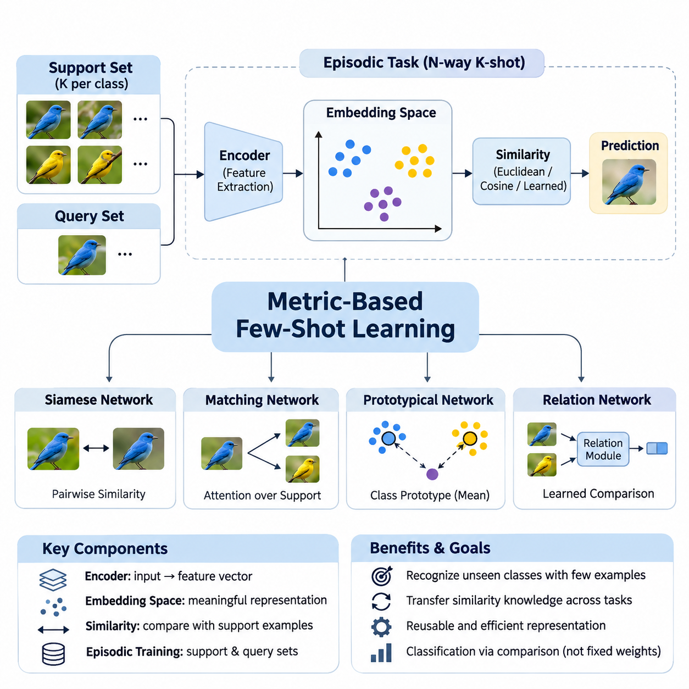
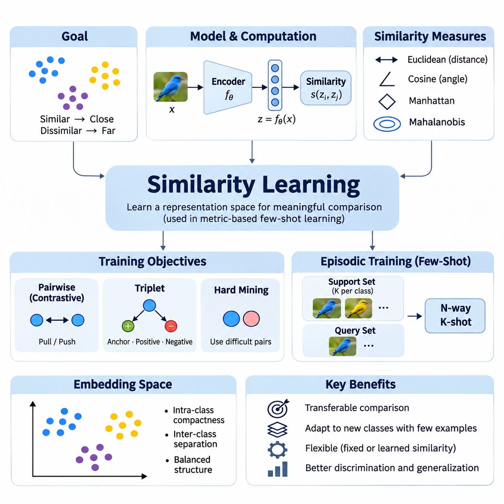
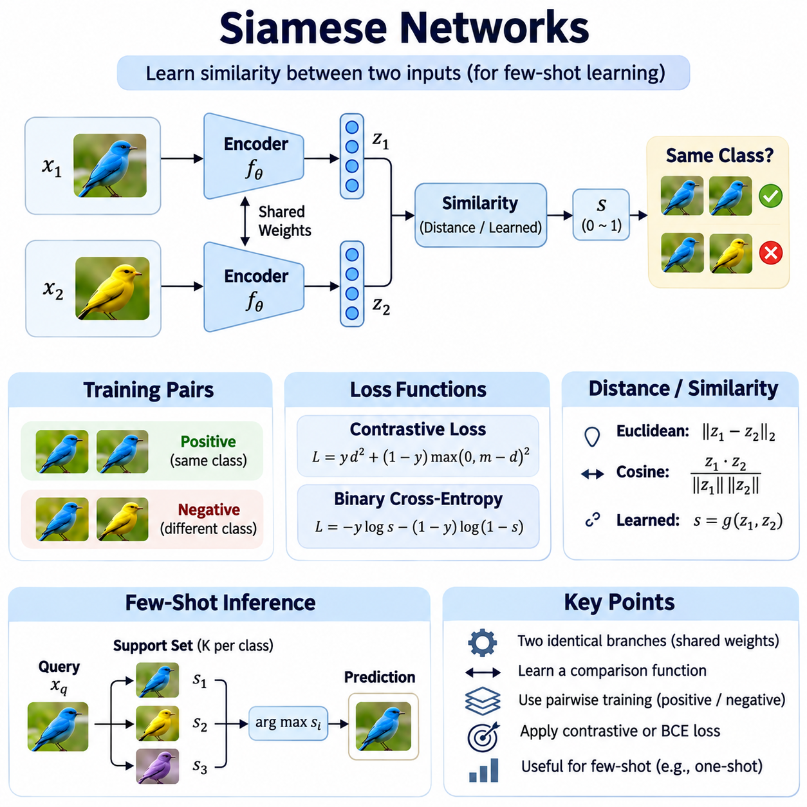
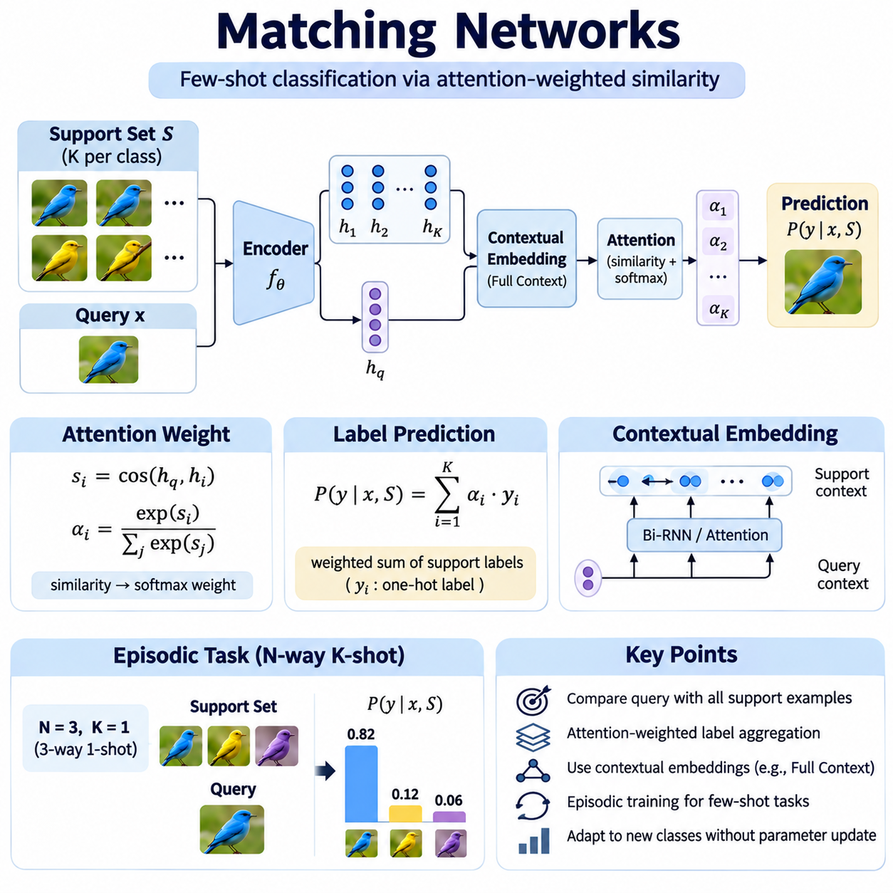
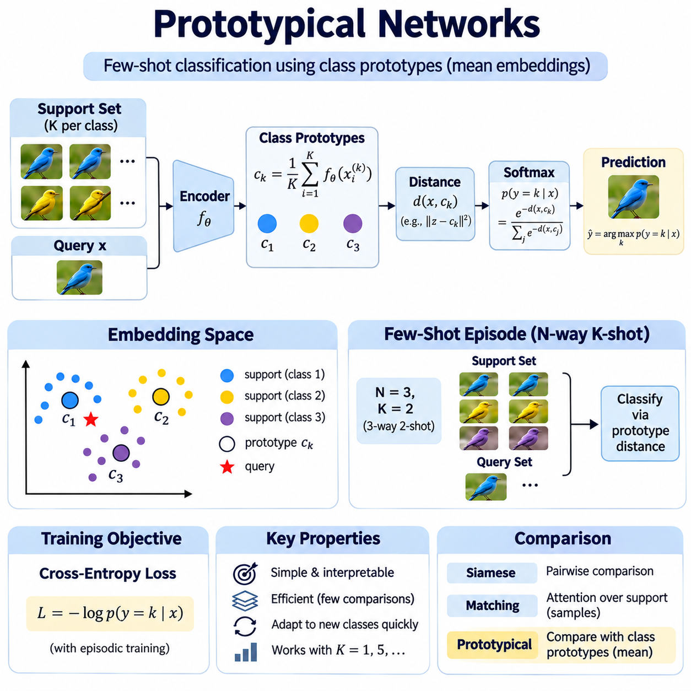
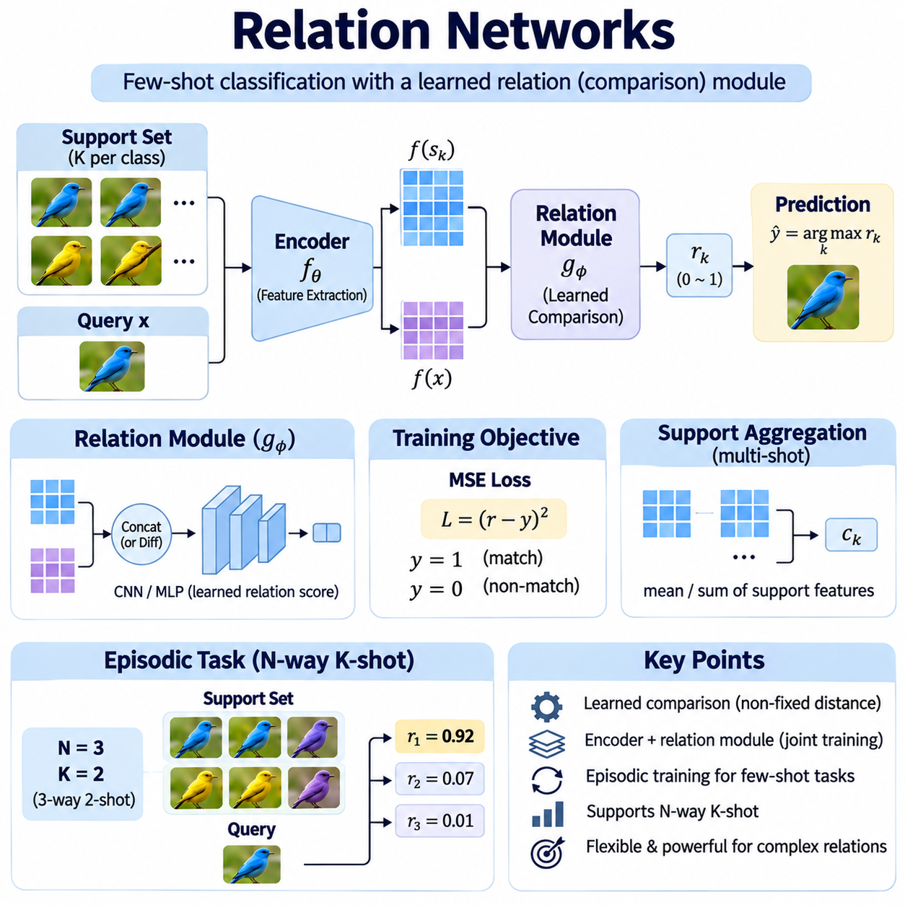
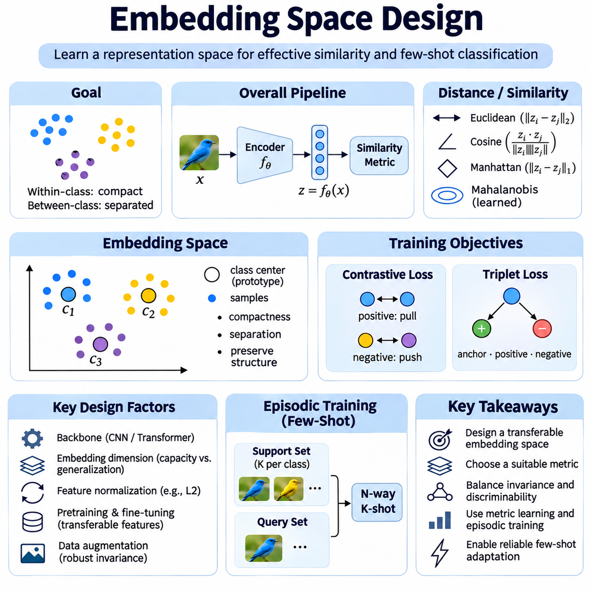
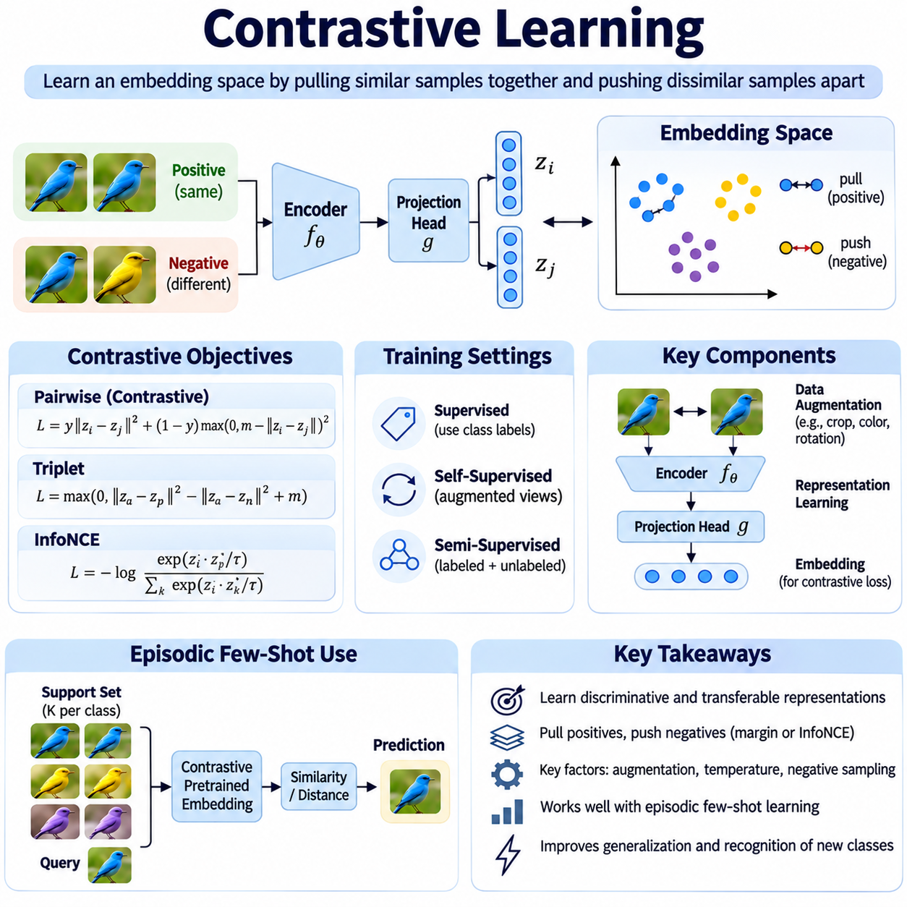
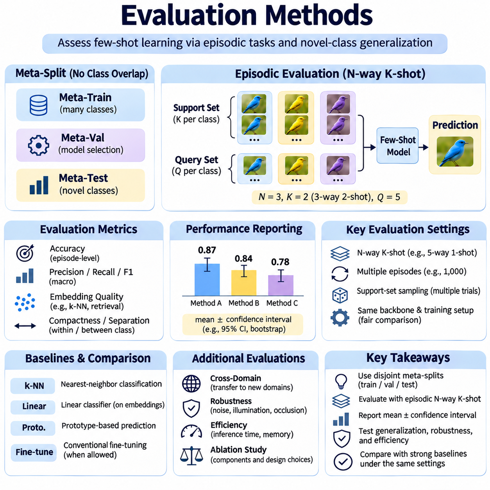
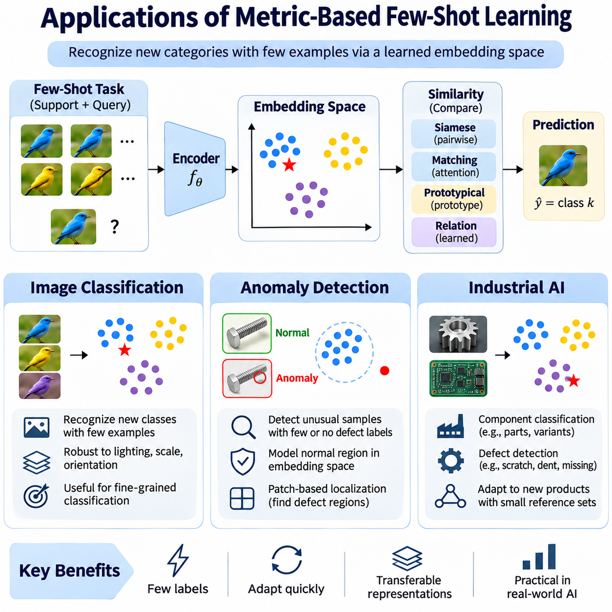

**Volume 36. Meta Learning and Few Shot Adaptation**

# 03. Metric Based Few Shot Learning

## 03.00 Overview

{width="7.268055555555556in" height="7.268055555555556in"}

Metric-based few-shot learning is a branch of meta-learning that enables models to recognize previously unseen classes from only a small number of labeled examples. Instead of learning a separate classifier for every new task, the model learns a representation space in which similarities between examples become meaningful. This approach transforms classification into a comparison problem and reduces the need for extensive task-specific training.

Traditional supervised learning typically requires substantial labeled datasets to establish reliable decision boundaries. However, many practical environments provide only a few examples of newly introduced categories. Metric-based methods address this limitation by transferring knowledge about similarity relationships from previously encountered tasks. Their central objective is to learn reusable representations that support classification under limited supervision.

The fundamental architecture generally consists of a feature extraction network, an embedding space, and a similarity-based decision mechanism. An encoder transforms raw inputs into compact feature vectors that preserve discriminative information. A distance or similarity function then compares these vectors with labeled reference examples. Predictions are generated from relative relationships rather than relying exclusively on fixed classification weights.

Few-shot learning tasks are commonly organized into episodes containing a support set and a query set. The support set provides a small collection of labeled examples representing the classes available within a particular episode. The query set contains additional examples whose labels must be predicted. Episodic training exposes the model to repeated classification problems designed to resemble the conditions encountered during evaluation.

An N-way K-shot classification task contains N candidate classes and K labeled support examples per class. For instance, a five-way one-shot task requires distinguishing five classes using only one labeled example from each category. The trained embedding network maps both support and query examples into a shared feature space. Classification then depends on identifying the most relevant support representations or class-level summaries.

Similarity learning provides the mathematical foundation for this approach. Common comparison functions include Euclidean distance, cosine similarity, and learned nonlinear similarity measures. Euclidean distance evaluates geometric separation, while cosine similarity emphasizes directional alignment between feature vectors. The choice of metric influences decision boundaries, sensitivity to feature magnitude, and robustness across different tasks.

Siamese Networks represent an early and influential approach to metric-based learning. Their architecture processes pairs of examples through shared feature extraction networks and learns whether the examples belong to the same category. Training encourages similar examples to produce compatible representations while separating unrelated examples. Once trained, the network can compare unfamiliar categories without requiring a conventional classifier trained specifically for those classes.

Matching Networks extend similarity-based classification by comparing query representations with labeled examples in the support set. Their prediction mechanism uses attention-weighted relationships between query and support embeddings. Rather than assigning a query to a single nearest example, the model aggregates evidence across multiple support instances. This mechanism allows the classification decision to incorporate the relative relevance of available labeled observations.

Prototypical Networks simplify few-shot classification by constructing a representative prototype for each class. A prototype is commonly calculated as the mean embedding of the corresponding support examples. Query samples are classified according to their distances from these class representatives. This approach combines computational simplicity with an interpretable geometric structure, making it attractive for efficient adaptation to new categories.

Relation Networks introduce a learned comparison mechanism instead of relying exclusively on predefined distance functions. A feature extractor generates representations for support and query examples, while a relation module estimates their compatibility. The relation module can capture nonlinear interactions that conventional geometric distances may overlook. However, this additional flexibility introduces model complexity and potentially greater computational requirements.

Embedding space design is critical because the effectiveness of every comparison mechanism depends on the quality of the underlying representations. A useful embedding space places semantically related examples near one another while maintaining separation between distinct categories. Feature normalization, dimensionality selection, backbone architecture, and regularization all influence this organization. Poorly structured embeddings can undermine classification even when the similarity function is appropriate.

Contrastive learning offers a complementary strategy for improving representation quality. Its objective encourages positive pairs to develop similar embeddings while pushing negative pairs apart. Related approaches use contrastive, triplet, or supervised contrastive objectives to establish discriminative geometric relationships. These techniques can improve metric-based few-shot performance, although their effectiveness depends on pair selection, sampling strategies, and training conditions.

The relationship between metric-based learning and optimization-based meta-learning highlights two different adaptation philosophies. Optimization-based methods, including Model-Agnostic Meta-Learning, generally adapt model parameters through task-specific updates. Metric-based methods primarily adapt predictions through comparisons with newly provided examples. Consequently, many metric-based systems can recognize new categories without performing gradient updates during inference.

This distinction creates practical advantages in applications where rapid adaptation and predictable inference costs are important. New classes can often be introduced by adding labeled support embeddings rather than retraining the complete model. However, the computational cost of comparing queries against large support collections may become significant. Prototype aggregation, embedding caching, and efficient nearest-neighbor retrieval can help manage these limitations.

Evaluation requires careful separation between the classes used for meta-training and those reserved for meta-testing. A model should demonstrate that its learned similarity structure transfers to unfamiliar categories rather than merely memorizing training labels. Episodic evaluation commonly reports average classification accuracy across numerous sampled tasks. Confidence intervals, repeated random seeds, and consistent episode construction improve the reliability of comparisons between different methods.

Few-shot benchmarks frequently include datasets such as Omniglot and MiniImageNet, which provide controlled environments for investigating generalization to unseen classes. Nevertheless, benchmark performance does not automatically establish robustness in production settings. Changes in illumination, background, sensor characteristics, or class distributions may alter embedding relationships. Evaluation should therefore include realistic distribution shifts and representative operational conditions.

Class imbalance and support-set quality introduce additional challenges. When some classes contain fewer or less representative examples, their embeddings may provide unreliable evidence for classification. Noisy labels and outliers can distort prototypes or similarity estimates. Robust aggregation, uncertainty estimation, and careful support-example selection can improve performance, but these mechanisms must be validated against the characteristics of the intended application.

Metric-based learning also faces difficulties when previously unseen classes are extremely similar to classes encountered during training. An embedding network may emphasize features that were discriminative in earlier tasks but fail to capture subtle differences required by new categories. This limitation illustrates the importance of representation transferability. Strong performance requires features that remain meaningful beyond the particular class distinctions present during meta-training.

Image classification is a natural application because visual encoders can transform images into feature representations suitable for comparison. A model trained across diverse visual categories may recognize new object types from a small reference collection. This capability is valuable when collecting extensive labeled examples is expensive or impractical. Performance nevertheless depends on visual similarity, domain consistency, and the representativeness of the reference images.

Anomaly detection provides another important application area, particularly when examples of defective or abnormal conditions are scarce. A metric-based system can learn representations of normal operating conditions and compare incoming observations against reference patterns. Significant deviations may indicate potential anomalies requiring further inspection. However, distance thresholds must be calibrated carefully because unfamiliar but acceptable variations can also produce large embedding distances.

Industrial AI systems can benefit from metric-based few-shot learning when production lines introduce new products, components, or defect categories. Instead of rebuilding an entire classification model whenever specifications change, engineers may update reference embeddings using a limited number of validated samples. This approach can reduce adaptation effort and accelerate deployment. Reliable operation still requires controlled data collection, traceable labels, and systematic validation.

Deployment considerations extend beyond predictive accuracy to include latency, memory consumption, hardware constraints, and operational maintainability. Lightweight embedding networks may support edge inference, while larger architectures can provide stronger representations at higher computational cost. Reference databases must remain synchronized with approved class definitions. Monitoring embedding drift and classification confidence is essential when operating conditions evolve over time.

The broader significance of metric-based few-shot learning lies in its ability to separate reusable representation learning from task-specific decision making. By learning how examples relate to one another, a system can transfer prior experience to unfamiliar classification problems with limited supervision. Siamese Networks, Matching Networks, Prototypical Networks, and Relation Networks provide complementary implementations of this principle, establishing a foundation for efficient and adaptable intelligent systems.

## 03.01 Similarity Learning

{width="7.268055555555556in" height="7.268055555555556in"}

Similarity learning is a fundamental approach in metric-based few-shot learning that enables models to recognize relationships between examples rather than relying exclusively on predefined class boundaries. Its primary objective is to learn representations in which semantically related samples exhibit high similarity while unrelated samples remain distinguishable. This capability allows knowledge acquired from previously observed categories to support classification of unfamiliar classes.

Conventional classification models typically associate input features with a fixed set of output labels. Such models may require additional training when new categories are introduced. Similarity learning addresses this limitation by learning a transferable comparison mechanism that can operate across different classification tasks. Instead of memorizing individual categories, the model develops a representation structure that captures relationships shared among multiple tasks.

The mathematical foundation of similarity learning involves mapping input observations into an embedding space through a parameterized feature extractor. Given an input x, an encoder fθ produces a representation z = fθ(x), where θ denotes the learned parameters. A similarity function compares two embeddings and estimates their degree of correspondence. The resulting score provides a basis for deciding whether examples belong to the same category or share meaningful characteristics.

Distance functions and similarity measures determine how relationships are evaluated within the embedding space. Euclidean distance measures geometric separation between feature vectors, while cosine similarity evaluates directional alignment. Manhattan distance and Mahalanobis distance provide alternative geometric interpretations. Each measure introduces different assumptions about feature distributions, dimensional relationships, and the importance of vector magnitude.

Euclidean distance is commonly applied when embedding dimensions have comparable scales and geometric proximity reflects semantic relationships. It calculates the square root of the sum of squared differences between corresponding vector components. Smaller distances indicate greater similarity under the learned representation. However, the measure can become sensitive to feature scaling and irrelevant dimensions, making normalization and representation quality important.

Cosine similarity compares vectors according to the angle between them rather than their absolute magnitudes. This property is useful when feature direction carries more discriminative information than feature amplitude. Normalized embeddings often simplify comparisons and stabilize training behavior. Nevertheless, cosine similarity may overlook magnitude information that is relevant to particular applications, so its suitability depends on the representation and task.

Learned similarity functions extend beyond fixed mathematical distances by allowing neural networks to estimate relationships directly. A relation module can receive two embeddings and produce a compatibility score through nonlinear transformations. This approach provides flexibility for modeling complex interactions between features. However, additional parameters increase training requirements and may introduce overfitting when the available task diversity is limited.

Pairwise learning is a common training strategy in which models receive pairs of examples labeled as similar or dissimilar. Positive pairs typically represent samples belonging to the same category, while negative pairs represent different categories. The training objective encourages the model to preserve meaningful relationships across these comparisons. Pair construction is therefore an important factor influencing the discriminative structure of the resulting embedding space.

Contrastive loss provides a mechanism for optimizing pairwise relationships by reducing distances between positive pairs and penalizing negative pairs that are insufficiently separated. A margin parameter often defines the minimum desired separation between dissimilar examples. This objective encourages compact within-class representations and larger between-class distances. The effectiveness of contrastive learning depends on margin selection, sample diversity, and the distribution of training pairs.

Triplet-based learning introduces an anchor example, a positive example from the same category, and a negative example from a different category. The objective encourages the anchor to remain closer to the positive example than to the negative example by a specified margin. This relative comparison can establish useful ranking relationships within the embedding space. Selecting informative triplets is essential because many randomly generated triplets contribute little to optimization.

Hard example mining focuses training on pairs or triplets that are difficult for the current model to distinguish. Hard negatives are examples from different classes that appear unusually similar, while hard positives belong to the same class despite substantial variation. These examples can improve discrimination near decision boundaries. Excessively difficult or incorrectly labeled samples, however, may destabilize optimization and reduce generalization.

The quality of an embedding space depends on both intra-class compactness and inter-class separation. Intra-class compactness describes how closely examples from the same category are grouped, while inter-class separation measures the distinction between different categories. Effective similarity learning balances these properties without eliminating meaningful variation. Excessive compression can obscure important subclasses, whereas insufficient separation produces ambiguous classification decisions.

Episodic training adapts similarity learning to few-shot classification by constructing repeated tasks from a distribution of available classes. Each episode contains a support set with labeled examples and a query set requiring classification. The model learns to compare query embeddings against support representations under changing class combinations. This process encourages transferable similarity relationships rather than dependence on a fixed collection of training labels.

During inference, a query example is encoded into the same representation space as the support examples. The model calculates similarity scores or distances between the query and available reference representations. Predictions may rely on the nearest support example, aggregated class scores, or distances to class prototypes. These alternatives offer different tradeoffs between computational efficiency, sensitivity to outliers, and classification stability.

Similarity learning provides the conceptual foundation for several established few-shot architectures. Siamese Networks learn pairwise relationships through shared encoders, while Matching Networks aggregate support information through attention-based comparisons. Prototypical Networks represent classes using mean embeddings, and Relation Networks learn nonlinear compatibility functions. Although their mechanisms differ, all depend on transferable representations that preserve useful relationships between examples.

Feature extractor design strongly influences similarity learning performance because distance calculations cannot recover discriminative information discarded during encoding. Convolutional neural networks are frequently used for image representations, while transformer-based architectures can capture broader contextual relationships. Pretrained encoders may provide useful initialization when labeled data is limited. Backbone selection should consider representation quality, computational cost, and domain characteristics.

High-dimensional embedding spaces introduce challenges associated with distance concentration and irrelevant feature variation. As dimensionality increases, differences between nearest and distant examples may become less informative under certain data distributions. Dimensionality reduction, feature normalization, and regularization can help maintain useful geometric relationships. The appropriate embedding dimension should be determined through validation rather than assuming that larger representations are always superior.

Similarity learning must also address variations caused by lighting, viewpoint, background, sensor noise, and other environmental factors. A robust representation should preserve category-relevant characteristics while reducing sensitivity to irrelevant transformations. Data augmentation and diverse training episodes can encourage such invariance. However, excessive invariance may remove subtle features needed to distinguish visually similar classes, particularly in fine-grained recognition tasks.

Evaluation should measure whether learned relationships generalize to categories that were not encountered during training. Class-disjoint training, validation, and testing partitions help prevent misleading performance estimates. Few-shot accuracy is commonly evaluated across multiple N-way K-shot episodes, with confidence intervals reflecting variation between sampled tasks. Retrieval metrics and distance-distribution analysis can provide additional evidence about the quality of learned representations.

Industrial applications demonstrate the practical value of similarity learning when labeled examples are scarce or categories change frequently. Manufacturing inspection systems can compare newly observed components with reference samples to identify product types or potential defects. Similarity-based representations may also support anomaly detection by measuring deviations from normal operating patterns. Reliable deployment requires representative reference data, calibrated thresholds, and monitoring of environmental changes.

Computational efficiency becomes important when similarity learning systems operate on edge devices or process large reference collections. Embedding vectors can be calculated in advance and stored for repeated comparisons, reducing unnecessary encoder execution. Approximate nearest-neighbor search can accelerate retrieval when the reference database grows. Nevertheless, indexing methods introduce accuracy and memory tradeoffs that must be evaluated against application requirements.

A major limitation of similarity learning is that geometric proximity does not always correspond to semantic equivalence. Samples from different categories may share visual characteristics, while examples within the same category may exhibit substantial variation. Dataset bias, noisy labels, and distribution shifts can further distort learned relationships. Addressing these limitations requires careful task construction, robust representation learning, and evaluation under realistic conditions.

Similarity learning establishes a reusable framework for transferring knowledge across classification tasks by emphasizing relationships instead of fixed label assignments. Its effectiveness depends on the interaction between embedding architecture, comparison metrics, training objectives, sampling strategies, and evaluation methodology. By learning meaningful similarity structures, metric-based few-shot systems can recognize unfamiliar categories with limited supervision and support adaptable AI applications across diverse environments.

## 03.02 Siamese Networks [w/Code]

{width="7.268055555555556in" height="7.268055555555556in"}

Siamese Networks are neural architectures designed to learn similarity relationships between pairs of inputs rather than directly predicting fixed class labels. They are particularly valuable in few-shot learning, where only a small number of labeled examples are available for unfamiliar categories. By learning a transferable comparison function, Siamese Networks can determine whether two observations belong to the same class without requiring extensive retraining for every new classification task.

The defining characteristic of a Siamese Network is its use of two identical feature extraction branches that share the same model parameters. Each branch processes an input independently and transforms it into a feature representation. Because the branches share weights, identical inputs produce identical embeddings under deterministic inference conditions. This parameter-sharing mechanism ensures consistent feature extraction and enables meaningful comparisons between different observations.

Given two inputs x1 and x2, a shared encoder fθ generates embeddings z1 = fθ(x1) and z2 = fθ(x2). A distance function or learned similarity module evaluates the relationship between these representations. The resulting score indicates whether the inputs are likely to belong to the same category. Training adjusts the encoder parameters θ so that semantically similar inputs become closer in the embedding space while dissimilar inputs become more distinguishable.

The feature extraction backbone can be selected according to the characteristics of the input data. Convolutional neural networks are commonly employed for images because they capture local spatial patterns and hierarchical visual features. Transformer-based encoders can model broader contextual relationships, while recurrent or temporal architectures may process sequential observations. The Siamese principle remains applicable as long as both branches produce comparable representations using shared parameters.

Pairwise training requires examples labeled according to their relationship rather than exclusively according to individual categories. Positive pairs contain inputs belonging to the same class, while negative pairs contain inputs from different classes. A balanced and diverse collection of pairs helps the model distinguish meaningful similarities from incidental correlations. Pair sampling is especially important because the number of possible combinations can grow rapidly with dataset size.

Contrastive loss is a widely used objective for training Siamese Networks. It encourages embeddings from positive pairs to move closer together while penalizing negative pairs that fall within a specified separation margin. A common formulation uses squared Euclidean distance for positive examples and a margin-based penalty for negative examples. This optimization produces an embedding space where geometric relationships can support classification of categories not encountered during training.

Binary cross-entropy provides an alternative training objective when a Siamese architecture includes a similarity prediction head. The model combines the two embeddings through a comparison operation and estimates the probability that the inputs belong to the same category. Training minimizes disagreement between predicted similarity scores and pairwise labels. This formulation supports flexible nonlinear comparison mechanisms, although predicted probabilities may require calibration before operational use.

The choice of distance metric influences the behavior of Siamese Networks during training and inference. Euclidean distance emphasizes absolute geometric separation, while cosine similarity focuses on angular relationships between embeddings. Learned comparison functions can model interactions that fixed distances may not capture. Feature normalization often improves numerical consistency, but the appropriate metric depends on whether magnitude, direction, or nonlinear feature relationships contain useful information.

Hard negative mining can improve Siamese Network training by emphasizing examples from different classes that appear highly similar. These difficult comparisons encourage the model to learn more discriminative representations near ambiguous class boundaries. Hard positive mining similarly identifies examples from the same class that exhibit substantial variation. However, excessively aggressive mining can amplify label noise and produce unstable optimization, making sampling strategies an important design consideration.

In few-shot classification, a trained Siamese Network compares an unfamiliar query example with labeled support examples representing newly introduced classes. Each comparison produces a similarity score or distance, and the query can be assigned to the class associated with the strongest matching evidence. Multiple support examples may be combined through nearest-neighbor selection or class-level score aggregation. This process enables adaptation without necessarily updating the encoder parameters.

One-shot learning represents an especially important application because only one labeled reference example is available for each candidate class. The model must rely on previously learned similarity relationships to distinguish new categories from minimal evidence. Successful one-shot recognition requires an embedding space that captures transferable characteristics rather than memorizing training identities. Performance can deteriorate when the reference example fails to represent the natural variation of its class.

Siamese Networks differ from conventional classification networks in how they represent knowledge and generate predictions. A standard classifier typically maps inputs to a predefined set of class outputs, whereas a Siamese model learns how to compare observations. This distinction allows new categories to be introduced through reference examples rather than complete classifier retraining. Nevertheless, the comparison mechanism must generalize beyond the specific categories and conditions encountered during training.

The architecture also differs from Prototypical Networks and Matching Networks in its typical classification strategy. Siamese Networks emphasize pairwise comparisons, while Prototypical Networks summarize support examples into class representatives. Matching Networks incorporate attention-based relationships across support examples. These approaches share the principle of metric-based adaptation but differ in how they aggregate evidence and organize classification decisions.

Embedding dimensionality is an important architectural parameter because it affects representation capacity, computational cost, and distance reliability. Very small embeddings may discard useful discriminative information, while unnecessarily large embeddings can introduce redundancy and sensitivity to irrelevant features. Regularization, normalization, and dimensionality validation help maintain an effective representation space. The optimal configuration depends on task complexity and available computational resources.

Data augmentation can improve Siamese Network robustness by exposing the encoder to realistic variations in input appearance. Image transformations may include changes in illumination, rotation, scale, and background conditions. These transformations encourage the model to preserve identity-relevant characteristics while reducing sensitivity to irrelevant differences. However, augmentation must respect class semantics because excessive transformations can remove the features needed for accurate discrimination.

Training stability depends on several interacting factors, including learning rate, batch composition, pair balance, margin selection, and encoder initialization. A model trained with mostly easy pairs may achieve low training loss without learning sufficiently discriminative representations. Conversely, training dominated by difficult or mislabeled pairs can produce unstable gradients. Monitoring positive and negative distance distributions helps identify whether the embedding space is developing useful separation.

Implementation commonly begins with a shared encoder module that processes both inputs through the same computational parameters. The resulting embeddings are compared using a differentiable distance function or similarity head. A training loop calculates pairwise loss, performs backpropagation, and updates the shared encoder. Modern frameworks such as PyTorch support this architecture through reusable modules, automatic differentiation, and efficient batch processing.

Efficient implementation can avoid redundant computation when multiple pairs contain repeated examples. Instead of independently encoding every occurrence, the system can calculate embeddings once and reuse them across comparisons. This strategy becomes particularly useful during inference when a query must be compared against a large reference collection. Embedding caching and vectorized distance computation can substantially reduce processing overhead without changing the underlying similarity model.

Evaluation should use categories that are separate from those encountered during training to determine whether learned similarity relationships transfer to unfamiliar classes. Common evaluation settings include one-shot and few-shot classification across repeated N-way K-shot episodes. Accuracy should be reported alongside variability across sampled tasks. Pairwise verification metrics, including precision, recall, and receiver operating characteristic analysis, can provide complementary evidence about similarity discrimination.

Threshold calibration is important when Siamese Networks are used for verification rather than closed-set classification. A similarity threshold determines whether two observations are accepted as belonging to the same category. Selecting this threshold involves balancing false acceptance and false rejection according to application requirements. In security-sensitive or industrial environments, incorrect acceptance may have substantially different consequences from incorrect rejection.

Industrial inspection provides a practical application in which Siamese Networks compare newly captured images with validated reference samples. A manufacturing system may recognize unfamiliar components or identify visual deviations without collecting thousands of examples for each new product. Similar methods can support defect verification, product matching, and quality control. Their reliability depends on reference quality, environmental consistency, and the ability to distinguish acceptable variation from meaningful defects.

Siamese Networks are also applicable to biometric verification, document matching, medical image comparison, and anomaly detection. In biometric systems, the network can compare identity representations without requiring a fixed classifier for every enrolled individual. In anomaly detection, distances from normal reference examples may indicate unusual observations. These applications require careful handling of uncertainty, distribution shifts, and domain-specific risks rather than assuming that embedding distance alone guarantees reliable decisions.

Despite their flexibility, Siamese Networks face limitations when different classes share similar appearances or when individual classes exhibit substantial internal variation. Pairwise similarity scores may also become computationally expensive when the reference collection grows. Distribution shifts can weaken the relationship between learned distances and semantic similarity. Robust deployment therefore requires representative training episodes, efficient retrieval mechanisms, calibrated decisions, and continuous performance monitoring.

Siamese Networks establish an important foundation for metric-based few-shot learning by transforming recognition into a transferable similarity estimation problem. Their shared-weight architecture, pairwise objectives, and embedding-based comparisons enable unfamiliar categories to be recognized from limited labeled evidence. When combined with appropriate sampling, representation learning, evaluation, and inference optimization, they provide a practical framework for adaptable classification and verification systems.

## 03.03 Matching Networks [w/Code]

{width="7.268055555555556in" height="7.268055555555556in"}

Matching Networks are a metric-based few-shot learning architecture designed to classify unfamiliar examples by comparing them with a small collection of labeled reference samples. Instead of learning fixed classification boundaries for every category, the model predicts labels through attention-weighted similarities between query and support examples. This approach enables rapid adaptation to new classes without requiring conventional parameter updates during inference.

The central principle of Matching Networks is that classification can be performed by retrieving relevant information from a support set. Each support example contains an input observation and its associated class label. When a query arrives, the model evaluates its relationship with every support example and combines their labels according to similarity scores. This mechanism transforms few-shot recognition into a differentiable attention-based retrieval problem.

A Matching Network typically consists of a feature extraction system, contextual embedding functions, an attention mechanism, and a label prediction module. The feature extractor maps raw observations into continuous vector representations. Contextual embeddings may refine these representations using information from other support examples. The attention mechanism then assigns weights to support samples, allowing the model to construct predictions from their labeled evidence.

Given a support set S containing labeled pairs (xi, yi) and a query input x, the model estimates the conditional probability P(y\|x,S). This probability is calculated by summing the labels of support examples weighted by attention coefficients. Each coefficient represents the relative similarity between the query embedding and a support embedding. The resulting prediction is therefore conditioned on the current task rather than a permanent classifier.

The attention mechanism commonly uses cosine similarity to compare query and support embeddings. Similarity scores are passed through a softmax function to produce nonnegative weights that sum to one. Support examples with greater similarity receive larger weights and contribute more strongly to the predicted label distribution. This differentiable weighting mechanism allows the complete system to learn representations that improve task-specific classification.

Unlike nearest-neighbor classification, which often relies on a single closest reference example, Matching Networks can aggregate information from multiple labeled observations. Several support examples belonging to the same class may jointly strengthen the corresponding prediction. However, misleading or unusually similar examples can also influence the result. The effectiveness of attention aggregation therefore depends on the quality and distribution of the support set.

The original Matching Networks architecture introduced Full Context Embeddings to improve the representation of support and query examples. Rather than encoding each observation independently, contextual embedding functions incorporate relationships among available support samples. This enables the representation of an example to depend partly on the classification task in which it appears. Contextual processing can improve discrimination when different tasks require attention to different features.

Support-set contextualization can be implemented through bidirectional recurrent neural networks that process the collection of support embeddings. The resulting representations capture information about neighboring examples and their relationships. Because support sets are conceptually unordered, implementation must consider sensitivity to sequence ordering. Alternative permutation-invariant mechanisms can provide contextual interactions without relying on an arbitrary ordering of reference examples.

Query contextualization can use an attention-based recurrent mechanism that repeatedly examines the support set. At each processing step, the query representation is refined using information retrieved from support embeddings. This iterative interaction allows the query representation to become more sensitive to the current task. Nevertheless, recurrent contextualization increases computational complexity and may be unnecessary when simpler embedding functions provide adequate performance.

Episodic training is fundamental to Matching Networks because the model must learn to solve new classification tasks rather than memorize a fixed set of categories. Each training episode samples a subset of classes and constructs corresponding support and query sets. The model predicts query labels using only the support examples provided within that episode. Repeated exposure to diverse episodes encourages representations and attention mechanisms that transfer across tasks.

An N-way K-shot episode contains N candidate classes with K labeled support examples per class. In a five-way one-shot setting, the model must distinguish five categories using one labeled reference example from each category. The query is compared against all five support embeddings, and attention weights determine the predicted class. Increasing the number of shots provides additional evidence but also increases the number of similarity calculations.

Training generally minimizes the negative log-likelihood of correct query labels across sampled episodes. Because the attention computation and embedding functions are differentiable, gradients can propagate through the prediction mechanism into the feature extractor. The resulting optimization encourages embeddings that support accurate classification under limited supervision. Training episodes should resemble expected evaluation conditions to reduce discrepancies between training and deployment.

Matching Networks are closely related to Siamese Networks but differ in how similarity evidence is used. Siamese architectures commonly learn pairwise compatibility between individual examples, whereas Matching Networks combine comparisons across an entire labeled support set. Their attention mechanism produces a normalized distribution over reference examples. This allows the model to integrate multiple sources of evidence rather than relying solely on isolated pairwise decisions.

Prototypical Networks provide another related approach but summarize each class using a representative embedding. Matching Networks retain individual support examples and assign attention weights to them directly. This distinction can preserve information about multimodal class distributions that a single prototype may obscure. However, retaining all support examples increases inference cost, especially when the number of classes or labeled references becomes large.

Embedding quality remains essential because attention cannot reliably recover information discarded by the feature extractor. Convolutional encoders are commonly used for image-based tasks, while transformer architectures may provide richer contextual representations. Feature normalization can improve similarity consistency, and pretrained backbones may reduce the amount of task-specific training required. Architecture selection should balance discriminative capability against computational requirements.

Attention temperature is an important design parameter that controls how sharply similarity scores are converted into weights. A low temperature produces concentrated attention around the most similar support examples, while a higher temperature distributes weight more broadly. Excessively sharp attention may amplify individual errors, whereas overly diffuse attention may weaken class discrimination. Temperature selection should therefore be validated under representative few-shot conditions.

Support-set composition strongly influences Matching Network predictions. Poorly selected examples may fail to represent important variations within a class, while mislabeled observations can direct attention toward incorrect categories. Class imbalance may also distort predictions when some categories contribute more support instances than others. Balanced episode construction, representative sampling, and label verification help reduce these sources of uncertainty.

Computational complexity increases with the number of query-to-support comparisons and the cost of contextual embedding operations. For small few-shot episodes, this overhead is generally manageable. Larger reference collections may require embedding caching, vectorized similarity calculations, or approximate retrieval methods. Such optimizations should preserve the relationship between attention scores and the intended prediction mechanism.

Evaluation typically separates meta-training classes from meta-testing classes to measure generalization to unfamiliar categories. Performance is assessed across repeated N-way K-shot episodes using classification accuracy and confidence intervals. Comparisons should maintain consistent support-set sizes, backbone architectures, and episode sampling procedures. Additional analysis can examine sensitivity to support selection, domain shifts, and variation in attention distributions.

Matching Networks are useful in image recognition applications where new object categories must be identified from limited labeled examples. A system can compare incoming images with a small reference collection and generate predictions without retraining a dedicated classifier. This capability is relevant to product identification, visual inspection, and specialized recognition tasks. Reliable performance requires representative examples and embeddings that remain meaningful across changing environments.

Industrial AI applications may use Matching Networks when production systems frequently introduce new components or product variants. Engineers can provide labeled reference images for newly introduced categories, allowing the model to compare incoming observations with current support examples. Attention-based predictions can facilitate rapid adaptation to changing production requirements. However, operational validation must address lighting changes, sensor variation, and visually similar components.

Anomaly detection presents another potential application, although conventional Matching Networks are primarily designed for supervised few-shot classification. A modified system can compare observations with reference examples of normal and known abnormal conditions. Similarity distributions may provide evidence about unusual patterns, but they do not automatically establish calibrated anomaly probabilities. Open-set recognition and threshold calibration are necessary when observations may belong to unknown categories.

A major limitation of Matching Networks is their dependence on support-set quality and the generalizability of learned embeddings. Attention may assign high weights to visually similar but semantically incorrect examples, particularly under distribution shifts. Contextual embedding mechanisms can introduce additional computational and implementation complexity. Robust deployment requires careful evaluation of uncertainty, reference-set maintenance, and performance under realistic operating conditions.

Matching Networks demonstrate how attention-based comparison can transform few-shot classification into a flexible task-conditioned prediction process. Their combination of episodic training, contextual embeddings, and differentiable label aggregation enables rapid recognition of unfamiliar categories from limited supervision. By preserving individual support examples and learning how to weight their relevance, they establish an important foundation for modern metric-based meta-learning systems.

## 03.04 Prototypical Networks [w/Code]

{width="7.268055555555556in" height="7.268055555555556in"}

Prototypical Networks are a metric-based few-shot learning approach that classifies unfamiliar examples by comparing their embeddings with representative vectors called class prototypes. Instead of training a separate classifier for every new category, the model constructs prototypes from a small collection of labeled support examples. This strategy enables rapid adaptation while maintaining a relatively simple and interpretable classification mechanism.

The central assumption of Prototypical Networks is that examples belonging to the same class can be represented by a common center in a learned embedding space. A neural feature extractor maps raw observations into vectors that preserve relevant characteristics. Each class prototype summarizes the corresponding support embeddings. Query examples are classified according to their distances from these representative centers.

Given a support set containing labeled examples, an embedding function fθ transforms each input into a feature vector. For a class k, its prototype ck is calculated as the arithmetic mean of the embeddings belonging to that class. This operation requires no additional optimization during inference. When a new class becomes available, its prototype can be constructed directly from the labeled reference examples.

The classification process begins by encoding a query observation using the same feature extractor applied to the support examples. The model calculates distances between the query embedding and every class prototype. These distances are converted into class probabilities through a softmax function applied to negative distance values. The class associated with the smallest distance generally receives the highest predicted probability.

Euclidean distance is widely used in Prototypical Networks because it provides a straightforward geometric interpretation of class relationships. Squared Euclidean distance is particularly common in training objectives and can support effective prototype-based classification. Cosine distance and other metrics are also possible, although they introduce different assumptions about embedding geometry. Metric selection should reflect the properties of the learned representations.

The arithmetic mean is a natural prototype estimator when the embedding space is organized around compact class clusters. Averaging multiple support embeddings can reduce the influence of individual variations and measurement noise. However, a mean prototype may become misleading when a class contains multiple distinct subgroups or severe outliers. The effectiveness of prototype aggregation therefore depends on the structure and quality of the support data.

Episodic training is essential because Prototypical Networks must learn representations that generalize across different classification tasks. Each episode samples a subset of training classes and divides their examples into support and query sets. Prototypes are calculated from the support examples, and the model predicts query labels using prototype distances. Repeated optimization across diverse episodes encourages transferable geometric relationships.

An N-way K-shot episode contains N classes with K labeled support examples per class. In a five-way one-shot task, five prototypes are constructed from five individual reference examples. In a five-way five-shot task, each prototype is calculated from five support embeddings. Increasing the number of shots can improve prototype stability, although the benefit depends on sample diversity and the representativeness of the selected examples.

Training generally minimizes cross-entropy between predicted query probabilities and their true labels. Because prototype construction and distance calculations are differentiable, gradients propagate through the prototype computation into the embedding network. The feature extractor learns to place examples near appropriate class centers while separating different classes. This training objective aligns representation learning with the classification mechanism used during inference.

Prototypical Networks differ from Siamese Networks in how they organize similarity comparisons. Siamese architectures commonly evaluate individual pairs of examples, while Prototypical Networks compare queries with aggregated class representatives. Matching Networks retain individual support examples and calculate attention-weighted predictions. Prototype aggregation reduces the number of comparisons and can improve efficiency when multiple reference examples represent each class.

Embedding space design strongly influences the performance of Prototypical Networks. A useful representation should maintain compact within-class distributions and sufficient separation between classes. Feature normalization, dimensionality selection, backbone architecture, and regularization affect these geometric properties. If the encoder fails to preserve relevant distinctions, even accurately calculated prototypes cannot provide reliable classification.

Convolutional neural networks are frequently used as embedding backbones for image-based few-shot recognition. Transformer-based architectures may capture broader contextual relationships, while pretrained encoders can provide transferable visual representations. The selected backbone determines the balance between discrimination and computational requirements. Lightweight models may be preferable for edge deployment, whereas larger models may support more complex visual categories.

The number and quality of support examples directly affect prototype reliability. A prototype constructed from a single example is sensitive to unusual appearance, sensor noise, and background variation. Additional examples can provide a more stable estimate of the class center. Nevertheless, poorly selected or mislabeled samples may shift the prototype toward an incorrect region of the embedding space and degrade classification performance.

Class imbalance introduces challenges when different categories contain unequal numbers of support examples. Although each prototype is calculated independently, estimates based on fewer observations may have greater uncertainty. Episodic sampling can control this imbalance during training, while uncertainty-aware methods can account for differences in prototype reliability. Evaluation should consider whether the intended application provides balanced or uneven reference collections.

Distance scaling affects how prototype distances are transformed into prediction probabilities. A temperature parameter can control the sharpness of the softmax distribution, influencing confidence without necessarily changing the nearest-prototype decision. Excessively sharp probabilities may create misleading confidence estimates, particularly under distribution shifts. Calibration should therefore be evaluated separately from classification accuracy.

Prototypical Networks can be extended beyond a single representative vector per class. Multiple prototypes may capture distinct subgroups within a category, while weighted aggregation can reduce the influence of unreliable support samples. Other extensions incorporate attention mechanisms, learned distance functions, or uncertainty estimates. These modifications increase flexibility but may reduce the simplicity and efficiency that characterize the original approach.

A probabilistic interpretation can help explain why prototype-based classification works. Under suitable assumptions about class-conditional distributions in the embedding space, class means provide useful representatives for distance-based decisions. Squared Euclidean distance is consistent with a model using isotropic Gaussian class distributions with shared variance. However, real data may violate these assumptions, particularly when classes have irregular or multimodal structures.

Efficient implementation requires only a shared embedding network, prototype aggregation, and vectorized distance calculations. In PyTorch, support embeddings can be grouped by class and averaged to construct prototypes. Query embeddings are then compared against the prototype matrix using batched tensor operations. Cross-entropy loss provides the training objective, and automatic differentiation updates the shared encoder through the complete computational graph.

Inference efficiency is a major advantage because each query is compared with one prototype per class rather than every support example. Prototypes can be cached and updated when validated reference samples are added or removed. This reduces repeated computation and supports rapid introduction of new categories. However, changing the embedding network generally requires recomputing stored prototypes to maintain representation consistency.

Evaluation commonly uses class-disjoint meta-training and meta-testing partitions to measure adaptation to unfamiliar categories. Accuracy is calculated across repeated N-way K-shot episodes, with confidence intervals describing variation between tasks. Comparisons should control the number of support examples, query examples, and backbone capacity. Additional experiments can investigate sensitivity to outliers, domain shifts, and prototype estimation errors.

Industrial inspection is a practical application because new products and components may be introduced with only a few labeled reference images. A Prototypical Network can construct class representatives for newly introduced components and compare incoming observations against them. This approach can reduce the need for repeated classifier retraining. Reliable deployment nevertheless requires representative samples, stable imaging conditions, and validation against visually similar product variants.

Anomaly detection can also benefit from prototype-based representations, particularly when normal operating conditions can be summarized by reference embeddings. Incoming observations can be compared with normal prototypes, and unusually large distances may indicate potential deviations. However, distance alone does not establish whether an observation is truly abnormal. Threshold calibration, uncertainty analysis, and evaluation against acceptable operational variation remain necessary.

Prototypical Networks face limitations when class distributions are highly irregular, overlapping, or poorly represented by their means. Distribution shifts may move query embeddings away from previously established prototypes, even when their semantic labels remain unchanged. Outliers and noisy labels can further distort representative centers. Robust aggregation, domain adaptation, and periodic reference validation can help address these challenges.

Prototypical Networks demonstrate how a simple geometric representation can support effective few-shot classification without task-specific gradient updates during inference. Their combination of episodic training, class-mean prototypes, and distance-based prediction provides an efficient framework for recognizing unfamiliar categories. By balancing representation quality, prototype reliability, and computational simplicity, they remain an important foundation for adaptable metric-based learning systems.

## 03.05 Relation Networks

{width="7.268055555555556in" height="7.268055555555556in"}

Relation Networks are a metric-based few-shot learning architecture that estimates similarity through a trainable neural comparison module rather than relying entirely on predefined distance functions. Their primary objective is to learn how examples relate within an embedding space and transfer this knowledge to unfamiliar categories. This approach enables classification from limited labeled observations while allowing complex nonlinear relationships to influence similarity decisions.

The central idea of Relation Networks is to combine feature extraction with relation learning in a unified architecture. A feature encoder transforms raw inputs into representations that preserve discriminative characteristics. A separate relation module examines combinations of support and query representations and produces compatibility scores. Both components are optimized jointly so that the learned features support accurate relational comparisons.

A typical Relation Network contains an embedding module and a relation module. The embedding module, commonly implemented using convolutional neural networks for image tasks, produces feature maps or compact vectors. The relation module processes paired representations through additional neural layers. Its output is a scalar relation score indicating the estimated similarity between a query example and a labeled reference class.

Given an input x, the embedding function fθ generates a representation fθ(x), where θ denotes its trainable parameters. For a query q and support example s, their representations are combined and passed into a relation function gφ. The resulting score r = gφ(fθ(q), fθ(s)) expresses their learned compatibility. Parameters θ and φ are updated through training to improve discrimination between matching and nonmatching examples.

Feature combination is an important architectural decision because it determines what information the relation module can examine. Common strategies include channel-wise concatenation, element-wise differences, and interactions between embedding vectors. Concatenation allows subsequent neural layers to discover relationships across both inputs. The selected strategy should preserve sufficient information while controlling computational complexity and parameter growth.

Unlike Euclidean distance or cosine similarity, a learned relation function is not restricted to a fixed geometric comparison rule. It can identify nonlinear dependencies among features and assign different importance to their interactions. This flexibility may improve discrimination when visually similar categories differ in subtle patterns. However, the learned relation score is not necessarily a mathematical metric because symmetry and the triangle inequality are not guaranteed.

Relation Networks are commonly trained through episodic learning, where each episode represents a small classification task. A support set contains labeled examples from selected classes, while a query set contains observations requiring predictions. The network constructs relation scores between query representations and support-derived class representations. Repeated exposure to diverse episodes encourages the model to learn comparisons that generalize beyond its training categories.

In an N-way K-shot task, N classes are represented by K labeled examples per class. For one-shot classification, the relation module can compare each query directly with one support representation from every candidate class. For multiple-shot classification, support embeddings belonging to the same class are commonly aggregated before comparison. This produces a class-level representation while limiting the number of relation evaluations.

Support aggregation is often implemented by summing or averaging embeddings from examples belonging to the same category. When feature maps are retained, aggregation can preserve spatial information useful for image recognition. The resulting class representation is paired with the query feature map and processed by the relation module. Aggregation improves efficiency but may obscure multimodal structures or amplify the influence of poorly selected support examples.

The original Relation Network formulation commonly uses mean squared error to train relation scores against binary targets indicating whether a query and support class match. Matching relationships receive a target near one, while nonmatching relationships receive a target near zero. This objective encourages discriminative relation estimation across episodes. Alternative implementations may use cross-entropy or ranking-based objectives, depending on the output design.

During inference, a query is encoded and compared with the available class representations. The relation module generates a compatibility score for each candidate class, and the class receiving the highest score is selected. New categories can be introduced by providing labeled support examples without necessarily updating the network parameters. This enables rapid task adaptation, provided the learned relation function transfers to the new domain.

Relation Networks differ from Siamese Networks because they explicitly learn a nonlinear comparison module over extracted representations. Siamese architectures often employ fixed distances or simpler similarity heads, whereas Relation Networks emphasize deeper relational processing. Both approaches share the objective of transferable similarity estimation. Their relative effectiveness depends on task complexity, training diversity, model capacity, and inference constraints.

Compared with Prototypical Networks, Relation Networks offer greater flexibility in how query-to-class compatibility is calculated. Prototypical Networks generally rely on distances to class centers, while Relation Networks learn the comparison function itself. Matching Networks instead use attention-weighted combinations of labeled support examples. These architectural differences influence computational efficiency, interpretability, and sensitivity to the geometry of the embedding space.

Embedding quality remains critical because the relation module cannot reliably reconstruct information discarded during feature extraction. Convolutional backbones can preserve local patterns, while transformer-based encoders may capture broader contextual dependencies. Feature normalization and regularization can improve representation stability. The embedding architecture should be selected according to the visual complexity and computational requirements of the target application.

The capacity of the relation module creates an important tradeoff between flexibility and generalization. A small module may fail to capture complex feature interactions, while an excessively large module may overfit the training episodes. Dropout, weight decay, and appropriate architectural constraints can reduce this risk. Validation on unseen classes is essential because strong training performance does not guarantee transferable relation learning.

Sampling strategy strongly influences the quality of learned relations. Training episodes should include sufficiently diverse classes and meaningful variations within each class. Difficult negative examples can encourage discrimination between categories with similar appearances. However, excessive emphasis on hard samples may amplify label noise and destabilize optimization. Balanced sampling helps the network learn reliable relationships across different task conditions.

Data augmentation can improve robustness by exposing the feature encoder and relation module to realistic variations. Changes in illumination, orientation, scale, and background may help the model distinguish category-relevant information from incidental visual differences. Nevertheless, transformations must preserve the semantic identity of each example. Excessive augmentation may remove subtle features required for fine-grained classification.

Implementation typically begins with an embedding network that processes support and query observations using shared parameters. Support embeddings are grouped by class, and each class representation is combined with the query embedding. A relation network then produces scalar compatibility scores for the candidate classes. Automatic differentiation updates both modules jointly, allowing representation learning and relation estimation to improve together.

Computational requirements depend on the feature extractor, relation module, and number of candidate classes. A query generally requires a relation evaluation for each class representation, making inference cost increase with the number of classes. Embedding caching, batched comparisons, and lightweight relation modules can reduce latency. These optimizations are particularly important for edge devices and real-time industrial inspection systems.

Evaluation should separate training and testing classes to measure whether learned relationships transfer to unfamiliar categories. Repeated N-way K-shot episodes provide estimates of classification accuracy and task-level variability. Comparisons should control backbone capacity, support-set size, and episode construction. Additional experiments can assess sensitivity to domain shifts, noisy references, and changes in relation score distributions.

Industrial applications include component recognition, visual quality inspection, and defect classification when only limited labeled samples are available. Relation Networks can compare incoming observations with validated reference examples and identify subtle differences between product variants. Their learned comparison functions may be useful when simple geometric distances provide insufficient discrimination. Reliable deployment requires representative references, stable sensing conditions, and systematic validation.

Relation scores require careful interpretation because they are learned compatibility estimates rather than automatically calibrated probabilities. A high score indicates that the model considers a query compatible with a reference class, but it does not guarantee correctness. Open-set recognition may require rejection thresholds or additional uncertainty estimation. Calibration is particularly important when incorrect classification can cause operational or safety consequences.

A major limitation of Relation Networks is that their additional flexibility introduces computational overhead and greater dependence on training quality. Learned comparison functions may exploit correlations that do not remain valid under distribution shifts. Support-set noise and class imbalance can also distort relation estimates. Robust training, representative episodic evaluation, and continuous monitoring are necessary to maintain reliable performance.

Relation Networks extend metric-based few-shot learning by replacing fixed similarity calculations with jointly learned representation and comparison functions. Their architecture combines episodic training, support-conditioned classification, and nonlinear relation estimation to recognize unfamiliar categories from limited supervision. When carefully designed and validated, they provide a flexible foundation for adaptive recognition systems that require more expressive similarity modeling.

## 03.06 Embedding Space Design

{width="7.268055555555556in" height="7.268055555555556in"}

Embedding space design is a fundamental component of metric-based few-shot learning because classification depends on how observations are represented and compared. An embedding function transforms raw inputs into continuous vectors that capture relevant semantic characteristics. A well-designed space places similar examples near one another while separating different categories, enabling reliable recognition even when only a few labeled references are available.

The primary objective of embedding space design is to establish a geometry that supports transferable similarity judgments. Within-class variation should remain sufficiently compact, while between-class separation should preserve meaningful distinctions. However, excessive compression can remove important differences among examples. Effective representations balance invariance to irrelevant changes with sensitivity to features that distinguish categories.

An embedding function is commonly implemented using a neural network parameterized by θ, producing a vector z = fθ(x) for an input x. The encoder may contain convolutional layers, attention mechanisms, or transformer blocks depending on the data modality. Its output dimensionality determines the capacity of the representation. Training adjusts the parameters so that geometric relationships become useful for classification across unfamiliar tasks.

Distance metric selection directly influences the interpretation of the embedding space. Euclidean distance measures absolute geometric separation, while cosine similarity emphasizes directional alignment between vectors. Manhattan distance and learned Mahalanobis metrics provide alternative comparison structures. No metric is universally optimal, and the selected measure should reflect the representation distribution and intended classification behavior.

Feature normalization can improve consistency by controlling differences in embedding magnitude. L2 normalization projects vectors onto a unit hypersphere, making cosine similarity equivalent to the dot product between normalized embeddings. This can reduce sensitivity to arbitrary feature scaling. However, normalization also removes magnitude information that may be useful for certain tasks, making its suitability dependent on the application.

Embedding dimensionality introduces a tradeoff between representational capacity and statistical reliability. High-dimensional embeddings can preserve complex distinctions but may increase computation and sensitivity to limited training data. Lower-dimensional representations improve storage efficiency and sometimes generalization, yet excessive compression can eliminate discriminative information. Dimensionality should be selected through validation on previously unseen classes.

The backbone architecture determines which characteristics are available for similarity learning. Convolutional neural networks are effective at capturing local spatial patterns in images, while transformer encoders can model broader contextual relationships. For sequential or multimodal observations, specialized encoders may be necessary. Architecture selection should account for data characteristics, available computation, and expected deployment conditions.

Pretrained representations often provide a strong foundation for few-shot learning because they already encode transferable patterns. An encoder trained on a large and diverse dataset may require only limited adaptation to support new categories. Nevertheless, features learned from unrelated domains may emphasize inappropriate characteristics. Domain-specific fine-tuning or representation adaptation can improve alignment with the target task.

Episodic training shapes the embedding space according to the requirements of few-shot classification. Each episode samples a small set of classes and divides observations into support and query subsets. The encoder learns representations that allow queries to be classified using the limited references available in that episode. Repeated exposure to diverse tasks encourages geometric relationships that generalize beyond fixed training categories.

Metric learning objectives provide explicit guidance for organizing embedding relationships. Contrastive loss encourages similar pairs to become closer and dissimilar pairs to remain separated by an appropriate margin. Triplet loss compares an anchor, a positive example, and a negative example to establish relative distances. These objectives can complement episodic classification losses when carefully balanced to avoid conflicting optimization pressures.

Class compactness is useful but should not be treated as an absolute requirement. Real categories may contain multiple modes corresponding to different viewpoints, operating conditions, or subtypes. Forcing all observations toward one center can destroy meaningful structure. Multiple prototypes, local neighborhood methods, and adaptive distance functions can preserve complex distributions while maintaining effective classification boundaries.

Hard example mining influences how efficiently the embedding network learns difficult distinctions. Hard negatives are examples from different classes that appear unusually similar, while hard positives belong to the same class but are widely separated. Selecting informative examples can improve discrimination. However, mislabeled or extreme samples may destabilize training, so mining strategies should incorporate safeguards against noise and outliers.

Data augmentation helps establish invariance to transformations that should not change semantic identity. Appropriate changes in illumination, orientation, scale, or background can encourage the encoder to focus on relevant features. Augmentation must remain consistent with the target application because some apparently minor transformations may alter class identity. Validation should determine whether learned invariances improve recognition under realistic conditions.

Regularization reduces the risk that embedding networks memorize training-specific patterns instead of learning transferable structure. Weight decay, dropout, feature constraints, and controlled model capacity can improve generalization. Excessive regularization may suppress important distinctions, particularly in fine-grained recognition tasks. The appropriate strength depends on dataset diversity, encoder size, and the number of available training episodes.

Embedding anisotropy occurs when learned representations occupy restricted directions or regions rather than using the available space effectively. Such concentration can reduce the discriminative value of distance comparisons. Feature whitening, normalization, and representation-spreading objectives may alleviate undesirable concentration. However, uniform distributions are not always necessary, and geometric diagnostics should be interpreted alongside classification performance.

Representation collapse is a more severe failure mode in which distinct inputs receive nearly identical embeddings. When collapse occurs, similarity measures cannot distinguish categories effectively. Contrastive objectives, appropriate negative sampling, and variance-preserving regularization can help prevent this problem. Monitoring embedding variance and class separation during training provides useful evidence about representation quality.

Support-set quality remains important even when the embedding network is well trained. A small reference collection may omit important variations or contain atypical examples that distort similarity judgments. Representative sampling and label verification improve the reliability of class comparisons. In prototype-based systems, noisy references can shift class centers, while attention-based systems may assign excessive influence to misleading examples.

Domain shift creates challenges when deployment observations differ from the data used to learn embeddings. Changes in sensors, lighting, environments, or object appearance may alter feature distributions without changing semantic categories. Domain adaptation and robust augmentation can reduce these discrepancies. Evaluation should include realistic shifts rather than relying exclusively on randomly sampled examples from a single dataset.

Embedding quality can be assessed through both geometric diagnostics and task-level performance. Within-class distances, between-class distances, neighborhood consistency, and retrieval accuracy reveal aspects of representation structure. Visualization techniques such as principal component analysis or t-SNE can support qualitative inspection but should not replace quantitative evaluation. Few-shot classification accuracy on unseen classes remains a central criterion.

Computational efficiency is another important design consideration, particularly for real-time recognition and edge deployment. Large embeddings increase memory consumption and similarity calculation costs, while complex encoders increase inference latency. Quantization, dimensionality reduction, and embedding caching may reduce resource requirements. These optimizations should be evaluated for their effects on distance consistency and classification accuracy.

Industrial AI applications require embeddings that distinguish meaningful product characteristics while remaining robust to operational variation. Component identification may depend on subtle geometric features, whereas defect recognition may require sensitivity to small surface irregularities. A representation optimized for broad object categories may overlook these details. Task-specific validation and carefully selected reference samples are therefore essential.

In robotics and autonomous inspection, embedding space design must also consider changing viewpoints, motion blur, sensor noise, and environmental uncertainty. Similarity representations may support object recognition, landmark identification, or comparison with previously observed conditions. However, embedding similarity alone does not establish operational safety or physical equivalence. Decision thresholds and uncertainty handling must be validated within the complete system.

Embedding space design ultimately determines whether metric-based few-shot learning can transfer knowledge from familiar categories to unfamiliar ones. Effective systems combine suitable encoders, meaningful distance measures, representative training episodes, and robust regularization. Their success depends not merely on producing compact vectors but on preserving the relationships required for reliable decisions under limited supervision and changing conditions.

## 03.07 Contrastive Learning

{width="7.268055555555556in" height="7.268055555555556in"}

Contrastive Learning is a representation learning approach that organizes an embedding space by encouraging related observations to become similar and unrelated observations to remain distinguishable. It is particularly valuable in metric-based few-shot learning because transferable similarity representations reduce dependence on large labeled datasets. By learning relationships between examples, contrastive methods support recognition of unfamiliar categories from limited supervision.

The central principle of Contrastive Learning is to construct informative comparisons between positive and negative examples. Positive pairs represent observations expected to share meaningful characteristics, while negative pairs represent observations that should remain distinguishable. A neural encoder transforms these observations into embeddings, and a contrastive objective adjusts their relative positions. The resulting geometry supports similarity-based classification and retrieval.

Contrastive Learning can operate under supervised, self-supervised, or semi-supervised conditions. Supervised methods use class labels to identify positive and negative relationships. Self-supervised methods commonly create positive pairs through different augmented views of the same observation. Semi-supervised approaches combine labeled relationships with information extracted from unlabeled data. Each setting introduces different assumptions about which observations should be considered semantically related.

A typical contrastive architecture contains an encoder, an optional projection head, and a contrastive loss function. The encoder extracts meaningful features from raw inputs, while the projection head maps those features into a space optimized for the training objective. The loss function evaluates relationships among embeddings and updates the network parameters. After training, downstream tasks may use encoder features rather than projection-head outputs.

Pairwise contrastive loss encourages embeddings from positive pairs to become close while penalizing negative pairs that violate a predefined separation margin. The margin establishes a minimum desired distance between dissimilar examples. This formulation is useful for learning discriminative representations from explicit similarity labels. However, its effectiveness depends on the selected distance metric, margin value, and distribution of training pairs.

Triplet-based learning extends pairwise comparison by introducing an anchor, a positive example, and a negative example. The objective encourages the anchor to remain closer to the positive than to the negative by a specified margin. This relative formulation emphasizes ranking relationships rather than absolute distances. Triplet selection is important because uninformative combinations may contribute little to representation improvement.

InfoNCE is a widely used contrastive objective that identifies a positive example among multiple competing candidates. Similarity scores are transformed through a temperature-scaled softmax function, encouraging the positive pair to receive greater probability than negative alternatives. This objective supports efficient batch-based training and is common in modern self-supervised representation learning. Its behavior depends on negative sampling and temperature selection.

Temperature controls the concentration of similarity-based probabilities during contrastive optimization. Lower temperatures emphasize difficult distinctions and produce sharper probability distributions, while higher temperatures distribute learning pressure more broadly. Excessively low temperatures may increase sensitivity to noisy or misleading examples. Appropriate temperature selection should consider batch composition, embedding normalization, and downstream few-shot performance.

Data augmentation plays a central role in self-supervised Contrastive Learning because positive relationships are frequently defined through transformed views of the same input. Image augmentations may include cropping, color variation, rotation, and geometric transformations. These operations encourage invariance to changes that should not alter semantic identity. However, inappropriate augmentations can remove features required for fine-grained recognition.

Negative sampling determines which distinctions the model is encouraged to learn. Random negatives are computationally convenient but may become uninformative as training progresses. Hard negatives are highly similar observations that should belong to different categories. They can improve discrimination but may also include false negatives, where semantically related examples are incorrectly treated as unrelated. Careful sampling reduces this risk.

Batch size influences contrastive training because many objectives use other observations in the batch as negative candidates. Larger batches can provide more diverse comparisons, potentially improving representation quality. Nevertheless, they increase memory requirements and may introduce additional false negatives. Memory banks and momentum encoders offer alternative mechanisms for maintaining larger collections of comparison embeddings.

Supervised Contrastive Learning uses class labels to define multiple positive examples for each anchor. Instead of restricting positive relationships to augmented views of one observation, the method can attract embeddings from different examples belonging to the same category. This may improve class compactness and discrimination. However, noisy labels and excessive within-class compression can reduce robustness when categories contain substantial internal variation.

Contrastive objectives can be combined with episodic training to support few-shot classification. An episode samples a limited set of classes and constructs support and query examples. Contrastive regularization can encourage useful relationships within the episode, while classification loss evaluates task-specific predictions. Joint optimization should balance these objectives so that representation geometry supports adaptation rather than merely memorizing training categories.

Contrastive Learning provides a useful foundation for Siamese Networks, Matching Networks, Prototypical Networks, and Relation Networks. Siamese models can learn pairwise similarity, while prototype-based models benefit from compact and separable class representations. Attention-based and learned-relation architectures also depend on meaningful embeddings. Contrastive pretraining can therefore improve several metric-based architectures without determining their final classification mechanisms.

Embedding normalization is frequently used to stabilize contrastive similarity calculations. L2-normalized vectors lie on a unit hypersphere, allowing cosine similarity to reflect directional alignment. Normalization limits the influence of uncontrolled vector magnitudes and can simplify temperature scaling. However, removing magnitude information may be undesirable when feature strength carries meaningful information about the underlying observation.

Representation collapse is a critical failure mode in which different observations receive nearly identical embeddings. A collapsed representation cannot preserve distinctions needed for classification. Contrastive objectives with effective negative comparisons generally discourage complete collapse. Nevertheless, poor sampling, inadequate optimization, or excessive invariance can still produce weak representations. Monitoring embedding variance and retrieval performance helps detect such problems.

False negative relationships present another challenge, especially when unlabeled datasets contain repeated semantic categories. Two observations representing the same object class may be treated as negatives simply because they originate from different samples. This can create contradictory training signals and fragment meaningful clusters. Label-aware sampling, nearest-neighbor filtering, and alternative objectives may reduce the impact of false negatives.

Domain shift affects contrastive representations when deployment conditions differ from pretraining data. Changes in sensors, illumination, environments, or object appearance may alter embedding relationships. Domain-specific augmentation and adaptation can improve robustness, but excessive adaptation may weaken previously learned general features. Evaluation should measure transfer to unseen classes under realistic operating conditions rather than relying solely on training-domain performance.

Contrastive pretraining is particularly useful when labeled examples are scarce but large collections of unlabeled observations are available. A model can first learn general representations from unlabeled data and subsequently adapt to a small labeled support set. This separates representation acquisition from task-specific classification. However, the learned invariances must remain compatible with the distinctions required by downstream applications.

Industrial AI applications can use Contrastive Learning to develop representations from extensive unlabeled inspection images. Positive pairs may capture acceptable changes in viewpoint or illumination, while negative relationships help distinguish product variants or defect categories. Careful augmentation design is essential because small surface differences may determine whether a component is acceptable. Reference validation and task-specific evaluation remain necessary.

In robotics, contrastive representations can support object recognition, landmark matching, and visual retrieval across changing observations. Encoders may learn invariance to viewpoint changes while retaining information needed to distinguish physical objects. However, visually similar observations do not necessarily represent identical locations or safe operating conditions. Contrastive similarity should therefore be integrated with geometric reasoning, uncertainty estimation, and system-level validation.

Evaluation should examine both representation quality and downstream few-shot classification performance. Retrieval accuracy, nearest-neighbor consistency, and class separation provide geometric evidence about learned embeddings. Repeated N-way K-shot episodes measure whether those representations transfer to unfamiliar categories. Comparisons should control encoder capacity, augmentation policy, and evaluation protocol to isolate the contribution of contrastive training.

Contrastive Learning establishes a general framework for learning transferable similarity representations through structured comparisons. Its effectiveness depends on positive and negative construction, augmentation quality, objective selection, and embedding geometry. When integrated with episodic learning and carefully validated under domain shifts, contrastive representations provide a strong foundation for adaptable metric-based few-shot recognition systems.

## 03.08 Evaluation Methods

{width="7.268055555555556in" height="7.268055555555556in"}

Evaluation methods are essential in metric-based few-shot learning because models must demonstrate the ability to recognize unfamiliar categories from limited labeled examples. Conventional classification accuracy on familiar classes cannot adequately measure this capability. Evaluation therefore emphasizes task-level adaptation, transferable representations, and performance under restricted supervision. Reliable protocols distinguish genuine generalization from memorization of training categories.

The fundamental evaluation framework uses separate meta-training, meta-validation, and meta-testing partitions. Classes assigned to meta-testing should not appear in the training partition when measuring novel-class generalization. Meta-validation classes support model selection and hyperparameter tuning without exposing final test categories. This separation prevents class-level information leakage and provides a more credible estimate of adaptation performance.

Episodic evaluation reproduces the structure of few-shot learning tasks by sampling support and query sets from selected classes. Each episode defines a temporary classification problem that the model must solve using limited labeled references. Performance is aggregated across many independently sampled episodes. This procedure evaluates whether the learned similarity mechanism remains effective across different combinations of unfamiliar categories.

An N-way K-shot evaluation episode contains N candidate classes and K labeled support examples per class. A five-way one-shot task requires classification among five categories using one reference example from each category. Increasing N generally makes classification more difficult, while increasing K provides additional evidence. Results should always specify both values because accuracy obtained under different episode configurations is not directly comparable.

Query-set construction is another important evaluation decision. Each episode may contain several query observations per class, and these queries should remain separate from support examples. Balanced query sampling simplifies comparisons, whereas naturally imbalanced queries may better represent deployment conditions. Evaluation protocols must specify query counts, sampling rules, and whether predictions are averaged across observations or episodes.

Classification accuracy is the most commonly reported metric because it measures the proportion of correctly predicted query labels. Episode-level accuracy can be averaged across sampled tasks to estimate expected few-shot performance. However, accuracy alone may conceal systematic errors affecting particular classes. Macro-averaged precision, recall, and F1-score provide complementary information when category distributions or error consequences differ.

Confidence intervals communicate uncertainty arising from variation among evaluation episodes. A common approach reports mean accuracy with a confidence interval calculated from repeated task results. Bootstrap resampling can provide an alternative estimate of variability. Because episodes may share examples or classes, statistical procedures should consider dependence between observations. Reporting the number of episodes and random seeds improves interpretability.

Support-set sampling can substantially influence few-shot classification outcomes. Different reference examples may produce different prototypes, attention distributions, or similarity relationships. Repeated evaluation with independently sampled support sets reveals this sensitivity. Reporting only the best-performing support configuration can exaggerate performance. Representative sampling and multiple trials provide a more realistic assessment of adaptation reliability.

Embedding quality should be evaluated separately from the final classification mechanism. Nearest-neighbor accuracy, retrieval precision, and neighborhood consistency reveal whether semantically related examples occupy appropriate regions of the representation space. Within-class compactness and between-class separation provide additional geometric evidence. These measurements help distinguish weak representations from ineffective decision rules.

Metric-based architectures require comparisons under consistent experimental conditions. Siamese Networks, Matching Networks, Prototypical Networks, and Relation Networks may differ in encoder capacity and computational requirements. Fair evaluation should control training data, backbone architecture, episode construction, and augmentation policies whenever possible. Otherwise, observed performance differences may reflect implementation choices rather than the underlying learning method.

Baseline selection is necessary to determine whether sophisticated few-shot methods provide meaningful improvements. Common baselines include nearest-neighbor classification, pretrained feature extractors, linear classifiers, and prototype-based prediction. Comparisons may also include conventional fine-tuning when sufficient adaptation resources are available. Strong baselines help identify whether gains originate from episodic training, representation learning, or classifier design.

Cross-domain evaluation examines whether representations learned from one data distribution transfer to substantially different environments. A model trained on general object images may be tested on industrial components, medical images, or specialized sensor observations. Such experiments reveal sensitivity to domain shift and differences in visual characteristics. Performance degradation should be analyzed rather than hidden through unrestricted target-domain adaptation.

Robustness evaluation investigates performance under realistic disturbances, including sensor noise, illumination changes, occlusion, background variation, and image degradation. These factors may alter embedding relationships without changing the true class identity. Controlled perturbation experiments reveal which conditions cause classification failures. Robustness should be measured using transformations that reflect plausible deployment environments.

Open-set evaluation addresses situations where a query may belong to a category absent from the support set. Standard closed-set few-shot classification assumes that every query belongs to one of the available classes. Open-set recognition requires detecting unsupported categories or rejecting uncertain predictions. Metrics such as AUROC, false acceptance rate, and rejection accuracy can assess this capability when appropriate ground-truth labels are available.

Probability calibration is important when similarity scores are interpreted as confidence estimates. A model may produce highly concentrated predictions even when the selected class is incorrect. Expected calibration error, reliability analysis, and negative log-likelihood can assess confidence quality. Calibration procedures should be fitted using validation data rather than final test episodes to avoid optimistic performance estimates.

Class imbalance and rare-category behavior require additional evaluation beyond balanced episodic benchmarks. Real systems may contain unequal support counts, different query frequencies, and categories with varying visual complexity. Macro-averaged metrics and per-class error analysis help identify disparities. Experiments with uneven support distributions can reveal whether prototype estimation or attention aggregation becomes biased.

Label noise experiments assess sensitivity to incorrect reference annotations. A mislabeled support example may distort class prototypes or attract attention toward the wrong category. Controlled corruption of support labels can quantify the resulting accuracy degradation. Such experiments are particularly relevant when reference examples are annotated manually or collected under operational constraints.

Computational evaluation measures the resources required to perform adaptation and inference. Important indicators include query latency, embedding computation time, memory consumption, and the number of support comparisons. Some architectures require additional contextual processing or learned relation evaluations. Reporting accuracy alongside computational cost clarifies whether a method is suitable for real-time or resource-constrained deployment.

Scalability experiments investigate how performance and resource requirements change as the number of classes or support examples increases. Matching Networks may require comparisons against many individual references, while Prototypical Networks summarize classes through representative embeddings. Relation Networks introduce learned comparison costs. Measuring these differences helps determine which architecture remains practical as reference collections expand.

Ablation studies identify the contribution of individual design decisions. Researchers may remove contextual embeddings, change distance metrics, disable contrastive objectives, or modify prototype aggregation. Performance differences reveal which components provide measurable benefits. Each ablation should preserve other experimental conditions to avoid attributing improvements to unrelated changes in model capacity or training procedure.

Statistical reproducibility requires transparent reporting of dataset partitions, preprocessing, random seeds, training schedules, and evaluation configurations. Results from a single training run may not represent typical performance. Repeating experiments across several seeds helps estimate sensitivity to initialization and sampling. Publicly documented protocols and consistent implementations support meaningful comparisons between research methods.

Industrial AI evaluation should incorporate production-specific requirements beyond average classification accuracy. Component recognition may require reliable discrimination between visually similar variants, while defect detection may prioritize missed-defect rates. Testing should include different cameras, lighting conditions, and production batches. Operational thresholds must reflect the consequences of incorrect decisions and the reliability required by the application.

Evaluation methods ultimately determine whether metric-based few-shot learning provides dependable adaptation rather than favorable benchmark results. Strong protocols combine class-disjoint testing, repeated episodic sampling, uncertainty reporting, robustness analysis, and computational measurements. By examining both predictive quality and operational constraints, evaluation establishes whether learned similarity representations can support reliable recognition in unfamiliar environments.

## 03.09 Applications

{width="7.268055555555556in" height="7.268055555555556in"}

Metric-based few-shot learning provides practical solutions for applications where labeled examples are scarce, categories change frequently, or collecting large training datasets is expensive. Instead of learning a fixed classifier for every possible category, these methods construct transferable embedding spaces that support similarity-based recognition. Their flexibility makes them particularly relevant to image classification, anomaly detection, and industrial artificial intelligence.

In image classification, few-shot learning enables recognition of previously unseen categories using only a small number of labeled reference images. A feature encoder converts images into embeddings, and a distance metric compares query images against support examples. Siamese Networks evaluate pairwise similarity, while Prototypical Networks summarize categories through representative vectors. Matching Networks use attention to combine information from individual references.

The effectiveness of few-shot image classification depends on learning visual representations that generalize beyond training categories. Encoders must capture meaningful object structure while remaining robust to variations in lighting, scale, orientation, and background. Pretraining on diverse image collections often improves transferability. Episodic training further encourages the model to solve unfamiliar classification tasks using limited labeled support sets.

Fine-grained image classification presents additional challenges because categories may differ through subtle visual characteristics. Examples include similar mechanical components, product variants, and objects distinguished by small geometric details. Excessive invariance can suppress the features required for accurate discrimination. Contrastive learning, carefully selected augmentations, and representative support examples help preserve meaningful differences.

Few-shot image classification is useful when new categories must be introduced without retraining an entire recognition system. A deployed model can incorporate additional labeled references and compare incoming observations with updated support collections. This approach reduces the need for repeated large-scale optimization. However, embedding quality, reference consistency, and classification thresholds must remain reliable as the number of categories increases.

Anomaly detection applies similarity learning to identify observations that differ from expected normal patterns. In many practical environments, abnormal examples are rare, diverse, or unavailable during training. A model can learn embeddings of normal observations and detect deviations using distances to reference examples or estimated normal regions. This approach supports anomaly recognition without requiring comprehensive labeled examples of every possible failure.

Few-shot anomaly detection can use a small collection of normal samples, abnormal samples, or both, depending on data availability. Normal-reference methods estimate the distribution of acceptable observations, while supervised approaches use known anomalies to improve discrimination. Distance thresholds determine when a query is considered unusual. These thresholds should reflect operational variability and the consequences of false alarms or missed anomalies.

Anomaly detection requires distinguishing meaningful abnormalities from harmless environmental variation. Changes in illumination, camera position, surface texture, or sensor noise may alter embeddings without indicating a true defect. Robust feature extraction and appropriate augmentation can reduce false positives. Nevertheless, excessive invariance may hide subtle defects, making task-specific validation essential for reliable detection.

Patch-based embedding methods are especially useful for visual anomaly localization. Instead of representing an entire image with one vector, the system extracts features from multiple spatial regions. Each patch can be compared with corresponding normal reference features to estimate local abnormality. Aggregating patch-level scores produces an image-level anomaly estimate, while spatial scores help identify suspicious regions for further inspection.

Evaluation of few-shot anomaly detection should consider both detection accuracy and operational reliability. Area under the receiver operating characteristic curve, precision, recall, and false-positive rates provide complementary evidence. Localization tasks may require pixel-level or region-level measurements. Testing should include unseen defect types, normal production variation, and realistic sensor disturbances to assess generalization.

Industrial AI provides a particularly valuable application environment because manufacturing systems frequently encounter limited labeled data and changing product configurations. New components, production batches, and inspection requirements may appear before sufficient training images become available. Metric-based few-shot learning enables recognition systems to incorporate small reference collections while reusing previously learned visual representations.

Industrial component classification often involves distinguishing parts with similar shapes, materials, and surface characteristics. An embedding encoder must preserve details such as hole positions, edge geometry, connector configurations, and assembly features. Prototype-based classification can provide efficient category summaries, while pairwise comparison methods may capture more detailed relationships. Reliable reference selection is essential when differences are subtle.

Industrial defect detection can apply metric learning to scratches, dents, contamination, missing components, and assembly irregularities. Because defect examples may be infrequent, normal-reference embeddings can establish an expected appearance baseline. Incoming observations are compared against this baseline to identify unusual patterns. Defect-specific examples can refine decision boundaries when additional labeled evidence becomes available.

Production environments introduce domain shifts through lighting changes, camera replacement, machine vibration, material variation, and changing inspection positions. These conditions can distort similarity relationships even when product identity remains unchanged. Domain adaptation and controlled augmentation can improve robustness. Evaluation across production batches and equipment configurations helps determine whether learned representations remain dependable.

Deployment requires attention to inference latency, memory consumption, reference database size, and computational hardware. Embedding caching can reduce repeated processing of support examples, while compact feature representations simplify similarity calculations. Edge computing may support low-latency inspection without continuous cloud communication. System design must balance recognition accuracy against throughput, resource limits, and maintenance requirements.

Human feedback can improve industrial few-shot systems through incremental reference updates and correction of uncertain predictions. Operators may verify difficult examples, add representative observations, or identify mislabeled references. These updates can improve the support collection without requiring complete model retraining. However, uncontrolled reference growth may introduce redundancy, inconsistencies, and computational overhead.

Safety-critical industrial applications require additional safeguards beyond similarity-based predictions. A high similarity score does not guarantee that a component is correctly assembled or safe for operation. Uncertainty estimation, rejection thresholds, independent inspection rules, and human review may be necessary. Validation should consider the operational consequences of incorrect acceptance, missed defects, and classification failures.

Across image classification, anomaly detection, and Industrial AI, metric-based few-shot learning offers a common strategy for adapting recognition systems with limited labeled evidence. Its success depends on transferable embeddings, representative support examples, meaningful similarity metrics, and realistic evaluation. When integrated with robust engineering and operational validation, these methods support flexible recognition in changing environments.
