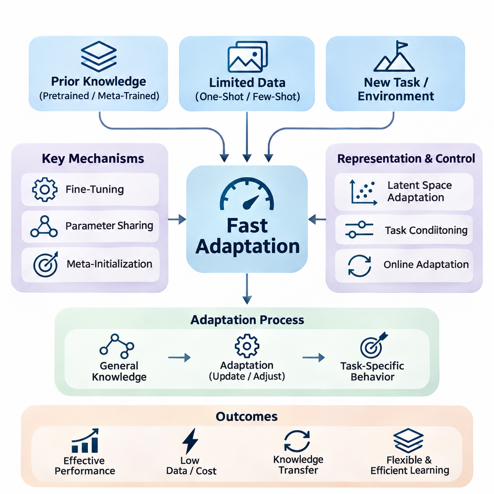
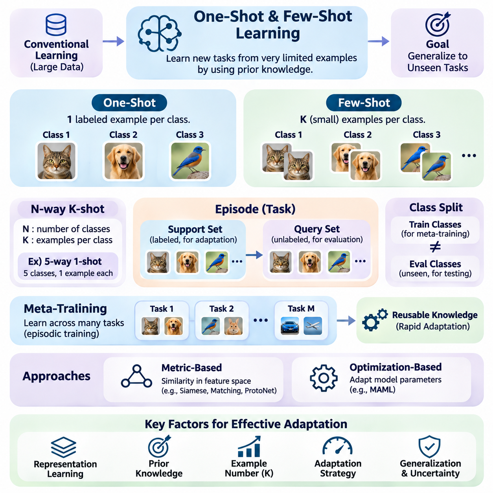
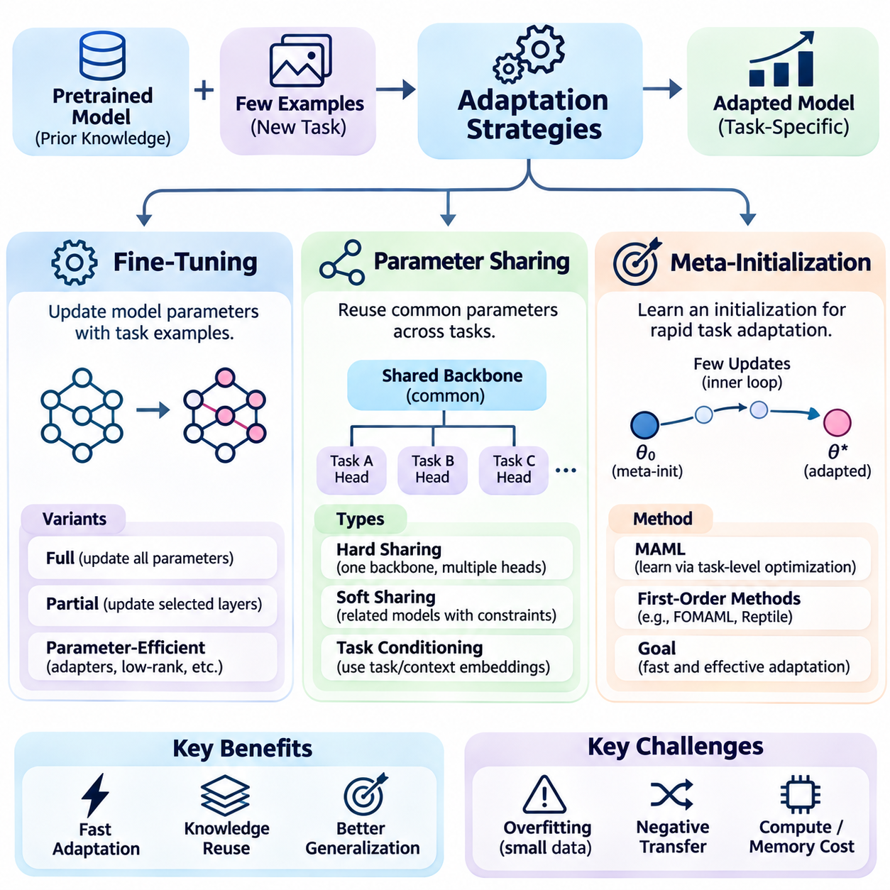
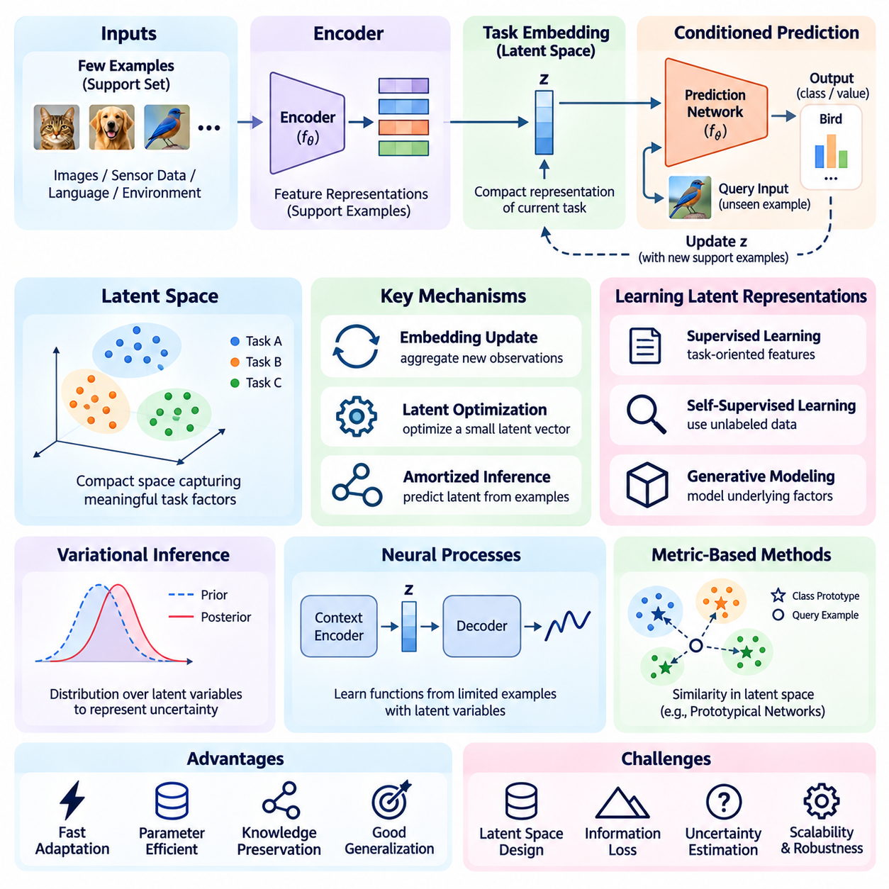
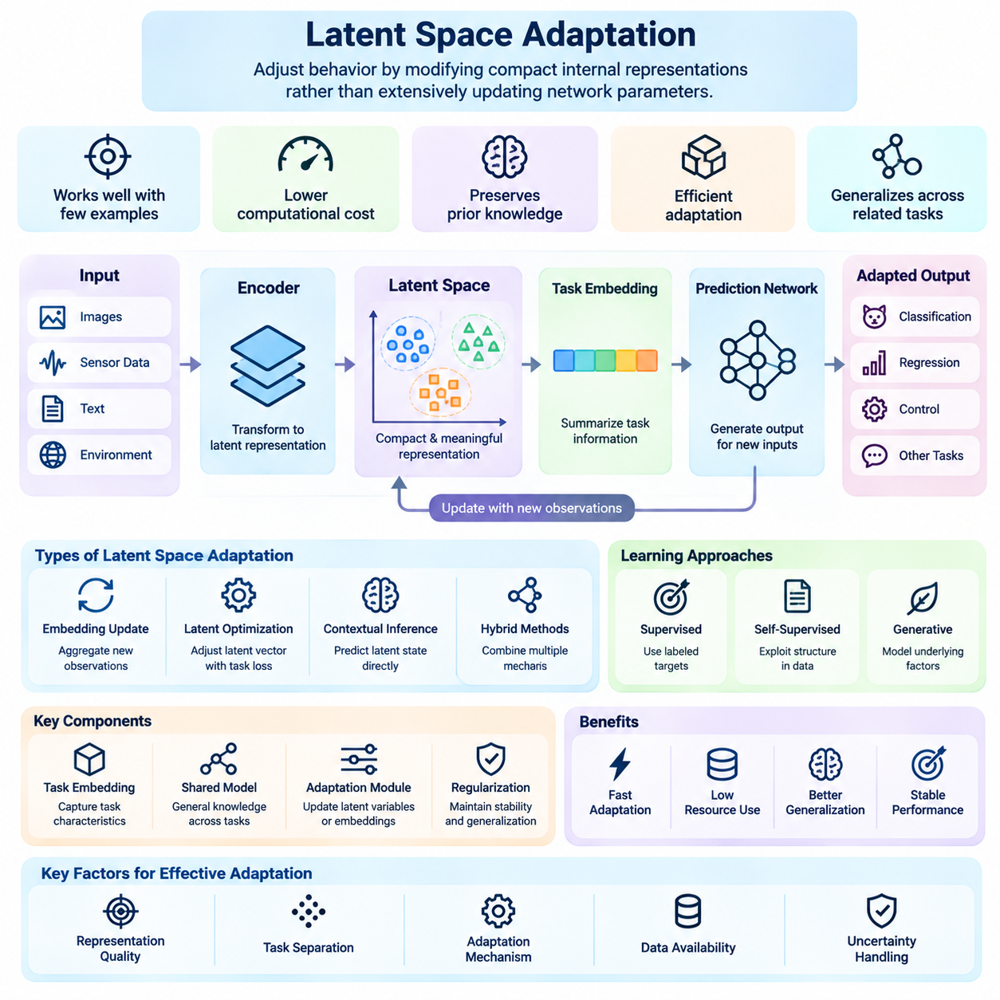
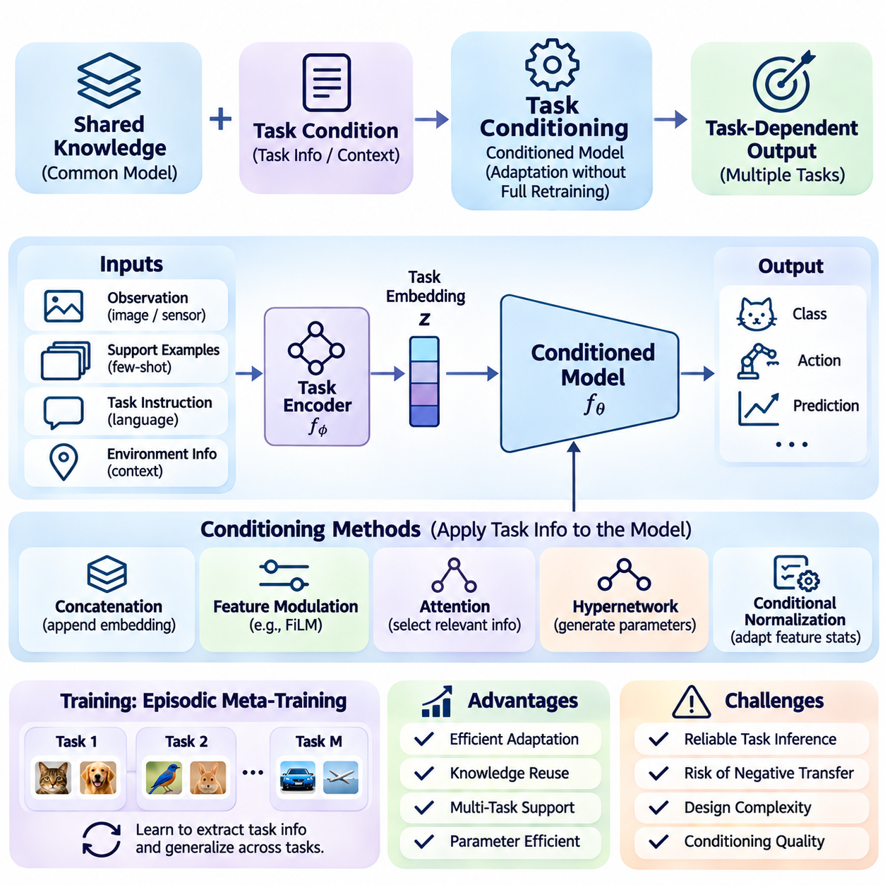
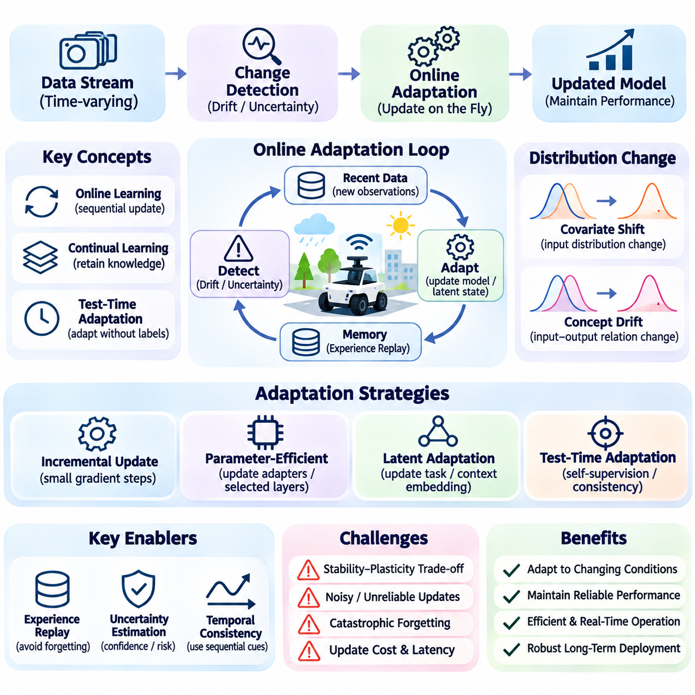
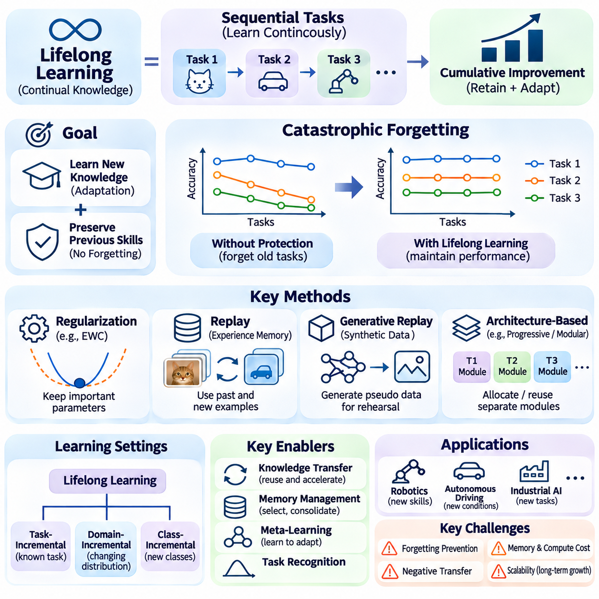
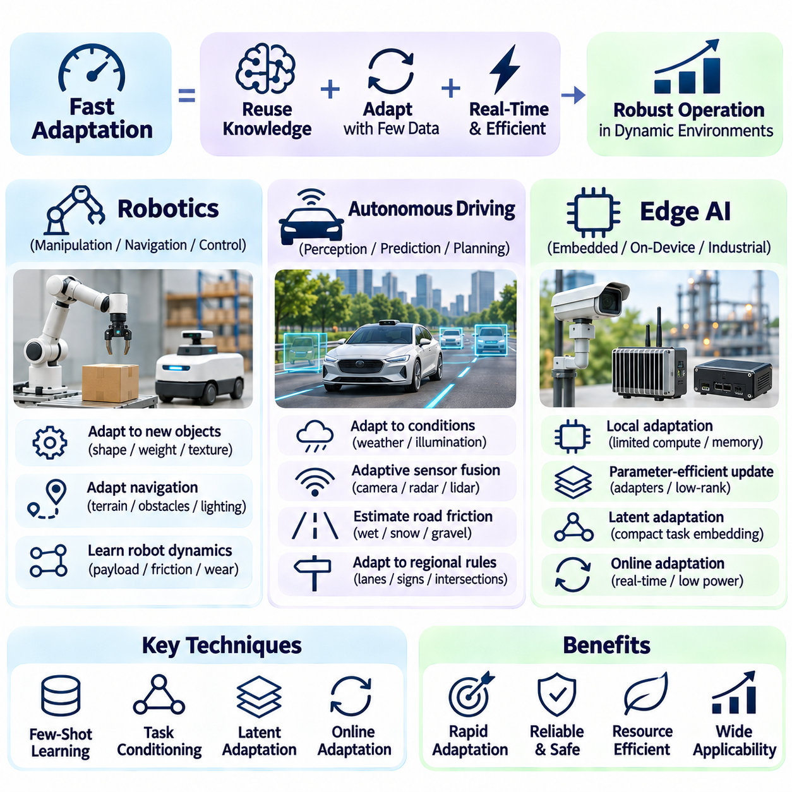

**Volume 36. Meta Learning and Few Shot Adaptation**

# 04. Fast Adaptation

## 04.00 Overview

{width="7.268055555555556in" height="7.268055555555556in"}

Fast adaptation is a central capability of intelligent systems that must respond effectively to new tasks, environments, and operating conditions with limited additional experience. Unlike conventional machine learning, which often depends on extensive retraining, fast adaptation seeks to achieve useful performance through a small number of observations, updates, or interactions. This capability is especially important when collecting new data is expensive, time-consuming, or operationally impractical.

The fundamental objective of fast adaptation is to reduce the amount of information and computation required to acquire a new capability. A model should transfer previously acquired knowledge while adjusting only those components necessary for the current task. Successful adaptation therefore depends on the quality of prior representations, the relevance of previous experience, and the efficiency of the adaptation mechanism under limited data and computational resources.

Fast adaptation is closely connected to meta-learning, where models are trained across multiple related tasks to acquire knowledge that supports rapid learning. Instead of optimizing exclusively for performance on individual training tasks, meta-learning encourages the discovery of transferable parameters, representations, and learning strategies. These shared structures allow a model to respond to unfamiliar tasks without repeating the complete training process.

One-shot and few-shot learning provide important settings for studying adaptation under severe data limitations. In one-shot learning, a model receives only one labeled example for each new class or task configuration. Few-shot learning extends this setting to a small collection of examples. Both approaches challenge conventional assumptions about training data availability and require models to exploit similarities, prior knowledge, and structural regularities.

The adaptation process can be understood as a transition from general-purpose knowledge to task-specific behavior. A pretrained or meta-trained model begins with parameters that encode information acquired from previous tasks. When new observations become available, an adaptation mechanism modifies predictions, internal representations, or selected parameters. The objective is to improve performance on the new task while preserving useful knowledge and avoiding unnecessary computational expense.

Fine-tuning is one of the most direct strategies for fast adaptation. It modifies pretrained model parameters using a limited dataset associated with the target task. However, unrestricted fine-tuning can cause overfitting when examples are scarce and may require substantial computation. Practical approaches often restrict updates to selected layers, introduce regularization, or employ small learning rates to maintain stable adaptation.

Parameter sharing provides another mechanism for reducing adaptation complexity. Instead of learning a completely independent model for every task, multiple tasks use a common collection of parameters that captures reusable knowledge. Task-specific components can then represent differences between individual tasks. This separation reduces memory requirements and allows new capabilities to emerge through relatively small modifications to the shared model.

Meta-initialization methods seek parameter configurations from which rapid optimization becomes possible. Model-Agnostic Meta-Learning illustrates this principle by learning an initialization that can be adjusted to new tasks through a small number of gradient updates. The effectiveness of this approach depends on the relationship between training and evaluation tasks, the optimization procedure, and the stability of the learned initialization.

Latent space adaptation offers an alternative to modifying large numbers of model parameters. In this approach, observations are mapped into compact representations that capture task-specific information. Adaptation occurs by updating latent variables, embeddings, or contextual states rather than retraining the entire network. This strategy can reduce computational cost and support efficient inference when the underlying representation is sufficiently expressive.

The quality of the latent representation strongly influences adaptation performance. A useful representation should preserve information relevant to task differences while suppressing irrelevant variation. When the latent space organizes related tasks coherently, new observations can identify appropriate behaviors with relatively little evidence. Poorly structured representations may instead require extensive updates or produce unreliable predictions under unfamiliar conditions.

Task conditioning allows models to adjust their behavior according to explicit or inferred information about the current task. Conditioning variables may represent task identity, environmental characteristics, user requirements, or contextual observations. These variables influence the model through mechanisms such as feature modulation, attention, or conditional parameter generation, enabling different behaviors without necessarily modifying the complete parameter set.

A major advantage of task conditioning is its ability to separate general knowledge from immediate contextual requirements. The model retains reusable capabilities while conditioning signals determine how those capabilities should be applied. This arrangement is valuable when tasks change frequently or when several operating modes must coexist within a single deployed system. Its effectiveness nevertheless depends on the reliability of task identification and contextual information.

Online adaptation extends fast adaptation into environments where observations arrive continuously. Rather than relying exclusively on a fixed adaptation dataset, the system updates its internal state or selected parameters during operation. This capability is important when environmental conditions, data distributions, or task requirements change over time. Online adaptation must balance responsiveness with stability because unreliable observations can introduce harmful updates.

The distinction between offline and online adaptation is particularly significant in autonomous systems. Offline adaptation generally occurs before deployment or during controlled maintenance periods, allowing extensive validation. Online adaptation occurs during active operation and may be subject to strict timing, safety, and resource constraints. Consequently, online learning mechanisms often require update restrictions, confidence monitoring, and mechanisms for reverting unsuitable changes.

Lifelong learning broadens the adaptation problem by considering sequences of tasks encountered over extended periods. A lifelong learning system should acquire new capabilities while retaining knowledge from previous experiences. This creates a fundamental tension between plasticity, which enables rapid modification, and stability, which protects established knowledge. Effective systems must manage both properties rather than maximizing adaptation speed alone.

Catastrophic forgetting is a major challenge in lifelong adaptation. When a model updates its parameters for a new task, performance on previously learned tasks may deteriorate. Regularization, experience replay, parameter isolation, and modular architectures offer different approaches to reducing this problem. Each introduces tradeoffs involving memory consumption, computational complexity, knowledge transfer, and the flexibility available for future adaptation.

Fast adaptation also requires careful management of uncertainty. A small number of examples may not provide enough evidence to determine whether a new task resembles previous experience. Models that adapt too aggressively can amplify noise or reinforce incorrect assumptions. Confidence estimation, Bayesian reasoning, validation procedures, and conservative update policies can help distinguish useful task information from unreliable observations.

Evaluation of fast adaptation must consider more than final predictive accuracy. Important measurements include the number of examples required, adaptation latency, computational cost, memory consumption, and performance stability. Adaptation curves reveal how performance changes as additional observations become available. These measurements help distinguish methods that genuinely learn efficiently from those that merely transfer substantial computational requirements into earlier training stages.

Robotics provides a practical setting where fast adaptation can improve performance under changing physical conditions. A robot may encounter unfamiliar surfaces, payload variations, sensor characteristics, or mechanical disturbances. Adaptation mechanisms can adjust perception, control parameters, or internal environmental representations using recent observations. However, any changes affecting physical behavior must remain within validated operational and safety constraints.

Autonomous driving presents additional adaptation challenges because environmental conditions can change rapidly and unpredictably. Variations in illumination, weather, road surfaces, and sensor performance may alter the relationship between observations and driving decisions. Adaptive perception and environmental estimation can improve robustness, but safety-critical control requires independent safeguards and rigorous validation before learned changes influence vehicle behavior.

Edge AI systems particularly benefit from efficient adaptation because they operate under limitations involving processing power, memory, energy consumption, and communication bandwidth. Transmitting all observations to centralized infrastructure may introduce unacceptable latency or dependence on network availability. Local adaptation can improve responsiveness and autonomy, provided that update mechanisms remain computationally efficient and compatible with device constraints.

Practical deployment requires integrating adaptation algorithms with monitoring, data management, and model lifecycle processes. Systems must determine when adaptation is necessary, which observations are trustworthy, and whether an updated model performs better than its predecessor. Version management, rollback capabilities, and controlled evaluation procedures provide essential support for maintaining reliability as models evolve through repeated operational experience.

Fast adaptation ultimately connects few-shot learning, optimization, representation learning, task conditioning, online learning, and lifelong learning into a unified framework for flexible intelligence. Its central ambition is not simply to accelerate training but to enable systems to reuse knowledge intelligently when facing unfamiliar situations. Achieving this capability requires balancing learning efficiency, generalization, computational constraints, stability, and operational safety.

## 04.01 One Shot and Few Shot Setting

{width="7.268055555555556in" height="7.268055555555556in"}

One-shot and few-shot learning represent fundamental problem settings in which machine learning models must recognize new patterns or acquire new capabilities from extremely limited examples. Conventional supervised learning typically relies on large labeled datasets, whereas these settings challenge models to generalize from minimal task-specific information. Their primary objective is to exploit previously acquired knowledge to achieve reliable performance on unfamiliar tasks.

One-shot learning refers to a learning scenario in which only one labeled example is available for each new class or task category. The model must infer relevant characteristics from this single observation and apply them to previously unseen inputs. This requirement makes conventional parameter estimation difficult because one example cannot adequately represent the full variability of a class. Effective one-shot learning therefore depends heavily on transferable representations and prior experience.

Few-shot learning extends the one-shot setting by providing a small number of labeled examples for each class. Although the additional observations offer more information about class characteristics, the available dataset remains insufficient for conventional training from random initialization. Models must therefore combine limited task-specific evidence with knowledge obtained during earlier training. The central challenge is achieving strong generalization without overfitting the small dataset.

A common experimental formulation is the N-way K-shot classification setting. Here, N represents the number of classes involved in a particular task, while K specifies the number of labeled examples available for each class. For example, a five-way one-shot task contains five classes with one labeled example per class. A five-way five-shot task provides five examples for each of the five classes, allowing more information to support classification decisions.

Few-shot tasks are commonly organized into episodes that simulate the conditions encountered during adaptation. Each episode contains a support set and a query set. The support set provides labeled examples that define the current task, while the query set contains additional examples used to evaluate predictions. This episodic organization encourages models to learn strategies that can be transferred across many related tasks rather than memorizing fixed training categories.

The support set serves as the primary source of task-specific information during adaptation. It may contain images, text samples, sensor measurements, or other observations depending on the application domain. The model uses these examples to identify class characteristics, estimate task relationships, or update selected parameters. Because the support set is small, each observation can strongly influence the resulting decision boundaries and predictions.

The query set evaluates whether the model can apply information extracted from the support set to previously unseen examples. During meta-training, query labels may contribute to optimization, while during evaluation they are withheld from the adaptation procedure. This separation is essential because it measures generalization beyond the examples directly provided for adaptation. Reliable evaluation requires preventing information leakage between support and query observations.

Meta-training typically involves sampling many tasks from a task distribution rather than optimizing a model on one fixed classification problem. Each sampled task introduces a different combination of classes, examples, or operating conditions. Repeated exposure to these variations encourages the model to acquire reusable learning strategies. The resulting knowledge can support rapid adaptation when the model encounters new tasks drawn from a related distribution.

The distinction between training classes and evaluation classes is particularly important in few-shot classification. Standard benchmarks often require evaluation classes to be disjoint from those used during meta-training. This arrangement tests whether the model can transfer its learned representations and adaptation mechanisms to unfamiliar categories. Strong performance on previously encountered classes alone does not demonstrate successful few-shot generalization.

Representation learning plays a central role in reducing the difficulty of one-shot and few-shot tasks. A model can transform raw observations into embeddings that preserve meaningful similarities while suppressing irrelevant variation. When these embeddings organize related examples into coherent regions, classification becomes possible using relatively few labeled observations. The quality of the representation often determines whether rapid adaptation is practical.

Metric-based methods approach few-shot learning by comparing query examples with labeled support examples in a learned feature space. Siamese Networks, Matching Networks, and Prototypical Networks illustrate different ways to exploit similarity relationships. Instead of learning an entirely new classifier through extensive optimization, these methods use distances, attention, or representative class prototypes to generate predictions from limited evidence.

Optimization-based approaches adapt model parameters directly using the available support examples. Model-Agnostic Meta-Learning and related algorithms learn parameter initializations that support rapid improvement through a small number of gradient updates. Their effectiveness depends on the learned initialization, adaptation learning rate, and relationship between training and evaluation tasks. Excessive updates can still cause overfitting when observations are scarce.

The number of examples available for each class influences both adaptation difficulty and prediction uncertainty. One-shot learning provides almost no direct information about within-class variation, making the model especially dependent on prior representations. Few-shot learning allows limited estimation of this variation but remains vulnerable to sampling bias. Performance generally improves with additional informative examples, although the magnitude of improvement depends on task complexity.

Class imbalance introduces additional complications when different categories contain unequal numbers of support examples. A model may become biased toward classes represented by more observations, particularly when adaptation relies on gradient-based optimization. Balanced episodic sampling can simplify evaluation, but practical applications frequently involve uneven data availability. Robust methods must therefore accommodate variable support-set sizes without assuming uniform class representation.

Task similarity strongly influences the effectiveness of knowledge transfer. When new tasks share meaningful structure with previously encountered tasks, learned features and adaptation strategies can remain useful. However, substantial differences in visual appearance, language, physical dynamics, or data distributions may reduce transfer effectiveness. Few-shot learning should therefore be evaluated under both related-task conditions and more challenging distribution shifts.

Data augmentation can improve adaptation by generating additional variations of the limited support examples. Transformations may include geometric changes in images, controlled perturbations of sensor signals, or meaning-preserving modifications of text. However, augmentation does not create independent evidence about unknown class characteristics. Poorly selected transformations may distort task semantics and reduce performance rather than improve generalization.

Regularization is particularly important because models can easily memorize the small support set. Techniques such as weight constraints, dropout, early stopping, and restricted parameter updates can reduce excessive specialization. Parameter-efficient adaptation provides another option by modifying only a small subset of model components. These approaches attempt to preserve transferable knowledge while allowing enough flexibility to accommodate task-specific differences.

Evaluation protocols must account for the variability inherent in few-shot experiments. Results can change significantly depending on which classes and examples are sampled into each episode. Consequently, performance is commonly estimated across many independently sampled evaluation episodes. Reporting average accuracy together with uncertainty estimates provides a more informative assessment than relying on a small number of favorable task configurations.

One-shot and few-shot learning have important applications in robotics, where collecting labeled demonstrations or interaction data can be expensive. A robot may need to recognize a new object, identify an unfamiliar tool, or adapt perception to a new workspace using only a few examples. Effective representations and adaptation mechanisms can reduce setup time and improve operational flexibility, although safety-critical behaviors require additional validation.

Autonomous driving and industrial inspection also present situations where rare conditions or newly introduced categories have limited labeled data. Few-shot techniques can support recognition of unusual objects, emerging defect patterns, or unfamiliar environmental characteristics. However, rare-event detection involves significant uncertainty, and successful laboratory classification does not automatically establish operational reliability. Deployment requires careful validation under realistic conditions.

Edge AI introduces further constraints because adaptation may need to occur on devices with limited processing power, memory, and energy availability. Metric-based inference, compact embeddings, and selective parameter updates can reduce computational requirements. Local adaptation may also reduce dependence on remote infrastructure. Nevertheless, adaptation speed must be evaluated alongside inference latency, resource consumption, and stability during continuous operation.

The broader significance of one-shot and few-shot settings lies in their ability to measure how effectively intelligent systems reuse prior knowledge. They provide controlled environments for investigating representation transfer, task conditioning, optimization efficiency, and uncertainty under limited supervision. Their ultimate goal is not merely classification with fewer examples, but the development of systems capable of acquiring useful new behaviors from minimal experience.

## 04.02 Adaptation Strategies [w/Code]

{width="7.268055555555556in" height="7.268055555555556in"}

Adaptation strategies determine how a machine learning model adjusts its behavior when encountering a new task with limited training examples. In few-shot learning and meta-learning, the objective is to achieve reliable performance without extensive retraining. Fine-tuning, parameter sharing, and meta-initialization provide complementary mechanisms for transferring previously acquired knowledge while controlling computational cost, adaptation speed, and generalization.

Fine-tuning adapts a pretrained model by updating selected or complete network parameters using task-specific examples. The pretrained model provides reusable representations, while additional optimization adjusts its predictions to new requirements. This strategy is widely applicable because it builds on established supervised learning procedures. However, its effectiveness depends on the quality and quantity of adaptation data and the stability of optimization.

Full fine-tuning updates all trainable parameters, allowing substantial changes in model behavior and feature representations. This flexibility is useful when a new task differs significantly from the original training distribution. However, updating a large network with only a few examples can produce overfitting and unstable gradients. Computational requirements may also become excessive when adaptation must occur rapidly or on resource-constrained hardware.

Partial fine-tuning limits adaptation to selected layers or prediction components while keeping other parameters fixed. A common approach freezes the feature extractor and updates only the final classification or regression head. This reduces training cost and preserves general representations learned from previous tasks. Nevertheless, performance may remain limited when the frozen features do not adequately represent the characteristics of an unfamiliar task.

Parameter-efficient fine-tuning introduces lightweight trainable components that modify model behavior without updating the complete network. Adapter modules, low-rank adaptation, and selective parameter updates can substantially reduce memory consumption. These methods are attractive for embedded intelligence and large pretrained models. Their effectiveness depends on whether the available adaptation capacity can represent the differences between previously learned and new tasks.

Fine-tuning requires careful control of learning rates, optimization steps, and regularization. Excessive updates can destroy useful pretrained representations, while insufficient optimization may leave the model poorly adapted. Early stopping, weight decay, and validation-based selection can reduce overfitting when suitable validation data are available. In extremely small support sets, uncertainty estimation and conservative updates become particularly important.

Parameter sharing allows multiple tasks to reuse common model components rather than maintaining completely independent networks. Shared parameters capture general patterns that remain useful across different learning problems. Task-specific components then represent variations associated with individual objectives. This architecture improves data efficiency and reduces duplicated computation, particularly when tasks share underlying structures or perceptual characteristics.

Hard parameter sharing uses a common backbone network with separate output heads or task-dependent modules. The shared backbone learns features from multiple tasks, while specialized components generate appropriate predictions. This design can improve generalization through common representation learning. However, unrelated tasks may interfere with one another when their optimization objectives require conflicting feature representations.

Soft parameter sharing maintains partially independent task models while encouraging their parameters or representations to remain related. Regularization terms, cross-task attention, or learned feature exchange can control the degree of information sharing. This approach offers greater flexibility than completely shared architectures. The additional parameters and coordination mechanisms, however, may increase memory requirements and training complexity.

Task conditioning strengthens parameter sharing by allowing shared networks to change their behavior according to contextual information. Task embeddings, feature modulation, and attention mechanisms can selectively activate relevant representations. This reduces the need for separate full-sized models while supporting task-dependent predictions. Reliable conditioning requires informative task representations and sufficient training diversity to distinguish unfamiliar operating conditions.

Negative transfer remains a major limitation of parameter sharing because knowledge useful for one task may interfere with another. Conflicting gradients can cause shared representations to favor certain objectives while degrading others. Gradient balancing, modular specialization, and selective sharing can mitigate these effects. Effective architectures must determine which information should remain common and which characteristics require task-specific adaptation.

Meta-initialization approaches adaptation from a different perspective by learning model parameters that can be rapidly optimized for new tasks. Instead of learning only a representation that performs well on training tasks, the system learns an initialization that supports efficient task-specific updates. This principle is central to optimization-based meta-learning and is especially relevant when only a few labeled examples are available.

Model-Agnostic Meta-Learning trains an initialization through repeated task-level optimization episodes. During each episode, an inner loop adapts the model to a sampled task, while an outer loop updates the initialization based on post-adaptation performance. Repeating this process across diverse tasks encourages parameters that respond effectively to small updates. The resulting model can adapt to unfamiliar but related tasks using limited observations.

First-order meta-learning methods reduce computational complexity by approximating or avoiding second-order gradient calculations. First-Order MAML and Reptile illustrate strategies for learning useful initial parameters with lower optimization overhead. These approaches can improve practical scalability, although their optimization behavior differs from full gradient-based meta-learning. Performance depends on task diversity, adaptation steps, and the relationship between training and evaluation tasks.

The quality of meta-initialization depends strongly on how training episodes represent future adaptation requirements. If meta-training tasks are too similar, the learned initialization may fail under unfamiliar conditions. If they are excessively heterogeneous, finding a common adaptable starting point may become difficult. Appropriate task sampling, support-query separation, and evaluation on unseen tasks are essential for measuring genuine adaptation capability.

Fine-tuning, parameter sharing, and meta-initialization are not mutually exclusive strategies. A system may use a shared pretrained backbone, learn a meta-initialized prediction head, and perform lightweight fine-tuning on new support examples. Task conditioning can further modify intermediate features according to inferred context. Such hybrid architectures balance adaptation flexibility, parameter efficiency, and the preservation of previously acquired knowledge.

Robotics illustrates the practical value of combining these strategies. Shared perception models can support object recognition and manipulation, while task-specific adapters respond to unfamiliar objects or operating conditions. Meta-initialized control components may adapt rapidly to changes in payload or friction. However, learned updates affecting physical behavior must remain subject to independently validated safety constraints and controlled deployment procedures.

Autonomous driving and edge AI impose additional requirements involving latency, memory, energy consumption, and operational reliability. Parameter sharing reduces model duplication, while lightweight fine-tuning limits adaptation cost. Meta-initialization can reduce the number of updates needed for unfamiliar conditions. Safety-critical systems must nevertheless prevent unverified model changes from overriding established control limits or fallback mechanisms.

Evaluation of adaptation strategies should consider predictive accuracy, adaptation speed, memory requirements, and robustness across unseen tasks. Comparisons should use consistent support sets, optimization budgets, and evaluation conditions. Additional measurements can examine catastrophic forgetting, negative transfer, and sensitivity to distribution shifts. These criteria reveal whether improvements result from effective adaptation rather than excessive computational resources.

The selection of an adaptation strategy depends on task similarity, available examples, hardware constraints, and acceptable operational risk. Fine-tuning offers direct flexibility, parameter sharing promotes efficient knowledge reuse, and meta-initialization prepares models for rapid optimization. Combining these mechanisms provides a practical foundation for intelligent systems that must learn efficiently while preserving stable performance across changing tasks and environments.

## 04.03 Latent Space Adaptation

{width="7.268055555555556in" height="7.268055555555556in"}

{width="7.268055555555556in" height="7.268055555555556in"}

Latent space adaptation enables machine learning models to adjust their behavior by modifying compact internal representations rather than extensively updating network parameters. This approach is particularly valuable in few-shot learning, where only limited task-specific observations are available. By encoding relevant information into a low-dimensional latent space, models can achieve rapid adaptation while reducing computational cost and preserving previously acquired knowledge.

A latent space is an internal representation in which complex observations are transformed into compact variables that capture meaningful underlying factors. Images, sensor measurements, language inputs, and environmental states can be mapped into latent vectors through learned encoders. These vectors may represent semantic characteristics, task identities, or dynamic conditions. Their usefulness depends on how effectively they preserve information required for downstream decisions.

The central principle of latent space adaptation is to separate general knowledge from task-specific variation. A shared model learns representations that apply across many tasks, while a latent variable captures characteristics of the current task. When new observations arrive, the system updates this variable without necessarily changing the main network weights. This separation can substantially reduce the number of quantities requiring adjustment during adaptation.

In a typical architecture, an encoder transforms support examples into feature representations that are combined into a task embedding. The embedding conditions a prediction network responsible for processing new query inputs. Adaptation occurs when additional support observations modify the task embedding. This design allows a model to respond to changing task requirements while retaining a stable shared representation learned from previous experience.

Task embeddings are central to many latent adaptation methods because they summarize information about the current learning problem. A useful embedding should distinguish relevant differences between tasks while remaining insensitive to irrelevant noise. For example, an embedding may encode object appearance, environmental conditions, or system dynamics. Its quality determines whether a small number of examples can provide enough information for effective adaptation.

Latent representations can be learned through supervised objectives, self-supervised learning, or generative modeling. Supervised approaches encourage features that support known prediction targets, while self-supervised methods exploit structural relationships within unlabeled observations. Generative approaches attempt to represent factors that explain observed data. Each strategy introduces different assumptions about which information should be preserved in the latent space.

Variational inference provides a probabilistic framework for learning task-dependent latent variables. Instead of assigning a single deterministic representation to each task, the model estimates a distribution over possible latent states. This distribution can express uncertainty when only a few support examples are available. As additional observations arrive, the inferred distribution may become more concentrated around latent configurations consistent with the evidence.

Conditional neural processes illustrate how latent variables can support rapid adaptation across related functions. A context encoder processes observed input-output pairs and produces a representation of the current function or task. A decoder then predicts outputs for new inputs using this contextual information. Variants incorporating global latent variables can represent uncertainty about the underlying function, although calibration and expressiveness depend on model design.

Metric-based few-shot learning can also be interpreted through latent space adaptation. Models such as Prototypical Networks transform examples into an embedding space where each class is represented by a prototype. When a new task appears, the model constructs prototypes from its support examples rather than retraining the feature extractor. Query examples are classified according to their distances from these prototypes, enabling efficient adaptation.

The geometry of the latent space strongly influences adaptation performance. Ideally, observations associated with similar tasks or classes occupy nearby regions, while meaningfully different examples remain distinguishable. Appropriate distance metrics and representation objectives can encourage this structure. However, low-dimensional compression may discard important details, and poorly organized embeddings can produce misleading similarity relationships.

Latent adaptation can operate through several mechanisms, including embedding updates, latent optimization, and contextual inference. Embedding updates aggregate new observations into a revised task representation. Latent optimization adjusts a compact vector using task-specific losses, while contextual inference predicts latent states directly from available evidence. These mechanisms differ in computational requirements, flexibility, and sensitivity to limited observations.

Gradient-based latent optimization provides an alternative to full parameter fine-tuning. The model\'s primary weights remain fixed while a small latent vector is optimized to minimize a task-specific objective. Because relatively few variables are updated, adaptation can require less memory and computation. Nevertheless, optimization quality depends on initialization, loss design, and whether the learned latent space contains suitable solutions for unfamiliar tasks.

Amortized inference avoids repeated optimization by training an encoder to predict task representations directly from support observations. Once trained, the encoder can produce an adaptation state through a forward pass, often reducing latency substantially. This approach is attractive for real-time systems, but its accuracy depends on whether the training distribution adequately represents future tasks. Unfamiliar conditions may require additional refinement or uncertainty monitoring.

Latent space disentanglement seeks representations in which different dimensions or components correspond to distinct underlying factors. Separating object identity, environmental appearance, and physical dynamics can make adaptation more selective. A system may then adjust only the latent components associated with changing conditions. However, disentangled representations are not automatically identifiable, and their interpretation depends on training assumptions and available supervision.

Temporal latent adaptation extends these ideas to environments where task characteristics evolve continuously. Recurrent networks, state-space models, and temporal encoders can update latent states as new observations arrive. Such representations may capture changes in system dynamics, sensor behavior, or environmental context. Effective temporal adaptation requires distinguishing meaningful changes from transient noise to avoid unstable predictions.

Uncertainty estimation is particularly important because latent variables inferred from limited evidence may be ambiguous. Probabilistic embeddings, ensembles, and Bayesian inference can help quantify uncertainty about the current task representation. Systems can use this information to determine whether adaptation is sufficiently reliable. When uncertainty remains high, additional observations or conservative predictions may be preferable to aggressive adaptation.

The relationship between latent adaptation and parameter adaptation involves important tradeoffs. Latent methods generally modify fewer variables and can preserve shared model weights, making them computationally efficient. However, their flexibility is limited by the representational capacity of the pretrained model. Parameter fine-tuning may accommodate larger task changes but introduces additional optimization cost and potential instability.

Hybrid architectures combine latent adaptation with selective parameter updates to balance efficiency and flexibility. A task encoder may first infer a compact representation, while a small adapter or prediction head performs limited fine-tuning. This arrangement can respond quickly to familiar variations while retaining the ability to adjust selected model components. Designing such systems requires careful control of update frequency, memory usage, and generalization behavior.

Robotics provides an important application because physical systems frequently encounter changing payloads, surfaces, friction conditions, and actuator characteristics. A robot can infer latent variables representing these conditions from recent sensor observations and use them to condition perception or control models. This enables adaptation without repeatedly retraining large networks. Safety-critical actions must nevertheless remain subject to validated constraints and independent monitoring.

Autonomous driving and mobile robotics can use latent representations to characterize changing environmental conditions. Lighting, weather, road friction, and sensor quality may influence perception and motion planning. Contextual embeddings can help models adjust their predictions to these variations. However, inferred latent states may be unreliable under rare conditions, requiring uncertainty-aware decision mechanisms and conservative operational safeguards.

Edge AI systems benefit from latent adaptation because compact representations can reduce memory requirements, communication overhead, and update latency. Instead of transmitting complete datasets or updating large parameter collections, devices may maintain small task-specific states locally. This supports responsiveness when network connectivity is limited. Practical deployment still requires evaluating energy consumption, inference speed, and the stability of repeated adaptation.

Evaluation of latent space adaptation should consider both predictive performance and the quality of learned representations. Relevant measurements include few-shot accuracy, adaptation latency, latent dimensionality, computational cost, and robustness to distribution shifts. Additional analysis can examine uncertainty calibration, representation stability, and sensitivity to noisy support examples. These criteria help determine whether compact adaptation genuinely improves operational efficiency.

Latent space adaptation provides a general framework for transforming limited observations into task-specific behavior through compact internal states. By combining representation learning, contextual inference, probabilistic modeling, and selective optimization, it supports rapid adaptation without requiring extensive parameter changes. Its long-term value lies in enabling intelligent systems to reuse general knowledge while responding efficiently and reliably to unfamiliar conditions.

## 04.04 Task Conditioning

{width="7.268055555555556in" height="7.268055555555556in"}

Task conditioning is a fundamental mechanism in fast adaptation that enables a machine learning model to modify its behavior according to the requirements of a particular task. Instead of retraining the entire network whenever conditions change, the model receives contextual information that influences its predictions or internal computations. This approach supports efficient knowledge reuse and allows a single model to perform multiple related tasks.

The central principle of task conditioning is to separate general-purpose knowledge from task-specific information. Shared model parameters encode capabilities acquired across previous tasks, while conditioning variables describe the current objective or operating context. By combining these components, the model can produce task-dependent outputs without extensive parameter updates. This separation is particularly valuable when adaptation data and computational resources are limited.

Conditioning information can originate from explicit task identifiers, labeled support examples, natural language instructions, environmental measurements, or inferred latent variables. Explicit identifiers are useful when task categories are known in advance, while inferred representations allow adaptation to unfamiliar tasks. The reliability and completeness of conditioning information strongly influence whether the model selects appropriate behavior under changing conditions.

Task embeddings provide a compact representation of the information needed to distinguish one task from another. An encoder transforms task descriptions or support observations into vectors that summarize relevant characteristics. These vectors are then supplied to a prediction network, allowing its behavior to depend on the current task. Effective task embeddings preserve meaningful distinctions while suppressing irrelevant variation and observation noise.

A common conditioning strategy concatenates a task embedding with the input features before passing them through a neural network. This allows the prediction function to depend jointly on the observation and the task representation. Although straightforward to implement, concatenation may require the network to learn complex interactions between both information sources. Its effectiveness depends on representation quality, network capacity, and training diversity.

Feature-wise modulation offers a more structured mechanism for integrating task information into intermediate network representations. Methods such as Feature-wise Linear Modulation use conditioning variables to generate scaling and shifting coefficients for feature channels. These coefficients modify how shared features contribute to predictions. Such mechanisms can support substantial behavioral variation without requiring separate networks for every task.

Attention-based conditioning enables models to select information according to the current task or context. A query representation may attend to relevant support examples, memory entries, or intermediate features. This selective interaction allows different tasks to emphasize different aspects of shared knowledge. Attention mechanisms are especially useful when conditioning information contains multiple observations or relationships that cannot be summarized reliably by a single fixed vector.

Hypernetworks provide another approach by generating some or all of a prediction model\'s parameters from task-specific information. A conditioning network receives a task embedding and produces weights for selected layers or modules. This mechanism can create highly flexible task-dependent behavior. However, generating large parameter sets introduces memory and computational costs, making partial parameter generation attractive for resource-constrained systems.

Conditional normalization modifies feature statistics or normalization parameters according to task information. By adjusting scaling and offset values, the model can alter intermediate representations while preserving much of its shared architecture. This approach is frequently associated with conditional image generation and domain adaptation. Its usefulness in few-shot settings depends on whether the conditioning representation captures relevant task differences.

Task conditioning can be learned through episodic meta-training, where each episode represents a distinct task with support and query examples. The conditioning encoder extracts information from the support set, and the prediction model uses that information to process query inputs. Query losses guide both components toward representations that support generalization. Repeated training across diverse tasks encourages rapid adjustment to unfamiliar task configurations.

An important design consideration is whether task information is provided explicitly or inferred from observations. Explicit conditioning can be efficient when task identities and requirements are known, but it may not generalize to previously unseen categories. Inferred conditioning provides greater flexibility by estimating task characteristics from available evidence. However, inference errors can produce inappropriate behavior, particularly when support observations are sparse or ambiguous.

Probabilistic task conditioning addresses uncertainty by representing task information as a distribution rather than a single deterministic embedding. A model can infer multiple plausible task states from limited observations and update their probabilities as additional evidence arrives. This approach is useful when task boundaries are unclear or environmental conditions change gradually. Reliable uncertainty estimation remains essential for deciding when conditioning information is sufficiently informative.

Task conditioning is closely related to latent space adaptation, but the two concepts emphasize different aspects of model behavior. Latent adaptation focuses on estimating or updating compact task representations, whereas conditioning describes how those representations influence model computations. A system may combine both by inferring a latent task variable and using it to modulate features, attention, or prediction parameters. This combination supports efficient context-dependent adaptation.

Dynamic task conditioning extends the approach to continuously changing environments. Rather than using a fixed task representation throughout an operation, the system updates conditioning information as new observations arrive. Temporal encoders, recurrent networks, and state estimators can maintain evolving contextual states. Effective implementations must distinguish meaningful environmental changes from temporary noise to prevent unstable behavioral switching.

Negative transfer is a significant concern when shared models are conditioned on tasks with conflicting requirements. A representation that supports one task may interfere with another if the conditioning mechanism cannot adequately separate their objectives. Stronger task embeddings, modular architectures, and selective parameter sharing can reduce such interference. Evaluation should examine both task-specific accuracy and the stability of shared capabilities.

Task conditioning also introduces challenges involving distribution shifts and unfamiliar contexts. A model trained on a limited range of task descriptions may respond unpredictably to conditioning inputs outside that range. Robustness can be improved through diverse episodic training, uncertainty monitoring, and controlled adaptation policies. However, these measures cannot guarantee reliable generalization to fundamentally different tasks without additional evidence.

In robotics, task conditioning enables a shared perception or control model to support different operational objectives. A robot may receive instructions to inspect an object, manipulate a component, or navigate toward a destination. Task embeddings can influence object selection, motion planning, and action prediction. However, learned conditioning must remain subordinate to independent safety constraints, especially when tasks involve physical interaction with people or equipment.

Autonomous driving and mobile robotics can use contextual conditioning to account for weather, road conditions, mission requirements, and sensor characteristics. A perception model may adjust its feature interpretation according to illumination or environmental context. Navigation systems may incorporate operational objectives into route selection. Safety-critical decisions nevertheless require validated safeguards because incorrect contextual inference can lead to inappropriate actions.

Edge AI applications benefit from task conditioning because a single shared model can support multiple functions without maintaining separate full-sized networks. Compact task embeddings and lightweight modulation layers can reduce memory requirements and adaptation latency. Local conditioning also reduces dependence on remote computation when network connectivity is unreliable. Practical efficiency depends on the size of the conditioning mechanism and the frequency of contextual updates.

Evaluation of task-conditioned models should consider generalization across unseen tasks, sensitivity to conditioning quality, and computational efficiency. Important measurements include query accuracy, adaptation latency, memory consumption, and robustness to noisy or incomplete task descriptions. Ablation studies can compare conditioning mechanisms and determine which components contribute to performance. Testing unfamiliar task combinations is especially important for assessing transferable behavior.

Task conditioning provides a flexible foundation for adapting intelligent systems without repeatedly retraining their complete parameter sets. By integrating task embeddings, feature modulation, attention, hypernetworks, and contextual inference, models can transform shared knowledge into task-specific predictions. Its effectiveness depends on reliable task representations, appropriate conditioning architectures, and careful management of uncertainty, computational constraints, and operational safety.

## 04.05 Online Adaptation

{width="7.268055555555556in" height="7.268055555555556in"}

Online adaptation enables machine learning systems to adjust their behavior continuously as new observations become available during operation. Unlike offline adaptation, which relies on previously collected datasets and controlled training procedures, online adaptation responds to changing conditions without requiring complete retraining. This capability is essential for intelligent systems operating in dynamic environments where data distributions, task requirements, and physical conditions evolve over time.

The fundamental objective of online adaptation is to maintain reliable performance under changing circumstances while minimizing computational overhead and operational disruption. A deployed model may encounter unfamiliar inputs, gradual environmental changes, or unexpected variations in system behavior. Online adaptation mechanisms use recent observations to update internal representations, selected parameters, or contextual states while preserving previously acquired knowledge.

Online adaptation is closely related to online learning, continual learning, and test-time adaptation, although these concepts emphasize different objectives. Online learning processes observations sequentially, continual learning focuses on retaining knowledge across evolving tasks, and test-time adaptation modifies models using deployment-time information. Online adaptation encompasses mechanisms that adjust system behavior during operation, potentially without immediate access to labeled examples.

A central challenge is detecting when adaptation is necessary. Changes in input distributions, prediction uncertainty, residual errors, or environmental measurements may indicate that existing model behavior is becoming less reliable. Drift detection methods can monitor these signals and trigger adaptation when predefined conditions are satisfied. However, distinguishing meaningful distribution shifts from temporary noise is essential to avoid unnecessary or harmful updates.

Concept drift occurs when relationships between inputs and desired outputs change over time, while covariate shift describes changes in input distributions. Both can reduce model performance, but they require different responses depending on the underlying cause. A system must determine whether observed changes reflect environmental variation, sensor degradation, or genuinely new task requirements before selecting an appropriate adaptation strategy.

Online adaptation can modify model parameters through incremental gradient updates using newly collected observations. Instead of processing a complete training dataset, the system performs small optimization steps on recent examples or buffered samples. This approach can improve responsiveness but may introduce instability when data are noisy or unrepresentative. Learning rates, update frequency, and parameter selection must therefore be carefully controlled.

Parameter-efficient online adaptation reduces computational requirements by updating only selected layers, adapters, or prediction heads. Shared feature extractors may remain frozen while lightweight components respond to changing conditions. This arrangement limits memory consumption and reduces the risk of disrupting established representations. However, restricted updates may be insufficient when environmental changes require substantial modifications to the underlying feature space.

Latent state adaptation offers an alternative to direct parameter optimization. A model can infer changing environmental characteristics through compact contextual embeddings or hidden states. These representations are updated from recent observations and used to condition predictions or control decisions. Because the main network parameters remain unchanged, latent adaptation can provide rapid responses with relatively low computational cost.

Test-time adaptation is particularly relevant when labeled data are unavailable during deployment. Methods may use self-supervised objectives, prediction consistency, or selected feature statistics to adjust model behavior. Such approaches can improve robustness under certain distribution shifts, but unreliable pseudo-labels or inappropriate objectives may reinforce prediction errors. Adaptation must therefore include safeguards against uncontrolled performance degradation.

Experience replay helps preserve previously acquired knowledge during continuous updates. A replay buffer stores selected historical observations that can be combined with recent data during optimization. This reduces the tendency to overfit the latest conditions and mitigates catastrophic forgetting. Buffer size, sampling strategy, and data retention policies influence the balance between adaptation flexibility, memory consumption, and long-term stability.

The stability-plasticity dilemma is fundamental to online adaptation. Plasticity allows a model to respond rapidly to new conditions, while stability protects established capabilities from unnecessary changes. Excessive plasticity may cause oscillation or forgetting, whereas excessive stability can prevent meaningful adaptation. Effective systems regulate update magnitude and frequency according to uncertainty, task importance, and observed environmental change.

Uncertainty estimation provides valuable information for controlling adaptation decisions. A model may encounter observations that differ substantially from its training experience, making its predictions unreliable. Confidence monitoring, probabilistic inference, and ensemble disagreement can help identify such situations. When uncertainty exceeds acceptable limits, the system may delay adaptation, request additional evidence, or switch to a conservative operating mode.

Temporal consistency is important because consecutive observations are often correlated rather than independent. Updating a model from a short sequence of nearly identical examples can produce biased adaptation and unstable behavior. Temporal sampling, observation windows, and diversity-aware replay can reduce this problem. Adaptation mechanisms should incorporate sufficient evidence across time before making significant changes to model parameters or operational decisions.

Online adaptation also requires mechanisms for detecting unsuccessful updates. A model may appear to improve on recent observations while becoming less reliable under other conditions. Performance monitors can compare updated predictions with reference behavior, validation samples, or independent consistency checks. If an update violates predefined acceptance criteria, the system should reject the change or restore a previously validated model state.

Computational constraints strongly influence online adaptation architectures. Real-time applications must allocate processing resources between inference, adaptation, monitoring, and other operational functions. Large optimization workloads can increase latency and interfere with time-critical decisions. Lightweight updates, asynchronous training processes, and bounded computational budgets help maintain predictable system behavior during continuous operation.

Robotics provides a practical application because physical conditions frequently change during deployment. Variations in payload, friction, actuator response, and sensor calibration may affect perception and control performance. Online adaptation can estimate these changes and adjust selected model components using recent observations. Nevertheless, safety-critical control must remain within independently validated operating limits, regardless of learned parameter updates.

Autonomous driving presents additional challenges because environmental changes may occur rapidly and unpredictably. Weather, illumination, road conditions, and sensor contamination can influence perception reliability. Adaptive models may improve environmental estimation or feature interpretation, but uncontrolled updates could introduce unacceptable risks. Safety-critical decisions require independent safeguards, conservative fallback behavior, and rigorous validation of adaptation mechanisms.

Edge AI systems particularly benefit from local online adaptation because network connectivity may be unreliable or communication latency may be unacceptable. Compact models can update contextual states or selected parameters directly on embedded devices. This reduces dependence on centralized infrastructure and supports operational autonomy. However, energy consumption, thermal constraints, memory capacity, and processor availability must be considered when scheduling updates.

Distributed online adaptation introduces coordination challenges when multiple devices learn from different operating conditions. Individual agents may acquire useful local knowledge, but their updates can become inconsistent across a fleet. Federated learning and controlled parameter aggregation can support knowledge sharing without transferring all raw observations. Communication constraints, heterogeneous data, and model compatibility must be addressed before integrating distributed updates.

Evaluation of online adaptation must consider performance throughout the adaptation process rather than only after convergence. Important measurements include adaptation latency, cumulative prediction error, recovery time after distribution shifts, memory usage, and forgetting of earlier capabilities. Evaluations should include gradual drift, abrupt changes, noisy observations, and recurring conditions to determine whether adaptation remains reliable over extended operation.

Operational deployment requires an integrated framework for monitoring, update authorization, model versioning, and rollback. Systems should record the observations and conditions responsible for each adaptation event and maintain traceability of model changes. Controlled testing can determine whether updated behavior satisfies performance and safety requirements. These procedures are particularly important when adaptive models interact with physical equipment or critical infrastructure.

Online adaptation ultimately connects sequential learning, contextual inference, uncertainty management, and continual optimization into a framework for responsive intelligence. Its objective is not unrestricted self-modification but controlled improvement under evolving conditions. Reliable implementations must balance adaptation speed, computational efficiency, knowledge retention, and operational safety while ensuring that learned changes remain observable, reversible, and appropriately validated.

## 04.06 Lifelong Learning

{width="7.268055555555556in" height="7.268055555555556in"}

Lifelong learning enables intelligent systems to acquire new knowledge continuously while retaining capabilities developed through earlier experiences. Unlike conventional machine learning, which typically assumes a fixed training dataset, lifelong learning addresses sequences of tasks and changing environments. Its objective is to support cumulative improvement over extended periods without requiring complete retraining whenever new information becomes available.

The central challenge of lifelong learning is balancing knowledge acquisition with knowledge preservation. Neural networks can rapidly learn new patterns, but parameter updates may interfere with representations supporting previously learned tasks. This phenomenon, known as catastrophic forgetting, can cause substantial performance degradation. Effective lifelong learning methods must therefore maintain earlier competencies while incorporating useful information from new experiences.

Lifelong learning is closely related to continual learning, incremental learning, and online adaptation. Continual learning emphasizes maintaining performance across sequential tasks, while incremental learning introduces new classes, examples, or capabilities over time. Online adaptation focuses on immediate responses to changing conditions. Lifelong learning integrates these objectives into a broader framework for cumulative knowledge development and long-term adaptability.

A typical lifelong learning system processes a sequence of learning experiences rather than a single static dataset. Each experience may introduce new task objectives, environmental conditions, or data distributions. The model must incorporate relevant information while preserving knowledge that remains useful. This process requires mechanisms for identifying important representations, controlling updates, and evaluating performance across previously encountered tasks.

Regularization-based approaches reduce forgetting by restricting changes to parameters considered important for earlier tasks. Elastic Weight Consolidation estimates parameter importance and penalizes modifications that could disrupt previously learned behavior. Related methods use gradient constraints or importance estimates to protect existing capabilities. Their effectiveness depends on accurately identifying which parameters contribute to long-term knowledge retention.

Replay-based lifelong learning preserves selected historical experiences for use during subsequent training. A memory buffer stores representative observations or task examples that are combined with newly collected data. This approach helps maintain performance on earlier tasks while learning new ones. However, limited memory capacity, sample selection, privacy requirements, and computational overhead influence the practicality of replay mechanisms.

Generative replay provides an alternative when storing historical data is impractical. A generative model produces synthetic examples resembling previously encountered experiences, allowing the learner to rehearse earlier knowledge. This can reduce dependence on large memory buffers, but generated samples may contain inaccuracies or insufficient diversity. Poor generative quality can gradually distort retained knowledge during repeated learning cycles.

Architecture-based methods preserve knowledge by allocating separate parameters, modules, or pathways to different tasks. Progressive neural networks introduce new components while retaining earlier ones, reducing interference between learning stages. Modular architectures can also reuse selected components across related tasks. Although effective in certain settings, expanding architectures may increase memory requirements and computational complexity over time.

Parameter-efficient lifelong learning attempts to balance architectural stability with adaptation flexibility. Shared backbone networks can remain largely unchanged while task-specific adapters, lightweight modules, or low-rank updates capture new information. This reduces the number of trainable parameters and limits interference with existing representations. However, maintaining numerous task-specific components may eventually create management and scalability challenges.

Knowledge transfer is a major advantage of lifelong learning because previously acquired representations can accelerate the acquisition of related capabilities. A model trained on earlier tasks may reuse visual features, semantic concepts, or control strategies when encountering new problems. Positive transfer reduces the amount of additional data required for adaptation. Negative transfer occurs when inappropriate knowledge reuse interferes with learning unfamiliar tasks.

Task boundaries are not always explicitly available in real-world environments. Task-incremental learning assumes task identity is known during evaluation, while domain-incremental and class-incremental learning introduce different requirements for handling changing distributions or expanding label spaces. Systems without clear task identifiers must infer relevant context from observations. This makes task recognition and uncertainty estimation important components of lifelong adaptation.

Memory management is essential because intelligent systems cannot retain every observation indefinitely. Effective strategies select representative, diverse, or informative experiences according to available storage and computational resources. Memory consolidation may combine similar observations into compact representations while preserving important distinctions. The challenge is retaining information that supports future learning without accumulating excessive redundant data.

Meta-learning can improve lifelong learning by teaching models how to adapt efficiently across sequences of tasks. Rather than optimizing only for immediate task performance, meta-learning can encourage representations and update strategies that support future adaptation. Learned initialization, contextual inference, and adaptive optimization may reduce the effort required to acquire new capabilities. However, long-term knowledge retention must still be addressed explicitly.

In robotics, lifelong learning supports the gradual acquisition of perception, manipulation, navigation, and interaction capabilities. A robot may encounter unfamiliar objects, changing surfaces, new equipment, or evolving operational procedures. Reusing earlier experience can reduce adaptation time and improve task efficiency. Nevertheless, learned changes affecting physical behavior require controlled validation and independent safety mechanisms before operational deployment.

Autonomous driving and mobile robotics present challenging lifelong learning environments because operating conditions vary across locations, seasons, traffic patterns, and sensor configurations. Models may benefit from accumulating experience across diverse situations. However, continuous updates can introduce unexpected regressions in rare but safety-critical scenarios. Reliable deployment therefore requires extensive evaluation, version control, and conservative update policies.

Edge AI applications require lifelong learning methods that operate within limited memory, energy, and processing budgets. Lightweight adapters, selective replay, and compact representations can support incremental improvement without repeatedly retraining large models. Devices may also exchange selected knowledge through distributed learning mechanisms. Practical architectures must balance local autonomy, communication costs, and consistency across deployed systems.

Evaluation of lifelong learning requires measuring performance across an entire sequence of experiences. Common criteria include average accuracy, forgetting, forward transfer, backward transfer, memory consumption, and computational cost. Forward transfer measures how previous learning benefits future tasks, while backward transfer examines how new learning affects earlier capabilities. Evaluation should also consider task order, distribution shifts, and performance stability over extended periods.

A fundamental distinction between lifelong learning and unrestricted self-modification is the requirement for controlled knowledge integration. Learning systems should not automatically deploy every newly acquired behavior without verification. Monitoring, validation datasets, rollback mechanisms, and traceable model versions help maintain operational reliability. These safeguards become especially important when learning affects safety-critical decisions or interactions with physical environments.

Lifelong learning provides a foundation for intelligent systems that improve through accumulated experience rather than isolated training cycles. By combining regularization, replay, modular architectures, meta-learning, and efficient adaptation, models can acquire new capabilities while preserving valuable knowledge. Its long-term success depends on managing forgetting, enabling positive transfer, controlling resource consumption, and maintaining reliable behavior as tasks and environments evolve.

## 04.07 Applications

{width="7.268055555555556in" height="7.268055555555556in"}

Fast adaptation enables intelligent systems to adjust their behavior using limited observations, computational resources, and adaptation time. Its practical importance is particularly evident in robotics, autonomous driving, and edge AI, where operating conditions frequently change. These applications require models that reuse previously acquired knowledge while responding to unfamiliar environments without extensive retraining or unacceptable interruptions to system operation.

Robotics provides a natural application for fast adaptation because physical systems encounter variations in objects, surfaces, payloads, and actuator behavior. A robot trained under controlled conditions may experience substantial performance degradation when deployed elsewhere. Few-shot learning, task conditioning, and latent state estimation allow perception and control models to adjust using small amounts of recent experience while preserving general capabilities.

Robotic manipulation illustrates the importance of adapting to unfamiliar objects and physical interactions. A manipulator may encounter components with different shapes, weights, textures, and friction properties. Task embeddings can represent object characteristics, while adaptive control models adjust grasping forces or motion trajectories. Reliable manipulation requires integrating these learned adjustments with force limits, collision avoidance, and validated safety constraints.

Mobile robots must adapt to changing terrain, obstacles, lighting, and localization conditions. A navigation model developed in one environment may become unreliable on unfamiliar surfaces or in crowded spaces. Contextual inference and online adaptation can help estimate terrain properties and update navigation behavior. However, safety-critical obstacle detection and emergency stopping must remain dependable even when adaptive perception produces uncertain predictions.

Learning robot dynamics from limited observations is another important application. Changes in payload, wheel friction, actuator response, or mechanical wear can alter the relationship between control commands and physical motion. Meta-learned models can infer task-specific dynamics from short observation sequences. These estimates may improve model-based control and trajectory prediction, provided that adaptation remains within verified operating limits.

Autonomous driving requires adaptation across weather, illumination, road surfaces, traffic conditions, and sensor configurations. Models trained on familiar environments may perform poorly when encountering rare combinations of these factors. Few-shot adaptation can improve contextual representations and selected perception components using limited evidence. Nevertheless, adapting to unfamiliar conditions must not compromise established safety requirements or operational boundaries.

Perception systems in autonomous vehicles can benefit from task-conditioned feature extraction and domain adaptation. Cameras, radar, and lidar sensors provide complementary information, but their reliability varies with environmental conditions. Adaptive fusion mechanisms may adjust the contribution of each sensor according to estimated context. Such adjustments require careful uncertainty monitoring because sensor degradation can produce misleading or incomplete observations.

Road friction estimation demonstrates how fast adaptation can support vehicle dynamics prediction. Wet pavement, snow, gravel, and surface contamination alter tire-road interaction and achievable braking performance. Models may infer changing friction characteristics from available motion and sensor measurements. These estimates can inform conservative planning decisions, but they cannot replace validated braking systems or independent vehicle stability controls.

Autonomous driving also benefits from adaptation to regional differences in road geometry, traffic patterns, and infrastructure. A shared perception model may encounter unfamiliar lane markings, signs, or intersection layouts. Contextual embeddings and selective parameter updates can improve interpretation of these variations. However, operational adaptation should be evaluated against regulatory requirements, uncertainty thresholds, and predefined fallback procedures.

Edge AI extends fast adaptation to embedded devices that operate with limited processing power, memory, and energy. Industrial sensors, mobile robots, cameras, and autonomous machines often require local intelligence without continuous cloud connectivity. Lightweight adaptation mechanisms can update compact representations or selected model components directly on the device. This reduces communication dependence and supports timely responses to changing operating conditions.

Parameter-efficient adaptation is especially useful for edge deployment because updating large neural networks may exceed available hardware resources. Low-rank adaptation, compact adapters, and lightweight prediction heads can modify selected behaviors while keeping shared model parameters fixed. These approaches reduce training memory and computational requirements. Their effectiveness depends on the representational capacity of the pretrained model and the complexity of new tasks.

Latent space adaptation offers additional advantages for resource-constrained devices. Instead of repeatedly optimizing network weights, an embedded system can maintain a compact task embedding that reflects recent observations. This representation can condition perception, prediction, or control models through inexpensive computations. Rapid contextual updates are particularly valuable when communication delays or intermittent connectivity prevent centralized adaptation.

Online adaptation in edge systems introduces challenges involving energy consumption, thermal management, and real-time scheduling. Adaptation workloads compete with inference and other operational processes for limited resources. Systems may therefore perform updates only when sufficient computational capacity is available or when detected changes justify the cost. Predictable latency and bounded resource consumption are essential for dependable embedded operation.

Distributed edge intelligence allows multiple devices to benefit from experiences collected across different environments. Federated learning and selective knowledge sharing can aggregate useful information without continuously transferring complete datasets. However, devices may encounter heterogeneous conditions and develop incompatible local representations. Controlled aggregation, model versioning, and validation are necessary to prevent harmful updates across a distributed fleet.

Robotics, autonomous driving, and edge AI share a common requirement for balancing adaptation speed with operational reliability. Rapid model updates are valuable only when they improve performance without destabilizing established capabilities. Monitoring systems should detect distribution shifts, estimate uncertainty, and evaluate proposed changes before deployment. Safety-critical functions must retain independently validated constraints and conservative fallback behavior.

Evaluation should reflect the operational characteristics of each application rather than relying exclusively on conventional few-shot accuracy. Robotics experiments may measure task completion, manipulation precision, and adaptation under changing dynamics. Autonomous driving studies may examine perception robustness and recovery from environmental shifts. Edge AI evaluations should additionally measure latency, memory usage, energy consumption, and update stability.

Fast adaptation ultimately provides a practical connection between meta-learning and intelligent systems operating in the physical world. By combining few-shot learning, task conditioning, latent representations, online updates, and knowledge retention, models can respond efficiently to unfamiliar conditions. Successful deployment depends on matching adaptation mechanisms to hardware limitations, environmental uncertainty, and the safety requirements of each application.
