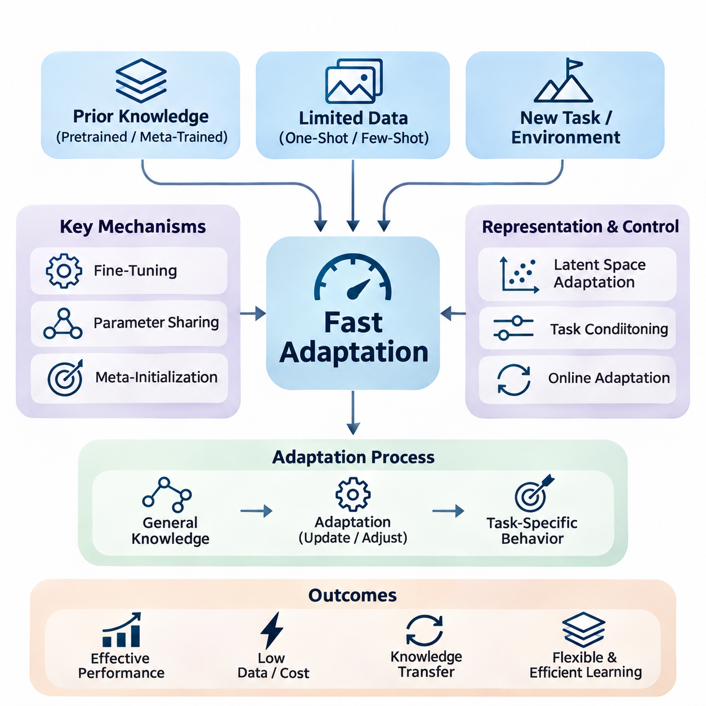
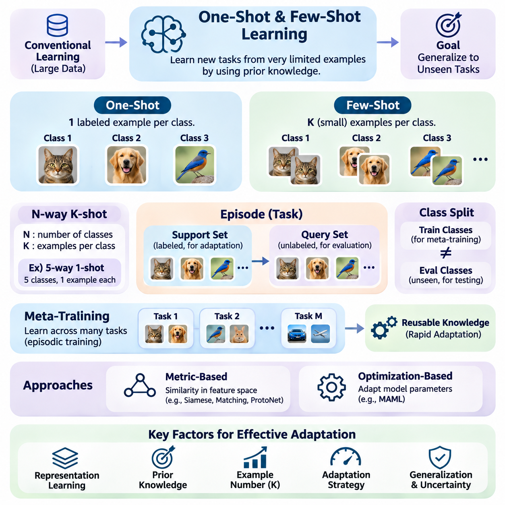
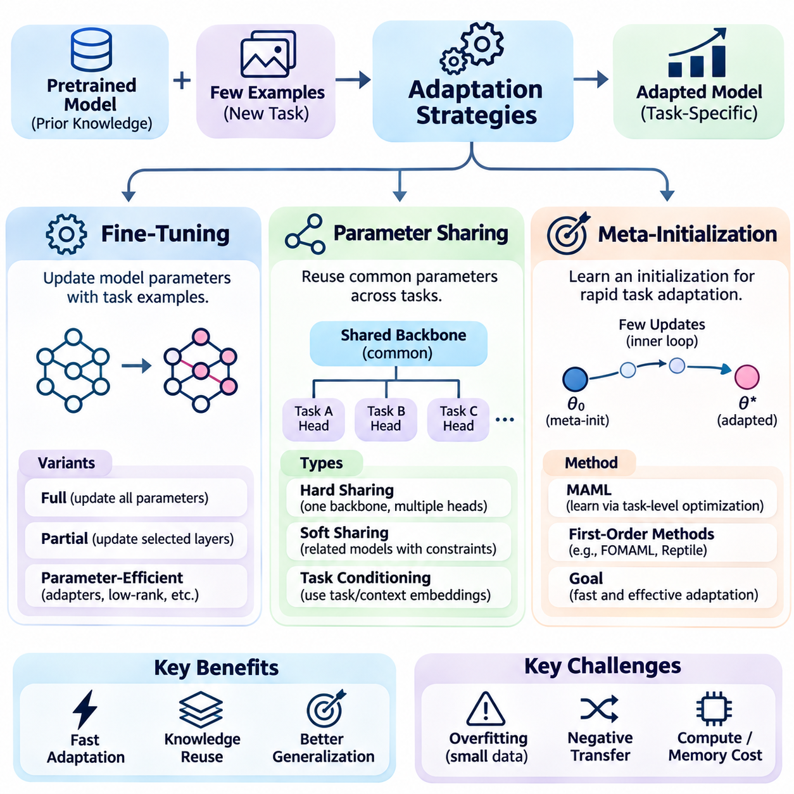
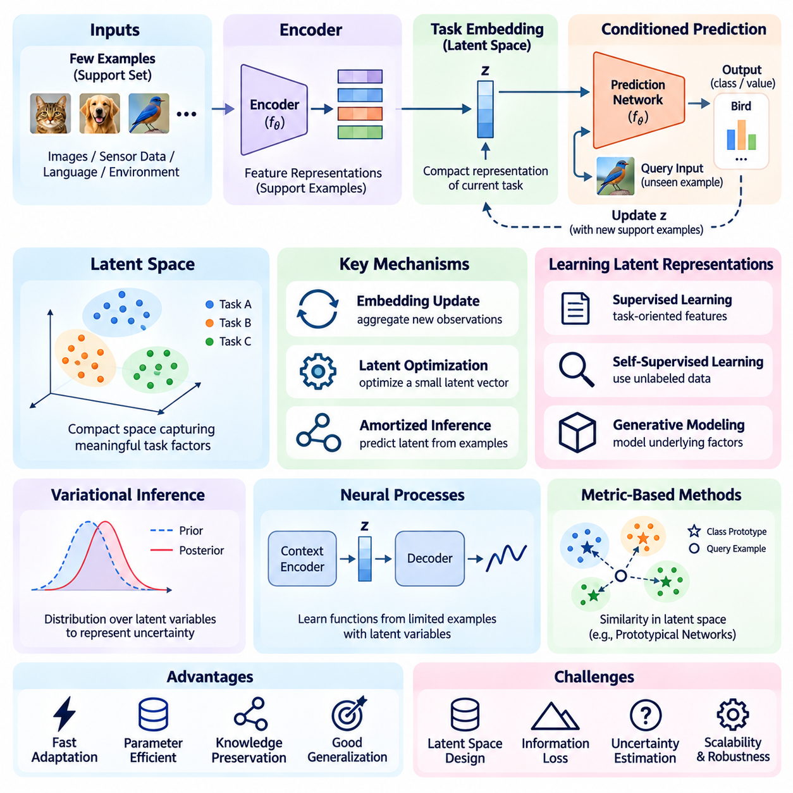
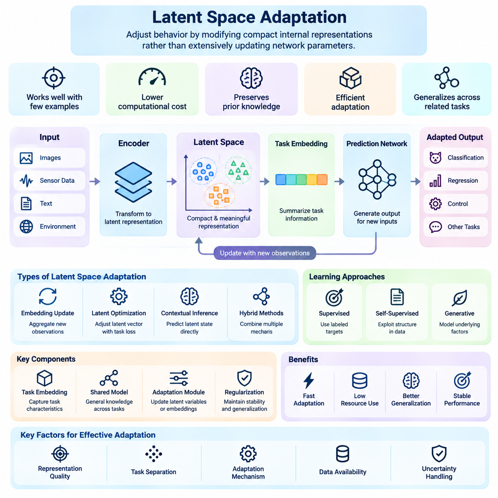
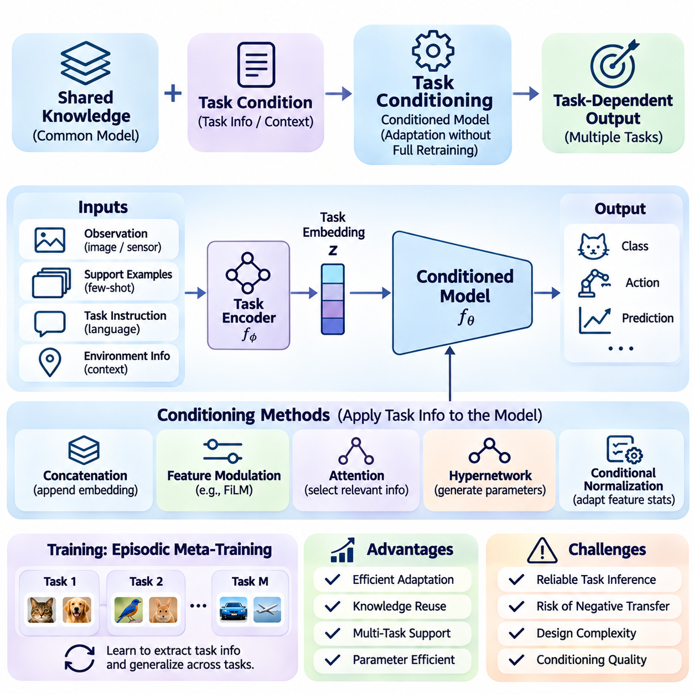
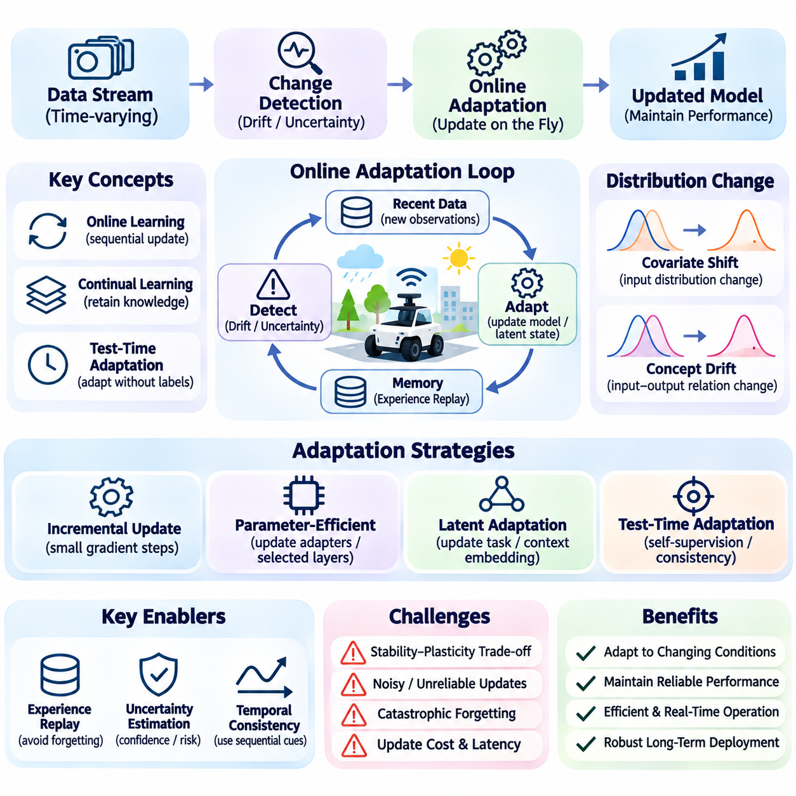
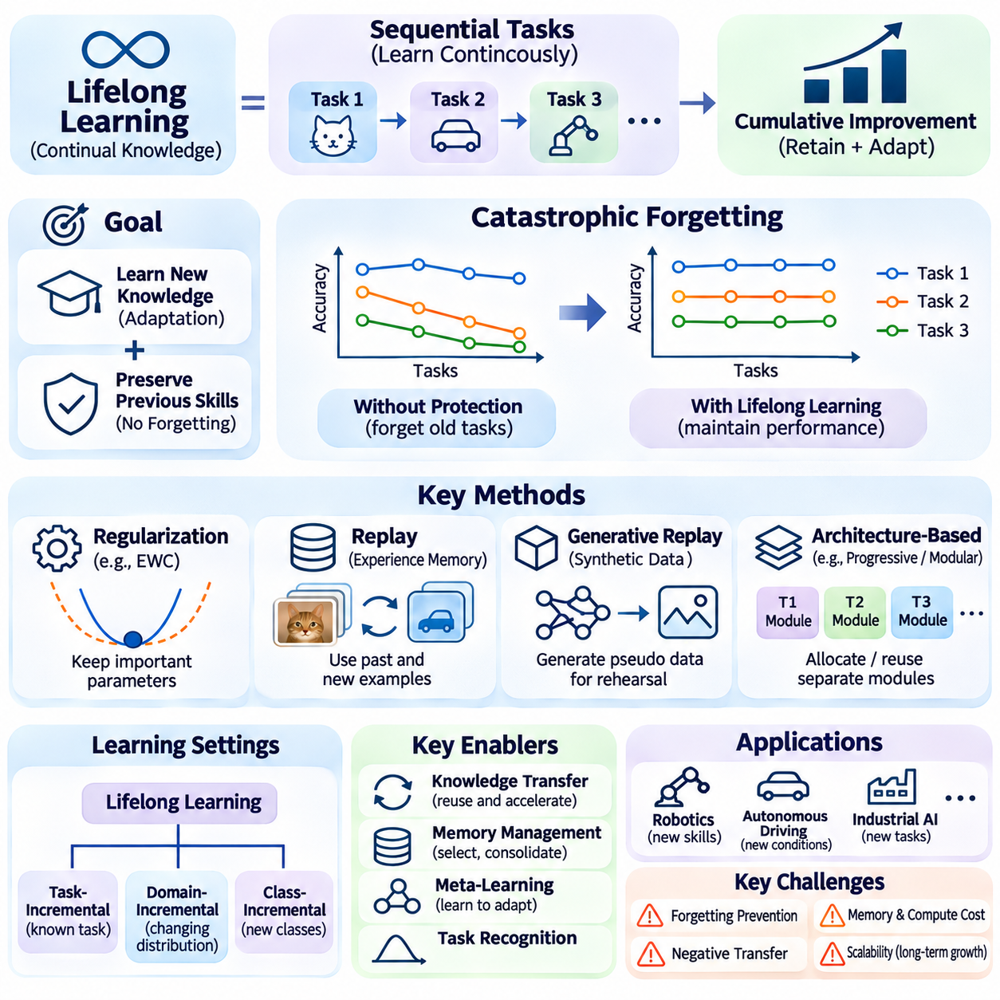
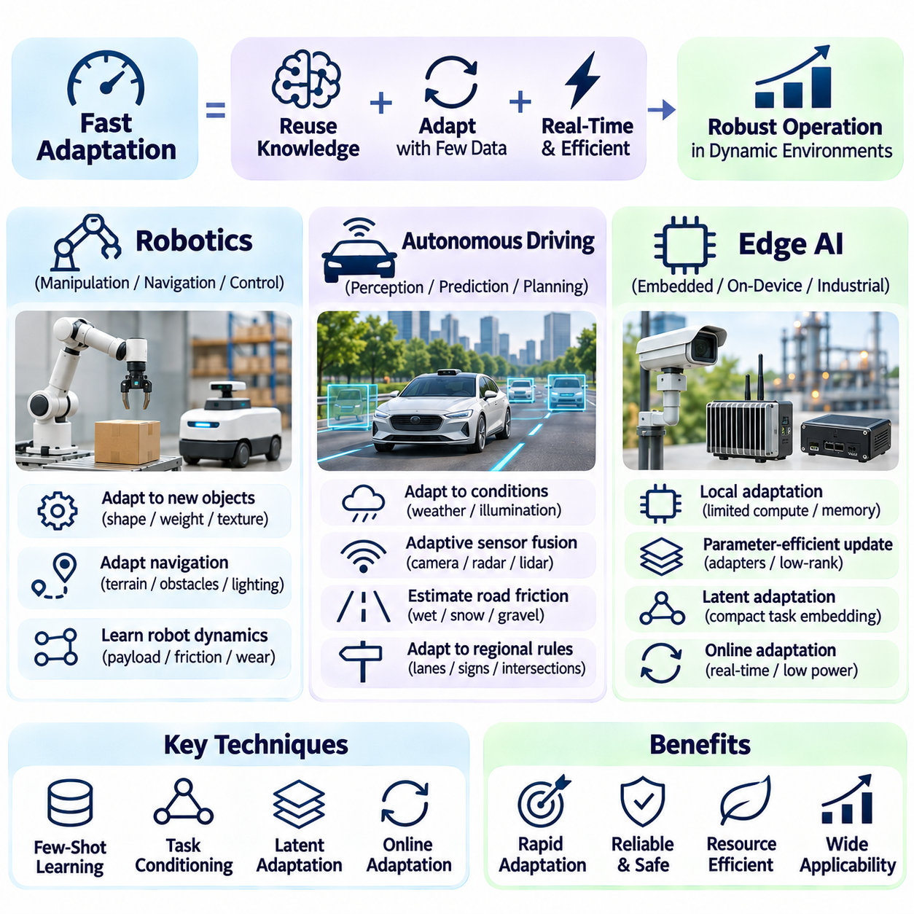

**Volume 36. Meta Learning and Few Shot Adaptation**

# 04. Fast Adaptation

## 04.00 Overview

{width="7.268055555555556in" height="7.268055555555556in"}

빠른 적응(Fast Adaptation)은 제한된 추가 경험만으로 새로운 작업(Task), 환경(Environment), 운영 조건(Operating Conditions)에 효과적으로 대응해야 하는 지능형 시스템(Intelligent Systems)의 핵심 역량이다. 일반적으로 광범위한 재학습(Retraining)에 의존하는 기존 기계학습(Machine Learning)과 달리, 빠른 적응은 소수의 관측(Observations), 갱신(Updates), 상호작용(Interactions)을 통해 유용한 성능을 확보하는 것을 목표로 한다. 이러한 능력은 새로운 데이터 수집에 많은 비용과 시간이 필요하거나 운영상 어려움이 있는 환경에서 특히 중요하다.

빠른 적응의 근본적인 목표는 새로운 능력을 습득하는 데 필요한 정보량과 계산량을 줄이는 것이다. 모델(Model)은 이전에 습득한 지식을 전이(Transfer)하면서 현재 작업에 필요한 구성 요소만 조정할 수 있어야 한다. 따라서 성공적인 적응은 기존 표현(Representations)의 품질, 이전 경험의 관련성, 제한된 데이터와 계산 자원(Computational Resources)에서 작동하는 적응 메커니즘(Adaptation Mechanism)의 효율성에 의해 결정된다.

빠른 적응은 여러 관련 작업을 학습하여 신속한 학습을 지원하는 지식을 습득하는 메타학습(Meta-Learning)과 밀접하게 연결된다. 메타학습은 개별 학습 작업의 성능만 최적화하는 대신, 전이 가능한 매개변수(Transferable Parameters), 표현(Representations), 학습 전략(Learning Strategies)을 발견하도록 유도한다. 이러한 공유 구조(Shared Structures)를 통해 모델은 전체 학습 과정을 반복하지 않고도 익숙하지 않은 작업에 대응할 수 있다.

원샷 학습(One-Shot Learning)과 퓨샷 학습(Few-Shot Learning)은 데이터가 극도로 제한된 상황에서 적응 능력을 연구하는 중요한 설정이다. 원샷 학습에서는 모델이 새로운 클래스(Class)나 작업 구성(Task Configuration)마다 단 하나의 레이블이 지정된 예제(Labeled Example)를 제공받는다. 퓨샷 학습은 이를 소수의 예제로 확장한다. 두 접근법 모두 기존 학습 데이터 가용성에 관한 가정에 도전하며, 모델이 유사성(Similarity), 사전 지식(Prior Knowledge), 구조적 규칙성(Structural Regularities)을 활용하도록 요구한다.

적응 과정(Adaptation Process)은 범용 지식(General-Purpose Knowledge)에서 작업별 행동(Task-Specific Behavior)으로 전환하는 과정으로 이해할 수 있다. 사전학습(Pretraining) 또는 메타학습을 거친 모델은 이전 작업에서 획득한 정보를 인코딩(Encoding)한 매개변수로 시작한다. 새로운 관측 정보가 제공되면 적응 메커니즘은 예측(Predictions), 내부 표현(Internal Representations), 선택된 매개변수를 수정한다. 목표는 유용한 지식을 보존하고 불필요한 계산 비용을 방지하면서 새로운 작업의 성능을 향상시키는 것이다.

미세조정(Fine-Tuning)은 빠른 적응을 구현하는 가장 직접적인 전략 중 하나이다. 이는 목표 작업(Target Task)과 관련된 제한된 데이터셋(Dataset)을 사용하여 사전학습된 모델의 매개변수를 수정한다. 그러나 제한 없는 미세조정은 예제가 부족할 때 과적합(Overfitting)을 유발할 수 있으며 상당한 계산 자원을 요구할 수 있다. 실제 접근법에서는 안정적인 적응을 유지하기 위해 특정 계층(Layers)의 갱신을 제한하거나 정규화(Regularization)를 도입하고 작은 학습률(Learning Rates)을 사용하는 경우가 많다.

매개변수 공유(Parameter Sharing)는 적응의 복잡성을 줄이는 또 다른 메커니즘이다. 모든 작업에 대해 완전히 독립적인 모델을 학습하는 대신, 여러 작업이 재사용 가능한 지식을 포착하는 공통 매개변수 집합을 활용한다. 이후 작업별 구성 요소(Task-Specific Components)가 개별 작업 간의 차이를 표현할 수 있다. 이러한 분리는 메모리 요구량(Memory Requirements)을 줄이고 공유 모델에 비교적 작은 수정만 적용하여 새로운 능력을 확보하도록 지원한다.

메타 초기화(Meta-Initialization) 방법은 신속한 최적화(Optimization)가 가능한 매개변수 구성을 찾는 것을 목표로 한다. 모델 불가지론적 메타학습(Model-Agnostic Meta-Learning, MAML)은 소수의 경사 갱신(Gradient Updates)만으로 새로운 작업에 맞게 조정할 수 있는 초기화(Initialization)를 학습함으로써 이러한 원리를 보여준다. 이 접근법의 효과는 학습 작업과 평가 작업(Evaluation Tasks)의 관계, 최적화 절차(Optimization Procedure), 학습된 초기화의 안정성에 따라 달라진다.

잠재 공간 적응(Latent Space Adaptation)은 많은 모델 매개변수를 수정하는 대신 사용할 수 있는 대안이다. 이 접근법에서는 관측 정보를 작업별 정보를 포착하는 압축된 표현(Compact Representations)으로 변환한다. 전체 신경망(Neural Network)을 재학습하는 대신 잠재 변수(Latent Variables), 임베딩(Embeddings), 문맥 상태(Contextual States)를 갱신하여 적응을 수행한다. 이러한 전략은 기반 표현이 충분한 표현 능력을 갖춘 경우 계산 비용을 줄이고 효율적인 추론(Inference)을 지원할 수 있다.

잠재 표현(Latent Representation)의 품질은 적응 성능에 큰 영향을 미친다. 유용한 표현은 작업 간 차이와 관련된 정보를 보존하면서 불필요한 변동(Irrelevant Variation)을 억제해야 한다. 잠재 공간이 관련 작업을 일관성 있게 구성하면 새로운 관측 정보만으로도 적절한 행동을 식별할 수 있다. 반대로 구조가 부적절한 표현은 광범위한 갱신을 요구하거나 익숙하지 않은 조건에서 신뢰하기 어려운 예측을 생성할 수 있다.

작업 조건화(Task Conditioning)는 현재 작업에 관한 명시적 또는 추론된 정보에 따라 모델의 행동을 조정하도록 한다. 조건화 변수(Conditioning Variables)는 작업 식별 정보(Task Identity), 환경 특성(Environmental Characteristics), 사용자 요구사항(User Requirements), 문맥 관측 정보(Contextual Observations)를 나타낼 수 있다. 이러한 변수는 특징 변조(Feature Modulation), 어텐션(Attention), 조건부 매개변수 생성(Conditional Parameter Generation) 등의 메커니즘을 통해 모델에 영향을 미치며, 전체 매개변수를 반드시 수정하지 않고도 다양한 행동을 가능하게 한다.

작업 조건화의 주요 장점은 일반 지식(General Knowledge)과 즉각적인 문맥 요구사항(Contextual Requirements)을 분리할 수 있다는 점이다. 모델은 재사용 가능한 능력을 유지하면서 조건화 신호(Conditioning Signals)를 통해 해당 능력의 적용 방식을 결정한다. 이러한 구성은 작업이 자주 변경되거나 하나의 배포된 시스템(Deployed System)에서 여러 운영 모드(Operating Modes)가 공존해야 하는 경우 유용하다. 그러나 효과는 작업 식별과 문맥 정보의 신뢰성에 따라 달라진다.

온라인 적응(Online Adaptation)은 관측 정보가 지속적으로 유입되는 환경으로 빠른 적응을 확장한다. 고정된 적응 데이터셋에만 의존하는 대신, 시스템은 운영 중 내부 상태(Internal State) 또는 선택된 매개변수를 갱신한다. 이러한 능력은 환경 조건, 데이터 분포(Data Distributions), 작업 요구사항이 시간에 따라 변화할 때 중요하다. 온라인 적응은 신뢰할 수 없는 관측 정보가 유해한 갱신을 유발할 수 있으므로 반응성(Responsiveness)과 안정성(Stability)의 균형을 유지해야 한다.

오프라인 적응(Offline Adaptation)과 온라인 적응의 차이는 자율 시스템(Autonomous Systems)에서 특히 중요하다. 오프라인 적응은 일반적으로 배포 이전이나 통제된 유지보수 기간에 수행되므로 광범위한 검증(Validation)이 가능하다. 반면 온라인 적응은 실제 운영 중 수행되며 엄격한 시간, 안전, 자원 제약을 받을 수 있다. 따라서 온라인 학습 메커니즘(Online Learning Mechanisms)에는 갱신 제한(Update Restrictions), 신뢰도 모니터링(Confidence Monitoring), 부적절한 변경을 되돌리는 복구 메커니즘(Rollback Mechanisms)이 필요한 경우가 많다.

평생학습(Lifelong Learning)은 장기간에 걸쳐 순차적으로 경험하는 작업들을 고려함으로써 적응 문제를 확장한다. 평생학습 시스템은 이전 경험에서 획득한 지식을 유지하면서 새로운 능력을 습득해야 한다. 이는 신속한 수정을 가능하게 하는 가소성(Plasticity)과 기존 지식을 보호하는 안정성 사이에 근본적인 긴장을 형성한다. 효과적인 시스템은 적응 속도만 극대화하는 것이 아니라 두 특성을 함께 관리해야 한다.

파국적 망각(Catastrophic Forgetting)은 평생 적응(Lifelong Adaptation)의 주요 과제이다. 모델이 새로운 작업을 위해 매개변수를 갱신하면 이전에 학습한 작업의 성능이 저하될 수 있다. 정규화, 경험 재생(Experience Replay), 매개변수 격리(Parameter Isolation), 모듈형 아키텍처(Modular Architectures)는 이러한 문제를 완화하는 서로 다른 접근법을 제공한다. 각 방법은 메모리 소비량, 계산 복잡도(Computational Complexity), 지식 전이(Knowledge Transfer), 향후 적응 유연성 사이에서 절충 관계(Tradeoffs)를 형성한다.

빠른 적응에는 불확실성(Uncertainty)에 대한 신중한 관리도 필요하다. 소수의 예제만으로는 새로운 작업이 이전 경험과 유사한지 판단하기에 충분한 근거를 확보하지 못할 수 있다. 지나치게 공격적으로 적응하는 모델은 잡음(Noise)을 증폭하거나 잘못된 가정을 강화할 수 있다. 신뢰도 추정(Confidence Estimation), 베이지안 추론(Bayesian Reasoning), 검증 절차(Validation Procedures), 보수적 갱신 정책(Conservative Update Policies)은 유용한 작업 정보와 신뢰하기 어려운 관측 정보를 구분하는 데 도움이 된다.

빠른 적응의 평가(Evaluation)는 최종 예측 정확도(Predictive Accuracy)만 고려해서는 안 된다. 중요한 측정 항목에는 필요한 예제 수, 적응 지연시간(Adaptation Latency), 계산 비용(Computational Cost), 메모리 소비량(Memory Consumption), 성능 안정성(Performance Stability)이 포함된다. 적응 곡선(Adaptation Curves)은 추가 관측 정보가 제공됨에 따라 성능이 어떻게 변화하는지 보여준다. 이러한 측정은 실제로 효율적으로 학습하는 방법과 계산 부담을 이전 학습 단계로 이전한 방법을 구분하는 데 도움이 된다.

로봇공학(Robotics)은 변화하는 물리적 조건에서 빠른 적응이 성능을 향상시킬 수 있는 실용적인 분야이다. 로봇은 익숙하지 않은 표면, 적재하중 변화(Payload Variations), 센서 특성(Sensor Characteristics), 기계적 외란(Mechanical Disturbances)에 직면할 수 있다. 적응 메커니즘은 최근 관측 정보를 활용하여 인식(Perception), 제어 매개변수(Control Parameters), 내부 환경 표현(Internal Environmental Representations)을 조정할 수 있다. 다만 물리적 행동에 영향을 미치는 모든 변경은 검증된 운영 및 안전 제약(Safety Constraints) 내에서 유지되어야 한다.

자율주행(Autonomous Driving)은 환경 조건이 빠르고 예측하기 어렵게 변화할 수 있으므로 추가적인 적응 과제를 제시한다. 조명(Illumination), 날씨(Weather), 노면 상태(Road Surfaces), 센서 성능(Sensor Performance)의 변화는 관측 정보와 주행 결정(Driving Decisions) 사이의 관계를 바꿀 수 있다. 적응형 인식(Adaptive Perception)과 환경 추정(Environmental Estimation)은 강건성(Robustness)을 향상시킬 수 있지만, 안전 필수 제어(Safety-Critical Control)에는 학습된 변경 사항이 차량 행동에 영향을 미치기 전에 독립적인 안전장치(Independent Safeguards)와 엄격한 검증이 필요하다.

엣지 인공지능(Edge AI) 시스템은 처리 능력(Processing Power), 메모리, 에너지 소비(Energy Consumption), 통신 대역폭(Communication Bandwidth)의 제약을 받기 때문에 효율적인 적응의 이점이 특히 크다. 모든 관측 정보를 중앙 인프라(Centralized Infrastructure)로 전송하면 허용하기 어려운 지연시간이나 네트워크 가용성(Network Availability)에 대한 의존성이 발생할 수 있다. 로컬 적응(Local Adaptation)은 갱신 메커니즘이 계산 효율성을 유지하고 장치 제약과 호환되는 경우 반응성과 자율성(Autonomy)을 향상시킬 수 있다.

실제 배포(Practical Deployment)에서는 적응 알고리즘(Adaptation Algorithms)을 모니터링(Monitoring), 데이터 관리(Data Management), 모델 수명주기(Model Lifecycle) 프로세스와 통합해야 한다. 시스템은 언제 적응이 필요한지, 어떤 관측 정보를 신뢰할 수 있는지, 갱신된 모델이 이전 모델보다 우수한 성능을 제공하는지 판단해야 한다. 버전 관리(Version Management), 롤백 기능(Rollback Capabilities), 통제된 평가 절차(Controlled Evaluation Procedures)는 반복적인 운영 경험을 통해 모델이 발전하는 동안 신뢰성을 유지하는 데 필수적인 지원 수단이다.

궁극적으로 빠른 적응은 퓨샷 학습, 최적화, 표현 학습(Representation Learning), 작업 조건화, 온라인 학습(Online Learning), 평생학습을 유연한 지능(Flexible Intelligence)을 위한 통합 프레임워크(Unified Framework)로 연결한다. 핵심 목표는 단순히 학습 속도를 높이는 것이 아니라 익숙하지 않은 상황에서 시스템이 기존 지식을 지능적으로 재사용하도록 하는 것이다. 이러한 능력을 실현하려면 학습 효율성(Learning Efficiency), 일반화(Generalization), 계산 제약(Computational Constraints), 안정성, 운영 안전성(Operational Safety) 사이의 균형을 유지해야 한다.

## 04.01 One Shot and Few Shot Setting

{width="7.268055555555556in" height="7.268055555555556in"}

원샷 학습(One-Shot Learning)과 퓨샷 학습(Few-Shot Learning)은 기계학습(Machine Learning) 모델이 극히 제한된 예제만으로 새로운 패턴을 인식하거나 새로운 능력을 습득해야 하는 기본적인 문제 설정(Problem Settings)을 나타낸다. 기존 지도학습(Supervised Learning)은 일반적으로 대규모 레이블 데이터셋(Labeled Datasets)에 의존하지만, 이러한 학습 설정에서는 최소한의 작업별 정보(Task-Specific Information)만으로 일반화(Generalization)를 수행해야 한다. 핵심 목표는 이전에 습득한 지식을 활용하여 익숙하지 않은 작업에서도 신뢰할 수 있는 성능을 달성하는 것이다.

원샷 학습은 새로운 클래스(Class) 또는 작업 범주(Task Category)마다 단 하나의 레이블이 지정된 예제(Labeled Example)만 제공되는 학습 상황을 의미한다. 모델은 이 단일 관측(Observation)에서 관련 특성을 추론하고 이전에 보지 못한 입력에 적용해야 한다. 하나의 예제만으로는 클래스 내부의 모든 변동성(Variability)을 충분히 표현할 수 없으므로 기존의 매개변수 추정(Parameter Estimation)이 어려워진다. 따라서 효과적인 원샷 학습은 전이 가능한 표현(Transferable Representations)과 사전 경험(Prior Experience)에 크게 의존한다.

퓨샷 학습은 각 클래스에 소수의 레이블 예제를 제공함으로써 원샷 학습 설정을 확장한다. 추가 관측 정보는 클래스 특성에 관한 더 많은 정보를 제공하지만, 사용 가능한 데이터셋은 여전히 무작위 초기화(Random Initialization)에서 기존 방식으로 학습하기에는 부족하다. 따라서 모델은 제한된 작업별 근거(Task-Specific Evidence)와 이전 학습에서 획득한 지식을 결합해야 한다. 핵심 과제는 소규모 데이터셋에 대한 과적합(Overfitting) 없이 높은 일반화 성능을 달성하는 것이다.

일반적인 실험 구성은 N-방향 K-샷 분류(N-Way K-Shot Classification) 설정이다. 여기서 N은 특정 작업에 포함된 클래스 수를 나타내며, K는 각 클래스에 제공되는 레이블 예제 수를 의미한다. 예를 들어 5-방향 원샷 작업(Five-Way One-Shot Task)은 5개 클래스 각각에 하나의 레이블 예제를 포함한다. 반면 5-방향 5-샷 작업(Five-Way Five-Shot Task)은 각 클래스에 5개의 예제를 제공하므로 분류 결정(Classification Decisions)에 더 많은 정보를 활용할 수 있다.

퓨샷 작업은 일반적으로 적응(Adaptation) 과정에서 발생하는 조건을 모사하는 에피소드(Episodes)로 구성된다. 각 에피소드에는 지원 집합(Support Set)과 질의 집합(Query Set)이 포함된다. 지원 집합은 현재 작업을 정의하는 레이블 예제를 제공하며, 질의 집합은 예측을 평가하는 데 사용되는 추가 예제를 포함한다. 이러한 에피소드 구성(Episodic Organization)은 모델이 고정된 학습 클래스를 암기하는 대신 여러 관련 작업에 전이할 수 있는 학습 전략(Learning Strategies)을 습득하도록 유도한다.

지원 집합은 적응 과정에서 작업별 정보를 제공하는 주요 원천이다. 응용 분야(Application Domain)에 따라 이미지, 텍스트 샘플(Text Samples), 센서 측정값(Sensor Measurements) 또는 기타 관측 정보를 포함할 수 있다. 모델은 이러한 예제를 활용하여 클래스 특성을 식별하고 작업 간 관계(Task Relationships)를 추정하거나 선택된 매개변수를 갱신한다. 지원 집합의 크기가 작기 때문에 개별 관측 정보가 결과적인 결정 경계(Decision Boundaries)와 예측에 큰 영향을 미칠 수 있다.

질의 집합은 모델이 지원 집합에서 추출한 정보를 이전에 보지 못한 예제에 적용할 수 있는지 평가한다. 메타학습 훈련(Meta-Training) 중에는 질의 레이블(Query Labels)이 최적화(Optimization)에 기여할 수 있지만, 평가 과정에서는 적응 절차(Adaptation Procedure)에 제공되지 않는다. 이러한 분리는 적응을 위해 직접 제공된 예제를 넘어서는 일반화 능력을 측정하므로 중요하다. 신뢰할 수 있는 평가를 위해서는 지원 집합과 질의 집합 사이의 정보 누출(Information Leakage)을 방지해야 한다.

메타학습 훈련은 일반적으로 하나의 고정된 분류 문제를 최적화하는 대신 작업 분포(Task Distribution)에서 여러 작업을 샘플링(Sampling)하는 방식으로 진행된다. 각 샘플링 작업은 서로 다른 클래스 조합, 예제 또는 운영 조건(Operating Conditions)을 제공한다. 이러한 다양한 작업에 반복적으로 노출되면 모델은 재사용 가능한 학습 전략을 습득하도록 유도된다. 그 결과 획득한 지식은 관련 분포에서 추출된 새로운 작업을 만났을 때 빠른 적응을 지원할 수 있다.

학습 클래스(Training Classes)와 평가 클래스(Evaluation Classes)의 구분은 퓨샷 분류(Few-Shot Classification)에서 특히 중요하다. 표준 벤치마크(Standard Benchmarks)는 메타학습 훈련에 사용된 클래스와 평가 클래스가 서로 겹치지 않도록 요구하는 경우가 많다. 이러한 구성은 모델이 학습된 표현과 적응 메커니즘을 익숙하지 않은 범주로 전이할 수 있는지 검증한다. 이전에 경험한 클래스에서 높은 성능을 보이는 것만으로는 성공적인 퓨샷 일반화(Few-Shot Generalization)를 입증할 수 없다.

표현 학습(Representation Learning)은 원샷 및 퓨샷 작업의 어려움을 줄이는 데 핵심적인 역할을 한다. 모델은 원시 관측 정보(Raw Observations)를 의미 있는 유사성을 보존하면서 불필요한 변동을 억제하는 임베딩(Embeddings)으로 변환할 수 있다. 이러한 임베딩이 관련 예제를 일관된 영역으로 구성하면 소수의 레이블 관측 정보만으로도 분류가 가능해진다. 표현의 품질은 빠른 적응이 실제로 가능한지를 결정하는 중요한 요소가 되는 경우가 많다.

메트릭 기반 방법(Metric-Based Methods)은 학습된 특징 공간(Feature Space)에서 질의 예제와 레이블이 지정된 지원 예제를 비교하여 퓨샷 학습을 수행한다. 샴 네트워크(Siamese Networks), 매칭 네트워크(Matching Networks), 프로토타입 네트워크(Prototypical Networks)는 유사성 관계(Similarity Relationships)를 활용하는 서로 다른 방식을 보여준다. 이러한 방법은 광범위한 최적화를 통해 완전히 새로운 분류기(Classifier)를 학습하는 대신 거리(Distance), 어텐션(Attention), 대표 클래스 프로토타입(Class Prototypes)을 사용하여 제한된 정보로부터 예측을 생성한다.

최적화 기반 접근법(Optimization-Based Approaches)은 사용 가능한 지원 예제를 활용하여 모델 매개변수를 직접 적응시킨다. 모델 불가지론적 메타학습(Model-Agnostic Meta-Learning, MAML)과 관련 알고리즘은 소수의 경사 갱신(Gradient Updates)만으로 빠른 성능 향상이 가능한 매개변수 초기화(Parameter Initializations)를 학습한다. 효과는 학습된 초기화, 적응 학습률(Adaptation Learning Rate), 학습 작업과 평가 작업 사이의 관계에 따라 달라진다. 관측 정보가 부족할 때 지나치게 많은 갱신을 수행하면 여전히 과적합이 발생할 수 있다.

각 클래스에 제공되는 예제 수는 적응 난이도(Adaptation Difficulty)와 예측 불확실성(Prediction Uncertainty)에 모두 영향을 미친다. 원샷 학습은 클래스 내부 변동(Within-Class Variation)에 관한 직접적인 정보를 거의 제공하지 않으므로 모델이 사전 표현(Prior Representations)에 특히 크게 의존한다. 퓨샷 학습은 이러한 변동을 제한적으로 추정할 수 있지만 표본 편향(Sampling Bias)에 여전히 취약하다. 일반적으로 정보 가치가 높은 예제가 추가되면 성능이 향상되지만, 향상 정도는 작업 복잡도(Task Complexity)에 따라 달라진다.

클래스 불균형(Class Imbalance)은 서로 다른 범주에 포함된 지원 예제 수가 같지 않을 때 추가적인 문제를 발생시킨다. 특히 적응 과정이 경사 기반 최적화(Gradient-Based Optimization)에 의존하는 경우, 모델은 더 많은 관측 정보가 제공된 클래스에 편향될 수 있다. 균형 잡힌 에피소드 샘플링(Balanced Episodic Sampling)은 평가를 단순화할 수 있지만 실제 응용에서는 데이터 가용성이 불균등한 경우가 많다. 따라서 강건한 방법(Robust Methods)은 모든 클래스에 동일한 수의 예제가 제공된다고 가정하지 않고 가변적인 지원 집합 크기(Variable Support-Set Sizes)를 처리해야 한다.

작업 유사성(Task Similarity)은 지식 전이(Knowledge Transfer)의 효과에 큰 영향을 미친다. 새로운 작업이 이전에 경험한 작업과 의미 있는 구조를 공유하면 학습된 특징과 적응 전략을 계속 유용하게 활용할 수 있다. 그러나 시각적 외형(Visual Appearance), 언어(Language), 물리적 동역학(Physical Dynamics), 데이터 분포(Data Distributions)에 상당한 차이가 있으면 전이 효과가 감소할 수 있다. 따라서 퓨샷 학습은 관련 작업 조건뿐 아니라 더욱 어려운 분포 이동(Distribution Shifts) 조건에서도 평가되어야 한다.

데이터 증강(Data Augmentation)은 제한된 지원 예제에 추가적인 변형을 생성하여 적응 성능을 향상시킬 수 있다. 변환(Transformations)에는 이미지의 기하학적 변화(Geometric Changes), 센서 신호의 제어된 교란(Controlled Perturbations), 의미를 보존하는 텍스트 수정(Meaning-Preserving Modifications) 등이 포함될 수 있다. 그러나 데이터 증강이 알려지지 않은 클래스 특성에 관한 독립적인 근거를 생성하는 것은 아니다. 부적절하게 선택된 변환은 작업 의미(Task Semantics)를 왜곡하여 일반화 성능을 향상시키기보다 저하시킬 수 있다.

정규화(Regularization)는 모델이 작은 지원 집합을 쉽게 암기할 수 있기 때문에 특히 중요하다. 가중치 제약(Weight Constraints), 드롭아웃(Dropout), 조기 종료(Early Stopping), 제한된 매개변수 갱신(Restricted Parameter Updates) 등의 기법은 과도한 작업 특화(Excessive Specialization)를 줄일 수 있다. 매개변수 효율적 적응(Parameter-Efficient Adaptation)은 모델 구성 요소의 일부만 수정하는 또 다른 선택지를 제공한다. 이러한 접근법은 작업별 차이를 수용할 수 있는 충분한 유연성을 유지하면서 전이 가능한 지식을 보존하려고 한다.

평가 프로토콜(Evaluation Protocols)은 퓨샷 실험(Few-Shot Experiments)에 내재된 변동성을 고려해야 한다. 결과는 각 에피소드에 어떤 클래스와 예제가 샘플링되는지에 따라 상당히 달라질 수 있다. 따라서 일반적으로 독립적으로 샘플링된 다수의 평가 에피소드(Evaluation Episodes)를 통해 성능을 추정한다. 평균 정확도(Average Accuracy)와 불확실성 추정값(Uncertainty Estimates)을 함께 보고하면 소수의 유리한 작업 구성에만 의존하는 것보다 더 유용한 평가가 가능하다.

원샷 및 퓨샷 학습은 레이블이 지정된 시연 데이터(Labeled Demonstrations)나 상호작용 데이터(Interaction Data)를 수집하는 데 많은 비용이 필요한 로봇공학(Robotics)에서 중요한 응용 가능성을 가진다. 로봇은 소수의 예제만으로 새로운 물체를 인식하거나 익숙하지 않은 도구를 식별하고 새로운 작업 공간(Workspace)에 맞게 인식 기능을 적응시켜야 할 수 있다. 효과적인 표현과 적응 메커니즘은 설정 시간(Setup Time)을 줄이고 운영 유연성(Operational Flexibility)을 향상시킬 수 있지만, 안전 필수 행동(Safety-Critical Behaviors)에는 추가적인 검증이 필요하다.

자율주행(Autonomous Driving)과 산업 검사(Industrial Inspection)에서도 드문 조건이나 새롭게 도입된 범주에 대한 레이블 데이터가 제한된 상황이 발생한다. 퓨샷 기법은 특이한 물체, 새롭게 나타나는 결함 패턴(Defect Patterns), 익숙하지 않은 환경 특성(Environmental Characteristics)의 인식을 지원할 수 있다. 그러나 희귀 사건 탐지(Rare-Event Detection)에는 상당한 불확실성이 수반되며, 실험실 분류 성능이 우수하다고 해서 운영 신뢰성(Operational Reliability)이 자동으로 입증되는 것은 아니다. 실제 배포에는 현실적인 조건에서의 신중한 검증이 필요하다.

엣지 인공지능(Edge AI)은 제한된 처리 능력(Processing Power), 메모리, 에너지 가용성(Energy Availability)을 가진 장치에서 적응이 수행되어야 할 수 있으므로 추가적인 제약을 발생시킨다. 메트릭 기반 추론(Metric-Based Inference), 압축 임베딩(Compact Embeddings), 선택적 매개변수 갱신(Selective Parameter Updates)은 계산 요구량을 줄일 수 있다. 로컬 적응(Local Adaptation)은 원격 인프라(Remote Infrastructure)에 대한 의존성도 줄일 수 있다. 그러나 적응 속도는 추론 지연시간(Inference Latency), 자원 소비(Resource Consumption), 지속적인 운영 중 안정성과 함께 평가되어야 한다.

원샷 및 퓨샷 학습 설정의 더 넓은 의미는 지능형 시스템(Intelligent Systems)이 사전 지식(Prior Knowledge)을 얼마나 효과적으로 재사용하는지 측정할 수 있다는 점에 있다. 이러한 설정은 제한된 지도 정보(Limited Supervision)에서 표현 전이(Representation Transfer), 작업 조건화(Task Conditioning), 최적화 효율성(Optimization Efficiency), 불확실성을 연구하기 위한 통제된 환경을 제공한다. 궁극적인 목표는 단순히 더 적은 예제로 분류하는 것이 아니라 최소한의 경험으로 유용한 새로운 행동을 습득할 수 있는 시스템을 개발하는 것이다.

## 04.02 Adaptation Strategies [w/Code]

{width="7.268055555555556in" height="7.268055555555556in"}

적응 전략(Adaptation Strategies)은 기계학습(Machine Learning) 모델이 제한된 학습 예제(Training Examples)를 사용하여 새로운 작업(Task)에 직면했을 때 동작을 조정하는 방식을 결정한다. 퓨샷 학습(Few-Shot Learning)과 메타학습(Meta-Learning)의 목표는 광범위한 재학습(Extensive Retraining) 없이 신뢰할 수 있는 성능을 달성하는 것이다. 미세조정(Fine-Tuning), 매개변수 공유(Parameter Sharing), 메타 초기화(Meta-Initialization)는 계산 비용(Computational Cost), 적응 속도(Adaptation Speed), 일반화(Generalization)를 제어하면서 이전에 획득한 지식을 전이하는 상호 보완적인 메커니즘을 제공한다.

미세조정은 작업별 예제(Task-Specific Examples)를 사용하여 사전학습된 모델(Pretrained Model)의 일부 또는 전체 신경망 매개변수(Network Parameters)를 갱신하는 적응 방법이다. 사전학습된 모델은 재사용 가능한 표현(Reusable Representations)을 제공하며, 추가적인 최적화(Optimization)는 새로운 요구사항에 맞게 예측을 조정한다. 이 전략은 기존 지도학습(Supervised Learning) 절차를 기반으로 하므로 다양한 분야에 적용할 수 있다. 그러나 효과는 적응 데이터(Adaptation Data)의 품질과 양, 최적화 안정성(Optimization Stability)에 따라 달라진다.

전체 미세조정(Full Fine-Tuning)은 학습 가능한 모든 매개변수(Trainable Parameters)를 갱신하여 모델 동작과 특징 표현(Feature Representations)을 상당한 수준으로 변경할 수 있도록 한다. 이러한 유연성(Flexibility)은 새로운 작업이 기존 학습 분포(Training Distribution)와 크게 다른 경우 유용하다. 그러나 소수의 예제만으로 대규모 신경망을 갱신하면 과적합(Overfitting)과 불안정한 경사(Unstable Gradients)가 발생할 수 있다. 또한 적응을 빠르게 수행해야 하거나 자원이 제한된 하드웨어(Resource-Constrained Hardware)에서 실행해야 하는 경우 계산 요구량이 과도하게 증가할 수 있다.

부분 미세조정(Partial Fine-Tuning)은 일부 매개변수를 고정한 상태로 유지하면서 선택된 계층(Layers)이나 예측 구성 요소(Prediction Components)만 갱신한다. 일반적인 접근법은 특징 추출기(Feature Extractor)를 동결(Freezing)하고 최종 분류 헤드(Classification Head)나 회귀 헤드(Regression Head)만 갱신하는 것이다. 이는 학습 비용(Training Cost)을 줄이고 이전 작업에서 학습한 일반적인 표현을 보존한다. 그러나 고정된 특징(Frozen Features)이 익숙하지 않은 작업의 특성을 충분히 표현하지 못하면 성능이 제한될 수 있다.

매개변수 효율적 미세조정(Parameter-Efficient Fine-Tuning)은 전체 신경망을 갱신하지 않고 모델 동작을 수정하는 경량 학습 구성 요소(Lightweight Trainable Components)를 도입한다. 어댑터 모듈(Adapter Modules), 저랭크 적응(Low-Rank Adaptation), 선택적 매개변수 갱신(Selective Parameter Updates)은 메모리 소비량(Memory Consumption)을 크게 줄일 수 있다. 이러한 방법은 임베디드 지능(Embedded Intelligence)과 대규모 사전학습 모델(Large Pretrained Models)에 적합하다. 효과는 사용 가능한 적응 용량(Adaptation Capacity)이 기존 작업과 새로운 작업 사이의 차이를 충분히 표현할 수 있는지에 따라 달라진다.

미세조정에서는 학습률(Learning Rates), 최적화 단계(Optimization Steps), 정규화(Regularization)를 신중하게 제어해야 한다. 과도한 갱신은 유용한 사전학습 표현(Pretrained Representations)을 손상시킬 수 있으며, 최적화가 부족하면 모델이 새로운 작업에 충분히 적응하지 못할 수 있다. 적절한 검증 데이터(Validation Data)를 사용할 수 있다면 조기 종료(Early Stopping), 가중치 감쇠(Weight Decay), 검증 기반 선택(Validation-Based Selection)을 통해 과적합을 줄일 수 있다. 지원 집합(Support Set)이 극도로 작은 경우에는 불확실성 추정(Uncertainty Estimation)과 보수적인 갱신(Conservative Updates)이 특히 중요하다.

매개변수 공유는 여러 작업이 완전히 독립적인 신경망을 유지하는 대신 공통 모델 구성 요소(Common Model Components)를 재사용하도록 한다. 공유 매개변수(Shared Parameters)는 서로 다른 학습 문제에서 지속적으로 유용한 일반적인 패턴(General Patterns)을 포착한다. 작업별 구성 요소(Task-Specific Components)는 개별 목표(Objectives)와 관련된 변화를 표현한다. 이러한 아키텍처(Architecture)는 특히 작업들이 공통적인 기반 구조(Underlying Structures)나 인식 특성(Perceptual Characteristics)을 공유하는 경우 데이터 효율성(Data Efficiency)을 높이고 중복 계산(Duplicated Computation)을 줄인다.

하드 매개변수 공유(Hard Parameter Sharing)는 공통 백본 신경망(Backbone Network)과 별도의 출력 헤드(Output Heads) 또는 작업 의존적 모듈(Task-Dependent Modules)을 사용한다. 공유 백본(Shared Backbone)은 여러 작업에서 특징을 학습하고, 특화된 구성 요소(Specialized Components)는 적절한 예측을 생성한다. 이러한 설계는 공통 표현 학습(Common Representation Learning)을 통해 일반화를 향상시킬 수 있다. 그러나 관련성이 낮은 작업들의 최적화 목표(Optimization Objectives)가 상충하는 특징 표현을 요구하면 서로 간섭할 수 있다.

소프트 매개변수 공유(Soft Parameter Sharing)는 부분적으로 독립적인 작업 모델(Task Models)을 유지하면서 매개변수나 표현이 서로 관련성을 유지하도록 유도한다. 정규화 항(Regularization Terms), 작업 간 어텐션(Cross-Task Attention), 학습된 특징 교환(Learned Feature Exchange)은 정보 공유의 정도를 제어할 수 있다. 이 접근법은 완전히 공유된 아키텍처보다 높은 유연성을 제공한다. 그러나 추가적인 매개변수와 조정 메커니즘(Coordination Mechanisms)으로 인해 메모리 요구량과 학습 복잡도(Training Complexity)가 증가할 수 있다.

작업 조건화(Task Conditioning)는 공유 신경망이 문맥 정보(Contextual Information)에 따라 동작을 변경할 수 있도록 하여 매개변수 공유를 강화한다. 작업 임베딩(Task Embeddings), 특징 변조(Feature Modulation), 어텐션 메커니즘(Attention Mechanisms)은 관련 표현을 선택적으로 활성화할 수 있다. 이는 작업별 예측(Task-Dependent Predictions)을 지원하면서 별도의 전체 규모 모델(Full-Sized Models)에 대한 필요성을 줄인다. 신뢰할 수 있는 조건화를 위해서는 유용한 작업 표현(Informative Task Representations)과 익숙하지 않은 운영 조건을 구분할 수 있는 충분한 학습 다양성(Training Diversity)이 필요하다.

부정적 전이(Negative Transfer)는 한 작업에 유용한 지식이 다른 작업을 방해할 수 있기 때문에 매개변수 공유의 주요 한계로 남아 있다. 상충하는 경사(Conflicting Gradients)는 공유 표현(Shared Representations)이 특정 목표에 유리하게 형성되도록 하면서 다른 목표의 성능을 저하시킬 수 있다. 경사 균형 조정(Gradient Balancing), 모듈형 특화(Modular Specialization), 선택적 공유(Selective Sharing)는 이러한 영향을 완화할 수 있다. 효과적인 아키텍처는 어떤 정보를 공통으로 유지하고 어떤 특성을 작업별 적응(Task-Specific Adaptation)으로 처리해야 하는지 결정해야 한다.

메타 초기화는 새로운 작업에 대해 빠르게 최적화할 수 있는 모델 매개변수를 학습한다는 점에서 다른 관점으로 적응에 접근한다. 학습 작업(Training Tasks)에서 좋은 성능을 보이는 표현만 학습하는 대신, 작업별 갱신(Task-Specific Updates)을 효율적으로 수행할 수 있는 초기값(Initialization)을 학습한다. 이 원리는 최적화 기반 메타학습(Optimization-Based Meta-Learning)의 핵심이며, 소수의 레이블 예제(Labeled Examples)만 사용할 수 있는 상황에서 특히 중요하다.

모델 불가지론적 메타학습(Model-Agnostic Meta-Learning, MAML)은 반복적인 작업 수준 최적화 에피소드(Task-Level Optimization Episodes)를 통해 초기값을 학습한다. 각 에피소드에서 내부 루프(Inner Loop)는 샘플링된 작업에 모델을 적응시키고, 외부 루프(Outer Loop)는 적응 이후 성능(Post-Adaptation Performance)을 기반으로 초기값을 갱신한다. 다양한 작업에서 이 과정을 반복하면 작은 갱신에도 효과적으로 반응하는 매개변수를 형성할 수 있다. 결과적으로 모델은 제한된 관측 정보를 사용하여 익숙하지 않지만 관련성이 있는 작업에 적응할 수 있다.

일차 메타학습 방법(First-Order Meta-Learning Methods)은 이차 경사 계산(Second-Order Gradient Calculations)을 근사하거나 생략하여 계산 복잡도(Computational Complexity)를 줄인다. 일차 MAML(First-Order MAML, FOMAML)과 렙타일(Reptile)은 낮은 최적화 오버헤드(Optimization Overhead)로 유용한 초기 매개변수를 학습하는 전략을 보여준다. 이러한 접근법은 실용적인 확장성(Scalability)을 향상시킬 수 있지만, 최적화 동작은 전체 경사 기반 메타학습(Full Gradient-Based Meta-Learning)과 차이가 있다. 성능은 작업 다양성(Task Diversity), 적응 단계(Adaptation Steps), 학습 작업과 평가 작업(Evaluation Tasks) 사이의 관계에 따라 달라진다.

메타 초기화의 품질은 학습 에피소드(Training Episodes)가 미래의 적응 요구사항(Future Adaptation Requirements)을 얼마나 잘 대표하는지에 크게 의존한다. 메타학습 훈련 작업(Meta-Training Tasks)이 지나치게 유사하면 학습된 초기값이 익숙하지 않은 조건에서 제대로 작동하지 않을 수 있다. 반대로 작업들이 지나치게 이질적(Heterogeneous)이면 공통으로 적응 가능한 시작점(Common Adaptable Starting Point)을 찾기 어려워질 수 있다. 적절한 작업 샘플링(Task Sampling), 지원 집합과 질의 집합의 분리(Support-Query Separation), 미관측 작업(Unseen Tasks)에 대한 평가는 실제 적응 능력을 측정하는 데 필수적이다.

미세조정, 매개변수 공유, 메타 초기화는 서로 배타적인 전략이 아니다. 시스템은 공유 사전학습 백본(Shared Pretrained Backbone)을 사용하고, 메타 초기화된 예측 헤드(Meta-Initialized Prediction Head)를 학습한 다음 새로운 지원 예제(Support Examples)에 대해 경량 미세조정(Lightweight Fine-Tuning)을 수행할 수 있다. 작업 조건화는 추론된 문맥(Inferred Context)에 따라 중간 특징(Intermediate Features)을 추가로 수정할 수 있다. 이러한 하이브리드 아키텍처(Hybrid Architectures)는 적응 유연성, 매개변수 효율성(Parameter Efficiency), 기존 지식의 보존 사이에서 균형을 유지한다.

로봇공학(Robotics)은 이러한 전략을 결합하는 실용적 가치를 보여준다. 공유 인식 모델(Shared Perception Models)은 물체 인식(Object Recognition)과 조작(Manipulation)을 지원하고, 작업별 어댑터는 익숙하지 않은 물체나 운영 조건에 대응할 수 있다. 메타 초기화된 제어 구성 요소(Meta-Initialized Control Components)는 적재하중(Payload)이나 마찰(Friction)의 변화에 빠르게 적응할 수 있다. 그러나 물리적 동작(Physical Behavior)에 영향을 미치는 학습 기반 갱신은 독립적으로 검증된 안전 제약(Independently Validated Safety Constraints)과 통제된 배포 절차(Controlled Deployment Procedures)를 따라야 한다.

자율주행(Autonomous Driving)과 엣지 인공지능(Edge AI)은 지연시간(Latency), 메모리, 에너지 소비(Energy Consumption), 운영 신뢰성(Operational Reliability)에 관한 추가적인 요구사항을 가진다. 매개변수 공유는 모델 중복(Model Duplication)을 줄이고, 경량 미세조정은 적응 비용(Adaptation Cost)을 제한한다. 메타 초기화는 익숙하지 않은 조건에 적응하는 데 필요한 갱신 횟수를 줄일 수 있다. 그러나 안전 필수 시스템(Safety-Critical Systems)은 검증되지 않은 모델 변경(Unverified Model Changes)이 기존 제어 한계(Control Limits)나 대체 메커니즘(Fallback Mechanisms)을 무력화하지 못하도록 해야 한다.

적응 전략의 평가(Evaluation)는 예측 정확도(Predictive Accuracy), 적응 속도, 메모리 요구량, 미관측 작업 전반에 대한 강건성(Robustness)을 고려해야 한다. 비교 실험(Comparisons)에서는 일관된 지원 집합, 최적화 예산(Optimization Budgets), 평가 조건(Evaluation Conditions)을 사용해야 한다. 추가적인 측정 항목으로는 파국적 망각(Catastrophic Forgetting), 부정적 전이, 분포 이동(Distribution Shifts)에 대한 민감도(Sensitivity)를 검토할 수 있다. 이러한 기준은 성능 향상이 과도한 계산 자원 사용이 아니라 효과적인 적응에서 비롯되었는지 판단하는 데 도움이 된다.

적응 전략의 선택은 작업 유사성(Task Similarity), 사용 가능한 예제, 하드웨어 제약(Hardware Constraints), 허용 가능한 운영 위험(Operational Risk)에 따라 결정된다. 미세조정은 직접적인 유연성을 제공하고, 매개변수 공유는 효율적인 지식 재사용(Knowledge Reuse)을 촉진하며, 메타 초기화는 빠른 최적화를 수행할 수 있도록 모델을 준비시킨다. 이러한 메커니즘을 결합하면 변화하는 작업과 환경 전반에서 안정적인 성능을 유지하면서 효율적으로 학습해야 하는 지능형 시스템(Intelligent Systems)을 위한 실용적인 기반을 구축할 수 있다.

## 04.03 Latent Space Adaptation

{width="7.268055555555556in" height="7.268055555555556in"}

{width="7.268055555555556in" height="7.268055555555556in"}

잠재 공간 적응(Latent Space Adaptation)은 신경망 매개변수(Network Parameters)를 광범위하게 갱신하는 대신 압축된 내부 표현(Compact Internal Representations)을 수정하여 기계학습(Machine Learning) 모델의 행동을 조정하는 방법이다. 이 접근법은 작업별 관측 정보(Task-Specific Observations)가 제한적인 퓨샷 학습(Few-Shot Learning)에서 특히 유용하다. 관련 정보를 저차원 잠재 공간(Low-Dimensional Latent Space)에 인코딩(Encoding)함으로써 계산 비용(Computational Cost)을 줄이고 이전에 습득한 지식을 보존하면서 빠른 적응(Fast Adaptation)을 달성할 수 있다.

잠재 공간(Latent Space)은 복잡한 관측 정보를 의미 있는 근본 요인(Underlying Factors)을 포착하는 압축 변수(Compact Variables)로 변환한 내부 표현 공간이다. 이미지, 센서 측정값(Sensor Measurements), 언어 입력(Language Inputs), 환경 상태(Environmental States)는 학습된 인코더(Encoders)를 통해 잠재 벡터(Latent Vectors)로 변환될 수 있다. 이러한 벡터는 의미적 특성(Semantic Characteristics), 작업 식별 정보(Task Identities), 동적 조건(Dynamic Conditions)을 나타낼 수 있다. 유용성은 후속 의사결정(Downstream Decisions)에 필요한 정보를 얼마나 효과적으로 보존하는지에 따라 결정된다.

잠재 공간 적응의 핵심 원리는 일반 지식(General Knowledge)과 작업별 변동(Task-Specific Variation)을 분리하는 것이다. 공유 모델(Shared Model)은 여러 작업에 적용할 수 있는 표현을 학습하고, 잠재 변수(Latent Variable)는 현재 작업의 특성을 포착한다. 새로운 관측 정보가 유입되면 시스템은 주요 신경망 가중치(Network Weights)를 반드시 변경하지 않고도 잠재 변수를 갱신한다. 이러한 분리는 적응 과정에서 조정해야 하는 변수의 수를 크게 줄일 수 있다.

일반적인 아키텍처(Architecture)에서는 인코더가 지원 예제(Support Examples)를 특징 표현(Feature Representations)으로 변환하고, 이를 결합하여 작업 임베딩(Task Embedding)을 생성한다. 이 임베딩은 새로운 질의 입력(Query Inputs)을 처리하는 예측 신경망(Prediction Network)의 동작을 조건화(Conditioning)한다. 추가 지원 관측 정보가 작업 임베딩을 수정할 때 적응이 이루어진다. 이러한 설계는 이전 경험에서 학습한 안정적인 공유 표현을 유지하면서 변화하는 작업 요구사항(Task Requirements)에 대응하도록 한다.

작업 임베딩은 현재 학습 문제에 관한 정보를 요약하므로 많은 잠재 적응 방법(Latent Adaptation Methods)에서 핵심적인 역할을 한다. 유용한 임베딩은 작업 간 중요한 차이를 구분하면서 불필요한 잡음(Noise)에는 민감하지 않아야 한다. 예를 들어 임베딩은 물체의 외형(Object Appearance), 환경 조건(Environmental Conditions), 시스템 동역학(System Dynamics)을 인코딩할 수 있다. 임베딩의 품질은 소수의 예제만으로 효과적인 적응에 충분한 정보를 확보할 수 있는지를 결정한다.

잠재 표현(Latent Representations)은 지도학습 목표(Supervised Objectives), 자기지도학습(Self-Supervised Learning), 생성 모델링(Generative Modeling)을 통해 학습할 수 있다. 지도학습 접근법은 알려진 예측 목표(Prediction Targets)를 지원하는 특징을 형성하도록 유도하며, 자기지도학습은 레이블이 없는 관측 정보(Unlabeled Observations)의 구조적 관계를 활용한다. 생성적 접근법(Generative Approaches)은 관측 데이터를 설명하는 요인을 표현하려고 한다. 각 전략은 잠재 공간에 어떤 정보를 보존해야 하는지에 관해 서로 다른 가정을 도입한다.

변분 추론(Variational Inference)은 작업 의존적 잠재 변수(Task-Dependent Latent Variables)를 학습하기 위한 확률적 프레임워크(Probabilistic Framework)를 제공한다. 각 작업에 단일한 결정론적 표현(Deterministic Representation)을 할당하는 대신 가능한 잠재 상태(Latent States)에 대한 확률분포(Probability Distribution)를 추정한다. 이 분포는 지원 예제가 소수일 때 불확실성(Uncertainty)을 표현할 수 있다. 추가 관측 정보가 유입되면 추론된 분포는 관측 근거와 일치하는 잠재 구성(Latent Configurations) 주변으로 더욱 집중될 수 있다.

조건부 신경 과정(Conditional Neural Processes)은 잠재 변수가 관련 함수들 사이에서 빠른 적응을 지원하는 방식을 보여준다. 문맥 인코더(Context Encoder)는 관측된 입력-출력 쌍(Input-Output Pairs)을 처리하여 현재 함수 또는 작업의 표현을 생성한다. 이후 디코더(Decoder)는 이러한 문맥 정보(Contextual Information)를 사용하여 새로운 입력의 출력을 예측한다. 전역 잠재 변수(Global Latent Variables)를 포함하는 변형 모델은 기반 함수(Underlying Function)에 관한 불확실성을 표현할 수 있지만, 보정 성능(Calibration)과 표현 능력(Expressiveness)은 모델 설계에 따라 달라진다.

메트릭 기반 퓨샷 학습(Metric-Based Few-Shot Learning)도 잠재 공간 적응의 관점에서 해석할 수 있다. 프로토타입 네트워크(Prototypical Networks)와 같은 모델은 예제를 각 클래스가 프로토타입(Prototype)으로 표현되는 임베딩 공간(Embedding Space)으로 변환한다. 새로운 작업이 등장하면 특징 추출기(Feature Extractor)를 재학습하는 대신 지원 예제로부터 프로토타입을 구성한다. 질의 예제는 이러한 프로토타입과의 거리(Distance)에 따라 분류되므로 효율적인 적응이 가능하다.

잠재 공간의 기하학적 구조(Geometry)는 적응 성능에 큰 영향을 미친다. 이상적으로 유사한 작업이나 클래스에 속하는 관측 정보는 가까운 영역에 위치하고, 의미 있게 다른 예제는 구분 가능한 상태를 유지해야 한다. 적절한 거리 척도(Distance Metrics)와 표현 학습 목표(Representation Objectives)는 이러한 구조 형성을 촉진할 수 있다. 그러나 저차원 압축(Low-Dimensional Compression)은 중요한 세부 정보를 제거할 수 있으며, 구조가 부적절한 임베딩은 잘못된 유사성 관계(Similarity Relationships)를 생성할 수 있다.

잠재 적응은 임베딩 갱신(Embedding Updates), 잠재 최적화(Latent Optimization), 문맥 추론(Contextual Inference) 등 여러 메커니즘을 통해 수행될 수 있다. 임베딩 갱신은 새로운 관측 정보를 통합하여 수정된 작업 표현을 생성한다. 잠재 최적화는 작업별 손실(Task-Specific Losses)을 사용하여 압축 벡터를 조정하며, 문맥 추론은 사용 가능한 근거에서 잠재 상태를 직접 예측한다. 이러한 메커니즘은 계산 요구량(Computational Requirements), 유연성(Flexibility), 제한된 관측 정보에 대한 민감도(Sensitivity)에서 차이를 보인다.

경사 기반 잠재 최적화(Gradient-Based Latent Optimization)는 전체 매개변수 미세조정(Full Parameter Fine-Tuning)의 대안을 제공한다. 모델의 주요 가중치는 고정된 상태로 유지하면서 작은 잠재 벡터만 최적화하여 작업별 목적 함수(Task-Specific Objective)를 최소화한다. 갱신되는 변수의 수가 상대적으로 적기 때문에 적응에 필요한 메모리와 계산량을 줄일 수 있다. 그러나 최적화 품질은 초기화(Initialization), 손실 함수 설계(Loss Design), 학습된 잠재 공간이 익숙하지 않은 작업에 적합한 해(Solutions)를 포함하는지에 따라 달라진다.

상각 추론(Amortized Inference)은 지원 관측 정보로부터 작업 표현을 직접 예측하도록 인코더를 학습시켜 반복적인 최적화를 피한다. 학습이 완료되면 인코더는 순전파(Forward Pass)만으로 적응 상태(Adaptation State)를 생성할 수 있어 지연시간(Latency)을 크게 줄일 수 있다. 이 접근법은 실시간 시스템(Real-Time Systems)에 매력적이지만, 정확도는 학습 분포(Training Distribution)가 미래 작업을 충분히 대표하는지에 따라 결정된다. 익숙하지 않은 조건에서는 추가적인 정교화(Refinement) 또는 불확실성 모니터링(Uncertainty Monitoring)이 필요할 수 있다.

잠재 공간 분리 표현 학습(Latent Space Disentanglement)은 서로 다른 차원(Dimensions)이나 구성 요소가 구별되는 근본 요인에 대응하도록 표현을 학습하는 것을 목표로 한다. 물체 식별 정보(Object Identity), 환경 외형(Environmental Appearance), 물리적 동역학(Physical Dynamics)을 분리하면 적응을 더욱 선택적으로 수행할 수 있다. 시스템은 변화하는 조건과 관련된 잠재 구성 요소만 조정할 수 있다. 그러나 분리된 표현(Disentangled Representations)은 자동으로 식별 가능(Identifiable)해지는 것이 아니며, 해석은 학습 가정과 사용 가능한 지도 정보(Supervision)에 따라 달라진다.

시간적 잠재 적응(Temporal Latent Adaptation)은 작업 특성이 지속적으로 변화하는 환경으로 이러한 개념을 확장한다. 순환 신경망(Recurrent Networks), 상태 공간 모델(State-Space Models), 시간 인코더(Temporal Encoders)는 새로운 관측 정보가 유입될 때 잠재 상태를 갱신할 수 있다. 이러한 표현은 시스템 동역학, 센서 동작(Sensor Behavior), 환경 문맥(Environmental Context)의 변화를 포착할 수 있다. 효과적인 시간적 적응을 위해서는 불안정한 예측을 방지하도록 의미 있는 변화와 일시적인 잡음을 구분해야 한다.

불확실성 추정(Uncertainty Estimation)은 제한된 근거에서 추론된 잠재 변수가 모호할 수 있기 때문에 특히 중요하다. 확률적 임베딩(Probabilistic Embeddings), 앙상블(Ensembles), 베이지안 추론(Bayesian Inference)은 현재 작업 표현에 관한 불확실성을 정량화하는 데 도움이 된다. 시스템은 이러한 정보를 사용하여 적응 결과가 충분히 신뢰할 수 있는지 판단할 수 있다. 불확실성이 높은 상태로 유지된다면 공격적인 적응보다 추가 관측 정보를 확보하거나 보수적인 예측(Conservative Predictions)을 수행하는 것이 바람직할 수 있다.

잠재 적응과 매개변수 적응(Parameter Adaptation)의 관계에는 중요한 절충 관계(Tradeoffs)가 존재한다. 잠재 기반 방법은 일반적으로 더 적은 변수를 수정하고 공유 모델 가중치(Shared Model Weights)를 보존할 수 있어 계산 효율성이 높다. 그러나 유연성은 사전학습된 모델의 표현 용량(Representational Capacity)에 의해 제한된다. 매개변수 미세조정(Parameter Fine-Tuning)은 더 큰 작업 변화를 수용할 수 있지만 추가적인 최적화 비용과 잠재적인 불안정성을 발생시킨다.

하이브리드 아키텍처(Hybrid Architectures)는 잠재 적응과 선택적 매개변수 갱신(Selective Parameter Updates)을 결합하여 효율성과 유연성의 균형을 유지한다. 작업 인코더(Task Encoder)는 먼저 압축 표현을 추론하고, 작은 어댑터(Adapter) 또는 예측 헤드(Prediction Head)가 제한적인 미세조정을 수행할 수 있다. 이러한 구성은 익숙한 변동에 빠르게 대응하면서 선택된 모델 구성 요소를 조정할 능력을 유지한다. 시스템 설계에는 갱신 빈도(Update Frequency), 메모리 사용량(Memory Usage), 일반화 동작(Generalization Behavior)에 대한 신중한 제어가 필요하다.

로봇공학(Robotics)은 물리적 시스템이 적재하중(Payloads), 표면(Surfaces), 마찰 조건(Friction Conditions), 액추에이터 특성(Actuator Characteristics)의 변화에 자주 직면하므로 중요한 응용 분야이다. 로봇은 최근 센서 관측 정보에서 이러한 조건을 나타내는 잠재 변수를 추론하고 이를 인식 모델(Perception Models)이나 제어 모델(Control Models)의 조건으로 활용할 수 있다. 이를 통해 대규모 신경망을 반복적으로 재학습하지 않고도 적응할 수 있다. 그러나 안전 필수 동작(Safety-Critical Actions)은 검증된 제약(Validated Constraints)과 독립적인 모니터링(Independent Monitoring)의 적용을 받아야 한다.

자율주행(Autonomous Driving)과 이동 로봇공학(Mobile Robotics)은 잠재 표현을 활용하여 변화하는 환경 조건을 특성화할 수 있다. 조명(Lighting), 날씨(Weather), 노면 마찰(Road Friction), 센서 품질(Sensor Quality)은 인식과 동작 계획(Motion Planning)에 영향을 미칠 수 있다. 문맥 임베딩(Contextual Embeddings)은 모델이 이러한 변화에 맞춰 예측을 조정하도록 지원한다. 그러나 드문 조건(Rare Conditions)에서는 추론된 잠재 상태의 신뢰성이 낮아질 수 있으므로 불확실성 인식 의사결정 메커니즘(Uncertainty-Aware Decision Mechanisms)과 보수적인 운영 안전장치(Operational Safeguards)가 필요하다.

엣지 인공지능(Edge AI) 시스템은 압축 표현을 통해 메모리 요구량, 통신 오버헤드(Communication Overhead), 갱신 지연시간(Update Latency)을 줄일 수 있으므로 잠재 적응의 이점을 얻는다. 전체 데이터셋을 전송하거나 대규모 매개변수 집합을 갱신하는 대신 장치는 작은 작업별 상태(Task-Specific States)를 로컬(Local)에서 유지할 수 있다. 이는 네트워크 연결(Network Connectivity)이 제한된 환경에서 반응성(Responsiveness)을 지원한다. 실제 배포에서는 에너지 소비(Energy Consumption), 추론 속도(Inference Speed), 반복 적응의 안정성을 계속 평가해야 한다.

잠재 공간 적응의 평가(Evaluation)는 예측 성능(Predictive Performance)과 학습된 표현의 품질을 모두 고려해야 한다. 관련 측정 항목에는 퓨샷 정확도(Few-Shot Accuracy), 적응 지연시간, 잠재 차원 수(Latent Dimensionality), 계산 비용, 분포 이동(Distribution Shifts)에 대한 강건성(Robustness)이 포함된다. 추가 분석에서는 불확실성 보정(Uncertainty Calibration), 표현 안정성(Representation Stability), 잡음이 포함된 지원 예제(Noisy Support Examples)에 대한 민감도를 검토할 수 있다. 이러한 기준은 압축된 적응 방식이 실제 운영 효율성을 향상시키는지 판단하는 데 도움이 된다.

잠재 공간 적응은 제한된 관측 정보를 압축된 내부 상태(Compact Internal States)를 통해 작업별 행동(Task-Specific Behavior)으로 변환하는 일반적인 프레임워크(General Framework)를 제공한다. 표현 학습(Representation Learning), 문맥 추론, 확률적 모델링(Probabilistic Modeling), 선택적 최적화(Selective Optimization)를 결합함으로써 광범위한 매개변수 변경 없이 빠른 적응을 지원한다. 장기적인 가치는 지능형 시스템(Intelligent Systems)이 일반 지식을 재사용하면서 익숙하지 않은 조건에 효율적이고 신뢰성 있게 대응하도록 하는 데 있다.

## 04.04 Task Conditioning

{width="7.268055555555556in" height="7.268055555555556in"}

작업 조건화(Task Conditioning)는 특정 작업(Task)의 요구사항에 따라 기계학습(Machine Learning) 모델의 동작을 수정할 수 있도록 하는 빠른 적응(Fast Adaptation)의 핵심 메커니즘이다. 조건이 변경될 때마다 전체 신경망(Neural Network)을 재학습하는 대신, 모델은 예측(Predictions)이나 내부 계산(Internal Computations)에 영향을 미치는 문맥 정보(Contextual Information)를 입력받는다. 이러한 접근법은 효율적인 지식 재사용(Knowledge Reuse)을 지원하며, 하나의 모델이 여러 관련 작업을 수행할 수 있도록 한다.

작업 조건화의 핵심 원리는 범용 지식(General-Purpose Knowledge)과 작업별 정보(Task-Specific Information)를 분리하는 것이다. 공유 모델 매개변수(Shared Model Parameters)는 이전 작업에서 획득한 능력을 인코딩(Encoding)하며, 조건화 변수(Conditioning Variables)는 현재 목표(Objective)나 운영 문맥(Operating Context)을 설명한다. 이러한 구성 요소를 결합하면 광범위한 매개변수 갱신(Parameter Updates) 없이 작업에 따라 달라지는 출력(Task-Dependent Outputs)을 생성할 수 있다. 이러한 분리는 적응 데이터(Adaptation Data)와 계산 자원(Computational Resources)이 제한된 환경에서 특히 유용하다.

조건화 정보(Conditioning Information)는 명시적인 작업 식별자(Task Identifiers), 레이블이 지정된 지원 예제(Labeled Support Examples), 자연어 명령(Natural Language Instructions), 환경 측정값(Environmental Measurements), 추론된 잠재 변수(Inferred Latent Variables)에서 얻을 수 있다. 명시적 식별자는 작업 범주가 사전에 알려진 경우 유용하며, 추론된 표현(Inferred Representations)은 익숙하지 않은 작업에 대한 적응을 가능하게 한다. 조건화 정보의 신뢰성과 완전성은 변화하는 조건에서 모델이 적절한 행동을 선택할 수 있는지에 큰 영향을 미친다.

작업 임베딩(Task Embeddings)은 작업 간 차이를 구분하는 데 필요한 정보를 압축하여 표현한다. 인코더(Encoder)는 작업 설명(Task Descriptions)이나 지원 관측 정보(Support Observations)를 관련 특성을 요약하는 벡터(Vectors)로 변환한다. 이러한 벡터는 예측 신경망(Prediction Network)에 제공되어 모델의 동작이 현재 작업에 따라 달라지도록 한다. 효과적인 작업 임베딩은 의미 있는 차이를 보존하면서 불필요한 변동(Irrelevant Variation)과 관측 잡음(Observation Noise)을 억제한다.

일반적인 조건화 전략은 작업 임베딩을 입력 특징(Input Features)과 연결(Concatenation)한 다음 신경망에 전달하는 것이다. 이를 통해 예측 함수(Prediction Function)는 관측 정보와 작업 표현(Task Representation)에 공동으로 의존할 수 있다. 이 방법은 구현이 간단하지만 신경망이 두 정보 원천 사이의 복잡한 상호작용(Complex Interactions)을 학습해야 할 수 있다. 효과는 표현 품질(Representation Quality), 신경망 용량(Network Capacity), 학습 다양성(Training Diversity)에 따라 달라진다.

특징별 변조(Feature-Wise Modulation)는 작업 정보를 신경망의 중간 표현(Intermediate Representations)에 통합하기 위한 더욱 구조화된 메커니즘을 제공한다. 특징별 선형 변조(Feature-wise Linear Modulation, FiLM)와 같은 방법은 조건화 변수를 사용하여 특징 채널(Feature Channels)에 대한 스케일링 계수(Scaling Coefficients)와 이동 계수(Shifting Coefficients)를 생성한다. 이러한 계수는 공유 특징(Shared Features)이 예측에 기여하는 방식을 수정한다. 이 메커니즘은 작업마다 별도의 신경망을 요구하지 않으면서 상당한 행동 변화를 지원할 수 있다.

어텐션 기반 조건화(Attention-Based Conditioning)는 모델이 현재 작업이나 문맥에 따라 정보를 선택하도록 한다. 질의 표현(Query Representation)은 관련 지원 예제(Support Examples), 메모리 항목(Memory Entries), 중간 특징(Intermediate Features)에 어텐션(Attention)을 적용할 수 있다. 이러한 선택적 상호작용(Selective Interaction)을 통해 서로 다른 작업이 공유 지식(Shared Knowledge)의 서로 다른 측면을 강조할 수 있다. 어텐션 메커니즘(Attention Mechanisms)은 조건화 정보가 여러 관측 정보나 관계를 포함하여 하나의 고정 벡터(Fixed Vector)로 신뢰성 있게 요약하기 어려운 경우 특히 유용하다.

하이퍼네트워크(Hypernetworks)는 작업별 정보로부터 예측 모델(Prediction Model)의 일부 또는 전체 매개변수를 생성하는 또 다른 접근법을 제공한다. 조건화 신경망(Conditioning Network)은 작업 임베딩을 입력받아 선택된 계층(Layers)이나 모듈(Modules)의 가중치(Weights)를 생성한다. 이 메커니즘은 매우 유연한 작업 의존적 행동(Task-Dependent Behavior)을 구현할 수 있다. 그러나 대규모 매개변수 집합(Parameter Sets)을 생성하면 메모리와 계산 비용이 증가하므로 자원이 제한된 시스템(Resource-Constrained Systems)에서는 부분적인 매개변수 생성(Partial Parameter Generation)이 유용하다.

조건부 정규화(Conditional Normalization)는 작업 정보에 따라 특징 통계(Feature Statistics)나 정규화 매개변수(Normalization Parameters)를 수정한다. 스케일링 값(Scaling Values)과 오프셋 값(Offset Values)을 조정하면 공유 아키텍처(Shared Architecture)의 대부분을 유지하면서 중간 표현을 변경할 수 있다. 이 접근법은 조건부 이미지 생성(Conditional Image Generation)과 도메인 적응(Domain Adaptation)에서 자주 활용된다. 퓨샷 학습(Few-Shot Learning)에서의 유용성은 조건화 표현이 관련 작업 간 차이를 얼마나 잘 포착하는지에 따라 결정된다.

작업 조건화는 각 에피소드(Episode)가 지원 예제와 질의 예제(Query Examples)를 포함하는 서로 다른 작업을 나타내는 에피소드 기반 메타학습 훈련(Episodic Meta-Training)을 통해 학습할 수 있다. 조건화 인코더(Conditioning Encoder)는 지원 집합(Support Set)에서 정보를 추출하고, 예측 모델은 이를 사용하여 질의 입력(Query Inputs)을 처리한다. 질의 손실(Query Losses)은 두 구성 요소가 일반화를 지원하는 표현을 학습하도록 유도한다. 다양한 작업에 걸친 반복 학습은 익숙하지 않은 작업 구성(Task Configurations)에 대한 빠른 조정을 촉진한다.

중요한 설계 고려사항(Design Consideration)은 작업 정보를 명시적으로 제공할 것인지, 관측 정보에서 추론할 것인지 결정하는 것이다. 명시적 조건화(Explicit Conditioning)는 작업 식별 정보와 요구사항이 알려진 경우 효율적이지만 이전에 보지 못한 범주로 일반화하기 어려울 수 있다. 추론 기반 조건화(Inferred Conditioning)는 사용 가능한 근거에서 작업 특성을 추정하므로 더 높은 유연성을 제공한다. 그러나 지원 관측 정보가 부족하거나 모호한 경우 추론 오류(Inference Errors)가 부적절한 행동을 발생시킬 수 있다.

확률적 작업 조건화(Probabilistic Task Conditioning)는 작업 정보를 단일한 결정론적 임베딩(Deterministic Embedding)이 아닌 확률분포(Probability Distribution)로 표현하여 불확실성(Uncertainty)을 다룬다. 모델은 제한된 관측 정보에서 여러 가능한 작업 상태(Task States)를 추론하고 추가 근거가 유입되면 각 상태의 확률을 갱신할 수 있다. 이 접근법은 작업 경계(Task Boundaries)가 불명확하거나 환경 조건이 점진적으로 변화하는 경우 유용하다. 조건화 정보가 충분히 유용한지 판단하려면 신뢰할 수 있는 불확실성 추정(Uncertainty Estimation)이 필수적이다.

작업 조건화는 잠재 공간 적응(Latent Space Adaptation)과 밀접하게 관련되어 있지만, 두 개념은 모델 동작의 서로 다른 측면을 강조한다. 잠재 적응(Latent Adaptation)은 압축된 작업 표현(Compact Task Representations)을 추정하거나 갱신하는 데 초점을 맞추는 반면, 조건화는 이러한 표현이 모델 계산(Model Computations)에 영향을 미치는 방식을 설명한다. 시스템은 잠재 작업 변수(Latent Task Variable)를 추론하고 이를 사용하여 특징, 어텐션 또는 예측 매개변수(Prediction Parameters)를 변조함으로써 두 접근법을 결합할 수 있다. 이러한 결합은 효율적인 문맥 의존적 적응(Context-Dependent Adaptation)을 지원한다.

동적 작업 조건화(Dynamic Task Conditioning)는 지속적으로 변화하는 환경으로 접근법을 확장한다. 전체 운영 과정에서 고정된 작업 표현을 사용하는 대신 새로운 관측 정보가 유입될 때 조건화 정보를 갱신한다. 시간 인코더(Temporal Encoders), 순환 신경망(Recurrent Networks), 상태 추정기(State Estimators)는 변화하는 문맥 상태(Contextual States)를 유지할 수 있다. 효과적인 구현을 위해서는 불안정한 행동 전환(Behavioral Switching)을 방지하도록 의미 있는 환경 변화와 일시적인 잡음(Temporary Noise)을 구분해야 한다.

부정적 전이(Negative Transfer)는 상충하는 요구사항을 가진 작업에 공유 모델을 조건화할 때 중요한 문제이다. 조건화 메커니즘이 작업 목표(Objectives)를 충분히 분리하지 못하면 한 작업을 지원하는 표현이 다른 작업을 방해할 수 있다. 더 정교한 작업 임베딩, 모듈형 아키텍처(Modular Architectures), 선택적 매개변수 공유(Selective Parameter Sharing)는 이러한 간섭(Interference)을 줄일 수 있다. 평가(Evaluation)에서는 작업별 정확도(Task-Specific Accuracy)와 공유 능력(Shared Capabilities)의 안정성을 모두 검토해야 한다.

작업 조건화는 분포 이동(Distribution Shifts)과 익숙하지 않은 문맥(Unfamiliar Contexts)에 관한 문제도 발생시킨다. 제한된 범위의 작업 설명으로 학습된 모델은 해당 범위를 벗어나는 조건화 입력(Conditioning Inputs)에 예측하기 어렵게 반응할 수 있다. 다양한 에피소드 학습(Diverse Episodic Training), 불확실성 모니터링(Uncertainty Monitoring), 통제된 적응 정책(Controlled Adaptation Policies)을 통해 강건성(Robustness)을 향상시킬 수 있다. 그러나 추가 근거 없이 근본적으로 다른 작업에 대한 신뢰할 수 있는 일반화를 보장할 수는 없다.

로봇공학(Robotics)에서 작업 조건화는 공유 인식 모델(Shared Perception Model)이나 제어 모델(Control Model)이 서로 다른 운영 목표(Operational Objectives)를 지원하도록 한다. 로봇은 물체 검사(Object Inspection), 부품 조작(Component Manipulation), 목적지 이동(Navigation) 등의 명령을 받을 수 있다. 작업 임베딩은 물체 선택(Object Selection), 동작 계획(Motion Planning), 행동 예측(Action Prediction)에 영향을 미칠 수 있다. 그러나 학습된 조건화는 특히 사람이나 장비와 물리적으로 상호작용하는 작업에서 독립적인 안전 제약(Independent Safety Constraints)을 우선적으로 준수해야 한다.

자율주행(Autonomous Driving)과 이동 로봇공학(Mobile Robotics)은 날씨, 도로 조건(Road Conditions), 임무 요구사항(Mission Requirements), 센서 특성(Sensor Characteristics)을 반영하기 위해 문맥 조건화(Contextual Conditioning)를 활용할 수 있다. 인식 모델은 조명(Illumination)이나 환경 문맥(Environmental Context)에 따라 특징 해석(Feature Interpretation)을 조정할 수 있다. 내비게이션 시스템(Navigation Systems)은 경로 선택(Route Selection)에 운영 목표를 반영할 수 있다. 그러나 잘못된 문맥 추론(Contextual Inference)은 부적절한 행동으로 이어질 수 있으므로 안전 필수 의사결정(Safety-Critical Decisions)에는 검증된 안전장치(Validated Safeguards)가 필요하다.

엣지 인공지능(Edge AI) 응용에서는 하나의 공유 모델이 별도의 전체 규모 신경망(Full-Sized Networks)을 여러 개 유지하지 않고도 다양한 기능을 지원할 수 있으므로 작업 조건화의 이점이 크다. 압축 작업 임베딩(Compact Task Embeddings)과 경량 변조 계층(Lightweight Modulation Layers)은 메모리 요구량(Memory Requirements)과 적응 지연시간(Adaptation Latency)을 줄일 수 있다. 로컬 조건화(Local Conditioning)는 네트워크 연결(Network Connectivity)이 불안정할 때 원격 계산(Remote Computation)에 대한 의존성도 감소시킨다. 실제 효율성은 조건화 메커니즘의 크기와 문맥 갱신 빈도(Contextual Update Frequency)에 따라 달라진다.

작업 조건화 모델(Task-Conditioned Models)의 평가에서는 이전에 보지 못한 작업에 대한 일반화, 조건화 정보의 품질에 대한 민감도(Sensitivity), 계산 효율성(Computational Efficiency)을 고려해야 한다. 중요한 측정 항목에는 질의 정확도(Query Accuracy), 적응 지연시간, 메모리 소비량(Memory Consumption), 잡음이 있거나 불완전한 작업 설명에 대한 강건성이 포함된다. 제거 실험(Ablation Studies)은 조건화 메커니즘을 비교하고 어떤 구성 요소가 성능에 기여하는지 확인하는 데 도움이 된다. 익숙하지 않은 작업 조합(Task Combinations)을 시험하는 것은 전이 가능한 행동(Transferable Behavior)을 평가하는 데 특히 중요하다.

작업 조건화는 전체 매개변수 집합(Parameter Sets)을 반복적으로 재학습하지 않고도 지능형 시스템(Intelligent Systems)을 적응시키기 위한 유연한 기반을 제공한다. 작업 임베딩, 특징 변조, 어텐션, 하이퍼네트워크, 문맥 추론을 통합함으로써 모델은 공유 지식을 작업별 예측(Task-Specific Predictions)으로 변환할 수 있다. 효과는 신뢰할 수 있는 작업 표현(Reliable Task Representations), 적절한 조건화 아키텍처(Conditioning Architectures), 불확실성, 계산 제약(Computational Constraints), 운영 안전성(Operational Safety)에 대한 신중한 관리에 달려 있다.

## 04.05 Online Adaptation

{width="7.268055555555556in" height="7.268055555555556in"}

온라인 적응(Online Adaptation)은 기계학습(Machine Learning) 시스템이 운영 중 새로운 관측 정보(Observations)가 제공됨에 따라 지속적으로 동작을 조정할 수 있도록 하는 기술이다. 이전에 수집된 데이터셋(Datasets)과 통제된 학습 절차(Training Procedures)에 의존하는 오프라인 적응(Offline Adaptation)과 달리, 온라인 적응은 전체 재학습(Complete Retraining) 없이 변화하는 조건에 대응한다. 이러한 능력은 데이터 분포(Data Distributions), 작업 요구사항(Task Requirements), 물리적 조건(Physical Conditions)이 시간에 따라 변화하는 동적 환경(Dynamic Environments)에서 작동하는 지능형 시스템(Intelligent Systems)에 필수적이다.

온라인 적응의 근본적인 목표는 계산 오버헤드(Computational Overhead)와 운영 중단(Operational Disruption)을 최소화하면서 변화하는 상황에서도 신뢰할 수 있는 성능을 유지하는 것이다. 배포된 모델(Deployed Model)은 익숙하지 않은 입력, 점진적인 환경 변화, 예상하지 못한 시스템 동작의 변화를 경험할 수 있다. 온라인 적응 메커니즘(Online Adaptation Mechanisms)은 최근 관측 정보를 사용하여 내부 표현(Internal Representations), 선택된 매개변수(Selected Parameters), 문맥 상태(Contextual States)를 갱신하면서 이전에 획득한 지식을 보존한다.

온라인 적응은 온라인 학습(Online Learning), 지속학습(Continual Learning), 테스트 시점 적응(Test-Time Adaptation)과 밀접하게 관련되어 있지만, 각 개념은 서로 다른 목표를 강조한다. 온라인 학습은 관측 정보를 순차적으로 처리하고, 지속학습은 변화하는 작업 전반에서 지식을 유지하는 데 초점을 맞추며, 테스트 시점 적응은 배포 시점의 정보를 활용하여 모델을 수정한다. 온라인 적응은 운영 중 시스템 동작을 조정하는 메커니즘을 포괄하며, 레이블이 지정된 예제(Labeled Examples)에 즉시 접근할 수 없는 상황에서도 수행될 수 있다.

핵심적인 과제는 언제 적응이 필요한지 탐지하는 것이다. 입력 분포(Input Distributions), 예측 불확실성(Prediction Uncertainty), 잔차 오차(Residual Errors), 환경 측정값(Environmental Measurements)의 변화는 기존 모델 동작의 신뢰성이 낮아지고 있음을 나타낼 수 있다. 드리프트 탐지(Drift Detection) 방법은 이러한 신호를 모니터링하고 사전에 정의된 조건이 충족되면 적응을 시작하도록 할 수 있다. 그러나 불필요하거나 유해한 갱신을 방지하려면 의미 있는 분포 이동(Distribution Shifts)과 일시적인 잡음(Temporary Noise)을 구분하는 것이 필수적이다.

개념 드리프트(Concept Drift)는 입력과 원하는 출력 사이의 관계가 시간에 따라 변화하는 현상이며, 공변량 이동(Covariate Shift)은 입력 분포가 변화하는 현상을 의미한다. 두 현상 모두 모델 성능을 저하시킬 수 있지만, 근본적인 원인에 따라 서로 다른 대응이 필요하다. 시스템은 관측된 변화가 환경적 변동(Environmental Variation), 센서 성능 저하(Sensor Degradation), 실제로 새로운 작업 요구사항 중 무엇을 반영하는지 판단한 후 적절한 적응 전략(Adaptation Strategy)을 선택해야 한다.

온라인 적응은 새롭게 수집된 관측 정보를 사용하여 점진적 경사 갱신(Incremental Gradient Updates)을 통해 모델 매개변수를 수정할 수 있다. 전체 학습 데이터셋을 처리하는 대신 최근 예제나 버퍼에 저장된 샘플(Buffered Samples)에 대해 작은 최적화 단계(Optimization Steps)를 수행한다. 이러한 접근법은 반응성(Responsiveness)을 향상시킬 수 있지만, 데이터에 잡음이 많거나 대표성이 부족하면 불안정성이 발생할 수 있다. 따라서 학습률(Learning Rates), 갱신 빈도(Update Frequency), 매개변수 선택(Parameter Selection)을 신중하게 제어해야 한다.

매개변수 효율적 온라인 적응(Parameter-Efficient Online Adaptation)은 선택된 계층(Layers), 어댑터(Adapters), 예측 헤드(Prediction Heads)만 갱신하여 계산 요구량을 줄인다. 공유 특징 추출기(Shared Feature Extractors)는 동결(Frozen) 상태로 유지하고 경량 구성 요소(Lightweight Components)만 변화하는 조건에 대응하도록 할 수 있다. 이러한 구성은 메모리 소비량(Memory Consumption)을 제한하고 기존 표현을 손상시킬 위험을 줄인다. 그러나 환경 변화가 기반 특징 공간(Feature Space)의 상당한 수정을 요구하는 경우 제한된 갱신만으로는 충분하지 않을 수 있다.

잠재 상태 적응(Latent State Adaptation)은 직접적인 매개변수 최적화(Parameter Optimization)의 대안을 제공한다. 모델은 압축된 문맥 임베딩(Contextual Embeddings)이나 은닉 상태(Hidden States)를 통해 변화하는 환경 특성을 추론할 수 있다. 이러한 표현은 최근 관측 정보로 갱신되며 예측이나 제어 결정(Control Decisions)을 조건화하는 데 사용된다. 주요 신경망 매개변수가 변경되지 않으므로 잠재 적응(Latent Adaptation)은 상대적으로 낮은 계산 비용으로 빠른 대응을 제공할 수 있다.

테스트 시점 적응은 배포 중 레이블 데이터(Labeled Data)를 사용할 수 없는 경우 특히 중요하다. 이러한 방법은 자기지도학습 목표(Self-Supervised Objectives), 예측 일관성(Prediction Consistency), 선택된 특징 통계(Feature Statistics)를 사용하여 모델 동작을 조정할 수 있다. 특정 분포 이동에서는 강건성(Robustness)을 향상시킬 수 있지만, 신뢰할 수 없는 의사 레이블(Pseudo-Labels)이나 부적절한 목적 함수(Objectives)는 예측 오류를 강화할 수 있다. 따라서 적응 과정에는 통제되지 않은 성능 저하를 방지하기 위한 안전장치(Safeguards)가 포함되어야 한다.

경험 재생(Experience Replay)은 지속적인 갱신 과정에서 이전에 획득한 지식을 보존하는 데 도움이 된다. 재생 버퍼(Replay Buffer)는 선택된 과거 관측 정보를 저장하며, 최적화 과정에서 최근 데이터와 결합하여 사용할 수 있다. 이는 최신 조건에 대한 과적합 경향을 줄이고 파국적 망각(Catastrophic Forgetting)을 완화한다. 버퍼 크기(Buffer Size), 샘플링 전략(Sampling Strategy), 데이터 보존 정책(Data Retention Policies)은 적응 유연성, 메모리 소비량, 장기적 안정성(Long-Term Stability) 사이의 균형에 영향을 미친다.

안정성-가소성 딜레마(Stability-Plasticity Dilemma)는 온라인 적응의 근본적인 문제이다. 가소성(Plasticity)은 모델이 새로운 조건에 빠르게 대응하도록 하며, 안정성(Stability)은 기존 능력이 불필요하게 변경되지 않도록 보호한다. 과도한 가소성은 진동(Oscillation)이나 망각(Forgetting)을 유발할 수 있고, 과도한 안정성은 의미 있는 적응을 방해할 수 있다. 효과적인 시스템은 불확실성(Uncertainty), 작업 중요도(Task Importance), 관측된 환경 변화에 따라 갱신 크기(Update Magnitude)와 빈도를 조절한다.

불확실성 추정(Uncertainty Estimation)은 적응 결정을 제어하는 데 유용한 정보를 제공한다. 모델은 학습 경험과 상당히 다른 관측 정보를 접할 수 있으며, 이 경우 예측의 신뢰성이 낮아질 수 있다. 신뢰도 모니터링(Confidence Monitoring), 확률적 추론(Probabilistic Inference), 앙상블 불일치(Ensemble Disagreement)는 이러한 상황을 식별하는 데 도움이 된다. 불확실성이 허용 가능한 한계(Acceptable Limits)를 초과하면 시스템은 적응을 지연하거나 추가 근거를 요청하고 보수적인 운영 모드(Conservative Operating Mode)로 전환할 수 있다.

시간적 일관성(Temporal Consistency)은 연속적인 관측 정보가 서로 독립적이기보다 상관관계(Correlation)를 가지는 경우가 많기 때문에 중요하다. 거의 동일한 예제로 구성된 짧은 시퀀스(Sequence)만을 사용하여 모델을 갱신하면 편향된 적응(Biased Adaptation)과 불안정한 동작이 발생할 수 있다. 시간적 샘플링(Temporal Sampling), 관측 윈도(Observation Windows), 다양성 인식 재생(Diversity-Aware Replay)은 이러한 문제를 줄일 수 있다. 적응 메커니즘은 모델 매개변수나 운영 결정을 크게 변경하기 전에 시간에 걸쳐 충분한 근거를 확보해야 한다.

온라인 적응에는 성공하지 못한 갱신을 탐지하는 메커니즘도 필요하다. 모델이 최근 관측 정보에서는 성능이 향상된 것처럼 보이더라도 다른 조건에서는 신뢰성이 낮아질 수 있다. 성능 모니터(Performance Monitors)는 갱신된 예측을 기준 동작(Reference Behavior), 검증 샘플(Validation Samples), 독립적인 일관성 검사(Independent Consistency Checks)와 비교할 수 있다. 갱신 결과가 사전에 정의된 승인 기준(Acceptance Criteria)을 위반하면 시스템은 변경을 거부하거나 이전에 검증된 모델 상태(Validated Model State)로 복원해야 한다.

계산 제약(Computational Constraints)은 온라인 적응 아키텍처(Online Adaptation Architectures)에 큰 영향을 미친다. 실시간 응용(Real-Time Applications)은 추론(Inference), 적응, 모니터링, 기타 운영 기능 사이에 처리 자원(Processing Resources)을 배분해야 한다. 대규모 최적화 작업(Optimization Workloads)은 지연시간(Latency)을 증가시키고 시간 제약이 엄격한 의사결정(Time-Critical Decisions)을 방해할 수 있다. 경량 갱신(Lightweight Updates), 비동기 학습 프로세스(Asynchronous Training Processes), 제한된 계산 예산(Bounded Computational Budgets)은 지속적인 운영 중 예측 가능한 시스템 동작을 유지하는 데 도움이 된다.

로봇공학(Robotics)은 배포 중 물리적 조건이 자주 변화하기 때문에 온라인 적응의 실용적인 응용 분야이다. 적재하중(Payload), 마찰(Friction), 액추에이터 응답(Actuator Response), 센서 보정(Sensor Calibration)의 변화는 인식(Perception)과 제어 성능(Control Performance)에 영향을 미칠 수 있다. 온라인 적응은 최근 관측 정보를 사용하여 이러한 변화를 추정하고 선택된 모델 구성 요소를 조정할 수 있다. 그러나 안전 필수 제어(Safety-Critical Control)는 학습된 매개변수 갱신과 관계없이 독립적으로 검증된 운영 한계(Validated Operating Limits) 내에서 유지되어야 한다.

자율주행(Autonomous Driving)은 환경 변화가 빠르고 예측하기 어렵게 발생할 수 있으므로 추가적인 과제를 제시한다. 날씨(Weather), 조명(Illumination), 도로 조건(Road Conditions), 센서 오염(Sensor Contamination)은 인식 신뢰성(Perception Reliability)에 영향을 미칠 수 있다. 적응형 모델(Adaptive Models)은 환경 추정(Environmental Estimation)이나 특징 해석(Feature Interpretation)을 개선할 수 있지만, 통제되지 않은 갱신은 허용할 수 없는 위험을 발생시킬 수 있다. 안전 필수 의사결정(Safety-Critical Decisions)에는 독립적인 안전장치(Independent Safeguards), 보수적인 대체 동작(Conservative Fallback Behavior), 적응 메커니즘에 대한 엄격한 검증(Rigorous Validation)이 필요하다.

엣지 인공지능(Edge AI) 시스템은 네트워크 연결(Network Connectivity)이 불안정하거나 통신 지연시간(Communication Latency)을 허용하기 어려운 경우가 있으므로 로컬 온라인 적응(Local Online Adaptation)의 이점이 특히 크다. 압축 모델(Compact Models)은 임베디드 장치(Embedded Devices)에서 문맥 상태나 선택된 매개변수를 직접 갱신할 수 있다. 이는 중앙집중식 인프라(Centralized Infrastructure)에 대한 의존성을 줄이고 운영 자율성(Operational Autonomy)을 지원한다. 그러나 갱신 일정을 결정할 때 에너지 소비(Energy Consumption), 열적 제약(Thermal Constraints), 메모리 용량(Memory Capacity), 프로세서 가용성(Processor Availability)을 고려해야 한다.

분산 온라인 적응(Distributed Online Adaptation)은 여러 장치가 서로 다른 운영 조건에서 학습할 때 조정 문제(Coordination Challenges)를 발생시킨다. 개별 에이전트(Agents)는 유용한 로컬 지식(Local Knowledge)을 획득할 수 있지만, 장치군(Fleet) 전체에서 갱신 결과가 일관되지 않을 수 있다. 연합학습(Federated Learning)과 통제된 매개변수 집계(Controlled Parameter Aggregation)는 모든 원시 관측 정보(Raw Observations)를 전송하지 않고도 지식 공유를 지원할 수 있다. 분산 갱신을 통합하기 전에 통신 제약(Communication Constraints), 이질적 데이터(Heterogeneous Data), 모델 호환성(Model Compatibility)을 해결해야 한다.

온라인 적응의 평가(Evaluation)는 수렴(Convergence) 이후의 성능뿐 아니라 적응 과정 전체의 성능을 고려해야 한다. 중요한 측정 항목에는 적응 지연시간(Adaptation Latency), 누적 예측 오차(Cumulative Prediction Error), 분포 이동 이후 복구 시간(Recovery Time), 메모리 사용량(Memory Usage), 이전 능력의 망각(Forgetting)이 포함된다. 평가는 점진적 드리프트(Gradual Drift), 급격한 변화(Abrupt Changes), 잡음이 포함된 관측 정보(Noisy Observations), 반복적으로 나타나는 조건(Recurring Conditions)을 포함하여 장기간 운영 중 적응의 신뢰성을 확인해야 한다.

실제 운영 배포(Operational Deployment)에는 모니터링(Monitoring), 갱신 승인(Update Authorization), 모델 버전 관리(Model Versioning), 롤백(Rollback)을 통합한 프레임워크(Integrated Framework)가 필요하다. 시스템은 각 적응 이벤트(Adaptation Event)를 발생시킨 관측 정보와 조건을 기록하고 모델 변경 사항의 추적 가능성(Traceability)을 유지해야 한다. 통제된 시험(Controlled Testing)은 갱신된 동작이 성능 및 안전 요구사항(Performance and Safety Requirements)을 충족하는지 판단할 수 있다. 이러한 절차는 적응형 모델(Adaptive Models)이 물리적 장비(Physical Equipment)나 핵심 인프라(Critical Infrastructure)와 상호작용할 때 특히 중요하다.

궁극적으로 온라인 적응은 순차 학습(Sequential Learning), 문맥 추론(Contextual Inference), 불확실성 관리(Uncertainty Management), 지속적 최적화(Continual Optimization)를 반응형 지능(Responsive Intelligence)을 위한 프레임워크로 연결한다. 목표는 제한 없는 자기 수정(Unrestricted Self-Modification)이 아니라 변화하는 조건에서 통제된 개선(Controlled Improvement)을 달성하는 것이다. 신뢰할 수 있는 구현을 위해서는 적응 속도, 계산 효율성(Computational Efficiency), 지식 유지(Knowledge Retention), 운영 안전성(Operational Safety)의 균형을 유지하면서 학습된 변경 사항이 관측 가능(Observable)하고 복원 가능(Reversible)하며 적절하게 검증(Validated)되도록 해야 한다.

## 04.06 Lifelong Learning

{width="7.268055555555556in" height="7.268055555555556in"}

평생학습(Lifelong Learning)은 지능형 시스템(Intelligent Systems)이 이전 경험을 통해 개발한 능력을 유지하면서 새로운 지식을 지속적으로 습득할 수 있도록 하는 학습 방식이다. 일반적으로 고정된 학습 데이터셋(Fixed Training Dataset)을 가정하는 기존 기계학습(Conventional Machine Learning)과 달리, 평생학습은 연속적인 작업(Sequential Tasks)과 변화하는 환경(Changing Environments)을 다룬다. 그 목표는 새로운 정보가 제공될 때마다 전체 재학습(Complete Retraining)을 수행하지 않고도 장기간에 걸쳐 누적적인 성능 향상(Cumulative Improvement)을 지원하는 것이다.

평생학습의 핵심 과제는 지식 습득(Knowledge Acquisition)과 지식 보존(Knowledge Preservation) 사이의 균형을 유지하는 것이다. 신경망(Neural Networks)은 새로운 패턴을 빠르게 학습할 수 있지만, 매개변수 갱신(Parameter Updates)은 이전에 학습한 작업을 지원하는 표현(Representations)을 방해할 수 있다. 파국적 망각(Catastrophic Forgetting)으로 알려진 이러한 현상은 상당한 성능 저하(Performance Degradation)를 초래할 수 있다. 따라서 효과적인 평생학습 방법은 새로운 경험에서 유용한 정보를 통합하면서 기존 능력을 유지해야 한다.

평생학습은 지속학습(Continual Learning), 점진적 학습(Incremental Learning), 온라인 적응(Online Adaptation)과 밀접하게 관련되어 있다. 지속학습은 순차적인 작업 전반에서 성능을 유지하는 데 중점을 두며, 점진적 학습은 시간에 따라 새로운 클래스(Classes), 예제(Examples), 능력(Capabilities)을 도입한다. 온라인 적응은 변화하는 조건에 대한 즉각적인 대응에 초점을 맞춘다. 평생학습은 이러한 목표를 누적적 지식 개발(Cumulative Knowledge Development)과 장기적 적응성(Long-Term Adaptability)을 위한 보다 포괄적인 프레임워크(Framework)로 통합한다.

일반적인 평생학습 시스템은 하나의 정적인 데이터셋(Static Dataset)이 아니라 일련의 학습 경험(Learning Experiences)을 처리한다. 각 경험은 새로운 작업 목표(Task Objectives), 환경 조건(Environmental Conditions), 데이터 분포(Data Distributions)를 도입할 수 있다. 모델은 여전히 유용한 지식을 보존하면서 관련 정보를 통합해야 한다. 이러한 과정에는 중요한 표현을 식별하고, 갱신을 제어하며, 이전에 경험한 작업 전반의 성능을 평가하는 메커니즘(Mechanisms)이 필요하다.

정규화 기반 접근법(Regularization-Based Approaches)은 이전 작업에 중요하다고 판단되는 매개변수의 변경을 제한하여 망각(Forgetting)을 줄인다. 탄성 가중치 통합(Elastic Weight Consolidation, EWC)은 매개변수 중요도(Parameter Importance)를 추정하고 이전에 학습한 동작을 방해할 수 있는 변경에 페널티(Penalty)를 부과한다. 관련 방법들은 경사 제약(Gradient Constraints)이나 중요도 추정(Importance Estimates)을 사용하여 기존 능력을 보호한다. 이러한 방법의 효과는 장기적인 지식 유지(Long-Term Knowledge Retention)에 기여하는 매개변수를 얼마나 정확하게 식별하는지에 따라 달라진다.

재생 기반 평생학습(Replay-Based Lifelong Learning)은 이후 학습 과정에서 활용할 수 있도록 선택된 과거 경험(Historical Experiences)을 보존한다. 메모리 버퍼(Memory Buffer)는 대표적인 관측 정보(Representative Observations)나 작업 예제(Task Examples)를 저장하며, 이를 새롭게 수집한 데이터와 결합하여 사용한다. 이러한 접근법은 새로운 작업을 학습하면서 이전 작업의 성능을 유지하는 데 도움이 된다. 그러나 제한된 메모리 용량(Memory Capacity), 샘플 선택(Sample Selection), 개인정보 보호 요구사항(Privacy Requirements), 계산 오버헤드(Computational Overhead)는 재생 메커니즘의 실용성에 영향을 미친다.

생성 재생(Generative Replay)은 과거 데이터를 저장하는 것이 현실적으로 어려운 경우 대안을 제공한다. 생성 모델(Generative Model)은 이전에 경험한 데이터와 유사한 합성 예제(Synthetic Examples)를 생성하여 학습 모델이 기존 지식을 반복적으로 복습하도록 한다. 이는 대규모 메모리 버퍼에 대한 의존성을 줄일 수 있지만, 생성된 샘플에는 부정확한 정보나 불충분한 다양성(Insufficient Diversity)이 포함될 수 있다. 생성 품질(Generative Quality)이 낮으면 반복적인 학습 주기(Learning Cycles) 동안 보존된 지식이 점진적으로 왜곡될 수 있다.

아키텍처 기반 방법(Architecture-Based Methods)은 서로 다른 작업에 별도의 매개변수, 모듈(Modules), 경로(Pathways)를 할당하여 지식을 보존한다. 점진적 신경망(Progressive Neural Networks)은 기존 구성 요소를 유지하면서 새로운 구성 요소를 도입하여 학습 단계 간 간섭(Interference)을 줄인다. 모듈형 아키텍처(Modular Architectures)는 관련 작업 전반에서 선택된 구성 요소를 재사용할 수도 있다. 이러한 방법은 특정 환경에서 효과적이지만, 아키텍처가 확장됨에 따라 메모리 요구량(Memory Requirements)과 계산 복잡도(Computational Complexity)가 증가할 수 있다.

매개변수 효율적 평생학습(Parameter-Efficient Lifelong Learning)은 아키텍처 안정성(Architectural Stability)과 적응 유연성(Adaptation Flexibility)의 균형을 유지하려고 한다. 공유 백본 신경망(Shared Backbone Networks)은 대부분 변경하지 않은 상태로 유지하면서 작업별 어댑터(Task-Specific Adapters), 경량 모듈(Lightweight Modules), 저랭크 갱신(Low-Rank Updates)을 통해 새로운 정보를 포착할 수 있다. 이는 학습 가능한 매개변수(Trainable Parameters)의 수를 줄이고 기존 표현과의 간섭을 제한한다. 그러나 작업별 구성 요소가 계속 증가하면 관리와 확장성(Scalability) 문제가 발생할 수 있다.

지식 전이(Knowledge Transfer)는 이전에 획득한 표현이 관련 능력의 학습을 가속할 수 있기 때문에 평생학습의 주요 장점이다. 이전 작업에서 학습한 모델은 새로운 문제를 접할 때 시각적 특징(Visual Features), 의미적 개념(Semantic Concepts), 제어 전략(Control Strategies)을 재사용할 수 있다. 긍정적 전이(Positive Transfer)는 적응에 필요한 추가 데이터의 양을 줄인다. 반면 부정적 전이(Negative Transfer)는 부적절한 지식 재사용이 익숙하지 않은 작업의 학습을 방해할 때 발생한다.

실제 환경에서는 작업 경계(Task Boundaries)가 항상 명시적으로 제공되는 것은 아니다. 작업 점진적 학습(Task-Incremental Learning)은 평가 시 작업 식별 정보(Task Identity)가 알려져 있다고 가정하는 반면, 도메인 점진적 학습(Domain-Incremental Learning)과 클래스 점진적 학습(Class-Incremental Learning)은 변화하는 분포나 확장되는 레이블 공간(Label Spaces)을 처리하기 위한 서로 다른 요구사항을 가진다. 명확한 작업 식별자가 없는 시스템은 관측 정보에서 관련 문맥(Context)을 추론해야 한다. 따라서 작업 인식(Task Recognition)과 불확실성 추정(Uncertainty Estimation)은 평생 적응(Lifelong Adaptation)의 중요한 구성 요소가 된다.

지능형 시스템은 모든 관측 정보를 무기한 보존할 수 없으므로 메모리 관리(Memory Management)가 필수적이다. 효과적인 전략은 사용 가능한 저장 공간(Storage)과 계산 자원(Computational Resources)에 따라 대표성, 다양성, 정보 가치가 높은 경험을 선택한다. 메모리 통합(Memory Consolidation)은 중요한 차이를 보존하면서 유사한 관측 정보를 압축된 표현(Compact Representations)으로 결합할 수 있다. 핵심 과제는 과도하게 중복된 데이터(Redundant Data)를 축적하지 않으면서 미래 학습을 지원하는 정보를 유지하는 것이다.

메타학습(Meta-Learning)은 모델이 연속적인 작업에 효율적으로 적응하는 방법을 학습하도록 하여 평생학습을 개선할 수 있다. 메타학습은 즉각적인 작업 성능만 최적화하는 대신 미래 적응(Future Adaptation)을 지원하는 표현과 갱신 전략(Update Strategies)을 형성하도록 유도할 수 있다. 학습된 초기화(Learned Initialization), 문맥 추론(Contextual Inference), 적응형 최적화(Adaptive Optimization)는 새로운 능력을 습득하는 데 필요한 노력을 줄일 수 있다. 그러나 장기적인 지식 보존 문제는 여전히 명시적으로 해결해야 한다.

로봇공학(Robotics)에서 평생학습은 인식(Perception), 조작(Manipulation), 내비게이션(Navigation), 상호작용(Interaction) 능력을 점진적으로 습득하도록 지원한다. 로봇은 익숙하지 않은 물체, 변화하는 표면, 새로운 장비, 발전하는 운영 절차(Operational Procedures)를 경험할 수 있다. 이전 경험을 재사용하면 적응 시간(Adaptation Time)을 줄이고 작업 효율성(Task Efficiency)을 향상시킬 수 있다. 그러나 물리적 동작(Physical Behavior)에 영향을 미치는 학습된 변경 사항은 실제 운영 배포(Operational Deployment) 전에 통제된 검증(Controlled Validation)과 독립적인 안전 메커니즘(Independent Safety Mechanisms)을 거쳐야 한다.

자율주행(Autonomous Driving)과 이동 로봇공학(Mobile Robotics)은 지역, 계절, 교통 패턴(Traffic Patterns), 센서 구성(Sensor Configurations)에 따라 운영 조건이 달라지므로 평생학습에 어려운 환경을 제공한다. 모델은 다양한 상황에서 축적한 경험을 통해 성능을 개선할 수 있다. 그러나 지속적인 갱신(Continuous Updates)은 드물지만 안전에 중요한 상황(Rare but Safety-Critical Scenarios)에서 예상하지 못한 성능 퇴행(Performance Regressions)을 발생시킬 수 있다. 따라서 신뢰할 수 있는 배포를 위해서는 광범위한 평가(Extensive Evaluation), 버전 관리(Version Control), 보수적인 갱신 정책(Conservative Update Policies)이 필요하다.

엣지 인공지능(Edge AI) 응용에서는 제한된 메모리, 에너지, 처리 예산(Processing Budgets) 내에서 작동하는 평생학습 방법이 필요하다. 경량 어댑터(Lightweight Adapters), 선택적 재생(Selective Replay), 압축 표현(Compact Representations)은 대규모 모델을 반복적으로 재학습하지 않고도 점진적인 성능 향상을 지원할 수 있다. 장치들은 분산 학습 메커니즘(Distributed Learning Mechanisms)을 통해 선택된 지식을 교환할 수도 있다. 실제 아키텍처는 로컬 자율성(Local Autonomy), 통신 비용(Communication Costs), 배포된 시스템 간 일관성(Consistency)의 균형을 유지해야 한다.

평생학습의 평가(Evaluation)는 전체 경험 시퀀스(Sequence of Experiences)에 걸친 성능을 측정해야 한다. 일반적인 평가 기준에는 평균 정확도(Average Accuracy), 망각, 순방향 전이(Forward Transfer), 역방향 전이(Backward Transfer), 메모리 소비량(Memory Consumption), 계산 비용(Computational Cost)이 포함된다. 순방향 전이는 이전 학습이 미래 작업에 얼마나 도움이 되는지를 측정하며, 역방향 전이는 새로운 학습이 이전 능력에 어떤 영향을 미치는지 평가한다. 평가에서는 작업 순서(Task Order), 분포 이동(Distribution Shifts), 장기간에 걸친 성능 안정성(Performance Stability)도 고려해야 한다.

평생학습과 제한 없는 자기 수정(Unrestricted Self-Modification)을 구분하는 근본적인 특징은 통제된 지식 통합(Controlled Knowledge Integration)이 요구된다는 점이다. 학습 시스템은 새롭게 습득한 모든 행동을 검증 없이 자동으로 배포해서는 안 된다. 모니터링(Monitoring), 검증 데이터셋(Validation Datasets), 롤백 메커니즘(Rollback Mechanisms), 추적 가능한 모델 버전(Traceable Model Versions)은 운영 신뢰성(Operational Reliability)을 유지하는 데 도움이 된다. 이러한 안전장치는 학습이 안전 필수 의사결정(Safety-Critical Decisions)이나 물리적 환경과의 상호작용에 영향을 미칠 때 특히 중요하다.

평생학습은 개별적인 학습 주기(Isolated Training Cycles)가 아니라 축적된 경험(Accumulated Experience)을 통해 개선되는 지능형 시스템의 기반을 제공한다. 정규화(Regularization), 재생(Replay), 모듈형 아키텍처, 메타학습, 효율적인 적응(Efficient Adaptation)을 결합하면 모델은 가치 있는 지식을 보존하면서 새로운 능력을 습득할 수 있다. 장기적인 성공은 망각을 관리하고, 긍정적 전이를 촉진하며, 자원 소비(Resource Consumption)를 제어하고, 작업과 환경이 변화하더라도 신뢰할 수 있는 동작(Reliable Behavior)을 유지하는 능력에 달려 있다.

## 04.07 Applications

{width="7.268055555555556in" height="7.268055555555556in"}

빠른 적응(Fast Adaptation)은 지능형 시스템(Intelligent Systems)이 제한된 관측 정보(Observations), 계산 자원(Computational Resources), 적응 시간(Adaptation Time)을 사용하여 동작을 조정할 수 있도록 한다. 이러한 기술의 실용적 중요성은 운영 조건이 자주 변화하는 로봇공학(Robotics), 자율주행(Autonomous Driving), 엣지 인공지능(Edge AI)에서 특히 두드러진다. 이러한 응용 분야에서는 광범위한 재학습(Extensive Retraining)이나 허용하기 어려운 운영 중단(Operational Interruptions) 없이 기존에 획득한 지식을 재사용하면서 익숙하지 않은 환경에 대응할 수 있는 모델이 필요하다.

로봇공학은 물리적 시스템(Physical Systems)이 물체, 표면, 적재하중(Payloads), 액추에이터 동작(Actuator Behavior)의 다양한 변화를 경험하므로 빠른 적응의 자연스러운 응용 분야이다. 통제된 조건에서 학습된 로봇은 다른 환경에 배포되면 상당한 성능 저하(Performance Degradation)를 경험할 수 있다. 퓨샷 학습(Few-Shot Learning), 작업 조건화(Task Conditioning), 잠재 상태 추정(Latent State Estimation)은 인식 모델(Perception Models)과 제어 모델(Control Models)이 소량의 최근 경험을 사용하여 일반적인 능력을 유지하면서 동작을 조정하도록 한다.

로봇 조작(Robotic Manipulation)은 익숙하지 않은 물체와 물리적 상호작용(Physical Interactions)에 적응하는 것의 중요성을 보여준다. 로봇 매니퓰레이터(Manipulator)는 형태, 무게, 질감, 마찰 특성(Friction Properties)이 서로 다른 부품을 다룰 수 있다. 작업 임베딩(Task Embeddings)은 물체의 특성을 표현하고, 적응형 제어 모델(Adaptive Control Models)은 파지력(Grasping Forces)이나 운동 궤적(Motion Trajectories)을 조정할 수 있다. 신뢰할 수 있는 조작을 위해서는 이러한 학습 기반 조정을 힘 제한(Force Limits), 충돌 회피(Collision Avoidance), 검증된 안전 제약(Validated Safety Constraints)과 통합해야 한다.

이동 로봇(Mobile Robots)은 변화하는 지형(Terrain), 장애물(Obstacles), 조명(Lighting), 위치 추정 조건(Localization Conditions)에 적응해야 한다. 특정 환경에서 개발된 내비게이션 모델(Navigation Model)은 익숙하지 않은 표면이나 혼잡한 공간에서 신뢰성이 낮아질 수 있다. 문맥 추론(Contextual Inference)과 온라인 적응(Online Adaptation)은 지형 특성을 추정하고 주행 동작(Navigation Behavior)을 갱신하는 데 도움이 된다. 그러나 적응형 인식(Adaptive Perception)이 불확실한 예측을 생성하더라도 안전 필수 장애물 탐지(Safety-Critical Obstacle Detection)와 비상 정지(Emergency Stopping)는 신뢰할 수 있는 상태로 유지되어야 한다.

제한된 관측 정보로 로봇 동역학(Robot Dynamics)을 학습하는 것도 중요한 응용 분야이다. 적재하중, 바퀴 마찰(Wheel Friction), 액추에이터 응답(Actuator Response), 기계적 마모(Mechanical Wear)의 변화는 제어 명령(Control Commands)과 물리적 운동(Physical Motion) 사이의 관계를 변화시킬 수 있다. 메타학습된 모델(Meta-Learned Models)은 짧은 관측 시퀀스(Observation Sequences)로부터 작업별 동역학(Task-Specific Dynamics)을 추론할 수 있다. 이러한 추정은 적응이 검증된 운영 한계(Verified Operating Limits) 내에서 이루어지는 경우 모델 기반 제어(Model-Based Control)와 궤적 예측(Trajectory Prediction)을 개선할 수 있다.

자율주행은 날씨(Weather), 조도(Illumination), 노면(Road Surfaces), 교통 조건(Traffic Conditions), 센서 구성(Sensor Configurations)의 변화에 대한 적응이 필요하다. 익숙한 환경에서 학습된 모델은 이러한 요인들이 드물게 결합된 상황에서 성능이 저하될 수 있다. 퓨샷 적응(Few-Shot Adaptation)은 제한된 근거를 사용하여 문맥 표현(Contextual Representations)과 선택된 인식 구성 요소(Perception Components)를 개선할 수 있다. 그러나 익숙하지 않은 조건에 대한 적응이 기존 안전 요구사항(Safety Requirements)이나 운영 경계(Operational Boundaries)를 훼손해서는 안 된다.

자율주행 차량(Autonomous Vehicles)의 인식 시스템(Perception Systems)은 작업 조건화 특징 추출(Task-Conditioned Feature Extraction)과 도메인 적응(Domain Adaptation)을 통해 이점을 얻을 수 있다. 카메라(Camera), 레이더(Radar), 라이다(Lidar) 센서는 상호 보완적인 정보를 제공하지만 환경 조건에 따라 신뢰성이 달라진다. 적응형 센서 융합(Adaptive Sensor Fusion) 메커니즘은 추정된 문맥에 따라 각 센서의 기여도를 조정할 수 있다. 이러한 조정에는 신중한 불확실성 모니터링(Uncertainty Monitoring)이 필요하다. 센서 성능 저하(Sensor Degradation)가 잘못되거나 불완전한 관측 정보를 생성할 수 있기 때문이다.

노면 마찰 추정(Road Friction Estimation)은 빠른 적응이 차량 동역학 예측(Vehicle Dynamics Prediction)을 지원하는 방식을 보여준다. 젖은 포장도로(Wet Pavement), 눈(Snow), 자갈(Gravel), 노면 오염(Surface Contamination)은 타이어와 노면 사이의 상호작용(Tire-Road Interaction)과 달성 가능한 제동 성능(Braking Performance)을 변화시킨다. 모델은 사용 가능한 운동 정보(Motion Measurements)와 센서 측정값(Sensor Measurements)에서 변화하는 마찰 특성을 추론할 수 있다. 이러한 추정은 보수적인 주행 계획(Conservative Planning Decisions)에 활용될 수 있지만, 검증된 제동 시스템(Validated Braking Systems)이나 독립적인 차량 안정성 제어(Independent Vehicle Stability Controls)를 대체할 수는 없다.

자율주행은 도로 기하구조(Road Geometry), 교통 패턴(Traffic Patterns), 인프라(Infrastructure)의 지역적 차이에 적응함으로써도 이점을 얻는다. 공유 인식 모델(Shared Perception Model)은 익숙하지 않은 차선 표시(Lane Markings), 교통 표지판(Traffic Signs), 교차로 구조(Intersection Layouts)를 접할 수 있다. 문맥 임베딩(Contextual Embeddings)과 선택적 매개변수 갱신(Selective Parameter Updates)은 이러한 변화의 해석을 개선할 수 있다. 그러나 운영 중 적응(Operational Adaptation)은 규제 요구사항(Regulatory Requirements), 불확실성 임계값(Uncertainty Thresholds), 사전에 정의된 대체 절차(Fallback Procedures)를 기준으로 평가되어야 한다.

엣지 인공지능은 제한된 처리 능력(Processing Power), 메모리(Memory), 에너지(Energy)로 작동하는 임베디드 장치(Embedded Devices)까지 빠른 적응을 확장한다. 산업용 센서(Industrial Sensors), 이동 로봇, 카메라, 자율 기계(Autonomous Machines)는 지속적인 클라우드 연결(Cloud Connectivity) 없이 로컬 지능(Local Intelligence)을 필요로 하는 경우가 많다. 경량 적응 메커니즘(Lightweight Adaptation Mechanisms)은 압축 표현(Compact Representations)이나 선택된 모델 구성 요소를 장치에서 직접 갱신할 수 있다. 이는 통신 의존성(Communication Dependence)을 줄이고 변화하는 운영 조건에 대한 신속한 대응을 지원한다.

매개변수 효율적 적응(Parameter-Efficient Adaptation)은 대규모 신경망(Large Neural Networks)의 갱신이 사용 가능한 하드웨어 자원(Hardware Resources)을 초과할 수 있으므로 엣지 배포(Edge Deployment)에 특히 유용하다. 저랭크 적응(Low-Rank Adaptation), 압축 어댑터(Compact Adapters), 경량 예측 헤드(Lightweight Prediction Heads)는 공유 모델 매개변수(Shared Model Parameters)를 고정한 상태에서 선택된 동작을 수정할 수 있다. 이러한 접근법은 학습 메모리(Training Memory)와 계산 요구량(Computational Requirements)을 줄인다. 효과는 사전학습된 모델(Pretrained Model)의 표현 용량(Representational Capacity)과 새로운 작업의 복잡도(Task Complexity)에 따라 달라진다.

잠재 공간 적응(Latent Space Adaptation)은 자원이 제한된 장치(Resource-Constrained Devices)에 추가적인 장점을 제공한다. 임베디드 시스템(Embedded System)은 신경망 가중치(Network Weights)를 반복적으로 최적화하는 대신 최근 관측 정보를 반영하는 압축 작업 임베딩(Compact Task Embedding)을 유지할 수 있다. 이러한 표현은 계산 비용이 낮은 연산을 통해 인식, 예측, 제어 모델을 조건화(Conditioning)할 수 있다. 빠른 문맥 갱신(Contextual Updates)은 통신 지연(Communication Delays)이나 간헐적인 연결(Intermittent Connectivity)로 인해 중앙집중식 적응(Centralized Adaptation)이 어려운 경우 특히 중요하다.

엣지 시스템의 온라인 적응은 에너지 소비(Energy Consumption), 열 관리(Thermal Management), 실시간 스케줄링(Real-Time Scheduling)과 관련된 과제를 발생시킨다. 적응 작업 부하(Adaptation Workloads)는 제한된 자원을 두고 추론(Inference) 및 기타 운영 프로세스(Operational Processes)와 경쟁한다. 따라서 시스템은 충분한 계산 용량(Computational Capacity)이 확보되거나 탐지된 변화가 비용을 정당화하는 경우에만 갱신을 수행할 수 있다. 예측 가능한 지연시간(Predictable Latency)과 제한된 자원 소비(Bounded Resource Consumption)는 신뢰할 수 있는 임베디드 운영(Embedded Operation)에 필수적이다.

분산 엣지 지능(Distributed Edge Intelligence)은 여러 장치가 서로 다른 환경에서 수집한 경험을 활용할 수 있도록 한다. 연합학습(Federated Learning)과 선택적 지식 공유(Selective Knowledge Sharing)는 전체 데이터셋을 지속적으로 전송하지 않고도 유용한 정보를 집계할 수 있다. 그러나 장치들은 이질적인 조건(Heterogeneous Conditions)을 경험하고 서로 호환되지 않는 로컬 표현(Local Representations)을 개발할 수 있다. 분산 장치군(Distributed Fleet) 전체에 유해한 갱신이 확산되는 것을 방지하려면 통제된 집계(Controlled Aggregation), 모델 버전 관리(Model Versioning), 검증(Validation)이 필요하다.

로봇공학, 자율주행, 엣지 인공지능은 적응 속도(Adaptation Speed)와 운영 신뢰성(Operational Reliability) 사이의 균형을 유지해야 한다는 공통 요구사항을 가진다. 빠른 모델 갱신(Model Updates)은 기존 능력을 불안정하게 만들지 않으면서 성능을 향상시킬 때에만 가치가 있다. 모니터링 시스템(Monitoring Systems)은 분포 이동(Distribution Shifts)을 탐지하고 불확실성(Uncertainty)을 추정하며 배포 전에 제안된 변경 사항을 평가해야 한다. 안전 필수 기능(Safety-Critical Functions)은 독립적으로 검증된 제약(Independently Validated Constraints)과 보수적인 대체 동작(Conservative Fallback Behavior)을 유지해야 한다.

평가(Evaluation)는 기존의 퓨샷 정확도(Few-Shot Accuracy)에만 의존하지 않고 각 응용 분야의 운영 특성(Operational Characteristics)을 반영해야 한다. 로봇공학 실험(Robotics Experiments)은 작업 완료율(Task Completion), 조작 정밀도(Manipulation Precision), 동역학 변화에 대한 적응을 측정할 수 있다. 자율주행 연구(Autonomous Driving Studies)는 인식 강건성(Perception Robustness)과 환경 변화 이후의 복구 능력(Recovery)을 검토할 수 있다. 엣지 인공지능 평가에서는 지연시간, 메모리 사용량(Memory Usage), 에너지 소비, 갱신 안정성(Update Stability)도 추가로 측정해야 한다.

궁극적으로 빠른 적응은 메타학습(Meta-Learning)과 물리적 세계(Physical World)에서 작동하는 지능형 시스템을 연결하는 실용적인 기술적 기반을 제공한다. 퓨샷 학습, 작업 조건화, 잠재 표현(Latent Representations), 온라인 갱신(Online Updates), 지식 유지(Knowledge Retention)를 결합함으로써 모델은 익숙하지 않은 조건에 효율적으로 대응할 수 있다. 성공적인 배포(Successful Deployment)는 적응 메커니즘을 하드웨어 제약(Hardware Limitations), 환경 불확실성(Environmental Uncertainty), 각 응용 분야의 안전 요구사항에 적절하게 맞추는 데 달려 있다.
