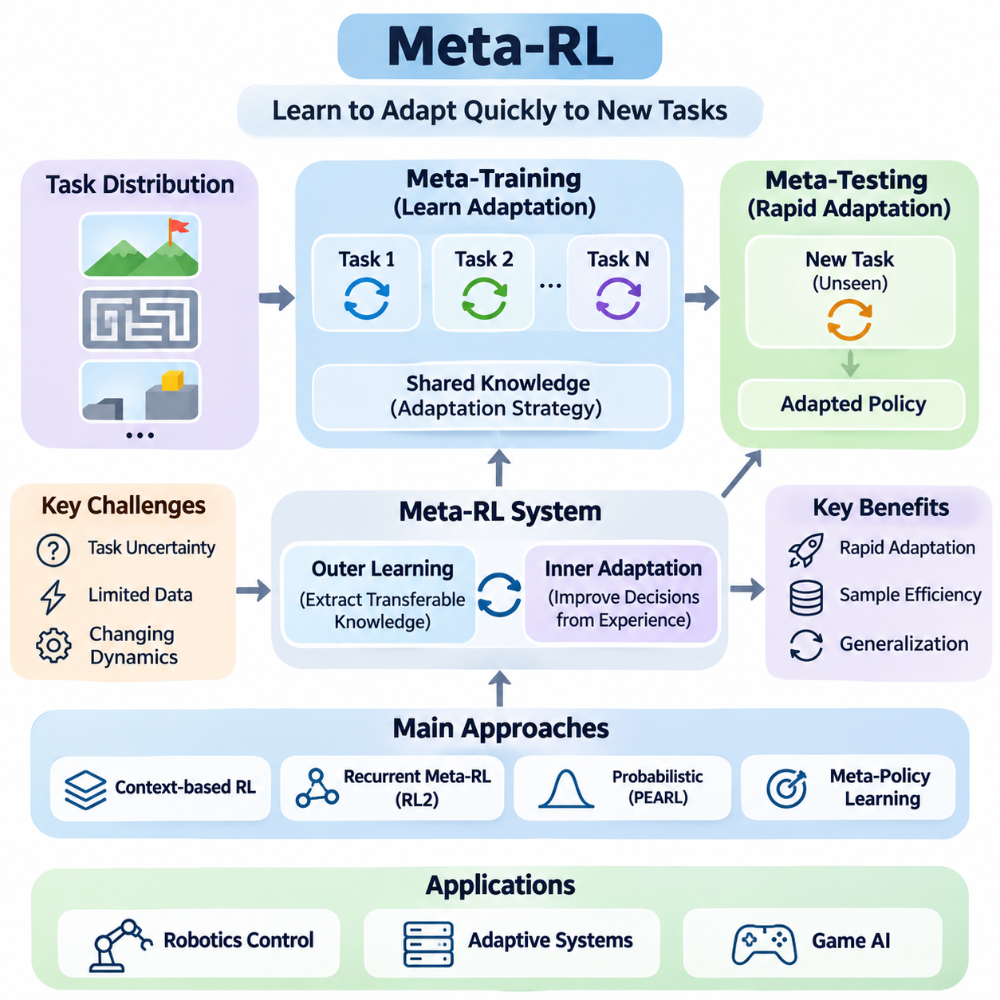
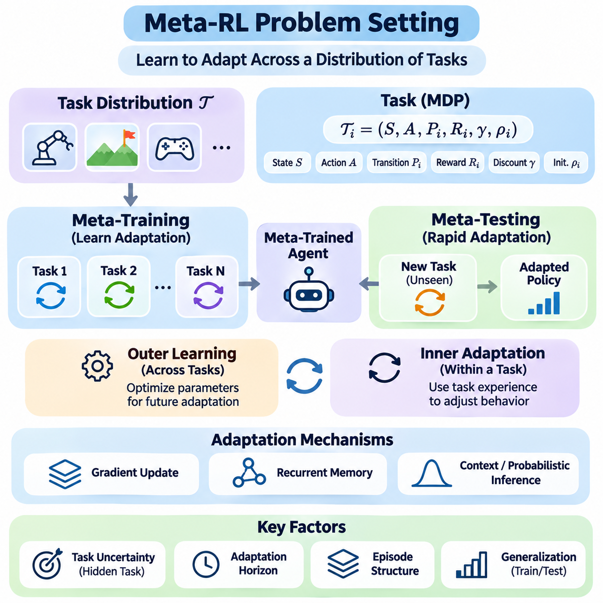
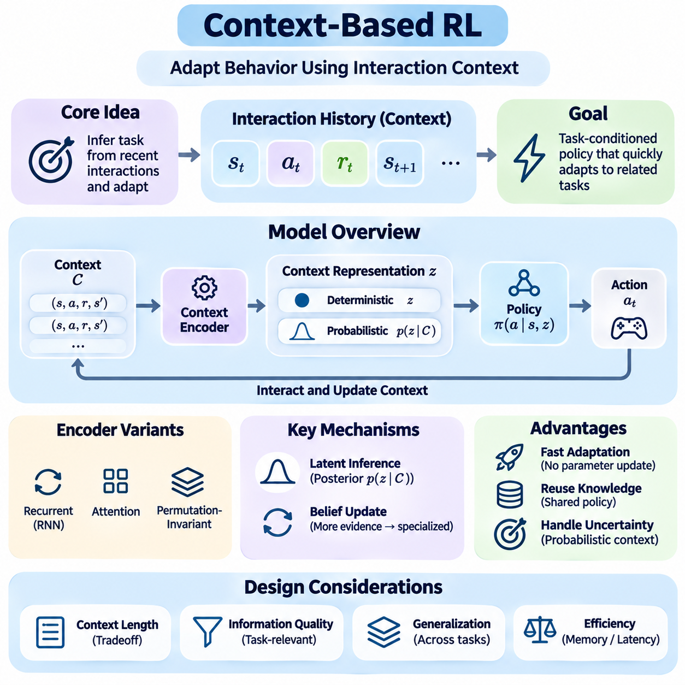
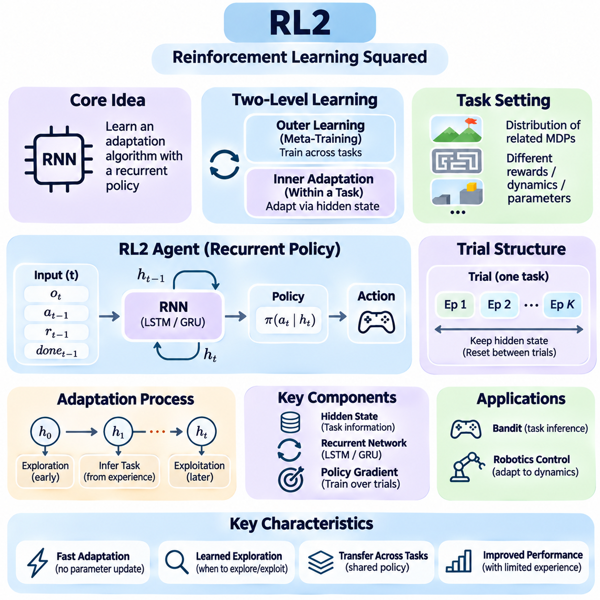
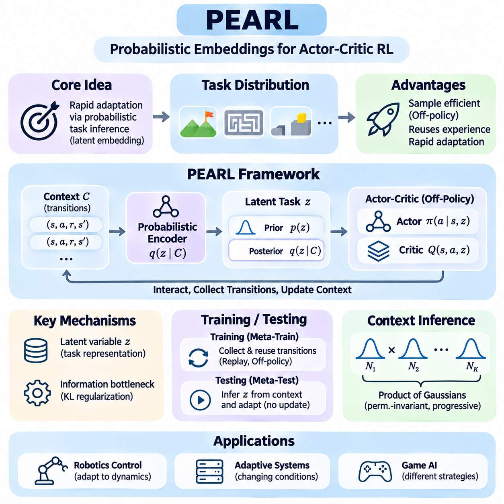
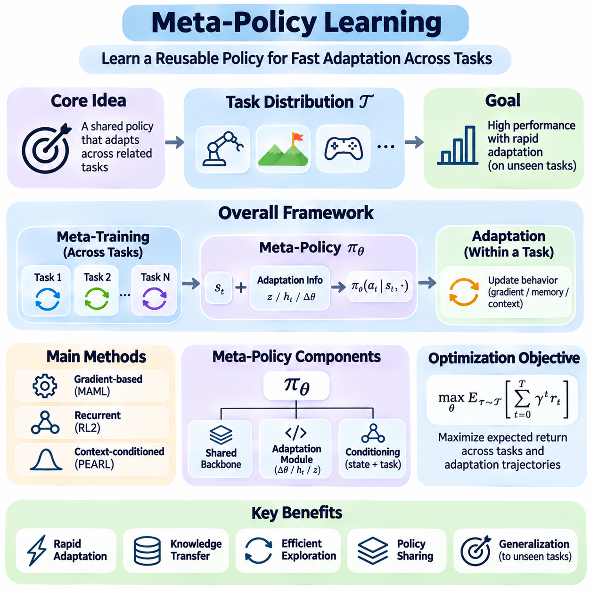
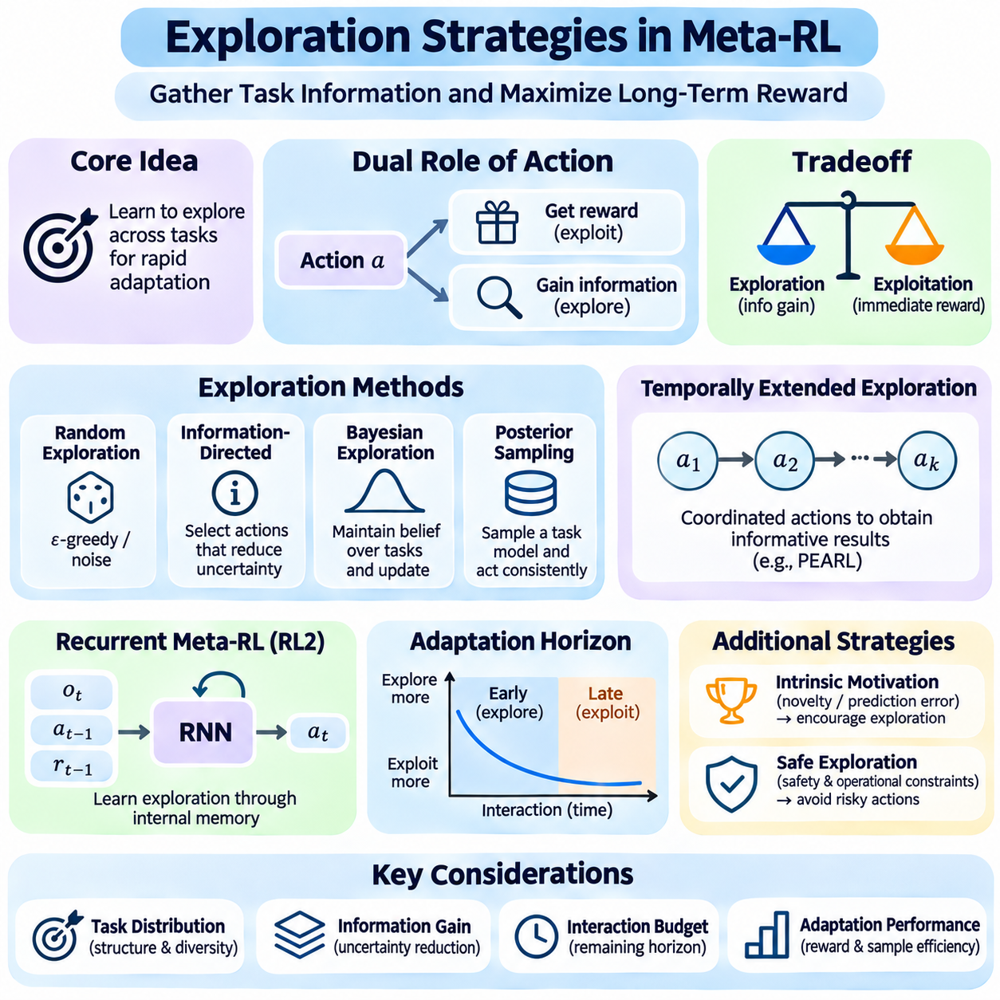
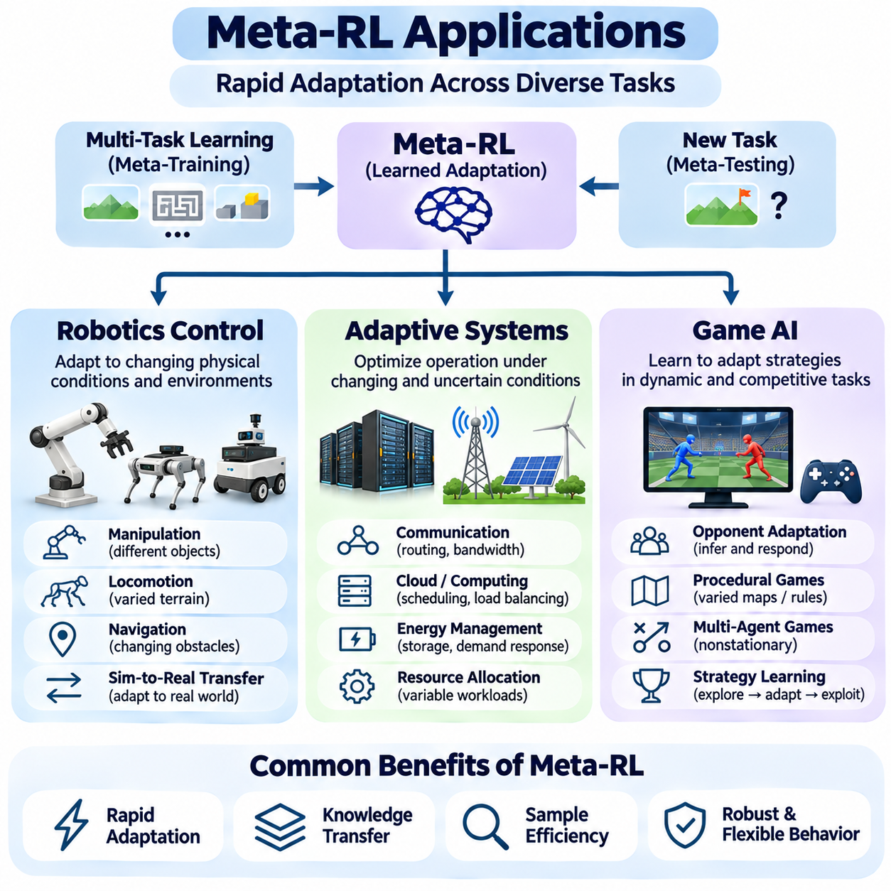

**Volume 36. Meta Learning and Few Shot Adaptation**

# 05. Meta RL

## 05.00 Overview

{width="7.268055555555556in" height="7.268055555555556in"}

Meta-Reinforcement Learning (Meta-RL) extends conventional reinforcement learning by enabling agents to acquire strategies for adapting rapidly to unfamiliar tasks. Rather than learning a separate policy from scratch for every environment, a meta-trained agent develops reusable knowledge from a distribution of related tasks. This approach combines sequential decision-making with learning-to-learn principles, improving adaptation when interaction data and computational resources are limited.

Traditional reinforcement learning typically assumes that an agent can collect sufficient experience within a relatively stable environment. However, real-world systems frequently encounter changing dynamics, uncertain rewards, and previously unseen operating conditions. Meta-RL addresses these challenges by learning how past experiences can guide future decisions, allowing an agent to adjust its behavior after observing only a small number of interactions with a new task.

The central objective of Meta-RL is to optimize performance across a distribution of Markov Decision Processes rather than a single fixed problem. Each task may have different transition dynamics, reward functions, initial states, or environmental parameters. During meta-training, the agent encounters multiple tasks and learns shared structures that support rapid adaptation. During meta-testing, its effectiveness is evaluated on previously unseen tasks sampled from a related distribution.

A Meta-RL system generally operates through two interconnected learning processes. The outer learning process extracts transferable adaptation strategies from multiple training tasks, while the inner adaptation process uses observations and rewards from a particular task to improve decisions. Unlike conventional gradient-based meta-learning, inner adaptation in Meta-RL may occur through recurrent memory, probabilistic inference, or changes in policy parameters without explicit gradient updates.

Task uncertainty plays an essential role because an agent may initially lack information about the environment in which it operates. A robot might not know the friction coefficient of a surface, while a game-playing agent may not know an opponent\'s strategy. Meta-RL enables the agent to infer relevant task characteristics from interaction histories and select actions accordingly. Effective adaptation therefore requires both accurate task identification and appropriate behavioral adjustment.

Context-based reinforcement learning represents one important family of Meta-RL approaches. These methods summarize recent observations, actions, rewards, and state transitions into a context representation describing the current task. A policy then conditions its decisions on this representation, allowing behavior to change as new information becomes available. Context may be represented through recurrent hidden states, learned embeddings, or probabilistic latent variables.

Recurrent Meta-RL methods provide another mechanism for learning adaptive behavior directly from experience. RL² is a representative approach that uses a recurrent neural network to encode interaction histories and implement an implicit learning algorithm. By training the recurrent policy across many tasks, the system can learn to explore, remember observations, and modify decisions within a new task without requiring conventional parameter updates during adaptation.

Probabilistic approaches introduce explicit uncertainty modeling into task adaptation. Probabilistic Embeddings for Actor-Critic RL, commonly known as PEARL, learns a latent representation of task identity from accumulated experience. The inferred latent variable conditions the policy, enabling the agent to distinguish between different environments and adapt its behavior. This formulation connects Meta-RL with Bayesian inference, representation learning, and off-policy reinforcement learning.

Meta-policy learning focuses on developing policies that can generalize across related decision-making problems while remaining sensitive to task-specific information. A meta-policy may incorporate a learned initialization, a recurrent adaptation mechanism, or a task-conditioned architecture. Its objective is not simply to maximize average training performance, but to provide a flexible behavioral foundation that can respond efficiently to variations encountered during deployment.

Exploration becomes especially important in Meta-RL because actions can serve two purposes simultaneously. An action may generate immediate reward while also revealing information about unknown task characteristics. This creates a tradeoff between exploiting current knowledge and exploring to improve future decisions. Meta-trained agents can learn exploration strategies that prioritize informative interactions, potentially reducing the number of samples required for successful adaptation.

The relationship between exploration and adaptation is closely connected to the concept of information gathering. An agent operating under uncertainty may deliberately select actions that distinguish between competing hypotheses about its environment. Such behavior can be understood through Bayesian reinforcement learning and partially observable decision processes. Effective Meta-RL systems use information acquired during exploration to improve subsequent actions and cumulative reward.

Sample efficiency is a major motivation for Meta-RL, particularly in environments where interactions are expensive or risky. Physical robots, industrial equipment, and autonomous systems cannot always perform millions of exploratory actions. By transferring adaptation knowledge from previously encountered tasks, Meta-RL can reduce the amount of new experience needed. However, actual improvements depend on task similarity, training diversity, algorithm design, and evaluation conditions.

Robotics control provides a natural application domain because physical systems frequently experience variations in dynamics and operating conditions. A robotic manipulator may encounter objects with different masses, while a mobile robot may operate on surfaces with changing traction. Meta-RL can support rapid adjustment of control behavior by identifying relevant environmental characteristics from observed responses and selecting policies appropriate to the inferred conditions.

Adaptive systems extend these principles beyond robotics into environments where operating parameters change over time. Examples include resource allocation, dynamic scheduling, and automated control under uncertain conditions. A Meta-RL agent can use previous experience to recognize recurring patterns and adjust its decision strategy. Such capabilities are particularly valuable when conventional fixed policies cannot adequately represent the diversity of operational scenarios.

Game AI offers another important setting for studying Meta-RL because opponents, rules, and strategic conditions can vary across episodes. An agent may encounter unfamiliar adversarial behaviors and need to infer effective responses from limited interactions. Meta-RL enables policies to incorporate opponent modeling, strategic exploration, and experience-dependent adaptation. These environments also provide controlled experimental settings for comparing different meta-learning architectures.

Despite its potential, Meta-RL presents substantial optimization and generalization challenges. Training across multiple reinforcement learning tasks can introduce high variance, unstable gradients, and significant computational expense. Agents may also overfit to the training task distribution and fail when encountering substantially different environments. Robust evaluation therefore requires carefully designed task splits, diverse environmental conditions, and comparisons against strong reinforcement learning baselines.

Another challenge concerns the distinction between genuine adaptation and memorization of training environments. A model may achieve strong performance by recognizing familiar task patterns without learning a broadly transferable adaptation mechanism. Researchers must therefore evaluate performance on held-out tasks and systematically vary environmental parameters. Measuring adaptation speed, cumulative reward, exploration efficiency, and sensitivity to distribution shifts provides a more complete assessment of Meta-RL capabilities.

Practical deployment introduces additional constraints involving latency, computational resources, safety, and reliability. An adaptive policy must often make decisions within strict timing requirements while processing incomplete or noisy observations. In safety-critical systems, exploration cannot be allowed to produce unacceptable actions merely to gather information. Consequently, practical Meta-RL architectures may combine learned adaptation with constrained control, monitoring mechanisms, and independent safety safeguards.

The broader significance of Meta-RL lies in its ability to connect reinforcement learning with continual adaptation and general-purpose decision-making. By learning reusable mechanisms for interpreting experience and modifying behavior, agents can become less dependent on extensive task-specific retraining. Continued progress in context inference, recurrent learning, meta-policy optimization, and exploration strategies may help develop autonomous systems capable of adapting efficiently to changing environments.

The following sections examine the Meta-RL problem setting, context-based reinforcement learning, RL², PEARL, meta-policy learning, and exploration strategies in greater technical detail. Their theoretical foundations and algorithmic differences establish a framework for understanding how agents acquire transferable adaptation capabilities. Applications in robotics control, adaptive systems, and game AI illustrate how these mechanisms can support intelligent behavior across diverse sequential decision-making tasks.

## 05.01 Meta RL Problem Setting

{width="7.268055555555556in" height="7.268055555555556in"}

Meta-Reinforcement Learning (Meta-RL) formulates sequential decision-making as learning across a distribution of related tasks rather than optimizing a policy for one fixed environment. Each task is typically represented as a Markov Decision Process with its own transition dynamics, reward function, and initial-state distribution. The objective is to develop an agent that can rapidly identify task characteristics and adapt its behavior using limited experience.

A conventional reinforcement learning problem assumes that the agent interacts with a particular environment and improves its policy through repeated observations, actions, and rewards. Meta-RL introduces an additional level of uncertainty because the agent must operate across multiple environments whose properties may differ. Successful learning therefore requires both effective decision-making within individual tasks and the acquisition of transferable adaptation strategies.

The task distribution is a fundamental component of the Meta-RL problem setting. During meta-training, tasks are sampled from a probability distribution representing possible operating conditions. These tasks may differ in physical parameters, reward structures, goals, or transition probabilities. By experiencing diverse tasks, the agent learns common patterns that support efficient adaptation when encountering a previously unseen but related environment.

A Meta-RL task can be represented by an MDP defined through a state space, action space, transition function, reward function, discount factor, and initial-state distribution. Some components may remain shared across tasks, while others vary according to task identity. For example, a robotic control benchmark may preserve the same observation and action dimensions while changing actuator strength, object mass, or target location.

The distinction between task identity and observable state is essential. The agent may observe its position, velocity, or sensor measurements without directly knowing the environmental parameters that determine system behavior. Task identity is therefore often treated as a hidden variable that must be inferred through interaction. This uncertainty transforms the adaptation problem into a partially observable decision-making process.

Meta-training and meta-testing define the two major evaluation phases. During meta-training, the agent learns from a collection of tasks sampled from the training distribution. During meta-testing, it encounters tasks that were not used to optimize its parameters. The objective is to determine whether previously acquired knowledge enables rapid adaptation rather than simply reproducing memorized behavior from familiar environments.

The relationship between training and testing distributions strongly influences generalization. When unseen tasks share important structural properties with training tasks, adaptation may require relatively little additional experience. However, substantial changes in dynamics, rewards, or observation characteristics can reduce performance. Consequently, the task distribution must be designed to represent meaningful variation without making adaptation objectives ambiguous.

A central concept in Meta-RL is the separation between learning across tasks and adapting within a task. The outer learning process optimizes parameters or mechanisms that support future adaptation, while the inner process uses task-specific experience to modify behavior. Depending on the algorithm, adaptation may involve gradient updates, recurrent memory, context inference, or probabilistic estimation of hidden task variables.

The optimization objective typically emphasizes expected cumulative reward after encountering a new task. Unlike conventional reinforcement learning, performance depends not only on the final policy but also on how efficiently the agent improves during its interaction history. A useful meta-objective therefore considers the rewards collected throughout adaptation, including the costs of exploration and the consequences of initially uncertain decisions.

Adaptation horizons determine how much experience an agent can accumulate before performance is assessed. Some settings permit only a few episodes of interaction, while others allow longer adaptation periods. Short horizons favor methods capable of extracting task information quickly, whereas longer horizons may support more elaborate exploration and policy refinement. The chosen horizon directly affects algorithm design and benchmark interpretation.

The episode structure also influences the learning problem. In certain Meta-RL formulations, an agent interacts with the same task across multiple episodes while retaining internal memory between episodes. Environmental states may reset, but task-specific knowledge remains available through the adaptation mechanism. This distinction allows recurrent agents to learn from previous attempts and improve their decisions during subsequent interactions.

Context-based formulations represent adaptation information through histories of states, actions, rewards, and transitions. A context encoder transforms these observations into a representation of the current task. The policy then conditions its action selection on the inferred context. This approach enables adaptation without necessarily modifying policy parameters and provides a foundation for algorithms that explicitly model uncertainty about task identity.

Recurrent formulations instead incorporate adaptation into the dynamics of a neural network. A recurrent policy receives interaction information and maintains hidden states that summarize relevant experience. Through training across many tasks, the network learns how to update its internal representation and adjust future actions. This perspective treats the recurrent computation itself as an implicit learning algorithm operating within each task.

Probabilistic formulations introduce a latent task variable representing unknown environmental characteristics. The agent maintains or approximates a belief distribution over possible task identities using accumulated evidence. As observations become available, the belief is updated and used to condition decisions. Such approaches provide a principled connection between Meta-RL, Bayesian inference, and partially observable reinforcement learning.

Exploration is especially important because the agent must gather information while simultaneously attempting to maximize reward. An action may provide immediate benefit or reveal properties that improve later decisions. This creates a dual-control problem in which actions influence both environmental outcomes and the agent\'s knowledge. Effective Meta-RL therefore requires exploration strategies that account for the future value of information.

The balance between exploration and exploitation depends on the remaining adaptation horizon and the uncertainty associated with the task. Early interactions may justify informative actions that produce limited immediate reward, while later interactions may favor exploiting acquired knowledge. A meta-trained agent can learn this balance from previous tasks, potentially developing exploration behavior that is more efficient than generic random exploration.

Task diversity is necessary for learning transferable adaptation mechanisms, but excessive variation can make optimization difficult. If tasks share little meaningful structure, the agent may struggle to discover reusable knowledge. Conversely, a narrow task distribution may encourage memorization rather than genuine adaptation. Designing an appropriate distribution requires balancing environmental diversity, structural similarity, and realistic deployment requirements.

Evaluation should distinguish initial performance, adaptation speed, and performance after sufficient experience. An agent that performs well immediately may possess strong prior knowledge, while another may improve rapidly after informative interactions. Both characteristics matter, but they represent different capabilities. Learning curves, cumulative returns, sample efficiency, and performance variance provide complementary evidence about adaptation quality.

Fair comparisons require consistent task distributions, interaction budgets, reward definitions, and evaluation protocols. Meta-RL algorithms should be compared with conventional reinforcement learning, multitask learning, and transfer learning baselines under equivalent conditions. Differences in training experience or access to task information can otherwise create misleading conclusions about adaptation efficiency and generalization performance.

Real-world Meta-RL problem settings introduce additional constraints involving safety, computational latency, observation noise, and limited opportunities for experimentation. A physical robot cannot always explore freely because unsuccessful actions may damage equipment or endanger nearby people. Practical formulations must therefore consider safe exploration, operational constraints, and the reliability of adaptation under uncertain environmental conditions.

The Meta-RL problem setting establishes the theoretical foundation for context-based reinforcement learning, recurrent methods such as RL², probabilistic approaches such as PEARL, and meta-policy optimization. Although these methods implement adaptation differently, they share the objective of exploiting experience across tasks to improve decisions within unfamiliar environments. Understanding task distributions, hidden task variables, adaptation horizons, and evaluation objectives is essential for designing effective Meta-RL systems.

## 05.02 Context Based RL

{width="7.268055555555556in" height="7.268055555555556in"}

Context-Based Reinforcement Learning provides a framework for adapting agent behavior by interpreting recent interactions as evidence about the current environment. Instead of requiring extensive policy retraining whenever task conditions change, the agent constructs a context representation from observations, actions, rewards, and state transitions. This representation allows a shared policy to respond differently across related tasks while retaining previously learned knowledge.

In conventional reinforcement learning, a policy typically maps the current state to an action under relatively stable environmental assumptions. Context-based methods extend this formulation by conditioning decisions on information accumulated during previous interactions. The context captures task-specific characteristics that may not be directly observable, such as reward preferences, physical dynamics, environmental constraints, or hidden operating parameters.

A context-based agent generally consists of a context encoder and a task-conditioned policy. The encoder transforms interaction histories into a compact representation describing the current task, while the policy uses this representation alongside the current observation to select actions. These components may be trained jointly or through separate optimization procedures, depending on the architecture and the learning objective.

Interaction histories commonly contain sequences of states, actions, rewards, and subsequent states. Each transition provides information about how the environment responds to the agent\'s behavior. By analyzing multiple transitions, the context encoder can identify recurring patterns and estimate task characteristics. This process enables the agent to distinguish between environments that appear similar initially but respond differently to identical actions.

Context representations can be deterministic or probabilistic. Deterministic encoders produce a fixed embedding summarizing available experience, while probabilistic encoders estimate a distribution over possible task representations. Probabilistic formulations are particularly useful when observations are incomplete or ambiguous because they allow the agent to represent uncertainty rather than committing prematurely to a single interpretation.

A deterministic context encoder may use recurrent neural networks, attention mechanisms, or permutation-invariant aggregation functions. Recurrent architectures process interaction sequences and maintain hidden states, while attention-based models identify relevant relationships among observations. Permutation-invariant encoders are appropriate when context transitions can be treated as an unordered collection rather than a temporally dependent sequence.

Probabilistic context inference introduces latent variables that represent hidden task characteristics. Given a collection of observed transitions, an inference network estimates a posterior distribution over the latent task representation. The policy conditions its decisions on a sampled or summarized latent variable. As additional experience becomes available, the posterior can become more informative, supporting increasingly specialized behavior.

The relationship between context inference and Bayesian reasoning is central to many context-based methods. An agent begins with uncertainty about the current task and updates its beliefs after observing environmental responses. Although neural inference networks often approximate rather than perform exact Bayesian updates, they provide a practical mechanism for combining prior knowledge with newly acquired evidence during adaptation.

Context-conditioned policies extend ordinary state-dependent policies by incorporating task information into action selection. Two agents observing the same physical state may select different actions if their inferred contexts indicate different objectives or dynamics. For example, a robotic controller may apply different forces when manipulating objects with different masses, even when the initial joint configuration is identical.

One major advantage of context-based reinforcement learning is that adaptation can occur without modifying the policy\'s learned parameters. The agent updates its context representation as new transitions arrive, and the policy immediately responds to the revised information. This mechanism can reduce adaptation latency and avoid the computational overhead associated with repeated gradient-based fine-tuning during deployment.

The quality of context inference depends strongly on the information contained in the interaction history. If the agent observes only uninformative transitions, different tasks may remain indistinguishable. Consequently, effective context-based learning requires representations that preserve task-relevant information while discarding irrelevant details. This balance influences both generalization performance and the efficiency of subsequent policy decisions.

Context length introduces an important design tradeoff. Short histories reduce memory requirements and computational complexity but may omit essential information about the task. Longer histories provide additional evidence but can increase inference latency and introduce outdated or irrelevant observations. Practical systems therefore require mechanisms for selecting, compressing, or weighting interaction data according to its relevance.

Attention mechanisms can improve context processing by assigning different importance to individual observations or transitions. Informative experiences receive greater influence, while redundant or noisy interactions contribute less to the inferred representation. This capability is particularly valuable in environments where only a small subset of interactions reveals meaningful differences between tasks.

Context-based learning also creates a connection between representation learning and reinforcement learning. The context encoder must discover latent features that explain variations in environmental behavior, while the policy must exploit those features to maximize cumulative reward. Joint optimization encourages representations that are useful for decision-making rather than merely reconstructing observed transitions or identifying superficial task differences.

Exploration remains important because the agent must acquire informative context before selecting an effective task-specific strategy. Some actions may reveal hidden dynamics or reward characteristics more clearly than others. A context-aware agent can therefore benefit from exploration policies that prioritize information acquisition, especially during early interactions when uncertainty about the current task is relatively high.

Probabilistic Embeddings for Actor-Critic RL, commonly known as PEARL, illustrates how context inference can support efficient meta-reinforcement learning. PEARL learns a probabilistic latent task representation and conditions an off-policy actor-critic policy on that representation. By separating task inference from policy execution, the approach enables rapid behavioral adaptation while reusing experience collected during previous training interactions.

Training context-based agents requires exposure to a sufficiently diverse collection of related tasks. During meta-training, the encoder learns to infer task characteristics from sampled interaction histories, while the policy learns appropriate behavior for different inferred contexts. At meta-testing, the system applies these learned mechanisms to unfamiliar tasks without requiring extensive retraining of its underlying neural networks.

Evaluation should examine both the accuracy of task inference and the quality of resulting decisions. Useful measurements include cumulative reward, adaptation speed, sample efficiency, robustness to noisy observations, and performance on unseen task configurations. A context representation that separates tasks accurately is not necessarily optimal unless those distinctions improve the agent\'s ability to select effective actions.

Context-based reinforcement learning is particularly relevant to robotics, adaptive control, and autonomous systems operating under changing conditions. A robot may infer variations in payload mass, surface friction, actuator response, or environmental constraints from recent sensor measurements. The resulting context can guide control decisions without requiring a complete redesign or retraining of the policy whenever operating conditions change.

Despite these advantages, context-based approaches face challenges involving distribution shifts, ambiguous task information, inference errors, and computational constraints. Incorrect context estimates can produce inappropriate actions, particularly when unfamiliar environments differ substantially from training conditions. Reliable deployment therefore benefits from uncertainty monitoring, conservative adaptation strategies, and independent safety mechanisms that constrain potentially hazardous behavior.

Context-Based Reinforcement Learning establishes an important foundation for Meta-RL by treating adaptation as the inference and utilization of task-specific information. Its central principle is that a shared policy can exhibit flexible behavior when conditioned on an informative representation of recent experience. This perspective connects naturally to recurrent Meta-RL, probabilistic latent-variable methods, meta-policy learning, and exploration strategies developed for efficient adaptation across changing environments.

## 05.03 RL2 [w/Code]

{width="7.268055555555556in" height="7.268055555555556in"}

RL², also known as Reinforcement Learning Squared, is a recurrent meta-reinforcement learning framework that learns an adaptation algorithm through repeated interaction with multiple tasks. Rather than explicitly updating policy parameters whenever a new task appears, RL² uses the internal state of a recurrent neural network to encode experience. This enables an agent to modify its behavior dynamically while maintaining a fixed set of learned network parameters.

The central idea of RL² is to treat a reinforcement learning algorithm as a computational process that can be represented by a recurrent policy. During meta-training, the agent encounters many related tasks and learns how previous observations, actions, and rewards should influence future decisions. The resulting recurrent network performs an implicit learning procedure, allowing adaptation to emerge through its internal state transitions.

In conventional reinforcement learning, an agent typically improves its policy by applying optimization updates to model parameters. RL² separates this slow parameter optimization from fast adaptation within a task. The outer learning process trains the recurrent network across tasks, while the inner adaptation process occurs through changes in hidden states. This distinction allows the same trained policy to adapt without requiring gradient calculations during deployment.

The RL² problem setting assumes a distribution of related Markov Decision Processes, each representing a different task. These tasks may vary in reward functions, transition dynamics, or environmental parameters while sharing compatible observation and action interfaces. During meta-training, tasks are repeatedly sampled from this distribution, encouraging the recurrent policy to discover behavioral strategies that transfer across different environments.

An RL² agent commonly receives the current observation, previous action, previous reward, and an episode termination indicator as inputs. These signals provide information about the current environment and the consequences of earlier decisions. The recurrent network processes the resulting interaction sequence and maintains a hidden state that summarizes relevant task information. Its output determines the next action according to the learned policy.

The hidden state is the primary mechanism through which RL² implements adaptation. As the agent interacts with a task, the recurrent network updates its internal representation based on new evidence. This representation may implicitly encode reward preferences, transition characteristics, uncertainty, or successful behavioral patterns. Because the hidden state evolves continuously, the agent can change its strategy without modifying the network weights.

A distinctive feature of RL² is the organization of interaction into trials containing multiple episodes from the same task. Environmental states may reset between episodes, but the recurrent hidden state is preserved throughout the trial. This allows the agent to use information obtained during earlier episodes when making decisions in later episodes. The hidden state is typically reset when a new task is sampled, preventing information leakage between unrelated trials.

The distinction between episodes and trials is essential for understanding RL². An episode represents one interaction sequence ending at a terminal condition, whereas a trial represents the complete adaptation experience associated with a particular task. By optimizing performance across entire trials, RL² encourages the recurrent policy to develop strategies that combine initial exploration with subsequent exploitation of acquired knowledge.

RL² can be trained using policy-gradient reinforcement learning methods applied to the recurrent policy. The outer optimization procedure evaluates the rewards collected across sampled tasks and updates network parameters to improve expected trial performance. Although the architecture does not prescribe a single optimizer, training must account for temporal dependencies across episodes because early actions may influence rewards obtained much later.

Recurrent neural networks such as Long Short-Term Memory and Gated Recurrent Units are suitable for implementing RL² because they can maintain information across extended interaction sequences. Their gating mechanisms regulate how previous experience is retained, updated, or discarded. This memory capability allows the policy to recognize task patterns, track previous outcomes, and adjust actions according to the accumulated interaction history.

Exploration emerges naturally as an important component of RL² because the recurrent policy is optimized over multiple episodes within a trial. Early actions may produce limited immediate rewards while revealing information that improves later performance. Through meta-training, the agent can learn when exploratory actions are beneficial and when accumulated knowledge should be exploited. This behavior resembles learning an exploration strategy rather than applying a fixed exploration rule.

A simple multi-armed bandit environment illustrates the operating principle of RL². Each task may assign different reward probabilities to available actions, and the agent initially does not know which action is most rewarding. By observing outcomes across repeated selections, the recurrent policy can infer promising choices. Successful meta-training encourages exploration during uncertain stages and increased selection of high-value actions as evidence accumulates.

In robotic control, RL² can support adaptation to changing physical conditions such as actuator strength, payload mass, friction, or system response. A robot may initially perform exploratory movements to estimate how the environment reacts to control commands. The recurrent hidden state captures useful information from these interactions, allowing subsequent actions to reflect the inferred dynamics without requiring explicit system identification or online parameter optimization.

The effectiveness of RL² depends on the diversity and structure of the meta-training task distribution. If training tasks are too similar, the recurrent network may memorize a common strategy instead of learning meaningful adaptation. If tasks differ excessively, discovering a reusable learning procedure becomes difficult. Appropriate task variation is therefore necessary to encourage generalization while preserving shared structure that the recurrent policy can exploit.

RL² differs from gradient-based meta-learning methods because its inner adaptation mechanism does not explicitly modify policy parameters. Methods such as Model-Agnostic Meta-Learning optimize parameter initializations that support rapid gradient updates. RL² instead embeds adaptation within recurrent computation. Both approaches seek rapid learning across tasks, but they differ in how experience changes behavior and how adaptation costs are distributed.

Compared with probabilistic context-based approaches, RL² generally represents task information implicitly through recurrent hidden states rather than explicitly estimating a latent task distribution. This design provides flexibility because the network can learn complex history-dependent behaviors. However, implicit representations can be difficult to interpret, and uncertainty estimates may not be directly available without additional modeling components.

One limitation of RL² is its dependence on recurrent memory capacity and the ability to preserve relevant information across long interaction sequences. Important observations may be forgotten, while irrelevant information may influence subsequent decisions. Long trials can also increase training complexity because optimization must account for extended temporal dependencies. These challenges become more significant when tasks require substantial exploration before useful information becomes available.

Training stability is another concern because RL² combines reinforcement learning optimization with recurrent sequence modeling. Sparse rewards, delayed consequences, and high-variance policy gradients can make it difficult to learn effective adaptation strategies. Large collections of training tasks and extensive interaction data may be required. Practical implementations therefore benefit from carefully designed reward signals, suitable optimization methods, and systematic evaluation of learning behavior.

Evaluation of RL² should measure both the quality of initial behavior and the improvement achieved through continued interaction. Performance can be examined across successive episodes within each trial to determine whether the recurrent policy actually adapts. Useful metrics include cumulative trial reward, adaptation speed, sample efficiency, robustness to unfamiliar tasks, and sensitivity to changes in task distributions or trial length.

Deployment introduces additional considerations involving inference latency, memory initialization, episode boundaries, and operational safety. Although RL² avoids gradient-based adaptation during execution, its recurrent state must be maintained consistently and reset at appropriate task boundaries. In safety-critical environments, exploratory behavior must remain within acceptable constraints. Independent safety mechanisms may be necessary to prevent hazardous actions while the agent identifies unfamiliar conditions.

RL² demonstrates that a reinforcement learning agent can acquire an implicit learning algorithm through recurrent policy optimization across tasks. Its main contribution is the integration of memory, exploration, and behavioral adaptation into a single learned policy. By distinguishing slow meta-training from fast hidden-state adaptation, RL² provides a foundation for understanding recurrent meta-reinforcement learning and its relationship to context-based inference, probabilistic task representations, and adaptive autonomous systems.

## 05.04 PEARL

{width="7.268055555555556in" height="7.268055555555556in"}

PEARL, or Probabilistic Embeddings for Actor-Critic RL, is a meta-reinforcement learning framework designed to enable rapid adaptation through probabilistic task inference. Instead of repeatedly updating policy parameters for every new environment, PEARL learns a latent representation of task characteristics from interaction experience. This representation conditions a shared policy, allowing the agent to adjust its behavior efficiently across related tasks.

The central motivation behind PEARL is the high sample complexity of many meta-reinforcement learning algorithms. Conventional on-policy methods often require extensive new interactions whenever the meta-policy is updated. PEARL addresses this limitation by combining probabilistic context inference with off-policy reinforcement learning, allowing previously collected transitions to be reused during training while preserving rapid adaptation at evaluation time.

PEARL assumes that tasks are sampled from a distribution of related Markov Decision Processes. Individual tasks may differ in reward functions, transition dynamics, goals, or physical parameters while maintaining compatible observation and action spaces. The agent does not necessarily observe task identity directly. Instead, it must infer the relevant characteristics of the current task from experience and use that information to select appropriate actions.

A fundamental component of PEARL is the latent task variable, commonly denoted by z. This variable provides a compact representation of environmental characteristics that influence optimal behavior. Rather than constructing an independent policy for each task, PEARL learns a policy conditioned on both the current state and the inferred latent variable. Different values of z allow the same policy network to generate task-specific actions.

The context encoder estimates a probability distribution over latent task variables using observed transitions. Context typically consists of state, action, reward, and next-state information collected during interaction. Each transition provides evidence about the task, and the encoder combines this evidence to infer a posterior distribution. As more informative transitions become available, the inferred representation can better distinguish among possible tasks.

PEARL commonly uses a probabilistic encoder that produces parameters of a latent distribution rather than a single deterministic embedding. In its original formulation, individual context transitions contribute Gaussian factors that are combined through a product-of-Gaussians mechanism. This structure supports permutation-invariant context aggregation and allows multiple observations to progressively refine the inferred task representation.

The prior distribution represents uncertainty about task identity before informative context is available. As the agent gathers experience, the posterior distribution incorporates evidence from observed transitions. During adaptation, latent variables can be sampled from this posterior and supplied to the policy. This mechanism enables the agent to express uncertainty about the current task while gradually developing more specialized behavior.

PEARL introduces an information bottleneck that regularizes the latent representation. A divergence penalty encourages the inferred posterior to remain close to a predefined prior unless the observed context provides sufficient evidence for a different representation. This prevents the encoder from encoding arbitrary details of individual transitions and encourages it to retain information that is relevant to task identification and policy adaptation.

The policy in PEARL is typically implemented using an off-policy actor-critic architecture based on Soft Actor-Critic. The actor selects actions conditioned on the current state and latent task variable, while critic networks estimate the expected value of those actions. By learning across multiple tasks, the policy develops reusable behavioral knowledge that can be specialized through changes in the inferred context.

Off-policy learning is a defining advantage of PEARL because it separates the collection of interaction data from the optimization of the policy. Transitions obtained during earlier interactions can be stored in replay buffers and sampled repeatedly during training. This reuse improves data efficiency compared with methods that discard experience after each policy update, although overall performance still depends on task diversity and training stability.

During meta-training, PEARL alternates between collecting experience and optimizing its context encoder, policy, and value functions. Tasks are sampled from the training distribution, and interaction data are stored for subsequent updates. The encoder learns to extract task-relevant information, while the actor-critic components learn actions that maximize expected returns under different latent representations.

The distinction between context sampling and policy optimization is important. Context transitions are used to infer task identity, whereas replayed transitions support actor-critic learning. These data may originate from different portions of the experience buffer, allowing PEARL to train the inference mechanism and control policy efficiently. Careful management of these samples helps maintain useful task representations and stable off-policy updates.

At meta-testing, PEARL encounters a previously unseen task and begins with limited information about its characteristics. The agent initially samples latent variables from its prior distribution and collects interaction data. As context accumulates, the encoder estimates a posterior over task representations. The policy then uses this updated information to select actions without requiring gradient-based updates to its learned parameters.

Exploration in PEARL is closely connected to uncertainty over latent task variables. Sampling a latent representation from the current belief can encourage temporally coherent exploration because the selected representation influences a sequence of actions. This differs from exploration strategies that introduce independent random disturbances at every time step. Such behavior can help the agent discover informative task characteristics through structured interaction.

The effectiveness of posterior sampling depends on the quality of the learned latent representation. If different tasks produce nearly identical context observations, the encoder may struggle to distinguish them. Conversely, informative transitions can rapidly reduce uncertainty and improve action selection. Consequently, exploration efficiency depends on both the policy\'s behavior and the encoder\'s ability to interpret environmental responses.

PEARL differs from recurrent approaches such as RL² in how adaptation information is represented. RL² typically maintains an implicit task representation through recurrent hidden states, while PEARL explicitly estimates a probabilistic distribution over latent task variables. This separation makes the inference mechanism more structured and allows uncertainty to influence policy behavior, although the learned latent dimensions may remain difficult to interpret.

Compared with gradient-based meta-learning, PEARL avoids repeated parameter optimization during adaptation. Methods such as Model-Agnostic Meta-Learning rely on task-specific gradient updates, whereas PEARL modifies policy behavior through inferred latent variables. This distinction can reduce online computational requirements and make adaptation suitable for environments where interaction data are expensive or immediate responses are important.

Robotic control provides a natural application for PEARL because physical systems frequently experience changes in payload mass, friction, actuator response, or target conditions. A robot can collect a small amount of interaction data and infer a latent representation of the current dynamics. The conditioned policy then adjusts its control actions accordingly, potentially reducing the need for extensive task-specific retraining.

Despite its advantages, PEARL faces limitations involving task distribution shifts, ambiguous observations, inaccurate posterior inference, and sensitivity to training configuration. A latent representation learned from a narrow task distribution may not generalize to substantially different environments. Incorrect task inference can also lead to unsuitable actions, making uncertainty monitoring and robust evaluation important for practical applications.

Evaluation of PEARL should consider adaptation speed, cumulative reward, sample efficiency, and performance on unseen tasks. Comparisons with recurrent meta-reinforcement learning, gradient-based adaptation, and conventional off-policy reinforcement learning help clarify its strengths. Evaluation should also examine whether improvements arise from effective task inference, extensive training experience, or favorable assumptions about the task distribution.

PEARL demonstrates how probabilistic inference and off-policy actor-critic learning can be integrated into an efficient meta-reinforcement learning framework. Its central contribution is the separation of task inference from policy execution through a learned latent representation. This design connects Bayesian reasoning, context-based adaptation, and sample-efficient reinforcement learning, providing a foundation for adaptive agents operating across changing environments.

## 05.05 Meta Policy Learning

{width="7.268055555555556in" height="7.268055555555556in"}

Meta-Policy Learning is a central component of meta-reinforcement learning that focuses on developing policies capable of adapting efficiently across related tasks. Rather than optimizing a separate policy for every environment, the objective is to learn a reusable decision-making mechanism that incorporates task-specific experience. This enables an agent to adjust its behavior when encountering unfamiliar conditions while preserving knowledge acquired during meta-training.

A meta-policy differs from a conventional reinforcement learning policy because it must account for both the current state and the information accumulated during adaptation. Traditional policies generally optimize behavior under a fixed task definition, whereas meta-policies are designed to respond to changing goals, dynamics, and reward structures. Their effectiveness depends on how well previous experience can be transformed into decisions appropriate for the current task.

The Meta-Policy Learning problem is commonly formulated over a distribution of Markov Decision Processes. Each sampled task may possess different transition dynamics, reward functions, or environmental parameters while sharing compatible state and action spaces. The meta-policy is optimized to achieve high expected performance across this distribution, with particular emphasis on rapid adaptation to tasks that were not encountered during training.

A fundamental distinction exists between meta-training and task-specific adaptation. During meta-training, the agent acquires general knowledge from multiple tasks and optimizes parameters that support flexible behavior. During adaptation, the agent uses observations, actions, and rewards from the current task to modify its decisions. Depending on the architecture, this adjustment may involve gradient updates, recurrent hidden states, or inferred context representations.

The meta-policy can be expressed conceptually as a function of the current observation and an adaptation-dependent representation. This representation may contain a latent task embedding, recurrent memory state, or parameters updated through a small number of gradient steps. By conditioning action selection on such information, a shared policy can generate different behaviors for environments that initially appear similar but require distinct control strategies.

Gradient-based meta-policy learning seeks parameter initializations that can be adapted quickly using limited task-specific experience. Model-Agnostic Meta-Learning provides a representative approach by optimizing initial parameters for effective performance after one or more adaptation updates. The outer optimization process evaluates adapted policies across tasks, encouraging the initial policy to occupy a parameter region that supports efficient task-specific improvement.

Recurrent meta-policy learning incorporates adaptation directly into the internal dynamics of a neural network. Methods such as RL² process observations, previous actions, and rewards through recurrent architectures that maintain task-relevant information. The network learns how to interpret interaction histories and adjust future behavior without explicitly modifying its weights during deployment. Adaptation is therefore implemented through evolving internal memory.

Context-conditioned meta-policies provide another mechanism for rapid behavioral adjustment. A context encoder extracts task-relevant information from recent transitions and converts it into a compact representation. The policy then selects actions conditioned on the current state and inferred context. Probabilistic methods such as PEARL extend this approach by maintaining uncertainty over latent task characteristics and using sampled representations to guide decisions.

The optimization objective in Meta-Policy Learning generally emphasizes expected cumulative reward across tasks and adaptation trajectories. Performance depends not only on the quality of the final adapted policy but also on rewards collected while identifying the task. This distinction encourages policies that balance immediate performance with information acquisition, particularly when the agent must adapt within a limited interaction budget.

Exploration is closely connected to meta-policy optimization because early actions can influence the information available for later decisions. An effective meta-policy may deliberately select informative actions that reveal hidden reward structures or transition dynamics. Although such actions may produce limited immediate reward, they can improve subsequent performance. Meta-training can teach the policy when exploration is valuable and when exploitation becomes preferable.

The structure of the task distribution strongly influences the behavior learned by a meta-policy. Tasks must share enough underlying structure for transferable knowledge to exist, but they should also contain meaningful differences that require adaptation. If the distribution is too narrow, the policy may memorize common responses. If it is excessively diverse, learning a coherent adaptation mechanism can become difficult.

Policy parameter sharing is an important design principle because it allows knowledge to transfer across tasks without maintaining a completely independent model for each environment. Shared neural network components can capture common dynamics or behavioral patterns, while task-conditioned modules introduce specialization. This arrangement can improve computational efficiency and reduce storage requirements, although excessive sharing may create interference between incompatible tasks.

Meta-policy architectures may also employ modular networks, attention mechanisms, or learned adaptation operators. Modular designs separate reusable capabilities from task-dependent components, while attention mechanisms emphasize relevant observations or experiences. Learned adaptation operators can transform task-specific information into parameter adjustments or policy conditioning signals. These approaches provide different tradeoffs between flexibility, complexity, and interpretability.

Representation learning plays a critical role in determining whether a meta-policy can generalize. The adaptation representation should preserve information that changes optimal behavior while excluding irrelevant environmental variation. For example, a robotic policy may need to identify payload mass or friction but not unrelated visual details. Effective representations support rapid task discrimination and improve the consistency of subsequent action selection.

Meta-policy learning is also related to hierarchical reinforcement learning because reusable behavioral skills can support adaptation across different objectives. A higher-level policy may select among learned skills, while lower-level controllers execute specialized actions. Meta-learning can improve how these skills are selected or adjusted for unfamiliar tasks. However, hierarchical organization alone does not guarantee rapid adaptation unless task-specific information influences policy decisions.

In robotic control, meta-policies can adapt to variations in actuator response, object properties, terrain conditions, or manipulation goals. A robot trained across diverse operating conditions may infer the current environment from limited interaction and adjust its control commands accordingly. This capability is valuable when collecting extensive task-specific data is expensive, although safety constraints must restrict potentially hazardous exploratory behavior.

Adaptive systems and game environments provide additional applications. Resource allocation systems may encounter changing demand patterns, while game agents may face opponents with unfamiliar strategies. A meta-policy can use recent observations to identify relevant conditions and modify its decision-making behavior. The same underlying principle applies whenever tasks share transferable structure but require different responses under changing circumstances.

Evaluation should distinguish immediate policy performance from the ability to improve through adaptation. Useful metrics include cumulative reward, adaptation speed, sample efficiency, performance variance, and generalization to unseen tasks. Learning curves across successive interactions reveal whether the policy is genuinely adapting. Comparisons with multitask policies and conventional reinforcement learning baselines help determine whether meta-learning provides measurable benefits.

Several challenges limit practical Meta-Policy Learning, including unstable optimization, task interference, distribution shifts, and excessive computational requirements. Gradient-based methods may involve expensive higher-order optimization, while recurrent and context-based methods can suffer from inaccurate task representations. Robust training requires diverse tasks, appropriate regularization, and evaluation protocols that distinguish genuine adaptation from memorization.

Deployment introduces further requirements involving inference latency, memory management, uncertainty estimation, and operational reliability. A meta-policy must adapt quickly without violating safety constraints or producing unpredictable behavior during exploration. Practical systems may combine learned adaptation with conservative control rules, monitoring mechanisms, and fallback policies. These safeguards are particularly important in physical environments where incorrect actions have real consequences.

Meta-Policy Learning unifies several approaches to rapid adaptation by treating policy flexibility as an objective learned across tasks. Gradient-based initialization, recurrent memory, probabilistic context inference, and modular architectures offer different mechanisms for achieving this goal. Together, they establish a foundation for autonomous agents that can reuse prior experience, interpret unfamiliar conditions, and improve sequential decisions with limited additional interaction.

## 05.06 Exploration Strategies

{width="7.268055555555556in" height="7.268055555555556in"}

Exploration Strategies in Meta-Reinforcement Learning address how an agent should gather information about unfamiliar tasks while simultaneously maximizing cumulative reward. Unlike conventional reinforcement learning, where exploration often focuses on discovering valuable actions within one environment, Meta-RL emphasizes learning how to explore across a distribution of tasks. The objective is to acquire information that enables rapid adaptation with limited interactions.

The exploration problem arises because the agent may not initially know the reward function, transition dynamics, or hidden parameters of the current task. Actions therefore serve two purposes: influencing environmental outcomes and revealing information about task characteristics. This dual role creates a tradeoff between exploration and exploitation, requiring the agent to consider both immediate rewards and the potential value of improved future decisions.

A central principle of meta-exploration is that information gathered during early interactions can improve performance throughout the remaining adaptation horizon. An exploratory action may temporarily reduce immediate reward while identifying important environmental properties. The value of this action depends on whether the acquired information enables better subsequent behavior. Effective strategies therefore evaluate exploration in relation to its long-term consequences.

Task distributions strongly influence which exploration behaviors are useful. When tasks share structural similarities, an agent can learn recurring patterns that indicate which actions reveal important differences. Meta-training exposes the agent to multiple tasks and allows it to discover exploration strategies that transfer to unfamiliar environments. Such strategies can be more efficient than repeatedly applying generic random exploration.

Random exploration provides a simple baseline by introducing stochasticity into action selection. Methods such as epsilon-greedy selection or action noise encourage agents to sample alternatives rather than repeatedly choosing familiar actions. Although these approaches can discover useful behavior, they do not explicitly prioritize task identification. In Meta-RL, this limitation becomes important when interaction budgets are small and informative actions are rare.

Information-directed exploration selects actions according to their expected ability to reduce uncertainty about the current task. An agent may maintain a belief over possible reward functions, dynamics models, or latent task variables. Actions are then evaluated partly by how much their outcomes could distinguish competing hypotheses. This approach connects meta-exploration with Bayesian inference, experimental design, and information theory.

Information gain can be measured through changes in uncertainty before and after observing an action\'s consequences. A common formulation uses the expected reduction in entropy or the divergence between posterior and prior beliefs. Actions with high expected information gain are attractive when they reveal task characteristics relevant to future control. However, information gain alone does not guarantee improved reward or safe behavior.

Bayesian exploration maintains uncertainty over possible tasks and updates beliefs as evidence accumulates. Rather than assuming a single environment model, the agent considers several plausible explanations for observed transitions. Action selection can incorporate these beliefs to balance immediate performance with learning. Exact Bayesian planning is often computationally expensive, motivating approximate inference and learned exploration policies.

Posterior sampling offers a practical mechanism for directing exploration through uncertainty. The agent samples a plausible task representation or model from its current belief and selects actions accordingly. Repeated observations update the posterior distribution, allowing behavior to change as uncertainty decreases. When a sampled hypothesis guides several consecutive actions, exploration can become temporally coherent rather than purely random.

Temporally extended exploration is particularly valuable when informative outcomes require sequences of coordinated actions. Independent action noise may disrupt such sequences before meaningful evidence is collected. By maintaining a sampled task hypothesis, exploration policy, or latent variable over multiple steps, the agent can execute consistent behavioral experiments. This principle is relevant to probabilistic Meta-RL approaches such as PEARL.

Recurrent meta-reinforcement learning provides another way to acquire exploration strategies. In RL², a recurrent policy processes observations, previous actions, and rewards while maintaining internal memory across interactions. Meta-training optimizes performance over complete adaptation trials, encouraging the network to discover when information gathering is beneficial. Exploration emerges as part of the learned sequential decision-making process.

The relationship between exploration and adaptation horizon is fundamental. When many interactions remain, the agent may benefit from investing in information that improves later decisions. Near the end of a trial, exploratory actions may have insufficient time to produce a positive return. Consequently, an effective exploration strategy should consider remaining time, uncertainty, expected information value, and the costs of unsuccessful actions.

Reward-based exploration and task-identification exploration are not always equivalent. An action may reveal substantial information about environmental parameters without affecting the optimal policy. Conversely, a small amount of information about a critical parameter may significantly improve control performance. Meta-RL exploration should therefore prioritize decision-relevant information rather than maximizing uncertainty reduction as an isolated objective.

Intrinsic motivation can encourage exploration by assigning additional rewards to novelty, prediction errors, or information acquisition. These intrinsic rewards supplement the external task reward and promote informative interactions. During meta-training, their influence can be adjusted to support efficient adaptation. However, poorly designed intrinsic objectives may encourage irrelevant novelty seeking or distract the agent from actual task requirements.

Active system identification provides an important example in robotic control. A robot may execute controlled movements to estimate payload mass, friction, actuator response, or other uncertain physical parameters. The resulting observations help distinguish possible dynamics models and guide subsequent control decisions. Meta-learning can improve this process by identifying probing actions that provide useful information across related operating conditions.

Safety constraints significantly affect exploration in physical environments. Informative actions may be unacceptable if they create excessive forces, unstable motion, collisions, or other hazards. Safe exploration therefore requires limiting candidate actions according to operational constraints and uncertainty estimates. Practical systems may combine learned exploration policies with safety filters, conservative controllers, or independent monitoring mechanisms.

Exploration efficiency depends on the quality of task representations and uncertainty estimates. If an encoder cannot distinguish important task characteristics, the agent may repeatedly perform uninformative actions. Conversely, accurate uncertainty modeling can guide interactions toward unresolved questions that influence policy selection. Jointly learning task inference and exploration behavior can improve adaptation when both components are appropriately optimized.

The design of meta-training tasks determines whether learned exploration strategies generalize. A narrow distribution may produce exploration routines that exploit predictable training patterns rather than genuinely identify unfamiliar conditions. Excessively diverse tasks may prevent the discovery of reusable information-gathering behavior. Training should therefore include meaningful variation in dynamics, rewards, initial conditions, and observation uncertainty.

Evaluation of exploration strategies should measure adaptation performance rather than exploration activity alone. Useful metrics include cumulative reward, information acquisition efficiency, interactions required to reach a target performance level, and robustness to unseen tasks. Comparing early and late trial behavior helps reveal whether an agent transitions appropriately from exploration to exploitation. Controlled experiments can isolate the contribution of learned exploration mechanisms.

Practical deployment introduces additional challenges involving computational latency, noisy sensors, delayed rewards, and changing task conditions. An exploration policy must distinguish genuine environmental changes from transient disturbances and avoid unnecessary repeated probing. In safety-critical systems, the cost of information gathering must be evaluated against operational risks. Reliable exploration therefore requires coordinated inference, control, and monitoring.

Exploration Strategies form an essential component of Meta-RL because rapid adaptation depends on acquiring useful task information efficiently. Random exploration, Bayesian methods, posterior sampling, intrinsic motivation, and recurrent learned strategies provide different mechanisms for balancing information gathering with reward optimization. Their integration with context inference and meta-policy learning enables agents to adapt more effectively across uncertain and changing environments.

## 05.07 Applications

{width="7.268055555555556in" height="7.268055555555556in"}

Applications of Meta-Reinforcement Learning extend across robotics control, adaptive systems, and game artificial intelligence, where agents must respond to changing tasks with limited additional experience. These domains share a need for rapid adaptation under uncertainty, but differ in their dynamics, operational constraints, and evaluation objectives. Meta-RL provides a common framework for transferring knowledge across related environments.

In practical applications, Meta-RL typically separates knowledge acquisition during meta-training from rapid adaptation during deployment. Agents encounter diverse tasks during training and learn policies, representations, or adaptation procedures that capture reusable structure. When operating in an unfamiliar environment, they use recent observations and rewards to identify task characteristics and adjust decisions without extensive retraining.

Robotics control is a major application because physical systems frequently experience variations in dynamics, payloads, contact conditions, and environmental geometry. Conventional controllers may require manual calibration or repeated optimization when operating conditions change. Meta-RL seeks to reduce this dependence by learning adaptation mechanisms that infer relevant physical properties from limited interaction data.

Robot manipulation illustrates how meta-learning can support task-specific control. A robotic arm may encounter objects with different masses, friction coefficients, or geometric properties. By observing the consequences of initial movements, a meta-trained controller can infer characteristics that influence grasping and manipulation. The policy can then adjust grip forces, trajectories, and motion strategies according to the inferred conditions.

Locomotion control provides another important example. Legged robots must operate across surfaces with different friction, compliance, slopes, and disturbances. A meta-policy trained on diverse simulated terrains can learn to recognize changes in environmental dynamics through proprioceptive feedback. Adaptation may involve modifying gait parameters, foot placement, or body stabilization strategies while maintaining balance.

Meta-RL can also support robotic navigation in changing environments. Mobile robots may encounter different obstacle configurations, wheel-ground interactions, or motion constraints. By incorporating recent experience into policy decisions, an adaptive navigation controller can adjust steering, acceleration, and route-selection behavior. Such adaptation is especially valuable when environmental conditions cannot be modeled accurately in advance.

Sim-to-real transfer is closely connected to robotic Meta-RL applications. Policies trained in simulation often encounter discrepancies in friction, actuator response, sensing, and physical dynamics when deployed on real hardware. Training across randomized simulation parameters can expose a meta-policy to diverse conditions. During deployment, the policy may infer the actual operating regime and compensate for discrepancies using limited observations.

Safety remains a fundamental requirement in robotic Meta-RL. Exploration that improves task identification may also create unstable movements, excessive contact forces, or collision risks. Practical systems therefore need constrained action spaces, safety monitoring, and reliable fallback controllers. Adaptation performance must be evaluated alongside physical safety, control latency, and robustness to sensor uncertainty.

Adaptive systems represent a broader application domain involving environments whose behavior changes over time. Examples include communication networks, computing infrastructure, resource allocation platforms, and energy management systems. These environments often exhibit variable workloads, uncertain demand, and evolving operational conditions. Meta-RL enables controllers to transfer experience across related operating scenarios.

In communication networks, an adaptive agent may manage routing, bandwidth allocation, or congestion control under changing traffic patterns. Different network conditions create related but distinct optimization tasks. A meta-trained policy can use recent throughput, delay, and packet-loss observations to infer current operating conditions. It may then adjust resource allocation decisions to improve service performance.

Cloud computing and distributed systems provide similar opportunities. Workload intensity, task arrival rates, and available computing resources may change unexpectedly. Meta-RL can support scheduling, resource provisioning, and load balancing by learning how to adapt policies across workload distributions. However, deployment requires careful consideration of service-level constraints, delayed feedback, and the cost of exploratory decisions.

Energy management systems can benefit from adaptation to changing demand, renewable generation, and storage conditions. A meta-policy may learn common patterns across operating scenarios and adjust control decisions when environmental parameters shift. Applications include battery scheduling, microgrid coordination, and demand-response optimization. Operational constraints must remain explicit to prevent unsafe or economically undesirable actions.

Adaptive systems introduce challenges related to nonstationarity, partial observability, and delayed rewards. Environmental changes may occur gradually or abruptly, making task identification difficult. A meta-policy must distinguish meaningful changes from temporary fluctuations and avoid unnecessary adaptation. Context inference, recurrent memory, and uncertainty-aware exploration can help maintain reliable performance under these conditions.

Game artificial intelligence provides a controlled environment for studying rapid adaptation, strategic reasoning, and opponent behavior. Games often contain repeated interactions with changing objectives, rules, or adversaries. Meta-RL allows an agent to learn across diverse game configurations and use limited experience to identify effective strategies. These settings support systematic experimentation with adaptation mechanisms.

Opponent adaptation is a particularly important application in competitive games. An agent may face opponents with different levels of aggression, defensive preferences, or strategic patterns. By observing previous actions and outcomes, a meta-policy can infer behavioral tendencies and modify its strategy. This process resembles online opponent modeling, where experience is continuously incorporated into decision-making.

Multi-agent games extend this problem because other agents may also adapt during interaction. The resulting environment becomes nonstationary from the perspective of an individual learner. Meta-RL can train policies across diverse opponent populations and encourage flexible responses to unfamiliar strategies. Nevertheless, successful adaptation requires avoiding overfitting to a limited collection of training opponents.

Procedurally generated games provide another application by creating tasks with varied maps, objectives, resources, and environmental mechanics. A meta-trained agent can learn reusable exploration and planning strategies across these variations. When encountering a new configuration, it may use early interactions to identify important rules or opportunities. Performance depends on whether the training distribution captures transferable structure.

Game environments are also useful for evaluating exploration strategies because rewards, hidden variables, and adaptation horizons can be controlled precisely. Researchers can compare recurrent adaptation, gradient-based meta-learning, and probabilistic context inference under consistent conditions. Such experiments help identify whether an agent genuinely learns to adapt or simply memorizes patterns encountered during training.

Across robotics, adaptive systems, and game AI, evaluation should measure both final performance and the efficiency of adaptation. Important criteria include cumulative reward, sample efficiency, generalization to unseen tasks, computational cost, and robustness to distribution shifts. Physical and operational applications additionally require safety and reliability metrics that may be less prominent in simulated game environments.

A common limitation is that meta-trained policies often assume new tasks are related to those encountered during training. Large changes in dynamics, objectives, or observation structure can invalidate learned adaptation mechanisms. Reliable applications therefore require representative task distributions, uncertainty monitoring, and procedures for detecting conditions outside the training experience.

The practical significance of Meta-RL lies in its ability to transform experience across multiple tasks into reusable adaptation capabilities. Robotics emphasizes physical control and safety, adaptive systems emphasize operational efficiency under changing conditions, and game AI emphasizes strategic flexibility and opponent adaptation. Together, these applications demonstrate how learned exploration, task inference, and meta-policy optimization can support more adaptable autonomous systems.
