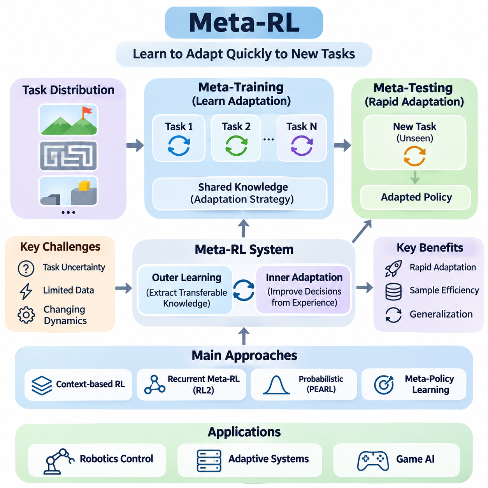
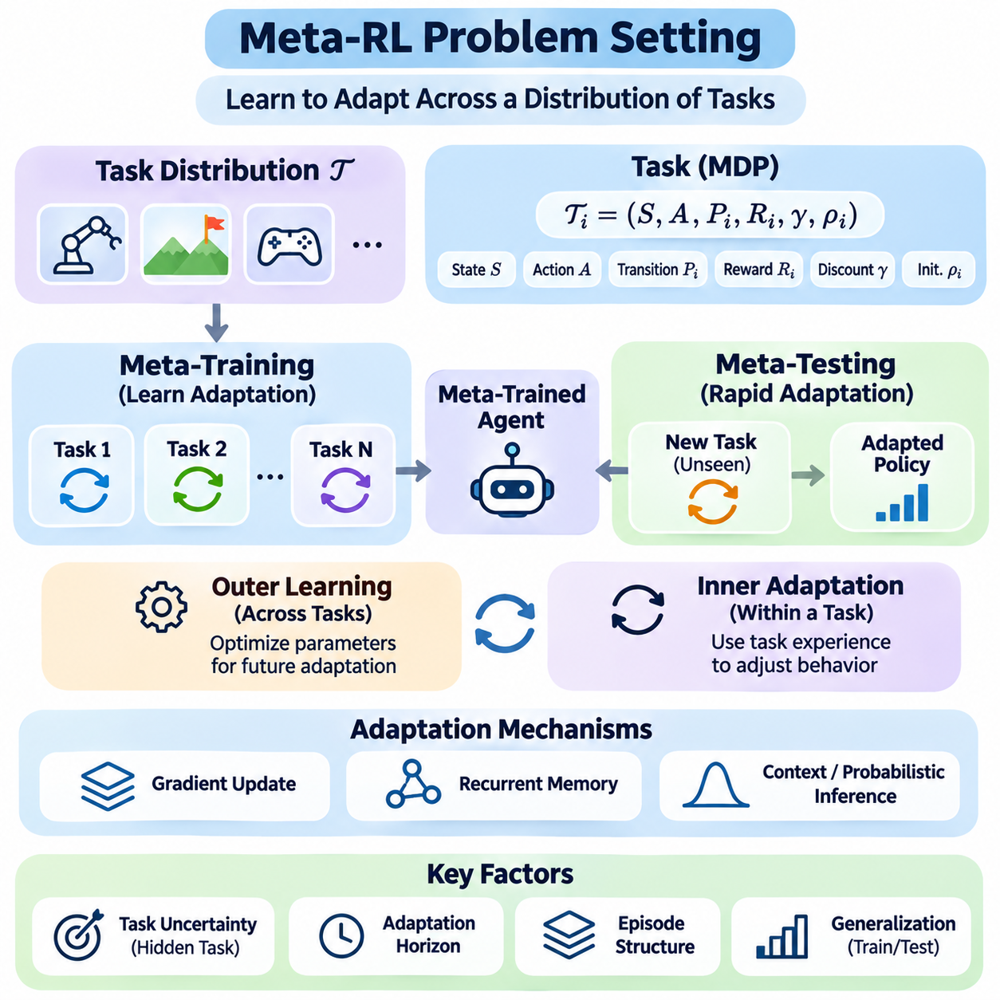
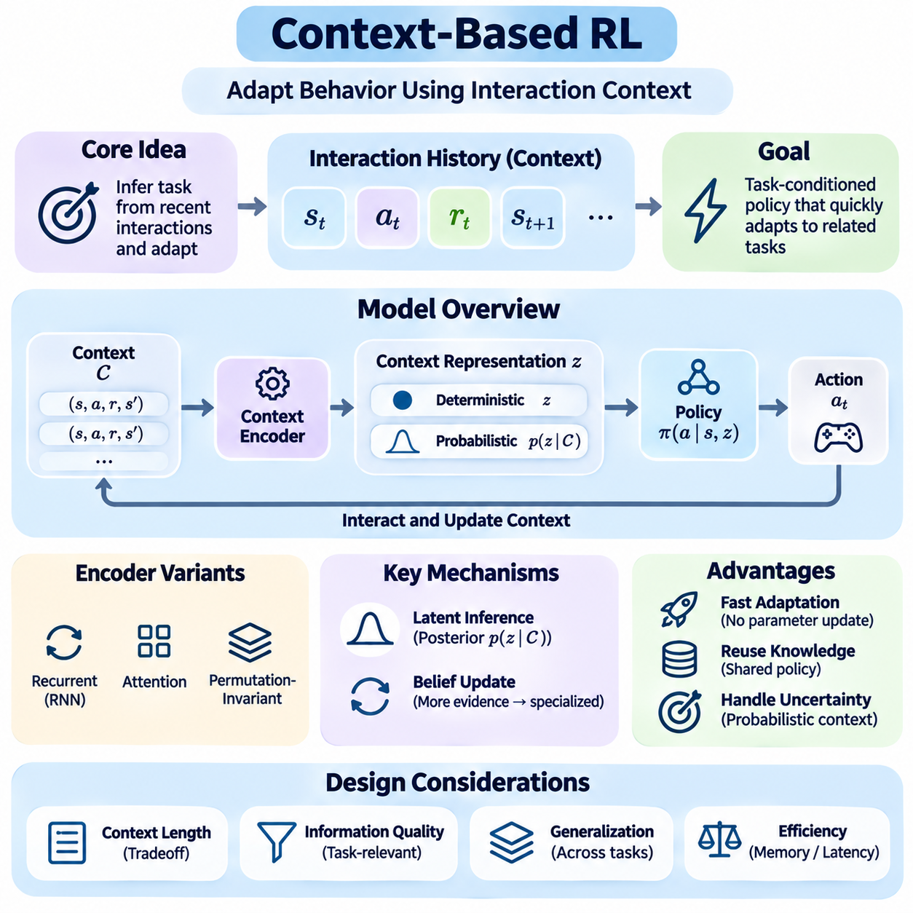
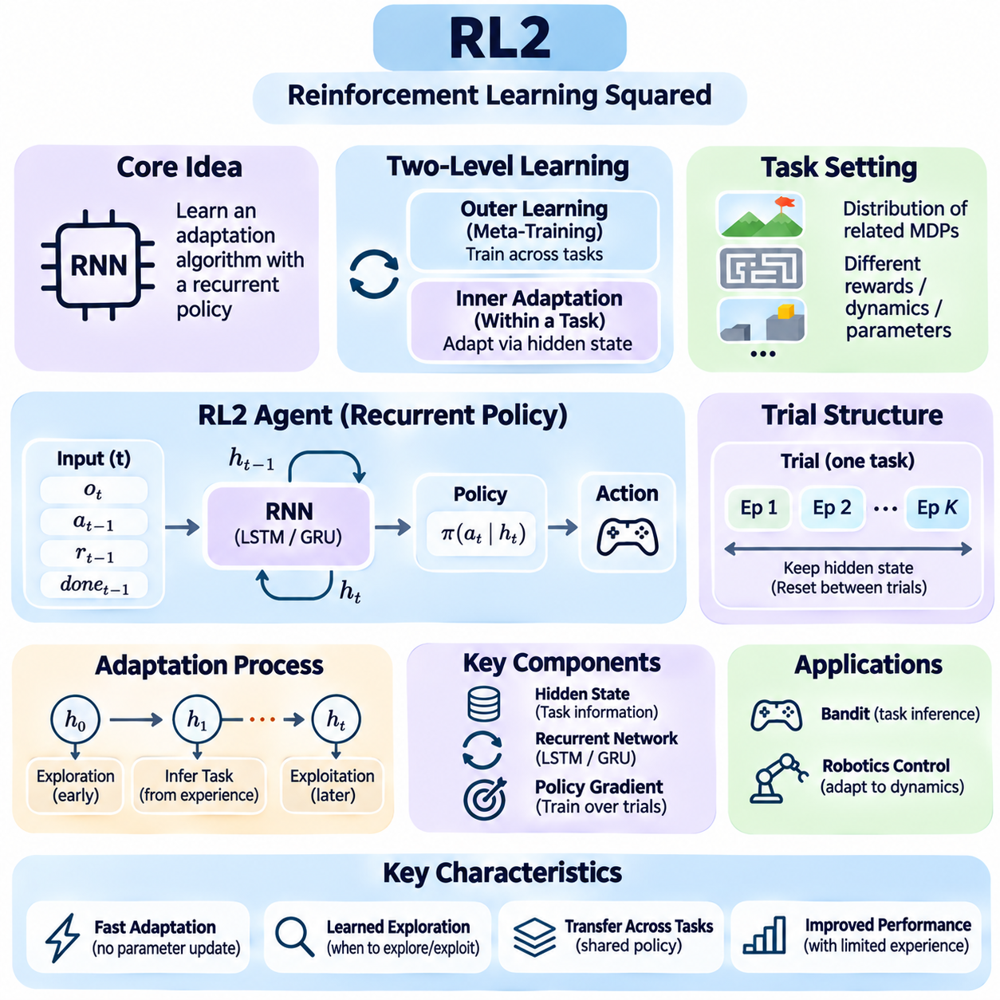
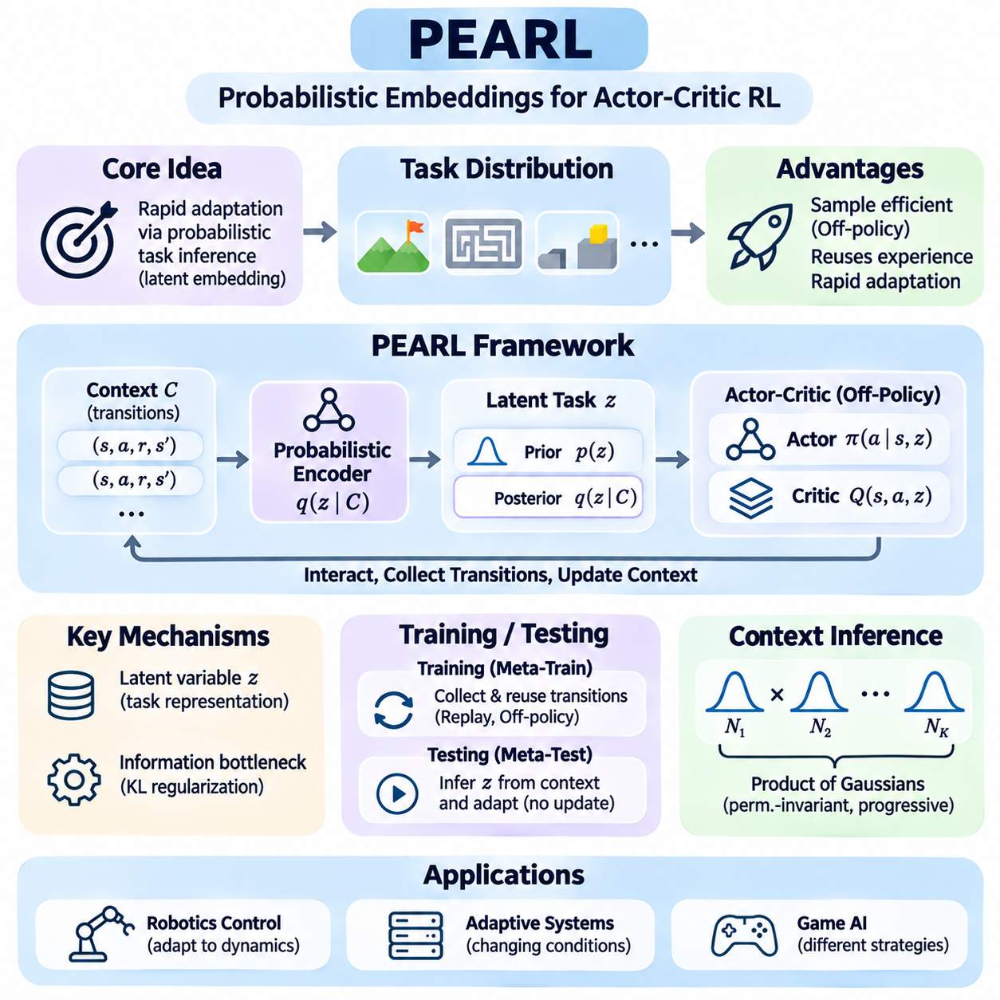
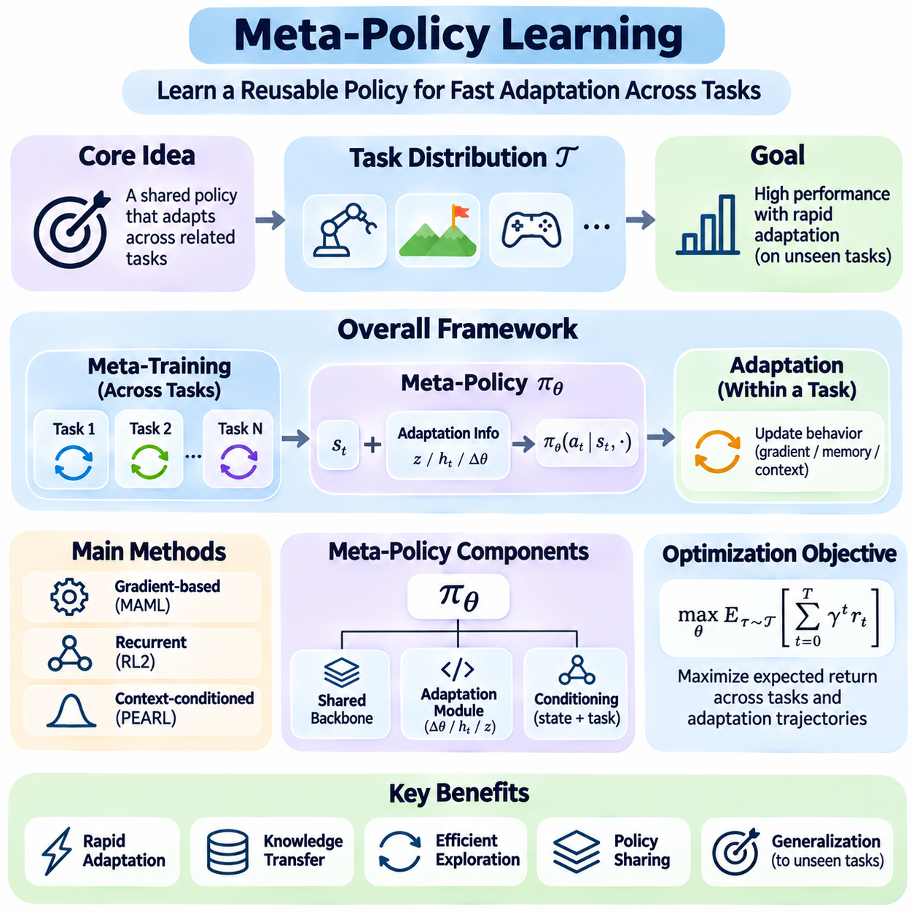
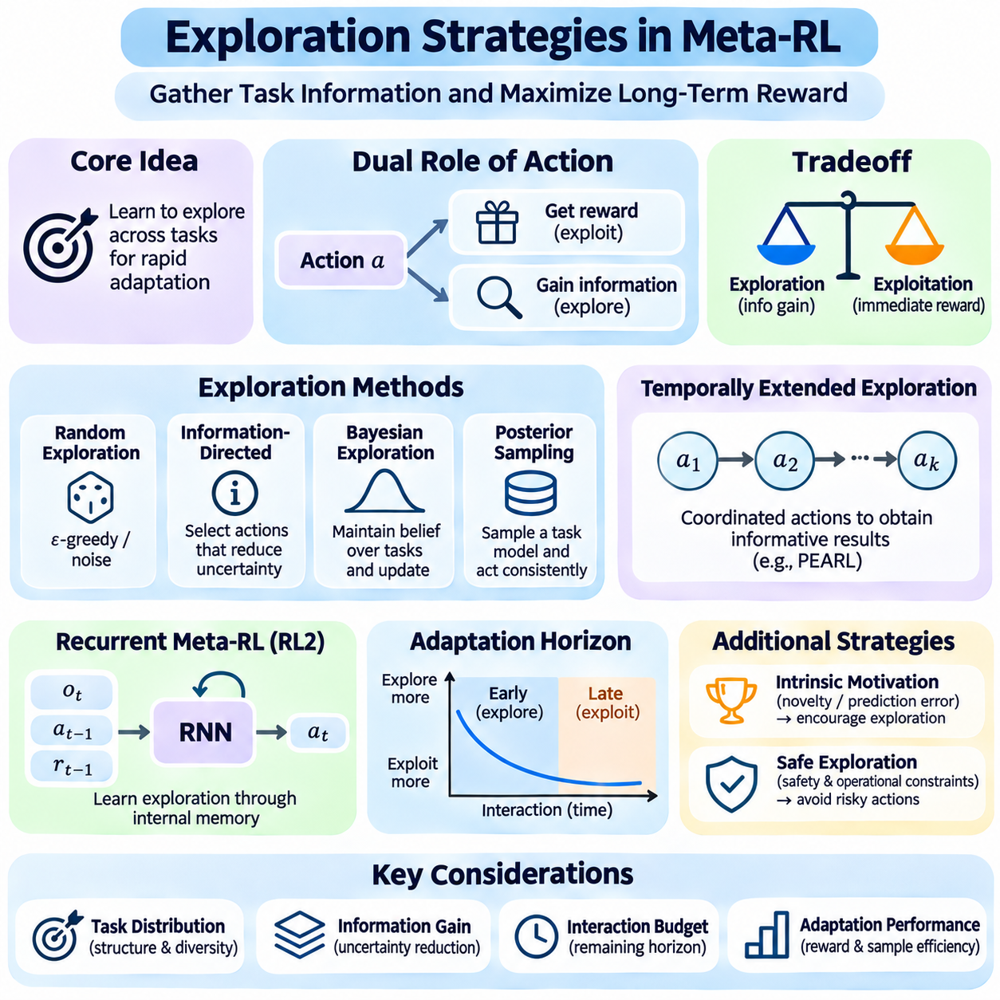
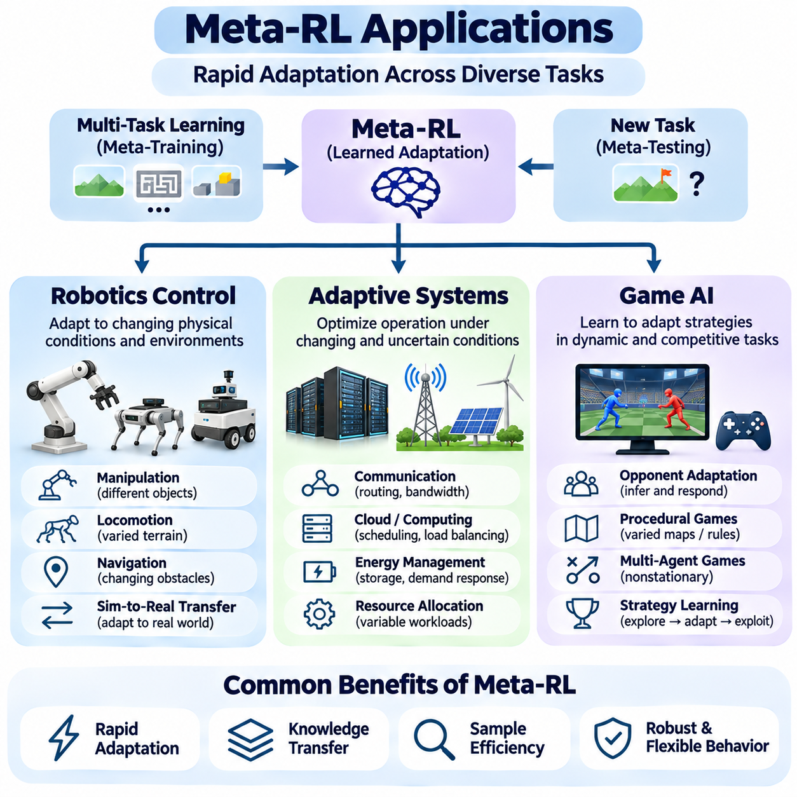

**Volume 36. Meta Learning and Few Shot Adaptation**

# 05. Meta RL

## 05.00 Overview

{width="7.268055555555556in" height="7.268055555555556in"}

메타 강화학습(Meta-Reinforcement Learning, Meta-RL)은 에이전트(Agent)가 익숙하지 않은 작업(Task)에 빠르게 적응하는 전략을 습득하도록 기존 강화학습(Reinforcement Learning)을 확장한 접근법이다. 각 환경에 대해 별도의 정책(Policy)을 처음부터 학습하는 대신, 메타 학습된 에이전트(Meta-Trained Agent)는 관련 작업들의 분포(Task Distribution)에서 재사용 가능한 지식을 습득한다. 이러한 접근법은 순차적 의사결정(Sequential Decision-Making)과 학습하는 방법을 학습하는 원리(Learning-to-Learn)를 결합하여 상호작용 데이터와 계산 자원이 제한된 상황에서도 적응 능력을 향상시킨다.

전통적인 강화학습(Traditional Reinforcement Learning)은 일반적으로 에이전트가 비교적 안정적인 환경에서 충분한 경험을 수집할 수 있다고 가정한다. 그러나 실제 시스템은 변화하는 동역학(Dynamics), 불확실한 보상(Reward), 이전에 경험하지 못한 운영 조건을 자주 마주한다. 메타 강화학습(Meta-RL)은 과거 경험이 미래의 의사결정을 어떻게 안내할 수 있는지를 학습함으로써 이러한 문제를 해결한다. 이를 통해 에이전트는 새로운 작업에서 소수의 상호작용만 관찰한 후에도 자신의 행동을 조정할 수 있다.

메타 강화학습(Meta-RL)의 핵심 목표는 하나의 고정된 문제가 아니라 마르코프 의사결정 과정(Markov Decision Process, MDP)의 분포 전반에서 성능을 최적화하는 것이다. 각 작업은 서로 다른 상태 전이 동역학(Transition Dynamics), 보상 함수(Reward Function), 초기 상태(Initial State), 환경 매개변수(Environmental Parameter)를 가질 수 있다. 메타 학습(Meta-Training) 과정에서 에이전트는 여러 작업을 경험하면서 빠른 적응을 지원하는 공통 구조를 학습한다. 메타 테스트(Meta-Testing)에서는 관련 분포에서 추출한 이전에 경험하지 못한 작업을 대상으로 성능을 평가한다.

메타 강화학습 시스템(Meta-RL System)은 일반적으로 서로 연결된 두 가지 학습 과정으로 작동한다. 외부 학습 과정(Outer Learning Process)은 여러 학습 작업에서 전이 가능한 적응 전략을 추출하며, 내부 적응 과정(Inner Adaptation Process)은 특정 작업의 관측값과 보상을 활용하여 의사결정을 개선한다. 기존의 경사 기반 메타 학습(Gradient-Based Meta-Learning)과 달리 메타 강화학습에서는 명시적인 경사 갱신(Gradient Update) 없이도 순환 메모리(Recurrent Memory), 확률적 추론(Probabilistic Inference), 정책 매개변수 변경을 통해 내부 적응이 이루어질 수 있다.

작업 불확실성(Task Uncertainty)은 에이전트가 처음에는 자신이 작동하는 환경에 대한 정보를 충분히 알지 못할 수 있기 때문에 중요한 역할을 한다. 로봇은 표면의 마찰계수(Friction Coefficient)를 알지 못할 수 있으며, 게임 에이전트(Game Agent)는 상대방의 전략을 파악하지 못할 수 있다. 메타 강화학습(Meta-RL)은 에이전트가 상호작용 이력(Interaction History)으로부터 관련 작업 특성을 추론하고 적절한 행동을 선택하도록 한다. 따라서 효과적인 적응에는 정확한 작업 식별(Task Identification)과 적절한 행동 조정(Behavioral Adjustment)이 모두 필요하다.

문맥 기반 강화학습(Context-Based Reinforcement Learning)은 메타 강화학습(Meta-RL)의 중요한 접근법 중 하나이다. 이러한 방법은 최근의 관측값(Observation), 행동(Action), 보상(Reward), 상태 전이(State Transition)를 현재 작업을 설명하는 문맥 표현(Context Representation)으로 요약한다. 이후 정책(Policy)은 이러한 표현을 조건으로 의사결정을 수행하므로 새로운 정보가 확보될 때마다 행동을 변경할 수 있다. 문맥은 순환 은닉 상태(Recurrent Hidden State), 학습된 임베딩(Learned Embedding), 확률적 잠재변수(Probabilistic Latent Variable) 등으로 표현할 수 있다.

순환 메타 강화학습(Recurrent Meta-RL)은 경험으로부터 적응 행동을 직접 학습하는 또 다른 메커니즘을 제공한다. RL²는 순환 신경망(Recurrent Neural Network, RNN)을 사용하여 상호작용 이력을 인코딩(Encoding)하고 암묵적인 학습 알고리즘(Implicit Learning Algorithm)을 구현하는 대표적인 접근법이다. 여러 작업에 걸쳐 순환 정책(Recurrent Policy)을 학습함으로써 시스템은 새로운 작업에서 기존의 매개변수 갱신(Parameter Update)을 수행하지 않고도 탐색하고, 관측 정보를 기억하며, 의사결정을 수정하는 방법을 습득할 수 있다.

확률적 접근법(Probabilistic Approach)은 작업 적응 과정에 명시적인 불확실성 모델링(Uncertainty Modeling)을 도입한다. 일반적으로 PEARL이라고 불리는 액터-크리틱 강화학습을 위한 확률적 임베딩(Probabilistic Embeddings for Actor-Critic RL)은 축적된 경험으로부터 작업 정체성(Task Identity)의 잠재 표현(Latent Representation)을 학습한다. 추론된 잠재변수(Latent Variable)는 정책의 조건으로 사용되어 에이전트가 서로 다른 환경을 구별하고 행동을 조정하도록 한다. 이러한 구조는 메타 강화학습을 베이지안 추론(Bayesian Inference), 표현 학습(Representation Learning), 오프폴리시 강화학습(Off-Policy Reinforcement Learning)과 연결한다.

메타 정책 학습(Meta-Policy Learning)은 관련된 의사결정 문제 전반에 일반화하면서도 작업별 정보에 민감하게 반응할 수 있는 정책을 개발하는 데 중점을 둔다. 메타 정책(Meta-Policy)은 학습된 초기화(Learned Initialization), 순환 적응 메커니즘(Recurrent Adaptation Mechanism), 작업 조건부 아키텍처(Task-Conditioned Architecture)를 포함할 수 있다. 그 목표는 단순히 학습 작업의 평균 성능을 최대화하는 것이 아니라, 실제 배포(Deployment) 과정에서 발생하는 다양한 변화에 효율적으로 대응할 수 있는 유연한 행동 기반을 제공하는 것이다.

탐색(Exploration)은 행동이 동시에 두 가지 목적을 수행할 수 있기 때문에 메타 강화학습(Meta-RL)에서 특히 중요하다. 하나의 행동은 즉각적인 보상을 생성하는 동시에 알려지지 않은 작업 특성에 대한 정보를 제공할 수 있다. 이로 인해 현재 지식을 활용하는 이용(Exploitation)과 미래 의사결정을 개선하기 위한 탐색(Exploration) 사이에 상충관계(Tradeoff)가 발생한다. 메타 학습된 에이전트는 정보 가치가 높은 상호작용을 우선하는 탐색 전략을 학습하여 성공적인 적응에 필요한 표본 수를 줄일 수 있다.

탐색(Exploration)과 적응(Adaptation)의 관계는 정보 수집(Information Gathering) 개념과 밀접하게 연결된다. 불확실한 환경에서 작동하는 에이전트는 환경에 관한 여러 경쟁 가설(Competing Hypotheses)을 구별하기 위해 의도적으로 특정 행동을 선택할 수 있다. 이러한 행동은 베이지안 강화학습(Bayesian Reinforcement Learning)과 부분 관측 의사결정 과정(Partially Observable Decision Process)을 통해 이해할 수 있다. 효과적인 메타 강화학습 시스템은 탐색 과정에서 획득한 정보를 활용하여 이후의 행동과 누적 보상(Cumulative Reward)을 개선한다.

표본 효율성(Sample Efficiency)은 메타 강화학습(Meta-RL)의 주요 도입 동기이며, 특히 환경과의 상호작용에 많은 비용이나 위험이 수반되는 경우 중요하다. 물리적 로봇(Physical Robot), 산업 장비(Industrial Equipment), 자율 시스템(Autonomous System)은 항상 수백만 번의 탐색 행동을 수행할 수 있는 것은 아니다. 메타 강화학습은 이전에 경험한 작업에서 적응 지식을 전이함으로써 새로운 경험의 필요량을 줄일 수 있다. 다만 실제 개선 수준은 작업 유사성(Task Similarity), 학습 다양성(Training Diversity), 알고리즘 설계(Algorithm Design), 평가 조건(Evaluation Conditions)에 따라 달라진다.

로봇 제어(Robotics Control)는 물리 시스템의 동역학과 작동 조건이 자주 변하기 때문에 메타 강화학습(Meta-RL)의 자연스러운 응용 분야이다. 로봇 매니퓰레이터(Robotic Manipulator)는 서로 다른 질량의 물체를 다룰 수 있으며, 이동 로봇(Mobile Robot)은 접지력이 변화하는 표면에서 작동할 수 있다. 메타 강화학습은 관측된 반응으로부터 관련 환경 특성을 식별하고 추론된 조건에 적합한 정책을 선택함으로써 제어 행동(Control Behavior)의 빠른 조정을 지원한다.

적응형 시스템(Adaptive System)은 이러한 원리를 로봇 분야를 넘어 운영 매개변수가 시간에 따라 변화하는 환경으로 확장한다. 대표적인 사례로 자원 할당(Resource Allocation), 동적 일정 관리(Dynamic Scheduling), 불확실한 조건에서의 자동 제어(Automated Control)가 있다. 메타 강화학습 에이전트(Meta-RL Agent)는 이전 경험을 활용하여 반복되는 패턴을 인식하고 의사결정 전략을 조정할 수 있다. 이러한 능력은 기존의 고정 정책(Fixed Policy)이 다양한 운영 시나리오를 충분히 표현하지 못하는 경우 특히 유용하다.

게임 인공지능(Game AI)은 상대방, 규칙, 전략적 조건이 에피소드(Episode)마다 달라질 수 있기 때문에 메타 강화학습(Meta-RL)을 연구하는 또 다른 중요한 환경이다. 에이전트는 익숙하지 않은 상대의 행동을 접하고 제한된 상호작용만으로 효과적인 대응 전략을 추론해야 할 수 있다. 메타 강화학습은 정책이 상대 모델링(Opponent Modeling), 전략적 탐색(Strategic Exploration), 경험 의존적 적응(Experience-Dependent Adaptation)을 통합하도록 한다. 이러한 환경은 다양한 메타 학습 아키텍처(Meta-Learning Architecture)를 비교하기 위한 통제된 실험 조건도 제공한다.

메타 강화학습(Meta-RL)은 높은 잠재력에도 불구하고 최적화(Optimization)와 일반화(Generalization) 측면에서 상당한 어려움을 가진다. 여러 강화학습 작업을 대상으로 학습하면 높은 분산(High Variance), 불안정한 경사(Unstable Gradient), 상당한 계산 비용(Computational Cost)이 발생할 수 있다. 또한 에이전트는 학습 작업 분포에 과적합(Overfitting)되어 크게 다른 환경에서는 실패할 수 있다. 따라서 강건한 평가(Robust Evaluation)를 위해서는 신중하게 설계된 작업 분할(Task Split), 다양한 환경 조건, 강력한 강화학습 기준 모델(Baseline)과의 비교가 필요하다.

또 다른 과제는 진정한 적응(Genuine Adaptation)과 학습 환경의 암기(Memorization)를 구별하는 것이다. 모델은 폭넓게 전이 가능한 적응 메커니즘을 학습하지 않고도 익숙한 작업 패턴을 인식하여 높은 성능을 달성할 수 있다. 따라서 연구자는 학습에서 제외된 작업(Held-Out Task)을 대상으로 성능을 평가하고 환경 매개변수를 체계적으로 변화시켜야 한다. 적응 속도(Adaptation Speed), 누적 보상(Cumulative Reward), 탐색 효율성(Exploration Efficiency), 분포 변화에 대한 민감도(Sensitivity to Distribution Shifts)를 측정하면 메타 강화학습 능력을 더욱 종합적으로 평가할 수 있다.

실제 배포(Deployment)에서는 지연시간(Latency), 계산 자원(Computational Resources), 안전성(Safety), 신뢰성(Reliability)과 관련된 추가 제약이 발생한다. 적응형 정책(Adaptive Policy)은 불완전하거나 잡음이 포함된 관측값을 처리하면서 엄격한 시간 요구사항 내에 의사결정을 수행해야 하는 경우가 많다. 안전 필수 시스템(Safety-Critical System)에서는 정보를 수집하기 위한 탐색이라는 이유만으로 허용할 수 없는 행동을 수행해서는 안 된다. 따라서 실용적인 메타 강화학습 아키텍처는 학습 기반 적응(Learned Adaptation)을 제약 기반 제어(Constrained Control), 모니터링 메커니즘(Monitoring Mechanism), 독립적인 안전 보호장치(Independent Safety Safeguards)와 결합할 수 있다.

메타 강화학습(Meta-RL)의 광범위한 의의는 강화학습을 지속적인 적응(Continual Adaptation) 및 범용 의사결정(General-Purpose Decision-Making)과 연결할 수 있다는 점에 있다. 경험을 해석하고 행동을 수정하는 재사용 가능한 메커니즘을 학습함으로써 에이전트는 광범위한 작업별 재학습(Task-Specific Retraining)에 대한 의존도를 줄일 수 있다. 문맥 추론(Context Inference), 순환 학습(Recurrent Learning), 메타 정책 최적화(Meta-Policy Optimization), 탐색 전략(Exploration Strategy)의 지속적인 발전은 변화하는 환경에 효율적으로 적응하는 자율 시스템(Autonomous System)의 개발에 기여할 수 있다.

이후 절에서는 메타 강화학습 문제 설정(Meta-RL Problem Setting), 문맥 기반 강화학습(Context-Based Reinforcement Learning), RL², PEARL, 메타 정책 학습(Meta-Policy Learning), 탐색 전략(Exploration Strategies)을 더욱 기술적으로 상세히 살펴본다. 각 접근법의 이론적 기반(Theoretical Foundation)과 알고리즘 차이(Algorithmic Difference)는 에이전트가 전이 가능한 적응 능력(Transferable Adaptation Capability)을 습득하는 과정을 이해하기 위한 체계를 제공한다. 로봇 제어(Robotics Control), 적응형 시스템(Adaptive Systems), 게임 인공지능(Game AI)의 응용 사례는 이러한 메커니즘이 다양한 순차적 의사결정 작업에서 지능적인 행동을 지원하는 방식을 보여준다.

## 05.01 Meta RL Problem Setting

{width="7.268055555555556in" height="7.268055555555556in"}

메타 강화학습(Meta-Reinforcement Learning, Meta-RL)은 하나의 고정된 환경에 대한 정책(Policy)을 최적화하는 대신, 서로 관련된 작업 분포(Task Distribution) 전반에서 학습하는 순차적 의사결정(Sequential Decision-Making) 문제로 정의된다. 각 작업(Task)은 일반적으로 고유한 상태 전이 동역학(Transition Dynamics), 보상 함수(Reward Function), 초기 상태 분포(Initial-State Distribution)를 갖는 마르코프 의사결정 과정(Markov Decision Process, MDP)으로 표현된다. 목표는 제한된 경험만으로 작업의 특성을 빠르게 식별하고 행동을 적응시킬 수 있는 에이전트(Agent)를 개발하는 것이다.

기존 강화학습(Conventional Reinforcement Learning) 문제에서는 에이전트가 특정 환경과 상호작용하면서 반복적인 관측(Observation), 행동(Action), 보상(Reward)을 통해 정책을 개선한다고 가정한다. 메타 강화학습(Meta-RL)은 서로 다른 특성을 가진 여러 환경에서 작동해야 하므로 추가적인 불확실성(Uncertainty)을 도입한다. 따라서 성공적인 학습을 위해서는 개별 작업 내에서 효과적인 의사결정을 수행하는 능력과 함께, 다른 작업에도 전이할 수 있는 적응 전략(Transferable Adaptation Strategy)을 습득해야 한다.

작업 분포(Task Distribution)는 메타 강화학습(Meta-RL) 문제 설정의 핵심 구성 요소이다. 메타 학습(Meta-Training) 과정에서는 가능한 운영 조건을 나타내는 확률 분포(Probability Distribution)에서 작업을 추출한다. 이러한 작업은 물리적 매개변수(Physical Parameter), 보상 구조(Reward Structure), 목표(Goal), 상태 전이 확률(Transition Probability) 등이 서로 다를 수 있다. 에이전트는 다양한 작업을 경험하면서 이전에 접하지 못했지만 관련성이 있는 환경에 효율적으로 적응할 수 있도록 공통 패턴(Common Pattern)을 학습한다.

메타 강화학습 작업(Meta-RL Task)은 상태 공간(State Space), 행동 공간(Action Space), 상태 전이 함수(Transition Function), 보상 함수(Reward Function), 할인율(Discount Factor), 초기 상태 분포(Initial-State Distribution)로 정의되는 마르코프 의사결정 과정(MDP)으로 표현할 수 있다. 일부 구성 요소는 작업 간에 공유될 수 있으며, 다른 요소는 작업 정체성(Task Identity)에 따라 달라질 수 있다. 예를 들어 로봇 제어 벤치마크(Robotic Control Benchmark)에서는 관측 및 행동 차원은 유지하면서 액추에이터 출력(Actuator Strength), 물체 질량(Object Mass), 목표 위치(Target Location)를 변경할 수 있다.

작업 정체성(Task Identity)과 관측 가능한 상태(Observable State)를 구별하는 것은 매우 중요하다. 에이전트는 자신의 위치(Position), 속도(Velocity), 센서 측정값(Sensor Measurement)을 관측할 수 있지만, 시스템 동작을 결정하는 환경 매개변수(Environmental Parameter)를 직접 알지 못할 수 있다. 따라서 작업 정체성은 상호작용을 통해 추론해야 하는 은닉변수(Hidden Variable)로 취급되는 경우가 많다. 이러한 불확실성은 적응 문제를 부분 관측 의사결정 과정(Partially Observable Decision-Making Process)으로 전환한다.

메타 학습(Meta-Training)과 메타 테스트(Meta-Testing)는 두 가지 주요 평가 단계를 정의한다. 메타 학습 과정에서 에이전트는 학습 분포(Training Distribution)에서 추출한 작업 집합으로부터 지식을 습득한다. 메타 테스트 과정에서는 매개변수 최적화(Parameter Optimization)에 사용되지 않은 새로운 작업을 경험한다. 평가의 목적은 에이전트가 익숙한 환경에서 암기한 행동을 단순히 재현하는 것이 아니라, 이전에 습득한 지식을 활용하여 빠르게 적응할 수 있는지를 확인하는 것이다.

학습 분포(Training Distribution)와 테스트 분포(Test Distribution)의 관계는 일반화(Generalization) 성능에 큰 영향을 미친다. 새로운 작업이 학습 작업과 중요한 구조적 특성(Structural Property)을 공유한다면 비교적 적은 추가 경험만으로 적응할 수 있다. 그러나 동역학(Dynamics), 보상(Reward), 관측 특성(Observation Characteristics)이 크게 변화하면 성능이 저하될 수 있다. 따라서 작업 분포는 적응 목표(Adaptation Objective)를 모호하게 만들지 않으면서 의미 있는 변화를 표현하도록 설계해야 한다.

메타 강화학습(Meta-RL)의 핵심 개념은 여러 작업에 걸친 학습(Learning Across Tasks)과 개별 작업 내 적응(Within-Task Adaptation)을 분리하는 것이다. 외부 학습 과정(Outer Learning Process)은 향후 적응을 지원하는 매개변수나 메커니즘을 최적화하며, 내부 적응 과정(Inner Adaptation Process)은 작업별 경험을 활용하여 행동을 수정한다. 알고리즘에 따라 적응은 경사 갱신(Gradient Update), 순환 메모리(Recurrent Memory), 문맥 추론(Context Inference), 은닉 작업 변수(Hidden Task Variable)의 확률적 추정(Probabilistic Estimation)을 통해 이루어질 수 있다.

최적화 목표(Optimization Objective)는 일반적으로 새로운 작업을 접한 이후의 기대 누적 보상(Expected Cumulative Reward)을 강조한다. 기존 강화학습과 달리 성능은 최종 정책(Final Policy)뿐만 아니라 상호작용 이력(Interaction History) 동안 에이전트가 얼마나 효율적으로 개선되는지에도 영향을 받는다. 따라서 유용한 메타 목적 함수(Meta-Objective Function)는 탐색 비용(Exploration Cost)과 초기의 불확실한 의사결정이 초래하는 결과를 포함하여 적응 과정 전체에서 획득한 보상을 고려한다.

적응 기간(Adaptation Horizon)은 성능 평가 이전에 에이전트가 축적할 수 있는 경험의 양을 결정한다. 일부 환경에서는 소수의 에피소드(Episode)만 허용하지만, 다른 환경에서는 더 긴 적응 기간을 제공한다. 짧은 적응 기간에서는 작업 정보를 빠르게 추출하는 방법이 유리하며, 긴 적응 기간에서는 더욱 정교한 탐색(Exploration)과 정책 개선(Policy Refinement)이 가능하다. 선택된 적응 기간은 알고리즘 설계(Algorithm Design)와 벤치마크 해석(Benchmark Interpretation)에 직접적인 영향을 미친다.

에피소드 구조(Episode Structure) 역시 학습 문제에 영향을 미친다. 일부 메타 강화학습(Meta-RL) 문제 설정에서는 에이전트가 동일한 작업에 대해 여러 에피소드 동안 상호작용하면서 에피소드 사이에 내부 메모리(Internal Memory)를 유지한다. 환경 상태(Environmental State)는 초기화될 수 있지만, 작업별 지식(Task-Specific Knowledge)은 적응 메커니즘(Adaptation Mechanism)을 통해 유지된다. 이러한 특성은 순환 에이전트(Recurrent Agent)가 이전 시도로부터 학습하고 이후 상호작용에서 의사결정을 개선하도록 한다.

문맥 기반 문제 설정(Context-Based Formulation)은 상태(State), 행동(Action), 보상(Reward), 상태 전이(Transition)의 이력을 통해 적응 정보를 표현한다. 문맥 인코더(Context Encoder)는 이러한 관측 정보를 현재 작업의 표현(Representation)으로 변환한다. 이후 정책(Policy)은 추론된 문맥(Inferred Context)을 조건으로 행동을 선택한다. 이 접근법은 정책 매개변수(Policy Parameter)를 반드시 수정하지 않고도 적응할 수 있도록 하며, 작업 정체성에 대한 불확실성을 명시적으로 모델링하는 알고리즘의 기반을 제공한다.

순환 기반 문제 설정(Recurrent Formulation)은 적응 과정을 신경망(Neural Network)의 동적 작동 과정에 통합한다. 순환 정책(Recurrent Policy)은 상호작용 정보를 입력받고 관련 경험을 요약하는 은닉 상태(Hidden State)를 유지한다. 여러 작업에 걸친 학습을 통해 신경망은 내부 표현(Internal Representation)을 갱신하고 이후 행동을 조정하는 방법을 습득한다. 이러한 관점에서는 순환 연산(Recurrent Computation) 자체를 각 작업 내에서 작동하는 암묵적 학습 알고리즘(Implicit Learning Algorithm)으로 간주한다.

확률적 문제 설정(Probabilistic Formulation)은 알려지지 않은 환경 특성을 나타내는 잠재 작업 변수(Latent Task Variable)를 도입한다. 에이전트는 축적된 증거를 활용하여 가능한 작업 정체성에 대한 신념 분포(Belief Distribution)를 유지하거나 근사한다. 새로운 관측값이 확보되면 신념이 갱신되고 의사결정의 조건으로 사용된다. 이러한 접근법은 메타 강화학습(Meta-RL), 베이지안 추론(Bayesian Inference), 부분 관측 강화학습(Partially Observable Reinforcement Learning) 사이에 원리적인 연결 관계를 제공한다.

탐색(Exploration)은 에이전트가 보상을 최대화하는 동시에 정보를 수집해야 하기 때문에 특히 중요하다. 하나의 행동은 즉각적인 이익을 제공할 수도 있고, 이후 의사결정을 개선하는 환경 특성을 드러낼 수도 있다. 이로 인해 행동이 환경의 결과와 에이전트의 지식 모두에 영향을 미치는 이중 제어 문제(Dual-Control Problem)가 발생한다. 따라서 효과적인 메타 강화학습(Meta-RL)은 정보의 미래 가치(Future Value of Information)를 고려하는 탐색 전략을 필요로 한다.

탐색(Exploration)과 이용(Exploitation) 사이의 균형은 남아 있는 적응 기간(Remaining Adaptation Horizon)과 작업에 관련된 불확실성(Uncertainty)에 따라 달라진다. 초기 상호작용에서는 즉각적인 보상이 제한적이더라도 정보 가치가 높은 행동을 선택할 수 있으며, 이후에는 확보한 지식을 활용하는 행동이 유리할 수 있다. 메타 학습된 에이전트(Meta-Trained Agent)는 이전 작업들로부터 이러한 균형을 학습하여 일반적인 무작위 탐색(Random Exploration)보다 효율적인 탐색 행동을 개발할 수 있다.

작업 다양성(Task Diversity)은 전이 가능한 적응 메커니즘(Transferable Adaptation Mechanism)을 학습하는 데 필요하지만, 지나치게 큰 변동성은 최적화를 어렵게 만들 수 있다. 작업 간에 의미 있는 공통 구조가 거의 없다면 에이전트는 재사용 가능한 지식을 발견하기 어렵다. 반대로 작업 분포가 지나치게 좁으면 진정한 적응보다 암기(Memorization)를 유도할 수 있다. 적절한 작업 분포를 설계하려면 환경 다양성(Environmental Diversity), 구조적 유사성(Structural Similarity), 실제 배포 요구사항(Deployment Requirements) 사이의 균형을 고려해야 한다.

평가(Evaluation)에서는 초기 성능(Initial Performance), 적응 속도(Adaptation Speed), 충분한 경험을 축적한 이후의 성능을 구별해야 한다. 처음부터 높은 성능을 보이는 에이전트는 강력한 사전 지식(Prior Knowledge)을 보유하고 있을 수 있으며, 다른 에이전트는 정보 가치가 높은 상호작용 이후 빠르게 개선될 수 있다. 두 특성 모두 중요하지만 서로 다른 능력을 나타낸다. 학습 곡선(Learning Curve), 누적 수익(Cumulative Return), 표본 효율성(Sample Efficiency), 성능 분산(Performance Variance)은 적응 품질(Adaptation Quality)에 대한 상호 보완적인 근거를 제공한다.

공정한 비교(Fair Comparison)를 위해서는 일관된 작업 분포(Task Distribution), 상호작용 예산(Interaction Budget), 보상 정의(Reward Definition), 평가 프로토콜(Evaluation Protocol)이 필요하다. 메타 강화학습 알고리즘(Meta-RL Algorithm)은 동등한 조건에서 기존 강화학습(Conventional Reinforcement Learning), 다중 작업 학습(Multitask Learning), 전이 학습(Transfer Learning)의 기준 모델(Baseline)과 비교해야 한다. 학습 경험의 양이나 작업 정보에 대한 접근 권한이 다르면 적응 효율성(Adaptation Efficiency)과 일반화 성능(Generalization Performance)에 관한 잘못된 결론이 도출될 수 있다.

실제 환경의 메타 강화학습 문제 설정(Real-World Meta-RL Problem Setting)에는 안전성(Safety), 계산 지연시간(Computational Latency), 관측 잡음(Observation Noise), 제한된 실험 기회와 관련된 추가 제약이 존재한다. 물리적 로봇(Physical Robot)은 실패한 행동이 장비를 손상시키거나 주변 사람을 위험에 빠뜨릴 수 있으므로 항상 자유롭게 탐색할 수 있는 것은 아니다. 따라서 실용적인 문제 설정에서는 안전 탐색(Safe Exploration), 운영 제약(Operational Constraints), 불확실한 환경 조건에서의 적응 신뢰성(Adaptation Reliability)을 고려해야 한다.

메타 강화학습 문제 설정(Meta-RL Problem Setting)은 문맥 기반 강화학습(Context-Based Reinforcement Learning), RL²와 같은 순환 기반 방법(Recurrent Method), PEARL과 같은 확률적 접근법(Probabilistic Approach), 메타 정책 최적화(Meta-Policy Optimization)의 이론적 기반을 확립한다. 이러한 방법들은 서로 다른 방식으로 적응을 구현하지만, 여러 작업에서 축적한 경험을 활용하여 익숙하지 않은 환경에서의 의사결정을 개선한다는 공통 목표를 가진다. 효과적인 메타 강화학습 시스템(Meta-RL System)을 설계하려면 작업 분포(Task Distribution), 은닉 작업 변수(Hidden Task Variable), 적응 기간(Adaptation Horizon), 평가 목표(Evaluation Objective)를 이해하는 것이 필수적이다.

## 05.02 Context Based RL

{width="7.268055555555556in" height="7.268055555555556in"}

문맥 기반 강화학습(Context-Based Reinforcement Learning)은 최근의 상호작용(Interaction)을 현재 환경에 대한 증거로 해석하여 에이전트(Agent)의 행동을 적응시키는 프레임워크(Framework)를 제공한다. 작업 조건(Task Conditions)이 변경될 때마다 광범위한 정책 재학습(Policy Retraining)을 수행하는 대신, 에이전트는 관측값(Observation), 행동(Action), 보상(Reward), 상태 전이(State Transition)로부터 문맥 표현(Context Representation)을 구성한다. 이러한 표현을 통해 공유 정책(Shared Policy)은 이전에 학습한 지식을 유지하면서도 서로 관련된 작업(Task)에 따라 다른 방식으로 대응할 수 있다.

기존 강화학습(Conventional Reinforcement Learning)에서 정책(Policy)은 일반적으로 비교적 안정적인 환경을 가정하고 현재 상태(State)를 행동(Action)으로 매핑한다. 문맥 기반 방법(Context-Based Method)은 이전 상호작용에서 축적된 정보를 의사결정의 조건으로 활용하여 이러한 구조를 확장한다. 문맥(Context)은 보상 선호도(Reward Preferences), 물리적 동역학(Physical Dynamics), 환경 제약(Environmental Constraints), 은닉 운영 매개변수(Hidden Operating Parameters)와 같이 직접 관측하기 어려운 작업별 특성을 포착한다.

문맥 기반 에이전트(Context-Based Agent)는 일반적으로 문맥 인코더(Context Encoder)와 작업 조건부 정책(Task-Conditioned Policy)으로 구성된다. 인코더(Encoder)는 상호작용 이력(Interaction History)을 현재 작업을 설명하는 압축된 표현(Compact Representation)으로 변환하며, 정책은 이러한 표현을 현재 관측값(Current Observation)과 함께 활용하여 행동을 선택한다. 이러한 구성 요소는 아키텍처(Architecture)와 학습 목표(Learning Objective)에 따라 공동으로 학습하거나 별도의 최적화 절차(Optimization Procedure)를 통해 학습할 수 있다.

상호작용 이력(Interaction History)은 일반적으로 상태(State), 행동(Action), 보상(Reward), 다음 상태(Next State)의 시퀀스(Sequence)를 포함한다. 각 상태 전이(Transition)는 환경이 에이전트의 행동에 어떻게 반응하는지에 대한 정보를 제공한다. 문맥 인코더(Context Encoder)는 여러 상태 전이를 분석하여 반복되는 패턴(Recurring Pattern)을 식별하고 작업 특성(Task Characteristics)을 추정할 수 있다. 이를 통해 에이전트는 처음에는 유사하게 보이지만 동일한 행동에 서로 다르게 반응하는 환경을 구별할 수 있다.

문맥 표현(Context Representation)은 결정론적(Deterministic)이거나 확률적(Probabilistic)일 수 있다. 결정론적 인코더(Deterministic Encoder)는 사용 가능한 경험을 요약하는 고정 임베딩(Fixed Embedding)을 생성하며, 확률적 인코더(Probabilistic Encoder)는 가능한 작업 표현(Task Representation)에 대한 확률 분포(Probability Distribution)를 추정한다. 확률적 접근법은 관측값이 불완전하거나 모호한 경우에 특히 유용하며, 에이전트가 하나의 해석을 성급하게 확정하지 않고 불확실성(Uncertainty)을 표현하도록 한다.

결정론적 문맥 인코더(Deterministic Context Encoder)는 순환 신경망(Recurrent Neural Network, RNN), 어텐션 메커니즘(Attention Mechanism), 순열 불변 집계 함수(Permutation-Invariant Aggregation Function)를 사용할 수 있다. 순환 아키텍처(Recurrent Architecture)는 상호작용 시퀀스를 처리하고 은닉 상태(Hidden State)를 유지하며, 어텐션 기반 모델(Attention-Based Model)은 관측값 사이의 관련성을 식별한다. 순열 불변 인코더(Permutation-Invariant Encoder)는 문맥의 상태 전이를 시간적 의존성이 있는 시퀀스가 아니라 순서가 없는 집합(Unordered Collection)으로 처리할 수 있는 경우에 적합하다.

확률적 문맥 추론(Probabilistic Context Inference)은 은닉된 작업 특성(Hidden Task Characteristics)을 나타내는 잠재변수(Latent Variable)를 도입한다. 관측된 상태 전이의 집합이 주어지면 추론 네트워크(Inference Network)는 잠재 작업 표현(Latent Task Representation)에 대한 사후 확률 분포(Posterior Distribution)를 추정한다. 정책(Policy)은 표본 추출되거나 요약된 잠재변수를 조건으로 의사결정을 수행한다. 추가 경험이 축적되면 사후 분포에 포함된 정보가 더욱 풍부해져 작업에 특화된 행동을 지원할 수 있다.

문맥 추론(Context Inference)과 베이지안 추론(Bayesian Reasoning)의 관계는 많은 문맥 기반 방법(Context-Based Method)의 핵심이다. 에이전트는 현재 작업에 대한 불확실성을 가진 상태에서 시작하며, 환경의 반응을 관측한 이후 신념(Belief)을 갱신한다. 신경망 기반 추론 네트워크(Neural Inference Network)는 정확한 베이지안 갱신(Exact Bayesian Update)을 수행하기보다 이를 근사하는 경우가 많지만, 적응 과정에서 사전 지식(Prior Knowledge)과 새롭게 획득한 증거를 결합하는 실용적인 메커니즘을 제공한다.

문맥 조건부 정책(Context-Conditioned Policy)은 행동 선택(Action Selection)에 작업 정보를 포함함으로써 일반적인 상태 의존적 정책(State-Dependent Policy)을 확장한다. 두 에이전트가 동일한 물리적 상태(Physical State)를 관측하더라도 추론된 문맥(Inferred Context)이 서로 다른 목표나 동역학을 나타내면 다른 행동을 선택할 수 있다. 예를 들어 로봇 제어기(Robotic Controller)는 초기 관절 구성(Joint Configuration)이 동일하더라도 물체의 질량에 따라 서로 다른 힘을 적용할 수 있다.

문맥 기반 강화학습(Context-Based Reinforcement Learning)의 주요 장점 중 하나는 학습된 정책 매개변수(Policy Parameters)를 수정하지 않고도 적응할 수 있다는 점이다. 새로운 상태 전이가 발생하면 에이전트는 문맥 표현(Context Representation)을 갱신하고, 정책은 변경된 정보에 즉시 반응한다. 이러한 메커니즘은 적응 지연시간(Adaptation Latency)을 줄이고 실제 배포(Deployment) 과정에서 반복적인 경사 기반 미세 조정(Gradient-Based Fine-Tuning)에 필요한 계산 부담(Computational Overhead)을 감소시킬 수 있다.

문맥 추론(Context Inference)의 품질은 상호작용 이력(Interaction History)에 포함된 정보에 크게 의존한다. 에이전트가 정보 가치가 낮은 상태 전이(Uninformative Transition)만 관측한다면 서로 다른 작업을 구별하기 어려울 수 있다. 따라서 효과적인 문맥 기반 학습(Context-Based Learning)을 위해서는 작업과 관련된 정보(Task-Relevant Information)는 보존하고 관련성이 낮은 세부 정보는 제거하는 표현이 필요하다. 이러한 균형은 일반화 성능(Generalization Performance)과 이후 정책 의사결정의 효율성에 모두 영향을 미친다.

문맥 길이(Context Length)는 중요한 설계 상충관계(Design Tradeoff)를 발생시킨다. 짧은 이력(Short History)은 메모리 요구량(Memory Requirement)과 계산 복잡도(Computational Complexity)를 줄이지만 작업에 관한 필수 정보를 누락할 수 있다. 반대로 긴 이력(Long History)은 추가적인 증거를 제공하지만 추론 지연시간(Inference Latency)을 증가시키고 오래되었거나 관련성이 낮은 관측값을 포함할 수 있다. 따라서 실용적인 시스템에는 관련성에 따라 상호작용 데이터를 선택, 압축 또는 가중 처리하는 메커니즘이 필요하다.

어텐션 메커니즘(Attention Mechanism)은 개별 관측값이나 상태 전이에 서로 다른 중요도를 부여하여 문맥 처리(Context Processing)를 개선할 수 있다. 정보 가치가 높은 경험(Informative Experience)은 더 큰 영향을 미치며, 중복되거나 잡음이 포함된 상호작용은 추론된 표현(Inferred Representation)에 상대적으로 적게 기여한다. 이러한 능력은 소수의 상호작용만이 작업 간의 의미 있는 차이를 드러내는 환경에서 특히 유용하다.

문맥 기반 학습(Context-Based Learning)은 표현 학습(Representation Learning)과 강화학습(Reinforcement Learning) 사이의 연결 관계도 형성한다. 문맥 인코더(Context Encoder)는 환경 행동의 변화를 설명하는 잠재 특징(Latent Feature)을 발견해야 하며, 정책(Policy)은 이러한 특징을 활용하여 누적 보상(Cumulative Reward)을 최대화해야 한다. 공동 최적화(Joint Optimization)는 관측된 상태 전이를 단순히 재구성하거나 표면적인 작업 차이를 식별하는 데 그치지 않고, 의사결정에 유용한 표현을 학습하도록 유도한다.

탐색(Exploration)은 에이전트가 효과적인 작업별 전략(Task-Specific Strategy)을 선택하기 전에 정보 가치가 높은 문맥(Informative Context)을 확보해야 하므로 여전히 중요하다. 일부 행동은 다른 행동보다 은닉된 동역학(Hidden Dynamics)이나 보상 특성(Reward Characteristics)을 더 명확하게 드러낼 수 있다. 따라서 문맥 인식 에이전트(Context-Aware Agent)는 특히 현재 작업에 대한 불확실성이 높은 초기 상호작용 단계에서 정보 획득(Information Acquisition)을 우선하는 탐색 정책(Exploration Policy)의 이점을 얻을 수 있다.

일반적으로 PEARL이라고 불리는 액터-크리틱 강화학습을 위한 확률적 임베딩(Probabilistic Embeddings for Actor-Critic RL)은 문맥 추론(Context Inference)이 효율적인 메타 강화학습(Meta-Reinforcement Learning)을 지원하는 방식을 보여준다. PEARL은 확률적 잠재 작업 표현(Probabilistic Latent Task Representation)을 학습하고, 이를 조건으로 오프폴리시 액터-크리틱 정책(Off-Policy Actor-Critic Policy)을 실행한다. 작업 추론(Task Inference)과 정책 실행(Policy Execution)을 분리함으로써 이전 학습 상호작용에서 수집한 경험을 재사용하면서 빠른 행동 적응(Behavioral Adaptation)을 가능하게 한다.

문맥 기반 에이전트(Context-Based Agent)를 학습하려면 충분히 다양한 관련 작업(Task)에 노출되어야 한다. 메타 학습(Meta-Training) 과정에서 인코더(Encoder)는 표본 추출된 상호작용 이력으로부터 작업 특성을 추론하는 방법을 학습하며, 정책(Policy)은 서로 다른 추론 문맥(Inferred Context)에 적합한 행동을 학습한다. 메타 테스트(Meta-Testing)에서는 기본 신경망(Underlying Neural Network)을 광범위하게 재학습하지 않고도 이러한 학습된 메커니즘을 익숙하지 않은 작업에 적용한다.

평가(Evaluation)에서는 작업 추론(Task Inference)의 정확성과 그에 따른 의사결정 품질(Decision Quality)을 모두 검토해야 한다. 유용한 평가 지표에는 누적 보상(Cumulative Reward), 적응 속도(Adaptation Speed), 표본 효율성(Sample Efficiency), 잡음이 포함된 관측값에 대한 강건성(Robustness), 이전에 경험하지 못한 작업 구성(Unseen Task Configuration)에서의 성능이 포함된다. 문맥 표현(Context Representation)이 작업을 정확하게 구분하더라도 이러한 구분이 효과적인 행동 선택에 기여하지 않는다면 반드시 최적의 표현이라고 할 수는 없다.

문맥 기반 강화학습(Context-Based Reinforcement Learning)은 변화하는 조건에서 작동하는 로봇공학(Robotics), 적응형 제어(Adaptive Control), 자율 시스템(Autonomous Systems)에 특히 적합하다. 로봇은 최근의 센서 측정값(Sensor Measurement)으로부터 탑재 하중(Payload Mass), 표면 마찰(Surface Friction), 액추에이터 응답(Actuator Response), 환경 제약(Environmental Constraints)의 변화를 추론할 수 있다. 이러한 문맥은 운영 조건이 변경될 때마다 정책을 완전히 재설계하거나 재학습하지 않고도 제어 의사결정을 안내할 수 있다.

이러한 장점에도 불구하고 문맥 기반 접근법(Context-Based Approach)은 분포 변화(Distribution Shift), 모호한 작업 정보(Ambiguous Task Information), 추론 오류(Inference Error), 계산 제약(Computational Constraint)과 관련된 어려움을 가진다. 잘못된 문맥 추정(Context Estimation)은 특히 익숙하지 않은 환경이 학습 조건과 크게 다른 경우 부적절한 행동을 유발할 수 있다. 따라서 신뢰할 수 있는 배포(Reliable Deployment)를 위해서는 불확실성 모니터링(Uncertainty Monitoring), 보수적인 적응 전략(Conservative Adaptation Strategy), 잠재적으로 위험한 행동을 제한하는 독립적인 안전 메커니즘(Independent Safety Mechanism)이 필요하다.

문맥 기반 강화학습(Context-Based Reinforcement Learning)은 적응(Adaptation)을 작업별 정보(Task-Specific Information)의 추론과 활용으로 취급함으로써 메타 강화학습(Meta-RL)의 중요한 기반을 확립한다. 핵심 원리는 최근 경험에 대한 정보성 높은 표현(Informative Representation)을 조건으로 활용하면 하나의 공유 정책(Shared Policy)도 유연한 행동을 나타낼 수 있다는 것이다. 이러한 관점은 변화하는 환경 전반에서 효율적인 적응을 위해 개발된 순환 메타 강화학습(Recurrent Meta-RL), 확률적 잠재변수 방법(Probabilistic Latent-Variable Method), 메타 정책 학습(Meta-Policy Learning), 탐색 전략(Exploration Strategy)과 자연스럽게 연결된다.

## 05.03 RL2 [w/Code]

{width="7.268055555555556in" height="7.268055555555556in"}

RL²는 강화학습 제곱(Reinforcement Learning Squared)이라고도 불리며, 여러 작업(Task)과의 반복적인 상호작용을 통해 적응 알고리즘(Adaptation Algorithm)을 학습하는 순환 메타 강화학습(Recurrent Meta-Reinforcement Learning) 프레임워크이다. 새로운 작업이 등장할 때마다 정책 매개변수(Policy Parameter)를 명시적으로 갱신하는 대신, RL²는 순환 신경망(Recurrent Neural Network)의 내부 상태(Internal State)를 사용하여 경험을 인코딩(Encoding)한다. 이를 통해 에이전트(Agent)는 학습된 신경망 매개변수를 고정한 상태에서도 자신의 행동을 동적으로 수정할 수 있다.

RL²의 핵심 개념은 강화학습 알고리즘(Reinforcement Learning Algorithm)을 순환 정책(Recurrent Policy)으로 표현할 수 있는 계산 과정(Computational Process)으로 취급하는 것이다. 메타 학습(Meta-Training) 과정에서 에이전트는 관련된 여러 작업을 경험하면서 이전 관측값(Observation), 행동(Action), 보상(Reward)이 이후 의사결정에 어떤 영향을 미쳐야 하는지를 학습한다. 결과적으로 순환 신경망은 암묵적 학습 절차(Implicit Learning Procedure)를 수행하며, 내부 상태 전이(Internal State Transition)를 통해 적응 능력(Adaptation Capability)을 발현한다.

기존 강화학습(Conventional Reinforcement Learning)에서 에이전트는 일반적으로 모델 매개변수(Model Parameter)에 최적화 갱신(Optimization Update)을 적용하여 정책을 개선한다. RL²는 이러한 느린 매개변수 최적화(Slow Parameter Optimization)를 작업 내부의 빠른 적응(Fast Adaptation)과 분리한다. 외부 학습 과정(Outer Learning Process)은 여러 작업에 걸쳐 순환 신경망을 학습시키며, 내부 적응 과정(Inner Adaptation Process)은 은닉 상태(Hidden State)의 변화를 통해 이루어진다. 이러한 구분은 실제 배포(Deployment) 중 경사 계산(Gradient Calculation) 없이도 동일한 학습 정책이 적응하도록 한다.

RL²의 문제 설정(Problem Setting)은 서로 관련된 마르코프 의사결정 과정(Markov Decision Process, MDP)의 분포를 가정하며, 각각은 서로 다른 작업을 나타낸다. 이러한 작업은 호환 가능한 관측 인터페이스(Observation Interface)와 행동 인터페이스(Action Interface)를 공유하면서 보상 함수(Reward Function), 상태 전이 동역학(Transition Dynamics), 환경 매개변수(Environmental Parameter)가 달라질 수 있다. 메타 학습 과정에서는 이러한 분포에서 작업을 반복적으로 추출하여 순환 정책이 다양한 환경에 전이 가능한 행동 전략(Transferable Behavioral Strategy)을 발견하도록 유도한다.

RL² 에이전트는 일반적으로 현재 관측값(Current Observation), 이전 행동(Previous Action), 이전 보상(Previous Reward), 에피소드 종료 표시자(Episode Termination Indicator)를 입력으로 받는다. 이러한 신호는 현재 환경과 이전 의사결정의 결과에 관한 정보를 제공한다. 순환 신경망은 상호작용 시퀀스(Interaction Sequence)를 처리하고 관련 작업 정보를 요약하는 은닉 상태(Hidden State)를 유지한다. 신경망의 출력(Output)은 학습된 정책에 따라 다음 행동(Next Action)을 결정한다.

은닉 상태(Hidden State)는 RL²가 적응을 구현하는 주요 메커니즘이다. 에이전트가 작업과 상호작용하면 순환 신경망은 새로운 증거(Evidence)를 바탕으로 내부 표현(Internal Representation)을 갱신한다. 이러한 표현에는 보상 선호도(Reward Preference), 상태 전이 특성(Transition Characteristics), 불확실성(Uncertainty), 성공적인 행동 패턴(Behavioral Pattern)이 암묵적으로 인코딩될 수 있다. 은닉 상태가 지속적으로 변화하기 때문에 에이전트는 신경망 가중치(Network Weight)를 수정하지 않고도 전략을 변경할 수 있다.

RL²의 특징적인 요소는 동일한 작업에서 여러 에피소드(Episode)를 포함하는 시행(Trial) 구조이다. 에피소드 사이에서 환경 상태(Environmental State)는 초기화될 수 있지만, 순환 은닉 상태(Recurrent Hidden State)는 전체 시행 기간에 걸쳐 유지된다. 이를 통해 에이전트는 이전 에피소드에서 획득한 정보를 이후 에피소드의 의사결정에 활용할 수 있다. 일반적으로 새로운 작업이 추출되면 은닉 상태를 초기화하여 서로 관련이 없는 시행 사이에서 정보가 누출되는 현상(Information Leakage)을 방지한다.

에피소드(Episode)와 시행(Trial)의 구분은 RL²를 이해하는 데 필수적이다. 에피소드는 종료 조건(Terminal Condition)에 도달할 때까지의 하나의 상호작용 시퀀스를 나타내며, 시행은 특정 작업과 관련된 전체 적응 경험(Adaptation Experience)을 의미한다. RL²는 전체 시행에 걸친 성능을 최적화함으로써 순환 정책이 초기 탐색(Initial Exploration)과 이후에 획득한 지식의 이용(Exploitation)을 결합하는 전략을 개발하도록 유도한다.

RL²는 순환 정책(Recurrent Policy)에 적용되는 정책 경사 강화학습(Policy-Gradient Reinforcement Learning) 방법을 사용하여 학습할 수 있다. 외부 최적화 절차(Outer Optimization Procedure)는 추출된 여러 작업에서 수집한 보상을 평가하고 기대 시행 성능(Expected Trial Performance)을 개선하도록 신경망 매개변수를 갱신한다. 이 아키텍처는 특정 최적화 알고리즘(Optimizer)을 지정하지 않지만, 초기 행동이 훨씬 나중에 획득하는 보상에 영향을 줄 수 있으므로 학습 과정에서 에피소드 간 시간적 의존성(Temporal Dependency)을 고려해야 한다.

장단기 기억(Long Short-Term Memory, LSTM)과 게이트 순환 유닛(Gated Recurrent Unit, GRU) 같은 순환 신경망(Recurrent Neural Network)은 긴 상호작용 시퀀스에 걸쳐 정보를 유지할 수 있으므로 RL² 구현에 적합하다. 이러한 신경망의 게이팅 메커니즘(Gating Mechanism)은 이전 경험을 유지하거나 갱신하거나 제거하는 방식을 조절한다. 이와 같은 기억 능력(Memory Capability)은 정책이 작업 패턴(Task Pattern)을 인식하고 이전 결과를 추적하며 축적된 상호작용 이력에 따라 행동을 조정하도록 한다.

탐색(Exploration)은 순환 정책이 하나의 시행 내 여러 에피소드에 걸쳐 최적화되므로 RL²의 중요한 구성 요소로 자연스럽게 나타난다. 초기 행동은 즉각적인 보상이 제한적이더라도 이후 성능을 개선하는 정보를 제공할 수 있다. 메타 학습(Meta-Training)을 통해 에이전트는 탐색 행동(Exploratory Action)이 언제 유리한지, 축적된 지식을 언제 이용해야 하는지를 학습할 수 있다. 이러한 행동은 고정된 탐색 규칙(Fixed Exploration Rule)을 적용하는 대신 탐색 전략(Exploration Strategy) 자체를 학습하는 것과 유사하다.

간단한 다중 슬롯머신 환경(Multi-Armed Bandit Environment)은 RL²의 작동 원리를 설명한다. 각 작업은 사용 가능한 행동에 서로 다른 보상 확률(Reward Probability)을 부여할 수 있으며, 에이전트는 처음에 어떤 행동이 가장 높은 보상을 제공하는지 알지 못한다. 반복적인 행동 선택의 결과를 관측하면서 순환 정책은 유망한 선택을 추론할 수 있다. 성공적인 메타 학습은 불확실성이 높은 단계에서 탐색을 수행하고 증거가 축적됨에 따라 높은 가치를 가진 행동(High-Value Action)을 더 자주 선택하도록 유도한다.

로봇 제어(Robotic Control)에서 RL²는 액추에이터 출력(Actuator Strength), 탑재 하중(Payload Mass), 마찰(Friction), 시스템 응답(System Response)과 같은 물리적 조건의 변화에 대한 적응을 지원할 수 있다. 로봇은 제어 명령(Control Command)에 환경이 어떻게 반응하는지 추정하기 위해 초기 탐색 동작(Exploratory Movement)을 수행할 수 있다. 순환 은닉 상태는 이러한 상호작용에서 유용한 정보를 포착하여 명시적인 시스템 식별(System Identification)이나 온라인 매개변수 최적화(Online Parameter Optimization) 없이도 이후 행동에 추론된 동역학(Inferred Dynamics)을 반영하도록 한다.

RL²의 효과는 메타 학습 작업 분포(Meta-Training Task Distribution)의 다양성과 구조에 따라 달라진다. 학습 작업이 지나치게 유사하면 순환 신경망은 의미 있는 적응을 학습하는 대신 공통 전략(Common Strategy)을 암기할 수 있다. 반대로 작업 간 차이가 지나치게 크면 재사용 가능한 학습 절차(Reusable Learning Procedure)를 발견하기 어려워진다. 따라서 일반화(Generalization)를 촉진하면서 순환 정책이 활용할 수 있는 공유 구조(Shared Structure)를 유지하려면 적절한 작업 변동성(Task Variation)이 필요하다.

RL²는 내부 적응 메커니즘(Inner Adaptation Mechanism)이 정책 매개변수를 명시적으로 수정하지 않는다는 점에서 경사 기반 메타 학습(Gradient-Based Meta-Learning)과 다르다. 모델 불가지론적 메타 학습(Model-Agnostic Meta-Learning, MAML)과 같은 방법은 빠른 경사 갱신(Gradient Update)을 지원하는 매개변수 초기화(Parameter Initialization)를 최적화한다. 반면 RL²는 순환 연산(Recurrent Computation) 내부에 적응을 내장한다. 두 접근법 모두 작업 간 빠른 학습을 추구하지만, 경험이 행동을 변화시키는 방식과 적응 비용(Adaptation Cost)의 분배 방식에서 차이가 있다.

확률적 문맥 기반 접근법(Probabilistic Context-Based Approach)과 비교하면 RL²는 일반적으로 잠재 작업 분포(Latent Task Distribution)를 명시적으로 추정하기보다 순환 은닉 상태를 통해 작업 정보를 암묵적으로 표현한다. 이러한 설계는 신경망이 복잡한 이력 의존적 행동(History-Dependent Behavior)을 학습할 수 있다는 점에서 유연성을 제공한다. 그러나 암묵적 표현(Implicit Representation)은 해석하기 어려울 수 있으며, 추가적인 모델링 구성 요소(Modeling Component)가 없으면 불확실성 추정값(Uncertainty Estimate)을 직접 확보하기 어려울 수 있다.

RL²의 한계 중 하나는 순환 메모리 용량(Recurrent Memory Capacity)과 긴 상호작용 시퀀스에 걸쳐 관련 정보를 유지하는 능력에 대한 의존성이다. 중요한 관측값이 잊힐 수 있으며, 관련성이 낮은 정보가 이후 의사결정에 영향을 미칠 수도 있다. 또한 긴 시행(Long Trial)은 최적화 과정에서 장기간의 시간적 의존성(Long-Term Temporal Dependency)을 고려해야 하므로 학습 복잡도(Training Complexity)를 증가시킨다. 이러한 문제는 유용한 정보를 얻기 전에 상당한 탐색이 필요한 작업에서 더욱 심각해진다.

학습 안정성(Training Stability)도 중요한 문제이다. RL²는 강화학습 최적화(Reinforcement Learning Optimization)와 순환 시퀀스 모델링(Recurrent Sequence Modeling)을 결합하기 때문이다. 희소 보상(Sparse Reward), 지연된 결과(Delayed Consequence), 높은 분산의 정책 경사(High-Variance Policy Gradient)는 효과적인 적응 전략을 학습하기 어렵게 만들 수 있다. 많은 학습 작업과 광범위한 상호작용 데이터가 필요할 수 있으므로 실용적인 구현에서는 신중하게 설계된 보상 신호(Reward Signal), 적절한 최적화 방법(Optimization Method), 학습 행동에 대한 체계적인 평가(Systematic Evaluation)가 유용하다.

RL²의 평가(Evaluation)에서는 초기 행동(Initial Behavior)의 품질과 지속적인 상호작용을 통해 달성한 성능 개선(Performance Improvement)을 모두 측정해야 한다. 각 시행 내에서 연속적인 에피소드의 성능을 분석하면 순환 정책이 실제로 적응하는지 확인할 수 있다. 유용한 평가 지표에는 누적 시행 보상(Cumulative Trial Reward), 적응 속도(Adaptation Speed), 표본 효율성(Sample Efficiency), 익숙하지 않은 작업에 대한 강건성(Robustness), 작업 분포나 시행 길이의 변화에 대한 민감도(Sensitivity)가 포함된다.

실제 배포(Deployment)에서는 추론 지연시간(Inference Latency), 메모리 초기화(Memory Initialization), 에피소드 경계(Episode Boundary), 운영 안전성(Operational Safety)과 관련된 추가적인 고려사항이 발생한다. RL²는 실행 중 경사 기반 적응(Gradient-Based Adaptation)을 수행하지 않지만, 순환 상태(Recurrent State)를 일관되게 유지하고 적절한 작업 경계(Task Boundary)에서 초기화해야 한다. 안전 필수 환경(Safety-Critical Environment)에서는 탐색 행동이 허용 가능한 제약 범위(Acceptable Constraint) 내에 있어야 하며, 에이전트가 익숙하지 않은 조건을 식별하는 동안 위험한 행동을 방지하기 위해 독립적인 안전 메커니즘(Independent Safety Mechanism)이 필요할 수 있다.

RL²는 강화학습 에이전트(Reinforcement Learning Agent)가 여러 작업에 걸친 순환 정책 최적화(Recurrent Policy Optimization)를 통해 암묵적 학습 알고리즘(Implicit Learning Algorithm)을 습득할 수 있음을 보여준다. 주요 기여는 기억(Memory), 탐색(Exploration), 행동 적응(Behavioral Adaptation)을 하나의 학습된 정책(Learned Policy)에 통합한다는 점이다. 느린 메타 학습(Slow Meta-Training)과 빠른 은닉 상태 적응(Fast Hidden-State Adaptation)을 구분함으로써 RL²는 순환 메타 강화학습(Recurrent Meta-Reinforcement Learning)과 문맥 기반 추론(Context-Based Inference), 확률적 작업 표현(Probabilistic Task Representation), 적응형 자율 시스템(Adaptive Autonomous System) 사이의 관계를 이해하기 위한 기반을 제공한다.

## 05.04 PEARL

{width="7.268055555555556in" height="7.268055555555556in"}

PEARL은 액터-크리틱 강화학습을 위한 확률적 임베딩(Probabilistic Embeddings for Actor-Critic RL)의 약자로, 확률적 작업 추론(Probabilistic Task Inference)을 통해 빠른 적응을 가능하게 하도록 설계된 메타 강화학습(Meta-Reinforcement Learning) 프레임워크이다. 새로운 환경마다 정책 매개변수(Policy Parameters)를 반복적으로 갱신하는 대신, PEARL은 상호작용 경험(Interaction Experience)으로부터 작업 특성(Task Characteristics)의 잠재 표현(Latent Representation)을 학습한다. 이러한 표현은 공유 정책(Shared Policy)의 조건으로 사용되어 에이전트(Agent)가 서로 관련된 작업에 걸쳐 효율적으로 행동을 조정하도록 한다.

PEARL의 핵심 개발 동기는 많은 메타 강화학습(Meta-Reinforcement Learning) 알고리즘이 요구하는 높은 표본 복잡도(Sample Complexity)에 있다. 기존 온폴리시 방법(On-Policy Method)은 메타 정책(Meta-Policy)이 갱신될 때마다 광범위한 새로운 상호작용을 요구하는 경우가 많다. PEARL은 확률적 문맥 추론(Probabilistic Context Inference)과 오프폴리시 강화학습(Off-Policy Reinforcement Learning)을 결합하여 이러한 한계를 해결한다. 이를 통해 학습 과정에서 이전에 수집한 상태 전이(Transition)를 재사용하면서 평가 단계에서는 빠른 적응을 유지할 수 있다.

PEARL은 서로 관련된 마르코프 의사결정 과정(Markov Decision Process, MDP)의 분포에서 작업(Task)이 추출된다고 가정한다. 개별 작업은 호환 가능한 관측 공간(Observation Space)과 행동 공간(Action Space)을 유지하면서 보상 함수(Reward Function), 상태 전이 동역학(Transition Dynamics), 목표(Goal), 물리적 매개변수(Physical Parameter)가 달라질 수 있다. 에이전트는 작업 정체성(Task Identity)을 반드시 직접 관측하는 것은 아니다. 대신 경험으로부터 현재 작업의 관련 특성을 추론하고 해당 정보를 활용하여 적절한 행동을 선택해야 한다.

PEARL의 기본 구성 요소는 일반적으로 z로 표시되는 잠재 작업 변수(Latent Task Variable)이다. 이 변수는 최적 행동(Optimal Behavior)에 영향을 미치는 환경 특성(Environmental Characteristics)을 압축하여 표현한다. PEARL은 각 작업에 대해 독립적인 정책을 구성하는 대신, 현재 상태(Current State)와 추론된 잠재변수(Inferred Latent Variable)를 모두 조건으로 사용하는 정책을 학습한다. 서로 다른 z 값은 동일한 정책 신경망(Policy Network)이 작업별 행동(Task-Specific Action)을 생성하도록 한다.

문맥 인코더(Context Encoder)는 관측된 상태 전이(Observed Transition)를 사용하여 잠재 작업 변수(Latent Task Variable)에 대한 확률 분포(Probability Distribution)를 추정한다. 문맥(Context)은 일반적으로 상호작용 과정에서 수집한 상태(State), 행동(Action), 보상(Reward), 다음 상태(Next State) 정보를 포함한다. 각 상태 전이는 작업에 대한 증거(Evidence)를 제공하며, 인코더는 이러한 증거를 결합하여 사후 확률 분포(Posterior Distribution)를 추론한다. 정보 가치가 높은 상태 전이가 추가되면 추론된 표현은 가능한 작업들을 더욱 정확하게 구별할 수 있다.

PEARL은 일반적으로 하나의 결정론적 임베딩(Deterministic Embedding) 대신 잠재 분포(Latent Distribution)의 매개변수를 생성하는 확률적 인코더(Probabilistic Encoder)를 사용한다. 원래의 공식화(Original Formulation)에서는 개별 문맥 상태 전이가 가우시안 인자(Gaussian Factor)에 기여하며, 이들은 가우시안 곱(Product-of-Gaussians) 메커니즘을 통해 결합된다. 이러한 구조는 순열 불변 문맥 집계(Permutation-Invariant Context Aggregation)를 지원하며, 여러 관측값이 추론된 작업 표현을 점진적으로 정교하게 만들도록 한다.

사전 분포(Prior Distribution)는 정보 가치가 높은 문맥이 확보되기 전 작업 정체성(Task Identity)에 대한 불확실성(Uncertainty)을 나타낸다. 에이전트가 경험을 수집하면 사후 분포(Posterior Distribution)는 관측된 상태 전이로부터 얻은 증거를 반영한다. 적응 과정에서 잠재변수(Latent Variable)를 이러한 사후 분포로부터 표본 추출(Sampling)하여 정책에 제공할 수 있다. 이 메커니즘은 에이전트가 현재 작업에 대한 불확실성을 표현하면서 점진적으로 작업에 특화된 행동(Task-Specialized Behavior)을 개발하도록 한다.

PEARL은 잠재 표현(Latent Representation)을 정규화하는 정보 병목(Information Bottleneck)을 도입한다. 발산 페널티(Divergence Penalty)는 관측된 문맥이 다른 표현을 뒷받침하는 충분한 증거를 제공하지 않는 한, 추론된 사후 분포(Inferred Posterior)가 미리 정의된 사전 분포(Predefined Prior)에 가깝게 유지되도록 유도한다. 이를 통해 인코더가 개별 상태 전이의 임의적인 세부 정보를 인코딩하는 것을 억제하고, 작업 식별(Task Identification)과 정책 적응(Policy Adaptation)에 관련된 정보를 유지하도록 장려한다.

PEARL의 정책(Policy)은 일반적으로 소프트 액터-크리틱(Soft Actor-Critic, SAC)을 기반으로 하는 오프폴리시 액터-크리틱 아키텍처(Off-Policy Actor-Critic Architecture)를 사용하여 구현된다. 액터(Actor)는 현재 상태와 잠재 작업 변수(Latent Task Variable)를 조건으로 행동을 선택하며, 크리틱 네트워크(Critic Network)는 해당 행동의 기대 가치(Expected Value)를 추정한다. 여러 작업에 걸쳐 학습함으로써 정책은 추론된 문맥의 변화에 따라 특화할 수 있는 재사용 가능한 행동 지식(Reusable Behavioral Knowledge)을 개발한다.

오프폴리시 학습(Off-Policy Learning)은 상호작용 데이터 수집(Interaction Data Collection)과 정책 최적화(Policy Optimization)를 분리한다는 점에서 PEARL의 핵심적인 장점이다. 이전 상호작용에서 얻은 상태 전이는 리플레이 버퍼(Replay Buffer)에 저장되어 학습 과정에서 반복적으로 표본 추출될 수 있다. 이러한 재사용은 각 정책 갱신 이후 경험을 폐기하는 방법과 비교하여 데이터 효율성(Data Efficiency)을 개선한다. 다만 전체 성능은 여전히 작업 다양성(Task Diversity)과 학습 안정성(Training Stability)에 영향을 받는다.

메타 학습(Meta-Training) 과정에서 PEARL은 경험 수집(Experience Collection)과 문맥 인코더(Context Encoder), 정책(Policy), 가치 함수(Value Function)의 최적화를 번갈아 수행한다. 학습 분포(Training Distribution)에서 작업을 추출하고 상호작용 데이터를 저장하여 이후 갱신에 활용한다. 인코더는 작업 관련 정보(Task-Relevant Information)를 추출하는 방법을 학습하며, 액터-크리틱 구성 요소(Actor-Critic Component)는 서로 다른 잠재 표현에서 기대 수익(Expected Return)을 최대화하는 행동을 학습한다.

문맥 표본 추출(Context Sampling)과 정책 최적화(Policy Optimization)를 구별하는 것은 중요하다. 문맥 상태 전이(Context Transition)는 작업 정체성(Task Identity)을 추론하는 데 사용되며, 재사용된 상태 전이(Replayed Transition)는 액터-크리틱 학습(Actor-Critic Learning)을 지원한다. 이러한 데이터는 경험 버퍼(Experience Buffer)의 서로 다른 부분에서 가져올 수 있으므로 PEARL은 추론 메커니즘(Inference Mechanism)과 제어 정책(Control Policy)을 효율적으로 학습할 수 있다. 이러한 표본을 신중하게 관리하면 유용한 작업 표현과 안정적인 오프폴리시 갱신(Off-Policy Update)을 유지하는 데 도움이 된다.

메타 테스트(Meta-Testing)에서 PEARL은 이전에 경험하지 못한 작업을 접하고 그 특성에 대한 제한된 정보만으로 시작한다. 에이전트는 처음에 사전 분포(Prior Distribution)에서 잠재변수를 표본 추출하고 상호작용 데이터를 수집한다. 문맥이 축적되면 인코더는 작업 표현(Task Representation)에 대한 사후 분포(Posterior Distribution)를 추정한다. 이후 정책은 학습된 매개변수에 대한 경사 기반 갱신(Gradient-Based Update) 없이도 갱신된 정보를 사용하여 행동을 선택한다.

PEARL의 탐색(Exploration)은 잠재 작업 변수(Latent Task Variable)에 대한 불확실성과 밀접하게 연결된다. 현재 신념(Current Belief)에서 잠재 표현(Latent Representation)을 표본 추출하면 선택된 표현이 일련의 행동에 영향을 미치므로 시간적으로 일관된 탐색(Temporally Coherent Exploration)을 유도할 수 있다. 이는 매 시간 단계(Time Step)마다 독립적인 무작위 교란(Random Disturbance)을 도입하는 탐색 전략과 다르다. 이러한 행동은 구조화된 상호작용(Structured Interaction)을 통해 정보 가치가 높은 작업 특성을 발견하는 데 도움이 될 수 있다.

사후 분포 표본 추출(Posterior Sampling)의 효과는 학습된 잠재 표현(Learned Latent Representation)의 품질에 따라 달라진다. 서로 다른 작업이 거의 동일한 문맥 관측값(Context Observation)을 생성하면 인코더가 작업을 구별하기 어려울 수 있다. 반대로 정보 가치가 높은 상태 전이는 불확실성을 빠르게 감소시키고 행동 선택(Action Selection)을 개선할 수 있다. 따라서 탐색 효율성(Exploration Efficiency)은 정책의 행동뿐만 아니라 환경 반응(Environmental Response)을 해석하는 인코더의 능력에도 의존한다.

PEARL은 적응 정보(Adaptation Information)를 표현하는 방식에서 RL²와 같은 순환 기반 접근법(Recurrent Approach)과 차이가 있다. RL²는 일반적으로 순환 은닉 상태(Recurrent Hidden State)를 통해 암묵적인 작업 표현(Implicit Task Representation)을 유지하는 반면, PEARL은 잠재 작업 변수에 대한 확률 분포를 명시적으로 추정한다. 이러한 분리는 추론 메커니즘을 더욱 구조화하고 불확실성이 정책 행동에 영향을 미치도록 한다. 다만 학습된 잠재 차원(Latent Dimension)은 여전히 해석하기 어려울 수 있다.

경사 기반 메타 학습(Gradient-Based Meta-Learning)과 비교하면 PEARL은 적응 과정에서 반복적인 매개변수 최적화(Parameter Optimization)를 수행하지 않는다. 모델 불가지론적 메타 학습(Model-Agnostic Meta-Learning, MAML)과 같은 방법은 작업별 경사 갱신(Task-Specific Gradient Update)에 의존하지만, PEARL은 추론된 잠재변수(Inferred Latent Variable)를 통해 정책 행동을 수정한다. 이러한 차이는 온라인 계산 요구량(Online Computational Requirement)을 줄이고 상호작용 데이터의 수집 비용이 높거나 즉각적인 대응이 중요한 환경에 적응을 적용하기 쉽게 만들 수 있다.

로봇 제어(Robotic Control)는 물리 시스템(Physical System)이 탑재 하중(Payload Mass), 마찰(Friction), 액추에이터 응답(Actuator Response), 목표 조건(Target Condition)의 변화를 자주 경험하기 때문에 PEARL의 자연스러운 응용 분야이다. 로봇은 소량의 상호작용 데이터를 수집하고 현재 동역학(Current Dynamics)의 잠재 표현(Latent Representation)을 추론할 수 있다. 이후 조건부 정책(Conditioned Policy)은 이에 따라 제어 행동(Control Action)을 조정하여 광범위한 작업별 재학습(Task-Specific Retraining)의 필요성을 줄일 수 있다.

이러한 장점에도 불구하고 PEARL은 작업 분포 변화(Task Distribution Shift), 모호한 관측값(Ambiguous Observation), 부정확한 사후 추론(Inaccurate Posterior Inference), 학습 설정(Training Configuration)에 대한 민감성과 관련된 한계를 가진다. 좁은 작업 분포에서 학습된 잠재 표현은 크게 다른 환경으로 일반화되지 않을 수 있다. 잘못된 작업 추론(Task Inference)은 부적절한 행동을 초래할 수 있으므로 실제 응용에서는 불확실성 모니터링(Uncertainty Monitoring)과 강건한 평가(Robust Evaluation)가 중요하다.

PEARL의 평가(Evaluation)에서는 적응 속도(Adaptation Speed), 누적 보상(Cumulative Reward), 표본 효율성(Sample Efficiency), 이전에 경험하지 못한 작업(Unseen Task)에서의 성능을 고려해야 한다. 순환 메타 강화학습(Recurrent Meta-Reinforcement Learning), 경사 기반 적응(Gradient-Based Adaptation), 기존 오프폴리시 강화학습(Conventional Off-Policy Reinforcement Learning)과 비교하면 PEARL의 강점을 명확히 파악할 수 있다. 또한 성능 개선이 효과적인 작업 추론, 광범위한 학습 경험, 작업 분포에 대한 유리한 가정 중 무엇에서 비롯되었는지도 검토해야 한다.

PEARL은 확률적 추론(Probabilistic Inference)과 오프폴리시 액터-크리틱 학습(Off-Policy Actor-Critic Learning)을 효율적인 메타 강화학습(Meta-Reinforcement Learning) 프레임워크로 통합할 수 있음을 보여준다. 핵심 기여는 학습된 잠재 표현(Learned Latent Representation)을 통해 작업 추론(Task Inference)과 정책 실행(Policy Execution)을 분리한다는 점이다. 이러한 설계는 베이지안 추론(Bayesian Reasoning), 문맥 기반 적응(Context-Based Adaptation), 표본 효율적인 강화학습(Sample-Efficient Reinforcement Learning)을 연결하며, 변화하는 환경에서 작동하는 적응형 에이전트(Adaptive Agent)를 위한 기반을 제공한다.

## 05.05 Meta Policy Learning

{width="7.268055555555556in" height="7.268055555555556in"}

메타 정책 학습(Meta-Policy Learning)은 서로 관련된 작업(Task) 전반에서 효율적으로 적응할 수 있는 정책(Policy)을 개발하는 데 중점을 두는 메타 강화학습(Meta-Reinforcement Learning)의 핵심 구성 요소이다. 각 환경에 대해 별도의 정책을 최적화하는 대신, 작업별 경험(Task-Specific Experience)을 통합하는 재사용 가능한 의사결정 메커니즘(Reusable Decision-Making Mechanism)을 학습하는 것이 목표이다. 이를 통해 에이전트(Agent)는 메타 학습(Meta-Training) 과정에서 습득한 지식을 유지하면서 익숙하지 않은 조건에 직면했을 때 행동을 조정할 수 있다.

메타 정책(Meta-Policy)은 현재 상태(Current State)뿐만 아니라 적응 과정에서 축적된 정보(Accumulated Information)까지 고려해야 한다는 점에서 기존 강화학습 정책(Conventional Reinforcement Learning Policy)과 다르다. 전통적인 정책은 일반적으로 고정된 작업 정의(Task Definition)에서 행동을 최적화하지만, 메타 정책은 변화하는 목표(Goal), 동역학(Dynamics), 보상 구조(Reward Structure)에 대응하도록 설계된다. 메타 정책의 효과는 이전 경험을 현재 작업에 적합한 의사결정으로 얼마나 잘 변환할 수 있는지에 따라 결정된다.

메타 정책 학습(Meta-Policy Learning) 문제는 일반적으로 마르코프 의사결정 과정(Markov Decision Process, MDP)의 분포를 기반으로 정의된다. 추출된 각 작업은 호환 가능한 상태 공간(State Space)과 행동 공간(Action Space)을 공유하면서 서로 다른 상태 전이 동역학(Transition Dynamics), 보상 함수(Reward Function), 환경 매개변수(Environmental Parameter)를 가질 수 있다. 메타 정책은 이러한 분포 전반에서 높은 기대 성능(Expected Performance)을 달성하도록 최적화되며, 특히 학습 과정에서 경험하지 못한 작업에 대한 빠른 적응(Rapid Adaptation)을 강조한다.

메타 학습(Meta-Training)과 작업별 적응(Task-Specific Adaptation) 사이에는 근본적인 차이가 존재한다. 메타 학습 과정에서 에이전트는 여러 작업으로부터 일반적인 지식(General Knowledge)을 습득하고 유연한 행동(Flexible Behavior)을 지원하는 매개변수를 최적화한다. 적응 과정에서는 현재 작업의 관측값(Observation), 행동(Action), 보상(Reward)을 사용하여 의사결정을 수정한다. 아키텍처(Architecture)에 따라 이러한 조정은 경사 갱신(Gradient Update), 순환 은닉 상태(Recurrent Hidden State), 추론된 문맥 표현(Inferred Context Representation)을 통해 이루어질 수 있다.

메타 정책(Meta-Policy)은 개념적으로 현재 관측값(Current Observation)과 적응 의존적 표현(Adaptation-Dependent Representation)의 함수로 나타낼 수 있다. 이러한 표현에는 잠재 작업 임베딩(Latent Task Embedding), 순환 메모리 상태(Recurrent Memory State), 소수의 경사 갱신을 통해 수정된 매개변수(Parameter)가 포함될 수 있다. 이러한 정보를 조건으로 행동을 선택하면 하나의 공유 정책(Shared Policy)이 처음에는 유사하게 보이지만 서로 다른 제어 전략(Control Strategy)을 요구하는 환경에 대해 다른 행동을 생성할 수 있다.

경사 기반 메타 정책 학습(Gradient-Based Meta-Policy Learning)은 제한된 작업별 경험을 사용하여 빠르게 적응할 수 있는 매개변수 초기화(Parameter Initialization)를 추구한다. 모델 불가지론적 메타 학습(Model-Agnostic Meta-Learning, MAML)은 하나 이상의 적응 갱신(Adaptation Update) 이후 효과적인 성능을 달성하도록 초기 매개변수를 최적화하는 대표적인 접근법이다. 외부 최적화 과정(Outer Optimization Process)은 여러 작업에서 적응된 정책(Adapted Policy)을 평가하여 초기 정책이 효율적인 작업별 개선을 지원하는 매개변수 영역(Parameter Region)에 위치하도록 유도한다.

순환 메타 정책 학습(Recurrent Meta-Policy Learning)은 적응을 신경망(Neural Network)의 내부 동역학(Internal Dynamics)에 직접 통합한다. RL²와 같은 방법은 관측값, 이전 행동(Previous Action), 보상(Reward)을 순환 아키텍처(Recurrent Architecture)를 통해 처리하면서 작업 관련 정보(Task-Relevant Information)를 유지한다. 신경망은 상호작용 이력(Interaction History)을 해석하고 실제 배포(Deployment) 중 가중치(Weight)를 명시적으로 수정하지 않고도 이후 행동을 조정하는 방법을 학습한다. 따라서 적응은 변화하는 내부 메모리(Internal Memory)를 통해 구현된다.

문맥 조건부 메타 정책(Context-Conditioned Meta-Policy)은 빠른 행동 조정(Rapid Behavioral Adjustment)을 위한 또 다른 메커니즘을 제공한다. 문맥 인코더(Context Encoder)는 최근 상태 전이(Recent Transition)에서 작업 관련 정보를 추출하여 압축된 표현(Compact Representation)으로 변환한다. 이후 정책은 현재 상태와 추론된 문맥(Inferred Context)을 조건으로 행동을 선택한다. PEARL과 같은 확률적 방법(Probabilistic Method)은 잠재 작업 특성(Latent Task Characteristics)에 대한 불확실성을 유지하고 표본 추출된 표현(Sampled Representation)을 활용하여 의사결정을 안내함으로써 이러한 접근법을 확장한다.

메타 정책 학습(Meta-Policy Learning)의 최적화 목표(Optimization Objective)는 일반적으로 여러 작업과 적응 궤적(Adaptation Trajectory)에 걸친 기대 누적 보상(Expected Cumulative Reward)을 강조한다. 성능은 최종적으로 적응된 정책(Final Adapted Policy)의 품질뿐만 아니라 작업을 식별하는 동안 수집한 보상에도 영향을 받는다. 이러한 차이는 특히 제한된 상호작용 예산(Interaction Budget) 내에서 적응해야 하는 경우, 즉각적인 성능(Immediate Performance)과 정보 획득(Information Acquisition) 사이의 균형을 유지하는 정책을 유도한다.

탐색(Exploration)은 초기 행동이 이후 의사결정에 사용할 수 있는 정보에 영향을 미칠 수 있기 때문에 메타 정책 최적화(Meta-Policy Optimization)와 밀접하게 연결된다. 효과적인 메타 정책은 은닉된 보상 구조(Hidden Reward Structure)나 상태 전이 동역학(Transition Dynamics)을 드러내는 정보 가치가 높은 행동(Informative Action)을 의도적으로 선택할 수 있다. 이러한 행동은 즉각적인 보상이 제한적이더라도 이후 성능을 개선할 수 있다. 메타 학습은 탐색이 언제 가치가 있고 언제 이용(Exploitation)이 더 유리한지를 정책에 학습시킬 수 있다.

작업 분포(Task Distribution)의 구조는 메타 정책이 학습하는 행동에 큰 영향을 미친다. 작업들은 전이 가능한 지식(Transferable Knowledge)이 존재할 만큼 충분한 기본 구조(Underlying Structure)를 공유해야 하지만, 적응을 요구하는 의미 있는 차이도 포함해야 한다. 분포가 지나치게 좁으면 정책이 공통적인 반응을 암기할 수 있다. 반대로 분포가 지나치게 다양하면 일관된 적응 메커니즘(Coherent Adaptation Mechanism)을 학습하기 어려워질 수 있다.

정책 매개변수 공유(Policy Parameter Sharing)는 각 환경에 대해 완전히 독립적인 모델을 유지하지 않고도 작업 간 지식 전이(Knowledge Transfer)를 가능하게 하는 중요한 설계 원리이다. 공유 신경망 구성 요소(Shared Neural Network Component)는 공통 동역학(Common Dynamics)이나 행동 패턴(Behavioral Pattern)을 포착하고, 작업 조건부 모듈(Task-Conditioned Module)은 특수화(Specialization)를 도입할 수 있다. 이러한 구조는 계산 효율성(Computational Efficiency)을 개선하고 저장 공간 요구량(Storage Requirement)을 줄일 수 있지만, 과도한 공유는 서로 호환되지 않는 작업 사이에서 간섭(Task Interference)을 발생시킬 수 있다.

메타 정책 아키텍처(Meta-Policy Architecture)는 모듈형 신경망(Modular Network), 어텐션 메커니즘(Attention Mechanism), 학습된 적응 연산자(Learned Adaptation Operator)를 활용할 수도 있다. 모듈형 설계(Modular Design)는 재사용 가능한 능력(Reusable Capability)을 작업 의존적 구성 요소(Task-Dependent Component)와 분리하며, 어텐션 메커니즘은 관련 관측값이나 경험을 강조한다. 학습된 적응 연산자는 작업별 정보를 매개변수 조정(Parameter Adjustment)이나 정책 조건화 신호(Policy Conditioning Signal)로 변환할 수 있다. 이러한 접근법은 유연성(Flexibility), 복잡도(Complexity), 해석 가능성(Interpretability) 사이에서 서로 다른 상충관계를 제공한다.

표현 학습(Representation Learning)은 메타 정책이 일반화(Generalization)할 수 있는지를 결정하는 데 중요한 역할을 한다. 적응 표현(Adaptation Representation)은 최적 행동(Optimal Behavior)을 변화시키는 정보를 보존하면서 관련성이 낮은 환경 변화(Environmental Variation)는 제외해야 한다. 예를 들어 로봇 정책(Robotic Policy)은 탑재 하중(Payload Mass)이나 마찰(Friction)을 식별해야 할 수 있지만, 관련성이 없는 시각적 세부 정보(Visual Detail)는 필요하지 않을 수 있다. 효과적인 표현은 빠른 작업 구별(Task Discrimination)을 지원하고 이후 행동 선택(Action Selection)의 일관성을 개선한다.

메타 정책 학습(Meta-Policy Learning)은 재사용 가능한 행동 기술(Reusable Behavioral Skill)이 서로 다른 목표에 대한 적응을 지원할 수 있다는 점에서 계층적 강화학습(Hierarchical Reinforcement Learning)과도 관련된다. 상위 정책(Higher-Level Policy)은 학습된 기술 중 하나를 선택하고, 하위 제어기(Lower-Level Controller)는 특화된 행동을 실행할 수 있다. 메타 학습은 익숙하지 않은 작업에 대해 이러한 기술을 선택하거나 조정하는 방식을 개선할 수 있다. 그러나 작업별 정보가 정책 의사결정에 영향을 미치지 않는다면 계층적 구조만으로 빠른 적응이 보장되지는 않는다.

로봇 제어(Robotic Control)에서 메타 정책은 액추에이터 응답(Actuator Response), 물체 특성(Object Properties), 지형 조건(Terrain Conditions), 조작 목표(Manipulation Goal)의 변화에 적응할 수 있다. 다양한 운영 조건(Operating Conditions)에서 학습된 로봇은 제한된 상호작용으로 현재 환경을 추론하고 이에 따라 제어 명령(Control Command)을 조정할 수 있다. 이러한 능력은 광범위한 작업별 데이터(Task-Specific Data)를 수집하는 비용이 높은 경우 유용하지만, 잠재적으로 위험한 탐색 행동(Exploratory Behavior)은 안전 제약(Safety Constraint)에 따라 제한되어야 한다.

적응형 시스템(Adaptive System)과 게임 환경(Game Environment)은 추가적인 응용 분야를 제공한다. 자원 할당 시스템(Resource Allocation System)은 변화하는 수요 패턴(Demand Pattern)에 직면할 수 있으며, 게임 에이전트(Game Agent)는 익숙하지 않은 전략을 사용하는 상대를 만날 수 있다. 메타 정책은 최근 관측값을 활용하여 관련 조건을 식별하고 의사결정 행동(Decision-Making Behavior)을 수정할 수 있다. 동일한 기본 원리는 작업들이 전이 가능한 구조를 공유하면서도 변화하는 상황에 따라 서로 다른 대응을 요구하는 모든 환경에 적용된다.

평가(Evaluation)에서는 즉각적인 정책 성능(Immediate Policy Performance)과 적응을 통한 개선 능력(Adaptation Capability)을 구별해야 한다. 유용한 평가 지표에는 누적 보상(Cumulative Reward), 적응 속도(Adaptation Speed), 표본 효율성(Sample Efficiency), 성능 분산(Performance Variance), 이전에 경험하지 못한 작업에 대한 일반화(Generalization)가 포함된다. 연속적인 상호작용에 따른 학습 곡선(Learning Curve)은 정책이 실제로 적응하는지를 보여준다. 다중 작업 정책(Multitask Policy) 및 기존 강화학습 기준 모델(Conventional Reinforcement Learning Baseline)과의 비교는 메타 학습이 측정 가능한 이점을 제공하는지 판단하는 데 도움이 된다.

불안정한 최적화(Unstable Optimization), 작업 간 간섭(Task Interference), 분포 변화(Distribution Shift), 과도한 계산 요구량(Computational Requirement)은 실용적인 메타 정책 학습(Meta-Policy Learning)을 제한하는 주요 과제이다. 경사 기반 방법(Gradient-Based Method)은 비용이 높은 고차 최적화(Higher-Order Optimization)를 포함할 수 있으며, 순환 및 문맥 기반 방법(Recurrent and Context-Based Method)은 부정확한 작업 표현(Task Representation)의 영향을 받을 수 있다. 강건한 학습(Robust Training)을 위해서는 다양한 작업, 적절한 정규화(Regularization), 진정한 적응과 암기를 구별하는 평가 프로토콜(Evaluation Protocol)이 필요하다.

실제 배포(Deployment)에서는 추론 지연시간(Inference Latency), 메모리 관리(Memory Management), 불확실성 추정(Uncertainty Estimation), 운영 신뢰성(Operational Reliability)에 관한 추가 요구사항이 발생한다. 메타 정책은 안전 제약(Safety Constraint)을 위반하거나 탐색 과정에서 예측할 수 없는 행동을 생성하지 않으면서 빠르게 적응해야 한다. 실용적인 시스템은 학습 기반 적응(Learned Adaptation)을 보수적인 제어 규칙(Conservative Control Rule), 모니터링 메커니즘(Monitoring Mechanism), 대체 정책(Fallback Policy)과 결합할 수 있다. 이러한 보호장치는 잘못된 행동이 실제 결과를 초래하는 물리적 환경(Physical Environment)에서 특히 중요하다.

메타 정책 학습(Meta-Policy Learning)은 정책 유연성(Policy Flexibility)을 여러 작업에 걸쳐 학습하는 목표로 취급함으로써 빠른 적응을 위한 다양한 접근법을 통합한다. 경사 기반 초기화(Gradient-Based Initialization), 순환 메모리(Recurrent Memory), 확률적 문맥 추론(Probabilistic Context Inference), 모듈형 아키텍처(Modular Architecture)는 이러한 목표를 달성하기 위한 서로 다른 메커니즘을 제공한다. 이들은 함께 이전 경험을 재사용하고 익숙하지 않은 조건을 해석하며 제한된 추가 상호작용만으로 순차적 의사결정(Sequential Decision-Making)을 개선할 수 있는 자율 에이전트(Autonomous Agent)의 기반을 확립한다.

## 05.06 Exploration Strategies

{width="7.268055555555556in" height="7.268055555555556in"}

메타 강화학습(Meta-Reinforcement Learning)에서 탐색 전략(Exploration Strategies)은 에이전트(Agent)가 익숙하지 않은 작업(Task)에 대한 정보를 수집하는 동시에 누적 보상(Cumulative Reward)을 최대화하는 방법을 다룬다. 탐색이 주로 하나의 환경에서 가치 있는 행동을 발견하는 데 집중하는 기존 강화학습(Conventional Reinforcement Learning)과 달리, 메타 강화학습(Meta-RL)은 작업 분포(Task Distribution) 전반에서 탐색하는 방법을 학습하는 데 중점을 둔다. 목표는 제한된 상호작용(Interaction)만으로 빠른 적응(Rapid Adaptation)을 가능하게 하는 정보를 획득하는 것이다.

탐색 문제(Exploration Problem)는 에이전트가 현재 작업의 보상 함수(Reward Function), 상태 전이 동역학(Transition Dynamics), 은닉 매개변수(Hidden Parameter)를 처음부터 알지 못할 수 있기 때문에 발생한다. 따라서 행동(Action)은 환경의 결과에 영향을 미치는 동시에 작업 특성(Task Characteristics)에 대한 정보를 드러내는 두 가지 목적을 수행한다. 이러한 이중 역할(Dual Role)은 탐색(Exploration)과 이용(Exploitation) 사이의 상충관계(Tradeoff)를 형성하며, 에이전트가 즉각적인 보상과 미래 의사결정 개선의 잠재적 가치를 모두 고려하도록 요구한다.

메타 탐색(Meta-Exploration)의 핵심 원리는 초기 상호작용(Early Interaction)에서 수집한 정보가 남은 적응 기간(Adaptation Horizon) 전체의 성능을 개선할 수 있다는 것이다. 탐색 행동(Exploratory Action)은 중요한 환경 특성(Environmental Properties)을 식별하는 동안 일시적으로 즉각적인 보상을 감소시킬 수 있다. 이러한 행동의 가치는 획득한 정보가 이후의 행동을 얼마나 개선하는지에 따라 결정된다. 따라서 효과적인 전략은 탐색의 장기적인 결과(Long-Term Consequences)를 고려하여 탐색 행동을 평가한다.

작업 분포(Task Distribution)는 어떤 탐색 행동(Exploration Behavior)이 유용한지에 큰 영향을 미친다. 작업들이 구조적 유사성(Structural Similarity)을 공유하면 에이전트는 중요한 차이를 드러내는 행동을 나타내는 반복적인 패턴(Recurring Pattern)을 학습할 수 있다. 메타 학습(Meta-Training)은 에이전트를 여러 작업에 노출하여 익숙하지 않은 환경으로 전이(Transfer)할 수 있는 탐색 전략을 발견하도록 한다. 이러한 전략은 일반적인 무작위 탐색(Random Exploration)을 반복적으로 적용하는 것보다 효율적일 수 있다.

무작위 탐색(Random Exploration)은 행동 선택(Action Selection)에 확률성(Stochasticity)을 도입하는 간단한 기준 방법(Baseline)을 제공한다. 엡실론 탐욕적 선택(Epsilon-Greedy Selection)이나 행동 잡음(Action Noise)과 같은 방법은 에이전트가 익숙한 행동만 반복적으로 선택하는 대신 대안을 시도하도록 유도한다. 이러한 접근법은 유용한 행동을 발견할 수 있지만 작업 식별(Task Identification)을 명시적으로 우선시하지는 않는다. 메타 강화학습(Meta-RL)에서는 상호작용 예산(Interaction Budget)이 작고 정보 가치가 높은 행동이 드문 경우 이러한 한계가 중요해진다.

정보 지향 탐색(Information-Directed Exploration)은 현재 작업에 대한 불확실성(Uncertainty)을 감소시킬 것으로 예상되는 능력을 기준으로 행동을 선택한다. 에이전트는 가능한 보상 함수(Reward Function), 동역학 모델(Dynamics Model), 잠재 작업 변수(Latent Task Variable)에 대한 신념(Belief)을 유지할 수 있다. 이후 행동은 그 결과가 서로 경쟁하는 가설(Competing Hypotheses)을 얼마나 구별할 수 있는지에 따라 부분적으로 평가된다. 이러한 접근법은 메타 탐색을 베이지안 추론(Bayesian Inference), 실험 설계(Experimental Design), 정보 이론(Information Theory)과 연결한다.

정보 획득량(Information Gain)은 행동의 결과를 관측하기 전후의 불확실성 변화를 통해 측정할 수 있다. 일반적인 공식화(Formulation)는 엔트로피(Entropy)의 기대 감소량 또는 사후 신념(Posterior Belief)과 사전 신념(Prior Belief) 사이의 발산(Divergence)을 사용한다. 기대 정보 획득량(Expected Information Gain)이 높은 행동은 미래 제어(Future Control)에 관련된 작업 특성을 드러낼 때 매력적이다. 그러나 정보 획득량만으로 보상 개선이나 안전한 행동이 보장되는 것은 아니다.

베이지안 탐색(Bayesian Exploration)은 가능한 작업에 대한 불확실성을 유지하고 증거(Evidence)가 축적됨에 따라 신념(Belief)을 갱신한다. 에이전트는 하나의 환경 모델(Environment Model)을 가정하는 대신 관측된 상태 전이(Observed Transition)에 대한 여러 가능한 설명을 고려한다. 행동 선택(Action Selection)은 이러한 신념을 반영하여 즉각적인 성능과 학습 사이의 균형을 유지할 수 있다. 정확한 베이지안 계획(Exact Bayesian Planning)은 계산 비용이 높은 경우가 많으므로 근사 추론(Approximate Inference)과 학습된 탐색 정책(Learned Exploration Policy)이 활용된다.

사후 분포 표본 추출(Posterior Sampling)은 불확실성을 통해 탐색 방향을 결정하는 실용적인 메커니즘을 제공한다. 에이전트는 현재 신념(Current Belief)에서 가능한 작업 표현(Task Representation)이나 모델을 표본 추출하고 이에 따라 행동을 선택한다. 반복적인 관측은 사후 분포(Posterior Distribution)를 갱신하여 불확실성이 감소함에 따라 행동이 변화하도록 한다. 표본 추출된 가설(Sampled Hypothesis)이 여러 연속적인 행동을 안내하면 탐색은 단순한 무작위 방식이 아니라 시간적으로 일관된 형태(Temporally Coherent Exploration)를 가질 수 있다.

시간적으로 확장된 탐색(Temporally Extended Exploration)은 정보 가치가 높은 결과를 얻기 위해 일련의 조정된 행동(Coordinated Action)이 필요한 경우 특히 유용하다. 독립적인 행동 잡음(Independent Action Noise)은 의미 있는 증거가 수집되기 전에 이러한 행동 순서를 방해할 수 있다. 에이전트는 표본 추출된 작업 가설(Task Hypothesis), 탐색 정책(Exploration Policy), 잠재변수(Latent Variable)를 여러 단계에 걸쳐 유지함으로써 일관된 행동 실험(Behavioral Experiment)을 수행할 수 있다. 이러한 원리는 PEARL과 같은 확률적 메타 강화학습(Probabilistic Meta-RL) 접근법과 관련된다.

순환 메타 강화학습(Recurrent Meta-Reinforcement Learning)은 탐색 전략을 습득하는 또 다른 방법을 제공한다. RL²에서는 순환 정책(Recurrent Policy)이 관측값(Observation), 이전 행동(Previous Action), 보상(Reward)을 처리하면서 상호작용 전반에 걸쳐 내부 메모리(Internal Memory)를 유지한다. 메타 학습(Meta-Training)은 전체 적응 시행(Adaptation Trial)에 걸친 성능을 최적화하여 신경망이 정보 수집(Information Gathering)이 유리한 시점을 발견하도록 유도한다. 탐색은 학습된 순차적 의사결정 과정(Sequential Decision-Making Process)의 일부로 나타난다.

탐색(Exploration)과 적응 기간(Adaptation Horizon) 사이의 관계는 근본적으로 중요하다. 많은 상호작용이 남아 있을 때 에이전트는 이후 의사결정을 개선하는 정보에 투자함으로써 이익을 얻을 수 있다. 반면 시행(Trial)이 끝나갈 무렵에는 탐색 행동이 긍정적인 수익(Positive Return)을 만들어 낼 시간이 충분하지 않을 수 있다. 따라서 효과적인 탐색 전략은 남은 시간(Remaining Time), 불확실성(Uncertainty), 기대 정보 가치(Expected Information Value), 실패한 행동의 비용(Cost of Unsuccessful Actions)을 고려해야 한다.

보상 기반 탐색(Reward-Based Exploration)과 작업 식별 탐색(Task-Identification Exploration)이 항상 동일한 것은 아니다. 어떤 행동은 최적 정책(Optimal Policy)에 영향을 주지 않으면서 환경 매개변수(Environmental Parameter)에 대한 상당한 정보를 드러낼 수 있다. 반대로 중요한 매개변수(Critical Parameter)에 대한 소량의 정보가 제어 성능(Control Performance)을 크게 개선할 수도 있다. 따라서 메타 강화학습(Meta-RL)의 탐색은 불확실성 감소 자체를 독립적인 목표로 최대화하기보다 의사결정 관련 정보(Decision-Relevant Information)를 우선시해야 한다.

내재적 동기(Intrinsic Motivation)는 새로움(Novelty), 예측 오차(Prediction Error), 정보 획득(Information Acquisition)에 추가적인 보상을 부여하여 탐색을 장려할 수 있다. 이러한 내재적 보상(Intrinsic Reward)은 외부 작업 보상(External Task Reward)을 보완하고 정보 가치가 높은 상호작용을 촉진한다. 메타 학습(Meta-Training) 과정에서는 효율적인 적응을 지원하도록 그 영향을 조정할 수 있다. 그러나 부적절하게 설계된 내재적 목표(Intrinsic Objective)는 관련성이 낮은 새로움 추구(Novelty Seeking)를 유도하거나 실제 작업 요구사항(Task Requirement)으로부터 에이전트의 주의를 분산시킬 수 있다.

능동적 시스템 식별(Active System Identification)은 로봇 제어(Robotic Control)에서 중요한 사례를 제공한다. 로봇은 탑재 하중(Payload Mass), 마찰(Friction), 액추에이터 응답(Actuator Response), 기타 불확실한 물리적 매개변수(Physical Parameter)를 추정하기 위해 통제된 움직임(Controlled Movement)을 수행할 수 있다. 그 결과로 얻은 관측값은 가능한 동역학 모델(Dynamics Model)을 구별하고 이후 제어 의사결정을 안내하는 데 도움이 된다. 메타 학습은 서로 관련된 운영 조건(Operating Conditions)에서 유용한 정보를 제공하는 탐침 행동(Probing Action)을 식별함으로써 이 과정을 개선할 수 있다.

안전 제약(Safety Constraint)은 물리적 환경(Physical Environment)에서의 탐색에 상당한 영향을 미친다. 정보 가치가 높은 행동이라도 과도한 힘(Excessive Force), 불안정한 움직임(Unstable Motion), 충돌(Collision), 기타 위험(Hazard)을 발생시킨다면 허용될 수 없다. 따라서 안전한 탐색(Safe Exploration)은 운영 제약(Operational Constraint)과 불확실성 추정(Uncertainty Estimate)에 따라 후보 행동(Candidate Action)을 제한해야 한다. 실용적인 시스템은 학습된 탐색 정책(Learned Exploration Policy)을 안전 필터(Safety Filter), 보수적 제어기(Conservative Controller), 독립적인 모니터링 메커니즘(Independent Monitoring Mechanism)과 결합할 수 있다.

탐색 효율성(Exploration Efficiency)은 작업 표현(Task Representation)과 불확실성 추정(Uncertainty Estimation)의 품질에 따라 달라진다. 인코더(Encoder)가 중요한 작업 특성(Task Characteristics)을 구별하지 못하면 에이전트는 정보 가치가 낮은 행동을 반복적으로 수행할 수 있다. 반대로 정확한 불확실성 모델링(Uncertainty Modeling)은 정책 선택(Policy Selection)에 영향을 미치는 미해결 문제(Unresolved Question)를 향해 상호작용을 유도할 수 있다. 작업 추론(Task Inference)과 탐색 행동(Exploration Behavior)을 공동으로 학습하면 두 구성 요소가 적절하게 최적화되는 경우 적응 성능을 개선할 수 있다.

메타 학습 작업(Meta-Training Task)의 설계는 학습된 탐색 전략이 일반화(Generalization)할 수 있는지를 결정한다. 좁은 작업 분포(Task Distribution)는 익숙하지 않은 조건을 실제로 식별하기보다 예측 가능한 학습 패턴(Training Pattern)을 이용하는 탐색 절차(Exploration Routine)를 만들어 낼 수 있다. 지나치게 다양한 작업은 재사용 가능한 정보 수집 행동(Reusable Information-Gathering Behavior)의 발견을 방해할 수 있다. 따라서 학습에는 동역학(Dynamics), 보상(Reward), 초기 조건(Initial Condition), 관측 불확실성(Observation Uncertainty)의 의미 있는 변화를 포함해야 한다.

탐색 전략(Exploration Strategy)의 평가는 탐색 활동 자체보다 적응 성능(Adaptation Performance)을 측정해야 한다. 유용한 평가 지표(Metric)에는 누적 보상(Cumulative Reward), 정보 획득 효율성(Information Acquisition Efficiency), 목표 성능 수준(Target Performance Level)에 도달하는 데 필요한 상호작용 횟수, 경험하지 못한 작업에 대한 강건성(Robustness)이 포함된다. 시행 초기와 후기의 행동을 비교하면 에이전트가 탐색에서 이용(Exploitation)으로 적절하게 전환하는지 확인할 수 있다. 통제된 실험(Controlled Experiment)은 학습된 탐색 메커니즘의 기여도를 분리하여 평가할 수 있다.

실제 배포(Practical Deployment)에서는 계산 지연시간(Computational Latency), 센서 잡음(Sensor Noise), 지연된 보상(Delayed Reward), 변화하는 작업 조건(Task Conditions)과 관련된 추가적인 과제가 발생한다. 탐색 정책(Exploration Policy)은 실제 환경 변화(Genuine Environmental Change)와 일시적인 교란(Transient Disturbance)을 구별하고 불필요한 반복 탐침(Repeated Probing)을 피해야 한다. 안전 필수 시스템(Safety-Critical System)에서는 정보 수집 비용(Cost of Information Gathering)을 운영 위험(Operational Risk)과 비교하여 평가해야 한다. 따라서 신뢰할 수 있는 탐색(Reliable Exploration)을 위해서는 추론(Inference), 제어(Control), 모니터링(Monitoring)의 조정이 필요하다.

탐색 전략(Exploration Strategies)은 빠른 적응(Rapid Adaptation)이 유용한 작업 정보를 효율적으로 획득하는 능력에 의존하기 때문에 메타 강화학습(Meta-RL)의 필수 구성 요소이다. 무작위 탐색(Random Exploration), 베이지안 방법(Bayesian Method), 사후 분포 표본 추출(Posterior Sampling), 내재적 동기(Intrinsic Motivation), 순환 기반 학습 탐색 전략(Recurrent Learned Exploration Strategy)은 정보 수집과 보상 최적화(Reward Optimization) 사이의 균형을 유지하기 위한 서로 다른 메커니즘을 제공한다. 이러한 전략을 문맥 추론(Context Inference) 및 메타 정책 학습(Meta-Policy Learning)과 통합하면 에이전트는 불확실하고 변화하는 환경 전반에서 더욱 효과적으로 적응할 수 있다.

## 05.07 Applications

{width="7.268055555555556in" height="7.268055555555556in"}

메타 강화학습(Meta-Reinforcement Learning)의 응용 분야(Applications)는 로봇 제어(Robotics Control), 적응형 시스템(Adaptive Systems), 게임 인공지능(Game Artificial Intelligence) 전반으로 확장되며, 이러한 분야에서는 에이전트(Agent)가 제한된 추가 경험(Additional Experience)만으로 변화하는 작업(Task)에 대응해야 한다. 이들 분야는 불확실성(Uncertainty) 아래에서 빠른 적응(Rapid Adaptation)이 필요하다는 공통점을 가지지만, 동역학(Dynamics), 운영 제약(Operational Constraints), 평가 목표(Evaluation Objectives)에서는 차이가 있다. 메타 강화학습(Meta-RL)은 서로 관련된 환경 간 지식 전이(Knowledge Transfer)를 위한 공통 프레임워크(Common Framework)를 제공한다.

실제 응용에서 메타 강화학습(Meta-RL)은 일반적으로 메타 학습(Meta-Training) 과정의 지식 획득(Knowledge Acquisition)과 실제 배포(Deployment) 과정의 빠른 적응(Rapid Adaptation)을 분리한다. 에이전트는 학습 중 다양한 작업을 경험하고 재사용 가능한 구조(Reusable Structure)를 포착하는 정책(Policy), 표현(Representation), 적응 절차(Adaptation Procedure)를 학습한다. 익숙하지 않은 환경에서 작동할 때는 최근 관측값(Recent Observation)과 보상(Reward)을 사용하여 작업 특성(Task Characteristics)을 식별하고 광범위한 재학습(Retraining) 없이 의사결정을 조정한다.

로봇 제어(Robotics Control)는 물리 시스템(Physical System)이 동역학(Dynamics), 탑재 하중(Payload), 접촉 조건(Contact Conditions), 환경 기하학적 구조(Environmental Geometry)의 변화를 자주 경험하기 때문에 주요 응용 분야이다. 기존 제어기(Conventional Controller)는 운영 조건(Operating Conditions)이 변화할 때 수동 보정(Manual Calibration)이나 반복적인 최적화(Repeated Optimization)가 필요할 수 있다. 메타 강화학습(Meta-RL)은 제한된 상호작용 데이터(Interaction Data)로부터 관련 물리적 특성(Physical Properties)을 추론하는 적응 메커니즘(Adaptation Mechanism)을 학습하여 이러한 의존성을 줄이고자 한다.

로봇 조작(Robot Manipulation)은 메타 학습(Meta-Learning)이 작업별 제어(Task-Specific Control)를 지원하는 방법을 보여준다. 로봇 팔(Robotic Arm)은 서로 다른 질량(Mass), 마찰 계수(Friction Coefficient), 기하학적 특성(Geometric Properties)을 가진 물체를 다룰 수 있다. 초기 움직임(Initial Movement)의 결과를 관측함으로써 메타 학습된 제어기(Meta-Trained Controller)는 파지(Grasping)와 조작(Manipulation)에 영향을 미치는 특성을 추론할 수 있다. 이후 정책은 추론된 조건에 따라 파지력(Grip Force), 궤적(Trajectory), 동작 전략(Motion Strategy)을 조정할 수 있다.

이동 제어(Locomotion Control)는 또 다른 중요한 사례를 제공한다. 다족 보행 로봇(Legged Robot)은 마찰(Friction), 유연성(Compliance), 경사(Slope), 외란(Disturbance)이 서로 다른 표면에서 작동해야 한다. 다양한 시뮬레이션 지형(Simulated Terrain)에서 학습된 메타 정책(Meta-Policy)은 고유수용성 피드백(Proprioceptive Feedback)을 통해 환경 동역학(Environmental Dynamics)의 변화를 인식하는 방법을 학습할 수 있다. 적응 과정에서는 균형(Balance)을 유지하면서 보행 매개변수(Gait Parameters), 발 배치(Foot Placement), 몸체 안정화 전략(Body Stabilization Strategy)을 수정할 수 있다.

메타 강화학습(Meta-RL)은 변화하는 환경에서 로봇 내비게이션(Robotic Navigation)을 지원할 수도 있다. 이동 로봇(Mobile Robot)은 서로 다른 장애물 구성(Obstacle Configuration), 바퀴와 지면의 상호작용(Wheel-Ground Interaction), 운동 제약(Motion Constraints)에 직면할 수 있다. 최근 경험(Recent Experience)을 정책 의사결정(Policy Decision)에 통합함으로써 적응형 내비게이션 제어기(Adaptive Navigation Controller)는 조향(Steering), 가속(Acceleration), 경로 선택(Route Selection) 행동을 조정할 수 있다. 이러한 적응은 환경 조건을 사전에 정확하게 모델링하기 어려운 경우 특히 유용하다.

시뮬레이션에서 현실로의 전이(Sim-to-Real Transfer)는 로봇 메타 강화학습(Robotic Meta-RL) 응용과 밀접하게 연결된다. 시뮬레이션(Simulation)에서 학습된 정책은 실제 하드웨어(Real Hardware)에 배포될 때 마찰(Friction), 액추에이터 응답(Actuator Response), 센싱(Sensing), 물리 동역학(Physical Dynamics)의 차이를 경험하는 경우가 많다. 무작위화된 시뮬레이션 매개변수(Randomized Simulation Parameters)에 걸친 학습은 메타 정책을 다양한 조건에 노출할 수 있다. 실제 배포 과정에서 정책은 제한된 관측값을 사용하여 실제 운영 상태(Operating Regime)를 추론하고 차이를 보상할 수 있다.

안전(Safety)은 로봇 메타 강화학습(Robotic Meta-RL)에서 여전히 근본적인 요구사항이다. 작업 식별(Task Identification)을 개선하는 탐색(Exploration)은 불안정한 움직임(Unstable Movement), 과도한 접촉력(Excessive Contact Force), 충돌 위험(Collision Risk)을 발생시킬 수도 있다. 따라서 실제 시스템에는 제약된 행동 공간(Constrained Action Space), 안전 모니터링(Safety Monitoring), 신뢰할 수 있는 대체 제어기(Fallback Controller)가 필요하다. 적응 성능(Adaptation Performance)은 물리적 안전(Physical Safety), 제어 지연시간(Control Latency), 센서 불확실성(Sensor Uncertainty)에 대한 강건성(Robustness)과 함께 평가되어야 한다.

적응형 시스템(Adaptive Systems)은 시간에 따라 동작 특성이 변화하는 환경을 포함하는 더욱 광범위한 응용 분야이다. 대표적인 사례에는 통신 네트워크(Communication Network), 컴퓨팅 인프라(Computing Infrastructure), 자원 할당 플랫폼(Resource Allocation Platform), 에너지 관리 시스템(Energy Management System)이 있다. 이러한 환경에서는 가변적인 작업 부하(Variable Workload), 불확실한 수요(Uncertain Demand), 변화하는 운영 조건(Evolving Operational Conditions)이 자주 나타난다. 메타 강화학습(Meta-RL)은 제어기가 서로 관련된 운영 시나리오(Operating Scenario) 전반에서 경험을 전이할 수 있도록 한다.

통신 네트워크(Communication Network)에서 적응형 에이전트(Adaptive Agent)는 변화하는 트래픽 패턴(Traffic Pattern)에 따라 라우팅(Routing), 대역폭 할당(Bandwidth Allocation), 혼잡 제어(Congestion Control)를 관리할 수 있다. 서로 다른 네트워크 조건(Network Conditions)은 관련성이 있으면서도 구별되는 최적화 작업(Optimization Task)을 형성한다. 메타 학습된 정책(Meta-Trained Policy)은 최근 처리량(Throughput), 지연시간(Delay), 패킷 손실(Packet Loss) 관측값을 활용하여 현재 운영 조건을 추론할 수 있다. 이후 서비스 성능(Service Performance)을 개선하도록 자원 할당 결정을 조정할 수 있다.

클라우드 컴퓨팅(Cloud Computing)과 분산 시스템(Distributed Systems)도 유사한 기회를 제공한다. 작업 부하 강도(Workload Intensity), 작업 도착률(Task Arrival Rate), 사용 가능한 컴퓨팅 자원(Available Computing Resources)은 예기치 않게 변화할 수 있다. 메타 강화학습(Meta-RL)은 작업 부하 분포(Workload Distribution) 전반에서 정책을 적응시키는 방법을 학습하여 스케줄링(Scheduling), 자원 프로비저닝(Resource Provisioning), 부하 분산(Load Balancing)을 지원할 수 있다. 그러나 실제 배포에서는 서비스 수준 제약(Service-Level Constraints), 지연된 피드백(Delayed Feedback), 탐색적 의사결정(Exploratory Decision)의 비용을 신중하게 고려해야 한다.

에너지 관리 시스템(Energy Management Systems)은 변화하는 수요(Demand), 재생에너지 발전량(Renewable Generation), 에너지 저장 조건(Storage Conditions)에 대한 적응으로 이점을 얻을 수 있다. 메타 정책(Meta-Policy)은 여러 운영 시나리오(Operating Scenario)의 공통 패턴(Common Pattern)을 학습하고 환경 매개변수(Environmental Parameter)가 변화할 때 제어 의사결정(Control Decision)을 조정할 수 있다. 응용 분야에는 배터리 스케줄링(Battery Scheduling), 마이크로그리드 조정(Microgrid Coordination), 수요 반응 최적화(Demand-Response Optimization)가 포함된다. 안전하지 않거나 경제적으로 바람직하지 않은 행동을 방지하기 위해 운영 제약(Operational Constraints)을 명시적으로 유지해야 한다.

적응형 시스템(Adaptive Systems)은 비정상성(Nonstationarity), 부분 관측 가능성(Partial Observability), 지연 보상(Delayed Reward)과 관련된 과제를 제기한다. 환경 변화(Environmental Change)는 점진적으로 또는 갑작스럽게 발생할 수 있어 작업 식별(Task Identification)을 어렵게 만든다. 메타 정책(Meta-Policy)은 의미 있는 변화와 일시적인 변동(Temporary Fluctuation)을 구별하고 불필요한 적응(Unnecessary Adaptation)을 피해야 한다. 문맥 추론(Context Inference), 순환 메모리(Recurrent Memory), 불확실성 인식 탐색(Uncertainty-Aware Exploration)은 이러한 조건에서 신뢰할 수 있는 성능을 유지하는 데 도움이 될 수 있다.

게임 인공지능(Game Artificial Intelligence)은 빠른 적응(Rapid Adaptation), 전략적 추론(Strategic Reasoning), 상대 행동(Opponent Behavior)을 연구하기 위한 통제된 환경(Controlled Environment)을 제공한다. 게임은 변화하는 목표(Objectives), 규칙(Rules), 적대적 상대(Adversaries)와의 반복적인 상호작용을 포함하는 경우가 많다. 메타 강화학습(Meta-RL)은 에이전트가 다양한 게임 구성(Game Configuration)에 걸쳐 학습하고 제한된 경험을 사용하여 효과적인 전략(Effective Strategy)을 식별하도록 한다. 이러한 환경은 적응 메커니즘(Adaptation Mechanism)에 대한 체계적인 실험(Systematic Experimentation)을 지원한다.

상대 적응(Opponent Adaptation)은 경쟁 게임(Competitive Game)에서 특히 중요한 응용 분야이다. 에이전트는 서로 다른 공격성 수준(Aggression Level), 방어 선호도(Defensive Preference), 전략적 패턴(Strategic Pattern)을 가진 상대를 만날 수 있다. 이전 행동(Previous Action)과 결과(Outcome)를 관측함으로써 메타 정책(Meta-Policy)은 행동 성향(Behavioral Tendency)을 추론하고 자신의 전략을 수정할 수 있다. 이러한 과정은 경험이 의사결정에 지속적으로 통합되는 온라인 상대 모델링(Online Opponent Modeling)과 유사하다.

다중 에이전트 게임(Multi-Agent Game)은 다른 에이전트들도 상호작용 과정에서 적응할 수 있기 때문에 이러한 문제를 확장한다. 그 결과 개별 학습자(Individual Learner)의 관점에서 환경은 비정상적(Nonstationary)이 된다. 메타 강화학습(Meta-RL)은 다양한 상대 집단(Opponent Population)에 걸쳐 정책을 학습하고 익숙하지 않은 전략에 대한 유연한 대응(Flexible Response)을 유도할 수 있다. 그러나 성공적인 적응을 위해서는 제한된 학습 상대 집합(Training Opponent Set)에 대한 과적합(Overfitting)을 방지해야 한다.

절차적으로 생성된 게임(Procedurally Generated Game)은 다양한 지도(Map), 목표(Objective), 자원(Resource), 환경 메커니즘(Environmental Mechanics)을 가진 작업을 생성함으로써 또 다른 응용 분야를 제공한다. 메타 학습된 에이전트(Meta-Trained Agent)는 이러한 변화 전반에서 재사용 가능한 탐색 전략(Exploration Strategy)과 계획 전략(Planning Strategy)을 학습할 수 있다. 새로운 구성을 접하면 초기 상호작용(Early Interaction)을 통해 중요한 규칙이나 기회를 식별할 수 있다. 성능은 학습 분포(Training Distribution)가 전이 가능한 구조(Transferable Structure)를 얼마나 잘 포착하는지에 따라 달라진다.

게임 환경(Game Environment)은 보상(Reward), 은닉 변수(Hidden Variable), 적응 기간(Adaptation Horizon)을 정밀하게 제어할 수 있기 때문에 탐색 전략(Exploration Strategies)을 평가하는 데에도 유용하다. 연구자는 일관된 조건(Consistent Conditions)에서 순환 적응(Recurrent Adaptation), 경사 기반 메타 학습(Gradient-Based Meta-Learning), 확률적 문맥 추론(Probabilistic Context Inference)을 비교할 수 있다. 이러한 실험은 에이전트가 실제로 적응을 학습하는지, 아니면 학습 중 경험한 패턴을 단순히 암기하는지를 식별하는 데 도움이 된다.

로봇 제어(Robotics Control), 적응형 시스템(Adaptive Systems), 게임 인공지능(Game AI) 전반에서 평가는 최종 성능(Final Performance)과 적응 효율성(Adaptation Efficiency)을 모두 측정해야 한다. 중요한 기준에는 누적 보상(Cumulative Reward), 표본 효율성(Sample Efficiency), 경험하지 못한 작업에 대한 일반화(Generalization to Unseen Tasks), 계산 비용(Computational Cost), 분포 변화(Distribution Shift)에 대한 강건성(Robustness)이 포함된다. 물리적 및 운영 응용 분야(Physical and Operational Applications)에서는 시뮬레이션 게임 환경(Simulated Game Environment)보다 더욱 중요하게 다루어질 수 있는 안전 및 신뢰성 지표(Safety and Reliability Metrics)가 추가로 필요하다.

공통적인 한계(Common Limitation)는 메타 학습된 정책(Meta-Trained Policy)이 새로운 작업이 학습 중 경험한 작업과 관련되어 있다고 가정하는 경우가 많다는 점이다. 동역학(Dynamics), 목표(Objectives), 관측 구조(Observation Structure)가 크게 변화하면 학습된 적응 메커니즘(Learned Adaptation Mechanism)이 유효하지 않을 수 있다. 따라서 신뢰할 수 있는 응용을 위해서는 대표성 있는 작업 분포(Representative Task Distribution), 불확실성 모니터링(Uncertainty Monitoring), 학습 경험(Training Experience)의 범위를 벗어난 조건을 탐지하는 절차(Detection Procedure)가 필요하다.

메타 강화학습(Meta-RL)의 실용적 중요성(Practical Significance)은 여러 작업에서 얻은 경험을 재사용 가능한 적응 능력(Reusable Adaptation Capability)으로 전환할 수 있다는 데 있다. 로봇 제어(Robotics Control)는 물리적 제어(Physical Control)와 안전(Safety)을 강조하고, 적응형 시스템(Adaptive Systems)은 변화하는 조건에서의 운영 효율성(Operational Efficiency)을 강조하며, 게임 인공지능(Game AI)은 전략적 유연성(Strategic Flexibility)과 상대 적응(Opponent Adaptation)을 강조한다. 이러한 응용 분야는 학습된 탐색(Learned Exploration), 작업 추론(Task Inference), 메타 정책 최적화(Meta-Policy Optimization)가 더욱 적응력 있는 자율 시스템(Adaptive Autonomous Systems)을 지원할 수 있음을 보여준다.
