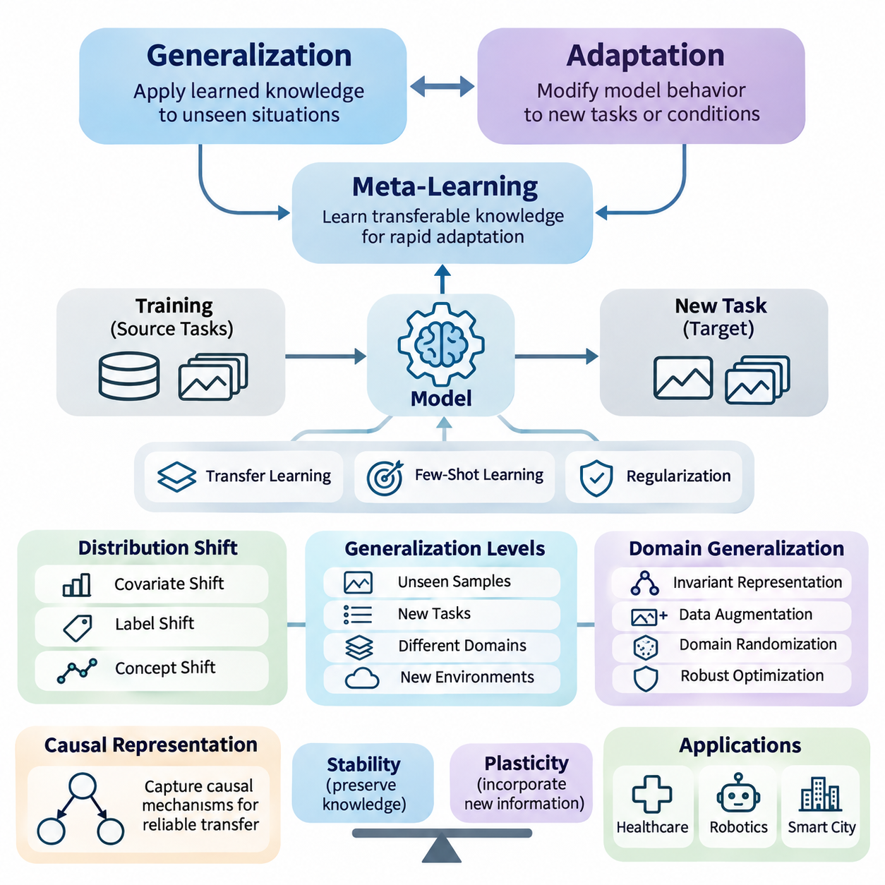
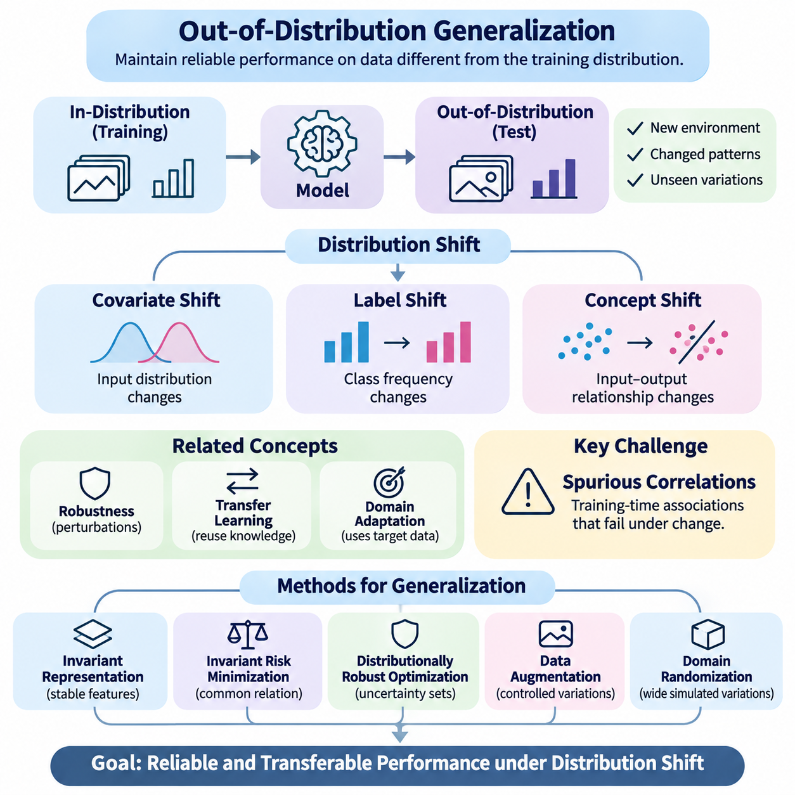
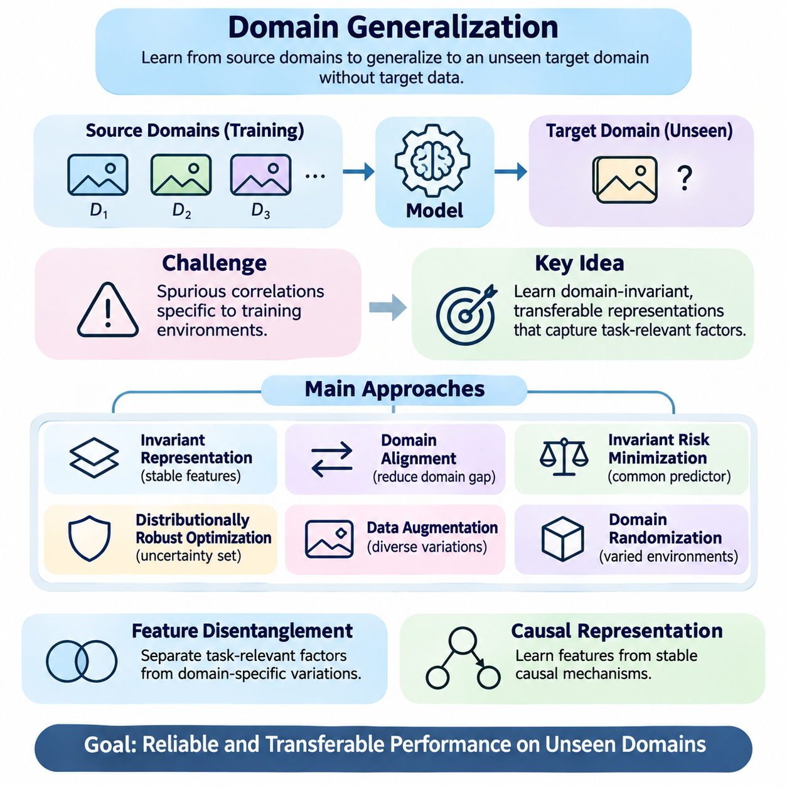
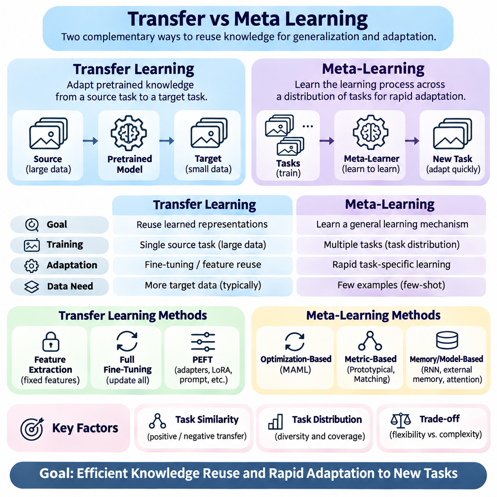
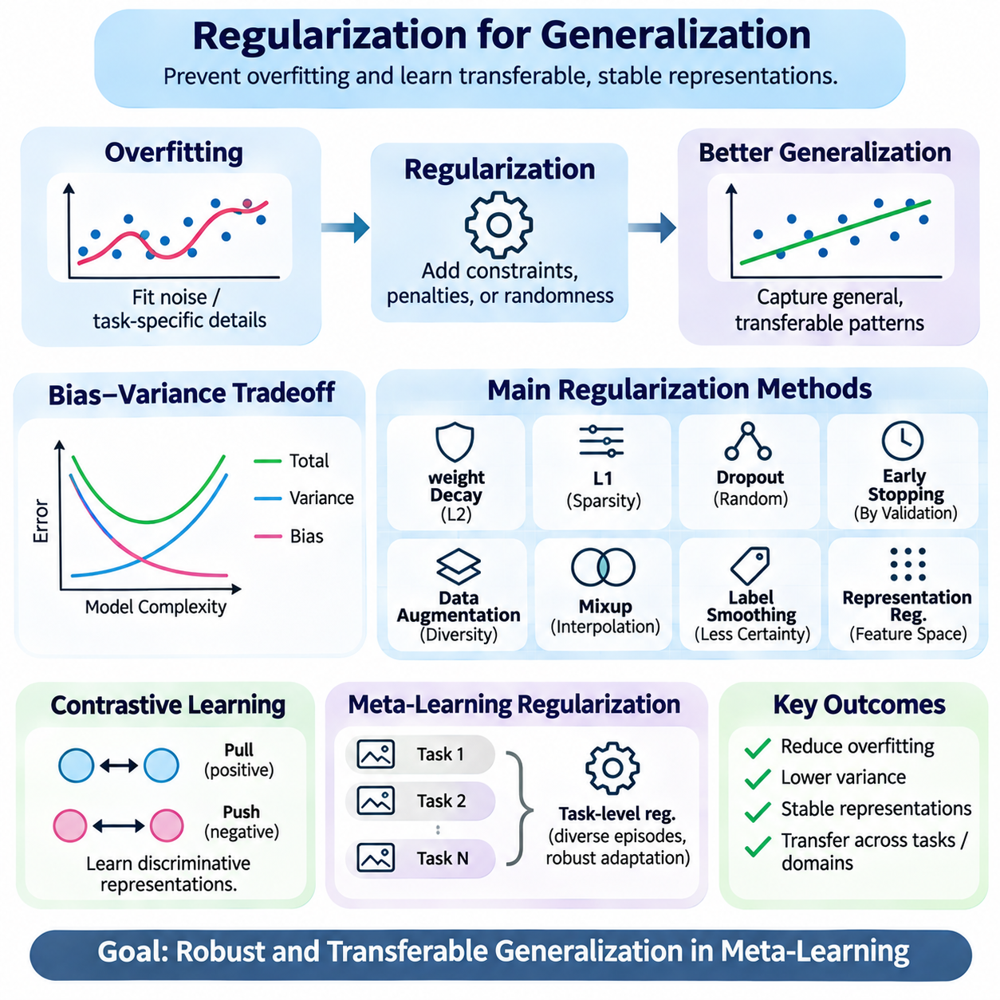
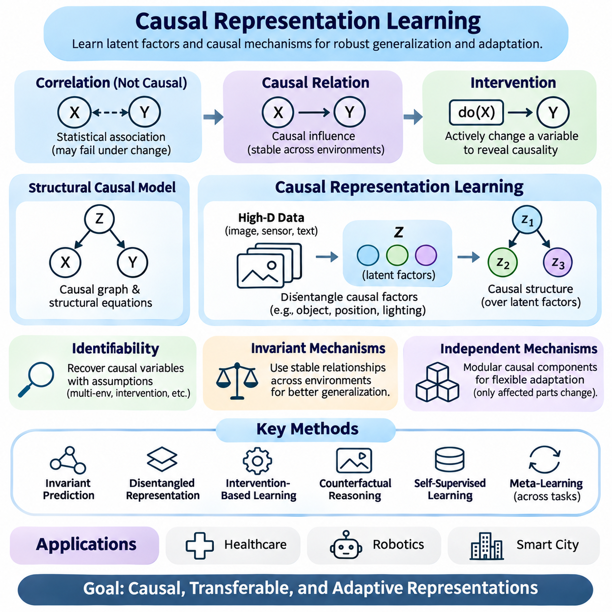
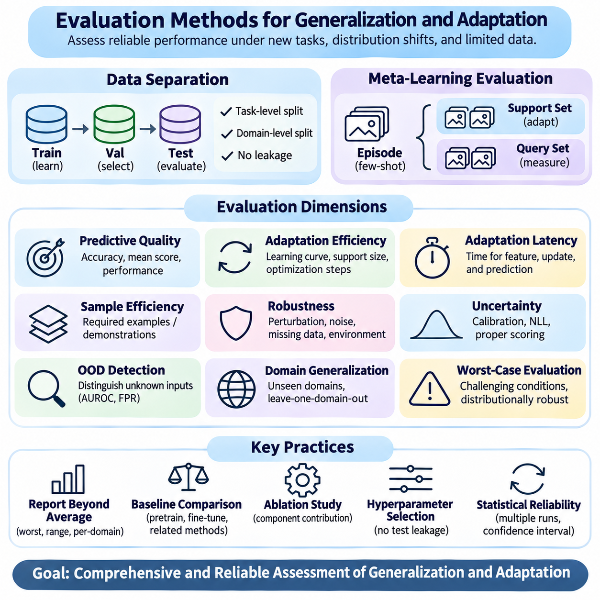
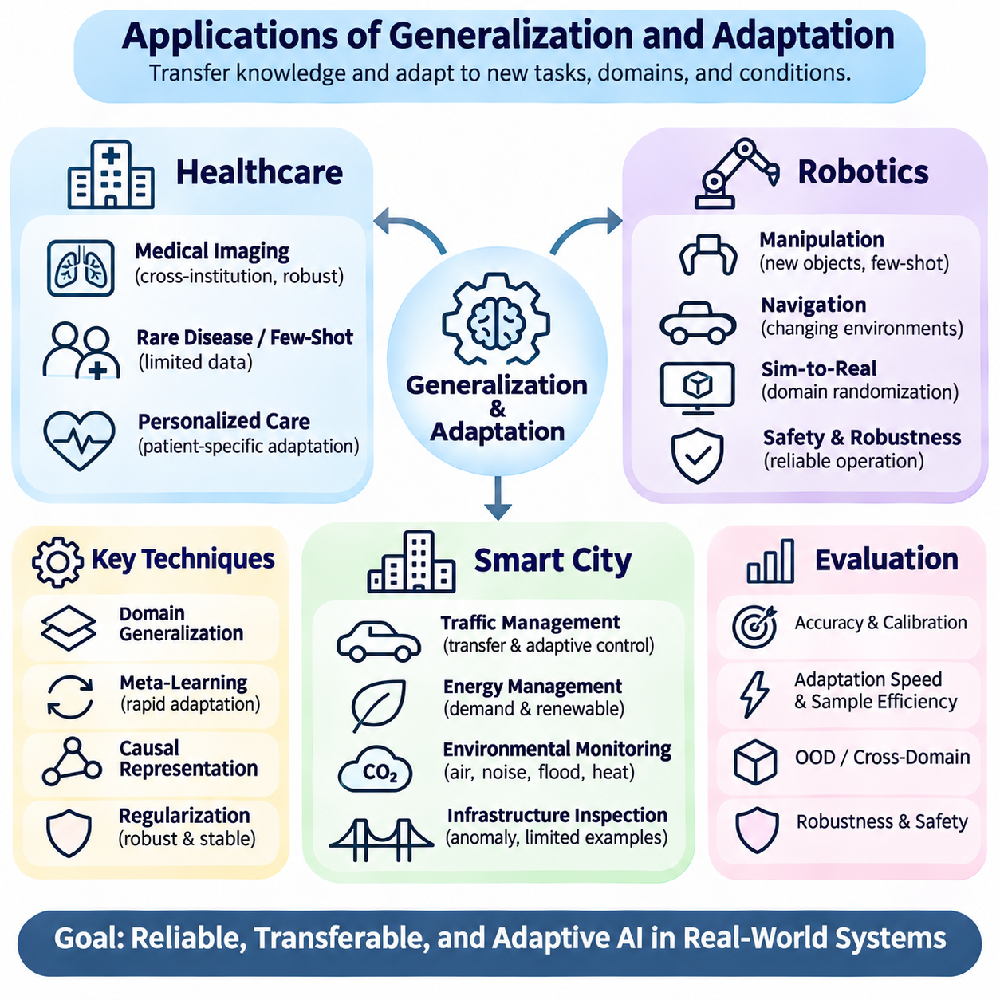

**Volume 36. Meta Learning and Few Shot Adaptation**


# 06. Generalization and Adaptation

## 06.00 Overview

{width="7.268055555555556in" height="7.268055555555556in"}

Generalization and adaptation are fundamental capabilities of intelligent learning systems, enabling models to perform effectively beyond the specific examples and environments encountered during training. Generalization concerns the ability to apply learned knowledge to unseen situations, while adaptation involves modifying model behavior in response to new tasks, data distributions, or operating conditions.

Traditional machine learning often assumes that training and testing data originate from similar statistical distributions. However, real-world environments frequently violate this assumption because of changing sensors, user behavior, environmental conditions, and operational requirements. Meta-learning addresses these challenges by learning transferable knowledge that supports rapid adaptation across related tasks.

The relationship between generalization and adaptation is particularly important in few-shot learning, where models must recognize new patterns using only a limited number of labeled examples. Successful systems combine previously acquired representations with task-specific information, allowing them to respond to unfamiliar situations without requiring extensive retraining or large additional datasets.

Generalization can be understood at several levels, including generalization to unseen samples, new tasks, different domains, and previously unobserved environmental conditions. These levels impose different requirements on learned representations and optimization procedures. A model that performs well on unseen examples from a familiar distribution may still struggle when the underlying data-generating process changes.

Out-of-distribution generalization examines model performance when evaluation data differ from the distributions represented during training. Such differences may involve feature statistics, class frequencies, environmental contexts, or relationships between inputs and outputs. The central challenge is identifying which learned patterns remain reliable when familiar statistical assumptions no longer hold.

Distribution shifts are commonly categorized as covariate shift, label shift, and concept shift. Covariate shift changes the input distribution while preserving the conditional relationship between inputs and labels. Label shift changes class frequencies, whereas concept shift alters the predictive relationship itself. Distinguishing these conditions helps determine whether adaptation, recalibration, or structural model changes are necessary.

Domain generalization focuses on developing models that perform effectively in previously unseen domains without requiring access to target-domain training data. Instead of optimizing performance for one environment, the learning process attempts to capture relationships that remain useful across multiple source domains. This approach is especially valuable when deployment environments cannot be fully anticipated during development.

Domain generalization methods frequently employ data augmentation, domain randomization, invariant representation learning, and distributionally robust optimization. These techniques expose models to diverse conditions or discourage dependence on unstable correlations. Their effectiveness depends on whether the simulated or observed variations adequately represent the uncertainties encountered during actual deployment.

Transfer learning and meta-learning provide complementary approaches to knowledge reuse. Transfer learning typically begins with representations learned from a source task and adapts them to a target task. Meta-learning instead optimizes learning behavior across a distribution of tasks, seeking representations, initializations, or adaptation procedures that enable efficient learning from limited target-task experience.

The distinction becomes particularly important when adaptation time and data availability are constrained. Conventional fine-tuning may require numerous optimization steps and substantial labeled data, whereas meta-learning can prepare a model for rapid task-specific updates. Nevertheless, meta-learning does not automatically guarantee superior generalization, especially when target tasks differ substantially from the meta-training distribution.

Regularization plays a central role in preventing models from becoming excessively dependent on training-specific patterns. Weight decay, dropout, early stopping, and representation constraints can reduce overfitting and improve stability. Within meta-learning, regularization may operate across tasks, encouraging shared representations that remain useful without suppressing the flexibility required for adaptation.

The balance between stability and plasticity is another essential consideration. Stability preserves useful knowledge acquired from previous tasks, while plasticity allows models to incorporate new information. Excessive stability can prevent adaptation, whereas excessive plasticity can cause catastrophic forgetting. Effective systems must manage this tradeoff according to task similarity, deployment constraints, and expected environmental changes.

Causal representation learning offers a promising direction for improving generalization by emphasizing relationships that remain meaningful under changing conditions. Rather than relying exclusively on statistical associations, causal approaches seek representations connected to underlying mechanisms. When valid causal structure can be identified, these representations may support more reliable transfer across environments and interventions.

However, causal representations cannot always be recovered from observational data alone. Their identification may require assumptions about the data-generating process, multiple environments, intervention data, or domain knowledge. Consequently, causal learning should be evaluated carefully rather than treated as an automatic solution to distribution shift, spurious correlations, or unreliable extrapolation.

Adaptation mechanisms vary according to the information available after deployment. Some systems update model parameters through gradient-based optimization, while others modify latent representations, normalization statistics, task embeddings, or prediction thresholds. Parameter-free adaptation can offer lower computational costs, whereas parameter updates may provide greater flexibility when sufficient reliable evidence is available.

Test-time adaptation extends this principle by allowing models to adjust using information encountered during inference. Such methods may optimize self-supervised objectives, update selected parameters, or estimate changing input statistics. Although potentially effective, they introduce risks involving noisy observations, incorrect pseudo-labels, unstable updates, and performance degradation under persistent distribution shifts.

Evaluation methods must distinguish generalization performance from adaptation performance. Generalization is commonly assessed on held-out tasks, domains, or distributions, whereas adaptation requires measuring improvement after limited exposure to new information. Meaningful comparisons should account for the number of adaptation examples, computational resources, update steps, and whether target-domain labels are available.

Robust experimental design requires separating meta-training, validation, and evaluation tasks to prevent information leakage. Domain-level separation is especially important when assessing out-of-distribution behavior. Repeated evaluation across different random seeds, task configurations, and shift intensities provides stronger evidence than performance measured on a single favorable benchmark or distribution.

Adaptation efficiency should also be considered alongside predictive accuracy. Important measurements include adaptation latency, memory consumption, computational complexity, energy requirements, and the number of observations needed to reach acceptable performance. In resource-constrained systems, a slightly less accurate method may be preferable when it delivers more predictable behavior and substantially lower operational costs.

Healthcare applications illustrate the importance of reliable generalization across institutions, patient populations, imaging devices, and clinical workflows. Models developed using data from one hospital may encounter different acquisition protocols or population characteristics elsewhere. Adaptation techniques can help address these differences, but clinical validation, calibration, and careful monitoring remain essential before deployment.

Robotics presents additional challenges because environmental changes directly influence physical behavior. Variations in terrain, lighting, payload, friction, and sensor characteristics can invalidate assumptions learned during training. Meta-learning and domain generalization can support rapid adjustment, but safety-critical control requires bounded adaptation, uncertainty awareness, and independent safeguards against unsafe actions.

Smart city systems encounter distribution shifts caused by seasonal patterns, infrastructure changes, traffic conditions, and evolving human activities. Generalizable models can support transportation forecasting, infrastructure monitoring, and resource allocation across heterogeneous urban environments. Adaptive mechanisms help maintain performance as operational conditions change, provided that updates are validated and monitored.

Ultimately, generalization and adaptation represent complementary dimensions of learning capability rather than interchangeable objectives. Generalization reduces dependence on new observations, while adaptation enables useful responses when existing knowledge becomes insufficient. Their integration provides a foundation for meta-learning systems that remain effective, efficient, and dependable across changing tasks and environments.

일반화(Generalization)와 적응(Adaptation)은 지능형 학습 시스템(Intelligent Learning Systems)의 핵심 역량으로, 모델(Model)이 학습 과정에서 경험한 특정 사례와 환경을 넘어 효과적으로 작동하도록 한다. 일반화는 학습된 지식(Learned Knowledge)을 새로운 상황에 적용하는 능력을 의미하며, 적응은 새로운 작업(Task), 데이터 분포(Data Distribution), 운영 조건(Operating Conditions)에 대응하여 모델의 동작을 조정하는 과정을 의미한다.

전통적인 기계학습(Machine Learning)은 학습 데이터(Training Data)와 테스트 데이터(Test Data)가 유사한 통계적 분포(Statistical Distribution)에서 생성된다고 가정하는 경우가 많다. 그러나 실제 환경에서는 센서(Sensor), 사용자 행동(User Behavior), 환경 조건(Environmental Conditions), 운영 요구사항(Operational Requirements)이 지속적으로 변화한다. 메타학습(Meta-Learning)은 다양한 작업에 걸쳐 빠른 적응을 지원하는 전이 가능한 지식(Transferable Knowledge)을 학습함으로써 이러한 문제를 해결하고자 한다.

일반화와 적응의 관계는 소수 샷 학습(Few-Shot Learning)에서 특히 중요하다. 소수 샷 학습에서는 제한된 수의 레이블이 지정된 예제(Labeled Examples)만으로 새로운 패턴을 인식해야 한다. 성공적인 시스템은 이전에 획득한 표현(Representation)과 작업별 정보(Task-Specific Information)를 결합하여, 대규모 추가 데이터셋(Additional Dataset)이나 광범위한 재학습(Retraining) 없이도 익숙하지 않은 상황에 대응할 수 있다.

일반화는 새로운 샘플(Unseen Samples), 새로운 작업(New Tasks), 서로 다른 도메인(Domains), 이전에 관찰하지 못한 환경 조건(Environmental Conditions)에 대한 일반화 등 여러 수준에서 이해할 수 있다. 이러한 수준마다 학습된 표현(Learned Representations)과 최적화 절차(Optimization Procedures)에 요구되는 특성이 다르다. 익숙한 분포의 새로운 데이터에서 높은 성능을 보이는 모델이라도 데이터 생성 과정(Data-Generating Process)이 변화하면 성능이 크게 저하될 수 있다.

분포 외 일반화(Out-of-Distribution Generalization)는 평가 데이터(Evaluation Data)가 학습 과정에서 사용된 분포와 다를 때 모델의 성능을 분석한다. 이러한 차이는 특징 통계(Feature Statistics), 클래스 빈도(Class Frequencies), 환경적 맥락(Environmental Contexts), 입력과 출력 사이의 관계(Input-Output Relationships)에서 발생할 수 있다. 핵심 과제는 기존의 통계적 가정(Statistical Assumptions)이 더 이상 성립하지 않는 상황에서도 신뢰할 수 있는 학습 패턴을 식별하는 것이다.

분포 변화(Distribution Shift)는 일반적으로 공변량 변화(Covariate Shift), 레이블 변화(Label Shift), 개념 변화(Concept Shift)로 구분된다. 공변량 변화는 입력과 레이블 사이의 조건부 관계(Conditional Relationship)를 유지하면서 입력 분포가 변화하는 현상이다. 레이블 변화는 클래스 빈도가 달라지는 것이며, 개념 변화는 예측 관계(Predictive Relationship) 자체가 달라지는 현상이다. 이러한 차이를 구분하면 적응, 재보정(Recalibration), 모델 구조 변경(Structural Model Changes)의 필요성을 판단할 수 있다.

도메인 일반화(Domain Generalization)는 목표 도메인(Target Domain)의 학습 데이터에 접근하지 않고도 이전에 경험하지 못한 도메인에서 효과적으로 작동하는 모델을 개발하는 데 초점을 맞춘다. 단일 환경에 대한 성능을 최적화하는 대신 여러 소스 도메인(Source Domains)에서 유용하게 유지되는 관계를 학습한다. 이러한 접근법은 실제 배포 환경(Deployment Environment)을 개발 단계에서 완전히 예측하기 어려운 경우에 특히 중요하다.

도메인 일반화 방법에는 데이터 증강(Data Augmentation), 도메인 무작위화(Domain Randomization), 불변 표현 학습(Invariant Representation Learning), 분포 강건 최적화(Distributionally Robust Optimization)가 포함된다. 이러한 기법은 모델을 다양한 조건에 노출하거나 불안정한 상관관계(Unstable Correlations)에 대한 의존성을 줄인다. 효과는 학습 중 관찰하거나 생성한 변화가 실제 배포 환경의 불확실성을 얼마나 적절하게 반영하는지에 따라 달라진다.

전이학습(Transfer Learning)과 메타학습(Meta-Learning)은 지식 재사용(Knowledge Reuse)을 위한 상호 보완적인 접근법이다. 전이학습은 일반적으로 소스 작업(Source Task)에서 학습한 표현을 목표 작업(Target Task)에 맞게 조정한다. 반면 메타학습은 작업 분포(Task Distribution) 전반에서 학습 행동(Learning Behavior)을 최적화하여 제한된 목표 작업 경험만으로 효율적인 학습을 가능하게 하는 표현, 초기화(Initialization), 적응 절차(Adaptation Procedures)를 학습한다.

이러한 차이는 적응 시간(Adaptation Time)과 데이터 가용성(Data Availability)이 제한될 때 더욱 중요해진다. 기존의 미세조정(Fine-Tuning)은 많은 최적화 단계(Optimization Steps)와 상당한 양의 레이블 데이터를 요구할 수 있지만, 메타학습은 빠른 작업별 업데이트(Task-Specific Updates)를 수행하도록 모델을 준비시킨다. 그러나 목표 작업이 메타학습 훈련 분포(Meta-Training Distribution)와 크게 다르면 메타학습이 반드시 더 우수한 일반화 성능을 보장하는 것은 아니다.

정규화(Regularization)는 모델이 학습 데이터에 특화된 패턴에 지나치게 의존하는 것을 방지하는 중요한 역할을 한다. 가중치 감쇠(Weight Decay), 드롭아웃(Dropout), 조기 종료(Early Stopping), 표현 제약(Representation Constraints)은 과적합(Overfitting)을 줄이고 안정성을 개선할 수 있다. 메타학습에서는 여러 작업에 걸친 정규화를 통해 적응에 필요한 유연성을 유지하면서도 다양한 작업에서 유용한 공유 표현(Shared Representations)을 학습하도록 유도할 수 있다.

안정성(Stability)과 가소성(Plasticity) 사이의 균형도 중요한 고려사항이다. 안정성은 이전 작업에서 획득한 유용한 지식을 보존하고, 가소성은 새로운 정보를 반영하도록 한다. 안정성이 지나치게 높으면 적응이 어려워지고, 가소성이 지나치게 높으면 파국적 망각(Catastrophic Forgetting)이 발생할 수 있다. 효과적인 시스템은 작업 유사성(Task Similarity), 배포 제약(Deployment Constraints), 예상되는 환경 변화에 따라 이러한 상충관계(Tradeoff)를 관리해야 한다.

인과 표현 학습(Causal Representation Learning)은 변화하는 조건에서도 의미 있는 관계를 강조하여 일반화 성능을 개선할 수 있는 유망한 접근법이다. 통계적 연관성(Statistical Associations)에만 의존하는 대신 인과적 접근법(Causal Approaches)은 근본적인 생성 메커니즘(Underlying Mechanisms)과 연결된 표현을 학습하고자 한다. 유효한 인과 구조(Causal Structure)를 식별할 수 있다면 이러한 표현은 다양한 환경과 개입(Interventions)에 걸쳐 더욱 신뢰할 수 있는 지식 전이(Knowledge Transfer)를 지원할 수 있다.

그러나 인과 표현(Causal Representations)을 관찰 데이터(Observational Data)만으로 항상 복원할 수 있는 것은 아니다. 이를 식별하려면 데이터 생성 과정에 대한 가정(Assumptions), 다중 환경(Multiple Environments), 개입 데이터(Intervention Data), 도메인 지식(Domain Knowledge)이 필요할 수 있다. 따라서 인과학습(Causal Learning)을 분포 변화, 허위 상관관계(Spurious Correlations), 불안정한 외삽(Unreliable Extrapolation)에 대한 자동적인 해결책으로 간주해서는 안 되며 신중하게 평가해야 한다.

적응 메커니즘(Adaptation Mechanisms)은 배포 이후 사용할 수 있는 정보에 따라 달라진다. 일부 시스템은 경사 기반 최적화(Gradient-Based Optimization)를 통해 모델 매개변수(Model Parameters)를 업데이트하고, 다른 시스템은 잠재 표현(Latent Representations), 정규화 통계(Normalization Statistics), 작업 임베딩(Task Embeddings), 예측 임계값(Prediction Thresholds)을 조정한다. 매개변수를 변경하지 않는 적응(Parameter-Free Adaptation)은 계산 비용을 줄일 수 있지만, 충분하고 신뢰할 수 있는 정보가 있다면 매개변수 업데이트(Parameter Updates)가 더 높은 유연성을 제공할 수 있다.

테스트 시점 적응(Test-Time Adaptation)은 추론(Inference) 과정에서 관찰되는 정보를 이용하여 모델을 조정하는 방식으로 이러한 원리를 확장한다. 이 방법은 자기지도 목적함수(Self-Supervised Objectives)를 최적화하거나 선택된 매개변수를 업데이트하고 입력 통계(Input Statistics)를 추정할 수 있다. 그러나 잡음이 포함된 관측값(Noisy Observations), 잘못된 의사 레이블(Pseudo-Labels), 불안정한 업데이트(Unstable Updates), 지속적인 분포 변화로 인한 성능 저하 등의 위험이 존재한다.

평가 방법(Evaluation Methods)은 일반화 성능(Generalization Performance)과 적응 성능(Adaptation Performance)을 구분해야 한다. 일반화는 일반적으로 별도로 보류된 작업(Held-Out Tasks), 도메인, 분포에서 평가하며, 적응은 제한된 새로운 정보에 노출된 이후의 성능 향상을 측정한다. 의미 있는 비교를 위해서는 적응 예제의 수, 계산 자원(Computational Resources), 업데이트 단계, 목표 도메인 레이블(Target-Domain Labels)의 사용 가능 여부를 고려해야 한다.

강건한 실험 설계(Robust Experimental Design)를 위해서는 정보 누출(Information Leakage)을 방지하도록 메타훈련(Meta-Training), 검증(Validation), 평가(Evaluation) 작업을 분리해야 한다. 분포 외 성능을 평가할 때는 도메인 수준 분리(Domain-Level Separation)가 특히 중요하다. 서로 다른 무작위 시드(Random Seeds), 작업 구성(Task Configurations), 분포 변화 강도(Shift Intensities)에 걸친 반복 평가는 단일 벤치마크(Benchmark)의 유리한 결과보다 더 강력한 근거를 제공한다.

적응 효율성(Adaptation Efficiency)은 예측 정확도(Predictive Accuracy)와 함께 고려해야 한다. 주요 측정 항목에는 적응 지연시간(Adaptation Latency), 메모리 사용량(Memory Consumption), 계산 복잡도(Computational Complexity), 에너지 요구량(Energy Requirements), 허용 가능한 성능에 도달하기 위해 필요한 관측값의 수가 포함된다. 자원이 제한된 시스템(Resource-Constrained Systems)에서는 예측 가능성이 높고 운영 비용이 상당히 낮다면 정확도가 약간 낮은 방법이 더 적합할 수 있다.

의료(Healthcare) 분야는 의료기관, 환자 집단(Patient Populations), 영상 장비(Imaging Devices), 임상 업무 흐름(Clinical Workflows)에 걸친 신뢰할 수 있는 일반화의 중요성을 보여준다. 한 병원의 데이터로 개발한 모델은 다른 병원에서 서로 다른 영상 획득 프로토콜(Acquisition Protocols)이나 환자 집단 특성을 경험할 수 있다. 적응 기법은 이러한 차이를 해결하는 데 도움이 되지만, 실제 배포 전에는 임상 검증(Clinical Validation), 보정(Calibration), 신중한 모니터링(Monitoring)이 필수적이다.

로보틱스(Robotics)는 환경 변화가 물리적 행동(Physical Behavior)에 직접적인 영향을 미치기 때문에 추가적인 어려움을 가진다. 지형(Terrain), 조명(Lighting), 적재 하중(Payload), 마찰(Friction), 센서 특성(Sensor Characteristics)의 변화는 학습 과정에서 형성된 가정을 무효화할 수 있다. 메타학습과 도메인 일반화는 빠른 조정을 지원하지만, 안전 필수 제어(Safety-Critical Control)에서는 제한된 범위의 적응(Bounded Adaptation), 불확실성 인식(Uncertainty Awareness), 위험한 행동을 방지하는 독립적인 안전장치(Independent Safeguards)가 필요하다.

스마트시티(Smart City) 시스템은 계절적 패턴(Seasonal Patterns), 인프라 변화(Infrastructure Changes), 교통 상황(Traffic Conditions), 인간 활동(Human Activities)의 변화로 인한 분포 변화를 경험한다. 일반화 가능한 모델(Generalizable Models)은 이질적인 도시 환경(Heterogeneous Urban Environments)에서 교통 예측(Transportation Forecasting), 인프라 모니터링(Infrastructure Monitoring), 자원 할당(Resource Allocation)을 지원할 수 있다. 적응 메커니즘은 업데이트가 검증되고 지속적으로 모니터링되는 조건에서 운영 환경 변화에 따른 성능 유지를 돕는다.

궁극적으로 일반화와 적응은 서로 대체할 수 있는 목표가 아니라 학습 역량(Learning Capability)의 상호 보완적인 차원을 나타낸다. 일반화는 새로운 관측값(New Observations)에 대한 의존성을 줄이고, 적응은 기존 지식이 충분하지 않을 때 효과적으로 대응하도록 한다. 두 역량의 통합은 변화하는 작업과 환경 전반에서 효과성(Effectiveness), 효율성(Efficiency), 신뢰성(Dependability)을 유지하는 메타학습 시스템의 기반을 제공한다.

## 06.01 Out of Distribution Generalization

{width="7.268055555555556in" height="7.268055555555556in"}

Out-of-distribution generalization refers to the ability of a machine learning model to maintain reliable performance when encountering data that differ from the distribution observed during training. Unlike conventional generalization, which assumes similar training and testing conditions, this capability addresses unfamiliar environments, changing statistical relationships, and previously unseen variations that challenge learned representations.

The importance of out-of-distribution generalization arises from the limitations of the independent and identically distributed assumption. Many learning algorithms implicitly expect future observations to follow the same probability distribution as their training examples. In practical applications, however, sensor characteristics, environmental conditions, population structures, and operational requirements frequently change after deployment.

Distribution shift occurs when the statistical properties of incoming data differ from those represented in the training dataset. These changes may affect input features, class frequencies, conditional relationships, or combinations of these factors. Understanding the nature of distribution shift is essential because different changes require different strategies for preserving predictive accuracy and decision reliability.

Covariate shift describes situations where the distribution of input variables changes while the conditional relationship between inputs and target labels remains stable. For example, an image recognition system may encounter different lighting conditions or camera characteristics. Although the underlying recognition task remains unchanged, altered feature distributions can reduce performance when the model depends on training-specific visual patterns.

Label shift occurs when the relative frequencies of target classes change while the class-conditional input distributions remain stable. A medical classification system may encounter different disease prevalence rates across hospitals, even when the characteristics of each disease remain similar. Such changes can affect predicted probabilities and decision thresholds, requiring appropriate statistical correction or recalibration.

Concept shift represents a more fundamental change in the relationship between input variables and target outcomes. In this situation, patterns that previously supported accurate predictions may no longer describe the current environment. Concept shift is particularly challenging because correcting input statistics alone cannot restore the original predictive relationship, and additional learning or model revision may become necessary.

Out-of-distribution generalization is closely related to robustness, transfer learning, and domain adaptation, but these concepts emphasize different capabilities. Robustness concerns performance under disturbances or perturbations, while transfer learning reuses knowledge across tasks. Domain adaptation generally uses information from a target domain, whereas out-of-distribution generalization seeks reliable performance under unfamiliar distributions without assuming such information is available beforehand.

A major obstacle to generalization is the presence of spurious correlations, which are statistical associations that appear predictive during training but fail under environmental changes. Models may learn background textures, acquisition artifacts, or contextual shortcuts instead of task-relevant characteristics. When these correlations disappear or reverse, prediction quality can deteriorate despite strong performance on conventional test datasets.

Invariant representation learning attempts to address this problem by identifying features that remain useful across different environments. Rather than encoding every statistical detail of the training distribution, the model is encouraged to emphasize stable relationships associated with the prediction task. The effectiveness of this approach depends on whether the training environments provide sufficient evidence to distinguish stable signals from misleading correlations.

Invariant risk minimization introduces an optimization perspective in which a representation should support a common predictive relationship across multiple training environments. The underlying motivation is that relationships stable across diverse environments may transfer more effectively to unseen conditions. However, obtaining meaningful invariance is difficult when environments are insufficiently diverse or optimization objectives admit unintended solutions.

Distributionally robust optimization approaches generalization by considering uncertainty about the probability distribution encountered during deployment. Instead of minimizing average training loss alone, the learning objective emphasizes performance across a specified family of plausible distributions. This strategy can improve resilience to certain shifts, although overly conservative uncertainty sets may reduce performance under ordinary operating conditions.

Data augmentation provides another practical mechanism for improving generalization by exposing models to controlled variations during training. Transformations involving illumination, geometry, noise, texture, and environmental context can reduce dependence on superficial characteristics. Nevertheless, augmentation must preserve task-relevant information, since unrealistic transformations may introduce misleading examples or distort the intended learning objective.

Domain randomization extends augmentation by systematically varying simulation parameters, environmental properties, and observation conditions. This technique is particularly relevant to robotics, where simulated environments can represent different friction coefficients, object appearances, sensor noise levels, and physical configurations. Successful transfer depends on whether randomized conditions adequately cover the variations encountered in real environments.

Meta-learning contributes to out-of-distribution generalization by learning adaptation strategies across diverse tasks and environments. Through repeated task-level training, a model can acquire representations or parameter initializations that support efficient responses to unfamiliar conditions. However, the resulting capabilities remain influenced by the diversity of the meta-training task distribution and may weaken under substantial task mismatch.

Few-shot adaptation can complement generalization when limited target-environment examples become available. A model with transferable representations may require only a small number of observations to adjust its predictions or internal parameters. This approach is especially useful when comprehensive retraining is impractical, although adaptation quality depends on example representativeness, label reliability, and optimization stability.

Uncertainty estimation is important because models may produce confident predictions even when inputs differ substantially from their training experience. Probabilistic modeling, ensemble methods, and calibration techniques can provide information about predictive reliability. Nevertheless, uncertainty estimates themselves may become unreliable under severe distribution shifts, making independent validation and conservative decision policies necessary.

Out-of-distribution detection attempts to identify observations that differ significantly from the model\'s familiar data distribution. Detection methods may analyze confidence scores, feature-space distances, predictive disagreement, or estimated data likelihoods. Detecting unfamiliar inputs does not automatically determine whether predictions are incorrect, but it can support selective prediction, human review, and controlled fallback behavior.

Evaluation requires test conditions that deliberately challenge assumptions established during training. Researchers may construct benchmarks involving unseen domains, environmental changes, corrupted inputs, or shifts in class composition. Strong evaluation protocols separate training and testing environments, prevent information leakage, and examine performance across multiple shift types rather than relying on a single aggregate accuracy score.

Performance analysis should consider both average accuracy and worst-case behavior across evaluation environments. Metrics such as calibration error, negative log-likelihood, failure frequency, and performance degradation under increasing shift severity provide complementary information. Confidence intervals and repeated experimental trials help distinguish systematic improvements from variations caused by random initialization or dataset sampling.

In healthcare, out-of-distribution generalization is essential when predictive models operate across hospitals, patient populations, imaging devices, and clinical protocols. Differences in acquisition procedures or population characteristics can alter observed data distributions. Reliable deployment therefore requires external validation, subgroup analysis, uncertainty monitoring, and mechanisms for identifying conditions outside the model\'s validated operating range.

Robotics and autonomous systems encounter distribution shifts through changing weather, terrain, lighting, payload, and sensor performance. Models trained in controlled environments may fail when physical conditions differ from expectations. Generalization techniques can improve resilience, but safety-critical systems must also incorporate independent safeguards, operating limits, and fallback procedures that do not depend entirely on learned predictions.

Smart city applications face additional challenges because transportation patterns, infrastructure conditions, population behavior, and seasonal demand evolve over time. Predictive models must operate across heterogeneous locations and changing operational contexts. Robust representations and systematic evaluation can improve transferability, while monitoring systems help identify when observed conditions exceed the assumptions used during model development.

Ultimately, out-of-distribution generalization is a central requirement for developing machine learning systems that remain dependable beyond controlled training environments. Its effectiveness depends on appropriate representations, diverse training conditions, robust optimization, uncertainty awareness, and realistic evaluation. Integrating these principles with meta-learning and efficient adaptation provides a foundation for intelligent systems capable of responding to unfamiliar and evolving conditions.

분포 외 일반화(Out-of-Distribution Generalization)는 기계학습 모델(Machine Learning Model)이 학습 과정에서 관찰한 데이터 분포(Data Distribution)와 다른 데이터를 접하더라도 신뢰할 수 있는 성능을 유지하는 능력을 의미한다. 학습과 테스트 조건이 유사하다고 가정하는 기존의 일반화(Generalization)와 달리, 이 능력은 익숙하지 않은 환경, 변화하는 통계적 관계(Statistical Relationships), 이전에 관찰하지 못한 변동에 대응하여 학습된 표현(Learned Representations)의 한계를 극복하는 데 초점을 맞춘다.

분포 외 일반화의 중요성은 독립 동일 분포 가정(Independent and Identically Distributed Assumption)의 한계에서 비롯된다. 많은 학습 알고리즘(Learning Algorithms)은 미래의 관측값이 학습 예제와 동일한 확률 분포(Probability Distribution)를 따른다고 암묵적으로 가정한다. 그러나 실제 응용 환경에서는 센서 특성(Sensor Characteristics), 환경 조건(Environmental Conditions), 인구 집단 구조(Population Structures), 운영 요구사항(Operational Requirements)이 배포 이후에도 지속적으로 변화한다.

분포 변화(Distribution Shift)는 입력 데이터의 통계적 특성(Statistical Properties)이 학습 데이터셋(Training Dataset)에 나타난 특성과 달라질 때 발생한다. 이러한 변화는 입력 특징(Input Features), 클래스 빈도(Class Frequencies), 조건부 관계(Conditional Relationships) 또는 이러한 요소들의 조합에 영향을 미칠 수 있다. 분포 변화의 특성을 이해하는 것은 예측 정확도(Predictive Accuracy)와 의사결정 신뢰성(Decision Reliability)을 유지하기 위해 서로 다른 대응 전략이 필요하기 때문에 중요하다.

공변량 변화(Covariate Shift)는 입력 변수(Input Variables)의 분포가 달라지지만 입력과 목표 레이블(Target Labels) 사이의 조건부 관계는 안정적으로 유지되는 상황을 의미한다. 예를 들어 영상 인식 시스템(Image Recognition System)은 서로 다른 조명 조건(Lighting Conditions)이나 카메라 특성(Camera Characteristics)을 경험할 수 있다. 기본적인 인식 작업은 동일하더라도 모델이 학습 환경에 특화된 시각적 패턴(Visual Patterns)에 의존하면 특징 분포의 변화로 성능이 저하될 수 있다.

레이블 변화(Label Shift)는 클래스별 입력 조건부 분포(Class-Conditional Input Distributions)가 안정적으로 유지되는 동안 목표 클래스(Target Classes)의 상대적 빈도가 달라지는 현상이다. 의료 분류 시스템(Medical Classification System)은 질병별 특성이 유사하게 유지되더라도 병원마다 서로 다른 질병 유병률(Disease Prevalence Rates)을 경험할 수 있다. 이러한 변화는 예측 확률(Predicted Probabilities)과 의사결정 임계값(Decision Thresholds)에 영향을 미치므로 적절한 통계적 보정(Statistical Correction)이나 재보정(Recalibration)이 필요할 수 있다.

개념 변화(Concept Shift)는 입력 변수와 목표 결과(Target Outcomes) 사이의 관계가 더욱 근본적으로 달라지는 현상을 의미한다. 이러한 상황에서는 이전에 정확한 예측을 가능하게 했던 패턴이 현재 환경을 더 이상 적절하게 설명하지 못할 수 있다. 개념 변화는 입력 통계(Input Statistics)를 보정하는 것만으로 기존의 예측 관계(Predictive Relationship)를 복원할 수 없기 때문에 특히 어려우며, 추가 학습(Additional Learning)이나 모델 수정(Model Revision)이 필요할 수 있다.

분포 외 일반화는 강건성(Robustness), 전이학습(Transfer Learning), 도메인 적응(Domain Adaptation)과 밀접하게 관련되어 있지만 각 개념은 서로 다른 능력을 강조한다. 강건성은 교란(Disturbances)이나 섭동(Perturbations) 상황에서의 성능을 의미하고, 전이학습은 작업 간 지식 재사용(Knowledge Reuse)에 초점을 맞춘다. 도메인 적응은 일반적으로 목표 도메인(Target Domain)의 정보를 활용하지만, 분포 외 일반화는 이러한 정보가 사전에 제공된다고 가정하지 않고 익숙하지 않은 분포에서도 신뢰할 수 있는 성능을 추구한다.

일반화를 방해하는 주요 요인 중 하나는 허위 상관관계(Spurious Correlations)이다. 이는 학습 과정에서는 예측에 유용한 것처럼 보이지만 환경이 변화하면 더 이상 유효하지 않은 통계적 연관성(Statistical Associations)을 의미한다. 모델은 작업과 직접 관련된 특성 대신 배경 질감(Background Textures), 데이터 획득 인공물(Acquisition Artifacts), 문맥적 지름길(Contextual Shortcuts)을 학습할 수 있다. 이러한 상관관계가 사라지거나 반전되면 기존 테스트 데이터에서 높은 성능을 보였더라도 예측 품질이 크게 저하될 수 있다.

불변 표현 학습(Invariant Representation Learning)은 서로 다른 환경에서도 유용하게 유지되는 특징을 식별하여 이러한 문제를 해결하고자 한다. 모델이 학습 분포의 모든 통계적 세부사항을 인코딩(Encoding)하는 대신 예측 작업과 관련된 안정적인 관계를 강조하도록 유도한다. 이 접근법의 효과는 학습 환경(Training Environments)이 안정적인 신호(Stable Signals)와 잘못된 상관관계를 구분할 수 있을 만큼 충분한 정보를 제공하는지에 따라 달라진다.

불변 위험 최소화(Invariant Risk Minimization)는 하나의 표현(Representation)이 여러 학습 환경에서 공통된 예측 관계를 지원하도록 하는 최적화 관점(Optimization Perspective)을 제시한다. 기본적인 동기는 다양한 환경에서 안정적으로 유지되는 관계가 새로운 조건으로 더욱 효과적으로 전이될 수 있다는 것이다. 그러나 학습 환경의 다양성이 부족하거나 최적화 목적함수(Optimization Objectives)가 의도하지 않은 해(Unintended Solutions)를 허용하면 의미 있는 불변성(Invariance)을 확보하기 어렵다.

분포 강건 최적화(Distributionally Robust Optimization)는 배포 과정에서 발생할 수 있는 확률 분포의 불확실성(Uncertainty)을 고려하여 일반화 문제에 접근한다. 평균 학습 손실(Average Training Loss)만 최소화하는 대신, 합리적으로 예상할 수 있는 분포 집합(Plausible Distributions) 전반에서의 성능을 강조한다. 이러한 전략은 특정 분포 변화에 대한 회복력(Resilience)을 개선할 수 있지만, 불확실성 집합(Uncertainty Sets)을 지나치게 보수적으로 설정하면 일반적인 운영 조건에서 성능이 저하될 수 있다.

데이터 증강(Data Augmentation)은 학습 과정에서 모델을 통제된 변동(Controlled Variations)에 노출하여 일반화 성능을 개선하는 실용적인 방법이다. 조명(Illumination), 기하학적 구조(Geometry), 잡음(Noise), 질감(Texture), 환경적 맥락(Environmental Context)을 변화시키는 변환(Transformations)은 피상적인 특성에 대한 의존성을 줄일 수 있다. 그러나 데이터 증강은 작업과 관련된 정보를 보존해야 하며, 비현실적인 변환은 잘못된 학습 예제를 생성하거나 원래의 학습 목적(Learning Objective)을 왜곡할 수 있다.

도메인 무작위화(Domain Randomization)는 시뮬레이션 매개변수(Simulation Parameters), 환경 특성(Environmental Properties), 관측 조건(Observation Conditions)을 체계적으로 변화시키는 방식으로 데이터 증강을 확장한다. 이 기법은 서로 다른 마찰계수(Friction Coefficients), 물체 외형(Object Appearances), 센서 잡음 수준(Sensor Noise Levels), 물리적 구성(Physical Configurations)을 시뮬레이션할 수 있는 로보틱스(Robotics) 분야에서 특히 중요하다. 성공적인 전이는 무작위화된 조건이 실제 환경에서 발생하는 변화를 얼마나 충분히 포괄하는지에 달려 있다.

메타학습(Meta-Learning)은 다양한 작업과 환경에서 적응 전략(Adaptation Strategies)을 학습함으로써 분포 외 일반화에 기여한다. 반복적인 작업 수준 학습(Task-Level Training)을 통해 모델은 익숙하지 않은 조건에 효율적으로 대응할 수 있는 표현이나 매개변수 초기화(Parameter Initializations)를 획득한다. 그러나 이러한 능력은 메타훈련 작업 분포(Meta-Training Task Distribution)의 다양성에 영향을 받으며, 작업 불일치(Task Mismatch)가 상당히 클 경우 성능이 약화될 수 있다.

소수 샷 적응(Few-Shot Adaptation)은 목표 환경(Target Environment)의 제한된 예제가 제공될 때 일반화 능력을 보완할 수 있다. 전이 가능한 표현(Transferable Representations)을 갖춘 모델은 소수의 관측값만으로 예측 결과나 내부 매개변수(Internal Parameters)를 조정할 수 있다. 이 접근법은 전체 재학습(Comprehensive Retraining)이 현실적으로 어려운 상황에서 특히 유용하지만, 적응 품질은 예제의 대표성(Representativeness), 레이블 신뢰성(Label Reliability), 최적화 안정성(Optimization Stability)에 따라 달라진다.

불확실성 추정(Uncertainty Estimation)은 모델이 학습 경험과 크게 다른 입력을 접하더라도 높은 확신을 가진 예측을 생성할 수 있기 때문에 중요하다. 확률적 모델링(Probabilistic Modeling), 앙상블 기법(Ensemble Methods), 보정 기법(Calibration Techniques)은 예측 신뢰성(Predictive Reliability)에 관한 정보를 제공할 수 있다. 그러나 심각한 분포 변화에서는 불확실성 추정 자체도 신뢰하기 어려워질 수 있으므로 독립적인 검증(Independent Validation)과 보수적인 의사결정 정책(Conservative Decision Policies)이 필요하다.

분포 외 탐지(Out-of-Distribution Detection)는 모델이 익숙하게 학습한 데이터 분포와 크게 다른 관측값을 식별하려는 접근법이다. 탐지 방법은 신뢰도 점수(Confidence Scores), 특징 공간 거리(Feature-Space Distances), 예측 불일치(Predictive Disagreement), 추정 데이터 우도(Estimated Data Likelihoods)를 분석할 수 있다. 익숙하지 않은 입력을 탐지했다고 해서 예측 오류가 자동으로 확인되는 것은 아니지만, 선택적 예측(Selective Prediction), 인간 검토(Human Review), 통제된 대체 동작(Controlled Fallback Behavior)을 지원할 수 있다.

평가(Evaluation)는 학습 과정에서 형성된 가정을 의도적으로 시험하는 테스트 조건(Test Conditions)을 필요로 한다. 연구자는 새로운 도메인(Unseen Domains), 환경 변화(Environmental Changes), 손상된 입력(Corrupted Inputs), 클래스 구성 변화(Shifts in Class Composition)를 포함하는 벤치마크(Benchmarks)를 구성할 수 있다. 강력한 평가 프로토콜(Evaluation Protocols)은 학습과 테스트 환경을 분리하고 정보 누출(Information Leakage)을 방지하며, 단일 종합 정확도(Aggregate Accuracy)에 의존하지 않고 다양한 분포 변화 유형에서 성능을 분석한다.

성능 분석(Performance Analysis)은 평가 환경 전반의 평균 정확도(Average Accuracy)와 최악 조건 성능(Worst-Case Performance)을 모두 고려해야 한다. 보정 오차(Calibration Error), 음의 로그 우도(Negative Log-Likelihood), 실패 빈도(Failure Frequency), 분포 변화 강도에 따른 성능 저하(Performance Degradation) 등의 지표는 상호 보완적인 정보를 제공한다. 신뢰구간(Confidence Intervals)과 반복 실험(Repeated Experimental Trials)은 체계적인 개선 효과와 무작위 초기화(Random Initialization) 또는 데이터셋 샘플링(Dataset Sampling)으로 발생한 변동을 구분하는 데 도움이 된다.

의료(Healthcare) 분야에서 분포 외 일반화는 예측 모델(Predictive Models)이 서로 다른 병원, 환자 집단(Patient Populations), 영상 장비(Imaging Devices), 임상 프로토콜(Clinical Protocols)에 걸쳐 작동할 때 필수적이다. 데이터 획득 절차(Acquisition Procedures)나 환자 집단 특성의 차이는 관측 데이터 분포를 변화시킬 수 있다. 따라서 신뢰할 수 있는 배포를 위해서는 외부 검증(External Validation), 하위 집단 분석(Subgroup Analysis), 불확실성 모니터링(Uncertainty Monitoring), 검증된 운영 범위(Validated Operating Range)를 벗어난 조건을 식별하는 메커니즘이 필요하다.

로보틱스와 자율 시스템(Autonomous Systems)은 날씨(Weather), 지형(Terrain), 조명(Lighting), 적재 하중(Payload), 센서 성능(Sensor Performance)의 변화로 인해 분포 변화를 경험한다. 통제된 환경에서 학습한 모델은 실제 물리적 조건이 예상과 달라지면 실패할 수 있다. 일반화 기법은 이러한 변화에 대한 회복력을 개선할 수 있지만, 안전 필수 시스템(Safety-Critical Systems)은 학습된 예측에 전적으로 의존하지 않는 독립적인 안전장치(Independent Safeguards), 운영 제한(Operating Limits), 대체 대응 절차(Fallback Procedures)도 포함해야 한다.

스마트시티(Smart City) 응용 분야는 교통 패턴(Transportation Patterns), 인프라 상태(Infrastructure Conditions), 인구 행동(Population Behavior), 계절적 수요(Seasonal Demand)가 시간에 따라 변화하기 때문에 추가적인 어려움에 직면한다. 예측 모델은 이질적인 지역(Heterogeneous Locations)과 변화하는 운영 환경(Operational Contexts)에서 작동해야 한다. 강건한 표현(Robust Representations)과 체계적인 평가(Systematic Evaluation)는 전이 가능성(Transferability)을 개선하며, 모니터링 시스템(Monitoring Systems)은 실제 관측 조건이 모델 개발 과정에서 설정한 가정을 벗어나는 시점을 식별하도록 지원한다.

궁극적으로 분포 외 일반화는 통제된 학습 환경을 넘어 신뢰할 수 있는 기계학습 시스템(Machine Learning Systems)을 개발하기 위한 핵심 요구사항이다. 그 효과는 적절한 표현(Representations), 다양한 학습 조건(Training Conditions), 강건한 최적화(Robust Optimization), 불확실성 인식(Uncertainty Awareness), 현실적인 평가(Realistic Evaluation)에 달려 있다. 이러한 원리를 메타학습과 효율적인 적응(Efficient Adaptation)에 통합하면 익숙하지 않고 지속적으로 변화하는 조건에 대응할 수 있는 지능형 시스템(Intelligent Systems)의 기반을 마련할 수 있다.

## 06.02 Domain Generalization

{width="7.268055555555556in" height="7.268055555555556in"}

Domain generalization is a machine learning paradigm that aims to develop models capable of performing reliably in previously unseen domains without accessing target-domain data during training. Unlike conventional learning, which assumes similar training and testing distributions, domain generalization emphasizes transferable representations and predictive relationships that remain useful across changing environments, populations, and operational conditions.

A domain represents a particular data-generating environment characterized by statistical properties, acquisition conditions, and contextual factors. Different domains may share the same prediction task while exhibiting substantial differences in input distributions. For example, image classification datasets collected using different cameras, lighting conditions, or geographical locations may represent distinct domains despite containing similar object categories.

The fundamental objective of domain generalization is to learn a predictive function from one or more source domains that performs effectively on an unseen target domain. Training data may originate from multiple environments, but the target distribution remains unavailable during model development. This restriction distinguishes domain generalization from domain adaptation, where unlabeled or labeled target-domain observations may be available.

Domain generalization becomes challenging because machine learning models often exploit statistical correlations that are specific to their training environments. Features such as image backgrounds, recording artifacts, or contextual information may provide shortcuts for prediction. Although these correlations improve training accuracy, they may disappear or change in unseen domains, causing substantial degradation in generalization performance.

A central principle of domain generalization is the identification of domain-invariant features that preserve predictive information across environmental changes. These features should capture relationships relevant to the underlying task rather than incidental characteristics of particular datasets. However, complete invariance is neither always achievable nor necessarily desirable, because some domain-specific information may remain useful for accurate predictions.

Invariant representation learning encourages models to construct feature spaces in which predictive relationships remain stable across source domains. This can involve reducing discrepancies between domain-specific feature distributions or encouraging consistent predictive mechanisms. The challenge is ensuring that alignment preserves class-discriminative information rather than eliminating useful distinctions between different categories or tasks.

Domain alignment methods attempt to reduce statistical differences among source-domain representations. Techniques may employ distribution matching, adversarial learning, or discrepancy minimization objectives. Although alignment can improve transferability under suitable conditions, matching marginal feature distributions alone does not guarantee successful generalization when label relationships or class proportions differ across environments.

Invariant risk minimization seeks representations that support a common optimal predictor across multiple training environments. Instead of minimizing average prediction error alone, the learning objective encourages consistency in predictive relationships. Its theoretical motivation is that stable mechanisms may generalize beyond observed environments, although practical implementations can struggle with optimization difficulties and insufficient environmental diversity.

Distributionally robust optimization provides an alternative perspective by minimizing prediction risk under unfavorable distributions within a specified uncertainty set. This approach emphasizes resilience rather than performance on the average training distribution. Group-based robust optimization can prioritize poorly performing source domains, but improvements depend on whether the uncertainty model adequately represents plausible deployment conditions.

Data augmentation is widely used to improve domain generalization by exposing models to diverse variations during training. Image transformations, noise injection, style changes, and synthetic perturbations can reduce dependence on superficial domain characteristics. Effective augmentation should preserve task semantics while introducing realistic diversity, because excessive or inappropriate transformations may damage useful information.

Domain randomization extends augmentation by varying environmental parameters systematically, particularly in simulation-based learning. Robotics systems may encounter randomized lighting, textures, friction coefficients, sensor noise, and object configurations during training. By learning across diverse simulated conditions, models can become less sensitive to individual environmental assumptions, although simulation coverage remains a critical limitation.

Feature disentanglement attempts to separate task-relevant factors from domain-specific variations within learned representations. Ideally, a model distinguishes stable semantic information from nuisance variables such as illumination or acquisition style. However, disentanglement is difficult to identify uniquely without additional assumptions, supervision, or structural constraints, and imperfect separation can reduce predictive performance.

Causal representation learning offers another perspective by seeking features associated with stable mechanisms underlying observed relationships. If predictive features reflect causal structures rather than environment-dependent correlations, they may transfer more reliably across domains. Nevertheless, causal relationships cannot generally be identified from observational correlations alone, making environmental diversity and domain knowledge important.

Meta-learning supports domain generalization by organizing training around simulated domain shifts or task-level adaptation episodes. A model may repeatedly train on selected source domains and evaluate learning behavior on held-out source environments. This process encourages representations or optimization strategies that perform beyond the domains used in individual updates, approximating the challenge of unseen-domain deployment.

Meta-learning-based domain generalization methods often separate available source environments into temporary meta-training and meta-testing partitions. Model parameters are optimized to improve performance after simulated distribution changes. Unlike conventional meta-learning for few-shot adaptation, strict domain generalization evaluates predictions without target-domain adaptation, although both approaches can share episodic training principles.

Regularization contributes to domain generalization by discouraging overly complex or environment-specific predictive relationships. Weight decay, dropout, feature consistency constraints, and representation penalties can reduce sensitivity to training-domain artifacts. However, excessive regularization may cause underfitting, making it necessary to balance stable knowledge extraction with sufficient model capacity.

Self-supervised learning can improve domain generalization by learning representations from diverse unlabeled observations. Contrastive learning, masked prediction, and consistency-based objectives may capture reusable structural information without relying exclusively on labeled source examples. Their effectiveness depends on whether the learned features emphasize transferable semantics rather than shortcuts introduced by the pretraining data.

Domain generalization evaluation requires strict separation between source and target domains. Leave-one-domain-out protocols train models using several environments and evaluate them on a previously excluded environment. This methodology provides evidence of transferability, but results can vary substantially depending on which domain is held out and whether benchmark environments represent realistic deployment shifts.

Model selection is particularly difficult because target-domain validation data are unavailable under the standard domain generalization setting. Hyperparameters must therefore be selected using source-domain validation procedures or simulated domain shifts. Evaluating multiple held-out source environments can provide useful guidance, although source-domain performance does not necessarily predict generalization to fundamentally different target conditions.

Performance assessment should consider average accuracy, worst-domain accuracy, calibration, and sensitivity to distribution changes. Repeated experiments across random seeds and domain partitions help quantify uncertainty in reported results. Strong benchmark performance should not be interpreted as universal robustness, because domain generalization guarantees rarely extend beyond the assumptions represented by the evaluation design.

Healthcare applications illustrate the importance of domain generalization across hospitals, imaging devices, patient populations, and clinical workflows. Models trained on multiple institutions may learn more transferable diagnostic representations than models trained under narrowly controlled conditions. Nevertheless, external clinical validation and subgroup evaluation remain essential because unseen populations can introduce shifts beyond those observed during development.

Robotics applications require models to operate across different terrains, lighting conditions, sensor configurations, and physical environments. Domain generalization can improve perception and control transfer from simulation to real-world deployment. However, physical systems also require uncertainty monitoring, independent safety mechanisms, and conservative fallback behavior because predictive robustness alone cannot guarantee operational safety.

Smart city applications involve heterogeneous transportation networks, infrastructure configurations, environmental conditions, and human activity patterns. Domain-generalized models can support traffic prediction, infrastructure monitoring, and urban sensing across different locations. Their effectiveness depends on whether source environments capture sufficient structural diversity to support reliable predictions under previously unseen urban conditions.

Ultimately, domain generalization seeks to transform experience across limited source environments into predictive knowledge that remains useful in unfamiliar settings. Achieving this objective requires careful representation learning, realistic environmental diversity, robust optimization, and rigorous evaluation. Its integration with meta-learning provides a foundation for intelligent systems that can operate across changing domains without depending on continuous target-specific retraining.

도메인 일반화(Domain Generalization)는 학습 과정에서 목표 도메인(Target Domain)의 데이터에 접근하지 않고도 이전에 경험하지 못한 도메인에서 신뢰할 수 있는 성능을 발휘하는 모델을 개발하는 기계학습 패러다임(Machine Learning Paradigm)이다. 학습과 테스트 분포가 유사하다고 가정하는 기존 학습 방식과 달리, 도메인 일반화는 변화하는 환경, 인구 집단, 운영 조건 전반에서 유용하게 유지되는 전이 가능한 표현(Transferable Representations)과 예측 관계(Predictive Relationships)를 강조한다.

도메인(Domain)은 통계적 특성(Statistical Properties), 데이터 획득 조건(Acquisition Conditions), 맥락적 요인(Contextual Factors)으로 특징지어지는 특정 데이터 생성 환경(Data-Generating Environment)을 의미한다. 서로 다른 도메인은 동일한 예측 작업(Prediction Task)을 공유하면서도 입력 분포(Input Distributions)에서 상당한 차이를 보일 수 있다. 예를 들어 서로 다른 카메라, 조명 조건, 지리적 위치에서 수집된 영상 분류 데이터셋(Image Classification Datasets)은 유사한 객체 범주(Object Categories)를 포함하더라도 서로 다른 도메인에 해당할 수 있다.

도메인 일반화의 근본적인 목표는 하나 이상의 소스 도메인(Source Domains)에서 학습한 예측 함수(Predictive Function)가 이전에 관찰하지 못한 목표 도메인에서도 효과적으로 작동하도록 하는 것이다. 학습 데이터는 여러 환경에서 수집될 수 있지만, 모델 개발 과정에서는 목표 분포(Target Distribution)를 사용할 수 없다. 이러한 제약은 레이블이 없는 데이터나 레이블이 지정된 목표 도메인 관측값을 활용할 수 있는 도메인 적응(Domain Adaptation)과 도메인 일반화를 구분하는 핵심적인 특징이다.

도메인 일반화가 어려운 이유는 기계학습 모델(Machine Learning Models)이 학습 환경에 특화된 통계적 상관관계(Statistical Correlations)를 활용하는 경우가 많기 때문이다. 영상 배경(Image Backgrounds), 기록 과정에서 발생한 인공물(Recording Artifacts), 맥락 정보(Contextual Information) 등의 특징은 예측을 위한 지름길(Shortcuts)을 제공할 수 있다. 이러한 상관관계는 학습 정확도를 높일 수 있지만, 새로운 도메인에서 사라지거나 변화하면 일반화 성능(Generalization Performance)이 크게 저하될 수 있다.

도메인 일반화의 핵심 원리는 환경 변화에도 예측 정보를 유지하는 도메인 불변 특징(Domain-Invariant Features)을 식별하는 것이다. 이러한 특징은 특정 데이터셋의 부수적인 특성보다 기본 작업(Underlying Task)과 관련된 관계를 포착해야 한다. 그러나 완전한 불변성(Complete Invariance)은 항상 달성할 수 있는 것도 아니며 반드시 바람직한 것도 아니다. 일부 도메인별 정보(Domain-Specific Information)는 정확한 예측에 여전히 유용할 수 있기 때문이다.

불변 표현 학습(Invariant Representation Learning)은 소스 도메인 전반에서 예측 관계가 안정적으로 유지되는 특징 공간(Feature Spaces)을 구성하도록 모델을 유도한다. 이를 위해 도메인별 특징 분포(Domain-Specific Feature Distributions) 사이의 차이를 줄이거나 일관된 예측 메커니즘(Predictive Mechanisms)을 학습하도록 할 수 있다. 중요한 과제는 이러한 정렬(Alignment)이 서로 다른 범주나 작업을 구분하는 데 필요한 유용한 정보를 제거하지 않으면서 클래스 판별 정보(Class-Discriminative Information)를 보존하도록 하는 것이다.

도메인 정렬 방법(Domain Alignment Methods)은 소스 도메인 표현 사이의 통계적 차이를 줄이는 것을 목표로 한다. 이를 위해 분포 정합(Distribution Matching), 적대적 학습(Adversarial Learning), 불일치 최소화 목적함수(Discrepancy Minimization Objectives) 등을 활용할 수 있다. 적절한 조건에서는 정렬이 전이 가능성(Transferability)을 개선하지만, 환경마다 레이블 관계(Label Relationships)나 클래스 비율(Class Proportions)이 다르면 주변 특징 분포(Marginal Feature Distributions)를 일치시키는 것만으로 성공적인 일반화를 보장할 수 없다.

불변 위험 최소화(Invariant Risk Minimization)는 여러 학습 환경에서 공통의 최적 예측기(Optimal Predictor)를 지원하는 표현을 찾는 방법이다. 평균 예측 오차(Average Prediction Error)만 최소화하는 대신 예측 관계의 일관성(Consistency)을 유지하도록 학습 목적함수(Learning Objective)를 구성한다. 이론적 동기는 안정적인 메커니즘(Stable Mechanisms)이 관찰된 환경을 넘어 일반화될 수 있다는 것이지만, 실제 구현에서는 최적화의 어려움과 환경 다양성 부족으로 인해 한계가 발생할 수 있다.

분포 강건 최적화(Distributionally Robust Optimization)는 지정된 불확실성 집합(Uncertainty Set)에 포함된 불리한 분포에서의 예측 위험(Prediction Risk)을 최소화하는 대안적인 접근법이다. 이 방법은 평균 학습 분포(Average Training Distribution)에서의 성능보다 다양한 변화에 대한 회복력(Resilience)을 강조한다. 그룹 기반 강건 최적화(Group-Based Robust Optimization)는 성능이 낮은 소스 도메인에 우선적으로 대응할 수 있지만, 개선 효과는 불확실성 모델(Uncertainty Model)이 실제 배포 조건을 얼마나 적절하게 반영하는지에 따라 달라진다.

데이터 증강(Data Augmentation)은 학습 과정에서 모델을 다양한 변동에 노출하여 도메인 일반화를 개선하는 데 널리 사용된다. 영상 변환(Image Transformations), 잡음 주입(Noise Injection), 스타일 변화(Style Changes), 합성 섭동(Synthetic Perturbations)은 피상적인 도메인 특성에 대한 의존성을 줄일 수 있다. 효과적인 데이터 증강은 작업의 의미적 특성(Task Semantics)을 보존하면서 현실적인 다양성을 제공해야 하며, 과도하거나 부적절한 변환은 유용한 정보를 손상시킬 수 있다.

도메인 무작위화(Domain Randomization)는 특히 시뮬레이션 기반 학습(Simulation-Based Learning)에서 환경 매개변수(Environmental Parameters)를 체계적으로 변화시키는 방식으로 데이터 증강을 확장한다. 로보틱스(Robotics) 시스템은 학습 과정에서 무작위화된 조명, 질감, 마찰계수(Friction Coefficients), 센서 잡음(Sensor Noise), 객체 구성(Object Configurations)을 경험할 수 있다. 다양한 시뮬레이션 조건을 학습하면 특정 환경 가정에 대한 민감도를 줄일 수 있지만, 시뮬레이션의 포괄 범위(Simulation Coverage)는 여전히 중요한 제약으로 남는다.

특징 분리(Feature Disentanglement)는 학습된 표현 내부에서 작업 관련 요인(Task-Relevant Factors)과 도메인별 변동(Domain-Specific Variations)을 분리하려는 접근법이다. 이상적으로 모델은 안정적인 의미 정보(Semantic Information)를 조명이나 데이터 획득 스타일과 같은 방해 변수(Nuisance Variables)와 구분한다. 그러나 추가적인 가정, 지도 정보(Supervision), 구조적 제약(Structural Constraints)이 없다면 이러한 분리를 고유하게 식별하기 어렵고, 불완전한 분리는 예측 성능을 저하시킬 수 있다.

인과 표현 학습(Causal Representation Learning)은 관찰된 관계의 기반이 되는 안정적인 메커니즘과 관련된 특징을 찾는 또 다른 접근법이다. 예측 특징(Predictive Features)이 환경에 의존하는 상관관계보다 인과 구조(Causal Structures)를 반영한다면 도메인 간 전이가 더욱 신뢰할 수 있게 이루어질 수 있다. 그러나 일반적으로 관찰된 상관관계만으로 인과관계를 식별할 수 없으므로 환경 다양성(Environmental Diversity)과 도메인 지식(Domain Knowledge)이 중요하다.

메타학습(Meta-Learning)은 시뮬레이션된 도메인 변화(Simulated Domain Shifts)나 작업 수준 적응 에피소드(Task-Level Adaptation Episodes)를 중심으로 학습을 구성하여 도메인 일반화를 지원한다. 모델은 선택된 소스 도메인에서 반복적으로 학습하고, 학습에서 제외된 소스 환경(Held-Out Source Environments)에서 성능을 평가할 수 있다. 이러한 과정은 개별 업데이트에 사용되지 않은 도메인에서도 효과적으로 작동하는 표현이나 최적화 전략(Optimization Strategies)을 학습하도록 유도한다.

메타학습 기반 도메인 일반화(Meta-Learning-Based Domain Generalization)는 사용 가능한 소스 환경을 임시 메타훈련(Meta-Training)과 메타테스트(Meta-Testing) 집합으로 분리하는 경우가 많다. 모델 매개변수(Model Parameters)는 시뮬레이션된 분포 변화 이후의 성능을 개선하도록 최적화된다. 소수 샷 적응(Few-Shot Adaptation)을 위한 기존 메타학습과 달리, 엄격한 도메인 일반화는 목표 도메인 적응 없이 예측을 평가하지만 두 접근법은 에피소드 기반 학습(Episodic Training) 원리를 공유할 수 있다.

정규화(Regularization)는 지나치게 복잡하거나 특정 환경에 특화된 예측 관계를 억제함으로써 도메인 일반화에 기여한다. 가중치 감쇠(Weight Decay), 드롭아웃(Dropout), 특징 일관성 제약(Feature Consistency Constraints), 표현 페널티(Representation Penalties)는 학습 도메인의 인공물(Training-Domain Artifacts)에 대한 민감도를 줄일 수 있다. 그러나 과도한 정규화는 과소적합(Underfitting)을 초래할 수 있으므로 안정적인 지식 추출(Stable Knowledge Extraction)과 충분한 모델 용량(Model Capacity) 사이의 균형이 필요하다.

자기지도학습(Self-Supervised Learning)은 다양한 레이블 없는 관측값(Unlabeled Observations)에서 표현을 학습하여 도메인 일반화를 개선할 수 있다. 대조학습(Contrastive Learning), 마스킹 예측(Masked Prediction), 일관성 기반 목적함수(Consistency-Based Objectives)는 레이블이 지정된 소스 예제에만 의존하지 않고 재사용 가능한 구조적 정보(Structural Information)를 포착할 수 있다. 효과는 학습된 특징이 사전학습 데이터(Pretraining Data)에서 발생한 지름길보다 전이 가능한 의미적 특성(Transferable Semantics)을 얼마나 잘 반영하는지에 달려 있다.

도메인 일반화 평가(Domain Generalization Evaluation)는 소스 도메인과 목표 도메인을 엄격하게 분리해야 한다. 도메인 하나 제외 검증(Leave-One-Domain-Out Protocols)은 여러 환경에서 모델을 학습한 뒤 이전에 제외한 환경에서 평가한다. 이 방법은 전이 가능성에 대한 근거를 제공하지만, 어떤 도메인을 제외하는지와 벤치마크 환경(Benchmark Environments)이 실제 배포 환경의 변화를 얼마나 현실적으로 반영하는지에 따라 결과가 크게 달라질 수 있다.

모델 선택(Model Selection)은 표준 도메인 일반화 설정에서 목표 도메인 검증 데이터(Target-Domain Validation Data)를 사용할 수 없기 때문에 특히 어렵다. 따라서 하이퍼파라미터(Hyperparameters)는 소스 도메인 검증 절차(Source-Domain Validation Procedures)나 시뮬레이션된 도메인 변화를 이용하여 선택해야 한다. 여러 제외된 소스 환경에서 평가하면 유용한 판단 근거를 얻을 수 있지만, 소스 도메인 성능이 근본적으로 다른 목표 조건에서의 일반화 성능을 반드시 예측하는 것은 아니다.

성능 평가(Performance Assessment)는 평균 정확도(Average Accuracy), 최악 도메인 정확도(Worst-Domain Accuracy), 보정(Calibration), 분포 변화에 대한 민감도(Sensitivity)를 함께 고려해야 한다. 서로 다른 무작위 시드(Random Seeds)와 도메인 분할(Domain Partitions)에 걸친 반복 실험은 보고된 결과의 불확실성을 정량화하는 데 도움이 된다. 높은 벤치마크 성능을 보편적인 강건성(Universal Robustness)으로 해석해서는 안 되며, 도메인 일반화의 보장 범위는 평가 설계의 가정을 넘어서는 경우가 드물다.

의료(Healthcare) 분야는 병원, 영상 장비(Imaging Devices), 환자 집단(Patient Populations), 임상 업무 흐름(Clinical Workflows)에 걸친 도메인 일반화의 중요성을 보여준다. 여러 의료기관의 데이터로 학습한 모델은 제한된 조건에서 학습한 모델보다 전이 가능한 진단 표현(Diagnostic Representations)을 획득할 수 있다. 그러나 새로운 환자 집단은 개발 과정에서 관찰하지 못한 분포 변화를 유발할 수 있으므로 외부 임상 검증(External Clinical Validation)과 하위 집단 평가(Subgroup Evaluation)가 여전히 필수적이다.

로보틱스 응용 분야에서는 모델이 서로 다른 지형(Terrains), 조명 조건(Lighting Conditions), 센서 구성(Sensor Configurations), 물리적 환경(Physical Environments)에서 작동해야 한다. 도메인 일반화는 시뮬레이션에서 실제 환경으로의 인식 및 제어 전이(Perception and Control Transfer)를 개선할 수 있다. 그러나 물리적 시스템은 예측 강건성(Predictive Robustness)만으로 운영 안전성(Operational Safety)을 보장할 수 없으므로 불확실성 모니터링(Uncertainty Monitoring), 독립적인 안전 메커니즘(Independent Safety Mechanisms), 보수적인 대체 동작(Conservative Fallback Behavior)이 필요하다.

스마트시티(Smart City) 응용 분야에는 이질적인 교통망(Transportation Networks), 인프라 구성(Infrastructure Configurations), 환경 조건(Environmental Conditions), 인간 활동 패턴(Human Activity Patterns)이 포함된다. 도메인 일반화 모델(Domain-Generalized Models)은 서로 다른 지역에서 교통 예측(Traffic Prediction), 인프라 모니터링(Infrastructure Monitoring), 도시 감지(Urban Sensing)를 지원할 수 있다. 그 효과는 소스 환경이 이전에 관찰하지 못한 도시 조건에서도 신뢰할 수 있는 예측을 지원할 만큼 충분한 구조적 다양성(Structural Diversity)을 포함하는지에 달려 있다.

궁극적으로 도메인 일반화는 제한된 소스 환경에서 획득한 경험을 익숙하지 않은 환경에서도 유용하게 유지되는 예측 지식(Predictive Knowledge)으로 전환하는 것을 목표로 한다. 이를 달성하려면 신중한 표현 학습(Representation Learning), 현실적인 환경 다양성(Environmental Diversity), 강건한 최적화(Robust Optimization), 엄격한 평가(Rigorous Evaluation)가 필요하다. 메타학습과의 통합은 지속적인 목표별 재학습(Target-Specific Retraining)에 의존하지 않고 변화하는 도메인 전반에서 작동할 수 있는 지능형 시스템(Intelligent Systems)의 기반을 제공한다.

## 06.03 Transfer vs Meta Learning

{width="7.268055555555556in" height="7.268055555555556in"}

Transfer learning and meta-learning are complementary approaches for reusing knowledge across tasks, but they differ in how transferable knowledge is acquired and applied. Transfer learning typically adapts representations learned from a source task to a target task, whereas meta-learning explicitly optimizes the learning process across multiple tasks. Understanding this distinction is essential for designing systems that generalize efficiently under limited data and computational resources.

Transfer learning assumes that knowledge acquired from one learning problem can improve performance on another related problem. A model is commonly pretrained on a large source dataset and subsequently adapted to a smaller target dataset. The transferred knowledge may include feature representations, model parameters, or structural patterns that reduce the amount of target-specific training required to achieve useful predictive performance.

Meta-learning, often described as learning to learn, focuses on acquiring mechanisms that enable rapid learning from new experiences. Instead of optimizing only for performance on individual training tasks, meta-learning considers a distribution of tasks and seeks parameters, representations, or update strategies that support effective adaptation. The resulting model is evaluated on previously unseen tasks drawn from a related task distribution.

The fundamental difference lies in the training objective. Conventional transfer learning primarily seeks a representation that performs well on a source task and remains useful for downstream adaptation. Meta-learning directly incorporates future adaptation performance into its optimization process. Consequently, meta-learning can learn initializations or representations specifically designed to respond efficiently to limited target-task observations.

Pretraining and fine-tuning form the most common transfer learning workflow. During pretraining, a model acquires general representations from extensive source data. Fine-tuning then updates some or all parameters using target-task examples. This approach is widely applied in computer vision and natural language processing, where large pretrained models provide reusable features for classification, recognition, and prediction tasks.

Feature extraction represents a computationally efficient form of transfer learning in which pretrained model parameters remain fixed. A new prediction layer is trained using representations produced by the frozen feature extractor. This strategy reduces training cost and the risk of overfitting on small datasets, although its effectiveness depends on whether the original representations adequately capture the characteristics required by the target task.

Full fine-tuning offers greater flexibility by updating all model parameters during target-task training. It can improve performance when source and target tasks differ substantially, provided sufficient representative data are available. However, extensive parameter updates increase computational requirements and may cause overfitting or catastrophic forgetting, particularly when target datasets are small or contain substantial noise.

Parameter-efficient fine-tuning provides an intermediate solution by updating only selected components of a pretrained model. Techniques such as adapters, low-rank adaptation, and prompt-based tuning can reduce memory consumption while retaining much of the original model\'s knowledge. These approaches remain forms of transfer learning because their primary objective is adapting previously acquired representations to a target application.

Optimization-based meta-learning introduces a different strategy by learning parameter initializations that support rapid task-specific optimization. Model-agnostic meta-learning, or MAML, repeatedly samples tasks and evaluates performance after a small number of gradient updates. Its outer optimization process improves the initialization so that subsequent adaptation requires fewer examples and optimization steps.

Metric-based meta-learning approaches rapid adaptation through learned similarity structures rather than extensive parameter updates. Prototypical networks construct class representations from support examples and classify queries according to distances in an embedding space. Matching networks and related methods similarly use learned representations to compare new observations with limited labeled examples.

Memory-based and model-based meta-learning extend this principle by learning mechanisms that incorporate task information dynamically. Recurrent networks, external memory modules, and attention-based architectures can encode previous observations and adjust predictions without conventional gradient-based fine-tuning. Their effectiveness depends on how well the learned adaptation mechanism transfers across tasks with different structures.

Task distribution plays a central role in meta-learning because it determines the experiences from which learning strategies are acquired. Training tasks must provide sufficient diversity to encourage reusable adaptation behavior while maintaining meaningful relationships with expected evaluation tasks. If the target task differs substantially from the meta-training distribution, rapid adaptation may become unreliable despite strong benchmark performance.

Transfer learning is also sensitive to differences between source and target distributions. Positive transfer occurs when previously learned knowledge improves target-task performance, while negative transfer occurs when unsuitable source representations interfere with learning. Task similarity, feature compatibility, and label relationships therefore influence whether transfer learning provides meaningful advantages over training a model from scratch.

The distinction between transfer learning and meta-learning becomes especially important in few-shot learning. A pretrained model may already possess strong representations that require only a simple classifier for a new task. Meta-learning attempts to improve this process by explicitly training for few-example adaptation. Nevertheless, strong pretrained representations can match or outperform complex meta-learning methods, depending on the benchmark and adaptation protocol.

Data efficiency is frequently presented as a major advantage of meta-learning, but comparisons must account for total training resources. Meta-learning may require extensive task sampling, repeated inner-loop optimization, and substantial computational expenditure before deployment. Transfer learning may instead rely on a single large pretraining stage followed by inexpensive adaptation, making overall efficiency dependent on the complete training lifecycle.

Computational complexity also differs between adaptation methods. Gradient-based meta-learning can involve higher-order derivatives, multiple optimization loops, and considerable memory consumption. First-order approximations reduce some of these costs, while metric-based approaches often provide faster inference-time adaptation. Conventional transfer learning offers flexible computational tradeoffs through frozen encoders, partial fine-tuning, and parameter-efficient updates.

Generalization should be evaluated separately from adaptation speed. A model that learns a new task quickly may still perform poorly when the task differs from its training experience. Similarly, a broadly pretrained representation may generalize effectively without explicit meta-learning. Reliable comparisons therefore require evaluation across unseen tasks, distribution shifts, varying support-set sizes, and different adaptation budgets.

Experimental protocols must control for differences in backbone architectures, pretraining datasets, parameter counts, and computational resources. Comparing a meta-learned model against a weak transfer learning baseline can exaggerate apparent benefits. Strong evaluations include frozen-feature classifiers, conventional fine-tuning, and appropriately configured meta-learning methods under comparable data and computational constraints.

In computer vision, transfer learning commonly adapts pretrained visual encoders to classification, detection, or segmentation tasks. Meta-learning is particularly relevant when new categories must be recognized from very few labeled images. Hybrid approaches combine large-scale representation pretraining with episodic meta-learning, allowing models to benefit from general visual features while improving their ability to adapt to unfamiliar categories.

Natural language processing provides another important comparison. Large language models acquire transferable linguistic representations through extensive pretraining and can be adapted through fine-tuning or parameter-efficient methods. Meta-learning principles can support task-conditioned adaptation and rapid specialization, although in-context learning should not automatically be treated as equivalent to explicit meta-learning without examining the training objective.

Robotics presents demanding conditions because new tasks may involve changes in dynamics, payloads, terrain, and control objectives. Transfer learning can reuse perception and control representations from simulation or previous robots, while meta-learning can prepare controllers for rapid adaptation to changing dynamics. Both approaches require careful validation because fast adaptation does not independently guarantee stability or physical safety.

Healthcare applications illustrate the importance of choosing an approach according to data availability and deployment constraints. Transfer learning can adapt pretrained imaging or clinical models to specialized diagnostic tasks, while meta-learning may support adaptation across institutions or rare conditions with limited examples. However, differences in patient populations and clinical protocols require external validation regardless of the learning strategy.

Ultimately, transfer learning emphasizes the reuse and adaptation of previously acquired knowledge, whereas meta-learning explicitly optimizes how new knowledge is acquired. Neither approach is universally superior, and their strengths often overlap in practical systems. Combining transferable representations with efficient adaptation mechanisms offers a flexible foundation for intelligent models that must operate across unfamiliar tasks and changing environments.

전이학습(Transfer Learning)과 메타학습(Meta-Learning)은 작업(Task) 간 지식을 재사용하기 위한 상호 보완적인 접근법이지만, 전이 가능한 지식(Transferable Knowledge)을 획득하고 적용하는 방식에서 차이가 있다. 전이학습은 일반적으로 소스 작업(Source Task)에서 학습한 표현(Representations)을 목표 작업(Target Task)에 맞게 조정하는 반면, 메타학습은 여러 작업에 걸쳐 학습 과정(Learning Process) 자체를 명시적으로 최적화한다. 이러한 차이를 이해하는 것은 제한된 데이터와 계산 자원(Computational Resources)으로 효율적으로 일반화하는 시스템을 설계하는 데 필수적이다.

전이학습은 하나의 학습 문제(Learning Problem)에서 획득한 지식이 다른 관련 문제의 성능을 개선할 수 있다고 가정한다. 일반적으로 모델(Model)은 대규모 소스 데이터셋(Source Dataset)에서 사전학습(Pretraining)된 후 더 작은 목표 데이터셋(Target Dataset)에 맞게 적응된다. 전이되는 지식에는 특징 표현(Feature Representations), 모델 매개변수(Model Parameters), 구조적 패턴(Structural Patterns) 등이 포함되며, 이를 통해 유용한 예측 성능(Predictive Performance)을 달성하는 데 필요한 목표 작업별 학습량을 줄일 수 있다.

흔히 학습하는 방법을 학습하는 것(Learning to Learn)으로 설명되는 메타학습은 새로운 경험으로부터 빠르게 학습할 수 있는 메커니즘(Mechanisms)을 획득하는 데 초점을 맞춘다. 개별 학습 작업의 성능만 최적화하는 대신 작업 분포(Task Distribution)를 고려하여 효과적인 적응(Adaptation)을 지원하는 매개변수, 표현, 업데이트 전략(Update Strategies)을 학습한다. 이렇게 학습된 모델은 관련 작업 분포에서 추출된 이전에 관찰하지 못한 작업(Unseen Tasks)을 대상으로 평가된다.

두 접근법의 근본적인 차이는 학습 목적함수(Training Objective)에 있다. 기존 전이학습은 주로 소스 작업에서 높은 성능을 발휘하면서 후속 적응(Downstream Adaptation)에도 유용한 표현을 학습하는 것을 목표로 한다. 반면 메타학습은 미래의 적응 성능(Future Adaptation Performance)을 최적화 과정에 직접 포함한다. 따라서 메타학습은 제한된 목표 작업 관측값(Target-Task Observations)에 효율적으로 대응하도록 특별히 설계된 초기화(Initializations)나 표현을 학습할 수 있다.

사전학습과 미세조정(Fine-Tuning)은 가장 일반적인 전이학습 작업 흐름(Workflow)을 구성한다. 사전학습 단계에서는 모델이 방대한 소스 데이터에서 일반적인 표현을 획득한다. 이후 미세조정 단계에서는 목표 작업 예제(Target-Task Examples)를 이용하여 일부 또는 전체 매개변수를 업데이트한다. 이 접근법은 대규모 사전학습 모델(Pretrained Models)이 분류(Classification), 인식(Recognition), 예측(Prediction)을 위한 재사용 가능한 특징을 제공하는 컴퓨터 비전(Computer Vision)과 자연어 처리(Natural Language Processing) 분야에서 널리 활용된다.

특징 추출(Feature Extraction)은 사전학습된 모델 매개변수를 고정한 상태로 사용하는 계산 효율적인 전이학습 방식이다. 고정된 특징 추출기(Frozen Feature Extractor)가 생성한 표현을 이용하여 새로운 예측 계층(Prediction Layer)을 학습한다. 이 전략은 학습 비용(Training Cost)과 소규모 데이터셋에서 발생할 수 있는 과적합(Overfitting) 위험을 줄이지만, 기존 표현이 목표 작업에 필요한 특성을 충분히 포착하는지에 따라 효과가 달라진다.

전체 미세조정(Full Fine-Tuning)은 목표 작업 학습 과정에서 모든 모델 매개변수를 업데이트하여 더 높은 유연성(Flexibility)을 제공한다. 충분하고 대표성 있는 데이터(Representative Data)가 확보된다면 소스 작업과 목표 작업이 상당히 다른 경우에도 성능을 개선할 수 있다. 그러나 광범위한 매개변수 업데이트는 계산 요구량(Computational Requirements)을 증가시키고, 특히 목표 데이터셋이 작거나 잡음(Noise)이 많은 경우 과적합이나 파국적 망각(Catastrophic Forgetting)을 유발할 수 있다.

매개변수 효율적 미세조정(Parameter-Efficient Fine-Tuning)은 사전학습 모델의 일부 구성요소만 업데이트하는 중간 단계의 해결책을 제공한다. 어댑터(Adapters), 저랭크 적응(Low-Rank Adaptation), 프롬프트 기반 튜닝(Prompt-Based Tuning) 등의 기법은 기존 모델 지식의 상당 부분을 유지하면서 메모리 사용량(Memory Consumption)을 줄일 수 있다. 이러한 방법은 이전에 획득한 표현을 목표 응용 분야(Target Application)에 맞게 조정하는 것이 주요 목적이므로 전이학습의 한 형태에 해당한다.

최적화 기반 메타학습(Optimization-Based Meta-Learning)은 빠른 작업별 최적화(Task-Specific Optimization)를 지원하는 매개변수 초기화를 학습하는 다른 전략을 제시한다. 모델 불가지론적 메타학습(Model-Agnostic Meta-Learning, MAML)은 반복적으로 작업을 샘플링하고 소수의 경사 업데이트(Gradient Updates) 이후 성능을 평가한다. 외부 최적화 과정(Outer Optimization Process)은 이후 적응에 필요한 예제 수와 최적화 단계(Optimization Steps)를 줄일 수 있도록 초기화를 개선한다.

거리 기반 메타학습(Metric-Based Meta-Learning)은 광범위한 매개변수 업데이트 대신 학습된 유사도 구조(Similarity Structures)를 이용하여 빠른 적응을 수행한다. 프로토타입 네트워크(Prototypical Networks)는 지원 예제(Support Examples)에서 클래스 표현(Class Representations)을 구성하고 임베딩 공간(Embedding Space)의 거리를 기준으로 질의(Query)를 분류한다. 매칭 네트워크(Matching Networks)와 관련 방법도 학습된 표현을 이용하여 새로운 관측값을 제한된 레이블 예제(Labeled Examples)와 비교한다.

메모리 기반 메타학습(Memory-Based Meta-Learning)과 모델 기반 메타학습(Model-Based Meta-Learning)은 작업 정보를 동적으로 반영하는 메커니즘을 학습함으로써 이러한 원리를 확장한다. 순환 신경망(Recurrent Networks), 외부 메모리 모듈(External Memory Modules), 어텐션 기반 아키텍처(Attention-Based Architectures)는 이전 관측값을 인코딩하고 기존의 경사 기반 미세조정(Gradient-Based Fine-Tuning) 없이 예측을 조정할 수 있다. 그 효과는 학습된 적응 메커니즘이 서로 다른 구조의 작업에 얼마나 잘 전이되는지에 달려 있다.

작업 분포는 학습 전략을 획득하는 경험의 범위를 결정하므로 메타학습에서 핵심적인 역할을 한다. 학습 작업(Training Tasks)은 재사용 가능한 적응 행동(Reusable Adaptation Behavior)을 유도할 만큼 충분히 다양하면서도 예상되는 평가 작업(Evaluation Tasks)과 의미 있는 관련성을 유지해야 한다. 목표 작업이 메타훈련 분포(Meta-Training Distribution)와 크게 다르면 벤치마크(Benchmark)에서 높은 성능을 보였더라도 빠른 적응이 불안정해질 수 있다.

전이학습 역시 소스 분포(Source Distribution)와 목표 분포(Target Distribution)의 차이에 민감하다. 긍정적 전이(Positive Transfer)는 이전에 학습한 지식이 목표 작업의 성능을 개선하는 현상이며, 부정적 전이(Negative Transfer)는 적합하지 않은 소스 표현이 학습을 방해하는 현상이다. 따라서 작업 유사성(Task Similarity), 특징 호환성(Feature Compatibility), 레이블 관계(Label Relationships)는 전이학습이 처음부터 모델을 학습하는 방식(Training from Scratch)보다 실질적인 이점을 제공하는지 결정하는 중요한 요소이다.

전이학습과 메타학습의 차이는 소수 샷 학습(Few-Shot Learning)에서 특히 중요해진다. 사전학습 모델은 새로운 작업에 간단한 분류기(Classifier)만 추가해도 높은 성능을 얻을 수 있는 강력한 표현을 이미 보유할 수 있다. 메타학습은 소수 예제 적응(Few-Example Adaptation)을 명시적으로 학습하여 이 과정을 개선하고자 한다. 그러나 벤치마크와 적응 프로토콜(Adaptation Protocol)에 따라 강력한 사전학습 표현이 복잡한 메타학습 방법과 비슷하거나 더 우수한 성능을 보일 수도 있다.

데이터 효율성(Data Efficiency)은 메타학습의 주요 장점으로 자주 제시되지만, 비교할 때는 전체 학습 자원(Total Training Resources)을 고려해야 한다. 메타학습은 배포 전에 광범위한 작업 샘플링(Task Sampling), 반복적인 내부 루프 최적화(Inner-Loop Optimization), 상당한 계산 비용을 요구할 수 있다. 반면 전이학습은 하나의 대규모 사전학습 단계와 저비용 적응(Low-Cost Adaptation)을 활용할 수 있으므로 전체 효율성은 완전한 학습 수명주기(Training Lifecycle)에 따라 달라진다.

계산 복잡도(Computational Complexity) 역시 적응 방법에 따라 차이가 있다. 경사 기반 메타학습(Gradient-Based Meta-Learning)은 고차 도함수(Higher-Order Derivatives), 다중 최적화 루프(Multiple Optimization Loops), 상당한 메모리 사용량을 수반할 수 있다. 일차 근사(First-Order Approximations)는 일부 비용을 줄이며, 거리 기반 접근법은 추론 시점 적응(Inference-Time Adaptation)을 더 빠르게 수행하는 경우가 많다. 기존 전이학습은 고정 인코더(Frozen Encoders), 부분 미세조정(Partial Fine-Tuning), 매개변수 효율적 업데이트(Parameter-Efficient Updates)를 통해 유연한 계산 비용 조절을 제공한다.

일반화(Generalization)는 적응 속도(Adaptation Speed)와 별도로 평가해야 한다. 새로운 작업을 빠르게 학습하는 모델이라도 해당 작업이 학습 경험과 다르면 성능이 저하될 수 있다. 마찬가지로 광범위하게 사전학습된 표현은 명시적인 메타학습 없이도 효과적으로 일반화할 수 있다. 따라서 신뢰할 수 있는 비교를 위해서는 새로운 작업, 분포 변화(Distribution Shifts), 다양한 지원 집합 크기(Support-Set Sizes), 서로 다른 적응 예산(Adaptation Budgets)에 걸친 평가가 필요하다.

실험 프로토콜(Experimental Protocols)은 백본 아키텍처(Backbone Architectures), 사전학습 데이터셋(Pretraining Datasets), 매개변수 수(Parameter Counts), 계산 자원(Computational Resources)의 차이를 통제해야 한다. 메타학습 모델을 성능이 낮은 전이학습 기준선(Transfer Learning Baseline)과 비교하면 이점이 과장될 수 있다. 강력한 평가에는 고정 특징 분류기(Frozen-Feature Classifiers), 기존 미세조정(Conventional Fine-Tuning), 적절하게 구성된 메타학습 방법을 비교 가능한 데이터 및 계산 조건에서 함께 검토하는 과정이 포함된다.

컴퓨터 비전에서는 전이학습을 통해 사전학습된 시각 인코더(Visual Encoders)를 분류(Classification), 탐지(Detection), 분할(Segmentation) 작업에 맞게 조정하는 경우가 많다. 메타학습은 극소수의 레이블 영상(Labeled Images)으로 새로운 범주(New Categories)를 인식해야 할 때 특히 중요하다. 하이브리드 접근법(Hybrid Approaches)은 대규모 표현 사전학습(Representation Pretraining)과 에피소드 기반 메타학습(Episodic Meta-Learning)을 결합하여 일반적인 시각 특징의 이점을 활용하면서 새로운 범주에 대한 적응 능력을 개선한다.

자연어 처리(Natural Language Processing)는 두 접근법을 비교할 수 있는 또 다른 중요한 분야이다. 대규모 언어 모델(Large Language Models)은 광범위한 사전학습을 통해 전이 가능한 언어 표현(Linguistic Representations)을 획득하고, 미세조정이나 매개변수 효율적 방법을 통해 적응할 수 있다. 메타학습 원리는 작업 조건부 적응(Task-Conditioned Adaptation)과 빠른 전문화(Rapid Specialization)를 지원할 수 있지만, 학습 목적함수를 검토하지 않고 문맥 내 학습(In-Context Learning)을 명시적 메타학습(Explicit Meta-Learning)과 동일하게 취급해서는 안 된다.

로보틱스(Robotics)는 새로운 작업이 동역학(Dynamics), 적재 하중(Payloads), 지형(Terrain), 제어 목표(Control Objectives)의 변화를 포함할 수 있기 때문에 까다로운 조건을 제공한다. 전이학습은 시뮬레이션이나 기존 로봇에서 획득한 인식 및 제어 표현(Perception and Control Representations)을 재사용할 수 있으며, 메타학습은 변화하는 동역학에 빠르게 적응하도록 제어기(Controllers)를 준비시킬 수 있다. 그러나 빠른 적응 자체가 안정성(Stability)이나 물리적 안전성(Physical Safety)을 보장하지는 않으므로 두 접근법 모두 신중한 검증이 필요하다.

의료(Healthcare) 응용 분야는 데이터 가용성(Data Availability)과 배포 제약(Deployment Constraints)에 따라 적절한 접근법을 선택하는 것이 중요함을 보여준다. 전이학습은 사전학습된 영상 또는 임상 모델(Clinical Models)을 전문적인 진단 작업(Diagnostic Tasks)에 맞게 조정할 수 있으며, 메타학습은 제한된 예제를 이용한 의료기관 간 적응이나 희귀 질환(Rare Conditions)에 대한 적응을 지원할 수 있다. 그러나 환자 집단과 임상 프로토콜(Clinical Protocols)의 차이로 인해 어떤 학습 전략을 사용하더라도 외부 검증(External Validation)이 필요하다.

궁극적으로 전이학습은 이전에 획득한 지식의 재사용과 적응을 강조하는 반면, 메타학습은 새로운 지식을 획득하는 방법 자체를 명시적으로 최적화한다. 어느 접근법도 모든 상황에서 보편적으로 우수하지 않으며, 실제 시스템에서는 두 방법의 강점이 중첩되는 경우가 많다. 전이 가능한 표현과 효율적인 적응 메커니즘(Efficient Adaptation Mechanisms)을 결합하면 익숙하지 않은 작업과 변화하는 환경 전반에서 작동해야 하는 지능형 모델(Intelligent Models)을 위한 유연한 기반을 구축할 수 있다.

## 06.04 Regularization for Generalization

{width="7.268055555555556in" height="7.268055555555556in"}

Regularization is a fundamental technique for improving generalization by preventing machine learning models from becoming excessively specialized to their training data. It introduces constraints, penalties, or controlled randomness that discourage overfitting and promote more stable predictive behavior. In meta-learning, regularization is particularly important because models must generalize across both unseen examples and unfamiliar tasks.

Overfitting occurs when a model captures noise, incidental correlations, or task-specific details instead of patterns that remain useful beyond the training dataset. Highly flexible models can achieve low training error while performing poorly on unseen observations. Regularization reduces this tendency by controlling effective model complexity, limiting unstable parameter configurations, and encouraging representations that transfer across different conditions.

The bias-variance tradeoff provides a useful perspective on regularization. Models with excessive flexibility may exhibit high variance because their predictions depend strongly on particular training samples. Strong regularization can reduce variance but introduce bias by restricting the relationships a model can represent. Effective generalization requires balancing these effects according to dataset size, task diversity, and expected distribution changes.

Weight decay is a widely used regularization method that discourages excessively large model parameters. By penalizing parameter magnitude, it can reduce sensitivity to training-specific fluctuations and improve optimization behavior. L2 regularization is closely related to weight decay, although their implementations differ under some adaptive optimizers. Appropriate regularization strength depends on architecture, optimization settings, and data characteristics.

L1 regularization encourages sparse parameter configurations by penalizing the absolute magnitude of model weights. Sparsity can simplify representations and reduce dependence on irrelevant features, potentially improving interpretability and generalization. However, sparse solutions are not automatically more robust, and excessive penalties may eliminate useful relationships that become important under new tasks or environments.

Dropout introduces stochastic regularization by randomly disabling selected neural network activations during training. This discourages excessive reliance on individual features and promotes distributed representations. Dropout can improve generalization in many architectures, but its effectiveness depends on network structure, training conditions, and placement. Excessive dropout may disrupt learning or reduce predictive accuracy.

Early stopping limits overfitting by terminating optimization when validation performance stops improving. Instead of relying exclusively on explicit parameter penalties, this technique controls how closely a model fits the training observations. In meta-learning, validation should involve separate tasks rather than only separate examples, because the objective is to generalize across task boundaries as well as individual samples.

Data augmentation acts as an implicit regularizer by increasing the diversity of training observations through controlled transformations. Geometric changes, noise injection, feature perturbations, and synthetic examples can discourage memorization of superficial patterns. Effective augmentation must preserve the relevant task semantics, since inappropriate transformations may alter labels or introduce unrealistic relationships.

Mixup regularization constructs synthetic examples by interpolating training inputs and their corresponding labels. This encourages smoother predictive behavior between observed samples and may reduce excessive confidence. Related methods operate within feature spaces or combine information from different observations. Their effectiveness depends on whether interpolation produces meaningful examples for the underlying task.

Label smoothing modifies training targets by reducing the certainty assigned to individual classes. This can discourage overly confident predictions and sometimes improve calibration and generalization. However, label smoothing does not guarantee robustness under distribution shift and may interfere with objectives that depend on precise probability estimates. Its usefulness must therefore be evaluated within the intended application.

Representation regularization constrains learned feature spaces rather than focusing exclusively on model parameters. Techniques may encourage compact embeddings, feature consistency, class separation, or reduced sensitivity to irrelevant transformations. In few-shot learning, these constraints can improve the quality of similarity comparisons and support more reliable classification when only limited labeled examples are available.

Contrastive learning provides a representation-oriented regularization mechanism by encouraging related observations to occupy nearby regions of an embedding space while separating unrelated examples. Positive and negative pair construction strongly influences the resulting representation. If pair definitions reflect superficial correlations rather than task-relevant relationships, contrastive objectives may reinforce shortcuts instead of improving generalization.

Meta-learning introduces additional regularization challenges because training involves multiple related tasks. A model may overfit the meta-training task distribution even when individual task performance appears satisfactory. Meta-regularization therefore aims to discourage dependence on particular training tasks and promote adaptation strategies that remain effective across unfamiliar task configurations.

Task-level regularization can be implemented by sampling diverse episodes, varying support-set sizes, and controlling the relationships among training tasks. Such strategies encourage models to avoid reliance on narrow task structures. However, artificial diversity is not always beneficial, because excessively unrealistic episodes may weaken learning of the shared structure needed for effective adaptation.

In optimization-based meta-learning, regularization can influence both the initialization and the task-specific adaptation process. Constraints on inner-loop updates may prevent rapid overfitting to small support sets, while outer-loop penalties can encourage broadly useful parameter configurations. The balance is important because excessive restrictions may preserve stability at the expense of the flexibility required for new tasks.

Gradient-based regularization can penalize sensitivity of predictions or losses to changes in inputs and parameters. Gradient penalties and Jacobian regularization encourage smoother local behavior around observed examples. These methods may improve resistance to certain perturbations, but local smoothness does not guarantee reliable predictions under large distribution shifts or fundamentally different task relationships.

Sharpness-aware optimization seeks parameter configurations whose training loss remains relatively stable under small parameter perturbations. The motivation is that flatter local loss regions may correspond to solutions with improved generalization. Nevertheless, measured sharpness depends on parameterization and optimization choices, and empirical benefits should be established through controlled evaluation rather than assumed universally.

Domain-oriented regularization attempts to reduce dependence on environment-specific information by encouraging consistent predictions or representations across source domains. Invariance penalties and distribution alignment objectives can help identify transferable features. However, excessive alignment may remove useful class information, especially when domains differ in label distributions or predictive mechanisms.

Bayesian regularization introduces prior assumptions about model parameters and represents uncertainty through probability distributions. Maximum a posteriori estimation connects certain parameter penalties to probabilistic priors, while Bayesian meta-learning can model uncertainty across tasks. Such approaches may support more cautious predictions, although computational complexity and prior misspecification remain important limitations.

Regularization strength should be selected using validation procedures that reflect the intended generalization objective. For meta-learning, held-out validation tasks provide more meaningful evidence than random splits of examples from familiar tasks. For domain generalization, validation across separate source environments can reveal sensitivity to distribution changes, although it cannot guarantee performance in unseen target domains.

Evaluation should distinguish improvements in average accuracy from improvements in robustness, calibration, and adaptation efficiency. Strong regularization may reduce training accuracy while improving performance on unfamiliar tasks, but excessive constraints can cause underfitting. Repeated experiments, controlled baselines, and comparisons across regularization strengths are necessary to establish whether observed gains are consistent and practically meaningful.

In robotics, regularization can improve the transfer of perception and control models across variations in lighting, terrain, sensor noise, and physical dynamics. In healthcare, it can reduce dependence on institution-specific acquisition patterns or limited patient samples. Nevertheless, safety-critical applications require external validation and operational safeguards because regularization alone cannot guarantee reliable behavior under unfamiliar conditions.

Ultimately, regularization supports generalization by balancing model flexibility with resistance to noise, unstable correlations, and task-specific overfitting. Its most effective form depends on the architecture, training objective, task distribution, and deployment environment. Integrating parameter constraints, representation learning, task diversity, and rigorous validation provides a foundation for meta-learning systems that adapt efficiently while preserving dependable performance.

정규화(Regularization)는 기계학습 모델(Machine Learning Models)이 학습 데이터(Training Data)에 지나치게 특화되는 것을 방지하여 일반화(Generalization)를 개선하는 핵심 기법이다. 정규화는 제약조건(Constraints), 페널티(Penalties), 통제된 무작위성(Controlled Randomness)을 도입하여 과적합(Overfitting)을 억제하고 더욱 안정적인 예측 행동(Predictive Behavior)을 유도한다. 메타학습(Meta-Learning)에서는 모델이 새로운 예제(Unseen Examples)뿐만 아니라 익숙하지 않은 작업(Unfamiliar Tasks) 전반에서도 일반화해야 하므로 정규화가 특히 중요하다.

과적합은 모델이 학습 데이터셋(Training Dataset)을 넘어 유용하게 유지되는 패턴 대신 잡음(Noise), 부수적인 상관관계(Incidental Correlations), 작업별 세부사항(Task-Specific Details)을 학습할 때 발생한다. 유연성이 높은 모델은 학습 오차(Training Error)가 낮더라도 새로운 관측값에서 성능이 저하될 수 있다. 정규화는 실질적인 모델 복잡도(Effective Model Complexity)를 제어하고 불안정한 매개변수 구성(Parameter Configurations)을 제한하며 서로 다른 조건에서 전이 가능한 표현(Transferable Representations)을 유도하여 이러한 경향을 줄인다.

편향-분산 상충관계(Bias-Variance Tradeoff)는 정규화를 이해하는 데 유용한 관점을 제공한다. 지나치게 유연한 모델은 특정 학습 샘플(Training Samples)에 예측 결과가 크게 의존하기 때문에 높은 분산(Variance)을 나타낼 수 있다. 강한 정규화는 분산을 줄이는 대신 모델이 표현할 수 있는 관계를 제한하여 편향(Bias)을 증가시킬 수 있다. 효과적인 일반화를 위해서는 데이터셋 크기(Dataset Size), 작업 다양성(Task Diversity), 예상되는 분포 변화(Distribution Changes)에 따라 이러한 영향을 균형 있게 조정해야 한다.

가중치 감쇠(Weight Decay)는 지나치게 큰 모델 매개변수(Model Parameters)를 억제하는 대표적인 정규화 방법이다. 매개변수 크기(Parameter Magnitude)에 페널티를 부여하여 학습 데이터에 특화된 변동에 대한 민감도를 줄이고 최적화 행동(Optimization Behavior)을 개선할 수 있다. L2 정규화(L2 Regularization)는 가중치 감쇠와 밀접하게 관련되어 있지만 일부 적응형 최적화기(Adaptive Optimizers)에서는 구현 방식이 다르다. 적절한 정규화 강도(Regularization Strength)는 아키텍처(Architecture), 최적화 설정(Optimization Settings), 데이터 특성(Data Characteristics)에 따라 달라진다.

L1 정규화(L1 Regularization)는 모델 가중치(Model Weights)의 절댓값에 페널티를 부여하여 희소한 매개변수 구성(Sparse Parameter Configurations)을 유도한다. 희소성(Sparsity)은 표현을 단순화하고 관련성이 낮은 특징(Irrelevant Features)에 대한 의존성을 줄여 해석 가능성(Interpretability)과 일반화 성능을 개선할 수 있다. 그러나 희소한 해(Sparse Solutions)가 자동으로 더 높은 강건성(Robustness)을 보장하는 것은 아니며, 과도한 페널티는 새로운 작업이나 환경에서 중요해질 수 있는 유용한 관계를 제거할 수 있다.

드롭아웃(Dropout)은 학습 과정에서 선택된 신경망 활성값(Neural Network Activations)을 무작위로 비활성화하여 확률적 정규화(Stochastic Regularization)를 수행한다. 이는 개별 특징에 대한 과도한 의존성을 억제하고 분산된 표현(Distributed Representations)을 촉진한다. 드롭아웃은 다양한 아키텍처에서 일반화 성능을 개선할 수 있지만, 효과는 네트워크 구조(Network Structure), 학습 조건(Training Conditions), 적용 위치(Placement)에 따라 달라진다. 지나친 드롭아웃은 학습을 방해하거나 예측 정확도(Predictive Accuracy)를 낮출 수 있다.

조기 종료(Early Stopping)는 검증 성능(Validation Performance)이 더 이상 개선되지 않을 때 최적화(Optimization)를 중단하여 과적합을 제한한다. 이 기법은 명시적인 매개변수 페널티(Parameter Penalties)에만 의존하지 않고 모델이 학습 관측값(Training Observations)에 얼마나 밀접하게 적합되는지를 제어한다. 메타학습에서는 개별 예제만 분리하는 대신 별도의 작업을 사용하여 검증해야 한다. 목표가 개별 샘플뿐 아니라 작업 경계(Task Boundaries)를 넘어 일반화하는 것이기 때문이다.

데이터 증강(Data Augmentation)은 통제된 변환(Controlled Transformations)을 통해 학습 관측값의 다양성을 증가시키는 암묵적 정규화(Implicit Regularizer)로 작용한다. 기하학적 변화(Geometric Changes), 잡음 주입(Noise Injection), 특징 섭동(Feature Perturbations), 합성 예제(Synthetic Examples)는 피상적인 패턴의 암기(Memorization)를 억제할 수 있다. 효과적인 데이터 증강은 작업과 관련된 의미적 특성(Task Semantics)을 보존해야 하며, 부적절한 변환은 레이블(Labels)을 변경하거나 비현실적인 관계를 도입할 수 있다.

믹스업 정규화(Mixup Regularization)는 학습 입력(Training Inputs)과 해당 레이블을 보간(Interpolation)하여 합성 예제를 생성한다. 이는 관찰된 샘플 사이에서 더욱 부드러운 예측 행동(Smoother Predictive Behavior)을 유도하고 지나친 확신(Excessive Confidence)을 줄일 수 있다. 관련 방법은 특징 공간(Feature Spaces)에서 작동하거나 서로 다른 관측값의 정보를 결합한다. 효과는 보간으로 생성된 예제가 기본 작업(Underlying Task)에 의미 있는 데이터를 제공하는지에 따라 달라진다.

레이블 스무딩(Label Smoothing)은 개별 클래스에 부여되는 확신도를 낮추는 방식으로 학습 목표값(Training Targets)을 수정한다. 이를 통해 지나치게 확신하는 예측을 억제하고 경우에 따라 보정(Calibration)과 일반화 성능을 개선할 수 있다. 그러나 레이블 스무딩이 분포 변화(Distribution Shift)에 대한 강건성을 보장하지는 않으며, 정밀한 확률 추정(Probability Estimates)에 의존하는 목적함수(Objectives)를 방해할 수도 있다. 따라서 의도된 응용 분야에서 유용성을 평가해야 한다.

표현 정규화(Representation Regularization)는 모델 매개변수에만 초점을 맞추지 않고 학습된 특징 공간(Learned Feature Spaces)에 제약을 부여한다. 이러한 기법은 압축된 임베딩(Compact Embeddings), 특징 일관성(Feature Consistency), 클래스 분리(Class Separation), 관련성이 낮은 변환에 대한 민감도 감소를 유도할 수 있다. 소수 샷 학습(Few-Shot Learning)에서는 이러한 제약이 유사도 비교(Similarity Comparisons)의 품질을 개선하고 제한된 레이블 예제(Labeled Examples)만으로 더욱 신뢰할 수 있는 분류를 지원한다.

대조학습(Contrastive Learning)은 관련된 관측값을 임베딩 공간(Embedding Space)의 가까운 영역에 배치하고 관련성이 낮은 예제는 분리하도록 유도하는 표현 중심 정규화 메커니즘(Representation-Oriented Regularization Mechanism)을 제공한다. 양성 쌍(Positive Pairs)과 음성 쌍(Negative Pairs)의 구성은 결과 표현에 큰 영향을 미친다. 쌍의 정의가 작업 관련 관계보다 피상적인 상관관계를 반영하면 대조 목적함수(Contrastive Objectives)는 일반화를 개선하기보다 잘못된 지름길(Shortcuts)을 강화할 수 있다.

메타학습은 여러 관련 작업을 포함하는 학습 구조 때문에 추가적인 정규화 문제를 발생시킨다. 개별 작업 성능이 만족스럽게 나타나더라도 모델은 메타훈련 작업 분포(Meta-Training Task Distribution)에 과적합될 수 있다. 따라서 메타 정규화(Meta-Regularization)는 특정 학습 작업에 대한 의존성을 줄이고 익숙하지 않은 작업 구성(Task Configurations)에서도 효과적으로 유지되는 적응 전략(Adaptation Strategies)을 촉진하는 것을 목표로 한다.

작업 수준 정규화(Task-Level Regularization)는 다양한 에피소드(Episodes)를 샘플링하고 지원 집합 크기(Support-Set Sizes)를 변화시키며 학습 작업 사이의 관계를 조절하는 방식으로 구현할 수 있다. 이러한 전략은 모델이 제한된 작업 구조(Narrow Task Structures)에 의존하지 않도록 유도한다. 그러나 인위적인 다양성(Artificial Diversity)이 항상 유익한 것은 아니며, 지나치게 비현실적인 에피소드는 효과적인 적응에 필요한 공유 구조(Shared Structure)의 학습을 약화시킬 수 있다.

최적화 기반 메타학습(Optimization-Based Meta-Learning)에서 정규화는 초기화(Initialization)와 작업별 적응 과정(Task-Specific Adaptation Process) 모두에 영향을 미칠 수 있다. 내부 루프 업데이트(Inner-Loop Updates)에 대한 제약은 작은 지원 집합(Support Sets)에 대한 빠른 과적합을 방지할 수 있으며, 외부 루프 페널티(Outer-Loop Penalties)는 광범위하게 유용한 매개변수 구성을 유도할 수 있다. 지나친 제약은 새로운 작업에 필요한 유연성을 희생하면서 안정성만 유지할 수 있으므로 균형이 중요하다.

경사 기반 정규화(Gradient-Based Regularization)는 입력과 매개변수의 변화에 대한 예측 또는 손실(Loss)의 민감도(Sensitivity)에 페널티를 부여할 수 있다. 경사 페널티(Gradient Penalties)와 야코비안 정규화(Jacobian Regularization)는 관찰된 예제 주변에서 더욱 부드러운 국소적 행동(Local Behavior)을 유도한다. 이러한 방법은 특정 섭동(Perturbations)에 대한 저항성을 개선할 수 있지만, 국소적 평활성(Local Smoothness)이 큰 분포 변화나 근본적으로 다른 작업 관계에서 신뢰할 수 있는 예측을 보장하지는 않는다.

평탄도 인식 최적화(Sharpness-Aware Optimization)는 작은 매개변수 섭동(Parameter Perturbations)에도 학습 손실(Training Loss)이 비교적 안정적으로 유지되는 매개변수 구성을 찾는다. 그 기본적인 동기는 더 평탄한 국소 손실 영역(Flatter Local Loss Regions)이 개선된 일반화 성능과 관련될 수 있다는 것이다. 그러나 측정된 날카로움(Sharpness)은 매개변수화(Parameterization)와 최적화 선택(Optimization Choices)에 따라 달라지므로 경험적 이점(Empirical Benefits)은 보편적으로 가정하기보다 통제된 평가를 통해 확인해야 한다.

도메인 중심 정규화(Domain-Oriented Regularization)는 소스 도메인(Source Domains) 전반에서 일관된 예측이나 표현을 유도하여 환경별 정보(Environment-Specific Information)에 대한 의존성을 줄이려 한다. 불변성 페널티(Invariance Penalties)와 분포 정렬 목적함수(Distribution Alignment Objectives)는 전이 가능한 특징(Transferable Features)을 식별하는 데 도움이 될 수 있다. 그러나 도메인마다 레이블 분포(Label Distributions)나 예측 메커니즘(Predictive Mechanisms)이 다른 경우 과도한 정렬은 유용한 클래스 정보를 제거할 수 있다.

베이지안 정규화(Bayesian Regularization)는 모델 매개변수에 대한 사전 가정(Prior Assumptions)을 도입하고 확률 분포(Probability Distributions)를 통해 불확실성(Uncertainty)을 표현한다. 최대 사후 확률 추정(Maximum a Posteriori Estimation)은 특정 매개변수 페널티를 확률적 사전분포(Probabilistic Priors)와 연결하며, 베이지안 메타학습(Bayesian Meta-Learning)은 작업 전반의 불확실성을 모델링할 수 있다. 이러한 접근법은 더욱 신중한 예측을 지원할 수 있지만, 계산 복잡도(Computational Complexity)와 사전분포 설정 오류(Prior Misspecification)는 중요한 한계로 남는다.

정규화 강도는 의도된 일반화 목표(Generalization Objective)를 반영하는 검증 절차(Validation Procedures)를 통해 선택해야 한다. 메타학습에서는 익숙한 작업의 예제를 무작위로 분할하는 것보다 학습에서 제외된 검증 작업(Held-Out Validation Tasks)을 사용하는 것이 더 의미 있는 근거를 제공한다. 도메인 일반화(Domain Generalization)에서는 분리된 소스 환경에서의 검증이 분포 변화에 대한 민감도를 드러낼 수 있지만, 새로운 목표 도메인(Unseen Target Domains)에서의 성능을 보장하지는 않는다.

평가(Evaluation)는 평균 정확도(Average Accuracy)의 개선과 강건성(Robustness), 보정(Calibration), 적응 효율성(Adaptation Efficiency)의 개선을 구분해야 한다. 강한 정규화는 학습 정확도(Training Accuracy)를 낮추면서 익숙하지 않은 작업에서 성능을 개선할 수 있지만, 과도한 제약은 과소적합(Underfitting)을 초래할 수 있다. 관찰된 개선이 일관되고 실질적인 의미를 갖는지 확인하려면 반복 실험(Repeated Experiments), 통제된 기준선(Controlled Baselines), 서로 다른 정규화 강도에 대한 비교가 필요하다.

로보틱스(Robotics)에서는 정규화가 조명, 지형, 센서 잡음(Sensor Noise), 물리적 동역학(Physical Dynamics)의 변화에 걸쳐 인식 및 제어 모델(Perception and Control Models)의 전이를 개선할 수 있다. 의료(Healthcare)에서는 특정 의료기관의 데이터 획득 패턴(Institution-Specific Acquisition Patterns)이나 제한된 환자 샘플(Patient Samples)에 대한 의존성을 줄일 수 있다. 그러나 안전 필수 응용 분야(Safety-Critical Applications)에서는 정규화만으로 익숙하지 않은 조건에서 신뢰할 수 있는 동작을 보장할 수 없으므로 외부 검증(External Validation)과 운영 안전장치(Operational Safeguards)가 필요하다.

궁극적으로 정규화는 모델의 유연성(Model Flexibility)과 잡음, 불안정한 상관관계(Unstable Correlations), 작업별 과적합(Task-Specific Overfitting)에 대한 저항성 사이의 균형을 조절하여 일반화를 지원한다. 가장 효과적인 정규화 방식은 아키텍처, 학습 목적함수(Training Objective), 작업 분포(Task Distribution), 배포 환경(Deployment Environment)에 따라 달라진다. 매개변수 제약(Parameter Constraints), 표현 학습(Representation Learning), 작업 다양성(Task Diversity), 엄격한 검증(Rigorous Validation)을 통합하면 신뢰할 수 있는 성능을 유지하면서 효율적으로 적응하는 메타학습 시스템의 기반을 구축할 수 있다.

## 06.05 Causal Representation Learning

{width="7.268055555555556in" height="7.268055555555556in"}

Causal representation learning aims to discover latent variables and relationships that reflect the underlying mechanisms generating observed data. Unlike conventional representation learning, which often emphasizes statistical correlations, causal approaches seek structures that remain meaningful under interventions and environmental changes. This perspective is particularly relevant to generalization and adaptation across unfamiliar tasks and domains.

Traditional machine learning models frequently exploit predictive associations without distinguishing causal relationships from incidental correlations. A feature may correlate strongly with a target variable during training while having no direct influence on the underlying outcome. When environmental conditions change, such associations can disappear, producing unreliable predictions despite strong performance on conventional evaluation datasets.

Causal reasoning distinguishes observation from intervention. Observational relationships describe statistical dependencies found in existing data, whereas interventions examine how outcomes change when specific variables are deliberately modified. This distinction helps identify relationships that may remain stable across environments, although reliable causal conclusions require appropriate assumptions, experimental evidence, or additional structural knowledge.

Structural causal models provide a formal framework for representing causal relationships among variables. Each variable is described through a structural equation involving its direct causes and an exogenous disturbance term. The resulting causal graph expresses assumptions about directional dependencies, allowing researchers to reason about interventions, counterfactual outcomes, and the consequences of changes in generating mechanisms.

Causal representation learning extends structural causal modeling to high-dimensional observations such as images, sensor measurements, and language. Instead of assuming that meaningful causal variables are directly observable, the model attempts to infer them from complex data. The challenge is separating underlying factors, such as object identity, position, lighting, and environmental conditions, while preserving their causal relationships.

Disentangled representation learning is closely related to causal representation learning because both seek meaningful factors within learned feature spaces. However, statistically independent latent dimensions are not necessarily causal variables. A representation may separate visual characteristics without identifying which factors influence others, making additional assumptions or intervention-based evidence necessary for causal interpretation.

Identifiability is a central theoretical challenge because different causal models can produce the same observational distribution. Without sufficient assumptions, latent causal variables and their relationships cannot generally be recovered uniquely from passive observations. Multiple environments, known interventions, temporal structure, auxiliary variables, or domain-specific constraints may provide information that improves identifiability.

Invariant causal mechanisms offer an important motivation for generalization. If the relationship between a variable and its direct causes remains stable across environments, a model exploiting that mechanism may transfer more reliably than one relying on incidental correlations. However, invariance depends on which mechanisms change, and causal relationships do not automatically guarantee predictive stability under every possible distribution shift.

Invariant prediction methods attempt to identify relationships that remain consistent across multiple environments. By comparing predictive mechanisms under different conditions, researchers can seek features whose association with outcomes is less sensitive to environmental changes. Such methods depend on assumptions about interventions and environmental variation, and insufficient diversity may prevent reliable identification of stable causal structure.

Independent causal mechanisms provide another conceptual foundation. The principle suggests that a complex data-generating process can be understood through components whose mechanisms can change independently. This modular perspective supports adaptation because a change affecting one mechanism may require updating only the corresponding component rather than relearning the entire predictive system.

Counterfactual reasoning considers outcomes that would have occurred under alternative conditions for the same underlying situation. In representation learning, counterfactual examples can help distinguish task-relevant factors from environmental characteristics. Generating valid counterfactuals is difficult, however, because hypothetical changes must respect the causal structure and cannot simply be treated as arbitrary feature transformations.

Intervention-based learning provides stronger causal evidence when variables can be deliberately manipulated. Controlled changes to lighting, object position, physical parameters, or environmental conditions may reveal which factors influence observations and outcomes. In robotics and simulation, such interventions can be generated systematically, although simulated causal relationships must be validated against real-world behavior.

Self-supervised learning can contribute to causal representation discovery by extracting structure from large collections of unlabeled observations. Temporal prediction, object-centric learning, and consistency objectives may reveal persistent entities and changing environmental factors. Nevertheless, self-supervised objectives alone do not establish causal identifiability, and learned representations may still encode noncausal shortcuts.

Meta-learning offers a natural connection to causal representation learning because training across multiple tasks can expose variations in underlying mechanisms. A meta-learner may discover reusable structural knowledge while learning to adapt task-specific components. If tasks differ through localized causal changes, modular representations may support efficient adaptation without requiring extensive updates to unrelated model parameters.

Few-shot learning can benefit from causal representations when limited examples reveal changes in a small number of relevant mechanisms. Instead of relearning complex associations, a model may adjust a compact causal component while preserving stable relationships. This advantage depends on whether the learned causal structure is accurate and whether the new task follows the assumed pattern of mechanism variation.

Domain generalization and causal representation learning share the objective of reducing dependence on unstable environmental correlations. Causal features may remain informative when background appearance, acquisition conditions, or contextual patterns change. However, domain-invariant features are not necessarily causal, and causal features are not universally invariant, so empirical validation remains essential.

Optimization methods for causal representations may combine reconstruction losses, independence constraints, intervention consistency, and predictive objectives. The choice of objective determines which properties are encouraged in the latent space. Because several objectives can admit noncausal solutions, successful optimization does not by itself establish that the resulting variables correspond to genuine causal factors.

Evaluation requires more than conventional prediction accuracy. Researchers may examine whether learned variables respond correctly to interventions, preserve expected dependencies, and support transfer under controlled mechanism changes. Synthetic benchmarks with known causal structures provide useful diagnostic settings, while real-world evaluation tests whether identified relationships remain meaningful outside simplified experimental assumptions.

Robotics provides an important application because physical systems contain interacting mechanisms involving forces, motion, contact, and control actions. Causal representations can potentially separate object properties, environmental dynamics, and actuator effects. Such structure may improve adaptation to new payloads or surfaces, but reliable deployment still requires system identification, uncertainty monitoring, and independent safety constraints.

Healthcare applications may benefit from distinguishing causal clinical factors from institution-specific correlations. Models that rely on acquisition artifacts or demographic proxies may fail across hospitals and patient populations. Causal representations could support more transferable reasoning, but observational clinical data often contain confounding, selection bias, and incomplete measurements that limit causal identification.

Smart city systems involve interconnected mechanisms governing transportation, energy demand, infrastructure, and human activity. Causal representation learning may help distinguish structural relationships from temporary correlations caused by weather, events, or seasonal changes. However, policy interventions can modify behavior and create feedback effects, requiring continual validation of the assumed causal structure.

Practical implementation must account for computational complexity, data requirements, and uncertainty in causal assumptions. Learning meaningful causal variables from high-dimensional observations often requires diverse environments or intervention information that may be expensive to obtain. Hybrid approaches combining domain knowledge, representation learning, simulation, and experimental validation can provide a more realistic development strategy.

Ultimately, causal representation learning seeks to improve generalization by capturing mechanisms that explain how observations and outcomes arise. Its potential value lies in supporting stable prediction, modular adaptation, and reasoning under interventions rather than merely reproducing training correlations. Integration with meta-learning offers promising opportunities, but dependable results require explicit assumptions, identifiable structures, and rigorous empirical verification.

인과 표현 학습(Causal Representation Learning)은 관찰된 데이터(Observed Data)를 생성하는 근본적인 메커니즘(Underlying Mechanisms)을 반영하는 잠재 변수(Latent Variables)와 관계를 발견하는 것을 목표로 한다. 통계적 상관관계(Statistical Correlations)를 강조하는 기존의 표현 학습(Representation Learning)과 달리, 인과적 접근법(Causal Approaches)은 개입(Interventions)과 환경 변화(Environmental Changes)에서도 의미를 유지하는 구조를 찾는다. 이러한 관점은 익숙하지 않은 작업과 도메인 전반에서의 일반화(Generalization)와 적응(Adaptation)에 특히 중요하다.

전통적인 기계학습 모델(Machine Learning Models)은 인과관계(Causal Relationships)와 부수적인 상관관계(Incidental Correlations)를 구분하지 않고 예측적 연관성(Predictive Associations)을 활용하는 경우가 많다. 특정 특징(Feature)은 학습 과정에서 목표 변수(Target Variable)와 강한 상관관계를 보이더라도 실제 결과에 직접적인 영향을 미치지 않을 수 있다. 환경 조건이 변화하면 이러한 연관성이 사라질 수 있으며, 기존 평가 데이터셋(Evaluation Datasets)에서 높은 성능을 보였더라도 예측의 신뢰성이 저하될 수 있다.

인과 추론(Causal Reasoning)은 관찰(Observation)과 개입(Intervention)을 구분한다. 관찰적 관계(Observational Relationships)는 기존 데이터에서 발견되는 통계적 의존성(Statistical Dependencies)을 설명하는 반면, 개입은 특정 변수를 의도적으로 변경했을 때 결과가 어떻게 달라지는지 분석한다. 이러한 구분은 환경 전반에서 안정적으로 유지될 수 있는 관계를 식별하는 데 도움이 되지만, 신뢰할 수 있는 인과적 결론(Causal Conclusions)을 얻으려면 적절한 가정(Assumptions), 실험적 증거(Experimental Evidence), 추가적인 구조적 지식(Structural Knowledge)이 필요하다.

구조적 인과 모델(Structural Causal Models)은 변수 사이의 인과관계를 표현하기 위한 형식적 프레임워크(Formal Framework)를 제공한다. 각 변수는 직접적인 원인(Direct Causes)과 외생적 교란항(Exogenous Disturbance Term)을 포함하는 구조 방정식(Structural Equation)으로 설명된다. 이렇게 구성된 인과 그래프(Causal Graph)는 방향성 의존관계(Directional Dependencies)에 대한 가정을 나타내며, 연구자가 개입, 반사실적 결과(Counterfactual Outcomes), 생성 메커니즘 변화의 영향을 추론하도록 지원한다.

인과 표현 학습은 구조적 인과 모델링(Structural Causal Modeling)을 영상(Images), 센서 측정값(Sensor Measurements), 언어(Language)와 같은 고차원 관측값(High-Dimensional Observations)으로 확장한다. 의미 있는 인과 변수가 직접 관찰된다고 가정하는 대신 복잡한 데이터에서 이를 추론하려고 한다. 핵심 과제는 객체 정체성(Object Identity), 위치(Position), 조명(Lighting), 환경 조건(Environmental Conditions)과 같은 근본적인 요인을 분리하면서 이들 사이의 인과관계를 보존하는 것이다.

분리된 표현 학습(Disentangled Representation Learning)은 학습된 특징 공간(Feature Spaces)에서 의미 있는 요인을 찾는다는 점에서 인과 표현 학습과 밀접하게 관련된다. 그러나 통계적으로 독립적인 잠재 차원(Statistically Independent Latent Dimensions)이 반드시 인과 변수(Causal Variables)를 의미하는 것은 아니다. 표현이 시각적 특성을 분리하더라도 어떤 요인이 다른 요인에 영향을 미치는지는 식별하지 못할 수 있으므로 인과적 해석(Causal Interpretation)을 위해 추가적인 가정이나 개입 기반 증거(Intervention-Based Evidence)가 필요하다.

식별 가능성(Identifiability)은 서로 다른 인과 모델이 동일한 관찰 분포(Observational Distribution)를 생성할 수 있기 때문에 중요한 이론적 과제이다. 충분한 가정이 없다면 수동적 관찰(Passive Observations)만으로 잠재 인과 변수와 그 관계를 일반적으로 고유하게 복원할 수 없다. 다중 환경(Multiple Environments), 알려진 개입(Known Interventions), 시간적 구조(Temporal Structure), 보조 변수(Auxiliary Variables), 도메인별 제약(Domain-Specific Constraints)은 식별 가능성을 개선하는 정보를 제공할 수 있다.

불변 인과 메커니즘(Invariant Causal Mechanisms)은 일반화를 위한 중요한 이론적 동기를 제공한다. 특정 변수와 직접적인 원인 사이의 관계가 환경 전반에서 안정적으로 유지된다면, 이러한 메커니즘을 활용하는 모델은 부수적인 상관관계에 의존하는 모델보다 더 신뢰할 수 있게 전이될 수 있다. 그러나 불변성(Invariance)은 어떤 메커니즘이 변화하는지에 따라 달라지며, 인과관계가 존재한다는 사실만으로 모든 분포 변화(Distribution Shift)에서 예측 안정성(Predictive Stability)이 자동으로 보장되지는 않는다.

불변 예측 방법(Invariant Prediction Methods)은 여러 환경에서 일관되게 유지되는 관계를 식별하려고 한다. 서로 다른 조건에서 예측 메커니즘(Predictive Mechanisms)을 비교함으로써 환경 변화에 덜 민감한 결과와 특징 사이의 연관성을 찾을 수 있다. 이러한 방법은 개입과 환경적 변동(Environmental Variation)에 관한 가정에 의존하며, 환경 다양성(Environmental Diversity)이 부족하면 안정적인 인과 구조(Stable Causal Structure)를 신뢰성 있게 식별하지 못할 수 있다.

독립 인과 메커니즘(Independent Causal Mechanisms)은 또 다른 개념적 기반을 제공한다. 이 원리는 복잡한 데이터 생성 과정(Data-Generating Process)을 각 메커니즘이 독립적으로 변화할 수 있는 구성요소로 이해할 수 있다고 제안한다. 이러한 모듈식 관점(Modular Perspective)은 하나의 메커니즘에 영향을 미치는 변화가 발생했을 때 전체 예측 시스템(Predictive System)을 다시 학습하는 대신 해당 구성요소만 업데이트할 수 있으므로 적응을 지원한다.

반사실적 추론(Counterfactual Reasoning)은 동일한 근본적 상황에서 다른 조건이 적용되었다면 어떤 결과가 발생했을지를 고려한다. 표현 학습에서 반사실적 예제(Counterfactual Examples)는 작업 관련 요인(Task-Relevant Factors)과 환경적 특성(Environmental Characteristics)을 구분하는 데 도움이 될 수 있다. 그러나 유효한 반사실적 예제를 생성하는 것은 어렵다. 가상의 변화는 인과 구조를 따라야 하며 임의의 특징 변환(Feature Transformations)과 동일하게 취급할 수 없기 때문이다.

개입 기반 학습(Intervention-Based Learning)은 변수를 의도적으로 조작할 수 있을 때 더 강력한 인과적 증거(Causal Evidence)를 제공한다. 조명, 객체 위치(Object Position), 물리적 매개변수(Physical Parameters), 환경 조건을 통제하여 변화시키면 어떤 요인이 관측값과 결과에 영향을 미치는지 확인할 수 있다. 로보틱스(Robotics)와 시뮬레이션(Simulation)에서는 이러한 개입을 체계적으로 생성할 수 있지만, 시뮬레이션된 인과관계는 실제 환경의 동작과 비교하여 검증해야 한다.

자기지도학습(Self-Supervised Learning)은 대규모 레이블 없는 관측값(Unlabeled Observations)에서 구조를 추출하여 인과 표현 발견(Causal Representation Discovery)에 기여할 수 있다. 시간적 예측(Temporal Prediction), 객체 중심 학습(Object-Centric Learning), 일관성 목적함수(Consistency Objectives)는 지속적으로 존재하는 개체(Persistent Entities)와 변화하는 환경 요인을 드러낼 수 있다. 그러나 자기지도 목적함수만으로 인과적 식별 가능성이 확립되는 것은 아니며, 학습된 표현에는 비인과적 지름길(Noncausal Shortcuts)이 여전히 포함될 수 있다.

메타학습(Meta-Learning)은 여러 작업에 걸친 학습이 근본적인 메커니즘의 변화를 드러낼 수 있다는 점에서 인과 표현 학습과 자연스럽게 연결된다. 메타학습기(Meta-Learner)는 재사용 가능한 구조적 지식(Reusable Structural Knowledge)을 발견하면서 작업별 구성요소(Task-Specific Components)를 적응시키는 방법을 학습할 수 있다. 작업들이 국소적인 인과 변화(Localized Causal Changes)에 따라 달라진다면 모듈식 표현(Modular Representations)은 관련성이 없는 모델 매개변수(Model Parameters)를 광범위하게 업데이트하지 않고도 효율적인 적응을 지원할 수 있다.

소수 샷 학습(Few-Shot Learning)은 제한된 예제가 소수의 관련 메커니즘 변화를 드러내는 경우 인과 표현의 이점을 활용할 수 있다. 모델은 복잡한 연관성을 처음부터 다시 학습하는 대신 안정적인 관계를 보존하면서 간결한 인과 구성요소(Compact Causal Component)를 조정할 수 있다. 이러한 이점은 학습된 인과 구조가 정확하고 새로운 작업이 가정된 메커니즘 변화 패턴(Mechanism Variation Pattern)을 따르는지에 따라 달라진다.

도메인 일반화(Domain Generalization)와 인과 표현 학습은 불안정한 환경적 상관관계(Unstable Environmental Correlations)에 대한 의존성을 줄인다는 공통 목표를 가진다. 인과적 특징(Causal Features)은 배경 외형(Background Appearance), 데이터 획득 조건(Acquisition Conditions), 맥락적 패턴(Contextual Patterns)이 변화하더라도 유용한 정보를 유지할 수 있다. 그러나 도메인 불변 특징(Domain-Invariant Features)이 반드시 인과적인 것은 아니며 인과적 특징도 보편적으로 불변하는 것은 아니므로 경험적 검증(Empirical Validation)이 필수적이다.

인과 표현을 위한 최적화 방법(Optimization Methods)은 재구성 손실(Reconstruction Losses), 독립성 제약(Independence Constraints), 개입 일관성(Intervention Consistency), 예측 목적함수(Predictive Objectives)를 결합할 수 있다. 목적함수의 선택은 잠재 공간(Latent Space)에서 어떤 특성이 강화되는지를 결정한다. 여러 목적함수가 비인과적 해(Noncausal Solutions)를 허용할 수 있으므로 최적화에 성공했다는 사실만으로 결과 변수가 실제 인과 요인(Genuine Causal Factors)에 해당한다고 확정할 수는 없다.

평가(Evaluation)는 기존의 예측 정확도(Prediction Accuracy)만으로 충분하지 않다. 연구자는 학습된 변수가 개입에 올바르게 반응하는지, 예상되는 의존관계(Expected Dependencies)를 보존하는지, 통제된 메커니즘 변화(Controlled Mechanism Changes)에서 전이를 지원하는지 분석할 수 있다. 알려진 인과 구조(Known Causal Structures)를 갖춘 합성 벤치마크(Synthetic Benchmarks)는 유용한 진단 환경을 제공하며, 실제 환경 평가(Real-World Evaluation)는 식별된 관계가 단순화된 실험 가정을 벗어나서도 의미를 유지하는지 검증한다.

로보틱스는 물리적 시스템(Physical Systems)이 힘(Forces), 운동(Motion), 접촉(Contact), 제어 동작(Control Actions)과 관련된 상호작용 메커니즘을 포함하기 때문에 중요한 응용 분야이다. 인과 표현은 객체 특성(Object Properties), 환경 동역학(Environmental Dynamics), 액추에이터 효과(Actuator Effects)를 분리하는 데 기여할 수 있다. 이러한 구조는 새로운 적재 하중(Payloads)이나 표면(Surfaces)에 대한 적응을 개선할 수 있지만, 신뢰할 수 있는 배포를 위해서는 시스템 식별(System Identification), 불확실성 모니터링(Uncertainty Monitoring), 독립적인 안전 제약(Independent Safety Constraints)이 여전히 필요하다.

의료(Healthcare) 응용 분야에서는 인과적 임상 요인(Causal Clinical Factors)과 의료기관별 상관관계(Institution-Specific Correlations)를 구분함으로써 이점을 얻을 수 있다. 데이터 획득 인공물(Acquisition Artifacts)이나 인구통계학적 대리 변수(Demographic Proxies)에 의존하는 모델은 병원과 환자 집단(Patient Populations)이 달라지면 실패할 수 있다. 인과 표현은 더욱 전이 가능한 추론(Transferable Reasoning)을 지원할 수 있지만, 관찰 기반 임상 데이터(Observational Clinical Data)에는 교란(Confounding), 선택 편향(Selection Bias), 불완전한 측정(Incomplete Measurements)이 포함되는 경우가 많아 인과적 식별을 제한한다.

스마트시티(Smart City) 시스템에는 교통(Transportation), 에너지 수요(Energy Demand), 인프라(Infrastructure), 인간 활동(Human Activity)을 지배하는 상호 연결된 메커니즘이 존재한다. 인과 표현 학습은 구조적 관계(Structural Relationships)와 날씨, 행사, 계절적 변화(Seasonal Changes)로 인해 발생하는 일시적인 상관관계를 구분하는 데 도움이 될 수 있다. 그러나 정책 개입(Policy Interventions)은 행동을 변화시키고 피드백 효과(Feedback Effects)를 생성할 수 있으므로 가정된 인과 구조에 대한 지속적인 검증이 필요하다.

실제 구현(Practical Implementation)에서는 계산 복잡도(Computational Complexity), 데이터 요구사항(Data Requirements), 인과적 가정의 불확실성(Uncertainty in Causal Assumptions)을 고려해야 한다. 고차원 관측값에서 의미 있는 인과 변수를 학습하려면 다양한 환경이나 개입 정보(Intervention Information)가 필요한 경우가 많으며, 이를 확보하는 데 상당한 비용이 발생할 수 있다. 도메인 지식(Domain Knowledge), 표현 학습, 시뮬레이션, 실험적 검증(Experimental Validation)을 결합한 하이브리드 접근법(Hybrid Approaches)은 더욱 현실적인 개발 전략을 제공할 수 있다.

궁극적으로 인과 표현 학습은 관측값과 결과가 어떻게 발생하는지 설명하는 메커니즘을 포착하여 일반화 성능을 개선하고자 한다. 그 잠재적 가치는 학습 과정의 상관관계를 단순히 재현하는 것이 아니라 안정적인 예측(Stable Prediction), 모듈식 적응(Modular Adaptation), 개입 상황에서의 추론(Reasoning Under Interventions)을 지원하는 데 있다. 메타학습과의 통합은 유망한 가능성을 제공하지만, 신뢰할 수 있는 결과를 위해서는 명시적인 가정(Explicit Assumptions), 식별 가능한 구조(Identifiable Structures), 엄격한 경험적 검증(Rigorous Empirical Verification)이 필요하다.

## 06.06 Evaluation Methods

{width="7.268055555555556in" height="7.268055555555556in"}

Evaluation methods for generalization and adaptation determine whether machine learning systems can maintain reliable performance beyond the conditions encountered during training. Conventional test accuracy provides only a partial assessment because unfamiliar tasks, distribution shifts, and limited adaptation data introduce additional challenges. Effective evaluation must measure predictive quality, adaptation efficiency, robustness, and uncertainty under realistic operating conditions.

A fundamental requirement is separating training, validation, and testing data according to the intended generalization objective. Random example-level splits may be insufficient when observations share task identities, environments, or acquisition procedures. Task-level and domain-level separation help prevent information leakage and provide stronger evidence that models can transfer knowledge beyond familiar training conditions.

In meta-learning, evaluation commonly uses episodic protocols that reproduce the structure of few-shot adaptation. Each episode contains a support set for learning task-specific information and a query set for measuring predictive performance. Tasks used during meta-testing must remain separate from meta-training tasks, allowing researchers to assess whether learned adaptation mechanisms transfer to previously unseen problems.

Few-shot classification benchmarks often use N-way K-shot evaluation, where N represents the number of classes and K indicates the number of labeled support examples per class. Query accuracy measures performance after adaptation to the sampled task. Comparisons must control episode construction, class sampling, query-set size, and adaptation procedures because these choices can substantially influence reported results.

Out-of-distribution evaluation examines performance when test observations differ statistically from training data. Researchers may introduce changes in appearance, noise, class proportions, acquisition conditions, or predictive relationships. Distinguishing covariate shift, label shift, and concept shift is important because each affects model behavior differently and may require different mechanisms for maintaining reliability.

Domain generalization benchmarks assess whether models trained on one or more source environments perform effectively on unseen target domains. Leave-one-domain-out evaluation repeatedly excludes a domain from training and uses it exclusively for testing. This approach measures transfer across environments, although results depend on the diversity of available domains and the severity of the held-out distribution shift.

Cross-domain evaluation should consider both average performance and variability across target environments. A model may achieve strong mean accuracy while failing on a particularly difficult domain. Reporting worst-domain accuracy, performance ranges, and domain-specific results provides a more complete understanding of reliability than presenting only an aggregated benchmark score.

Adaptation efficiency measures how rapidly a model improves after receiving new task information. Learning curves can show predictive performance as a function of support-set size, optimization steps, or adaptation time. These measurements distinguish methods that achieve high final accuracy through extensive updates from those that reach useful performance with minimal data and computational effort.

Adaptation latency is especially important in real-time and resource-constrained systems. Evaluation should include the time required for feature extraction, gradient updates, memory access, and prediction generation. Computational cost must be measured under comparable hardware and software conditions, because algorithmic complexity alone does not fully describe practical deployment performance.

Sample efficiency evaluates the amount of target-task information required to reach a specified performance level. Researchers can compare models using different numbers of labeled examples, demonstrations, or interaction trajectories. Performance should be reported across multiple support-set sizes because a method that excels in one-shot adaptation may not remain superior when additional examples become available.

Robustness evaluation examines sensitivity to perturbations, noise, missing observations, and environmental changes. Controlled corruption benchmarks can reveal weaknesses that conventional test sets overlook. However, artificial perturbations do not necessarily reproduce real-world distribution shifts, so robustness claims should be supported by evaluation under naturally occurring environmental variations whenever possible.

Uncertainty evaluation determines whether model confidence reflects the reliability of its predictions. Calibration metrics, negative log-likelihood, and proper scoring rules provide complementary measures of probabilistic quality. A model may achieve high classification accuracy while remaining poorly calibrated, particularly when encountering unfamiliar tasks or distribution shifts.

Out-of-distribution detection can be evaluated by measuring how effectively a model distinguishes unfamiliar observations from known-distribution inputs. Common measures include area under the receiver operating characteristic curve and false-positive rates at specified detection thresholds. Detection performance should be interpreted separately from predictive accuracy because identifying unfamiliar inputs does not necessarily imply correct classification.

Worst-case evaluation emphasizes performance under challenging but plausible conditions rather than average behavior alone. Distributionally robust assessment may consider predefined uncertainty sets or the most difficult observed domains. Such evaluations help identify fragile models, although conclusions depend on how the uncertainty conditions are defined and whether they reflect realistic deployment risks.

Statistical reliability requires repeated experiments across random seeds, task samples, and domain partitions. Confidence intervals and measures of dispersion help distinguish consistent improvements from random fluctuations. In episodic meta-learning, repeated query observations within related tasks may not be statistically independent, so uncertainty estimates should account for the structure of the evaluation data.

Baseline selection is essential for meaningful comparisons. Meta-learning methods should be compared against strong pretrained representations, conventional fine-tuning, frozen-feature classifiers, and relevant adaptation strategies. Differences in backbone architecture, pretraining data, parameter count, and computational budget must be controlled or disclosed to avoid attributing unrelated advantages to the learning algorithm.

Ablation studies isolate the contribution of individual components within a learning system. Researchers may remove regularization terms, adaptation modules, task sampling strategies, or representation constraints and measure the resulting performance changes. Such experiments help determine whether improvements arise from the proposed mechanism or from additional parameters, training data, and optimization resources.

Hyperparameter selection must avoid using information from the final evaluation tasks or target domains. Validation procedures should reflect the intended deployment scenario while preserving strict separation from test conditions. In domain generalization, source-domain validation is often necessary because target-domain observations are unavailable during model development.

Continual evaluation is important when deployed systems encounter evolving distributions over time. Monitoring predictive accuracy, uncertainty, calibration, and adaptation behavior can reveal gradual degradation or sudden changes. Evaluation protocols should distinguish temporary environmental fluctuations from persistent distribution shifts that may require model updates or operational intervention.

Healthcare evaluation requires external validation across institutions, patient populations, and acquisition protocols. Aggregate accuracy should be complemented by subgroup analysis, calibration, sensitivity, and clinically relevant error measures. Models intended for clinical use must also be assessed for operational reliability because performance on retrospective datasets may not reflect prospective deployment conditions.

Robotics evaluation combines predictive metrics with physical performance measures such as task success rate, trajectory deviation, recovery time, and safety violations. Simulation benchmarks support controlled comparisons, but real-world testing remains necessary to assess unmodeled dynamics and sensor limitations. Adaptation experiments should also measure whether rapid parameter changes introduce instability or unsafe behavior.

Smart city evaluation must account for geographical diversity, temporal changes, seasonal patterns, and infrastructure differences. Models for traffic prediction or urban sensing should be tested across locations and time periods not represented during training. Reliability assessment should consider changing demand, rare disruptions, and the operational consequences of inaccurate predictions.

Ultimately, evaluation methods must connect benchmark performance with the practical requirements of generalization and adaptation. Reliable assessment combines strict data separation, realistic distribution shifts, adaptation measurements, statistical analysis, and application-specific validation. Such comprehensive evaluation provides stronger evidence that meta-learning systems can transfer knowledge efficiently while maintaining dependable performance in unfamiliar environments.

일반화 및 적응 평가 방법(Evaluation Methods for Generalization and Adaptation)은 기계학습 시스템(Machine Learning Systems)이 학습 과정에서 경험한 조건을 벗어나서도 신뢰할 수 있는 성능을 유지할 수 있는지 판단한다. 기존의 테스트 정확도(Test Accuracy)는 익숙하지 않은 작업(Unfamiliar Tasks), 분포 변화(Distribution Shifts), 제한된 적응 데이터(Adaptation Data)가 추가적인 문제를 발생시키므로 부분적인 평가만 제공한다. 효과적인 평가는 현실적인 운영 조건에서 예측 품질(Predictive Quality), 적응 효율성(Adaptation Efficiency), 강건성(Robustness), 불확실성(Uncertainty)을 측정해야 한다.

기본적인 요구사항은 의도된 일반화 목표(Generalization Objective)에 따라 학습 데이터(Training Data), 검증 데이터(Validation Data), 테스트 데이터(Testing Data)를 분리하는 것이다. 관측값이 작업 정체성(Task Identities), 환경(Environments), 데이터 획득 절차(Acquisition Procedures)를 공유하는 경우 무작위 예제 수준 분할(Random Example-Level Splits)만으로는 충분하지 않을 수 있다. 작업 수준 분리(Task-Level Separation)와 도메인 수준 분리(Domain-Level Separation)는 정보 누출(Information Leakage)을 방지하고 모델이 익숙한 학습 조건을 넘어 지식을 전이할 수 있다는 더욱 강력한 근거를 제공한다.

메타학습(Meta-Learning)에서는 일반적으로 소수 샷 적응(Few-Shot Adaptation)의 구조를 재현하는 에피소드 기반 평가 프로토콜(Episodic Evaluation Protocols)을 사용한다. 각 에피소드(Episode)는 작업별 정보(Task-Specific Information)를 학습하기 위한 지원 집합(Support Set)과 예측 성능을 측정하기 위한 질의 집합(Query Set)으로 구성된다. 메타테스트(Meta-Testing)에 사용되는 작업은 메타훈련(Meta-Training) 작업과 분리되어야 하며, 이를 통해 학습된 적응 메커니즘(Adaptation Mechanisms)이 이전에 경험하지 못한 문제로 전이되는지 평가할 수 있다.

소수 샷 분류 벤치마크(Few-Shot Classification Benchmarks)에서는 일반적으로 N-방향 K-샷 평가(N-Way K-Shot Evaluation)를 사용한다. 여기서 N은 클래스(Class)의 수를 나타내고 K는 클래스당 레이블이 지정된 지원 예제(Labeled Support Examples)의 수를 의미한다. 질의 정확도(Query Accuracy)는 샘플링된 작업에 적응한 이후의 성능을 측정한다. 에피소드 구성(Episode Construction), 클래스 샘플링(Class Sampling), 질의 집합 크기(Query-Set Size), 적응 절차(Adaptation Procedures)는 보고되는 결과에 상당한 영향을 미칠 수 있으므로 비교 과정에서 통제해야 한다.

분포 외 평가(Out-of-Distribution Evaluation)는 테스트 관측값(Test Observations)이 학습 데이터와 통계적으로 다른 경우의 성능을 분석한다. 연구자는 외형(Appearance), 잡음(Noise), 클래스 비율(Class Proportions), 데이터 획득 조건(Acquisition Conditions), 예측 관계(Predictive Relationships)의 변화를 도입할 수 있다. 공변량 변화(Covariate Shift), 레이블 변화(Label Shift), 개념 변화(Concept Shift)를 구분하는 것이 중요하다. 각 변화는 모델의 동작에 서로 다른 영향을 미치며 신뢰성을 유지하기 위한 메커니즘도 다를 수 있기 때문이다.

도메인 일반화 벤치마크(Domain Generalization Benchmarks)는 하나 이상의 소스 환경(Source Environments)에서 학습한 모델이 새로운 목표 도메인(Unseen Target Domains)에서도 효과적으로 작동하는지 평가한다. 하나의 도메인을 제외하는 평가(Leave-One-Domain-Out Evaluation)는 특정 도메인을 학습에서 반복적으로 제외하고 테스트에만 사용한다. 이러한 접근법은 환경 간 전이(Transfer Across Environments)를 측정하지만, 결과는 사용 가능한 도메인의 다양성과 제외된 도메인의 분포 변화 정도에 따라 달라진다.

교차 도메인 평가(Cross-Domain Evaluation)는 평균 성능(Average Performance)뿐만 아니라 목표 환경(Target Environments) 사이의 성능 변동성(Performance Variability)도 고려해야 한다. 모델이 높은 평균 정확도(Mean Accuracy)를 달성하더라도 특히 어려운 도메인에서는 실패할 수 있다. 최악 도메인 정확도(Worst-Domain Accuracy), 성능 범위(Performance Ranges), 도메인별 결과(Domain-Specific Results)를 보고하면 통합된 벤치마크 점수(Aggregated Benchmark Score)만 제시하는 것보다 신뢰성을 더욱 완전하게 이해할 수 있다.

적응 효율성(Adaptation Efficiency)은 새로운 작업 정보를 받은 이후 모델의 성능이 얼마나 빠르게 개선되는지를 측정한다. 학습 곡선(Learning Curves)은 지원 집합 크기(Support-Set Size), 최적화 단계(Optimization Steps), 적응 시간(Adaptation Time)에 따른 예측 성능을 보여줄 수 있다. 이러한 측정은 광범위한 업데이트를 통해 높은 최종 정확도(Final Accuracy)를 달성하는 방법과 최소한의 데이터 및 계산 자원(Computational Resources)으로 유용한 성능에 도달하는 방법을 구분한다.

적응 지연시간(Adaptation Latency)은 실시간 시스템(Real-Time Systems)과 자원 제약 시스템(Resource-Constrained Systems)에서 특히 중요하다. 평가에는 특징 추출(Feature Extraction), 경사 업데이트(Gradient Updates), 메모리 접근(Memory Access), 예측 생성(Prediction Generation)에 필요한 시간이 포함되어야 한다. 계산 비용(Computational Cost)은 비교 가능한 하드웨어(Hardware)와 소프트웨어(Software) 조건에서 측정해야 한다. 알고리즘 복잡도(Algorithmic Complexity)만으로는 실제 배포 성능(Deployment Performance)을 완전하게 설명할 수 없기 때문이다.

샘플 효율성(Sample Efficiency)은 지정된 성능 수준에 도달하는 데 필요한 목표 작업 정보(Target-Task Information)의 양을 평가한다. 연구자는 서로 다른 수의 레이블 예제(Labeled Examples), 시연(Demonstrations), 상호작용 궤적(Interaction Trajectories)을 사용하는 모델을 비교할 수 있다. 원샷 적응(One-Shot Adaptation)에서 우수한 방법이 추가 예제를 사용할 수 있을 때도 계속 우수하다는 보장은 없으므로 여러 지원 집합 크기에 걸친 성능을 보고해야 한다.

강건성 평가(Robustness Evaluation)는 섭동(Perturbations), 잡음, 누락된 관측값(Missing Observations), 환경 변화에 대한 민감도를 분석한다. 통제된 데이터 손상 벤치마크(Controlled Corruption Benchmarks)는 기존 테스트 집합(Test Sets)에서 발견하지 못한 취약점을 드러낼 수 있다. 그러나 인위적인 섭동(Artificial Perturbations)이 실제 분포 변화를 반드시 재현하는 것은 아니므로, 가능하면 자연적으로 발생하는 환경 변화(Naturally Occurring Environmental Variations)에서의 평가를 통해 강건성 주장을 뒷받침해야 한다.

불확실성 평가(Uncertainty Evaluation)는 모델의 확신도(Model Confidence)가 예측의 신뢰성을 얼마나 정확하게 반영하는지 판단한다. 보정 지표(Calibration Metrics), 음의 로그 가능도(Negative Log-Likelihood), 적절한 점수 규칙(Proper Scoring Rules)은 확률적 품질(Probabilistic Quality)을 상호 보완적으로 측정한다. 모델은 높은 분류 정확도(Classification Accuracy)를 달성하더라도 특히 익숙하지 않은 작업이나 분포 변화에 직면하면 보정 상태가 좋지 않을 수 있다.

분포 외 탐지(Out-of-Distribution Detection)는 모델이 익숙하지 않은 관측값을 알려진 분포의 입력(Known-Distribution Inputs)과 얼마나 효과적으로 구분하는지 측정하여 평가할 수 있다. 일반적인 측정 지표에는 수신자 조작 특성 곡선 아래 면적(Area Under the Receiver Operating Characteristic Curve)과 지정된 탐지 임계값(Detection Thresholds)에서의 거짓 양성 비율(False-Positive Rates)이 포함된다. 익숙하지 않은 입력을 식별하는 능력이 반드시 올바른 분류를 의미하지는 않으므로 탐지 성능(Detection Performance)은 예측 정확도와 별도로 해석해야 한다.

최악 조건 평가(Worst-Case Evaluation)는 평균적인 동작보다 어렵지만 현실적으로 발생 가능한 조건에서의 성능을 강조한다. 분포 강건 평가(Distributionally Robust Assessment)는 사전에 정의된 불확실성 집합(Uncertainty Sets)이나 관찰된 도메인 중 가장 어려운 조건을 고려할 수 있다. 이러한 평가는 취약한 모델(Fragile Models)을 식별하는 데 도움이 되지만, 결론은 불확실성 조건의 정의와 실제 배포 위험(Deployment Risks)을 얼마나 충실하게 반영하는지에 따라 달라진다.

통계적 신뢰성(Statistical Reliability)을 확보하려면 무작위 시드(Random Seeds), 작업 샘플(Task Samples), 도메인 분할(Domain Partitions)을 변경하면서 실험을 반복해야 한다. 신뢰구간(Confidence Intervals)과 산포도 측정값(Measures of Dispersion)은 일관된 개선과 무작위 변동(Random Fluctuations)을 구분하는 데 도움이 된다. 에피소드 기반 메타학습(Episodic Meta-Learning)에서는 관련 작업에 속한 반복적인 질의 관측값이 통계적으로 독립적이지 않을 수 있으므로 불확실성 추정(Uncertainty Estimates)에 평가 데이터의 구조를 반영해야 한다.

기준선 선택(Baseline Selection)은 의미 있는 비교를 위해 필수적이다. 메타학습 방법은 강력한 사전학습 표현(Pretrained Representations), 기존 미세조정(Conventional Fine-Tuning), 고정 특징 분류기(Frozen-Feature Classifiers), 관련 적응 전략(Adaptation Strategies)과 비교해야 한다. 백본 아키텍처(Backbone Architecture), 사전학습 데이터(Pretraining Data), 매개변수 수(Parameter Count), 계산 예산(Computational Budget)의 차이는 학습 알고리즘과 무관한 이점을 잘못 귀속시키지 않도록 통제하거나 명시해야 한다.

절제 연구(Ablation Studies)는 학습 시스템의 개별 구성요소가 기여하는 정도를 분리하여 분석한다. 연구자는 정규화 항(Regularization Terms), 적응 모듈(Adaptation Modules), 작업 샘플링 전략(Task Sampling Strategies), 표현 제약(Representation Constraints)을 제거하고 성능 변화를 측정할 수 있다. 이러한 실험은 개선이 제안된 메커니즘에서 발생했는지, 아니면 추가 매개변수, 학습 데이터, 최적화 자원(Optimization Resources)에서 비롯되었는지를 판단하는 데 도움이 된다.

하이퍼파라미터 선택(Hyperparameter Selection)에서는 최종 평가 작업(Final Evaluation Tasks)이나 목표 도메인(Target Domains)의 정보를 사용하지 않아야 한다. 검증 절차(Validation Procedures)는 테스트 조건과 엄격하게 분리하면서 의도된 배포 시나리오(Deployment Scenario)를 반영해야 한다. 도메인 일반화에서는 모델 개발 과정에서 목표 도메인의 관측값을 사용할 수 없는 경우가 많으므로 소스 도메인 검증(Source-Domain Validation)이 필요한 경우가 많다.

지속적 평가(Continual Evaluation)는 배포된 시스템이 시간에 따라 변화하는 분포(Evolving Distributions)를 경험할 때 중요하다. 예측 정확도, 불확실성, 보정, 적응 행동(Adaptation Behavior)을 모니터링하면 점진적인 성능 저하(Gradual Degradation)나 갑작스러운 변화를 발견할 수 있다. 평가 프로토콜은 일시적인 환경 변동(Temporary Environmental Fluctuations)과 모델 업데이트(Model Updates) 또는 운영 개입(Operational Intervention)이 필요한 지속적인 분포 변화(Persistent Distribution Shifts)를 구분해야 한다.

의료 평가(Healthcare Evaluation)에서는 의료기관(Institutions), 환자 집단(Patient Populations), 데이터 획득 프로토콜(Acquisition Protocols) 전반에 걸친 외부 검증(External Validation)이 필요하다. 종합 정확도(Aggregate Accuracy)는 하위집단 분석(Subgroup Analysis), 보정, 민감도(Sensitivity), 임상적으로 중요한 오류 지표(Clinically Relevant Error Measures)로 보완해야 한다. 임상 사용(Clinical Use)을 목적으로 하는 모델은 운영 신뢰성(Operational Reliability)도 평가해야 한다. 후향적 데이터셋(Retrospective Datasets)에서의 성능이 전향적 배포 조건(Prospective Deployment Conditions)을 반드시 반영하지는 않기 때문이다.

로보틱스 평가(Robotics Evaluation)는 예측 지표(Predictive Metrics)와 작업 성공률(Task Success Rate), 궤적 편차(Trajectory Deviation), 복구 시간(Recovery Time), 안전 위반(Safety Violations) 등의 물리적 성능 지표(Physical Performance Measures)를 결합한다. 시뮬레이션 벤치마크(Simulation Benchmarks)는 통제된 비교를 지원하지만, 모델링되지 않은 동역학(Unmodeled Dynamics)과 센서 한계(Sensor Limitations)를 평가하려면 실제 환경 테스트(Real-World Testing)가 필요하다. 적응 실험에서는 빠른 매개변수 변화(Rapid Parameter Changes)가 불안정성이나 위험한 동작(Unsafe Behavior)을 유발하는지도 측정해야 한다.

스마트시티 평가(Smart City Evaluation)는 지리적 다양성(Geographical Diversity), 시간적 변화(Temporal Changes), 계절적 패턴(Seasonal Patterns), 인프라 차이(Infrastructure Differences)를 고려해야 한다. 교통 예측(Traffic Prediction)이나 도시 감지(Urban Sensing)를 위한 모델은 학습 과정에 포함되지 않은 위치와 기간에 걸쳐 테스트해야 한다. 신뢰성 평가(Reliability Assessment)에서는 변화하는 수요(Changing Demand), 드문 장애 상황(Rare Disruptions), 부정확한 예측이 초래하는 운영상의 결과(Operational Consequences)도 고려해야 한다.

궁극적으로 평가 방법은 벤치마크 성능(Benchmark Performance)을 일반화와 적응의 실제 요구사항(Practical Requirements)에 연결해야 한다. 신뢰할 수 있는 평가(Reliable Assessment)는 엄격한 데이터 분리(Strict Data Separation), 현실적인 분포 변화(Realistic Distribution Shifts), 적응 측정(Adaptation Measurements), 통계적 분석(Statistical Analysis), 응용 분야별 검증(Application-Specific Validation)을 결합한다. 이러한 종합적인 평가(Comprehensive Evaluation)는 메타학습 시스템이 익숙하지 않은 환경에서도 신뢰할 수 있는 성능을 유지하면서 지식을 효율적으로 전이할 수 있다는 더욱 강력한 근거를 제공한다.

## 06.07 Applications

{width="7.268055555555556in" height="7.268055555555556in"}

Generalization and adaptation are essential for deploying machine learning systems in healthcare, robotics, and smart city environments. These applications involve changing conditions, limited labeled data, and operational constraints that challenge conventional training assumptions. Meta-learning provides mechanisms for transferring prior knowledge while adapting efficiently to new tasks, populations, physical environments, and infrastructure configurations.

Healthcare systems frequently encounter distribution shifts caused by differences in patient populations, medical equipment, clinical protocols, and institutional practices. Models trained at one hospital may perform poorly when deployed elsewhere because statistical relationships change. Domain generalization and adaptive learning seek to preserve clinically meaningful representations while reducing dependence on institution-specific patterns.

Few-shot learning is particularly valuable for rare disease recognition, specialized medical imaging, and clinical conditions with limited annotated examples. Meta-learning can exploit knowledge from related diagnostic tasks to support rapid adaptation to unfamiliar categories. However, limited support data may produce unstable estimates, making uncertainty quantification, expert review, and external validation essential for clinical reliability.

Medical imaging applications illustrate the importance of transferable feature representations. Differences in scanner manufacturers, acquisition settings, imaging protocols, and patient characteristics can alter observed data distributions. Representation regularization and domain adaptation may improve consistency across institutions, although transformations must preserve diagnostically relevant structures and avoid introducing misleading image characteristics.

Personalized healthcare presents another opportunity for adaptation because physiological responses and clinical histories differ among individuals. Models may adjust predictions using limited patient-specific observations while retaining knowledge learned from broader populations. Such adaptation requires careful control of overfitting, temporal changes, privacy constraints, and the possibility that individual data are incomplete or unrepresentative.

Causal representation learning may improve healthcare generalization by distinguishing clinically relevant mechanisms from incidental correlations. Models that rely on acquisition artifacts, institutional identifiers, or demographic proxies may fail when deployment conditions change. Causal approaches can encourage more meaningful representations, but observational medical data often contain confounding and selection bias that complicate causal identification.

Healthcare evaluation must extend beyond average predictive accuracy to include calibration, sensitivity, subgroup performance, and clinical consequences. External validation across institutions and prospective assessment are important for detecting hidden distribution shifts. Adaptive models also require monitoring and governance because updates based on new patient data can introduce unexpected behavior or degrade previously reliable performance.

Robotics requires adaptation because physical environments rarely match training conditions exactly. Changes in terrain, lighting, friction, payload, sensor quality, and actuator behavior can influence perception and control. Meta-learning enables robots to reuse prior experience across related tasks, potentially reducing the amount of interaction needed to adjust to unfamiliar physical conditions.

In robotic manipulation, few-shot adaptation can support grasping and object handling when previously unseen objects have different shapes, masses, or surface properties. A robot may infer useful task parameters from a small number of demonstrations or interactions. However, adaptation must account for contact uncertainty, sensor limitations, and the physical consequences of incorrect actions during exploration.

Mobile robots encounter distribution shifts when moving between warehouses, construction sites, outdoor roads, and crowded public spaces. Navigation models must respond to changing obstacles, surface conditions, and human movement patterns. Generalizable representations can reduce dependence on environment-specific visual features, while adaptive planning and control can accommodate local conditions without requiring complete retraining.

Simulation-based meta-learning allows robotic systems to experience diverse tasks and physical parameters before deployment. Randomizing dynamics, sensor noise, object properties, and environmental configurations can improve adaptation readiness. Nevertheless, simulation-to-reality transfer remains challenging because simulated interactions cannot perfectly reproduce hardware limitations, contact behavior, or unexpected real-world disturbances.

Safety is a central requirement when adaptive robots operate near people or valuable equipment. Rapid model updates may improve task performance but can also introduce unstable control responses. Practical architectures should separate adaptive learning components from independently validated safety mechanisms, including motion limits, protective stopping functions, and supervisory controls appropriate to the operating environment.

Robotics evaluation should combine adaptation speed with task success, energy consumption, trajectory accuracy, recovery behavior, and safety performance. Experiments across multiple environments and hardware configurations can reveal whether improvements generalize beyond familiar conditions. Real-world testing is essential because benchmark accuracy alone cannot establish reliable physical operation under uncertainty.

Smart city applications involve transportation networks, energy systems, environmental monitoring, and public infrastructure. These systems generate large volumes of heterogeneous data while experiencing seasonal variation, population movement, infrastructure changes, and unexpected disruptions. Generalization methods help predictive models transfer across locations, while adaptation mechanisms respond to evolving urban conditions.

Traffic prediction illustrates the importance of spatial and temporal generalization. Models trained on one road network may encounter different travel patterns, intersection structures, and demand distributions in another city. Meta-learning can exploit shared mobility characteristics while adapting to local observations, potentially reducing the historical data required to initialize prediction systems in new locations.

Adaptive traffic management can use updated demand estimates to support signal scheduling and congestion mitigation. However, traffic systems contain feedback effects because control decisions influence subsequent vehicle behavior. Evaluation must therefore consider not only prediction accuracy but also network-wide consequences, operational constraints, fairness, and the risk of unintended congestion displacement.

Energy management systems face changing electricity demand, weather conditions, renewable generation, and building occupancy patterns. Transferable representations may support forecasting across buildings or districts with limited historical observations. Few-shot adaptation can refine local predictions, although physical constraints, equipment differences, and rare peak-demand events require explicit consideration during model development.

Environmental monitoring applications include air quality estimation, noise mapping, flood prediction, and urban heat analysis. Sensor placement, calibration differences, geographical characteristics, and seasonal changes can produce substantial distribution shifts. Domain generalization and adaptive calibration may improve transfer across monitoring locations, but missing observations and sensor failures must be addressed independently.

Infrastructure monitoring systems can apply meta-learning to bridge inspection, road condition assessment, and structural anomaly detection. Damage examples are often scarce, while inspection conditions differ across assets and locations. Few-shot methods may support recognition of emerging defect categories, but reliable deployment requires uncertainty-aware decisions, engineering validation, and careful management of false alarms.

Causal representations are potentially useful in smart cities because urban variables interact through complex physical and behavioral mechanisms. Weather, mobility, energy consumption, and infrastructure performance may exhibit correlations that change after policy interventions. Models incorporating credible causal structure can support more informed adaptation, although feedback loops and hidden confounders complicate reliable inference.

Across healthcare, robotics, and smart cities, successful adaptation depends on the relationship between reusable knowledge and application-specific information. Excessive specialization reduces transferability, while overly restrictive representations may prevent necessary local adjustments. Regularization, task diversity, uncertainty estimation, and controlled adaptation provide complementary mechanisms for balancing stability and flexibility.

Data governance and operational accountability also influence practical deployment. Healthcare requires protection of sensitive patient information, robotics requires traceable safety decisions, and smart city systems must address privacy and public-service reliability. Adaptive learning pipelines should document data provenance, model versions, validation results, and conditions under which automated updates are permitted.

Ultimately, these applications demonstrate that generalization is not simply the ability to achieve high accuracy on unfamiliar datasets. It involves maintaining dependable behavior while adapting to new clinical populations, physical dynamics, and urban operating conditions. Combining meta-learning, robust representations, rigorous evaluation, and domain-specific safeguards provides a foundation for trustworthy adaptive intelligence in real-world systems.

일반화(Generalization)와 적응(Adaptation)은 의료(Healthcare), 로보틱스(Robotics), 스마트시티(Smart City) 환경에서 기계학습 시스템(Machine Learning Systems)을 배포하는 데 필수적이다. 이러한 응용 분야는 변화하는 조건, 제한된 레이블 데이터(Labeled Data), 운영상의 제약(Operational Constraints)을 포함하며 기존 학습 가정(Training Assumptions)에 도전한다. 메타학습(Meta-Learning)은 사전 지식(Prior Knowledge)을 전이하면서 새로운 작업, 환자 집단, 물리적 환경, 인프라 구성에 효율적으로 적응하는 메커니즘을 제공한다.

의료 시스템(Healthcare Systems)은 환자 집단(Patient Populations), 의료 장비(Medical Equipment), 임상 프로토콜(Clinical Protocols), 의료기관의 진료 관행(Institutional Practices) 차이로 인해 분포 변화(Distribution Shifts)를 자주 경험한다. 한 병원에서 학습한 모델은 통계적 관계(Statistical Relationships)가 변화하기 때문에 다른 병원에 배포했을 때 성능이 저하될 수 있다. 도메인 일반화(Domain Generalization)와 적응형 학습(Adaptive Learning)은 의료기관별 패턴(Institution-Specific Patterns)에 대한 의존성을 줄이면서 임상적으로 의미 있는 표현(Clinically Meaningful Representations)을 유지하는 것을 목표로 한다.

소수 샷 학습(Few-Shot Learning)은 희귀질환 인식(Rare Disease Recognition), 특수 의료영상(Specialized Medical Imaging), 주석이 달린 예제(Annotated Examples)가 제한된 임상 질환에서 특히 유용하다. 메타학습은 관련 진단 작업(Related Diagnostic Tasks)에서 얻은 지식을 활용하여 익숙하지 않은 범주에 빠르게 적응하도록 지원할 수 있다. 그러나 제한된 지원 데이터(Support Data)는 불안정한 추정(Unstable Estimates)을 초래할 수 있으므로 불확실성 정량화(Uncertainty Quantification), 전문가 검토(Expert Review), 외부 검증(External Validation)이 임상적 신뢰성(Clinical Reliability)을 확보하는 데 필수적이다.

의료영상 응용 분야(Medical Imaging Applications)는 전이 가능한 특징 표현(Transferable Feature Representations)의 중요성을 보여준다. 스캐너 제조사(Scanner Manufacturers), 데이터 획득 설정(Acquisition Settings), 영상 획득 프로토콜(Imaging Protocols), 환자 특성(Patient Characteristics)의 차이는 관측 데이터 분포(Observed Data Distributions)를 변화시킬 수 있다. 표현 정규화(Representation Regularization)와 도메인 적응(Domain Adaptation)은 의료기관 간 일관성을 개선할 수 있지만, 변환 과정에서는 진단적으로 중요한 구조(Diagnostically Relevant Structures)를 보존하고 오해를 유발하는 영상 특성이 생성되지 않도록 해야 한다.

개인맞춤형 의료(Personalized Healthcare)는 개인마다 생리적 반응(Physiological Responses)과 임상 이력(Clinical Histories)이 다르기 때문에 적응을 위한 또 다른 기회를 제공한다. 모델은 광범위한 환자 집단에서 학습한 지식을 유지하면서 제한된 환자별 관측값(Patient-Specific Observations)을 이용하여 예측을 조정할 수 있다. 이러한 적응에는 과적합(Overfitting), 시간적 변화(Temporal Changes), 개인정보 보호 제약(Privacy Constraints), 개인 데이터가 불완전하거나 대표성이 부족할 가능성을 신중하게 관리하는 과정이 필요하다.

인과 표현 학습(Causal Representation Learning)은 임상적으로 관련된 메커니즘(Clinically Relevant Mechanisms)과 부수적인 상관관계(Incidental Correlations)를 구분함으로써 의료 분야의 일반화를 개선할 수 있다. 데이터 획득 인공물(Acquisition Artifacts), 의료기관 식별자(Institutional Identifiers), 인구통계학적 대리 변수(Demographic Proxies)에 의존하는 모델은 배포 조건이 변화하면 실패할 수 있다. 인과적 접근법(Causal Approaches)은 더욱 의미 있는 표현을 유도할 수 있지만, 관찰 기반 의료 데이터(Observational Medical Data)에는 인과적 식별(Causal Identification)을 어렵게 만드는 교란(Confounding)과 선택 편향(Selection Bias)이 자주 포함된다.

의료 평가(Healthcare Evaluation)는 평균 예측 정확도(Average Predictive Accuracy)를 넘어 보정(Calibration), 민감도(Sensitivity), 하위집단 성능(Subgroup Performance), 임상적 결과(Clinical Consequences)를 포함해야 한다. 의료기관 간 외부 검증과 전향적 평가(Prospective Assessment)는 숨겨진 분포 변화를 발견하는 데 중요하다. 적응형 모델(Adaptive Models)은 새로운 환자 데이터를 기반으로 한 업데이트가 예상하지 못한 동작을 유발하거나 기존의 신뢰할 수 있는 성능을 저하시킬 수 있으므로 모니터링(Monitoring)과 거버넌스(Governance)도 필요하다.

로보틱스에서는 물리적 환경(Physical Environments)이 학습 조건과 정확히 일치하는 경우가 드물기 때문에 적응이 필요하다. 지형(Terrain), 조명(Lighting), 마찰(Friction), 적재 하중(Payload), 센서 품질(Sensor Quality), 액추에이터 동작(Actuator Behavior)의 변화는 인식(Perception)과 제어(Control)에 영향을 미칠 수 있다. 메타학습은 로봇이 관련 작업 전반에서 이전 경험(Prior Experience)을 재사용하도록 하여 익숙하지 않은 물리적 조건에 적응하는 데 필요한 상호작용(Interaction)의 양을 줄일 수 있다.

로봇 조작(Robotic Manipulation)에서 소수 샷 적응(Few-Shot Adaptation)은 이전에 경험하지 못한 객체가 서로 다른 형상(Shapes), 질량(Masses), 표면 특성(Surface Properties)을 가질 때 파지(Grasping)와 객체 취급(Object Handling)을 지원할 수 있다. 로봇은 소수의 시연(Demonstrations)이나 상호작용을 통해 유용한 작업 매개변수(Task Parameters)를 추론할 수 있다. 그러나 적응 과정에서는 접촉 불확실성(Contact Uncertainty), 센서 한계(Sensor Limitations), 탐색(Exploration) 중 잘못된 동작이 초래할 수 있는 물리적 결과를 고려해야 한다.

이동 로봇(Mobile Robots)은 창고(Warehouses), 건설 현장(Construction Sites), 실외 도로(Outdoor Roads), 혼잡한 공공장소(Crowded Public Spaces) 사이를 이동하면서 분포 변화를 경험한다. 내비게이션 모델(Navigation Models)은 변화하는 장애물(Obstacles), 노면 상태(Surface Conditions), 사람의 이동 패턴(Human Movement Patterns)에 대응해야 한다. 일반화 가능한 표현(Generalizable Representations)은 환경별 시각적 특징(Environment-Specific Visual Features)에 대한 의존성을 줄일 수 있으며, 적응형 경로 계획 및 제어(Adaptive Planning and Control)는 전체 재학습(Complete Retraining) 없이 지역적 조건에 대응하도록 지원한다.

시뮬레이션 기반 메타학습(Simulation-Based Meta-Learning)은 로봇 시스템이 배포 전에 다양한 작업과 물리적 매개변수(Physical Parameters)를 경험하도록 한다. 동역학(Dynamics), 센서 잡음(Sensor Noise), 객체 특성(Object Properties), 환경 구성(Environmental Configurations)을 무작위화하면 적응 준비도(Adaptation Readiness)를 개선할 수 있다. 그러나 시뮬레이션에서 현실로의 전이(Simulation-to-Reality Transfer)는 시뮬레이션된 상호작용이 하드웨어 한계(Hardware Limitations), 접촉 동작(Contact Behavior), 예상하지 못한 실제 환경의 교란(Real-World Disturbances)을 완벽하게 재현할 수 없기 때문에 여전히 어렵다.

적응형 로봇(Adaptive Robots)이 사람이나 고가의 장비 근처에서 작동할 때 안전(Safety)은 핵심 요구사항이다. 빠른 모델 업데이트(Rapid Model Updates)는 작업 성능을 개선할 수 있지만 불안정한 제어 응답(Unstable Control Responses)을 유발할 수도 있다. 실용적인 아키텍처(Practical Architectures)는 적응형 학습 구성요소(Adaptive Learning Components)를 독립적으로 검증된 안전 메커니즘(Independently Validated Safety Mechanisms)과 분리해야 하며, 여기에는 운영 환경에 적합한 운동 제한(Motion Limits), 보호 정지 기능(Protective Stopping Functions), 감독 제어(Supervisory Controls)가 포함된다.

로보틱스 평가(Robotics Evaluation)는 적응 속도(Adaptation Speed)를 작업 성공률(Task Success), 에너지 소비(Energy Consumption), 궤적 정확도(Trajectory Accuracy), 복구 동작(Recovery Behavior), 안전 성능(Safety Performance)과 결합해야 한다. 다양한 환경과 하드웨어 구성(Hardware Configurations)에 걸친 실험은 성능 개선이 익숙한 조건을 넘어 일반화되는지 보여줄 수 있다. 벤치마크 정확도(Benchmark Accuracy)만으로는 불확실한 조건에서 신뢰할 수 있는 물리적 동작(Physical Operation)을 입증할 수 없으므로 실제 환경 테스트(Real-World Testing)가 필수적이다.

스마트시티 응용 분야(Smart City Applications)에는 교통망(Transportation Networks), 에너지 시스템(Energy Systems), 환경 모니터링(Environmental Monitoring), 공공 인프라(Public Infrastructure)가 포함된다. 이러한 시스템은 대량의 이질적인 데이터(Heterogeneous Data)를 생성하면서 계절적 변화(Seasonal Variation), 인구 이동(Population Movement), 인프라 변화(Infrastructure Changes), 예상하지 못한 장애(Unexpected Disruptions)를 경험한다. 일반화 방법은 예측 모델(Predictive Models)이 지역 간 전이를 수행하도록 지원하며, 적응 메커니즘은 변화하는 도시 환경 조건(Urban Conditions)에 대응한다.

교통 예측(Traffic Prediction)은 공간적 및 시간적 일반화(Spatial and Temporal Generalization)의 중요성을 보여준다. 한 도로망(Road Network)에서 학습한 모델은 다른 도시에서 서로 다른 통행 패턴(Travel Patterns), 교차로 구조(Intersection Structures), 수요 분포(Demand Distributions)를 경험할 수 있다. 메타학습은 공통적인 이동 특성(Shared Mobility Characteristics)을 활용하면서 지역 관측값(Local Observations)에 적응할 수 있으며, 새로운 지역에서 예측 시스템(Prediction Systems)을 초기화하는 데 필요한 과거 데이터(Historical Data)의 양을 줄일 수 있다.

적응형 교통 관리(Adaptive Traffic Management)는 업데이트된 수요 추정값(Demand Estimates)을 활용하여 신호 일정 조정(Signal Scheduling)과 혼잡 완화(Congestion Mitigation)를 지원할 수 있다. 그러나 교통 시스템에는 제어 결정(Control Decisions)이 이후 차량 행동(Vehicle Behavior)에 영향을 미치는 피드백 효과(Feedback Effects)가 존재한다. 따라서 평가는 예측 정확도뿐만 아니라 교통망 전체에 미치는 영향(Network-Wide Consequences), 운영 제약(Operational Constraints), 공정성(Fairness), 의도하지 않은 혼잡 전이(Unintended Congestion Displacement)의 위험도 고려해야 한다.

에너지 관리 시스템(Energy Management Systems)은 변화하는 전력 수요(Electricity Demand), 기상 조건(Weather Conditions), 재생에너지 발전(Renewable Generation), 건물 점유 패턴(Building Occupancy Patterns)에 직면한다. 전이 가능한 표현(Transferable Representations)은 과거 관측값이 제한된 건물이나 지역 사이에서 예측을 지원할 수 있다. 소수 샷 적응은 지역별 예측(Local Predictions)을 정교화할 수 있지만, 모델 개발 과정에서는 물리적 제약(Physical Constraints), 장비 차이(Equipment Differences), 드문 최대 수요 사건(Rare Peak-Demand Events)을 명시적으로 고려해야 한다.

환경 모니터링 응용 분야(Environmental Monitoring Applications)에는 대기질 추정(Air Quality Estimation), 소음 지도화(Noise Mapping), 홍수 예측(Flood Prediction), 도시 열 분석(Urban Heat Analysis)이 포함된다. 센서 배치(Sensor Placement), 보정 차이(Calibration Differences), 지리적 특성(Geographical Characteristics), 계절 변화(Seasonal Changes)는 상당한 분포 변화를 유발할 수 있다. 도메인 일반화와 적응형 보정(Adaptive Calibration)은 관측 위치 간 전이를 개선할 수 있지만, 누락된 관측값(Missing Observations)과 센서 고장(Sensor Failures)은 별도로 처리해야 한다.

인프라 모니터링 시스템(Infrastructure Monitoring Systems)은 교량 검사(Bridge Inspection), 도로 상태 평가(Road Condition Assessment), 구조적 이상 탐지(Structural Anomaly Detection)에 메타학습을 적용할 수 있다. 손상 예제(Damage Examples)는 부족한 경우가 많으며 검사 조건(Inspection Conditions)은 시설물과 위치에 따라 달라진다. 소수 샷 방법은 새롭게 나타나는 결함 범주(Emerging Defect Categories)의 인식을 지원할 수 있지만, 신뢰할 수 있는 배포를 위해서는 불확실성을 고려한 의사결정(Uncertainty-Aware Decisions), 공학적 검증(Engineering Validation), 오경보(False Alarms)에 대한 신중한 관리가 필요하다.

인과 표현(Causal Representations)은 도시 변수(Urban Variables)가 복잡한 물리적 및 행동적 메커니즘(Physical and Behavioral Mechanisms)을 통해 상호작용하기 때문에 스마트시티에서 잠재적으로 유용하다. 날씨(Weather), 이동성(Mobility), 에너지 소비(Energy Consumption), 인프라 성능(Infrastructure Performance)은 정책 개입(Policy Interventions) 이후 변화하는 상관관계를 나타낼 수 있다. 신뢰할 수 있는 인과 구조(Credible Causal Structure)를 포함하는 모델은 더욱 정보에 기반한 적응(Informed Adaptation)을 지원할 수 있지만, 피드백 루프(Feedback Loops)와 숨겨진 교란 요인(Hidden Confounders)은 신뢰할 수 있는 추론을 어렵게 만든다.

의료, 로보틱스, 스마트시티 전반에서 성공적인 적응은 재사용 가능한 지식(Reusable Knowledge)과 응용 분야별 정보(Application-Specific Information) 사이의 관계에 달려 있다. 지나친 특화(Excessive Specialization)는 전이 가능성(Transferability)을 감소시키며, 지나치게 제한적인 표현(Overly Restrictive Representations)은 필요한 지역별 조정(Local Adjustments)을 방해할 수 있다. 정규화(Regularization), 작업 다양성(Task Diversity), 불확실성 추정(Uncertainty Estimation), 통제된 적응(Controlled Adaptation)은 안정성(Stability)과 유연성(Flexibility)의 균형을 유지하기 위한 상호 보완적인 메커니즘을 제공한다.

데이터 거버넌스(Data Governance)와 운영 책임성(Operational Accountability) 역시 실제 배포에 영향을 미친다. 의료 분야에서는 민감한 환자 정보(Sensitive Patient Information)의 보호가 필요하고, 로보틱스에서는 추적 가능한 안전 결정(Traceable Safety Decisions)이 요구되며, 스마트시티 시스템에서는 개인정보 보호(Privacy)와 공공서비스 신뢰성(Public-Service Reliability)을 고려해야 한다. 적응형 학습 파이프라인(Adaptive Learning Pipelines)은 데이터 출처(Data Provenance), 모델 버전(Model Versions), 검증 결과(Validation Results), 자동 업데이트(Automated Updates)가 허용되는 조건을 문서화해야 한다.

궁극적으로 이러한 응용 분야는 일반화가 단순히 익숙하지 않은 데이터셋에서 높은 정확도를 달성하는 능력만을 의미하지 않음을 보여준다. 일반화는 새로운 임상 환자 집단(Clinical Populations), 물리적 동역학(Physical Dynamics), 도시 운영 조건(Urban Operating Conditions)에 적응하면서도 신뢰할 수 있는 동작(Dependable Behavior)을 유지하는 것을 포함한다. 메타학습, 강건한 표현(Robust Representations), 엄격한 평가(Rigorous Evaluation), 도메인별 안전장치(Domain-Specific Safeguards)를 결합하면 실제 시스템에서 신뢰할 수 있는 적응형 지능(Trustworthy Adaptive Intelligence)을 구축하기 위한 기반을 마련할 수 있다.
