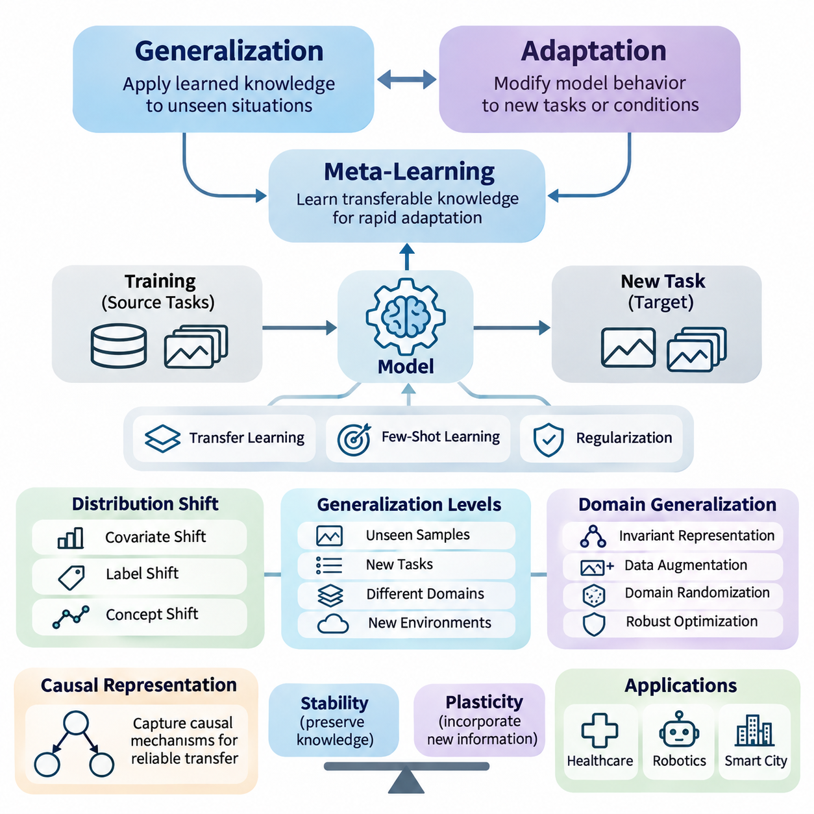
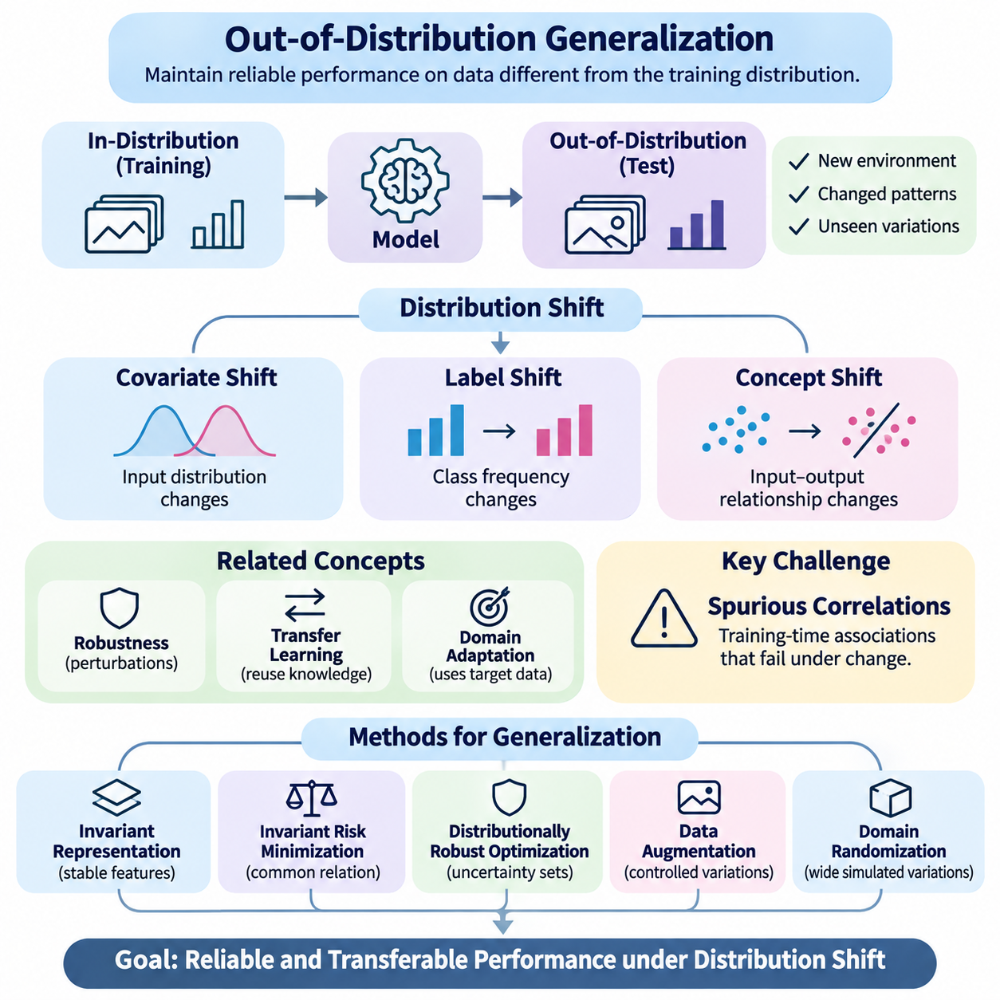
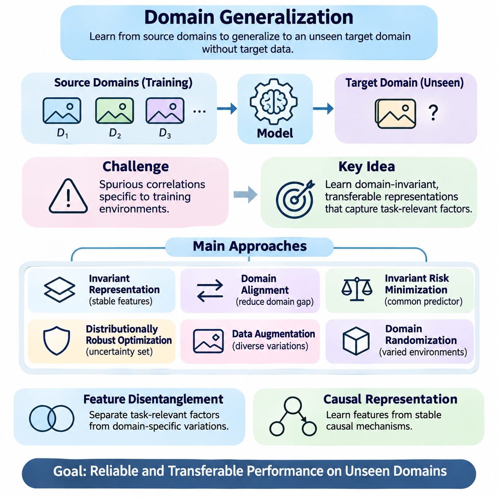
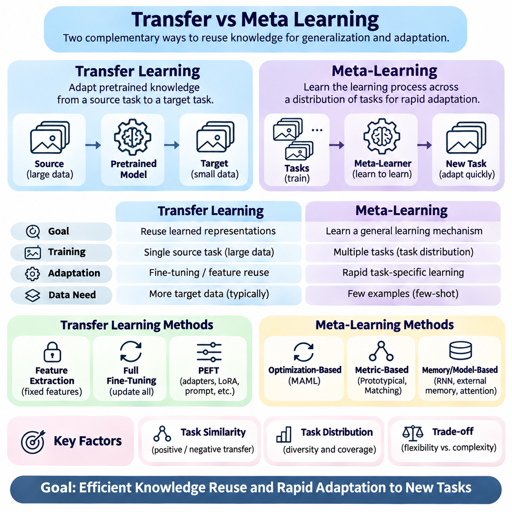
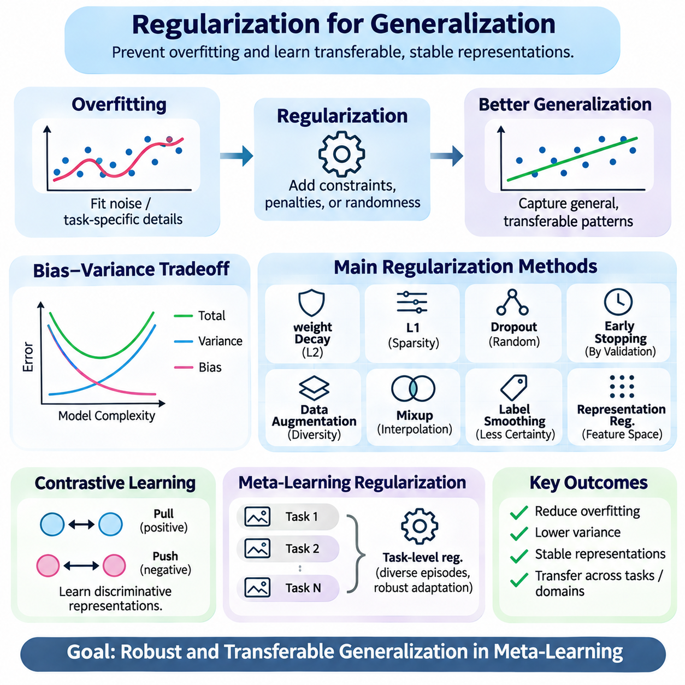
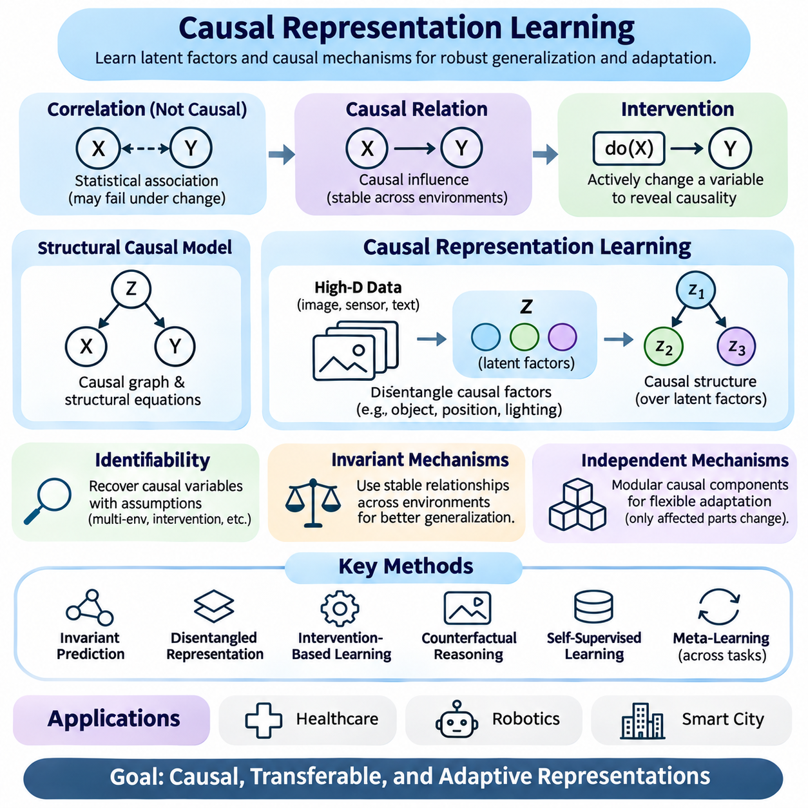
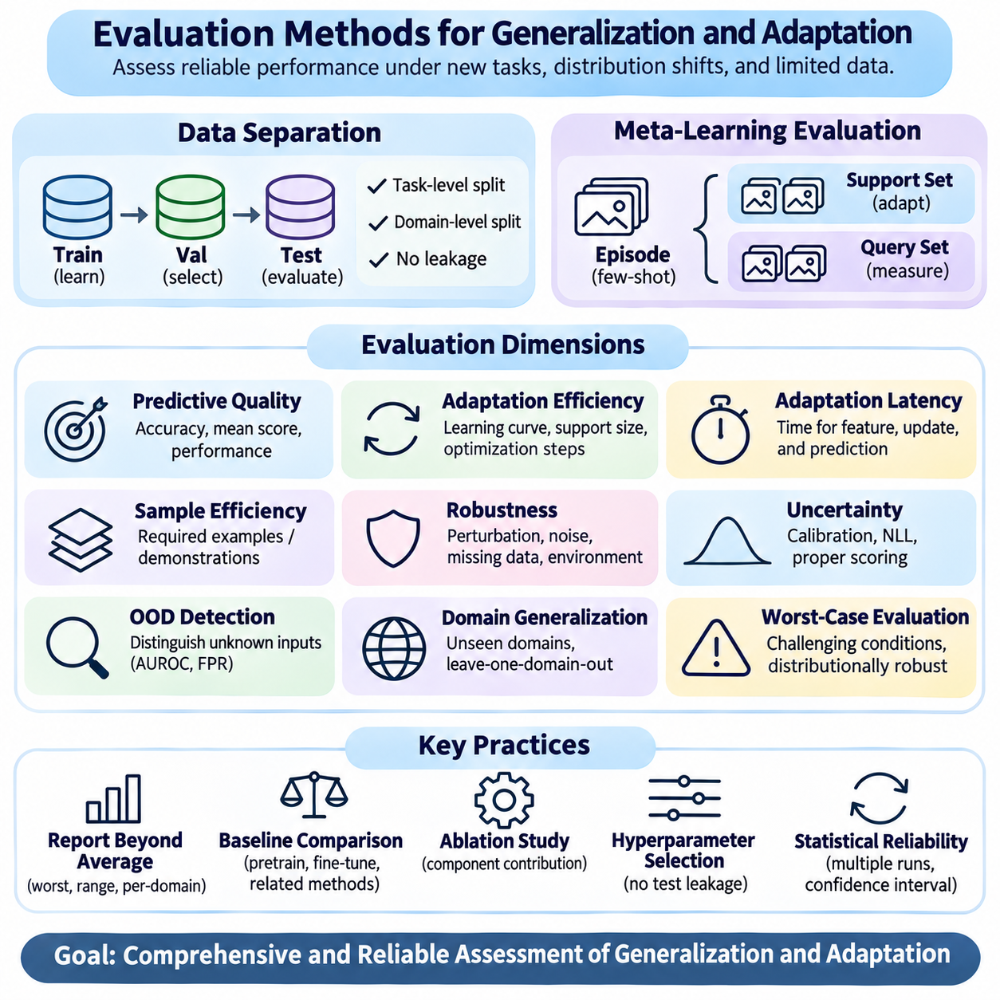
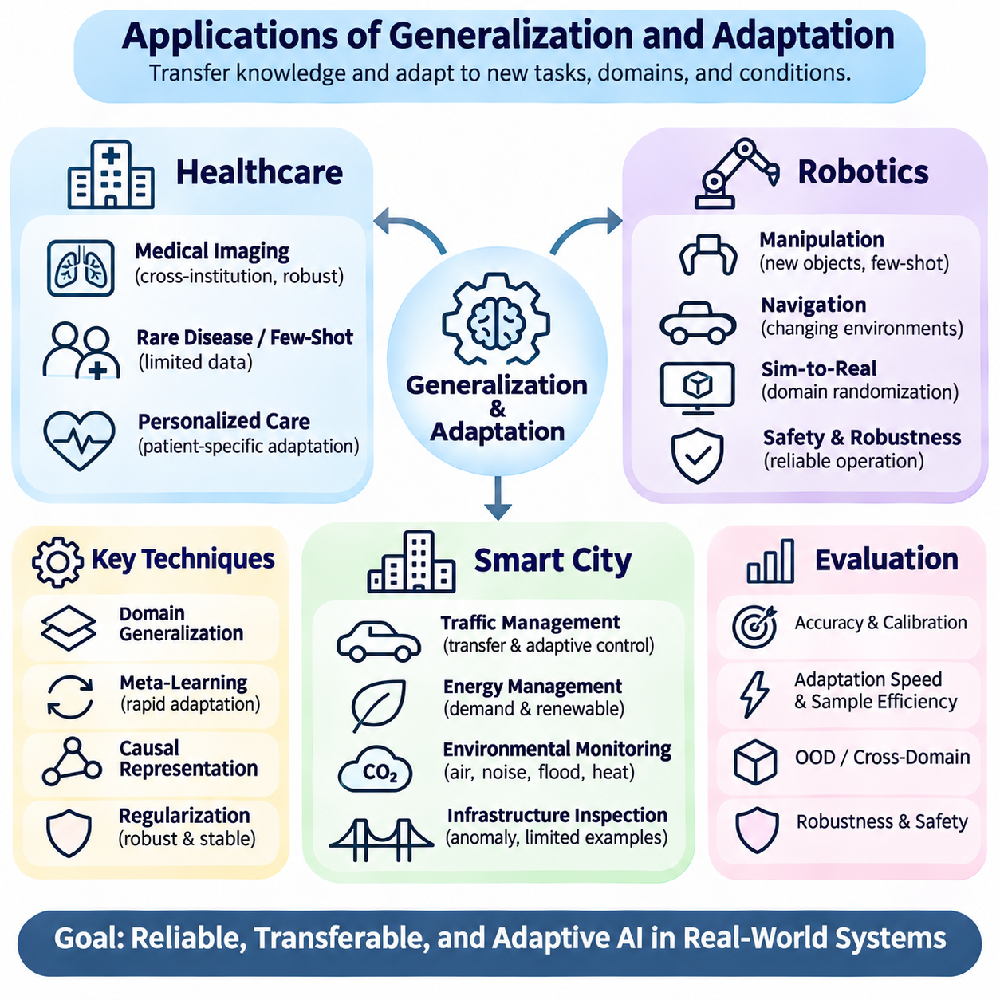

**Volume 36. Meta Learning and Few Shot Adaptation**

# 06. Generalization and Adaptation

## 06.00 Overview

{width="7.268055555555556in" height="7.268055555555556in"}

Generalization and adaptation are fundamental capabilities of intelligent learning systems, enabling models to perform effectively beyond the specific examples and environments encountered during training. Generalization concerns the ability to apply learned knowledge to unseen situations, while adaptation involves modifying model behavior in response to new tasks, data distributions, or operating conditions.

Traditional machine learning often assumes that training and testing data originate from similar statistical distributions. However, real-world environments frequently violate this assumption because of changing sensors, user behavior, environmental conditions, and operational requirements. Meta-learning addresses these challenges by learning transferable knowledge that supports rapid adaptation across related tasks.

The relationship between generalization and adaptation is particularly important in few-shot learning, where models must recognize new patterns using only a limited number of labeled examples. Successful systems combine previously acquired representations with task-specific information, allowing them to respond to unfamiliar situations without requiring extensive retraining or large additional datasets.

Generalization can be understood at several levels, including generalization to unseen samples, new tasks, different domains, and previously unobserved environmental conditions. These levels impose different requirements on learned representations and optimization procedures. A model that performs well on unseen examples from a familiar distribution may still struggle when the underlying data-generating process changes.

Out-of-distribution generalization examines model performance when evaluation data differ from the distributions represented during training. Such differences may involve feature statistics, class frequencies, environmental contexts, or relationships between inputs and outputs. The central challenge is identifying which learned patterns remain reliable when familiar statistical assumptions no longer hold.

Distribution shifts are commonly categorized as covariate shift, label shift, and concept shift. Covariate shift changes the input distribution while preserving the conditional relationship between inputs and labels. Label shift changes class frequencies, whereas concept shift alters the predictive relationship itself. Distinguishing these conditions helps determine whether adaptation, recalibration, or structural model changes are necessary.

Domain generalization focuses on developing models that perform effectively in previously unseen domains without requiring access to target-domain training data. Instead of optimizing performance for one environment, the learning process attempts to capture relationships that remain useful across multiple source domains. This approach is especially valuable when deployment environments cannot be fully anticipated during development.

Domain generalization methods frequently employ data augmentation, domain randomization, invariant representation learning, and distributionally robust optimization. These techniques expose models to diverse conditions or discourage dependence on unstable correlations. Their effectiveness depends on whether the simulated or observed variations adequately represent the uncertainties encountered during actual deployment.

Transfer learning and meta-learning provide complementary approaches to knowledge reuse. Transfer learning typically begins with representations learned from a source task and adapts them to a target task. Meta-learning instead optimizes learning behavior across a distribution of tasks, seeking representations, initializations, or adaptation procedures that enable efficient learning from limited target-task experience.

The distinction becomes particularly important when adaptation time and data availability are constrained. Conventional fine-tuning may require numerous optimization steps and substantial labeled data, whereas meta-learning can prepare a model for rapid task-specific updates. Nevertheless, meta-learning does not automatically guarantee superior generalization, especially when target tasks differ substantially from the meta-training distribution.

Regularization plays a central role in preventing models from becoming excessively dependent on training-specific patterns. Weight decay, dropout, early stopping, and representation constraints can reduce overfitting and improve stability. Within meta-learning, regularization may operate across tasks, encouraging shared representations that remain useful without suppressing the flexibility required for adaptation.

The balance between stability and plasticity is another essential consideration. Stability preserves useful knowledge acquired from previous tasks, while plasticity allows models to incorporate new information. Excessive stability can prevent adaptation, whereas excessive plasticity can cause catastrophic forgetting. Effective systems must manage this tradeoff according to task similarity, deployment constraints, and expected environmental changes.

Causal representation learning offers a promising direction for improving generalization by emphasizing relationships that remain meaningful under changing conditions. Rather than relying exclusively on statistical associations, causal approaches seek representations connected to underlying mechanisms. When valid causal structure can be identified, these representations may support more reliable transfer across environments and interventions.

However, causal representations cannot always be recovered from observational data alone. Their identification may require assumptions about the data-generating process, multiple environments, intervention data, or domain knowledge. Consequently, causal learning should be evaluated carefully rather than treated as an automatic solution to distribution shift, spurious correlations, or unreliable extrapolation.

Adaptation mechanisms vary according to the information available after deployment. Some systems update model parameters through gradient-based optimization, while others modify latent representations, normalization statistics, task embeddings, or prediction thresholds. Parameter-free adaptation can offer lower computational costs, whereas parameter updates may provide greater flexibility when sufficient reliable evidence is available.

Test-time adaptation extends this principle by allowing models to adjust using information encountered during inference. Such methods may optimize self-supervised objectives, update selected parameters, or estimate changing input statistics. Although potentially effective, they introduce risks involving noisy observations, incorrect pseudo-labels, unstable updates, and performance degradation under persistent distribution shifts.

Evaluation methods must distinguish generalization performance from adaptation performance. Generalization is commonly assessed on held-out tasks, domains, or distributions, whereas adaptation requires measuring improvement after limited exposure to new information. Meaningful comparisons should account for the number of adaptation examples, computational resources, update steps, and whether target-domain labels are available.

Robust experimental design requires separating meta-training, validation, and evaluation tasks to prevent information leakage. Domain-level separation is especially important when assessing out-of-distribution behavior. Repeated evaluation across different random seeds, task configurations, and shift intensities provides stronger evidence than performance measured on a single favorable benchmark or distribution.

Adaptation efficiency should also be considered alongside predictive accuracy. Important measurements include adaptation latency, memory consumption, computational complexity, energy requirements, and the number of observations needed to reach acceptable performance. In resource-constrained systems, a slightly less accurate method may be preferable when it delivers more predictable behavior and substantially lower operational costs.

Healthcare applications illustrate the importance of reliable generalization across institutions, patient populations, imaging devices, and clinical workflows. Models developed using data from one hospital may encounter different acquisition protocols or population characteristics elsewhere. Adaptation techniques can help address these differences, but clinical validation, calibration, and careful monitoring remain essential before deployment.

Robotics presents additional challenges because environmental changes directly influence physical behavior. Variations in terrain, lighting, payload, friction, and sensor characteristics can invalidate assumptions learned during training. Meta-learning and domain generalization can support rapid adjustment, but safety-critical control requires bounded adaptation, uncertainty awareness, and independent safeguards against unsafe actions.

Smart city systems encounter distribution shifts caused by seasonal patterns, infrastructure changes, traffic conditions, and evolving human activities. Generalizable models can support transportation forecasting, infrastructure monitoring, and resource allocation across heterogeneous urban environments. Adaptive mechanisms help maintain performance as operational conditions change, provided that updates are validated and monitored.

Ultimately, generalization and adaptation represent complementary dimensions of learning capability rather than interchangeable objectives. Generalization reduces dependence on new observations, while adaptation enables useful responses when existing knowledge becomes insufficient. Their integration provides a foundation for meta-learning systems that remain effective, efficient, and dependable across changing tasks and environments.

## 06.01 Out of Distribution Generalization

{width="7.268055555555556in" height="7.268055555555556in"}

Out-of-distribution generalization refers to the ability of a machine learning model to maintain reliable performance when encountering data that differ from the distribution observed during training. Unlike conventional generalization, which assumes similar training and testing conditions, this capability addresses unfamiliar environments, changing statistical relationships, and previously unseen variations that challenge learned representations.

The importance of out-of-distribution generalization arises from the limitations of the independent and identically distributed assumption. Many learning algorithms implicitly expect future observations to follow the same probability distribution as their training examples. In practical applications, however, sensor characteristics, environmental conditions, population structures, and operational requirements frequently change after deployment.

Distribution shift occurs when the statistical properties of incoming data differ from those represented in the training dataset. These changes may affect input features, class frequencies, conditional relationships, or combinations of these factors. Understanding the nature of distribution shift is essential because different changes require different strategies for preserving predictive accuracy and decision reliability.

Covariate shift describes situations where the distribution of input variables changes while the conditional relationship between inputs and target labels remains stable. For example, an image recognition system may encounter different lighting conditions or camera characteristics. Although the underlying recognition task remains unchanged, altered feature distributions can reduce performance when the model depends on training-specific visual patterns.

Label shift occurs when the relative frequencies of target classes change while the class-conditional input distributions remain stable. A medical classification system may encounter different disease prevalence rates across hospitals, even when the characteristics of each disease remain similar. Such changes can affect predicted probabilities and decision thresholds, requiring appropriate statistical correction or recalibration.

Concept shift represents a more fundamental change in the relationship between input variables and target outcomes. In this situation, patterns that previously supported accurate predictions may no longer describe the current environment. Concept shift is particularly challenging because correcting input statistics alone cannot restore the original predictive relationship, and additional learning or model revision may become necessary.

Out-of-distribution generalization is closely related to robustness, transfer learning, and domain adaptation, but these concepts emphasize different capabilities. Robustness concerns performance under disturbances or perturbations, while transfer learning reuses knowledge across tasks. Domain adaptation generally uses information from a target domain, whereas out-of-distribution generalization seeks reliable performance under unfamiliar distributions without assuming such information is available beforehand.

A major obstacle to generalization is the presence of spurious correlations, which are statistical associations that appear predictive during training but fail under environmental changes. Models may learn background textures, acquisition artifacts, or contextual shortcuts instead of task-relevant characteristics. When these correlations disappear or reverse, prediction quality can deteriorate despite strong performance on conventional test datasets.

Invariant representation learning attempts to address this problem by identifying features that remain useful across different environments. Rather than encoding every statistical detail of the training distribution, the model is encouraged to emphasize stable relationships associated with the prediction task. The effectiveness of this approach depends on whether the training environments provide sufficient evidence to distinguish stable signals from misleading correlations.

Invariant risk minimization introduces an optimization perspective in which a representation should support a common predictive relationship across multiple training environments. The underlying motivation is that relationships stable across diverse environments may transfer more effectively to unseen conditions. However, obtaining meaningful invariance is difficult when environments are insufficiently diverse or optimization objectives admit unintended solutions.

Distributionally robust optimization approaches generalization by considering uncertainty about the probability distribution encountered during deployment. Instead of minimizing average training loss alone, the learning objective emphasizes performance across a specified family of plausible distributions. This strategy can improve resilience to certain shifts, although overly conservative uncertainty sets may reduce performance under ordinary operating conditions.

Data augmentation provides another practical mechanism for improving generalization by exposing models to controlled variations during training. Transformations involving illumination, geometry, noise, texture, and environmental context can reduce dependence on superficial characteristics. Nevertheless, augmentation must preserve task-relevant information, since unrealistic transformations may introduce misleading examples or distort the intended learning objective.

Domain randomization extends augmentation by systematically varying simulation parameters, environmental properties, and observation conditions. This technique is particularly relevant to robotics, where simulated environments can represent different friction coefficients, object appearances, sensor noise levels, and physical configurations. Successful transfer depends on whether randomized conditions adequately cover the variations encountered in real environments.

Meta-learning contributes to out-of-distribution generalization by learning adaptation strategies across diverse tasks and environments. Through repeated task-level training, a model can acquire representations or parameter initializations that support efficient responses to unfamiliar conditions. However, the resulting capabilities remain influenced by the diversity of the meta-training task distribution and may weaken under substantial task mismatch.

Few-shot adaptation can complement generalization when limited target-environment examples become available. A model with transferable representations may require only a small number of observations to adjust its predictions or internal parameters. This approach is especially useful when comprehensive retraining is impractical, although adaptation quality depends on example representativeness, label reliability, and optimization stability.

Uncertainty estimation is important because models may produce confident predictions even when inputs differ substantially from their training experience. Probabilistic modeling, ensemble methods, and calibration techniques can provide information about predictive reliability. Nevertheless, uncertainty estimates themselves may become unreliable under severe distribution shifts, making independent validation and conservative decision policies necessary.

Out-of-distribution detection attempts to identify observations that differ significantly from the model\'s familiar data distribution. Detection methods may analyze confidence scores, feature-space distances, predictive disagreement, or estimated data likelihoods. Detecting unfamiliar inputs does not automatically determine whether predictions are incorrect, but it can support selective prediction, human review, and controlled fallback behavior.

Evaluation requires test conditions that deliberately challenge assumptions established during training. Researchers may construct benchmarks involving unseen domains, environmental changes, corrupted inputs, or shifts in class composition. Strong evaluation protocols separate training and testing environments, prevent information leakage, and examine performance across multiple shift types rather than relying on a single aggregate accuracy score.

Performance analysis should consider both average accuracy and worst-case behavior across evaluation environments. Metrics such as calibration error, negative log-likelihood, failure frequency, and performance degradation under increasing shift severity provide complementary information. Confidence intervals and repeated experimental trials help distinguish systematic improvements from variations caused by random initialization or dataset sampling.

In healthcare, out-of-distribution generalization is essential when predictive models operate across hospitals, patient populations, imaging devices, and clinical protocols. Differences in acquisition procedures or population characteristics can alter observed data distributions. Reliable deployment therefore requires external validation, subgroup analysis, uncertainty monitoring, and mechanisms for identifying conditions outside the model\'s validated operating range.

Robotics and autonomous systems encounter distribution shifts through changing weather, terrain, lighting, payload, and sensor performance. Models trained in controlled environments may fail when physical conditions differ from expectations. Generalization techniques can improve resilience, but safety-critical systems must also incorporate independent safeguards, operating limits, and fallback procedures that do not depend entirely on learned predictions.

Smart city applications face additional challenges because transportation patterns, infrastructure conditions, population behavior, and seasonal demand evolve over time. Predictive models must operate across heterogeneous locations and changing operational contexts. Robust representations and systematic evaluation can improve transferability, while monitoring systems help identify when observed conditions exceed the assumptions used during model development.

Ultimately, out-of-distribution generalization is a central requirement for developing machine learning systems that remain dependable beyond controlled training environments. Its effectiveness depends on appropriate representations, diverse training conditions, robust optimization, uncertainty awareness, and realistic evaluation. Integrating these principles with meta-learning and efficient adaptation provides a foundation for intelligent systems capable of responding to unfamiliar and evolving conditions.

## 06.02 Domain Generalization

{width="7.268055555555556in" height="7.268055555555556in"}

Domain generalization is a machine learning paradigm that aims to develop models capable of performing reliably in previously unseen domains without accessing target-domain data during training. Unlike conventional learning, which assumes similar training and testing distributions, domain generalization emphasizes transferable representations and predictive relationships that remain useful across changing environments, populations, and operational conditions.

A domain represents a particular data-generating environment characterized by statistical properties, acquisition conditions, and contextual factors. Different domains may share the same prediction task while exhibiting substantial differences in input distributions. For example, image classification datasets collected using different cameras, lighting conditions, or geographical locations may represent distinct domains despite containing similar object categories.

The fundamental objective of domain generalization is to learn a predictive function from one or more source domains that performs effectively on an unseen target domain. Training data may originate from multiple environments, but the target distribution remains unavailable during model development. This restriction distinguishes domain generalization from domain adaptation, where unlabeled or labeled target-domain observations may be available.

Domain generalization becomes challenging because machine learning models often exploit statistical correlations that are specific to their training environments. Features such as image backgrounds, recording artifacts, or contextual information may provide shortcuts for prediction. Although these correlations improve training accuracy, they may disappear or change in unseen domains, causing substantial degradation in generalization performance.

A central principle of domain generalization is the identification of domain-invariant features that preserve predictive information across environmental changes. These features should capture relationships relevant to the underlying task rather than incidental characteristics of particular datasets. However, complete invariance is neither always achievable nor necessarily desirable, because some domain-specific information may remain useful for accurate predictions.

Invariant representation learning encourages models to construct feature spaces in which predictive relationships remain stable across source domains. This can involve reducing discrepancies between domain-specific feature distributions or encouraging consistent predictive mechanisms. The challenge is ensuring that alignment preserves class-discriminative information rather than eliminating useful distinctions between different categories or tasks.

Domain alignment methods attempt to reduce statistical differences among source-domain representations. Techniques may employ distribution matching, adversarial learning, or discrepancy minimization objectives. Although alignment can improve transferability under suitable conditions, matching marginal feature distributions alone does not guarantee successful generalization when label relationships or class proportions differ across environments.

Invariant risk minimization seeks representations that support a common optimal predictor across multiple training environments. Instead of minimizing average prediction error alone, the learning objective encourages consistency in predictive relationships. Its theoretical motivation is that stable mechanisms may generalize beyond observed environments, although practical implementations can struggle with optimization difficulties and insufficient environmental diversity.

Distributionally robust optimization provides an alternative perspective by minimizing prediction risk under unfavorable distributions within a specified uncertainty set. This approach emphasizes resilience rather than performance on the average training distribution. Group-based robust optimization can prioritize poorly performing source domains, but improvements depend on whether the uncertainty model adequately represents plausible deployment conditions.

Data augmentation is widely used to improve domain generalization by exposing models to diverse variations during training. Image transformations, noise injection, style changes, and synthetic perturbations can reduce dependence on superficial domain characteristics. Effective augmentation should preserve task semantics while introducing realistic diversity, because excessive or inappropriate transformations may damage useful information.

Domain randomization extends augmentation by varying environmental parameters systematically, particularly in simulation-based learning. Robotics systems may encounter randomized lighting, textures, friction coefficients, sensor noise, and object configurations during training. By learning across diverse simulated conditions, models can become less sensitive to individual environmental assumptions, although simulation coverage remains a critical limitation.

Feature disentanglement attempts to separate task-relevant factors from domain-specific variations within learned representations. Ideally, a model distinguishes stable semantic information from nuisance variables such as illumination or acquisition style. However, disentanglement is difficult to identify uniquely without additional assumptions, supervision, or structural constraints, and imperfect separation can reduce predictive performance.

Causal representation learning offers another perspective by seeking features associated with stable mechanisms underlying observed relationships. If predictive features reflect causal structures rather than environment-dependent correlations, they may transfer more reliably across domains. Nevertheless, causal relationships cannot generally be identified from observational correlations alone, making environmental diversity and domain knowledge important.

Meta-learning supports domain generalization by organizing training around simulated domain shifts or task-level adaptation episodes. A model may repeatedly train on selected source domains and evaluate learning behavior on held-out source environments. This process encourages representations or optimization strategies that perform beyond the domains used in individual updates, approximating the challenge of unseen-domain deployment.

Meta-learning-based domain generalization methods often separate available source environments into temporary meta-training and meta-testing partitions. Model parameters are optimized to improve performance after simulated distribution changes. Unlike conventional meta-learning for few-shot adaptation, strict domain generalization evaluates predictions without target-domain adaptation, although both approaches can share episodic training principles.

Regularization contributes to domain generalization by discouraging overly complex or environment-specific predictive relationships. Weight decay, dropout, feature consistency constraints, and representation penalties can reduce sensitivity to training-domain artifacts. However, excessive regularization may cause underfitting, making it necessary to balance stable knowledge extraction with sufficient model capacity.

Self-supervised learning can improve domain generalization by learning representations from diverse unlabeled observations. Contrastive learning, masked prediction, and consistency-based objectives may capture reusable structural information without relying exclusively on labeled source examples. Their effectiveness depends on whether the learned features emphasize transferable semantics rather than shortcuts introduced by the pretraining data.

Domain generalization evaluation requires strict separation between source and target domains. Leave-one-domain-out protocols train models using several environments and evaluate them on a previously excluded environment. This methodology provides evidence of transferability, but results can vary substantially depending on which domain is held out and whether benchmark environments represent realistic deployment shifts.

Model selection is particularly difficult because target-domain validation data are unavailable under the standard domain generalization setting. Hyperparameters must therefore be selected using source-domain validation procedures or simulated domain shifts. Evaluating multiple held-out source environments can provide useful guidance, although source-domain performance does not necessarily predict generalization to fundamentally different target conditions.

Performance assessment should consider average accuracy, worst-domain accuracy, calibration, and sensitivity to distribution changes. Repeated experiments across random seeds and domain partitions help quantify uncertainty in reported results. Strong benchmark performance should not be interpreted as universal robustness, because domain generalization guarantees rarely extend beyond the assumptions represented by the evaluation design.

Healthcare applications illustrate the importance of domain generalization across hospitals, imaging devices, patient populations, and clinical workflows. Models trained on multiple institutions may learn more transferable diagnostic representations than models trained under narrowly controlled conditions. Nevertheless, external clinical validation and subgroup evaluation remain essential because unseen populations can introduce shifts beyond those observed during development.

Robotics applications require models to operate across different terrains, lighting conditions, sensor configurations, and physical environments. Domain generalization can improve perception and control transfer from simulation to real-world deployment. However, physical systems also require uncertainty monitoring, independent safety mechanisms, and conservative fallback behavior because predictive robustness alone cannot guarantee operational safety.

Smart city applications involve heterogeneous transportation networks, infrastructure configurations, environmental conditions, and human activity patterns. Domain-generalized models can support traffic prediction, infrastructure monitoring, and urban sensing across different locations. Their effectiveness depends on whether source environments capture sufficient structural diversity to support reliable predictions under previously unseen urban conditions.

Ultimately, domain generalization seeks to transform experience across limited source environments into predictive knowledge that remains useful in unfamiliar settings. Achieving this objective requires careful representation learning, realistic environmental diversity, robust optimization, and rigorous evaluation. Its integration with meta-learning provides a foundation for intelligent systems that can operate across changing domains without depending on continuous target-specific retraining.

## 06.03 Transfer vs Meta Learning

{width="7.268055555555556in" height="7.268055555555556in"}

Transfer learning and meta-learning are complementary approaches for reusing knowledge across tasks, but they differ in how transferable knowledge is acquired and applied. Transfer learning typically adapts representations learned from a source task to a target task, whereas meta-learning explicitly optimizes the learning process across multiple tasks. Understanding this distinction is essential for designing systems that generalize efficiently under limited data and computational resources.

Transfer learning assumes that knowledge acquired from one learning problem can improve performance on another related problem. A model is commonly pretrained on a large source dataset and subsequently adapted to a smaller target dataset. The transferred knowledge may include feature representations, model parameters, or structural patterns that reduce the amount of target-specific training required to achieve useful predictive performance.

Meta-learning, often described as learning to learn, focuses on acquiring mechanisms that enable rapid learning from new experiences. Instead of optimizing only for performance on individual training tasks, meta-learning considers a distribution of tasks and seeks parameters, representations, or update strategies that support effective adaptation. The resulting model is evaluated on previously unseen tasks drawn from a related task distribution.

The fundamental difference lies in the training objective. Conventional transfer learning primarily seeks a representation that performs well on a source task and remains useful for downstream adaptation. Meta-learning directly incorporates future adaptation performance into its optimization process. Consequently, meta-learning can learn initializations or representations specifically designed to respond efficiently to limited target-task observations.

Pretraining and fine-tuning form the most common transfer learning workflow. During pretraining, a model acquires general representations from extensive source data. Fine-tuning then updates some or all parameters using target-task examples. This approach is widely applied in computer vision and natural language processing, where large pretrained models provide reusable features for classification, recognition, and prediction tasks.

Feature extraction represents a computationally efficient form of transfer learning in which pretrained model parameters remain fixed. A new prediction layer is trained using representations produced by the frozen feature extractor. This strategy reduces training cost and the risk of overfitting on small datasets, although its effectiveness depends on whether the original representations adequately capture the characteristics required by the target task.

Full fine-tuning offers greater flexibility by updating all model parameters during target-task training. It can improve performance when source and target tasks differ substantially, provided sufficient representative data are available. However, extensive parameter updates increase computational requirements and may cause overfitting or catastrophic forgetting, particularly when target datasets are small or contain substantial noise.

Parameter-efficient fine-tuning provides an intermediate solution by updating only selected components of a pretrained model. Techniques such as adapters, low-rank adaptation, and prompt-based tuning can reduce memory consumption while retaining much of the original model\'s knowledge. These approaches remain forms of transfer learning because their primary objective is adapting previously acquired representations to a target application.

Optimization-based meta-learning introduces a different strategy by learning parameter initializations that support rapid task-specific optimization. Model-agnostic meta-learning, or MAML, repeatedly samples tasks and evaluates performance after a small number of gradient updates. Its outer optimization process improves the initialization so that subsequent adaptation requires fewer examples and optimization steps.

Metric-based meta-learning approaches rapid adaptation through learned similarity structures rather than extensive parameter updates. Prototypical networks construct class representations from support examples and classify queries according to distances in an embedding space. Matching networks and related methods similarly use learned representations to compare new observations with limited labeled examples.

Memory-based and model-based meta-learning extend this principle by learning mechanisms that incorporate task information dynamically. Recurrent networks, external memory modules, and attention-based architectures can encode previous observations and adjust predictions without conventional gradient-based fine-tuning. Their effectiveness depends on how well the learned adaptation mechanism transfers across tasks with different structures.

Task distribution plays a central role in meta-learning because it determines the experiences from which learning strategies are acquired. Training tasks must provide sufficient diversity to encourage reusable adaptation behavior while maintaining meaningful relationships with expected evaluation tasks. If the target task differs substantially from the meta-training distribution, rapid adaptation may become unreliable despite strong benchmark performance.

Transfer learning is also sensitive to differences between source and target distributions. Positive transfer occurs when previously learned knowledge improves target-task performance, while negative transfer occurs when unsuitable source representations interfere with learning. Task similarity, feature compatibility, and label relationships therefore influence whether transfer learning provides meaningful advantages over training a model from scratch.

The distinction between transfer learning and meta-learning becomes especially important in few-shot learning. A pretrained model may already possess strong representations that require only a simple classifier for a new task. Meta-learning attempts to improve this process by explicitly training for few-example adaptation. Nevertheless, strong pretrained representations can match or outperform complex meta-learning methods, depending on the benchmark and adaptation protocol.

Data efficiency is frequently presented as a major advantage of meta-learning, but comparisons must account for total training resources. Meta-learning may require extensive task sampling, repeated inner-loop optimization, and substantial computational expenditure before deployment. Transfer learning may instead rely on a single large pretraining stage followed by inexpensive adaptation, making overall efficiency dependent on the complete training lifecycle.

Computational complexity also differs between adaptation methods. Gradient-based meta-learning can involve higher-order derivatives, multiple optimization loops, and considerable memory consumption. First-order approximations reduce some of these costs, while metric-based approaches often provide faster inference-time adaptation. Conventional transfer learning offers flexible computational tradeoffs through frozen encoders, partial fine-tuning, and parameter-efficient updates.

Generalization should be evaluated separately from adaptation speed. A model that learns a new task quickly may still perform poorly when the task differs from its training experience. Similarly, a broadly pretrained representation may generalize effectively without explicit meta-learning. Reliable comparisons therefore require evaluation across unseen tasks, distribution shifts, varying support-set sizes, and different adaptation budgets.

Experimental protocols must control for differences in backbone architectures, pretraining datasets, parameter counts, and computational resources. Comparing a meta-learned model against a weak transfer learning baseline can exaggerate apparent benefits. Strong evaluations include frozen-feature classifiers, conventional fine-tuning, and appropriately configured meta-learning methods under comparable data and computational constraints.

In computer vision, transfer learning commonly adapts pretrained visual encoders to classification, detection, or segmentation tasks. Meta-learning is particularly relevant when new categories must be recognized from very few labeled images. Hybrid approaches combine large-scale representation pretraining with episodic meta-learning, allowing models to benefit from general visual features while improving their ability to adapt to unfamiliar categories.

Natural language processing provides another important comparison. Large language models acquire transferable linguistic representations through extensive pretraining and can be adapted through fine-tuning or parameter-efficient methods. Meta-learning principles can support task-conditioned adaptation and rapid specialization, although in-context learning should not automatically be treated as equivalent to explicit meta-learning without examining the training objective.

Robotics presents demanding conditions because new tasks may involve changes in dynamics, payloads, terrain, and control objectives. Transfer learning can reuse perception and control representations from simulation or previous robots, while meta-learning can prepare controllers for rapid adaptation to changing dynamics. Both approaches require careful validation because fast adaptation does not independently guarantee stability or physical safety.

Healthcare applications illustrate the importance of choosing an approach according to data availability and deployment constraints. Transfer learning can adapt pretrained imaging or clinical models to specialized diagnostic tasks, while meta-learning may support adaptation across institutions or rare conditions with limited examples. However, differences in patient populations and clinical protocols require external validation regardless of the learning strategy.

Ultimately, transfer learning emphasizes the reuse and adaptation of previously acquired knowledge, whereas meta-learning explicitly optimizes how new knowledge is acquired. Neither approach is universally superior, and their strengths often overlap in practical systems. Combining transferable representations with efficient adaptation mechanisms offers a flexible foundation for intelligent models that must operate across unfamiliar tasks and changing environments.

## 06.04 Regularization for Generalization

{width="7.268055555555556in" height="7.268055555555556in"}

Regularization is a fundamental technique for improving generalization by preventing machine learning models from becoming excessively specialized to their training data. It introduces constraints, penalties, or controlled randomness that discourage overfitting and promote more stable predictive behavior. In meta-learning, regularization is particularly important because models must generalize across both unseen examples and unfamiliar tasks.

Overfitting occurs when a model captures noise, incidental correlations, or task-specific details instead of patterns that remain useful beyond the training dataset. Highly flexible models can achieve low training error while performing poorly on unseen observations. Regularization reduces this tendency by controlling effective model complexity, limiting unstable parameter configurations, and encouraging representations that transfer across different conditions.

The bias-variance tradeoff provides a useful perspective on regularization. Models with excessive flexibility may exhibit high variance because their predictions depend strongly on particular training samples. Strong regularization can reduce variance but introduce bias by restricting the relationships a model can represent. Effective generalization requires balancing these effects according to dataset size, task diversity, and expected distribution changes.

Weight decay is a widely used regularization method that discourages excessively large model parameters. By penalizing parameter magnitude, it can reduce sensitivity to training-specific fluctuations and improve optimization behavior. L2 regularization is closely related to weight decay, although their implementations differ under some adaptive optimizers. Appropriate regularization strength depends on architecture, optimization settings, and data characteristics.

L1 regularization encourages sparse parameter configurations by penalizing the absolute magnitude of model weights. Sparsity can simplify representations and reduce dependence on irrelevant features, potentially improving interpretability and generalization. However, sparse solutions are not automatically more robust, and excessive penalties may eliminate useful relationships that become important under new tasks or environments.

Dropout introduces stochastic regularization by randomly disabling selected neural network activations during training. This discourages excessive reliance on individual features and promotes distributed representations. Dropout can improve generalization in many architectures, but its effectiveness depends on network structure, training conditions, and placement. Excessive dropout may disrupt learning or reduce predictive accuracy.

Early stopping limits overfitting by terminating optimization when validation performance stops improving. Instead of relying exclusively on explicit parameter penalties, this technique controls how closely a model fits the training observations. In meta-learning, validation should involve separate tasks rather than only separate examples, because the objective is to generalize across task boundaries as well as individual samples.

Data augmentation acts as an implicit regularizer by increasing the diversity of training observations through controlled transformations. Geometric changes, noise injection, feature perturbations, and synthetic examples can discourage memorization of superficial patterns. Effective augmentation must preserve the relevant task semantics, since inappropriate transformations may alter labels or introduce unrealistic relationships.

Mixup regularization constructs synthetic examples by interpolating training inputs and their corresponding labels. This encourages smoother predictive behavior between observed samples and may reduce excessive confidence. Related methods operate within feature spaces or combine information from different observations. Their effectiveness depends on whether interpolation produces meaningful examples for the underlying task.

Label smoothing modifies training targets by reducing the certainty assigned to individual classes. This can discourage overly confident predictions and sometimes improve calibration and generalization. However, label smoothing does not guarantee robustness under distribution shift and may interfere with objectives that depend on precise probability estimates. Its usefulness must therefore be evaluated within the intended application.

Representation regularization constrains learned feature spaces rather than focusing exclusively on model parameters. Techniques may encourage compact embeddings, feature consistency, class separation, or reduced sensitivity to irrelevant transformations. In few-shot learning, these constraints can improve the quality of similarity comparisons and support more reliable classification when only limited labeled examples are available.

Contrastive learning provides a representation-oriented regularization mechanism by encouraging related observations to occupy nearby regions of an embedding space while separating unrelated examples. Positive and negative pair construction strongly influences the resulting representation. If pair definitions reflect superficial correlations rather than task-relevant relationships, contrastive objectives may reinforce shortcuts instead of improving generalization.

Meta-learning introduces additional regularization challenges because training involves multiple related tasks. A model may overfit the meta-training task distribution even when individual task performance appears satisfactory. Meta-regularization therefore aims to discourage dependence on particular training tasks and promote adaptation strategies that remain effective across unfamiliar task configurations.

Task-level regularization can be implemented by sampling diverse episodes, varying support-set sizes, and controlling the relationships among training tasks. Such strategies encourage models to avoid reliance on narrow task structures. However, artificial diversity is not always beneficial, because excessively unrealistic episodes may weaken learning of the shared structure needed for effective adaptation.

In optimization-based meta-learning, regularization can influence both the initialization and the task-specific adaptation process. Constraints on inner-loop updates may prevent rapid overfitting to small support sets, while outer-loop penalties can encourage broadly useful parameter configurations. The balance is important because excessive restrictions may preserve stability at the expense of the flexibility required for new tasks.

Gradient-based regularization can penalize sensitivity of predictions or losses to changes in inputs and parameters. Gradient penalties and Jacobian regularization encourage smoother local behavior around observed examples. These methods may improve resistance to certain perturbations, but local smoothness does not guarantee reliable predictions under large distribution shifts or fundamentally different task relationships.

Sharpness-aware optimization seeks parameter configurations whose training loss remains relatively stable under small parameter perturbations. The motivation is that flatter local loss regions may correspond to solutions with improved generalization. Nevertheless, measured sharpness depends on parameterization and optimization choices, and empirical benefits should be established through controlled evaluation rather than assumed universally.

Domain-oriented regularization attempts to reduce dependence on environment-specific information by encouraging consistent predictions or representations across source domains. Invariance penalties and distribution alignment objectives can help identify transferable features. However, excessive alignment may remove useful class information, especially when domains differ in label distributions or predictive mechanisms.

Bayesian regularization introduces prior assumptions about model parameters and represents uncertainty through probability distributions. Maximum a posteriori estimation connects certain parameter penalties to probabilistic priors, while Bayesian meta-learning can model uncertainty across tasks. Such approaches may support more cautious predictions, although computational complexity and prior misspecification remain important limitations.

Regularization strength should be selected using validation procedures that reflect the intended generalization objective. For meta-learning, held-out validation tasks provide more meaningful evidence than random splits of examples from familiar tasks. For domain generalization, validation across separate source environments can reveal sensitivity to distribution changes, although it cannot guarantee performance in unseen target domains.

Evaluation should distinguish improvements in average accuracy from improvements in robustness, calibration, and adaptation efficiency. Strong regularization may reduce training accuracy while improving performance on unfamiliar tasks, but excessive constraints can cause underfitting. Repeated experiments, controlled baselines, and comparisons across regularization strengths are necessary to establish whether observed gains are consistent and practically meaningful.

In robotics, regularization can improve the transfer of perception and control models across variations in lighting, terrain, sensor noise, and physical dynamics. In healthcare, it can reduce dependence on institution-specific acquisition patterns or limited patient samples. Nevertheless, safety-critical applications require external validation and operational safeguards because regularization alone cannot guarantee reliable behavior under unfamiliar conditions.

Ultimately, regularization supports generalization by balancing model flexibility with resistance to noise, unstable correlations, and task-specific overfitting. Its most effective form depends on the architecture, training objective, task distribution, and deployment environment. Integrating parameter constraints, representation learning, task diversity, and rigorous validation provides a foundation for meta-learning systems that adapt efficiently while preserving dependable performance.

## 06.05 Causal Representation Learning

{width="7.268055555555556in" height="7.268055555555556in"}

Causal representation learning aims to discover latent variables and relationships that reflect the underlying mechanisms generating observed data. Unlike conventional representation learning, which often emphasizes statistical correlations, causal approaches seek structures that remain meaningful under interventions and environmental changes. This perspective is particularly relevant to generalization and adaptation across unfamiliar tasks and domains.

Traditional machine learning models frequently exploit predictive associations without distinguishing causal relationships from incidental correlations. A feature may correlate strongly with a target variable during training while having no direct influence on the underlying outcome. When environmental conditions change, such associations can disappear, producing unreliable predictions despite strong performance on conventional evaluation datasets.

Causal reasoning distinguishes observation from intervention. Observational relationships describe statistical dependencies found in existing data, whereas interventions examine how outcomes change when specific variables are deliberately modified. This distinction helps identify relationships that may remain stable across environments, although reliable causal conclusions require appropriate assumptions, experimental evidence, or additional structural knowledge.

Structural causal models provide a formal framework for representing causal relationships among variables. Each variable is described through a structural equation involving its direct causes and an exogenous disturbance term. The resulting causal graph expresses assumptions about directional dependencies, allowing researchers to reason about interventions, counterfactual outcomes, and the consequences of changes in generating mechanisms.

Causal representation learning extends structural causal modeling to high-dimensional observations such as images, sensor measurements, and language. Instead of assuming that meaningful causal variables are directly observable, the model attempts to infer them from complex data. The challenge is separating underlying factors, such as object identity, position, lighting, and environmental conditions, while preserving their causal relationships.

Disentangled representation learning is closely related to causal representation learning because both seek meaningful factors within learned feature spaces. However, statistically independent latent dimensions are not necessarily causal variables. A representation may separate visual characteristics without identifying which factors influence others, making additional assumptions or intervention-based evidence necessary for causal interpretation.

Identifiability is a central theoretical challenge because different causal models can produce the same observational distribution. Without sufficient assumptions, latent causal variables and their relationships cannot generally be recovered uniquely from passive observations. Multiple environments, known interventions, temporal structure, auxiliary variables, or domain-specific constraints may provide information that improves identifiability.

Invariant causal mechanisms offer an important motivation for generalization. If the relationship between a variable and its direct causes remains stable across environments, a model exploiting that mechanism may transfer more reliably than one relying on incidental correlations. However, invariance depends on which mechanisms change, and causal relationships do not automatically guarantee predictive stability under every possible distribution shift.

Invariant prediction methods attempt to identify relationships that remain consistent across multiple environments. By comparing predictive mechanisms under different conditions, researchers can seek features whose association with outcomes is less sensitive to environmental changes. Such methods depend on assumptions about interventions and environmental variation, and insufficient diversity may prevent reliable identification of stable causal structure.

Independent causal mechanisms provide another conceptual foundation. The principle suggests that a complex data-generating process can be understood through components whose mechanisms can change independently. This modular perspective supports adaptation because a change affecting one mechanism may require updating only the corresponding component rather than relearning the entire predictive system.

Counterfactual reasoning considers outcomes that would have occurred under alternative conditions for the same underlying situation. In representation learning, counterfactual examples can help distinguish task-relevant factors from environmental characteristics. Generating valid counterfactuals is difficult, however, because hypothetical changes must respect the causal structure and cannot simply be treated as arbitrary feature transformations.

Intervention-based learning provides stronger causal evidence when variables can be deliberately manipulated. Controlled changes to lighting, object position, physical parameters, or environmental conditions may reveal which factors influence observations and outcomes. In robotics and simulation, such interventions can be generated systematically, although simulated causal relationships must be validated against real-world behavior.

Self-supervised learning can contribute to causal representation discovery by extracting structure from large collections of unlabeled observations. Temporal prediction, object-centric learning, and consistency objectives may reveal persistent entities and changing environmental factors. Nevertheless, self-supervised objectives alone do not establish causal identifiability, and learned representations may still encode noncausal shortcuts.

Meta-learning offers a natural connection to causal representation learning because training across multiple tasks can expose variations in underlying mechanisms. A meta-learner may discover reusable structural knowledge while learning to adapt task-specific components. If tasks differ through localized causal changes, modular representations may support efficient adaptation without requiring extensive updates to unrelated model parameters.

Few-shot learning can benefit from causal representations when limited examples reveal changes in a small number of relevant mechanisms. Instead of relearning complex associations, a model may adjust a compact causal component while preserving stable relationships. This advantage depends on whether the learned causal structure is accurate and whether the new task follows the assumed pattern of mechanism variation.

Domain generalization and causal representation learning share the objective of reducing dependence on unstable environmental correlations. Causal features may remain informative when background appearance, acquisition conditions, or contextual patterns change. However, domain-invariant features are not necessarily causal, and causal features are not universally invariant, so empirical validation remains essential.

Optimization methods for causal representations may combine reconstruction losses, independence constraints, intervention consistency, and predictive objectives. The choice of objective determines which properties are encouraged in the latent space. Because several objectives can admit noncausal solutions, successful optimization does not by itself establish that the resulting variables correspond to genuine causal factors.

Evaluation requires more than conventional prediction accuracy. Researchers may examine whether learned variables respond correctly to interventions, preserve expected dependencies, and support transfer under controlled mechanism changes. Synthetic benchmarks with known causal structures provide useful diagnostic settings, while real-world evaluation tests whether identified relationships remain meaningful outside simplified experimental assumptions.

Robotics provides an important application because physical systems contain interacting mechanisms involving forces, motion, contact, and control actions. Causal representations can potentially separate object properties, environmental dynamics, and actuator effects. Such structure may improve adaptation to new payloads or surfaces, but reliable deployment still requires system identification, uncertainty monitoring, and independent safety constraints.

Healthcare applications may benefit from distinguishing causal clinical factors from institution-specific correlations. Models that rely on acquisition artifacts or demographic proxies may fail across hospitals and patient populations. Causal representations could support more transferable reasoning, but observational clinical data often contain confounding, selection bias, and incomplete measurements that limit causal identification.

Smart city systems involve interconnected mechanisms governing transportation, energy demand, infrastructure, and human activity. Causal representation learning may help distinguish structural relationships from temporary correlations caused by weather, events, or seasonal changes. However, policy interventions can modify behavior and create feedback effects, requiring continual validation of the assumed causal structure.

Practical implementation must account for computational complexity, data requirements, and uncertainty in causal assumptions. Learning meaningful causal variables from high-dimensional observations often requires diverse environments or intervention information that may be expensive to obtain. Hybrid approaches combining domain knowledge, representation learning, simulation, and experimental validation can provide a more realistic development strategy.

Ultimately, causal representation learning seeks to improve generalization by capturing mechanisms that explain how observations and outcomes arise. Its potential value lies in supporting stable prediction, modular adaptation, and reasoning under interventions rather than merely reproducing training correlations. Integration with meta-learning offers promising opportunities, but dependable results require explicit assumptions, identifiable structures, and rigorous empirical verification.

## 06.06 Evaluation Methods

{width="7.268055555555556in" height="7.268055555555556in"}

Evaluation methods for generalization and adaptation determine whether machine learning systems can maintain reliable performance beyond the conditions encountered during training. Conventional test accuracy provides only a partial assessment because unfamiliar tasks, distribution shifts, and limited adaptation data introduce additional challenges. Effective evaluation must measure predictive quality, adaptation efficiency, robustness, and uncertainty under realistic operating conditions.

A fundamental requirement is separating training, validation, and testing data according to the intended generalization objective. Random example-level splits may be insufficient when observations share task identities, environments, or acquisition procedures. Task-level and domain-level separation help prevent information leakage and provide stronger evidence that models can transfer knowledge beyond familiar training conditions.

In meta-learning, evaluation commonly uses episodic protocols that reproduce the structure of few-shot adaptation. Each episode contains a support set for learning task-specific information and a query set for measuring predictive performance. Tasks used during meta-testing must remain separate from meta-training tasks, allowing researchers to assess whether learned adaptation mechanisms transfer to previously unseen problems.

Few-shot classification benchmarks often use N-way K-shot evaluation, where N represents the number of classes and K indicates the number of labeled support examples per class. Query accuracy measures performance after adaptation to the sampled task. Comparisons must control episode construction, class sampling, query-set size, and adaptation procedures because these choices can substantially influence reported results.

Out-of-distribution evaluation examines performance when test observations differ statistically from training data. Researchers may introduce changes in appearance, noise, class proportions, acquisition conditions, or predictive relationships. Distinguishing covariate shift, label shift, and concept shift is important because each affects model behavior differently and may require different mechanisms for maintaining reliability.

Domain generalization benchmarks assess whether models trained on one or more source environments perform effectively on unseen target domains. Leave-one-domain-out evaluation repeatedly excludes a domain from training and uses it exclusively for testing. This approach measures transfer across environments, although results depend on the diversity of available domains and the severity of the held-out distribution shift.

Cross-domain evaluation should consider both average performance and variability across target environments. A model may achieve strong mean accuracy while failing on a particularly difficult domain. Reporting worst-domain accuracy, performance ranges, and domain-specific results provides a more complete understanding of reliability than presenting only an aggregated benchmark score.

Adaptation efficiency measures how rapidly a model improves after receiving new task information. Learning curves can show predictive performance as a function of support-set size, optimization steps, or adaptation time. These measurements distinguish methods that achieve high final accuracy through extensive updates from those that reach useful performance with minimal data and computational effort.

Adaptation latency is especially important in real-time and resource-constrained systems. Evaluation should include the time required for feature extraction, gradient updates, memory access, and prediction generation. Computational cost must be measured under comparable hardware and software conditions, because algorithmic complexity alone does not fully describe practical deployment performance.

Sample efficiency evaluates the amount of target-task information required to reach a specified performance level. Researchers can compare models using different numbers of labeled examples, demonstrations, or interaction trajectories. Performance should be reported across multiple support-set sizes because a method that excels in one-shot adaptation may not remain superior when additional examples become available.

Robustness evaluation examines sensitivity to perturbations, noise, missing observations, and environmental changes. Controlled corruption benchmarks can reveal weaknesses that conventional test sets overlook. However, artificial perturbations do not necessarily reproduce real-world distribution shifts, so robustness claims should be supported by evaluation under naturally occurring environmental variations whenever possible.

Uncertainty evaluation determines whether model confidence reflects the reliability of its predictions. Calibration metrics, negative log-likelihood, and proper scoring rules provide complementary measures of probabilistic quality. A model may achieve high classification accuracy while remaining poorly calibrated, particularly when encountering unfamiliar tasks or distribution shifts.

Out-of-distribution detection can be evaluated by measuring how effectively a model distinguishes unfamiliar observations from known-distribution inputs. Common measures include area under the receiver operating characteristic curve and false-positive rates at specified detection thresholds. Detection performance should be interpreted separately from predictive accuracy because identifying unfamiliar inputs does not necessarily imply correct classification.

Worst-case evaluation emphasizes performance under challenging but plausible conditions rather than average behavior alone. Distributionally robust assessment may consider predefined uncertainty sets or the most difficult observed domains. Such evaluations help identify fragile models, although conclusions depend on how the uncertainty conditions are defined and whether they reflect realistic deployment risks.

Statistical reliability requires repeated experiments across random seeds, task samples, and domain partitions. Confidence intervals and measures of dispersion help distinguish consistent improvements from random fluctuations. In episodic meta-learning, repeated query observations within related tasks may not be statistically independent, so uncertainty estimates should account for the structure of the evaluation data.

Baseline selection is essential for meaningful comparisons. Meta-learning methods should be compared against strong pretrained representations, conventional fine-tuning, frozen-feature classifiers, and relevant adaptation strategies. Differences in backbone architecture, pretraining data, parameter count, and computational budget must be controlled or disclosed to avoid attributing unrelated advantages to the learning algorithm.

Ablation studies isolate the contribution of individual components within a learning system. Researchers may remove regularization terms, adaptation modules, task sampling strategies, or representation constraints and measure the resulting performance changes. Such experiments help determine whether improvements arise from the proposed mechanism or from additional parameters, training data, and optimization resources.

Hyperparameter selection must avoid using information from the final evaluation tasks or target domains. Validation procedures should reflect the intended deployment scenario while preserving strict separation from test conditions. In domain generalization, source-domain validation is often necessary because target-domain observations are unavailable during model development.

Continual evaluation is important when deployed systems encounter evolving distributions over time. Monitoring predictive accuracy, uncertainty, calibration, and adaptation behavior can reveal gradual degradation or sudden changes. Evaluation protocols should distinguish temporary environmental fluctuations from persistent distribution shifts that may require model updates or operational intervention.

Healthcare evaluation requires external validation across institutions, patient populations, and acquisition protocols. Aggregate accuracy should be complemented by subgroup analysis, calibration, sensitivity, and clinically relevant error measures. Models intended for clinical use must also be assessed for operational reliability because performance on retrospective datasets may not reflect prospective deployment conditions.

Robotics evaluation combines predictive metrics with physical performance measures such as task success rate, trajectory deviation, recovery time, and safety violations. Simulation benchmarks support controlled comparisons, but real-world testing remains necessary to assess unmodeled dynamics and sensor limitations. Adaptation experiments should also measure whether rapid parameter changes introduce instability or unsafe behavior.

Smart city evaluation must account for geographical diversity, temporal changes, seasonal patterns, and infrastructure differences. Models for traffic prediction or urban sensing should be tested across locations and time periods not represented during training. Reliability assessment should consider changing demand, rare disruptions, and the operational consequences of inaccurate predictions.

Ultimately, evaluation methods must connect benchmark performance with the practical requirements of generalization and adaptation. Reliable assessment combines strict data separation, realistic distribution shifts, adaptation measurements, statistical analysis, and application-specific validation. Such comprehensive evaluation provides stronger evidence that meta-learning systems can transfer knowledge efficiently while maintaining dependable performance in unfamiliar environments.

## 06.07 Applications

{width="7.268055555555556in" height="7.268055555555556in"}

Generalization and adaptation are essential for deploying machine learning systems in healthcare, robotics, and smart city environments. These applications involve changing conditions, limited labeled data, and operational constraints that challenge conventional training assumptions. Meta-learning provides mechanisms for transferring prior knowledge while adapting efficiently to new tasks, populations, physical environments, and infrastructure configurations.

Healthcare systems frequently encounter distribution shifts caused by differences in patient populations, medical equipment, clinical protocols, and institutional practices. Models trained at one hospital may perform poorly when deployed elsewhere because statistical relationships change. Domain generalization and adaptive learning seek to preserve clinically meaningful representations while reducing dependence on institution-specific patterns.

Few-shot learning is particularly valuable for rare disease recognition, specialized medical imaging, and clinical conditions with limited annotated examples. Meta-learning can exploit knowledge from related diagnostic tasks to support rapid adaptation to unfamiliar categories. However, limited support data may produce unstable estimates, making uncertainty quantification, expert review, and external validation essential for clinical reliability.

Medical imaging applications illustrate the importance of transferable feature representations. Differences in scanner manufacturers, acquisition settings, imaging protocols, and patient characteristics can alter observed data distributions. Representation regularization and domain adaptation may improve consistency across institutions, although transformations must preserve diagnostically relevant structures and avoid introducing misleading image characteristics.

Personalized healthcare presents another opportunity for adaptation because physiological responses and clinical histories differ among individuals. Models may adjust predictions using limited patient-specific observations while retaining knowledge learned from broader populations. Such adaptation requires careful control of overfitting, temporal changes, privacy constraints, and the possibility that individual data are incomplete or unrepresentative.

Causal representation learning may improve healthcare generalization by distinguishing clinically relevant mechanisms from incidental correlations. Models that rely on acquisition artifacts, institutional identifiers, or demographic proxies may fail when deployment conditions change. Causal approaches can encourage more meaningful representations, but observational medical data often contain confounding and selection bias that complicate causal identification.

Healthcare evaluation must extend beyond average predictive accuracy to include calibration, sensitivity, subgroup performance, and clinical consequences. External validation across institutions and prospective assessment are important for detecting hidden distribution shifts. Adaptive models also require monitoring and governance because updates based on new patient data can introduce unexpected behavior or degrade previously reliable performance.

Robotics requires adaptation because physical environments rarely match training conditions exactly. Changes in terrain, lighting, friction, payload, sensor quality, and actuator behavior can influence perception and control. Meta-learning enables robots to reuse prior experience across related tasks, potentially reducing the amount of interaction needed to adjust to unfamiliar physical conditions.

In robotic manipulation, few-shot adaptation can support grasping and object handling when previously unseen objects have different shapes, masses, or surface properties. A robot may infer useful task parameters from a small number of demonstrations or interactions. However, adaptation must account for contact uncertainty, sensor limitations, and the physical consequences of incorrect actions during exploration.

Mobile robots encounter distribution shifts when moving between warehouses, construction sites, outdoor roads, and crowded public spaces. Navigation models must respond to changing obstacles, surface conditions, and human movement patterns. Generalizable representations can reduce dependence on environment-specific visual features, while adaptive planning and control can accommodate local conditions without requiring complete retraining.

Simulation-based meta-learning allows robotic systems to experience diverse tasks and physical parameters before deployment. Randomizing dynamics, sensor noise, object properties, and environmental configurations can improve adaptation readiness. Nevertheless, simulation-to-reality transfer remains challenging because simulated interactions cannot perfectly reproduce hardware limitations, contact behavior, or unexpected real-world disturbances.

Safety is a central requirement when adaptive robots operate near people or valuable equipment. Rapid model updates may improve task performance but can also introduce unstable control responses. Practical architectures should separate adaptive learning components from independently validated safety mechanisms, including motion limits, protective stopping functions, and supervisory controls appropriate to the operating environment.

Robotics evaluation should combine adaptation speed with task success, energy consumption, trajectory accuracy, recovery behavior, and safety performance. Experiments across multiple environments and hardware configurations can reveal whether improvements generalize beyond familiar conditions. Real-world testing is essential because benchmark accuracy alone cannot establish reliable physical operation under uncertainty.

Smart city applications involve transportation networks, energy systems, environmental monitoring, and public infrastructure. These systems generate large volumes of heterogeneous data while experiencing seasonal variation, population movement, infrastructure changes, and unexpected disruptions. Generalization methods help predictive models transfer across locations, while adaptation mechanisms respond to evolving urban conditions.

Traffic prediction illustrates the importance of spatial and temporal generalization. Models trained on one road network may encounter different travel patterns, intersection structures, and demand distributions in another city. Meta-learning can exploit shared mobility characteristics while adapting to local observations, potentially reducing the historical data required to initialize prediction systems in new locations.

Adaptive traffic management can use updated demand estimates to support signal scheduling and congestion mitigation. However, traffic systems contain feedback effects because control decisions influence subsequent vehicle behavior. Evaluation must therefore consider not only prediction accuracy but also network-wide consequences, operational constraints, fairness, and the risk of unintended congestion displacement.

Energy management systems face changing electricity demand, weather conditions, renewable generation, and building occupancy patterns. Transferable representations may support forecasting across buildings or districts with limited historical observations. Few-shot adaptation can refine local predictions, although physical constraints, equipment differences, and rare peak-demand events require explicit consideration during model development.

Environmental monitoring applications include air quality estimation, noise mapping, flood prediction, and urban heat analysis. Sensor placement, calibration differences, geographical characteristics, and seasonal changes can produce substantial distribution shifts. Domain generalization and adaptive calibration may improve transfer across monitoring locations, but missing observations and sensor failures must be addressed independently.

Infrastructure monitoring systems can apply meta-learning to bridge inspection, road condition assessment, and structural anomaly detection. Damage examples are often scarce, while inspection conditions differ across assets and locations. Few-shot methods may support recognition of emerging defect categories, but reliable deployment requires uncertainty-aware decisions, engineering validation, and careful management of false alarms.

Causal representations are potentially useful in smart cities because urban variables interact through complex physical and behavioral mechanisms. Weather, mobility, energy consumption, and infrastructure performance may exhibit correlations that change after policy interventions. Models incorporating credible causal structure can support more informed adaptation, although feedback loops and hidden confounders complicate reliable inference.

Across healthcare, robotics, and smart cities, successful adaptation depends on the relationship between reusable knowledge and application-specific information. Excessive specialization reduces transferability, while overly restrictive representations may prevent necessary local adjustments. Regularization, task diversity, uncertainty estimation, and controlled adaptation provide complementary mechanisms for balancing stability and flexibility.

Data governance and operational accountability also influence practical deployment. Healthcare requires protection of sensitive patient information, robotics requires traceable safety decisions, and smart city systems must address privacy and public-service reliability. Adaptive learning pipelines should document data provenance, model versions, validation results, and conditions under which automated updates are permitted.

Ultimately, these applications demonstrate that generalization is not simply the ability to achieve high accuracy on unfamiliar datasets. It involves maintaining dependable behavior while adapting to new clinical populations, physical dynamics, and urban operating conditions. Combining meta-learning, robust representations, rigorous evaluation, and domain-specific safeguards provides a foundation for trustworthy adaptive intelligence in real-world systems.
