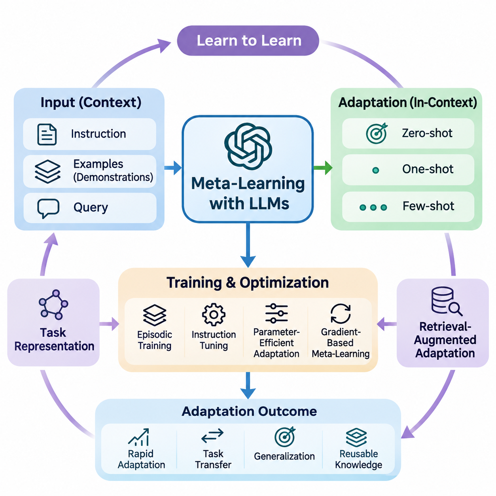
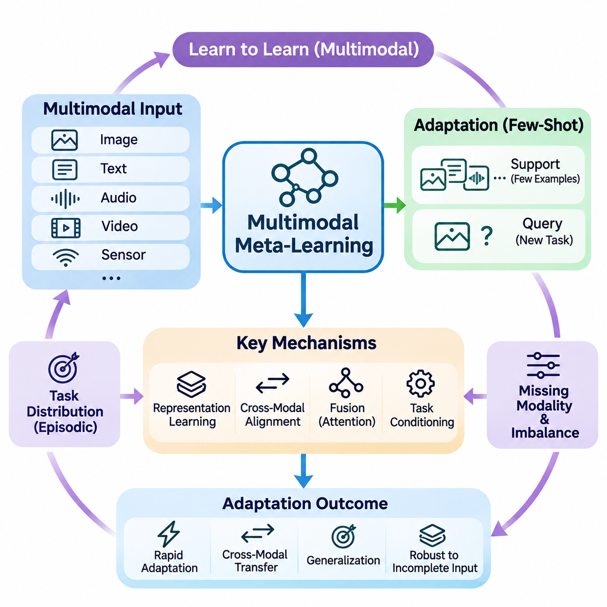
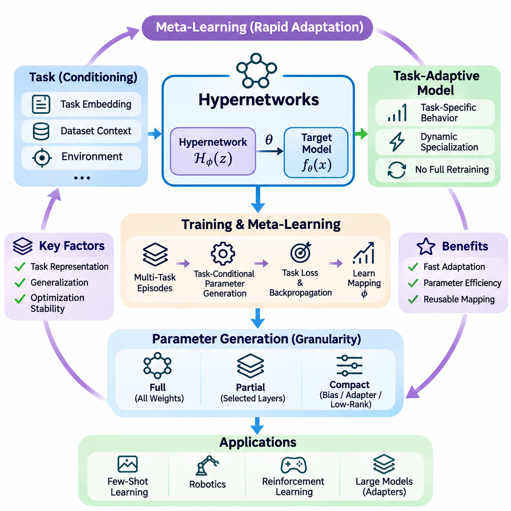
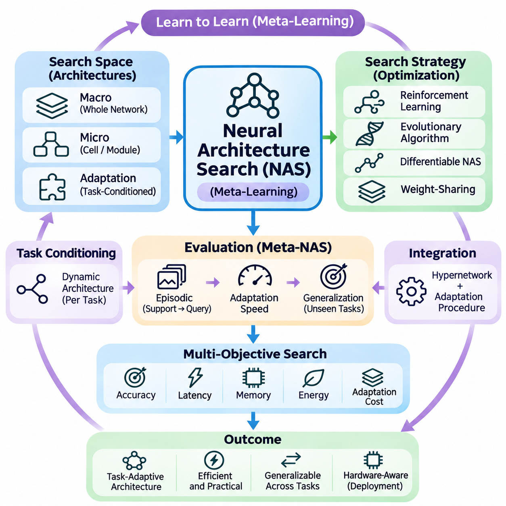
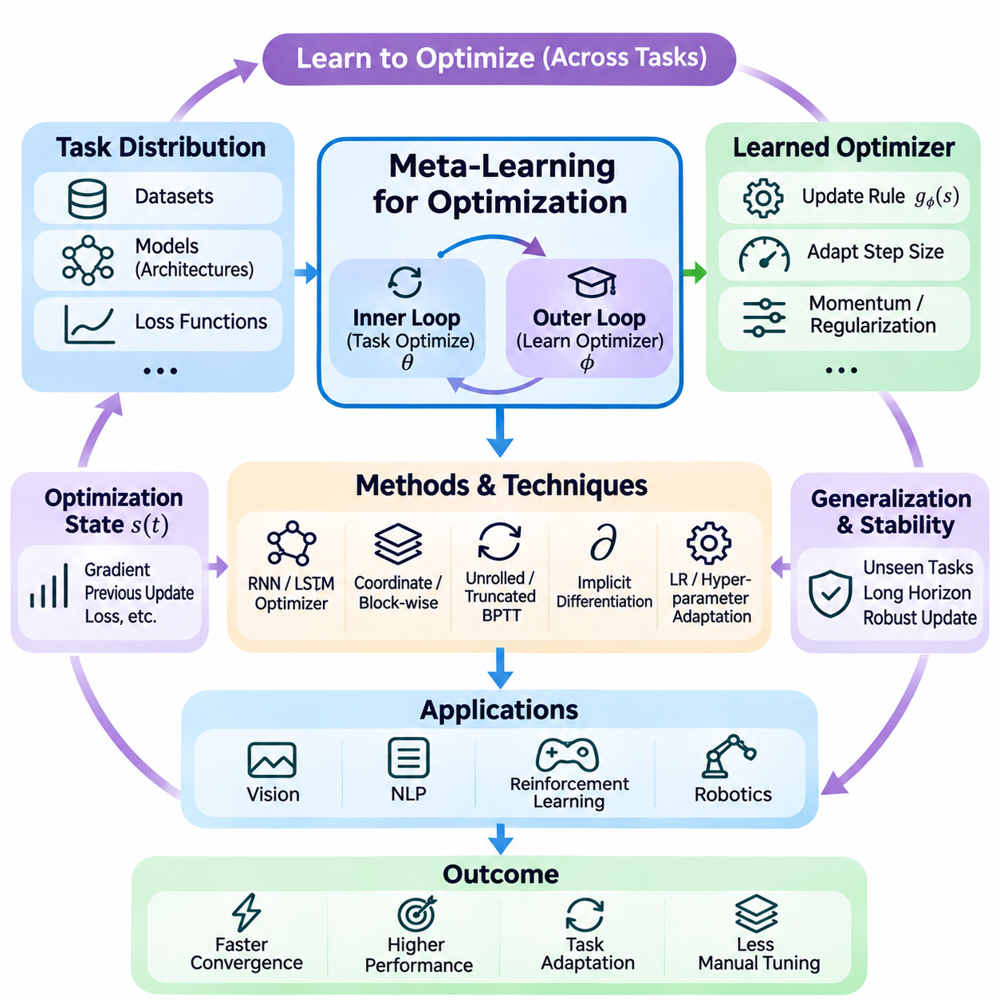
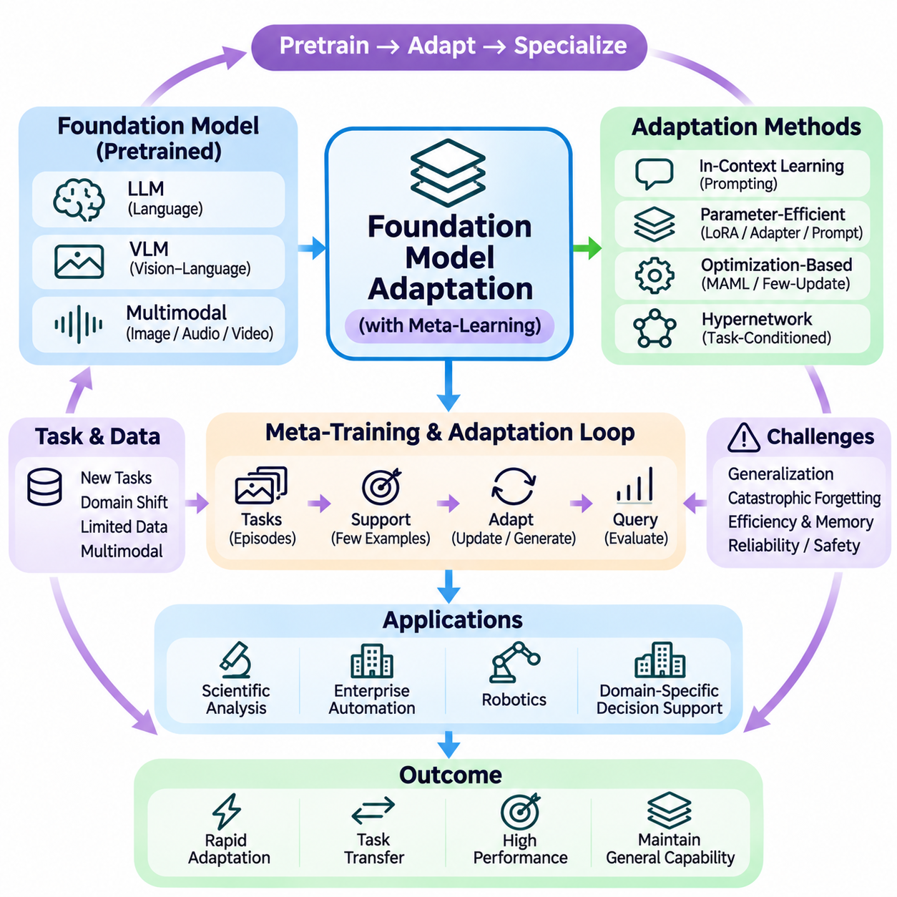

**Volume 36. Meta Learning and Few Shot Adaptation**


# 07. Advanced Meta Learning

## 07.01 Meta Learning with LLMs

{width="7.268055555555556in" height="7.268055555555556in"}

Meta-learning with large language models extends the principle of learning to learn into systems capable of adapting to unfamiliar tasks through natural language instructions, demonstrations, and contextual information. Unlike conventional machine learning, which often requires parameter updates for each new task, large language models can exhibit rapid adaptation by interpreting examples within their input context.

The relationship between meta-learning and large language models is particularly evident in in-context learning. A model receives a sequence containing task descriptions, example inputs, and corresponding outputs before processing a new query. Through pretraining, it may acquire mechanisms that allow it to infer task patterns from these demonstrations without explicitly modifying its underlying parameters.

In-context learning can be interpreted as a form of implicit meta-learning, although this interpretation depends on the model and training conditions. The model\'s parameters encode statistical regularities acquired across diverse training examples, while its contextual representations support temporary task adaptation. This distinction separates adaptation through internal activations from adaptation through gradient-based optimization.

Few-shot prompting provides a practical mechanism for applying these capabilities. A prompt containing several representative examples establishes an implicit relationship between inputs and expected outputs. The model uses these examples to infer formatting conventions, classification boundaries, reasoning patterns, or transformation rules. Performance depends strongly on example quality, relevance, ordering, and consistency.

Zero-shot, one-shot, and few-shot settings represent different levels of contextual supervision. Zero-shot learning relies on instructions and previously acquired knowledge, while one-shot learning introduces a single demonstration. Few-shot learning provides multiple examples that may reveal additional task structure. These settings help researchers examine how adaptation changes with the amount of information available at inference time.

The effectiveness of contextual adaptation is influenced by the distribution of tasks encountered during pretraining. Exposure to diverse linguistic structures, problem formats, and reasoning patterns can encourage transferable representations. However, broad pretraining does not guarantee successful adaptation to unfamiliar domains, especially when tasks require specialized knowledge or relationships absent from the training distribution.

Meta-learning objectives can be incorporated directly into language model training. Instead of optimizing only conventional next-token prediction, researchers may organize training data into episodes containing task-specific support examples and query examples. The model is then encouraged to produce correct query responses conditioned on the support information, creating an explicit connection between episodic learning and contextual adaptation.

An episodic training procedure samples tasks from a distribution and constructs contextual demonstrations for each task. The support examples provide information about the task, while the query evaluates whether the model can apply that information. Repeated optimization across different episodes can improve adaptation to new task instances, particularly when the training tasks reflect the intended deployment environment.

Instruction tuning offers another approach to improving adaptation. By training language models on diverse instruction-response pairs, developers encourage models to interpret natural language descriptions as specifications of desired behavior. Instruction tuning is not inherently equivalent to meta-learning, but it can strengthen capabilities that support rapid task adaptation when combined with contextual examples.

Parameter-efficient adaptation introduces a complementary mechanism for situations where contextual prompting alone is insufficient. Techniques such as low-rank adaptation, adapters, and soft prompt tuning modify a restricted set of trainable parameters while preserving most pretrained weights. Meta-learning can help identify effective initialization strategies or adaptation procedures for these lightweight components.

Gradient-based meta-learning methods can also be applied to language models, although computational requirements create substantial challenges. Methods inspired by model-agnostic meta-learning optimize parameters so that a small number of task-specific updates produces useful performance. For large transformers, memory consumption, higher-order differentiation, and optimization stability often motivate approximate or first-order alternatives.

Task representations provide another connection between language models and meta-learning. A model may infer latent characteristics of a task from its instructions, examples, or interaction history. These representations can influence subsequent predictions without requiring explicit task identifiers. Their usefulness depends on whether the model distinguishes meaningful task properties from superficial similarities in wording.

Retrieval-augmented adaptation extends contextual learning by selecting relevant examples or documents from external information sources. Rather than relying on a fixed demonstration set, the system retrieves information associated with the current query. This mechanism can improve adaptation to specialized tasks, although retrieval quality, document reliability, and context selection remain important determinants of performance.

Example selection can itself become a meta-learning problem. A selection policy may learn which demonstrations are most informative for different task categories, model capabilities, or input distributions. Similarity-based retrieval, diversity-aware sampling, and learned ranking mechanisms provide alternative strategies. The objective is to maximize useful contextual information within a limited token budget.

Context window limitations introduce important constraints on few-shot adaptation. Increasing the number of examples does not necessarily improve performance because irrelevant demonstrations may distract the model or obscure task relationships. Long contexts also increase computational requirements. Effective systems therefore balance demonstration coverage, information density, ordering, and inference cost.

Large language models may also support adaptation through iterative interaction. Feedback from users, tools, or external evaluators can be incorporated into subsequent prompts, allowing the model to revise its behavior during a session. This process resembles online adaptation, but temporary contextual adjustments should be distinguished from persistent learning through parameter updates or external memory modification.

Meta-reasoning introduces an additional dimension by allowing systems to select strategies according to task characteristics. A language model may choose between direct prediction, decomposition, retrieval, verification, or tool-assisted computation. Learning when to apply these strategies can improve efficiency and reliability, although generating elaborate reasoning traces does not automatically guarantee more accurate conclusions.

Uncertainty estimation is particularly important when adapting language models to unfamiliar tasks. A model may produce confident responses even when demonstrations are insufficient or contradictory. Calibration methods, confidence evaluation, selective prediction, and external verification can help identify unreliable outputs. Effective adaptation should account for uncertainty rather than treating every inferred task pattern as trustworthy.

Distribution shifts create further challenges because demonstrations may not adequately represent the target environment. Changes in terminology, document structure, user behavior, or domain conventions can reduce adaptation quality. Meta-learning approaches seek representations and adaptation mechanisms that remain effective across such shifts, but robustness must be established through evaluation on genuinely unseen tasks.

Evaluation requires separating previously encountered task families from novel task distributions. Researchers should measure accuracy, adaptation efficiency, calibration, computational cost, and sensitivity to demonstration selection. Comparisons between zero-shot prompting, few-shot prompting, fine-tuning, and meta-trained approaches help determine whether improvements arise from meaningful adaptation rather than memorization or benchmark contamination.

Applications include specialized document analysis, multilingual processing, information extraction, code generation, scientific assistance, and adaptive conversational systems. In these environments, contextual demonstrations can communicate task-specific conventions without requiring complete retraining. More demanding applications may combine prompting with retrieval, parameter-efficient updates, and structured verification procedures.

Enterprise language systems can benefit from meta-learning when requirements differ across organizations, departments, or workflows. A shared language model may adapt to distinct terminology, reporting conventions, and classification policies using carefully selected examples. Nevertheless, privacy protection, access control, provenance tracking, and validation remain necessary when contextual information contains sensitive organizational knowledge.

The distinction between adaptation and knowledge acquisition remains fundamental. In-context learning may temporarily alter model behavior without storing new information in its parameters. Fine-tuning changes model weights, while retrieval systems access information maintained outside the model. Combining these mechanisms requires clear architectural decisions about persistence, computational resources, reliability, and the intended scope of adaptation.

Future research increasingly explores how language models can acquire more systematic adaptation strategies across heterogeneous tasks. Promising directions include learned demonstration selection, adaptive computation, uncertainty-aware prompting, episodic instruction training, and efficient parameter updates. The broader objective is to develop language systems that generalize beyond familiar examples while adapting reliably with limited supervision.

Ultimately, meta-learning with large language models represents a convergence of representation learning, contextual inference, optimization, and task-level generalization. Its significance lies not merely in producing responses from a few examples, but in understanding how models identify task structure and transfer useful experience. Reliable progress depends on rigorous evaluation, efficient adaptation, and clear distinctions between temporary inference and persistent learning.

대규모 언어 모델(Large Language Models, LLMs)을 활용한 메타 학습(Meta-Learning)은 학습하는 방법을 학습한다는 원리를 자연어 지시(Natural Language Instructions), 시연 예제(Demonstrations), 문맥 정보(Contextual Information)를 통해 익숙하지 않은 작업에 적응할 수 있는 시스템으로 확장한다. 새로운 작업마다 매개변수 갱신(Parameter Updates)이 필요한 경우가 많은 기존 기계 학습(Machine Learning)과 달리, 대규모 언어 모델은 입력 문맥(Input Context)에 포함된 예제를 해석하여 신속하게 적응하는 능력을 나타낼 수 있다.

메타 학습과 대규모 언어 모델의 관계는 문맥 내 학습(In-Context Learning)에서 특히 명확하게 나타난다. 모델은 새로운 질의(Query)를 처리하기 전에 작업 설명(Task Descriptions), 예제 입력(Example Inputs), 해당 출력(Corresponding Outputs)으로 구성된 시퀀스(Sequence)를 제공받는다. 사전 학습(Pretraining)을 통해 모델은 기본 매개변수(Underlying Parameters)를 명시적으로 수정하지 않고도 이러한 시연 예제로부터 작업 패턴(Task Patterns)을 추론하는 메커니즘(Mechanisms)을 습득할 수 있다.

문맥 내 학습은 암묵적 메타 학습(Implicit Meta-Learning)의 한 형태로 해석할 수 있지만, 이러한 해석은 모델과 학습 조건에 따라 달라진다. 모델의 매개변수는 다양한 학습 예제에서 습득한 통계적 규칙성(Statistical Regularities)을 인코딩(Encoding)하며, 문맥 표현(Contextual Representations)은 일시적인 작업 적응(Task Adaptation)을 지원한다. 이러한 구분은 내부 활성화(Internal Activations)를 통한 적응과 기울기 기반 최적화(Gradient-Based Optimization)를 통한 적응을 구별한다.

퓨샷 프롬프팅(Few-Shot Prompting)은 이러한 능력을 적용하기 위한 실용적인 메커니즘을 제공한다. 여러 대표 예제(Representative Examples)를 포함한 프롬프트(Prompt)는 입력과 예상 출력(Expected Outputs) 사이의 암묵적 관계를 설정한다. 모델은 이러한 예제를 활용하여 형식 규칙(Formatting Conventions), 분류 경계(Classification Boundaries), 추론 패턴(Reasoning Patterns), 변환 규칙(Transformation Rules)을 추론한다. 성능은 예제의 품질, 관련성, 순서, 일관성에 크게 영향을 받는다.

제로샷(Zero-Shot), 원샷(One-Shot), 퓨샷(Few-Shot) 설정은 서로 다른 수준의 문맥적 지도(Contextual Supervision)를 나타낸다. 제로샷 학습(Zero-Shot Learning)은 지시와 기존에 습득한 지식에 의존하며, 원샷 학습(One-Shot Learning)은 하나의 시연 예제를 제공한다. 퓨샷 학습(Few-Shot Learning)은 추가적인 작업 구조(Task Structure)를 드러낼 수 있는 여러 예제를 제공한다. 이러한 설정은 추론 시점(Inference Time)에 이용할 수 있는 정보량에 따라 적응이 어떻게 달라지는지 분석하는 데 도움이 된다.

문맥적 적응(Contextual Adaptation)의 효과는 사전 학습 과정에서 접한 작업 분포(Task Distribution)의 영향을 받는다. 다양한 언어 구조(Linguistic Structures), 문제 형식(Problem Formats), 추론 패턴에 노출되면 전이 가능한 표현(Transferable Representations)의 형성이 촉진될 수 있다. 그러나 광범위한 사전 학습이 익숙하지 않은 도메인(Unfamiliar Domains)에 대한 성공적인 적응을 보장하지는 않으며, 특히 학습 분포에 없는 전문 지식이나 관계가 필요한 작업에서는 이러한 한계가 두드러진다.

메타 학습 목적 함수(Meta-Learning Objectives)는 언어 모델 학습(Language Model Training)에 직접 통합될 수 있다. 기존의 다음 토큰 예측(Next-Token Prediction)만 최적화하는 대신, 연구자들은 학습 데이터를 작업별 지원 예제(Support Examples)와 질의 예제(Query Examples)를 포함하는 에피소드(Episodes)로 구성할 수 있다. 이후 모델이 지원 정보를 조건으로 올바른 질의 응답을 생성하도록 유도함으로써 에피소드 학습(Episodic Learning)과 문맥적 적응 사이에 명시적인 연결을 형성한다.

에피소드 학습 절차(Episodic Training Procedure)는 작업 분포에서 작업을 샘플링(Sampling)하고 각 작업에 대한 문맥적 시연 예제(Contextual Demonstrations)를 구성한다. 지원 예제는 작업에 관한 정보를 제공하며, 질의는 모델이 해당 정보를 적용할 수 있는지 평가한다. 서로 다른 에피소드에 걸친 반복적인 최적화(Repeated Optimization)는 특히 학습 작업이 실제 배포 환경(Deployment Environment)을 반영할 때 새로운 작업 사례에 대한 적응 능력을 향상시킬 수 있다.

지시 미세 조정(Instruction Tuning)은 적응 능력을 향상시키는 또 다른 접근 방식이다. 다양한 지시-응답 쌍(Instruction-Response Pairs)을 사용하여 언어 모델을 학습시키면 자연어 설명을 원하는 동작의 명세(Specifications)로 해석하도록 유도할 수 있다. 지시 미세 조정 자체가 반드시 메타 학습과 동일한 것은 아니지만, 문맥적 예제와 결합하면 신속한 작업 적응을 지원하는 능력을 강화할 수 있다.

매개변수 효율적 적응(Parameter-Efficient Adaptation)은 문맥적 프롬프팅만으로 충분하지 않은 상황에서 보완적인 메커니즘을 제공한다. 저랭크 적응(Low-Rank Adaptation), 어댑터(Adapters), 소프트 프롬프트 튜닝(Soft Prompt Tuning)과 같은 기법은 사전 학습된 가중치(Pretrained Weights)의 대부분을 유지하면서 제한된 학습 가능 매개변수(Trainable Parameters)만 수정한다. 메타 학습은 이러한 경량 구성 요소(Lightweight Components)에 효과적인 초기화 전략(Initialization Strategies)이나 적응 절차(Adaptation Procedures)를 식별하는 데 활용될 수 있다.

기울기 기반 메타 학습(Gradient-Based Meta-Learning) 방법도 언어 모델에 적용할 수 있지만, 계산 요구사항(Computational Requirements)으로 인해 상당한 어려움이 발생한다. 모델 불가지론적 메타 학습(Model-Agnostic Meta-Learning, MAML)에서 영감을 받은 방법은 소수의 작업별 갱신(Task-Specific Updates)만으로 유용한 성능을 얻도록 매개변수를 최적화한다. 대규모 트랜스포머(Large Transformers)에서는 메모리 사용량, 고차 미분(Higher-Order Differentiation), 최적화 안정성(Optimization Stability) 때문에 근사 방법이나 일차 방법(First-Order Methods)이 활용되는 경우가 많다.

작업 표현(Task Representations)은 언어 모델과 메타 학습을 연결하는 또 다른 요소이다. 모델은 지시, 예제, 상호작용 기록(Interaction History)으로부터 작업의 잠재적 특성(Latent Characteristics)을 추론할 수 있다. 이러한 표현은 명시적인 작업 식별자(Task Identifiers) 없이도 후속 예측(Subsequent Predictions)에 영향을 줄 수 있다. 그 유용성은 모델이 의미 있는 작업 속성과 표현상의 피상적인 유사성(Superficial Similarities)을 얼마나 잘 구별하는지에 따라 달라진다.

검색 증강 적응(Retrieval-Augmented Adaptation)은 외부 정보원(External Information Sources)에서 관련 예제나 문서를 선택하여 문맥 학습(Contextual Learning)을 확장한다. 고정된 시연 예제 집합(Fixed Demonstration Set)에 의존하는 대신, 시스템은 현재 질의와 관련된 정보를 검색한다. 이러한 메커니즘은 전문 작업(Specialized Tasks)에 대한 적응 능력을 향상시킬 수 있지만, 검색 품질(Retrieval Quality), 문서 신뢰성(Document Reliability), 문맥 선택(Context Selection)은 여전히 성능을 결정하는 중요한 요소이다.

예제 선택(Example Selection) 자체도 메타 학습 문제가 될 수 있다. 선택 정책(Selection Policy)은 서로 다른 작업 범주(Task Categories), 모델 능력(Model Capabilities), 입력 분포(Input Distributions)에 대해 어떤 시연 예제가 가장 유익한지 학습할 수 있다. 유사도 기반 검색(Similarity-Based Retrieval), 다양성 인식 샘플링(Diversity-Aware Sampling), 학습된 순위 결정 메커니즘(Learned Ranking Mechanisms)은 서로 다른 전략을 제공한다. 목표는 제한된 토큰 예산(Token Budget) 안에서 유용한 문맥 정보를 최대화하는 것이다.

문맥 창 제한(Context Window Limitations)은 퓨샷 적응(Few-Shot Adaptation)에 중요한 제약을 부과한다. 예제 수를 늘린다고 반드시 성능이 향상되는 것은 아니며, 관련성이 낮은 시연 예제는 모델의 주의를 분산시키거나 작업 관계를 불명확하게 만들 수 있다. 긴 문맥(Long Contexts)은 계산 요구량도 증가시킨다. 따라서 효과적인 시스템은 시연 예제의 포괄성(Demonstration Coverage), 정보 밀도(Information Density), 순서, 추론 비용(Inference Cost) 사이의 균형을 유지해야 한다.

대규모 언어 모델은 반복적 상호작용(Iterative Interaction)을 통해 적응을 지원할 수도 있다. 사용자, 도구(Tools), 외부 평가기(External Evaluators)로부터 얻은 피드백(Feedback)을 후속 프롬프트에 반영하면 세션(Session) 중에 모델의 동작을 수정할 수 있다. 이러한 과정은 온라인 적응(Online Adaptation)과 유사하지만, 일시적인 문맥 조정(Temporary Contextual Adjustments)은 매개변수 갱신이나 외부 메모리 수정(External Memory Modification)을 통한 지속적 학습(Persistent Learning)과 구별해야 한다.

메타 추론(Meta-Reasoning)은 시스템이 작업 특성에 따라 전략을 선택하도록 함으로써 추가적인 차원을 제공한다. 언어 모델은 직접 예측(Direct Prediction), 문제 분해(Decomposition), 검색(Retrieval), 검증(Verification), 도구 지원 계산(Tool-Assisted Computation) 중에서 적절한 방법을 선택할 수 있다. 이러한 전략을 언제 적용해야 하는지 학습하면 효율성과 신뢰성을 향상시킬 수 있지만, 정교한 추론 과정(Reasoning Traces)을 생성한다고 해서 반드시 더 정확한 결론이 보장되는 것은 아니다.

불확실성 추정(Uncertainty Estimation)은 익숙하지 않은 작업에 언어 모델을 적응시킬 때 특히 중요하다. 모델은 시연 예제가 불충분하거나 서로 모순되는 경우에도 확신에 찬 응답을 생성할 수 있다. 보정 방법(Calibration Methods), 신뢰도 평가(Confidence Evaluation), 선택적 예측(Selective Prediction), 외부 검증(External Verification)은 신뢰할 수 없는 출력을 식별하는 데 도움이 된다. 효과적인 적응은 추론된 모든 작업 패턴을 신뢰할 수 있다고 가정하기보다 불확실성을 고려해야 한다.

분포 이동(Distribution Shifts)은 시연 예제가 목표 환경(Target Environment)을 충분히 대표하지 못할 수 있다는 점에서 추가적인 문제를 발생시킨다. 용어(Terminology), 문서 구조(Document Structure), 사용자 행동(User Behavior), 도메인 관례(Domain Conventions)의 변화는 적응 품질을 저하시킬 수 있다. 메타 학습 접근 방식은 이러한 변화에도 효과적으로 작동하는 표현과 적응 메커니즘을 추구하지만, 강건성(Robustness)은 실제로 관찰하지 않은 작업(Unseen Tasks)에 대한 평가를 통해 입증해야 한다.

평가(Evaluation)에서는 이전에 접한 작업 계열(Task Families)과 새로운 작업 분포(Novel Task Distributions)를 구분해야 한다. 연구자들은 정확도(Accuracy), 적응 효율성(Adaptation Efficiency), 보정(Calibration), 계산 비용(Computational Cost), 시연 예제 선택에 대한 민감도(Sensitivity)를 측정해야 한다. 제로샷 프롬프팅, 퓨샷 프롬프팅, 미세 조정(Fine-Tuning), 메타 학습된 접근 방식(Meta-Trained Approaches)을 비교하면 성능 향상이 단순 암기(Memorization)나 벤치마크 오염(Benchmark Contamination)이 아닌 의미 있는 적응에서 비롯되는지 판단하는 데 도움이 된다.

응용 분야(Applications)에는 전문 문서 분석(Specialized Document Analysis), 다국어 처리(Multilingual Processing), 정보 추출(Information Extraction), 코드 생성(Code Generation), 과학 연구 지원(Scientific Assistance), 적응형 대화 시스템(Adaptive Conversational Systems)이 포함된다. 이러한 환경에서 문맥적 시연 예제는 전체 재학습(Complete Retraining) 없이 작업별 규칙을 전달할 수 있다. 더 복잡한 응용에서는 프롬프팅, 검색, 매개변수 효율적 갱신(Parameter-Efficient Updates), 구조화된 검증 절차(Structured Verification Procedures)를 결합할 수 있다.

기업용 언어 시스템(Enterprise Language Systems)은 조직, 부서, 업무 흐름(Workflows)에 따라 요구사항이 달라지는 경우 메타 학습의 이점을 얻을 수 있다. 공유 언어 모델(Shared Language Model)은 신중하게 선택된 예제를 사용하여 서로 다른 전문 용어, 보고 규칙(Reporting Conventions), 분류 정책(Classification Policies)에 적응할 수 있다. 그러나 문맥 정보에 민감한 조직 지식(Sensitive Organizational Knowledge)이 포함된 경우 개인정보 보호(Privacy Protection), 접근 제어(Access Control), 출처 추적(Provenance Tracking), 검증(Validation)이 여전히 필요하다.

적응(Adaptation)과 지식 습득(Knowledge Acquisition)의 구분은 근본적으로 중요하다. 문맥 내 학습은 새로운 정보를 모델 매개변수에 저장하지 않고도 일시적으로 모델의 동작을 변경할 수 있다. 미세 조정은 모델 가중치(Model Weights)를 변경하는 반면, 검색 시스템(Retrieval Systems)은 모델 외부에 유지되는 정보에 접근한다. 이러한 메커니즘을 결합하려면 지속성(Persistence), 계산 자원(Computational Resources), 신뢰성(Reliability), 의도한 적응 범위(Adaptation Scope)에 관한 명확한 아키텍처 결정(Architectural Decisions)이 필요하다.

향후 연구(Future Research)는 언어 모델이 이질적인 작업(Heterogeneous Tasks)에 걸쳐 더욱 체계적인 적응 전략(Systematic Adaptation Strategies)을 습득하는 방법을 탐구하고 있다. 유망한 연구 방향에는 학습된 시연 예제 선택(Learned Demonstration Selection), 적응형 계산(Adaptive Computation), 불확실성 인식 프롬프팅(Uncertainty-Aware Prompting), 에피소드 기반 지시 학습(Episodic Instruction Training), 효율적인 매개변수 갱신(Efficient Parameter Updates)이 포함된다. 궁극적인 목표는 제한된 지도 정보(Limited Supervision)만으로도 안정적으로 적응하면서 익숙한 예제의 범위를 넘어 일반화할 수 있는 언어 시스템을 개발하는 것이다.

궁극적으로 대규모 언어 모델을 활용한 메타 학습은 표현 학습(Representation Learning), 문맥적 추론(Contextual Inference), 최적화(Optimization), 작업 수준 일반화(Task-Level Generalization)가 융합되는 영역을 나타낸다. 그 중요성은 단순히 소수의 예제로 응답을 생성하는 데 있는 것이 아니라, 모델이 작업 구조를 식별하고 유용한 경험을 전이하는 방법을 이해하는 데 있다. 신뢰할 수 있는 발전을 위해서는 엄격한 평가(Rigorous Evaluation), 효율적인 적응(Efficient Adaptation), 일시적인 추론(Temporary Inference)과 지속적 학습(Persistent Learning) 사이의 명확한 구분이 필요하다.

## 07.02 Multimodal Meta Learning

{width="7.268055555555556in" height="7.268055555555556in"}

Multimodal meta-learning extends the learning-to-learn paradigm to environments where information originates from multiple modalities, including images, text, audio, video, and sensor measurements. Instead of adapting to new tasks using a single data representation, multimodal systems learn transferable adaptation strategies that combine complementary information sources while operating with limited task-specific supervision.

The central objective is to acquire knowledge that supports rapid adaptation across different combinations of modalities and tasks. A model trained on visual recognition, language understanding, and audio interpretation may learn shared representations that facilitate adaptation to unfamiliar problems. Successful generalization requires distinguishing transferable semantic relationships from modality-specific characteristics.

Traditional meta-learning typically assumes that support and query examples share a consistent input structure. Multimodal meta-learning relaxes this assumption by allowing examples to contain different information types or incomplete modality combinations. A support set may contain images with textual descriptions, while a query may require classification using visual evidence alone.

Multimodal task distributions introduce substantial diversity into episodic training. Individual episodes may involve image-text matching, audio classification, visual question answering, or sensor-based activity recognition. By repeatedly encountering heterogeneous tasks, the model learns adaptation mechanisms that can operate across changing input configurations and different supervision conditions.

Representation learning forms the foundation of effective multimodal adaptation. Modality-specific encoders transform raw observations into feature representations that capture relevant patterns. Vision encoders extract spatial information, language encoders represent linguistic meaning, and audio encoders capture acoustic characteristics. These representations can subsequently be aligned or combined within a shared learning framework.

Cross-modal alignment establishes relationships between representations derived from different modalities. Contrastive learning can encourage semantically related image and text embeddings to occupy nearby regions of a shared feature space. Such alignment allows knowledge acquired from one modality to support adaptation in another, although successful transfer depends on representation quality and task compatibility.

Shared embedding spaces provide an important mechanism for cross-modal few-shot learning. When different modalities encode comparable semantic concepts, a model can classify unfamiliar examples using prototypes derived from another modality. For instance, textual descriptions of object categories may support visual recognition when only a limited number of labeled images are available.

Metric-based meta-learning can be extended to multimodal environments through similarity functions operating on aligned representations. Prototypical networks may construct class prototypes from combined image and text features, while matching networks can compare multimodal queries with support examples. These approaches reduce dependence on extensive parameter updates during adaptation.

Optimization-based approaches provide another strategy for multimodal meta-learning. Methods inspired by model-agnostic meta-learning optimize shared parameters so that limited gradient updates can adapt the system to new modality combinations. However, differences in encoder architectures, parameter scales, and gradient behavior complicate the design of stable and computationally efficient adaptation procedures.

Fusion mechanisms determine how information from different modalities contributes to predictions. Early fusion combines features before substantial task-specific processing, while late fusion integrates predictions or high-level representations. Intermediate fusion uses cross-attention or learned interactions between modality-specific features. The appropriate strategy depends on task structure and available computational resources.

Attention mechanisms are particularly useful when relevant information is distributed unevenly across modalities. Cross-attention allows visual representations to interact with linguistic descriptions or audio features. During adaptation, attention weights can emphasize informative relationships while reducing the influence of irrelevant observations, although attention alone does not guarantee robust modality selection.

Missing modalities represent a major challenge in real-world deployment. A system trained with images, text, and audio may encounter queries containing only one or two of these inputs. Robust multimodal meta-learning therefore requires adaptation mechanisms that tolerate incomplete observations, potentially using modality dropout, conditional encoders, or representations designed for partial information.

Modality imbalance creates additional difficulties because some information sources may dominate optimization. High-dimensional visual features or strongly predictive textual cues can overshadow weaker sensor signals. Balanced training objectives, adaptive weighting, and modality-specific regularization can help preserve complementary information while reducing dependence on a single dominant modality.

Cross-modal transfer enables knowledge learned through one sensory channel to improve performance in another. A model trained with extensive image-text pairs may adapt to visual classification using natural language category descriptions. Similarly, audio and video relationships can support event recognition when labeled examples are scarce. Transfer effectiveness depends on semantic correspondence between modalities.

Task conditioning provides a mechanism for adjusting multimodal processing according to the current objective. A task representation inferred from support examples or instructions can control feature fusion, attention allocation, or prediction layers. This approach allows the same model to prioritize different modalities for classification, retrieval, question answering, or structured prediction tasks.

Multimodal foundation models provide a powerful starting point for advanced meta-learning. Large-scale pretraining on image-text, audio-text, or video-language data can produce broadly transferable representations. Meta-learning can build upon these capabilities by optimizing task adaptation procedures rather than requiring complete retraining for each downstream application.

Parameter-efficient adaptation is particularly valuable for large multimodal architectures. Adapters, low-rank updates, and learned prompts can modify selected components while retaining pretrained encoders. Meta-training may identify initializations or update strategies that support rapid specialization, reducing memory requirements and computational costs compared with full-model fine-tuning.

Evaluation of multimodal meta-learning requires careful separation of training and testing tasks. Researchers should examine few-shot accuracy, cross-modal transfer, robustness to missing inputs, and sensitivity to modality imbalance. Testing unfamiliar combinations of tasks and modalities is especially important because strong performance on familiar configurations does not necessarily indicate general adaptation capability.

Practical applications include medical image interpretation, robotic perception, autonomous systems, industrial inspection, and assistive technologies. These environments often combine visual observations, language instructions, acoustic signals, and physical sensor measurements. Multimodal meta-learning can support rapid adaptation when operating conditions change or labeled training examples remain limited.

Robotics provides a particularly demanding application because sensory information changes continuously during interaction. A robot may combine camera images, tactile feedback, joint measurements, and verbal instructions to identify objects or perform manipulation tasks. Meta-learning can help the perception system adapt to new environments, although reliable physical control also requires safety constraints and real-time validation.

Industrial monitoring systems can use multimodal adaptation to recognize unfamiliar equipment conditions from vibration signals, thermal images, acoustic measurements, and maintenance descriptions. Limited examples of newly emerging faults may be sufficient to update task-specific representations. However, rare-event detection requires careful calibration because incorrect predictions can produce significant operational consequences.

The long-term objective of multimodal meta-learning is to develop systems that transfer adaptation strategies across sensory domains without requiring extensive supervision for every new configuration. Achieving this capability requires advances in representation alignment, heterogeneous task training, uncertainty estimation, and efficient optimization. Robust evaluation remains essential for distinguishing genuine cross-modal generalization from reliance on familiar training patterns.

다중모달 메타 학습(Multimodal Meta-Learning)은 학습하는 방법을 학습하는 패러다임(Learning-to-Learn Paradigm)을 이미지(Image), 텍스트(Text), 오디오(Audio), 비디오(Video), 센서 측정값(Sensor Measurements) 등 여러 모달리티(Modality)에서 정보가 생성되는 환경으로 확장한다. 단일 데이터 표현(Data Representation)을 사용하여 새로운 작업에 적응하는 대신, 다중모달 시스템(Multimodal Systems)은 제한된 작업별 지도 정보(Task-Specific Supervision)만으로 상호 보완적인 정보원을 결합하는 전이 가능한 적응 전략(Transferable Adaptation Strategies)을 학습한다.

핵심 목표는 다양한 모달리티 조합(Modality Combinations)과 작업(Task)에 신속하게 적응할 수 있도록 지원하는 지식을 습득하는 것이다. 시각 인식(Visual Recognition), 언어 이해(Language Understanding), 오디오 해석(Audio Interpretation)을 학습한 모델은 익숙하지 않은 문제에 대한 적응을 촉진하는 공유 표현(Shared Representations)을 학습할 수 있다. 성공적인 일반화(Generalization)를 위해서는 전이 가능한 의미적 관계(Transferable Semantic Relationships)와 모달리티별 특성(Modality-Specific Characteristics)을 구별해야 한다.

기존 메타 학습(Traditional Meta-Learning)은 일반적으로 지원 예제(Support Examples)와 질의 예제(Query Examples)가 일관된 입력 구조(Input Structure)를 공유한다고 가정한다. 다중모달 메타 학습은 서로 다른 정보 유형(Information Types)이나 불완전한 모달리티 조합(Incomplete Modality Combinations)을 포함하는 예제를 허용함으로써 이러한 가정을 완화한다. 지원 집합(Support Set)에는 텍스트 설명이 포함된 이미지가 제공되는 반면, 질의에서는 시각적 증거(Visual Evidence)만을 사용한 분류가 요구될 수 있다.

다중모달 작업 분포(Multimodal Task Distributions)는 에피소드 학습(Episodic Training)에 상당한 다양성을 도입한다. 개별 에피소드(Episodes)는 이미지-텍스트 매칭(Image-Text Matching), 오디오 분류(Audio Classification), 시각적 질의응답(Visual Question Answering), 센서 기반 활동 인식(Sensor-Based Activity Recognition)을 포함할 수 있다. 모델은 이질적인 작업(Heterogeneous Tasks)을 반복적으로 경험하면서 변화하는 입력 구성(Input Configurations)과 서로 다른 지도 조건(Supervision Conditions)에서 작동할 수 있는 적응 메커니즘(Adaptation Mechanisms)을 학습한다.

표현 학습(Representation Learning)은 효과적인 다중모달 적응(Multimodal Adaptation)의 기반을 형성한다. 모달리티별 인코더(Modality-Specific Encoders)는 원시 관측값(Raw Observations)을 관련 패턴을 포착하는 특징 표현(Feature Representations)으로 변환한다. 시각 인코더(Vision Encoders)는 공간 정보(Spatial Information)를 추출하고, 언어 인코더(Language Encoders)는 언어적 의미(Linguistic Meaning)를 표현하며, 오디오 인코더(Audio Encoders)는 음향적 특성(Acoustic Characteristics)을 포착한다. 이러한 표현은 이후 공유 학습 프레임워크(Shared Learning Framework)에서 정렬하거나 결합할 수 있다.

교차 모달 정렬(Cross-Modal Alignment)은 서로 다른 모달리티에서 생성된 표현 사이의 관계를 설정한다. 대조 학습(Contrastive Learning)은 의미적으로 관련된 이미지 임베딩(Image Embeddings)과 텍스트 임베딩(Text Embeddings)이 공유 특징 공간(Shared Feature Space)의 가까운 영역에 위치하도록 유도할 수 있다. 이러한 정렬은 한 모달리티에서 습득한 지식이 다른 모달리티의 적응을 지원하도록 하지만, 성공적인 전이는 표현 품질(Representation Quality)과 작업 호환성(Task Compatibility)에 따라 달라진다.

공유 임베딩 공간(Shared Embedding Spaces)은 교차 모달 퓨샷 학습(Cross-Modal Few-Shot Learning)을 위한 중요한 메커니즘을 제공한다. 서로 다른 모달리티가 비교 가능한 의미 개념(Semantic Concepts)을 인코딩하면, 모델은 다른 모달리티에서 생성된 프로토타입(Prototypes)을 사용하여 익숙하지 않은 예제를 분류할 수 있다. 예를 들어, 객체 범주(Object Categories)에 대한 텍스트 설명은 레이블이 지정된 이미지(Labeled Images)가 제한적으로 제공되는 상황에서 시각 인식(Visual Recognition)을 지원할 수 있다.

거리 기반 메타 학습(Metric-Based Meta-Learning)은 정렬된 표현(Aligned Representations)에 적용되는 유사도 함수(Similarity Functions)를 통해 다중모달 환경으로 확장될 수 있다. 프로토타입 네트워크(Prototypical Networks)는 결합된 이미지 및 텍스트 특징으로 클래스 프로토타입(Class Prototypes)을 구성할 수 있으며, 매칭 네트워크(Matching Networks)는 다중모달 질의(Multimodal Queries)를 지원 예제와 비교할 수 있다. 이러한 접근 방식은 적응 과정에서 광범위한 매개변수 갱신(Parameter Updates)에 대한 의존도를 줄인다.

최적화 기반 접근 방식(Optimization-Based Approaches)은 다중모달 메타 학습을 위한 또 다른 전략을 제공한다. 모델 불가지론적 메타 학습(Model-Agnostic Meta-Learning, MAML)에서 영감을 받은 방법은 제한된 기울기 갱신(Gradient Updates)만으로 새로운 모달리티 조합에 적응할 수 있도록 공유 매개변수(Shared Parameters)를 최적화한다. 그러나 인코더 아키텍처(Encoder Architectures), 매개변수 규모(Parameter Scales), 기울기 동작(Gradient Behavior)의 차이는 안정적이고 계산 효율적인 적응 절차(Adaptation Procedures)의 설계를 복잡하게 만든다.

융합 메커니즘(Fusion Mechanisms)은 서로 다른 모달리티의 정보가 예측(Predictions)에 어떻게 기여하는지를 결정한다. 초기 융합(Early Fusion)은 상당한 작업별 처리(Task-Specific Processing)가 수행되기 전에 특징을 결합하며, 후기 융합(Late Fusion)은 예측 결과나 고수준 표현(High-Level Representations)을 통합한다. 중간 융합(Intermediate Fusion)은 교차 어텐션(Cross-Attention)이나 모달리티별 특징 사이의 학습된 상호작용(Learned Interactions)을 활용한다. 적절한 전략은 작업 구조(Task Structure)와 사용 가능한 계산 자원(Computational Resources)에 따라 달라진다.

어텐션 메커니즘(Attention Mechanisms)은 관련 정보가 여러 모달리티에 불균등하게 분포된 경우 특히 유용하다. 교차 어텐션은 시각적 표현(Visual Representations)이 언어적 설명(Linguistic Descriptions)이나 오디오 특징(Audio Features)과 상호작용하도록 한다. 적응 과정에서 어텐션 가중치(Attention Weights)는 유익한 관계를 강조하고 관련성이 낮은 관측값의 영향을 줄일 수 있지만, 어텐션만으로 강건한 모달리티 선택(Robust Modality Selection)이 보장되는 것은 아니다.

누락된 모달리티(Missing Modalities)는 실제 배포(Real-World Deployment)에서 중요한 문제를 나타낸다. 이미지, 텍스트, 오디오를 사용하여 학습한 시스템이 실제 질의에서는 이들 중 하나 또는 두 가지 입력만 제공받을 수 있다. 따라서 강건한 다중모달 메타 학습(Robust Multimodal Meta-Learning)은 불완전한 관측값(Incomplete Observations)을 허용하는 적응 메커니즘이 필요하며, 이를 위해 모달리티 드롭아웃(Modality Dropout), 조건부 인코더(Conditional Encoders), 부분 정보(Partial Information)를 고려한 표현을 활용할 수 있다.

모달리티 불균형(Modality Imbalance)은 일부 정보원이 최적화(Optimization)를 지배할 수 있기 때문에 추가적인 어려움을 발생시킨다. 고차원 시각 특징(High-Dimensional Visual Features)이나 예측력이 높은 텍스트 단서(Textual Cues)는 상대적으로 약한 센서 신호(Sensor Signals)의 영향을 가릴 수 있다. 균형 잡힌 학습 목적 함수(Balanced Training Objectives), 적응형 가중치(Adaptive Weighting), 모달리티별 정규화(Modality-Specific Regularization)는 상호 보완적인 정보를 유지하면서 특정 모달리티에 대한 과도한 의존을 줄이는 데 도움이 된다.

교차 모달 전이(Cross-Modal Transfer)는 하나의 감각 채널(Sensory Channel)에서 학습한 지식을 다른 채널의 성능 향상에 활용하도록 한다. 광범위한 이미지-텍스트 쌍(Image-Text Pairs)으로 학습한 모델은 자연어 범주 설명(Natural Language Category Descriptions)을 활용하여 시각적 분류(Visual Classification)에 적응할 수 있다. 마찬가지로 오디오와 비디오 사이의 관계는 레이블이 지정된 예제가 부족한 상황에서 이벤트 인식(Event Recognition)을 지원할 수 있다. 전이 효과는 모달리티 사이의 의미적 대응 관계(Semantic Correspondence)에 따라 달라진다.

작업 조건화(Task Conditioning)는 현재 목표(Current Objective)에 따라 다중모달 처리(Multimodal Processing)를 조정하는 메커니즘을 제공한다. 지원 예제나 지시로부터 추론한 작업 표현(Task Representation)은 특징 융합(Feature Fusion), 어텐션 할당(Attention Allocation), 예측 계층(Prediction Layers)을 제어할 수 있다. 이러한 접근 방식은 동일한 모델이 분류(Classification), 검색(Retrieval), 질의응답(Question Answering), 구조화된 예측(Structured Prediction) 작업에 따라 서로 다른 모달리티에 우선순위를 부여하도록 한다.

다중모달 파운데이션 모델(Multimodal Foundation Models)은 고급 메타 학습(Advanced Meta-Learning)을 위한 강력한 출발점을 제공한다. 이미지-텍스트, 오디오-텍스트, 비디오-언어 데이터(Video-Language Data)에 대한 대규모 사전 학습(Large-Scale Pretraining)은 광범위하게 전이 가능한 표현을 생성할 수 있다. 메타 학습은 각 다운스트림 응용(Downstream Application)에 대한 전체 재학습(Complete Retraining)을 요구하는 대신, 작업 적응 절차(Task Adaptation Procedures)를 최적화하여 이러한 능력을 확장할 수 있다.

매개변수 효율적 적응(Parameter-Efficient Adaptation)은 대규모 다중모달 아키텍처(Large Multimodal Architectures)에서 특히 유용하다. 어댑터(Adapters), 저랭크 갱신(Low-Rank Updates), 학습된 프롬프트(Learned Prompts)는 사전 학습된 인코더(Pretrained Encoders)를 유지하면서 선택된 구성 요소만 수정할 수 있다. 메타 학습(Meta-Training)은 신속한 전문화(Rapid Specialization)를 지원하는 초기화(Initializations)나 갱신 전략(Update Strategies)을 식별하여 전체 모델 미세 조정(Full-Model Fine-Tuning)에 비해 메모리 요구량(Memory Requirements)과 계산 비용(Computational Costs)을 줄일 수 있다.

다중모달 메타 학습의 평가(Evaluation)는 학습 작업(Training Tasks)과 테스트 작업(Testing Tasks)을 신중하게 분리해야 한다. 연구자들은 퓨샷 정확도(Few-Shot Accuracy), 교차 모달 전이(Cross-Modal Transfer), 입력 누락에 대한 강건성(Robustness to Missing Inputs), 모달리티 불균형에 대한 민감도(Sensitivity to Modality Imbalance)를 조사해야 한다. 익숙하지 않은 작업 및 모달리티 조합을 테스트하는 것은 특히 중요하며, 익숙한 구성에서 높은 성능을 보인다고 해서 반드시 일반적인 적응 능력(General Adaptation Capability)을 의미하지는 않는다.

실용적인 응용 분야(Practical Applications)에는 의료 영상 해석(Medical Image Interpretation), 로봇 인식(Robotic Perception), 자율 시스템(Autonomous Systems), 산업 검사(Industrial Inspection), 보조 기술(Assistive Technologies)이 포함된다. 이러한 환경에서는 시각적 관측값(Visual Observations), 언어 지시(Language Instructions), 음향 신호(Acoustic Signals), 물리 센서 측정값(Physical Sensor Measurements)을 결합하는 경우가 많다. 다중모달 메타 학습은 운영 조건(Operating Conditions)이 변화하거나 레이블이 지정된 학습 예제가 제한적인 상황에서 신속한 적응을 지원할 수 있다.

로봇 공학(Robotics)은 상호작용 과정에서 감각 정보(Sensory Information)가 지속적으로 변화하기 때문에 특히 까다로운 응용 분야이다. 로봇은 객체를 식별하거나 조작 작업(Manipulation Tasks)을 수행하기 위해 카메라 이미지(Camera Images), 촉각 피드백(Tactile Feedback), 관절 측정값(Joint Measurements), 음성 지시(Verbal Instructions)를 결합할 수 있다. 메타 학습은 인식 시스템(Perception System)이 새로운 환경에 적응하도록 지원할 수 있지만, 신뢰할 수 있는 물리적 제어(Physical Control)를 위해서는 안전 제약(Safety Constraints)과 실시간 검증(Real-Time Validation)도 필요하다.

산업 모니터링 시스템(Industrial Monitoring Systems)은 진동 신호(Vibration Signals), 열화상(Thermal Images), 음향 측정값(Acoustic Measurements), 유지보수 설명(Maintenance Descriptions)을 활용하여 익숙하지 않은 장비 상태(Equipment Conditions)를 인식하는 데 다중모달 적응을 사용할 수 있다. 새롭게 발생하는 결함(Emerging Faults)에 대한 제한된 예제만으로도 작업별 표현(Task-Specific Representations)을 갱신할 수 있다. 그러나 희귀 이벤트 탐지(Rare-Event Detection)는 잘못된 예측이 상당한 운영상 결과(Operational Consequences)를 초래할 수 있으므로 신중한 보정(Calibration)이 필요하다.

다중모달 메타 학습의 장기적 목표(Long-Term Objective)는 새로운 구성마다 광범위한 지도 학습(Extensive Supervision)을 요구하지 않고 감각 도메인(Sensory Domains) 전반에 걸쳐 적응 전략을 전이할 수 있는 시스템을 개발하는 것이다. 이러한 능력을 실현하려면 표현 정렬(Representation Alignment), 이질적 작업 학습(Heterogeneous Task Training), 불확실성 추정(Uncertainty Estimation), 효율적인 최적화(Efficient Optimization)의 발전이 필요하다. 진정한 교차 모달 일반화(Genuine Cross-Modal Generalization)와 익숙한 학습 패턴(Training Patterns)에 대한 의존을 구별하기 위해서는 강건한 평가(Robust Evaluation)가 필수적이다.

## 07.03 Hypernetworks

{width="7.268055555555556in" height="7.268055555555556in"}

Hypernetworks represent an advanced neural learning paradigm in which one neural network generates the parameters of another network. Unlike conventional architectures that directly optimize a fixed set of model weights, hypernetworks learn a mapping from contextual information to task-specific parameters. This mechanism provides a flexible foundation for meta-learning, enabling rapid adaptation without repeatedly training an entire model from scratch.

A hypernetwork typically consists of a parameter-generating network and a target network. The hypernetwork receives a conditioning signal, such as a task embedding, dataset representation, or environmental context, and produces weights used by the target network. The target network subsequently processes input data using these generated parameters, allowing its behavior to change according to the current task.

The mathematical formulation describes a hypernetwork as a function that maps task information into model parameters. Given a task representation z and hypernetwork parameters phi, the generated weights can be expressed as theta = H_phi(z). The target model then computes predictions using f_theta(x). Learning optimizes phi so that the generated parameters perform effectively across a distribution of related tasks.

Hypernetworks are particularly relevant to meta-learning because they separate the process of learning how to generate parameters from the process of applying those parameters. During meta-training, the hypernetwork encounters multiple tasks and learns relationships between task characteristics and useful model configurations. During adaptation, a new task representation can produce specialized parameters through a forward pass.

Task embeddings play a central role in determining the effectiveness of hypernetwork-based adaptation. These embeddings summarize characteristics of individual tasks, including input distributions, output requirements, and relevant semantic relationships. They may be learned from support examples, inferred through an encoder, or constructed from explicit task descriptors, depending on the application and available information.

In few-shot learning, hypernetworks can generate classifier parameters from a limited collection of labeled examples. A task encoder processes the support set and produces a compact representation of the classification problem. The hypernetwork transforms this representation into weights for a task-specific prediction model, reducing the need for extensive gradient-based optimization during adaptation.

The relationship between hypernetworks and optimization-based meta-learning is especially important. Methods such as model-agnostic meta-learning obtain task-specific parameters through gradient updates from a learned initialization. Hypernetworks instead generate parameters directly from conditioning information. Hybrid approaches can combine both mechanisms by generating initial parameters that are subsequently refined through limited optimization.

Parameter generation can operate at different levels of model granularity. A hypernetwork may produce all weights of a small target network, generate selected layers of a larger architecture, or predict compact parameter adjustments. Full parameter generation offers substantial flexibility but can require considerable memory and computation, especially when target networks contain millions or billions of parameters.

Partial parameter generation provides a practical alternative for large neural architectures. Instead of generating complete weight matrices, a hypernetwork can produce biases, normalization coefficients, adapter parameters, or low-rank updates. This approach reduces output dimensionality while retaining task-dependent flexibility, making hypernetworks more practical for transformer models and resource-constrained systems.

Conditional computation is another important property of hypernetwork architectures. Because generated parameters depend on contextual inputs, the same target architecture can exhibit different behaviors across tasks. This enables dynamic specialization without maintaining a separate independently trained model for every task, although generating and storing task-specific weights still introduces computational and memory overhead.

Hypernetworks can also be interpreted as a form of learned parameter-space mapping. Rather than searching directly through a high-dimensional weight space for every new problem, the system learns a structured relationship between compact task representations and effective parameters. This mapping can constrain adaptation to regions associated with previously encountered tasks, potentially improving efficiency and generalization.

The quality of the learned task representation strongly influences generalization to unseen tasks. If task embeddings fail to capture meaningful differences between problems, the hypernetwork may generate inappropriate parameters. Conversely, representations that preserve relevant task structure can support interpolation between familiar tasks and adaptation to related situations not explicitly encountered during training.

Training hypernetworks generally requires differentiating through the target network. The hypernetwork generates parameters, the target model produces predictions, and a task-specific loss measures performance. Gradients propagate through the target model into the parameter generator, allowing the hypernetwork to improve its mapping from conditioning information to useful weights across repeated training episodes.

Optimization stability becomes challenging when generated parameters vary substantially across tasks. Poorly scaled outputs may produce unstable activations, exploding gradients, or ineffective target models. Weight normalization, bounded parameter transformations, regularization, and carefully designed initialization strategies can improve stability, although their effectiveness depends on the target architecture and training objective.

Hypernetworks introduce important tradeoffs between expressiveness and computational efficiency. Large parameter generators may represent complex task relationships but increase training cost and the risk of overfitting. Smaller generators are more efficient but may lack sufficient capacity to produce diverse model configurations. Architecture design must therefore balance parameter-generation capacity against the complexity of the task distribution.

Regularization is particularly important when only a limited number of meta-training tasks are available. A hypernetwork may memorize mappings between familiar task embeddings and effective weights instead of learning transferable adaptation principles. Techniques such as task augmentation, weight decay, representation regularization, and validation on held-out task families can help reduce this problem.

Hypernetworks can support continual learning by generating different parameters for different tasks while sharing a common parameter-generation mechanism. Task-conditioned outputs may reduce interference between previously learned behaviors, although catastrophic forgetting remains possible when the hypernetwork itself is updated. Replay strategies, parameter constraints, and modular designs can help preserve earlier capabilities.

In reinforcement learning, hypernetworks can generate policy parameters conditioned on environmental characteristics or inferred task representations. An agent may adapt its policy to changing dynamics, reward functions, or operating conditions without learning a completely new policy from scratch. Such approaches are relevant to meta-reinforcement learning, where rapid adaptation across related environments is essential.

Robotics applications can use hypernetworks to specialize perception, prediction, or control models according to robot configuration and environmental context. A parameter generator may adapt selected neural components to different sensors, payload conditions, or manipulation tasks. However, generated controllers must satisfy stability and safety requirements, particularly when adaptation affects physical motion.

Hypernetworks are also relevant to multimodal learning, where different input combinations may require different processing configurations. Task-conditioned parameter generation can adjust fusion layers, attention modules, or modality-specific adapters. This enables a shared architecture to accommodate changing combinations of visual, linguistic, acoustic, and sensor information without independently training every configuration.

Large language models provide another promising application for hypernetwork-based adaptation. A hypernetwork may generate lightweight adapter parameters or low-rank updates from task descriptions and example demonstrations. Such mechanisms can complement in-context learning by converting task information into parameter modifications, although scalability and reliable generalization remain significant engineering challenges.

Evaluation of hypernetwork-based meta-learning should measure adaptation accuracy, parameter-generation latency, memory consumption, and generalization to unseen tasks. Comparisons with gradient-based meta-learning, conventional fine-tuning, and fixed feature extractors help identify the benefits of conditional parameter generation. Testing task distributions beyond those used during training is essential for assessing genuine adaptability.

The broader significance of hypernetworks lies in their ability to transform model adaptation into a learned parameter-generation problem. By connecting task representations with dynamically generated neural parameters, they offer an alternative to repeatedly optimizing complete models. Their long-term potential depends on scalable architectures, stable optimization, expressive task embeddings, and reliable generalization across changing environments.

하이퍼네트워크(Hypernetworks)는 하나의 신경망(Neural Network)이 다른 신경망의 매개변수(Parameters)를 생성하는 고급 신경 학습 패러다임(Advanced Neural Learning Paradigm)을 나타낸다. 고정된 모델 가중치(Model Weights)를 직접 최적화하는 기존 아키텍처(Conventional Architectures)와 달리, 하이퍼네트워크는 문맥 정보(Contextual Information)에서 작업별 매개변수(Task-Specific Parameters)로의 매핑(Mapping)을 학습한다. 이러한 메커니즘은 전체 모델을 처음부터 반복적으로 학습하지 않고도 신속하게 적응할 수 있도록 하는 메타 학습(Meta-Learning)의 유연한 기반을 제공한다.

하이퍼네트워크는 일반적으로 매개변수 생성 네트워크(Parameter-Generating Network)와 대상 네트워크(Target Network)로 구성된다. 하이퍼네트워크는 작업 임베딩(Task Embedding), 데이터셋 표현(Dataset Representation), 환경적 문맥(Environmental Context)과 같은 조건화 신호(Conditioning Signal)를 입력받아 대상 네트워크에서 사용할 가중치를 생성한다. 이후 대상 네트워크는 생성된 매개변수를 사용하여 입력 데이터를 처리하며, 현재 작업에 따라 동작을 변경할 수 있다.

수학적 정식화(Mathematical Formulation)에서 하이퍼네트워크는 작업 정보를 모델 매개변수로 변환하는 함수(Function)로 표현된다. 작업 표현(Task Representation) z와 하이퍼네트워크 매개변수(Hypernetwork Parameters) phi가 주어지면, 생성된 가중치는 theta = H_phi(z)로 나타낼 수 있다. 이후 대상 모델은 f_theta(x)를 사용하여 예측을 계산한다. 학습 과정에서는 생성된 매개변수가 관련 작업 분포(Task Distribution) 전반에서 효과적으로 작동하도록 phi를 최적화한다.

하이퍼네트워크는 매개변수를 생성하는 방법을 학습하는 과정과 해당 매개변수를 적용하는 과정을 분리하기 때문에 메타 학습과 특히 밀접한 관련이 있다. 메타 학습 단계(Meta-Training)에서 하이퍼네트워크는 여러 작업을 경험하면서 작업 특성과 유용한 모델 구성(Model Configurations) 사이의 관계를 학습한다. 적응 단계(Adaptation)에서는 새로운 작업 표현을 입력받아 순전파(Forward Pass)만으로 특화된 매개변수를 생성할 수 있다.

작업 임베딩(Task Embeddings)은 하이퍼네트워크 기반 적응(Hypernetwork-Based Adaptation)의 효과를 결정하는 핵심 요소이다. 이러한 임베딩은 입력 분포(Input Distributions), 출력 요구사항(Output Requirements), 관련 의미적 관계(Semantic Relationships)를 포함하여 개별 작업의 특성을 요약한다. 응용 분야와 사용 가능한 정보에 따라 지원 예제(Support Examples)에서 학습하거나, 인코더(Encoder)를 통해 추론하거나, 명시적인 작업 설명자(Task Descriptors)로부터 구성할 수 있다.

퓨샷 학습(Few-Shot Learning)에서 하이퍼네트워크는 제한된 레이블 예제(Labeled Examples)로부터 분류기 매개변수(Classifier Parameters)를 생성할 수 있다. 작업 인코더(Task Encoder)는 지원 집합(Support Set)을 처리하여 분류 문제(Classification Problem)의 압축된 표현(Compact Representation)을 생성한다. 하이퍼네트워크는 이러한 표현을 작업별 예측 모델(Task-Specific Prediction Model)의 가중치로 변환하여 적응 과정에서 광범위한 기울기 기반 최적화(Gradient-Based Optimization)의 필요성을 줄인다.

하이퍼네트워크와 최적화 기반 메타 학습(Optimization-Based Meta-Learning)의 관계는 특히 중요하다. 모델 불가지론적 메타 학습(Model-Agnostic Meta-Learning, MAML)과 같은 방법은 학습된 초기화(Learned Initialization)에서 기울기 갱신(Gradient Updates)을 수행하여 작업별 매개변수를 얻는다. 반면 하이퍼네트워크는 조건화 정보(Conditioning Information)로부터 매개변수를 직접 생성한다. 하이브리드 접근 방식(Hybrid Approaches)은 초기 매개변수를 생성한 후 제한된 최적화를 통해 정교화하는 방식으로 두 메커니즘을 결합할 수 있다.

매개변수 생성(Parameter Generation)은 서로 다른 수준의 모델 세분성(Model Granularity)에서 수행될 수 있다. 하이퍼네트워크는 소규모 대상 네트워크의 모든 가중치를 생성하거나, 대규모 아키텍처의 특정 계층(Selected Layers)만 생성하거나, 압축된 매개변수 조정값(Compact Parameter Adjustments)을 예측할 수 있다. 전체 매개변수 생성(Full Parameter Generation)은 높은 유연성을 제공하지만, 대상 네트워크에 수백만 또는 수십억 개의 매개변수가 포함된 경우 상당한 메모리와 계산 자원이 필요할 수 있다.

부분 매개변수 생성(Partial Parameter Generation)은 대규모 신경망 아키텍처(Large Neural Architectures)를 위한 실용적인 대안을 제공한다. 전체 가중치 행렬(Weight Matrices)을 생성하는 대신, 하이퍼네트워크는 편향(Biases), 정규화 계수(Normalization Coefficients), 어댑터 매개변수(Adapter Parameters), 저랭크 갱신(Low-Rank Updates)을 생성할 수 있다. 이러한 접근 방식은 작업 의존적 유연성(Task-Dependent Flexibility)을 유지하면서 출력 차원(Output Dimensionality)을 줄여 트랜스포머 모델(Transformer Models)과 자원 제약 시스템(Resource-Constrained Systems)에 더욱 실용적으로 적용할 수 있도록 한다.

조건부 계산(Conditional Computation)은 하이퍼네트워크 아키텍처의 또 다른 중요한 특성이다. 생성된 매개변수가 문맥 입력(Contextual Inputs)에 따라 달라지므로 동일한 대상 아키텍처가 작업별로 서로 다른 동작을 나타낼 수 있다. 이를 통해 모든 작업에 대해 독립적으로 학습된 별도의 모델을 유지하지 않고도 동적 특화(Dynamic Specialization)가 가능하지만, 작업별 가중치의 생성과 저장에는 여전히 계산 및 메모리 오버헤드(Computational and Memory Overhead)가 발생한다.

하이퍼네트워크는 학습된 매개변수 공간 매핑(Learned Parameter-Space Mapping)의 한 형태로도 해석할 수 있다. 새로운 문제마다 고차원 가중치 공간(High-Dimensional Weight Space)을 직접 탐색하는 대신, 시스템은 압축된 작업 표현과 효과적인 매개변수 사이의 구조화된 관계(Structured Relationship)를 학습한다. 이러한 매핑은 적응을 이전에 경험한 작업과 관련된 영역으로 제한하여 효율성과 일반화(Generalization)를 향상시킬 가능성이 있다.

학습된 작업 표현의 품질은 관찰하지 않은 작업(Unseen Tasks)에 대한 일반화에 큰 영향을 미친다. 작업 임베딩이 문제 사이의 의미 있는 차이를 포착하지 못하면 하이퍼네트워크는 부적절한 매개변수를 생성할 수 있다. 반대로 관련 작업 구조(Relevant Task Structure)를 보존하는 표현은 익숙한 작업 사이의 보간(Interpolation)과 학습 과정에서 명시적으로 경험하지 않은 관련 상황에 대한 적응을 지원할 수 있다.

하이퍼네트워크 학습(Training Hypernetworks)은 일반적으로 대상 네트워크를 통한 미분(Differentiation)을 필요로 한다. 하이퍼네트워크가 매개변수를 생성하면 대상 모델은 예측을 수행하고, 작업별 손실(Task-Specific Loss)은 성능을 측정한다. 기울기(Gradients)는 대상 모델을 거쳐 매개변수 생성기(Parameter Generator)로 역전파(Backpropagation)되며, 이를 통해 하이퍼네트워크는 반복적인 학습 에피소드(Training Episodes)에 걸쳐 조건화 정보를 유용한 가중치로 변환하는 매핑을 개선한다.

생성된 매개변수가 작업마다 크게 달라지는 경우 최적화 안정성(Optimization Stability)을 확보하기 어려워진다. 부적절하게 스케일링된 출력(Poorly Scaled Outputs)은 불안정한 활성화(Unstable Activations), 기울기 폭발(Exploding Gradients), 비효율적인 대상 모델(Ineffective Target Models)을 초래할 수 있다. 가중치 정규화(Weight Normalization), 제한된 매개변수 변환(Bounded Parameter Transformations), 정규화(Regularization), 신중하게 설계된 초기화 전략(Initialization Strategies)은 안정성을 향상시킬 수 있지만, 효과는 대상 아키텍처와 학습 목적 함수(Training Objective)에 따라 달라진다.

하이퍼네트워크는 표현력(Expressiveness)과 계산 효율성(Computational Efficiency) 사이에 중요한 절충 관계(Tradeoffs)를 형성한다. 대규모 매개변수 생성기(Large Parameter Generators)는 복잡한 작업 관계를 표현할 수 있지만 학습 비용과 과적합(Overfitting) 위험을 증가시킨다. 소규모 생성기는 효율적이지만 다양한 모델 구성을 생성할 충분한 용량(Capacity)이 부족할 수 있다. 따라서 아키텍처 설계에서는 매개변수 생성 능력(Parameter-Generation Capacity)과 작업 분포의 복잡성(Complexity) 사이에 균형을 유지해야 한다.

정규화(Regularization)는 제한된 수의 메타 학습 작업(Meta-Training Tasks)만 제공되는 경우 특히 중요하다. 하이퍼네트워크는 전이 가능한 적응 원리(Transferable Adaptation Principles)를 학습하는 대신 익숙한 작업 임베딩과 효과적인 가중치 사이의 매핑을 암기(Memorization)할 수 있다. 작업 증강(Task Augmentation), 가중치 감쇠(Weight Decay), 표현 정규화(Representation Regularization), 보류된 작업 계열(Held-Out Task Families)에 대한 검증(Validation)은 이러한 문제를 줄이는 데 도움이 된다.

하이퍼네트워크는 공통 매개변수 생성 메커니즘(Common Parameter-Generation Mechanism)을 공유하면서 서로 다른 작업에 대해 다른 매개변수를 생성함으로써 지속 학습(Continual Learning)을 지원할 수 있다. 작업 조건부 출력(Task-Conditioned Outputs)은 이전에 학습한 동작 사이의 간섭(Interference)을 줄일 수 있지만, 하이퍼네트워크 자체가 갱신되는 경우 치명적 망각(Catastrophic Forgetting)이 여전히 발생할 수 있다. 재생 전략(Replay Strategies), 매개변수 제약(Parameter Constraints), 모듈식 설계(Modular Designs)는 기존 능력을 보존하는 데 도움이 된다.

강화 학습(Reinforcement Learning)에서 하이퍼네트워크는 환경 특성(Environmental Characteristics)이나 추론된 작업 표현에 따라 조건화된 정책 매개변수(Policy Parameters)를 생성할 수 있다. 에이전트(Agent)는 완전히 새로운 정책(Policy)을 처음부터 학습하지 않고도 변화하는 동역학(Dynamics), 보상 함수(Reward Functions), 운영 조건(Operating Conditions)에 정책을 적응시킬 수 있다. 이러한 접근 방식은 관련 환경 전반에서 신속한 적응이 필수적인 메타 강화 학습(Meta-Reinforcement Learning)과 밀접하게 관련된다.

로봇 공학(Robotics)에서는 하이퍼네트워크를 활용하여 로봇 구성(Robot Configuration)과 환경적 문맥(Environmental Context)에 따라 인식(Perception), 예측(Prediction), 제어 모델(Control Models)을 특화할 수 있다. 매개변수 생성기는 서로 다른 센서(Sensors), 탑재 하중 조건(Payload Conditions), 조작 작업(Manipulation Tasks)에 맞춰 선택된 신경망 구성 요소를 조정할 수 있다. 그러나 생성된 제어기(Generated Controllers)는 특히 적응이 물리적 움직임(Physical Motion)에 영향을 미치는 경우 안정성(Stability)과 안전 요구사항(Safety Requirements)을 충족해야 한다.

하이퍼네트워크는 서로 다른 입력 조합(Input Combinations)에 따라 처리 구성이 달라질 수 있는 다중모달 학습(Multimodal Learning)에도 관련된다. 작업 조건부 매개변수 생성(Task-Conditioned Parameter Generation)은 융합 계층(Fusion Layers), 어텐션 모듈(Attention Modules), 모달리티별 어댑터(Modality-Specific Adapters)를 조정할 수 있다. 이를 통해 공유 아키텍처(Shared Architecture)는 모든 구성을 독립적으로 학습하지 않고도 시각(Visual), 언어(Linguistic), 음향(Acoustic), 센서 정보(Sensor Information)의 변화하는 조합을 수용할 수 있다.

대규모 언어 모델(Large Language Models, LLMs)은 하이퍼네트워크 기반 적응(Hypernetwork-Based Adaptation)의 또 다른 유망한 응용 분야를 제공한다. 하이퍼네트워크는 작업 설명(Task Descriptions)과 시연 예제(Example Demonstrations)로부터 경량 어댑터 매개변수(Lightweight Adapter Parameters)나 저랭크 갱신(Low-Rank Updates)을 생성할 수 있다. 이러한 메커니즘은 작업 정보를 매개변수 수정(Parameter Modifications)으로 변환하여 문맥 내 학습(In-Context Learning)을 보완할 수 있지만, 확장성(Scalability)과 신뢰할 수 있는 일반화(Reliable Generalization)는 여전히 중요한 엔지니어링 과제로 남아 있다.

하이퍼네트워크 기반 메타 학습의 평가(Evaluation)는 적응 정확도(Adaptation Accuracy), 매개변수 생성 지연 시간(Parameter-Generation Latency), 메모리 사용량(Memory Consumption), 관찰하지 않은 작업에 대한 일반화(Generalization to Unseen Tasks)를 측정해야 한다. 기울기 기반 메타 학습(Gradient-Based Meta-Learning), 기존 미세 조정(Conventional Fine-Tuning), 고정 특징 추출기(Fixed Feature Extractors)와의 비교는 조건부 매개변수 생성(Conditional Parameter Generation)의 이점을 식별하는 데 도움이 된다. 진정한 적응 능력(Genuine Adaptability)을 평가하려면 학습에 사용된 범위를 벗어나는 작업 분포에 대한 테스트가 필수적이다.

하이퍼네트워크의 광범위한 중요성은 모델 적응(Model Adaptation)을 학습된 매개변수 생성 문제(Learned Parameter-Generation Problem)로 전환할 수 있다는 데 있다. 작업 표현과 동적으로 생성된 신경망 매개변수(Dynamically Generated Neural Parameters)를 연결함으로써 전체 모델을 반복적으로 최적화하는 방식에 대한 대안을 제공한다. 장기적인 잠재력(Long-Term Potential)은 확장 가능한 아키텍처(Scalable Architectures), 안정적인 최적화(Stable Optimization), 표현력이 높은 작업 임베딩(Expressive Task Embeddings), 변화하는 환경 전반에서 신뢰할 수 있는 일반화에 달려 있다.

## 07.04 Neural Architecture Search

{width="7.268055555555556in" height="7.268055555555556in"}

Neural architecture search (NAS) is an automated approach to discovering neural network structures that satisfy specific learning objectives. Rather than relying entirely on manually designed architectures, NAS explores combinations of layers, connections, and computational operations. Within meta-learning, architecture search becomes especially valuable because models must adapt efficiently across multiple tasks rather than optimize performance for a single fixed problem.

Traditional NAS typically searches for architectures that maximize validation performance on a particular dataset. Meta-learning introduces a broader objective by evaluating how effectively an architecture adapts to unfamiliar tasks using limited examples. The resulting search process considers not only predictive accuracy but also adaptation speed, computational efficiency, and the ability to generalize across changing task distributions.

A NAS framework generally contains three interacting components: a search space, a search strategy, and a performance evaluation mechanism. The search space defines possible architectures, including layer types, connectivity patterns, and model dimensions. The search strategy selects candidate designs, while the evaluation mechanism estimates their suitability for the intended learning environment.

Search spaces can be defined at different levels of architectural complexity. Macro-level search explores complete network structures, including depth, width, and connectivity. Micro-level search focuses on reusable computational cells or modules. In meta-learning applications, search spaces may additionally include adaptation layers, task-conditioned components, and mechanisms for updating parameters efficiently.

Reinforcement learning provides one approach to architecture search by treating architectural decisions as sequential actions. A controller generates candidate networks and receives rewards based on their measured performance. The controller gradually learns to favor promising architectural configurations. However, repeatedly training candidate models can require substantial computational resources.

Evolutionary algorithms offer another strategy by maintaining populations of candidate architectures. Mutation and selection operations progressively improve designs according to predefined fitness criteria. In meta-learning, fitness may reflect performance across multiple adaptation episodes rather than accuracy on a single dataset. Evolutionary methods support flexible search spaces but may involve expensive evaluations.

Differentiable architecture search reduces search costs by representing architectural choices through continuous parameters. Instead of evaluating every candidate independently, the method optimizes architecture parameters alongside network weights. This enables gradient-based exploration of candidate operations, although the continuous relaxation can introduce optimization bias and discrepancies between searched and deployed architectures.

Weight-sharing NAS further improves efficiency by allowing candidate architectures to reuse parameters from a common supernetwork. Individual candidates are evaluated using subsets of shared weights rather than being trained entirely from scratch. Although this approach reduces computational cost, shared-weight performance estimates may not accurately predict how independently trained architectures will perform.

Meta-learning changes the evaluation criteria used during architecture search. A candidate network may achieve strong accuracy after extensive training but adapt poorly when only a few labeled examples are available. Consequently, meta-NAS evaluates candidate architectures through episodic learning, where support examples guide adaptation and query examples measure generalization to unseen instances.

Episodic architecture evaluation samples multiple tasks from a training distribution. For each task, a candidate architecture performs a limited adaptation procedure before being evaluated on held-out query examples. Aggregating results across episodes estimates how well the architecture supports learning to learn. This procedure aligns architectural optimization with the actual requirements of few-shot adaptation.

Architecture and adaptation algorithms are closely related because structural choices influence optimization behavior. Network depth, normalization methods, residual connections, and parameter-sharing patterns affect gradient flow and adaptation stability. Jointly searching architectures and adaptation procedures may therefore identify configurations that outperform independently optimized designs.

Task-conditioned architecture selection extends NAS by allowing different tasks to activate different network structures. A task encoder extracts information from support examples, while a controller selects appropriate modules or computational paths. This mechanism enables dynamic specialization, although it introduces additional complexity in routing decisions and maintaining reliable performance.

Hypernetworks provide a complementary mechanism for architecture adaptation. While conventional NAS selects structural configurations, hypernetworks generate parameters conditioned on task information. Combining these approaches allows a system to choose suitable modules and generate task-specific weights. Such integration can increase flexibility but also complicates optimization and resource management.

Multi-objective architecture search considers several performance requirements simultaneously. Accuracy, latency, memory consumption, energy efficiency, and adaptation cost may conflict with one another. Pareto-based optimization identifies architectures representing different tradeoffs, enabling developers to select models according to deployment constraints rather than relying on predictive accuracy alone.

Hardware-aware NAS incorporates characteristics of the intended computing platform into the search process. Candidate architectures may be evaluated according to execution time, memory bandwidth, accelerator compatibility, and power consumption. This is particularly important for edge AI and robotics, where models must adapt under strict computational and real-time operating constraints.

Few-shot architecture search faces challenges associated with noisy performance estimates. Small support sets can produce substantial variation across sampled tasks, making architecture rankings unreliable. Repeated episodic evaluation, confidence intervals, and carefully separated validation tasks help distinguish genuine architectural advantages from randomness in task sampling.

Generalization remains a central concern because architecture search can overfit to the meta-training task distribution. A structure optimized for familiar task families may perform poorly when new tasks involve different visual patterns, language structures, or data characteristics. Robust evaluation therefore requires testing on unseen task families and examining sensitivity to distribution shifts.

Search efficiency can be improved through surrogate models that predict candidate performance without complete training. Performance predictors use architectural features and previously observed results to estimate promising configurations. Bayesian optimization and learned ranking methods can guide exploration toward useful regions of the search space, although prediction errors may distort architectural selection.

Neural architecture search is increasingly relevant to transformer-based models and multimodal systems. Search procedures can explore attention configurations, feedforward dimensions, adapter placement, and modality fusion mechanisms. Meta-learning objectives can encourage architectures that adapt to new language tasks, visual categories, or multimodal combinations with limited supervision.

In robotics, NAS can identify perception and control architectures suited to changing sensors, environments, and computational budgets. A mobile robot may require lightweight visual processing, while a manipulation system may benefit from richer multimodal representations. Meta-aware search can prioritize architectures that support rapid task adaptation without violating operational resource constraints.

Practical deployment requires considering the complete lifecycle of searched architectures. Search costs, reproducibility, implementation complexity, inference reliability, and maintenance requirements influence whether an automatically discovered model is useful. Architecture search should therefore be integrated with systematic benchmarking, hardware profiling, and validation under realistic operating conditions.

The long-term objective of neural architecture search within meta-learning is to automate the discovery of structures that learn efficiently across diverse tasks. Progress depends on reliable episodic evaluation, efficient search algorithms, adaptive architectural representations, and hardware-aware optimization. Ultimately, successful meta-NAS should produce networks that are not merely accurate, but adaptable, efficient, and robust under changing requirements.

신경망 아키텍처 탐색(Neural Architecture Search, NAS)은 특정 학습 목표(Learning Objectives)를 충족하는 신경망 구조(Neural Network Structures)를 자동으로 발견하는 접근 방식이다. 수동으로 설계된 아키텍처에 전적으로 의존하는 대신, NAS는 계층(Layers), 연결(Connections), 계산 연산(Computational Operations)의 다양한 조합을 탐색한다. 메타 학습(Meta-Learning)에서는 단일 고정 문제의 성능을 최적화하는 것이 아니라 여러 작업에 효율적으로 적응해야 하므로 아키텍처 탐색의 중요성이 더욱 커진다.

기존 신경망 아키텍처 탐색(Traditional NAS)은 일반적으로 특정 데이터셋(Dataset)에서 검증 성능(Validation Performance)을 최대화하는 아키텍처를 탐색한다. 메타 학습은 제한된 예제(Limited Examples)를 사용하여 익숙하지 않은 작업에 얼마나 효과적으로 적응하는지 평가함으로써 더 광범위한 목표를 도입한다. 따라서 탐색 과정에서는 예측 정확도(Predictive Accuracy)뿐만 아니라 적응 속도(Adaptation Speed), 계산 효율성(Computational Efficiency), 변화하는 작업 분포(Task Distributions)에 대한 일반화 능력(Generalization Capability)도 고려한다.

NAS 프레임워크(NAS Framework)는 일반적으로 탐색 공간(Search Space), 탐색 전략(Search Strategy), 성능 평가 메커니즘(Performance Evaluation Mechanism)이라는 세 가지 상호작용 구성 요소를 포함한다. 탐색 공간은 계층 유형(Layer Types), 연결 패턴(Connectivity Patterns), 모델 차원(Model Dimensions)을 포함한 가능한 아키텍처를 정의한다. 탐색 전략은 후보 설계(Candidate Designs)를 선택하며, 평가 메커니즘은 의도한 학습 환경(Learning Environment)에 대한 적합성을 추정한다.

탐색 공간은 서로 다른 수준의 아키텍처 복잡성(Architectural Complexity)에서 정의할 수 있다. 거시적 수준 탐색(Macro-Level Search)은 깊이(Depth), 너비(Width), 연결 구조(Connectivity)를 포함한 전체 네트워크 구조를 탐색한다. 미시적 수준 탐색(Micro-Level Search)은 재사용 가능한 계산 셀(Computational Cells)이나 모듈(Modules)에 초점을 맞춘다. 메타 학습 응용에서는 적응 계층(Adaptation Layers), 작업 조건부 구성 요소(Task-Conditioned Components), 효율적인 매개변수 갱신(Parameter Updates)을 위한 메커니즘도 탐색 공간에 포함할 수 있다.

강화 학습(Reinforcement Learning)은 아키텍처 결정(Architectural Decisions)을 순차적 행동(Sequential Actions)으로 취급하여 아키텍처를 탐색하는 접근 방식을 제공한다. 제어기(Controller)는 후보 네트워크(Candidate Networks)를 생성하고 측정된 성능에 따라 보상(Rewards)을 받는다. 제어기는 점진적으로 유망한 아키텍처 구성(Architectural Configurations)을 선호하도록 학습한다. 그러나 후보 모델을 반복적으로 학습시키는 과정에는 상당한 계산 자원(Computational Resources)이 필요할 수 있다.

진화 알고리즘(Evolutionary Algorithms)은 후보 아키텍처의 집단(Populations)을 유지하는 또 다른 전략을 제공한다. 돌연변이(Mutation)와 선택 연산(Selection Operations)은 사전에 정의된 적합도 기준(Fitness Criteria)에 따라 설계를 점진적으로 개선한다. 메타 학습에서는 적합도가 단일 데이터셋의 정확도가 아니라 여러 적응 에피소드(Adaptation Episodes)에 걸친 성능을 반영할 수 있다. 진화적 방법(Evolutionary Methods)은 유연한 탐색 공간을 지원하지만 평가 비용이 높아질 수 있다.

미분 가능한 아키텍처 탐색(Differentiable Architecture Search)은 아키텍처 선택을 연속 매개변수(Continuous Parameters)로 표현하여 탐색 비용을 줄인다. 모든 후보를 독립적으로 평가하는 대신, 네트워크 가중치(Network Weights)와 함께 아키텍처 매개변수(Architecture Parameters)를 최적화한다. 이를 통해 후보 연산(Candidate Operations)에 대한 기울기 기반 탐색(Gradient-Based Exploration)이 가능하지만, 연속 완화(Continuous Relaxation)는 최적화 편향(Optimization Bias)과 탐색된 아키텍처 및 실제 배포된 아키텍처 사이의 불일치를 초래할 수 있다.

가중치 공유 기반 NAS(Weight-Sharing NAS)는 후보 아키텍처가 공통 슈퍼네트워크(Supernetwork)의 매개변수를 재사용하도록 하여 효율성을 더욱 향상시킨다. 개별 후보는 처음부터 완전히 학습되는 대신 공유 가중치(Shared Weights)의 일부를 사용하여 평가된다. 이러한 접근 방식은 계산 비용을 줄이지만, 공유 가중치 기반 성능 추정값(Shared-Weight Performance Estimates)이 독립적으로 학습된 아키텍처의 실제 성능을 정확하게 예측하지 못할 수 있다.

메타 학습은 아키텍처 탐색에 사용되는 평가 기준(Evaluation Criteria)을 변화시킨다. 후보 네트워크가 광범위한 학습 후에는 높은 정확도를 달성하더라도 레이블이 지정된 예제(Labeled Examples)가 소수만 제공되는 상황에서는 적응 능력이 부족할 수 있다. 따라서 메타 NAS(Meta-NAS)는 지원 예제(Support Examples)가 적응을 안내하고 질의 예제(Query Examples)가 관찰하지 않은 사례(Unseen Instances)에 대한 일반화를 측정하는 에피소드 학습(Episodic Learning)을 통해 후보 아키텍처를 평가한다.

에피소드 기반 아키텍처 평가(Episodic Architecture Evaluation)는 학습 분포(Training Distribution)에서 여러 작업을 샘플링(Sampling)한다. 각 작업에 대해 후보 아키텍처는 제한된 적응 절차(Adaptation Procedure)를 수행한 후 별도로 보류된 질의 예제(Held-Out Query Examples)에서 평가된다. 여러 에피소드의 결과를 집계하면 아키텍처가 학습하는 방법을 학습하는 능력(Learning to Learn)을 얼마나 잘 지원하는지 추정할 수 있다. 이러한 절차는 아키텍처 최적화(Architectural Optimization)를 퓨샷 적응(Few-Shot Adaptation)의 실제 요구사항과 일치시킨다.

아키텍처와 적응 알고리즘(Adaptation Algorithms)은 구조적 선택(Structural Choices)이 최적화 동작(Optimization Behavior)에 영향을 미치기 때문에 밀접하게 관련된다. 네트워크 깊이(Network Depth), 정규화 방법(Normalization Methods), 잔차 연결(Residual Connections), 매개변수 공유 패턴(Parameter-Sharing Patterns)은 기울기 흐름(Gradient Flow)과 적응 안정성(Adaptation Stability)에 영향을 준다. 따라서 아키텍처와 적응 절차를 공동으로 탐색하면 각각 독립적으로 최적화한 설계보다 우수한 구성을 발견할 수 있다.

작업 조건부 아키텍처 선택(Task-Conditioned Architecture Selection)은 서로 다른 작업이 서로 다른 네트워크 구조를 활성화하도록 허용함으로써 NAS를 확장한다. 작업 인코더(Task Encoder)는 지원 예제에서 정보를 추출하고, 제어기(Controller)는 적절한 모듈(Modules)이나 계산 경로(Computational Paths)를 선택한다. 이러한 메커니즘은 동적 특화(Dynamic Specialization)를 가능하게 하지만, 라우팅 결정(Routing Decisions)과 안정적인 성능 유지에 추가적인 복잡성을 도입한다.

하이퍼네트워크(Hypernetworks)는 아키텍처 적응(Architecture Adaptation)을 위한 보완적인 메커니즘을 제공한다. 기존 NAS가 구조적 구성(Structural Configurations)을 선택하는 반면, 하이퍼네트워크는 작업 정보(Task Information)를 조건으로 매개변수를 생성한다. 이러한 접근 방식을 결합하면 시스템이 적절한 모듈을 선택하고 작업별 가중치(Task-Specific Weights)를 생성할 수 있다. 이러한 통합은 유연성을 높일 수 있지만 최적화와 자원 관리(Resource Management)를 더욱 복잡하게 만들 수 있다.

다목적 아키텍처 탐색(Multi-Objective Architecture Search)은 여러 성능 요구사항을 동시에 고려한다. 정확도(Accuracy), 지연 시간(Latency), 메모리 사용량(Memory Consumption), 에너지 효율성(Energy Efficiency), 적응 비용(Adaptation Cost)은 서로 충돌할 수 있다. 파레토 기반 최적화(Pareto-Based Optimization)는 서로 다른 절충 관계(Tradeoffs)를 나타내는 아키텍처를 식별하여 개발자가 예측 정확도만을 기준으로 삼지 않고 배포 제약조건(Deployment Constraints)에 따라 모델을 선택할 수 있도록 한다.

하드웨어 인식 NAS(Hardware-Aware NAS)는 대상 컴퓨팅 플랫폼(Target Computing Platform)의 특성을 탐색 과정에 통합한다. 후보 아키텍처는 실행 시간(Execution Time), 메모리 대역폭(Memory Bandwidth), 가속기 호환성(Accelerator Compatibility), 전력 소비(Power Consumption)에 따라 평가될 수 있다. 이는 엄격한 계산 제약(Computational Constraints)과 실시간 운영 제약(Real-Time Operating Constraints) 아래에서 모델이 적응해야 하는 엣지 인공지능(Edge AI)과 로봇 공학(Robotics)에서 특히 중요하다.

퓨샷 아키텍처 탐색(Few-Shot Architecture Search)은 잡음이 포함된 성능 추정값(Noisy Performance Estimates)과 관련된 문제에 직면한다. 작은 지원 집합(Small Support Sets)은 샘플링된 작업 사이에서 상당한 성능 변동(Performance Variation)을 발생시켜 아키텍처 순위(Architecture Rankings)의 신뢰성을 떨어뜨릴 수 있다. 반복적인 에피소드 평가(Repeated Episodic Evaluation), 신뢰 구간(Confidence Intervals), 신중하게 분리된 검증 작업(Validation Tasks)은 실제 아키텍처의 장점과 작업 샘플링(Task Sampling)의 무작위성(Randomness)을 구별하는 데 도움이 된다.

아키텍처 탐색이 메타 학습 작업 분포(Meta-Training Task Distribution)에 과적합(Overfitting)될 수 있으므로 일반화(Generalization)는 핵심적인 문제로 남아 있다. 익숙한 작업 계열(Task Families)에 최적화된 구조는 새로운 작업에서 서로 다른 시각적 패턴(Visual Patterns), 언어 구조(Language Structures), 데이터 특성(Data Characteristics)이 나타나면 성능이 저하될 수 있다. 따라서 강건한 평가(Robust Evaluation)를 위해서는 관찰하지 않은 작업 계열(Unseen Task Families)에 대한 테스트와 분포 이동(Distribution Shifts)에 대한 민감도 분석이 필요하다.

탐색 효율성(Search Efficiency)은 완전한 학습 없이 후보 성능을 예측하는 대리 모델(Surrogate Models)을 통해 향상시킬 수 있다. 성능 예측기(Performance Predictors)는 아키텍처 특징(Architectural Features)과 이전에 관찰한 결과를 사용하여 유망한 구성을 추정한다. 베이지안 최적화(Bayesian Optimization)와 학습된 순위 결정 방법(Learned Ranking Methods)은 탐색 공간의 유용한 영역으로 탐색을 유도할 수 있지만, 예측 오류(Prediction Errors)는 아키텍처 선택을 왜곡할 수 있다.

신경망 아키텍처 탐색은 트랜스포머 기반 모델(Transformer-Based Models)과 다중모달 시스템(Multimodal Systems)에서 점점 더 중요해지고 있다. 탐색 절차는 어텐션 구성(Attention Configurations), 피드포워드 차원(Feedforward Dimensions), 어댑터 배치(Adapter Placement), 모달리티 융합 메커니즘(Modality Fusion Mechanisms)을 조사할 수 있다. 메타 학습 목적 함수(Meta-Learning Objectives)는 제한된 지도 정보(Limited Supervision)만으로 새로운 언어 작업(Language Tasks), 시각적 범주(Visual Categories), 다중모달 조합(Multimodal Combinations)에 적응할 수 있는 아키텍처를 유도할 수 있다.

로봇 공학에서 NAS는 변화하는 센서(Sensors), 환경(Environments), 계산 예산(Computational Budgets)에 적합한 인식 및 제어 아키텍처(Perception and Control Architectures)를 식별할 수 있다. 이동 로봇(Mobile Robot)은 경량 시각 처리(Lightweight Visual Processing)가 필요할 수 있지만, 조작 시스템(Manipulation System)은 더욱 풍부한 다중모달 표현(Multimodal Representations)의 이점을 얻을 수 있다. 메타 학습 인식 탐색(Meta-Aware Search)은 운영 자원 제약(Operational Resource Constraints)을 위반하지 않으면서 신속한 작업 적응을 지원하는 아키텍처에 우선순위를 부여할 수 있다.

실제 배포(Practical Deployment)에서는 탐색된 아키텍처의 전체 수명주기(Complete Lifecycle)를 고려해야 한다. 탐색 비용(Search Costs), 재현성(Reproducibility), 구현 복잡성(Implementation Complexity), 추론 신뢰성(Inference Reliability), 유지보수 요구사항(Maintenance Requirements)은 자동으로 발견된 모델의 실용성에 영향을 미친다. 따라서 아키텍처 탐색은 체계적인 벤치마킹(Systematic Benchmarking), 하드웨어 프로파일링(Hardware Profiling), 실제 운영 조건(Realistic Operating Conditions)에서의 검증과 통합되어야 한다.

메타 학습에서 신경망 아키텍처 탐색의 장기적 목표(Long-Term Objective)는 다양한 작업에 걸쳐 효율적으로 학습할 수 있는 구조의 발견을 자동화하는 것이다. 발전을 위해서는 신뢰할 수 있는 에피소드 평가(Reliable Episodic Evaluation), 효율적인 탐색 알고리즘(Efficient Search Algorithms), 적응형 아키텍처 표현(Adaptive Architectural Representations), 하드웨어 인식 최적화(Hardware-Aware Optimization)가 필요하다. 궁극적으로 성공적인 메타 NAS는 단순히 정확한 네트워크가 아니라 변화하는 요구사항에 적응할 수 있고 효율적이며 강건한(Robust) 네트워크를 생성해야 한다.

## 07.05 Meta Learning for Optimization

{width="7.268055555555556in" height="7.268055555555556in"}

Meta-learning for optimization extends the learning-to-learn paradigm by training systems to improve how optimization problems are solved. Instead of relying exclusively on manually designed algorithms such as stochastic gradient descent or Adam, learned optimizers acquire update strategies from experience across multiple tasks. Their objective is to discover optimization behaviors that transfer efficiently to new models, datasets, or problem conditions.

Traditional optimization algorithms use predefined mathematical rules to update model parameters according to gradients and historical statistics. Meta-learning introduces a higher-level learning process that adjusts these rules based on observed optimization performance. This creates a distinction between the inner optimization process, which solves individual tasks, and the outer process, which learns how optimization should proceed.

A learned optimizer can be represented as a parameterized function that receives information about the current optimization state and produces parameter updates. Inputs may include gradients, previous updates, loss values, and accumulated statistics. The optimizer learns to transform these signals into effective update directions and step sizes, potentially discovering behaviors that differ from conventional optimization algorithms.

The mathematical formulation separates model parameters from optimizer parameters. If theta represents the parameters being optimized and phi represents the learned optimizer, an update can be written as theta(t+1) = theta(t) + g_phi(s(t)), where s(t) summarizes the optimization state. Meta-training adjusts phi to improve performance after a sequence of updates across sampled tasks.

Recurrent neural networks were among the early architectures investigated for learned optimization. An LSTM-based optimizer can maintain internal states that summarize previous gradients and optimization behavior. These states allow update decisions to depend on historical information rather than only the current gradient. However, recurrent optimizers may become computationally expensive when applied independently to many parameters.

Coordinate-wise optimization reduces complexity by applying a shared learned update rule to individual parameters or parameter groups. This approach allows the optimizer to handle models with different parameter counts while reusing the same learned mechanism. Nevertheless, treating coordinates independently can overlook relationships between parameters, motivating block-wise and structured optimization strategies.

Meta-training typically involves sampling optimization tasks from a task distribution and executing a learned optimizer for several steps. The resulting model performance defines a meta-objective that measures optimization effectiveness. By repeatedly updating the optimizer across different tasks, the system learns strategies intended to improve convergence speed, final accuracy, or stability under limited computational budgets.

Unrolled optimization provides a direct mechanism for training learned optimizers. The system differentiates through a sequence of parameter updates to determine how optimizer decisions influence later losses. This approach captures the consequences of earlier updates but can require substantial memory and computation. Long optimization trajectories also introduce difficulties involving unstable or vanishing meta-gradients.

Truncated backpropagation reduces computational requirements by differentiating through shorter optimization segments. Although this makes training more practical, it may introduce bias because long-term consequences of updates are not fully represented. Researchers therefore balance computational efficiency against the need to capture optimization behavior over extended trajectories.

Implicit differentiation offers an alternative when optimization solutions satisfy suitable mathematical conditions. Rather than storing every intermediate update, implicit methods estimate how a converged solution changes with optimizer or hyperparameter settings. Their applicability depends on assumptions about the optimization problem, and they may be difficult to use when solutions are unstable or far from convergence.

Learning-rate adaptation is a particularly practical application of meta-learning for optimization. A learned mechanism can adjust step sizes according to gradient magnitude, loss behavior, or task characteristics. Unlike fixed schedules, task-dependent learning rates can respond to changing optimization conditions. However, adaptive behavior must be constrained to avoid unstable updates or excessive sensitivity to noisy gradients.

Meta-learning can also optimize momentum, regularization coefficients, and other algorithmic hyperparameters. A controller may learn when to increase momentum, reduce learning rates, or modify regularization strength. These decisions can be conditioned on training progress and task-specific statistics, creating a dynamic optimization policy rather than a static configuration selected before training.

Gradient preprocessing is important because raw gradients can vary substantially in magnitude across models and tasks. Logarithmic transformations, normalization, clipping, and scale-invariant representations help learned optimizers process heterogeneous gradient distributions. Without appropriate preprocessing, the optimizer may overfit to the numerical characteristics of its meta-training problems.

Generalization is a major challenge for learned optimization methods. An optimizer trained on small neural networks or simple objective functions may perform poorly on deeper architectures or unfamiliar loss landscapes. Differences in parameter scale, curvature, gradient noise, and optimization horizon can reduce transferability. Evaluation must therefore include problems beyond the original meta-training distribution.

Optimization horizon generalization is especially difficult because learned optimizers are often trained using relatively short trajectories. A strategy that reduces loss quickly during early updates may become unstable or inefficient over longer training periods. Techniques such as randomized unroll lengths, longer evaluation horizons, and stability-aware objectives can improve robustness, although they do not guarantee reliable extrapolation.

Meta-learning for optimization is closely connected to hyperparameter optimization. Conventional methods search for effective settings through repeated experiments, while meta-learned systems attempt to infer useful configurations from previous optimization experience. Task embeddings and training statistics can guide the selection of learning rates, regularization settings, and optimizer configurations for new problems.

The relationship with model-agnostic meta-learning is also significant. MAML learns an initialization that enables rapid task adaptation using a small number of gradient steps. Learned optimization instead focuses on improving the update procedure itself. These approaches can be combined by jointly learning initialization parameters and update rules, although joint optimization increases computational complexity.

In reinforcement learning, learned optimizers can adapt update strategies to changing reward distributions, noisy gradients, and nonstationary environments. Meta-training across related control tasks may improve the efficiency of policy optimization. However, reinforcement learning introduces additional variance and stability challenges, making reliable evaluation across independent environments particularly important.

Robotics and autonomous systems provide applications where optimization must adapt under limited data and computational resources. Learned update rules may support rapid calibration, system identification, or task-specific model adaptation. For safety-critical control, however, learned optimizers should operate within validated constraints, since unstable parameter changes can affect physical system behavior.

Large-scale machine learning introduces practical constraints involving memory, parallel computation, and optimizer overhead. A learned optimizer must justify its additional complexity through measurable improvements over strong conventional baselines. Parameter sharing, compact optimizer networks, and hardware-efficient implementations can reduce overhead, but scalability remains a central research challenge.

Evaluation should compare learned optimizers against carefully tuned conventional methods using equivalent computational budgets. Relevant measures include convergence speed, final loss, generalization performance, memory usage, and stability across random seeds. Testing on unseen architectures, datasets, and optimization horizons is essential for determining whether the learned update strategy transfers beyond familiar tasks.

The broader objective of meta-learning for optimization is to replace rigid optimization rules with adaptable mechanisms informed by experience. Its potential lies in discovering efficient update strategies, improving task-specific adaptation, and reducing manual hyperparameter tuning. Continued progress requires stable meta-training, scalable architectures, rigorous benchmarking, and reliable generalization across diverse optimization problems.

최적화를 위한 메타 학습(Meta-Learning for Optimization)은 최적화 문제(Optimization Problems)를 해결하는 방법 자체를 개선하도록 시스템을 학습시킴으로써 학습하는 방법을 학습하는 패러다임(Learning-to-Learn Paradigm)을 확장한다. 확률적 경사 하강법(Stochastic Gradient Descent, SGD)이나 Adam과 같은 수동 설계 알고리즘(Manually Designed Algorithms)에 전적으로 의존하는 대신, 학습된 최적화기(Learned Optimizers)는 여러 작업에서 축적한 경험을 통해 갱신 전략(Update Strategies)을 습득한다. 목표는 새로운 모델, 데이터셋, 문제 조건에 효율적으로 전이할 수 있는 최적화 동작(Optimization Behaviors)을 발견하는 것이다.

기존 최적화 알고리즘(Traditional Optimization Algorithms)은 기울기(Gradients)와 과거 통계(Historical Statistics)에 따라 모델 매개변수(Model Parameters)를 갱신하기 위해 사전에 정의된 수학적 규칙(Mathematical Rules)을 사용한다. 메타 학습(Meta-Learning)은 관찰된 최적화 성능(Optimization Performance)을 기반으로 이러한 규칙을 조정하는 상위 수준 학습 과정(Higher-Level Learning Process)을 도입한다. 이를 통해 개별 작업을 해결하는 내부 최적화 과정(Inner Optimization Process)과 최적화가 어떻게 진행되어야 하는지를 학습하는 외부 과정(Outer Process)이 구분된다.

학습된 최적화기는 현재 최적화 상태(Optimization State)에 관한 정보를 입력받아 매개변수 갱신(Parameter Updates)을 생성하는 매개변수화된 함수(Parameterized Function)로 표현할 수 있다. 입력에는 기울기, 이전 갱신값(Previous Updates), 손실값(Loss Values), 누적 통계(Accumulated Statistics)가 포함될 수 있다. 최적화기는 이러한 신호를 효과적인 갱신 방향(Update Directions)과 단계 크기(Step Sizes)로 변환하는 방법을 학습하며, 기존 최적화 알고리즘과 다른 동작을 발견할 가능성이 있다.

수학적 정식화(Mathematical Formulation)는 최적화 대상인 모델 매개변수와 최적화기 매개변수(Optimizer Parameters)를 구분한다. theta가 최적화되는 매개변수를 나타내고 phi가 학습된 최적화기를 나타낸다면, 갱신은 theta(t+1) = theta(t) + g_phi(s(t))로 표현할 수 있으며, 여기서 s(t)는 최적화 상태를 요약한다. 메타 학습(Meta-Training)은 샘플링된 여러 작업에서 일련의 갱신 이후 성능을 향상시키도록 phi를 조정한다.

순환 신경망(Recurrent Neural Networks, RNNs)은 학습된 최적화를 위해 초기에 연구된 아키텍처 중 하나이다. 장단기 기억(Long Short-Term Memory, LSTM) 기반 최적화기는 이전 기울기와 최적화 동작을 요약하는 내부 상태(Internal States)를 유지할 수 있다. 이러한 상태를 통해 갱신 결정(Update Decisions)은 현재 기울기뿐만 아니라 과거 정보에도 의존할 수 있다. 그러나 순환 최적화기(Recurrent Optimizers)를 많은 매개변수에 독립적으로 적용하면 계산 비용이 크게 증가할 수 있다.

좌표별 최적화(Coordinate-Wise Optimization)는 개별 매개변수 또는 매개변수 그룹(Parameter Groups)에 공유된 학습 갱신 규칙(Shared Learned Update Rule)을 적용하여 복잡성을 줄인다. 이러한 접근 방식은 동일한 학습 메커니즘을 재사용하면서 서로 다른 매개변수 수(Parameter Counts)를 가진 모델을 처리할 수 있도록 한다. 그러나 좌표를 독립적으로 취급하면 매개변수 사이의 관계를 놓칠 수 있으므로 블록 단위 최적화(Block-Wise Optimization)와 구조화된 최적화 전략(Structured Optimization Strategies)이 필요하게 된다.

메타 학습은 일반적으로 작업 분포(Task Distribution)에서 최적화 작업(Optimization Tasks)을 샘플링하고 학습된 최적화기를 여러 단계에 걸쳐 실행하는 방식으로 수행된다. 결과적으로 얻어진 모델 성능은 최적화 효과(Optimization Effectiveness)를 측정하는 메타 목적 함수(Meta-Objective)를 정의한다. 시스템은 서로 다른 작업에서 최적화기를 반복적으로 갱신하면서 제한된 계산 예산(Computational Budgets) 내에서 수렴 속도(Convergence Speed), 최종 정확도(Final Accuracy), 안정성(Stability)을 향상시키기 위한 전략을 학습한다.

전개형 최적화(Unrolled Optimization)는 학습된 최적화기를 학습시키기 위한 직접적인 메커니즘을 제공한다. 시스템은 일련의 매개변수 갱신을 통해 미분(Differentiation)을 수행하여 최적화기의 결정이 이후 손실(Later Losses)에 어떤 영향을 미치는지 파악한다. 이러한 접근 방식은 초기 갱신의 결과를 반영할 수 있지만 상당한 메모리와 계산 자원이 필요할 수 있다. 긴 최적화 궤적(Optimization Trajectories)은 불안정하거나 소실되는 메타 기울기(Meta-Gradients)와 관련된 어려움도 발생시킨다.

절단 역전파(Truncated Backpropagation)는 더 짧은 최적화 구간(Optimization Segments)을 통해 미분을 수행하여 계산 요구량을 줄인다. 이 방법은 학습을 더욱 실용적으로 만들지만, 갱신의 장기적인 결과(Long-Term Consequences)가 완전히 반영되지 않기 때문에 편향(Bias)을 도입할 수 있다. 따라서 연구자들은 계산 효율성과 장기간의 최적화 동작(Optimization Behavior)을 포착해야 하는 요구사항 사이에서 균형을 유지한다.

암묵적 미분(Implicit Differentiation)은 최적화 해(Optimization Solutions)가 적절한 수학적 조건(Mathematical Conditions)을 충족하는 경우 사용할 수 있는 대안이다. 모든 중간 갱신(Intermediate Updates)을 저장하는 대신, 암묵적 방법(Implicit Methods)은 수렴한 해(Converged Solution)가 최적화기 또는 하이퍼파라미터 설정(Hyperparameter Settings)의 변화에 따라 어떻게 달라지는지 추정한다. 적용 가능성은 최적화 문제에 대한 가정에 따라 달라지며, 해가 불안정하거나 수렴에서 멀리 떨어진 경우 사용하기 어려울 수 있다.

학습률 적응(Learning-Rate Adaptation)은 최적화를 위한 메타 학습의 특히 실용적인 응용 분야이다. 학습된 메커니즘은 기울기 크기(Gradient Magnitude), 손실 동작(Loss Behavior), 작업 특성(Task Characteristics)에 따라 단계 크기를 조정할 수 있다. 고정된 학습률 일정(Fixed Schedules)과 달리 작업 의존적 학습률(Task-Dependent Learning Rates)은 변화하는 최적화 조건에 대응할 수 있다. 그러나 불안정한 갱신이나 잡음이 포함된 기울기(Noisy Gradients)에 대한 과도한 민감도를 방지하기 위해 적응 동작을 제한해야 한다.

메타 학습은 모멘텀(Momentum), 정규화 계수(Regularization Coefficients), 기타 알고리즘 하이퍼파라미터(Algorithmic Hyperparameters)도 최적화할 수 있다. 제어기(Controller)는 언제 모멘텀을 증가시키고, 학습률을 감소시키며, 정규화 강도(Regularization Strength)를 수정할지 학습할 수 있다. 이러한 결정은 학습 진행 상황(Training Progress)과 작업별 통계(Task-Specific Statistics)를 조건으로 이루어질 수 있으며, 학습 전에 선택된 정적 구성(Static Configuration) 대신 동적 최적화 정책(Dynamic Optimization Policy)을 형성한다.

기울기 전처리(Gradient Preprocessing)는 원시 기울기(Raw Gradients)의 크기가 모델과 작업에 따라 크게 달라질 수 있기 때문에 중요하다. 로그 변환(Logarithmic Transformations), 정규화(Normalization), 클리핑(Clipping), 스케일 불변 표현(Scale-Invariant Representations)은 학습된 최적화기가 이질적인 기울기 분포(Heterogeneous Gradient Distributions)를 처리하도록 돕는다. 적절한 전처리가 없으면 최적화기가 메타 학습 문제의 수치적 특성(Numerical Characteristics)에 과적합(Overfitting)될 수 있다.

일반화(Generalization)는 학습된 최적화 방법(Learned Optimization Methods)의 주요 과제이다. 소규모 신경망(Small Neural Networks)이나 단순한 목적 함수(Simple Objective Functions)에서 학습한 최적화기는 더 깊은 아키텍처(Deeper Architectures)나 익숙하지 않은 손실 지형(Loss Landscapes)에서 성능이 저하될 수 있다. 매개변수 규모(Parameter Scale), 곡률(Curvature), 기울기 잡음(Gradient Noise), 최적화 기간(Optimization Horizon)의 차이는 전이 가능성(Transferability)을 감소시킬 수 있다. 따라서 평가에는 기존 메타 학습 분포를 벗어나는 문제도 포함해야 한다.

최적화 기간 일반화(Optimization Horizon Generalization)는 학습된 최적화기가 상대적으로 짧은 궤적(Short Trajectories)을 사용하여 학습되는 경우가 많기 때문에 특히 어렵다. 초기 갱신에서 손실을 빠르게 감소시키는 전략이 장기간의 학습에서는 불안정하거나 비효율적으로 변할 수 있다. 무작위 전개 길이(Randomized Unroll Lengths), 더 긴 평가 기간(Longer Evaluation Horizons), 안정성 인식 목적 함수(Stability-Aware Objectives)와 같은 기법은 강건성(Robustness)을 향상시킬 수 있지만 신뢰할 수 있는 외삽(Reliable Extrapolation)을 보장하지는 않는다.

최적화를 위한 메타 학습은 하이퍼파라미터 최적화(Hyperparameter Optimization)와 밀접하게 연결된다. 기존 방법은 반복적인 실험을 통해 효과적인 설정을 탐색하는 반면, 메타 학습 시스템(Meta-Learned Systems)은 이전 최적화 경험(Previous Optimization Experience)에서 유용한 구성을 추론하려고 한다. 작업 임베딩(Task Embeddings)과 학습 통계(Training Statistics)는 새로운 문제에 대한 학습률, 정규화 설정(Regularization Settings), 최적화기 구성(Optimizer Configurations)의 선택을 안내할 수 있다.

모델 불가지론적 메타 학습(Model-Agnostic Meta-Learning, MAML)과의 관계도 중요하다. MAML은 소수의 기울기 단계(Gradient Steps)를 사용하여 신속한 작업 적응(Rapid Task Adaptation)이 가능하도록 초기화(Initialization)를 학습한다. 반면 학습된 최적화(Learned Optimization)는 갱신 절차(Update Procedure) 자체를 개선하는 데 초점을 맞춘다. 이러한 접근 방식은 초기화 매개변수(Initialization Parameters)와 갱신 규칙(Update Rules)을 공동으로 학습하여 결합할 수 있지만, 공동 최적화(Joint Optimization)는 계산 복잡성(Computational Complexity)을 증가시킨다.

강화 학습(Reinforcement Learning)에서 학습된 최적화기는 변화하는 보상 분포(Reward Distributions), 잡음이 포함된 기울기, 비정상 환경(Nonstationary Environments)에 맞춰 갱신 전략을 적응시킬 수 있다. 관련 제어 작업(Control Tasks)에 걸친 메타 학습은 정책 최적화(Policy Optimization)의 효율성을 향상시킬 수 있다. 그러나 강화 학습은 추가적인 분산(Variance)과 안정성 문제를 발생시키므로 독립적인 환경(Independent Environments) 전반에서 신뢰할 수 있는 평가가 특히 중요하다.

로봇 공학(Robotics)과 자율 시스템(Autonomous Systems)은 제한된 데이터와 계산 자원 아래에서 최적화가 적응해야 하는 응용 분야를 제공한다. 학습된 갱신 규칙(Learned Update Rules)은 신속한 보정(Rapid Calibration), 시스템 식별(System Identification), 작업별 모델 적응(Task-Specific Model Adaptation)을 지원할 수 있다. 그러나 안전 필수 제어(Safety-Critical Control)에서는 불안정한 매개변수 변경이 물리적 시스템 동작(Physical System Behavior)에 영향을 미칠 수 있으므로 학습된 최적화기가 검증된 제약조건(Validated Constraints) 내에서 작동해야 한다.

대규모 기계 학습(Large-Scale Machine Learning)은 메모리, 병렬 계산(Parallel Computation), 최적화기 오버헤드(Optimizer Overhead)와 관련된 실용적인 제약을 도입한다. 학습된 최적화기는 강력한 기존 기준 모델(Conventional Baselines)보다 측정 가능한 개선을 제공함으로써 추가적인 복잡성을 정당화해야 한다. 매개변수 공유(Parameter Sharing), 소형 최적화기 네트워크(Compact Optimizer Networks), 하드웨어 효율적 구현(Hardware-Efficient Implementations)은 오버헤드를 줄일 수 있지만, 확장성(Scalability)은 여전히 핵심 연구 과제로 남아 있다.

평가(Evaluation)에서는 동등한 계산 예산(Equivalent Computational Budgets)을 사용하여 학습된 최적화기와 신중하게 조정된 기존 방법(Carefully Tuned Conventional Methods)을 비교해야 한다. 관련 측정 지표(Measures)에는 수렴 속도, 최종 손실(Final Loss), 일반화 성능(Generalization Performance), 메모리 사용량(Memory Usage), 무작위 시드(Random Seeds)에 따른 안정성이 포함된다. 관찰하지 않은 아키텍처(Unseen Architectures), 데이터셋(Datasets), 최적화 기간에 대한 테스트는 학습된 갱신 전략이 익숙한 작업을 넘어 전이되는지 판단하는 데 필수적이다.

최적화를 위한 메타 학습의 광범위한 목표는 고정적인 최적화 규칙(Rigid Optimization Rules)을 경험에 기반한 적응형 메커니즘(Adaptable Mechanisms)으로 대체하는 것이다. 그 잠재력은 효율적인 갱신 전략(Efficient Update Strategies)을 발견하고, 작업별 적응(Task-Specific Adaptation)을 개선하며, 수동 하이퍼파라미터 조정(Manual Hyperparameter Tuning)을 줄이는 데 있다. 지속적인 발전을 위해서는 안정적인 메타 학습(Stable Meta-Training), 확장 가능한 아키텍처(Scalable Architectures), 엄격한 벤치마킹(Rigorous Benchmarking), 다양한 최적화 문제 전반에서 신뢰할 수 있는 일반화가 필요하다.

## 07.06 Foundation Model Adaptation

{width="7.268055555555556in" height="7.268055555555556in"}

Foundation model adaptation refers to the process of modifying broadly pretrained models to perform specialized tasks under new conditions. Foundation models acquire transferable representations from large and diverse datasets, but their general capabilities do not guarantee optimal performance in every application. Meta-learning provides mechanisms for adapting these models efficiently using limited examples, task descriptions, or feedback.

The relationship between foundation models and meta-learning centers on transferring prior knowledge to unfamiliar tasks. Large-scale pretraining establishes reusable representations, while meta-learning develops strategies for selecting and adjusting those representations. This combination can reduce the amount of labeled data and computation required for specialization, particularly when target tasks share underlying structure with previous experience.

In-context learning is one of the most accessible adaptation mechanisms for language foundation models. Task instructions and demonstrations are placed within the input context, allowing the model to infer expected behavior without changing its parameters. This approach supports rapid experimentation and task switching, although performance depends on demonstration quality, context length, and compatibility with pretrained knowledge.

Few-shot adaptation becomes more challenging when target tasks require knowledge or behavior absent from pretraining. A small collection of examples may communicate output formats or decision boundaries but cannot reliably supply extensive missing expertise. Meta-learning methods therefore distinguish between adapting existing capabilities and acquiring genuinely new information through additional training, retrieval, or external supervision.

Parameter-efficient fine-tuning provides a practical alternative to updating every parameter of a foundation model. Techniques such as low-rank adaptation, adapters, and prompt tuning modify compact trainable components while preserving most pretrained weights. Meta-learning can optimize their initialization or update procedures so that new tasks require fewer examples and computational resources.

Low-rank adaptation represents weight modifications through compact matrices rather than updating complete pretrained weight tensors. This substantially reduces the number of trainable parameters in suitable architectures. Meta-learning may generate or initialize low-rank components according to task characteristics, enabling specialization while limiting memory consumption and the risk of unnecessary changes to shared representations.

Adapters introduce small trainable modules into selected layers of a pretrained network. Different tasks can use specialized adapters while sharing the underlying foundation model. A meta-learning system may learn how to initialize, select, or combine adapters based on support examples. This modular structure supports efficient task switching, although maintaining numerous adapters introduces management and storage requirements.

Prompt-based adaptation modifies model behavior through textual instructions or learned prompt representations. Soft prompt tuning optimizes continuous embeddings that condition a frozen model, while conventional prompting relies on discrete language inputs. Meta-learning can improve prompt initialization, demonstration selection, or task-conditioned prompt generation, reducing repeated manual experimentation.

Optimization-based meta-learning offers another mechanism for foundation model adaptation. A meta-objective can encourage selected parameters to respond effectively to a small number of gradient updates. However, differentiating through large transformer architectures can be expensive. Practical implementations often restrict adaptation to lightweight modules or use first-order approximations to control computational complexity.

Hypernetworks can generate task-specific parameter adjustments from task descriptions or encoded support examples. Instead of independently optimizing an adapter for every new task, a parameter generator predicts suitable adaptation weights. This approach connects foundation model specialization with conditional parameter generation, although reliable generalization to unfamiliar task distributions remains difficult.

Multimodal foundation models extend adaptation beyond language to images, audio, video, and sensor information. Shared representations can support transfer between modalities, while task-specific modules adjust perception or fusion behavior. Meta-learning is especially useful when new applications provide limited labeled multimodal examples or require adaptation to changing combinations of available inputs.

Retrieval-augmented adaptation supplements pretrained knowledge with external documents and task-relevant examples. Retrieved information can be inserted into the model context without modifying its weights. Meta-learning may improve retrieval policies, example ranking, and context construction. Nevertheless, retrieved evidence must be evaluated for relevance, reliability, and potential conflicts with task requirements.

Continual adaptation introduces the challenge of updating foundation models as new tasks and information emerge. Repeated fine-tuning can cause catastrophic forgetting, where improvements on recent tasks reduce earlier capabilities. Parameter isolation, replay methods, regularization, and modular adaptation can help manage interference, but persistent learning requires careful validation across previous and new tasks.

Evaluation should distinguish adaptation quality from memorization and benchmark contamination. Researchers must separate meta-training tasks from genuinely unseen evaluation tasks and compare prompting, retrieval, parameter-efficient tuning, and full fine-tuning under appropriate resource budgets. Accuracy, calibration, adaptation speed, memory requirements, and robustness to distribution shifts provide complementary evidence of effectiveness.

Foundation model adaptation is increasingly relevant to scientific analysis, enterprise automation, robotics, and specialized decision-support systems. A shared pretrained model can be adapted to distinct terminology, operating conditions, and task requirements. However, applications involving sensitive information or physical systems require access controls, uncertainty assessment, systematic testing, and safeguards against unreliable outputs.

The long-term objective is to create foundation models that specialize rapidly without sacrificing their broad capabilities. Progress depends on combining transferable representations with efficient optimization, task-conditioned parameter generation, retrieval, and reliable evaluation. Meta-learning contributes by transforming adaptation from repeated manual retraining into a systematic process informed by experience across tasks.

파운데이션 모델 적응(Foundation Model Adaptation)은 광범위하게 사전 학습된 모델(Broadly Pretrained Models)을 새로운 조건에서 전문화된 작업(Specialized Tasks)을 수행하도록 수정하는 과정을 의미한다. 파운데이션 모델(Foundation Models)은 크고 다양한 데이터셋(Datasets)에서 전이 가능한 표현(Transferable Representations)을 습득하지만, 일반적인 능력(General Capabilities)이 모든 응용 분야에서 최적의 성능을 보장하는 것은 아니다. 메타 학습(Meta-Learning)은 제한된 예제, 작업 설명(Task Descriptions), 피드백(Feedback)을 사용하여 이러한 모델을 효율적으로 적응시키는 메커니즘을 제공한다.

파운데이션 모델과 메타 학습의 관계는 사전 지식(Prior Knowledge)을 익숙하지 않은 작업에 전이하는 데 중점을 둔다. 대규모 사전 학습(Large-Scale Pretraining)은 재사용 가능한 표현(Reusable Representations)을 형성하며, 메타 학습은 이러한 표현을 선택하고 조정하는 전략을 개발한다. 이러한 결합은 특히 목표 작업(Target Tasks)이 이전 경험과 기본적인 구조(Underlying Structure)를 공유하는 경우, 전문화(Specialization)에 필요한 레이블 데이터(Labeled Data)와 계산량(Computation)을 줄일 수 있다.

문맥 내 학습(In-Context Learning)은 언어 파운데이션 모델(Language Foundation Models)에 가장 쉽게 적용할 수 있는 적응 메커니즘 중 하나이다. 작업 지시(Task Instructions)와 시연 예제(Demonstrations)를 입력 문맥(Input Context)에 배치하면 모델은 매개변수(Parameters)를 변경하지 않고도 예상되는 동작(Expected Behavior)을 추론할 수 있다. 이러한 접근 방식은 신속한 실험(Rapid Experimentation)과 작업 전환(Task Switching)을 지원하지만, 성능은 시연 예제의 품질(Demonstration Quality), 문맥 길이(Context Length), 사전 학습된 지식(Pretrained Knowledge)과의 호환성(Compatibility)에 따라 달라진다.

퓨샷 적응(Few-Shot Adaptation)은 목표 작업에 필요한 지식이나 동작이 사전 학습(Pretraining)에 포함되지 않은 경우 더욱 어려워진다. 소수의 예제는 출력 형식(Output Formats)이나 결정 경계(Decision Boundaries)를 전달할 수 있지만, 광범위하게 부족한 전문 지식(Missing Expertise)을 안정적으로 제공하지는 못한다. 따라서 메타 학습 방법은 기존 능력(Existing Capabilities)을 적응시키는 것과 추가 학습(Additional Training), 검색(Retrieval), 외부 지도(External Supervision)를 통해 실제로 새로운 정보를 습득하는 것을 구별한다.

매개변수 효율적 미세 조정(Parameter-Efficient Fine-Tuning)은 파운데이션 모델의 모든 매개변수를 갱신하는 방식에 대한 실용적인 대안을 제공한다. 저랭크 적응(Low-Rank Adaptation), 어댑터(Adapters), 프롬프트 튜닝(Prompt Tuning)과 같은 기법은 사전 학습된 가중치(Pretrained Weights)의 대부분을 유지하면서 소규모 학습 가능 구성 요소(Compact Trainable Components)만 수정한다. 메타 학습은 이러한 구성 요소의 초기화(Initialization)나 갱신 절차(Update Procedures)를 최적화하여 새로운 작업에 필요한 예제 수와 계산 자원을 줄일 수 있다.

저랭크 적응은 사전 학습된 전체 가중치 텐서(Pretrained Weight Tensors)를 갱신하는 대신 소형 행렬(Compact Matrices)을 통해 가중치 수정(Weight Modifications)을 표현한다. 이는 적절한 아키텍처에서 학습 가능한 매개변수(Trainable Parameters)의 수를 크게 줄인다. 메타 학습은 작업 특성(Task Characteristics)에 따라 저랭크 구성 요소(Low-Rank Components)를 생성하거나 초기화할 수 있으며, 이를 통해 메모리 사용량(Memory Consumption)과 공유 표현(Shared Representations)에 대한 불필요한 변경 위험을 제한하면서 전문화를 수행할 수 있다.

어댑터는 사전 학습된 네트워크(Pretrained Network)의 선택된 계층(Selected Layers)에 소규모 학습 가능 모듈(Trainable Modules)을 추가한다. 서로 다른 작업은 기본 파운데이션 모델을 공유하면서 특화된 어댑터(Specialized Adapters)를 사용할 수 있다. 메타 학습 시스템은 지원 예제(Support Examples)를 기반으로 어댑터를 초기화, 선택, 결합하는 방법을 학습할 수 있다. 이러한 모듈식 구조(Modular Structure)는 효율적인 작업 전환을 지원하지만, 다수의 어댑터를 유지하는 데에는 관리 및 저장 요구사항(Management and Storage Requirements)이 발생한다.

프롬프트 기반 적응(Prompt-Based Adaptation)은 텍스트 지시(Textual Instructions)나 학습된 프롬프트 표현(Learned Prompt Representations)을 통해 모델의 동작을 수정한다. 소프트 프롬프트 튜닝(Soft Prompt Tuning)은 고정된 모델(Frozen Model)을 조건화하는 연속 임베딩(Continuous Embeddings)을 최적화하는 반면, 기존 프롬프팅(Conventional Prompting)은 이산적인 언어 입력(Discrete Language Inputs)에 의존한다. 메타 학습은 프롬프트 초기화(Prompt Initialization), 시연 예제 선택(Demonstration Selection), 작업 조건부 프롬프트 생성(Task-Conditioned Prompt Generation)을 개선하여 반복적인 수동 실험을 줄일 수 있다.

최적화 기반 메타 학습(Optimization-Based Meta-Learning)은 파운데이션 모델 적응을 위한 또 다른 메커니즘을 제공한다. 메타 목적 함수(Meta-Objective)는 선택된 매개변수가 소수의 기울기 갱신(Gradient Updates)에 효과적으로 반응하도록 유도할 수 있다. 그러나 대규모 트랜스포머 아키텍처(Large Transformer Architectures)를 통한 미분(Differentiation)은 높은 계산 비용을 요구할 수 있다. 실용적인 구현에서는 계산 복잡성(Computational Complexity)을 제어하기 위해 적응 범위를 경량 모듈(Lightweight Modules)로 제한하거나 일차 근사(First-Order Approximations)를 사용하는 경우가 많다.

하이퍼네트워크(Hypernetworks)는 작업 설명이나 인코딩된 지원 예제(Encoded Support Examples)로부터 작업별 매개변수 조정값(Task-Specific Parameter Adjustments)을 생성할 수 있다. 새로운 작업마다 어댑터를 독립적으로 최적화하는 대신, 매개변수 생성기(Parameter Generator)가 적절한 적응 가중치(Adaptation Weights)를 예측한다. 이러한 접근 방식은 파운데이션 모델의 전문화와 조건부 매개변수 생성(Conditional Parameter Generation)을 연결하지만, 익숙하지 않은 작업 분포(Unfamiliar Task Distributions)에 대한 신뢰할 수 있는 일반화(Reliable Generalization)는 여전히 어려운 과제로 남아 있다.

다중모달 파운데이션 모델(Multimodal Foundation Models)은 적응 범위를 언어에서 이미지(Images), 오디오(Audio), 비디오(Video), 센서 정보(Sensor Information)로 확장한다. 공유 표현(Shared Representations)은 모달리티 간 전이(Cross-Modal Transfer)를 지원할 수 있으며, 작업별 모듈(Task-Specific Modules)은 인식(Perception)이나 융합 동작(Fusion Behavior)을 조정한다. 메타 학습은 새로운 응용 분야에서 레이블이 지정된 다중모달 예제(Labeled Multimodal Examples)가 제한적이거나 사용 가능한 입력 조합(Input Combinations)의 변화에 적응해야 하는 경우 특히 유용하다.

검색 증강 적응(Retrieval-Augmented Adaptation)은 외부 문서(External Documents)와 작업 관련 예제(Task-Relevant Examples)를 사용하여 사전 학습된 지식(Pretrained Knowledge)을 보완한다. 검색된 정보(Retrieved Information)는 모델 가중치를 수정하지 않고도 모델 문맥(Model Context)에 삽입할 수 있다. 메타 학습은 검색 정책(Retrieval Policies), 예제 순위 결정(Example Ranking), 문맥 구성(Context Construction)을 개선할 수 있다. 그러나 검색된 근거(Retrieved Evidence)는 관련성(Relevance), 신뢰성(Reliability), 작업 요구사항(Task Requirements)과의 잠재적 충돌(Potential Conflicts)을 기준으로 평가해야 한다.

지속적 적응(Continual Adaptation)은 새로운 작업과 정보가 등장함에 따라 파운데이션 모델을 갱신해야 하는 과제를 도입한다. 반복적인 미세 조정(Repeated Fine-Tuning)은 최근 작업의 성능 향상이 이전 능력(Earlier Capabilities)을 저하시키는 치명적 망각(Catastrophic Forgetting)을 유발할 수 있다. 매개변수 분리(Parameter Isolation), 재생 방법(Replay Methods), 정규화(Regularization), 모듈식 적응(Modular Adaptation)은 간섭(Interference)을 관리하는 데 도움이 될 수 있지만, 지속적 학습(Persistent Learning)을 위해서는 이전 작업과 새로운 작업 전반에 대한 신중한 검증(Validation)이 필요하다.

평가(Evaluation)에서는 적응 품질(Adaptation Quality)을 암기(Memorization)와 벤치마크 오염(Benchmark Contamination)으로부터 구별해야 한다. 연구자들은 메타 학습 작업(Meta-Training Tasks)과 실제로 관찰하지 않은 평가 작업(Genuinely Unseen Evaluation Tasks)을 분리하고, 적절한 자원 예산(Resource Budgets) 아래에서 프롬프팅(Prompting), 검색(Retrieval), 매개변수 효율적 튜닝(Parameter-Efficient Tuning), 전체 미세 조정(Full Fine-Tuning)을 비교해야 한다. 정확도(Accuracy), 보정(Calibration), 적응 속도(Adaptation Speed), 메모리 요구사항(Memory Requirements), 분포 이동(Distribution Shifts)에 대한 강건성(Robustness)은 효과성을 판단하는 상호 보완적인 근거를 제공한다.

파운데이션 모델 적응은 과학적 분석(Scientific Analysis), 기업 자동화(Enterprise Automation), 로봇 공학(Robotics), 전문 의사결정 지원 시스템(Specialized Decision-Support Systems)에서 점점 더 중요해지고 있다. 공유 사전 학습 모델(Shared Pretrained Model)은 서로 다른 전문 용어(Terminology), 운영 조건(Operating Conditions), 작업 요구사항(Task Requirements)에 맞게 적응할 수 있다. 그러나 민감한 정보(Sensitive Information)나 물리적 시스템(Physical Systems)이 관련된 응용에서는 접근 제어(Access Controls), 불확실성 평가(Uncertainty Assessment), 체계적인 테스트(Systematic Testing), 신뢰할 수 없는 출력(Unreliable Outputs)에 대한 안전장치(Safeguards)가 필요하다.

장기적 목표(Long-Term Objective)는 광범위한 능력(Broad Capabilities)을 희생하지 않으면서 신속하게 전문화할 수 있는 파운데이션 모델을 개발하는 것이다. 이를 위한 발전은 전이 가능한 표현(Transferable Representations)을 효율적인 최적화(Efficient Optimization), 작업 조건부 매개변수 생성(Task-Conditioned Parameter Generation), 검색, 신뢰할 수 있는 평가(Reliable Evaluation)와 결합하는 데 달려 있다. 메타 학습은 적응 과정을 반복적인 수동 재학습(Manual Retraining)에서 여러 작업에 걸친 경험을 활용하는 체계적인 과정(Systematic Process)으로 전환하는 데 기여한다.
