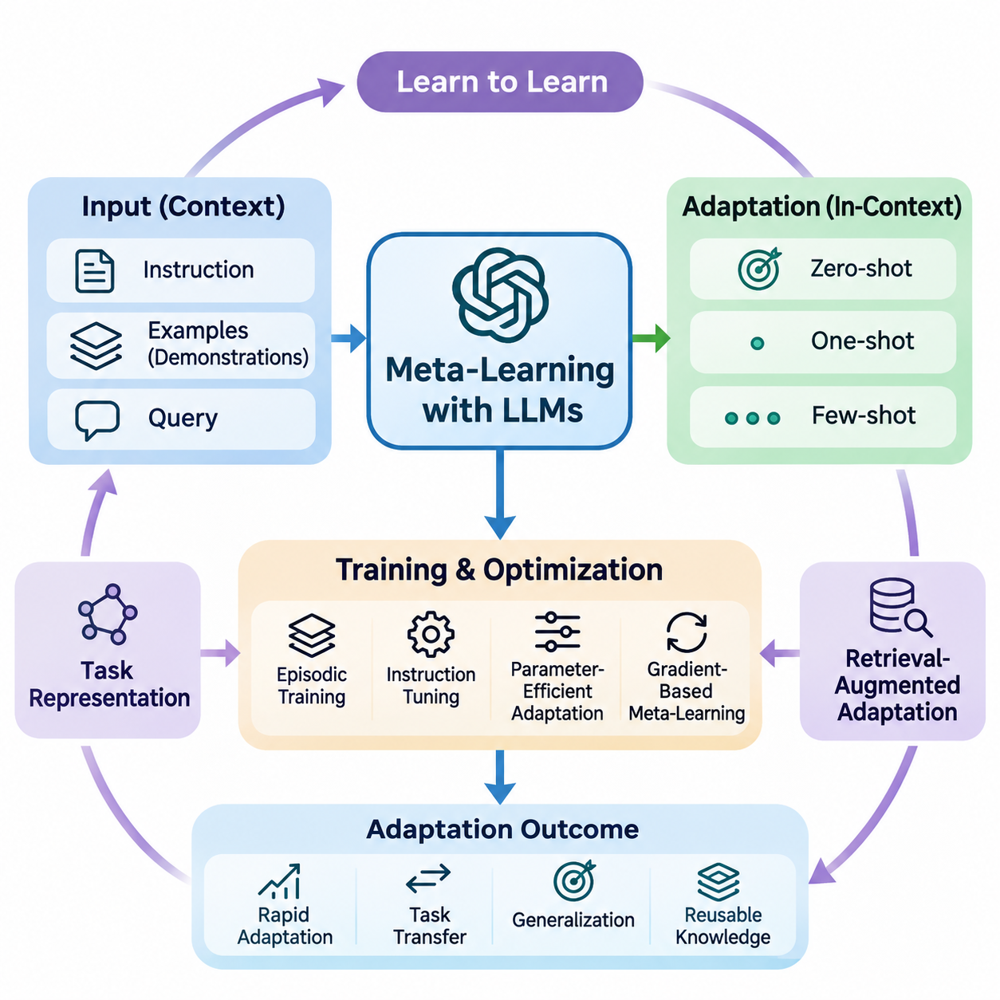
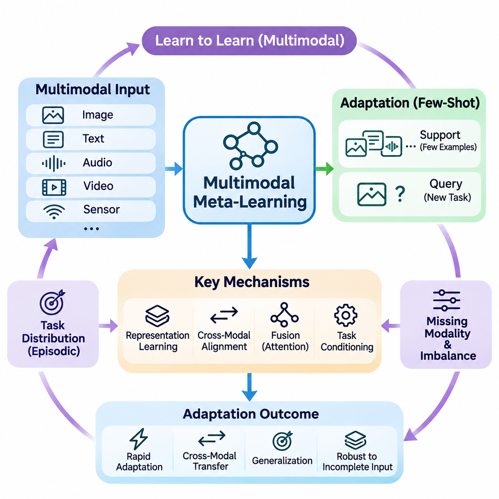
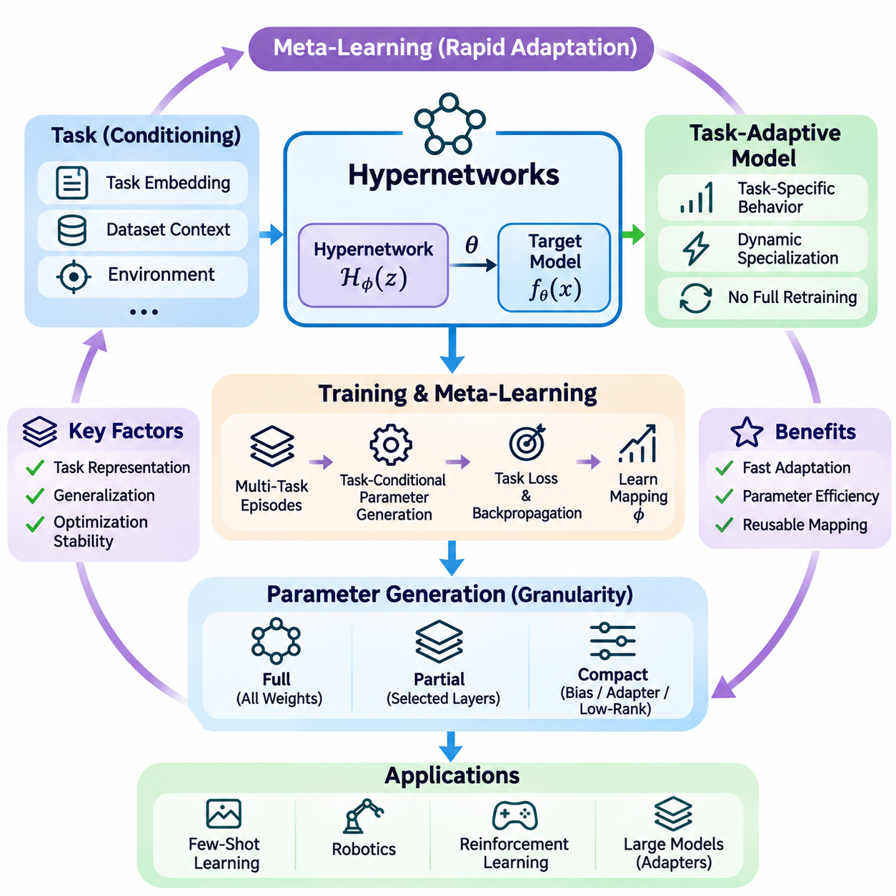
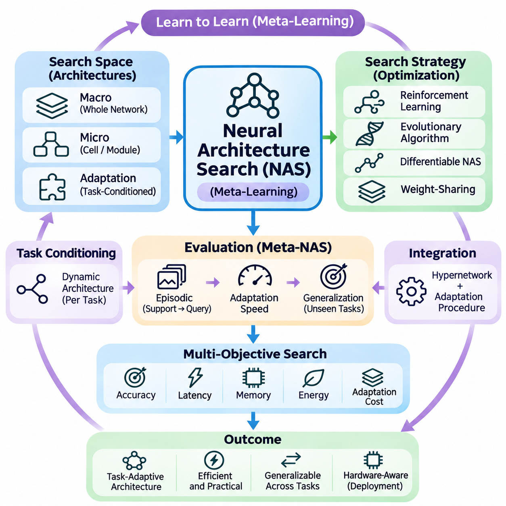
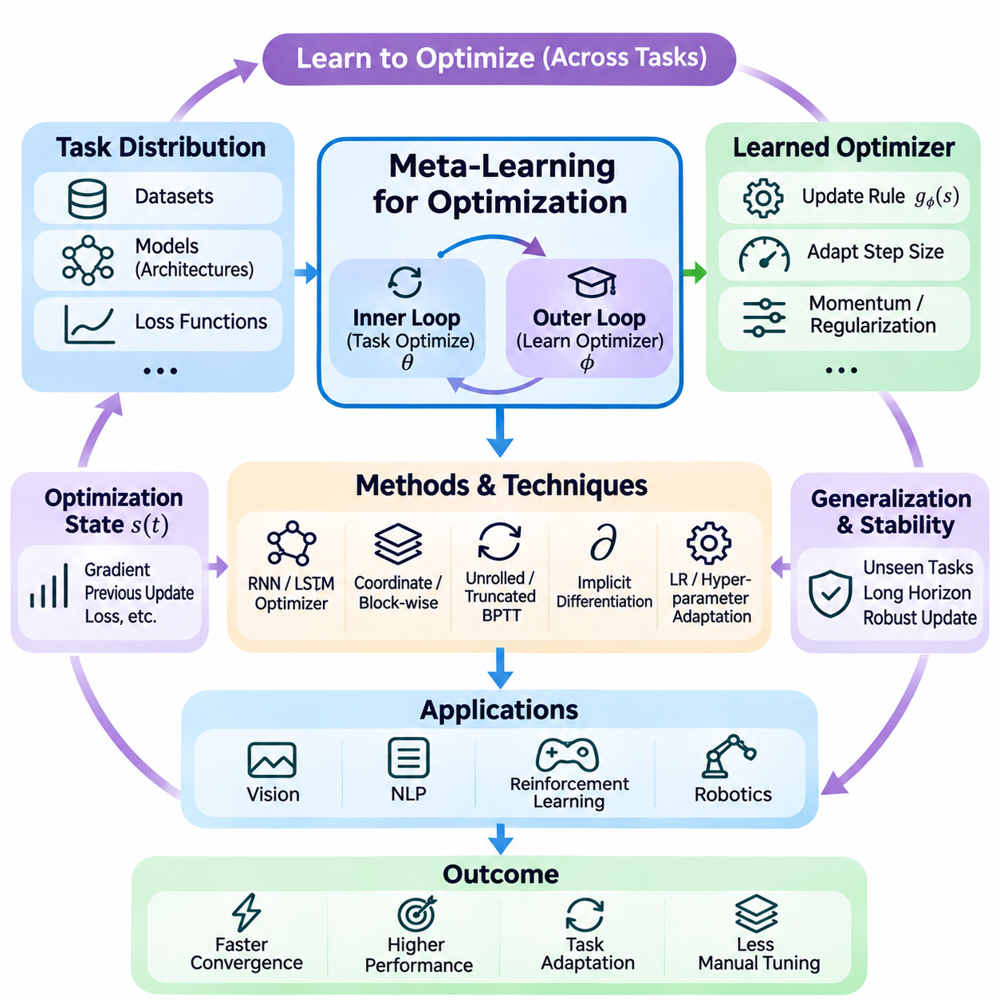
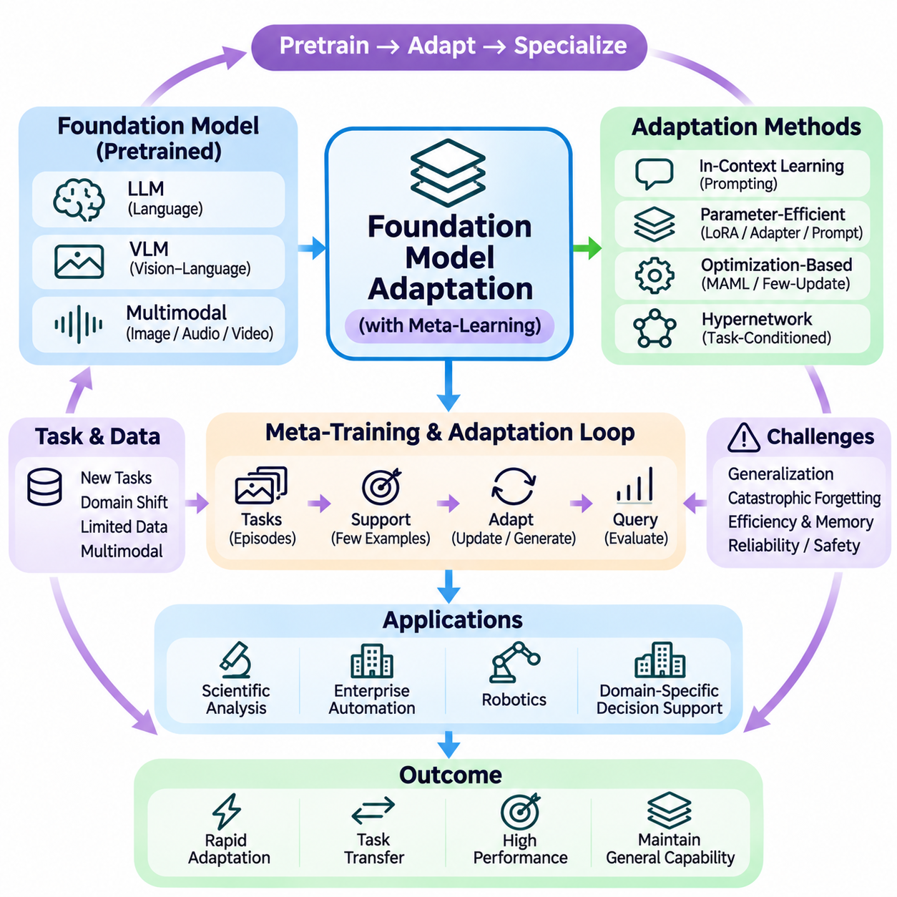

**Volume 36. Meta Learning and Few Shot Adaptation**

# 07. Advanced Meta Learning

## 07.01 Meta Learning with LLMs

{width="7.268055555555556in" height="7.268055555555556in"}

Meta-learning with large language models extends the principle of learning to learn into systems capable of adapting to unfamiliar tasks through natural language instructions, demonstrations, and contextual information. Unlike conventional machine learning, which often requires parameter updates for each new task, large language models can exhibit rapid adaptation by interpreting examples within their input context.

The relationship between meta-learning and large language models is particularly evident in in-context learning. A model receives a sequence containing task descriptions, example inputs, and corresponding outputs before processing a new query. Through pretraining, it may acquire mechanisms that allow it to infer task patterns from these demonstrations without explicitly modifying its underlying parameters.

In-context learning can be interpreted as a form of implicit meta-learning, although this interpretation depends on the model and training conditions. The model\'s parameters encode statistical regularities acquired across diverse training examples, while its contextual representations support temporary task adaptation. This distinction separates adaptation through internal activations from adaptation through gradient-based optimization.

Few-shot prompting provides a practical mechanism for applying these capabilities. A prompt containing several representative examples establishes an implicit relationship between inputs and expected outputs. The model uses these examples to infer formatting conventions, classification boundaries, reasoning patterns, or transformation rules. Performance depends strongly on example quality, relevance, ordering, and consistency.

Zero-shot, one-shot, and few-shot settings represent different levels of contextual supervision. Zero-shot learning relies on instructions and previously acquired knowledge, while one-shot learning introduces a single demonstration. Few-shot learning provides multiple examples that may reveal additional task structure. These settings help researchers examine how adaptation changes with the amount of information available at inference time.

The effectiveness of contextual adaptation is influenced by the distribution of tasks encountered during pretraining. Exposure to diverse linguistic structures, problem formats, and reasoning patterns can encourage transferable representations. However, broad pretraining does not guarantee successful adaptation to unfamiliar domains, especially when tasks require specialized knowledge or relationships absent from the training distribution.

Meta-learning objectives can be incorporated directly into language model training. Instead of optimizing only conventional next-token prediction, researchers may organize training data into episodes containing task-specific support examples and query examples. The model is then encouraged to produce correct query responses conditioned on the support information, creating an explicit connection between episodic learning and contextual adaptation.

An episodic training procedure samples tasks from a distribution and constructs contextual demonstrations for each task. The support examples provide information about the task, while the query evaluates whether the model can apply that information. Repeated optimization across different episodes can improve adaptation to new task instances, particularly when the training tasks reflect the intended deployment environment.

Instruction tuning offers another approach to improving adaptation. By training language models on diverse instruction-response pairs, developers encourage models to interpret natural language descriptions as specifications of desired behavior. Instruction tuning is not inherently equivalent to meta-learning, but it can strengthen capabilities that support rapid task adaptation when combined with contextual examples.

Parameter-efficient adaptation introduces a complementary mechanism for situations where contextual prompting alone is insufficient. Techniques such as low-rank adaptation, adapters, and soft prompt tuning modify a restricted set of trainable parameters while preserving most pretrained weights. Meta-learning can help identify effective initialization strategies or adaptation procedures for these lightweight components.

Gradient-based meta-learning methods can also be applied to language models, although computational requirements create substantial challenges. Methods inspired by model-agnostic meta-learning optimize parameters so that a small number of task-specific updates produces useful performance. For large transformers, memory consumption, higher-order differentiation, and optimization stability often motivate approximate or first-order alternatives.

Task representations provide another connection between language models and meta-learning. A model may infer latent characteristics of a task from its instructions, examples, or interaction history. These representations can influence subsequent predictions without requiring explicit task identifiers. Their usefulness depends on whether the model distinguishes meaningful task properties from superficial similarities in wording.

Retrieval-augmented adaptation extends contextual learning by selecting relevant examples or documents from external information sources. Rather than relying on a fixed demonstration set, the system retrieves information associated with the current query. This mechanism can improve adaptation to specialized tasks, although retrieval quality, document reliability, and context selection remain important determinants of performance.

Example selection can itself become a meta-learning problem. A selection policy may learn which demonstrations are most informative for different task categories, model capabilities, or input distributions. Similarity-based retrieval, diversity-aware sampling, and learned ranking mechanisms provide alternative strategies. The objective is to maximize useful contextual information within a limited token budget.

Context window limitations introduce important constraints on few-shot adaptation. Increasing the number of examples does not necessarily improve performance because irrelevant demonstrations may distract the model or obscure task relationships. Long contexts also increase computational requirements. Effective systems therefore balance demonstration coverage, information density, ordering, and inference cost.

Large language models may also support adaptation through iterative interaction. Feedback from users, tools, or external evaluators can be incorporated into subsequent prompts, allowing the model to revise its behavior during a session. This process resembles online adaptation, but temporary contextual adjustments should be distinguished from persistent learning through parameter updates or external memory modification.

Meta-reasoning introduces an additional dimension by allowing systems to select strategies according to task characteristics. A language model may choose between direct prediction, decomposition, retrieval, verification, or tool-assisted computation. Learning when to apply these strategies can improve efficiency and reliability, although generating elaborate reasoning traces does not automatically guarantee more accurate conclusions.

Uncertainty estimation is particularly important when adapting language models to unfamiliar tasks. A model may produce confident responses even when demonstrations are insufficient or contradictory. Calibration methods, confidence evaluation, selective prediction, and external verification can help identify unreliable outputs. Effective adaptation should account for uncertainty rather than treating every inferred task pattern as trustworthy.

Distribution shifts create further challenges because demonstrations may not adequately represent the target environment. Changes in terminology, document structure, user behavior, or domain conventions can reduce adaptation quality. Meta-learning approaches seek representations and adaptation mechanisms that remain effective across such shifts, but robustness must be established through evaluation on genuinely unseen tasks.

Evaluation requires separating previously encountered task families from novel task distributions. Researchers should measure accuracy, adaptation efficiency, calibration, computational cost, and sensitivity to demonstration selection. Comparisons between zero-shot prompting, few-shot prompting, fine-tuning, and meta-trained approaches help determine whether improvements arise from meaningful adaptation rather than memorization or benchmark contamination.

Applications include specialized document analysis, multilingual processing, information extraction, code generation, scientific assistance, and adaptive conversational systems. In these environments, contextual demonstrations can communicate task-specific conventions without requiring complete retraining. More demanding applications may combine prompting with retrieval, parameter-efficient updates, and structured verification procedures.

Enterprise language systems can benefit from meta-learning when requirements differ across organizations, departments, or workflows. A shared language model may adapt to distinct terminology, reporting conventions, and classification policies using carefully selected examples. Nevertheless, privacy protection, access control, provenance tracking, and validation remain necessary when contextual information contains sensitive organizational knowledge.

The distinction between adaptation and knowledge acquisition remains fundamental. In-context learning may temporarily alter model behavior without storing new information in its parameters. Fine-tuning changes model weights, while retrieval systems access information maintained outside the model. Combining these mechanisms requires clear architectural decisions about persistence, computational resources, reliability, and the intended scope of adaptation.

Future research increasingly explores how language models can acquire more systematic adaptation strategies across heterogeneous tasks. Promising directions include learned demonstration selection, adaptive computation, uncertainty-aware prompting, episodic instruction training, and efficient parameter updates. The broader objective is to develop language systems that generalize beyond familiar examples while adapting reliably with limited supervision.

Ultimately, meta-learning with large language models represents a convergence of representation learning, contextual inference, optimization, and task-level generalization. Its significance lies not merely in producing responses from a few examples, but in understanding how models identify task structure and transfer useful experience. Reliable progress depends on rigorous evaluation, efficient adaptation, and clear distinctions between temporary inference and persistent learning.

## 07.02 Multimodal Meta Learning

{width="7.268055555555556in" height="7.268055555555556in"}

Multimodal meta-learning extends the learning-to-learn paradigm to environments where information originates from multiple modalities, including images, text, audio, video, and sensor measurements. Instead of adapting to new tasks using a single data representation, multimodal systems learn transferable adaptation strategies that combine complementary information sources while operating with limited task-specific supervision.

The central objective is to acquire knowledge that supports rapid adaptation across different combinations of modalities and tasks. A model trained on visual recognition, language understanding, and audio interpretation may learn shared representations that facilitate adaptation to unfamiliar problems. Successful generalization requires distinguishing transferable semantic relationships from modality-specific characteristics.

Traditional meta-learning typically assumes that support and query examples share a consistent input structure. Multimodal meta-learning relaxes this assumption by allowing examples to contain different information types or incomplete modality combinations. A support set may contain images with textual descriptions, while a query may require classification using visual evidence alone.

Multimodal task distributions introduce substantial diversity into episodic training. Individual episodes may involve image-text matching, audio classification, visual question answering, or sensor-based activity recognition. By repeatedly encountering heterogeneous tasks, the model learns adaptation mechanisms that can operate across changing input configurations and different supervision conditions.

Representation learning forms the foundation of effective multimodal adaptation. Modality-specific encoders transform raw observations into feature representations that capture relevant patterns. Vision encoders extract spatial information, language encoders represent linguistic meaning, and audio encoders capture acoustic characteristics. These representations can subsequently be aligned or combined within a shared learning framework.

Cross-modal alignment establishes relationships between representations derived from different modalities. Contrastive learning can encourage semantically related image and text embeddings to occupy nearby regions of a shared feature space. Such alignment allows knowledge acquired from one modality to support adaptation in another, although successful transfer depends on representation quality and task compatibility.

Shared embedding spaces provide an important mechanism for cross-modal few-shot learning. When different modalities encode comparable semantic concepts, a model can classify unfamiliar examples using prototypes derived from another modality. For instance, textual descriptions of object categories may support visual recognition when only a limited number of labeled images are available.

Metric-based meta-learning can be extended to multimodal environments through similarity functions operating on aligned representations. Prototypical networks may construct class prototypes from combined image and text features, while matching networks can compare multimodal queries with support examples. These approaches reduce dependence on extensive parameter updates during adaptation.

Optimization-based approaches provide another strategy for multimodal meta-learning. Methods inspired by model-agnostic meta-learning optimize shared parameters so that limited gradient updates can adapt the system to new modality combinations. However, differences in encoder architectures, parameter scales, and gradient behavior complicate the design of stable and computationally efficient adaptation procedures.

Fusion mechanisms determine how information from different modalities contributes to predictions. Early fusion combines features before substantial task-specific processing, while late fusion integrates predictions or high-level representations. Intermediate fusion uses cross-attention or learned interactions between modality-specific features. The appropriate strategy depends on task structure and available computational resources.

Attention mechanisms are particularly useful when relevant information is distributed unevenly across modalities. Cross-attention allows visual representations to interact with linguistic descriptions or audio features. During adaptation, attention weights can emphasize informative relationships while reducing the influence of irrelevant observations, although attention alone does not guarantee robust modality selection.

Missing modalities represent a major challenge in real-world deployment. A system trained with images, text, and audio may encounter queries containing only one or two of these inputs. Robust multimodal meta-learning therefore requires adaptation mechanisms that tolerate incomplete observations, potentially using modality dropout, conditional encoders, or representations designed for partial information.

Modality imbalance creates additional difficulties because some information sources may dominate optimization. High-dimensional visual features or strongly predictive textual cues can overshadow weaker sensor signals. Balanced training objectives, adaptive weighting, and modality-specific regularization can help preserve complementary information while reducing dependence on a single dominant modality.

Cross-modal transfer enables knowledge learned through one sensory channel to improve performance in another. A model trained with extensive image-text pairs may adapt to visual classification using natural language category descriptions. Similarly, audio and video relationships can support event recognition when labeled examples are scarce. Transfer effectiveness depends on semantic correspondence between modalities.

Task conditioning provides a mechanism for adjusting multimodal processing according to the current objective. A task representation inferred from support examples or instructions can control feature fusion, attention allocation, or prediction layers. This approach allows the same model to prioritize different modalities for classification, retrieval, question answering, or structured prediction tasks.

Multimodal foundation models provide a powerful starting point for advanced meta-learning. Large-scale pretraining on image-text, audio-text, or video-language data can produce broadly transferable representations. Meta-learning can build upon these capabilities by optimizing task adaptation procedures rather than requiring complete retraining for each downstream application.

Parameter-efficient adaptation is particularly valuable for large multimodal architectures. Adapters, low-rank updates, and learned prompts can modify selected components while retaining pretrained encoders. Meta-training may identify initializations or update strategies that support rapid specialization, reducing memory requirements and computational costs compared with full-model fine-tuning.

Evaluation of multimodal meta-learning requires careful separation of training and testing tasks. Researchers should examine few-shot accuracy, cross-modal transfer, robustness to missing inputs, and sensitivity to modality imbalance. Testing unfamiliar combinations of tasks and modalities is especially important because strong performance on familiar configurations does not necessarily indicate general adaptation capability.

Practical applications include medical image interpretation, robotic perception, autonomous systems, industrial inspection, and assistive technologies. These environments often combine visual observations, language instructions, acoustic signals, and physical sensor measurements. Multimodal meta-learning can support rapid adaptation when operating conditions change or labeled training examples remain limited.

Robotics provides a particularly demanding application because sensory information changes continuously during interaction. A robot may combine camera images, tactile feedback, joint measurements, and verbal instructions to identify objects or perform manipulation tasks. Meta-learning can help the perception system adapt to new environments, although reliable physical control also requires safety constraints and real-time validation.

Industrial monitoring systems can use multimodal adaptation to recognize unfamiliar equipment conditions from vibration signals, thermal images, acoustic measurements, and maintenance descriptions. Limited examples of newly emerging faults may be sufficient to update task-specific representations. However, rare-event detection requires careful calibration because incorrect predictions can produce significant operational consequences.

The long-term objective of multimodal meta-learning is to develop systems that transfer adaptation strategies across sensory domains without requiring extensive supervision for every new configuration. Achieving this capability requires advances in representation alignment, heterogeneous task training, uncertainty estimation, and efficient optimization. Robust evaluation remains essential for distinguishing genuine cross-modal generalization from reliance on familiar training patterns.

## 07.03 Hypernetworks

{width="7.268055555555556in" height="7.268055555555556in"}

Hypernetworks represent an advanced neural learning paradigm in which one neural network generates the parameters of another network. Unlike conventional architectures that directly optimize a fixed set of model weights, hypernetworks learn a mapping from contextual information to task-specific parameters. This mechanism provides a flexible foundation for meta-learning, enabling rapid adaptation without repeatedly training an entire model from scratch.

A hypernetwork typically consists of a parameter-generating network and a target network. The hypernetwork receives a conditioning signal, such as a task embedding, dataset representation, or environmental context, and produces weights used by the target network. The target network subsequently processes input data using these generated parameters, allowing its behavior to change according to the current task.

The mathematical formulation describes a hypernetwork as a function that maps task information into model parameters. Given a task representation z and hypernetwork parameters phi, the generated weights can be expressed as theta = H_phi(z). The target model then computes predictions using f_theta(x). Learning optimizes phi so that the generated parameters perform effectively across a distribution of related tasks.

Hypernetworks are particularly relevant to meta-learning because they separate the process of learning how to generate parameters from the process of applying those parameters. During meta-training, the hypernetwork encounters multiple tasks and learns relationships between task characteristics and useful model configurations. During adaptation, a new task representation can produce specialized parameters through a forward pass.

Task embeddings play a central role in determining the effectiveness of hypernetwork-based adaptation. These embeddings summarize characteristics of individual tasks, including input distributions, output requirements, and relevant semantic relationships. They may be learned from support examples, inferred through an encoder, or constructed from explicit task descriptors, depending on the application and available information.

In few-shot learning, hypernetworks can generate classifier parameters from a limited collection of labeled examples. A task encoder processes the support set and produces a compact representation of the classification problem. The hypernetwork transforms this representation into weights for a task-specific prediction model, reducing the need for extensive gradient-based optimization during adaptation.

The relationship between hypernetworks and optimization-based meta-learning is especially important. Methods such as model-agnostic meta-learning obtain task-specific parameters through gradient updates from a learned initialization. Hypernetworks instead generate parameters directly from conditioning information. Hybrid approaches can combine both mechanisms by generating initial parameters that are subsequently refined through limited optimization.

Parameter generation can operate at different levels of model granularity. A hypernetwork may produce all weights of a small target network, generate selected layers of a larger architecture, or predict compact parameter adjustments. Full parameter generation offers substantial flexibility but can require considerable memory and computation, especially when target networks contain millions or billions of parameters.

Partial parameter generation provides a practical alternative for large neural architectures. Instead of generating complete weight matrices, a hypernetwork can produce biases, normalization coefficients, adapter parameters, or low-rank updates. This approach reduces output dimensionality while retaining task-dependent flexibility, making hypernetworks more practical for transformer models and resource-constrained systems.

Conditional computation is another important property of hypernetwork architectures. Because generated parameters depend on contextual inputs, the same target architecture can exhibit different behaviors across tasks. This enables dynamic specialization without maintaining a separate independently trained model for every task, although generating and storing task-specific weights still introduces computational and memory overhead.

Hypernetworks can also be interpreted as a form of learned parameter-space mapping. Rather than searching directly through a high-dimensional weight space for every new problem, the system learns a structured relationship between compact task representations and effective parameters. This mapping can constrain adaptation to regions associated with previously encountered tasks, potentially improving efficiency and generalization.

The quality of the learned task representation strongly influences generalization to unseen tasks. If task embeddings fail to capture meaningful differences between problems, the hypernetwork may generate inappropriate parameters. Conversely, representations that preserve relevant task structure can support interpolation between familiar tasks and adaptation to related situations not explicitly encountered during training.

Training hypernetworks generally requires differentiating through the target network. The hypernetwork generates parameters, the target model produces predictions, and a task-specific loss measures performance. Gradients propagate through the target model into the parameter generator, allowing the hypernetwork to improve its mapping from conditioning information to useful weights across repeated training episodes.

Optimization stability becomes challenging when generated parameters vary substantially across tasks. Poorly scaled outputs may produce unstable activations, exploding gradients, or ineffective target models. Weight normalization, bounded parameter transformations, regularization, and carefully designed initialization strategies can improve stability, although their effectiveness depends on the target architecture and training objective.

Hypernetworks introduce important tradeoffs between expressiveness and computational efficiency. Large parameter generators may represent complex task relationships but increase training cost and the risk of overfitting. Smaller generators are more efficient but may lack sufficient capacity to produce diverse model configurations. Architecture design must therefore balance parameter-generation capacity against the complexity of the task distribution.

Regularization is particularly important when only a limited number of meta-training tasks are available. A hypernetwork may memorize mappings between familiar task embeddings and effective weights instead of learning transferable adaptation principles. Techniques such as task augmentation, weight decay, representation regularization, and validation on held-out task families can help reduce this problem.

Hypernetworks can support continual learning by generating different parameters for different tasks while sharing a common parameter-generation mechanism. Task-conditioned outputs may reduce interference between previously learned behaviors, although catastrophic forgetting remains possible when the hypernetwork itself is updated. Replay strategies, parameter constraints, and modular designs can help preserve earlier capabilities.

In reinforcement learning, hypernetworks can generate policy parameters conditioned on environmental characteristics or inferred task representations. An agent may adapt its policy to changing dynamics, reward functions, or operating conditions without learning a completely new policy from scratch. Such approaches are relevant to meta-reinforcement learning, where rapid adaptation across related environments is essential.

Robotics applications can use hypernetworks to specialize perception, prediction, or control models according to robot configuration and environmental context. A parameter generator may adapt selected neural components to different sensors, payload conditions, or manipulation tasks. However, generated controllers must satisfy stability and safety requirements, particularly when adaptation affects physical motion.

Hypernetworks are also relevant to multimodal learning, where different input combinations may require different processing configurations. Task-conditioned parameter generation can adjust fusion layers, attention modules, or modality-specific adapters. This enables a shared architecture to accommodate changing combinations of visual, linguistic, acoustic, and sensor information without independently training every configuration.

Large language models provide another promising application for hypernetwork-based adaptation. A hypernetwork may generate lightweight adapter parameters or low-rank updates from task descriptions and example demonstrations. Such mechanisms can complement in-context learning by converting task information into parameter modifications, although scalability and reliable generalization remain significant engineering challenges.

Evaluation of hypernetwork-based meta-learning should measure adaptation accuracy, parameter-generation latency, memory consumption, and generalization to unseen tasks. Comparisons with gradient-based meta-learning, conventional fine-tuning, and fixed feature extractors help identify the benefits of conditional parameter generation. Testing task distributions beyond those used during training is essential for assessing genuine adaptability.

The broader significance of hypernetworks lies in their ability to transform model adaptation into a learned parameter-generation problem. By connecting task representations with dynamically generated neural parameters, they offer an alternative to repeatedly optimizing complete models. Their long-term potential depends on scalable architectures, stable optimization, expressive task embeddings, and reliable generalization across changing environments.

## 07.04 Neural Architecture Search

{width="7.268055555555556in" height="7.268055555555556in"}

Neural architecture search (NAS) is an automated approach to discovering neural network structures that satisfy specific learning objectives. Rather than relying entirely on manually designed architectures, NAS explores combinations of layers, connections, and computational operations. Within meta-learning, architecture search becomes especially valuable because models must adapt efficiently across multiple tasks rather than optimize performance for a single fixed problem.

Traditional NAS typically searches for architectures that maximize validation performance on a particular dataset. Meta-learning introduces a broader objective by evaluating how effectively an architecture adapts to unfamiliar tasks using limited examples. The resulting search process considers not only predictive accuracy but also adaptation speed, computational efficiency, and the ability to generalize across changing task distributions.

A NAS framework generally contains three interacting components: a search space, a search strategy, and a performance evaluation mechanism. The search space defines possible architectures, including layer types, connectivity patterns, and model dimensions. The search strategy selects candidate designs, while the evaluation mechanism estimates their suitability for the intended learning environment.

Search spaces can be defined at different levels of architectural complexity. Macro-level search explores complete network structures, including depth, width, and connectivity. Micro-level search focuses on reusable computational cells or modules. In meta-learning applications, search spaces may additionally include adaptation layers, task-conditioned components, and mechanisms for updating parameters efficiently.

Reinforcement learning provides one approach to architecture search by treating architectural decisions as sequential actions. A controller generates candidate networks and receives rewards based on their measured performance. The controller gradually learns to favor promising architectural configurations. However, repeatedly training candidate models can require substantial computational resources.

Evolutionary algorithms offer another strategy by maintaining populations of candidate architectures. Mutation and selection operations progressively improve designs according to predefined fitness criteria. In meta-learning, fitness may reflect performance across multiple adaptation episodes rather than accuracy on a single dataset. Evolutionary methods support flexible search spaces but may involve expensive evaluations.

Differentiable architecture search reduces search costs by representing architectural choices through continuous parameters. Instead of evaluating every candidate independently, the method optimizes architecture parameters alongside network weights. This enables gradient-based exploration of candidate operations, although the continuous relaxation can introduce optimization bias and discrepancies between searched and deployed architectures.

Weight-sharing NAS further improves efficiency by allowing candidate architectures to reuse parameters from a common supernetwork. Individual candidates are evaluated using subsets of shared weights rather than being trained entirely from scratch. Although this approach reduces computational cost, shared-weight performance estimates may not accurately predict how independently trained architectures will perform.

Meta-learning changes the evaluation criteria used during architecture search. A candidate network may achieve strong accuracy after extensive training but adapt poorly when only a few labeled examples are available. Consequently, meta-NAS evaluates candidate architectures through episodic learning, where support examples guide adaptation and query examples measure generalization to unseen instances.

Episodic architecture evaluation samples multiple tasks from a training distribution. For each task, a candidate architecture performs a limited adaptation procedure before being evaluated on held-out query examples. Aggregating results across episodes estimates how well the architecture supports learning to learn. This procedure aligns architectural optimization with the actual requirements of few-shot adaptation.

Architecture and adaptation algorithms are closely related because structural choices influence optimization behavior. Network depth, normalization methods, residual connections, and parameter-sharing patterns affect gradient flow and adaptation stability. Jointly searching architectures and adaptation procedures may therefore identify configurations that outperform independently optimized designs.

Task-conditioned architecture selection extends NAS by allowing different tasks to activate different network structures. A task encoder extracts information from support examples, while a controller selects appropriate modules or computational paths. This mechanism enables dynamic specialization, although it introduces additional complexity in routing decisions and maintaining reliable performance.

Hypernetworks provide a complementary mechanism for architecture adaptation. While conventional NAS selects structural configurations, hypernetworks generate parameters conditioned on task information. Combining these approaches allows a system to choose suitable modules and generate task-specific weights. Such integration can increase flexibility but also complicates optimization and resource management.

Multi-objective architecture search considers several performance requirements simultaneously. Accuracy, latency, memory consumption, energy efficiency, and adaptation cost may conflict with one another. Pareto-based optimization identifies architectures representing different tradeoffs, enabling developers to select models according to deployment constraints rather than relying on predictive accuracy alone.

Hardware-aware NAS incorporates characteristics of the intended computing platform into the search process. Candidate architectures may be evaluated according to execution time, memory bandwidth, accelerator compatibility, and power consumption. This is particularly important for edge AI and robotics, where models must adapt under strict computational and real-time operating constraints.

Few-shot architecture search faces challenges associated with noisy performance estimates. Small support sets can produce substantial variation across sampled tasks, making architecture rankings unreliable. Repeated episodic evaluation, confidence intervals, and carefully separated validation tasks help distinguish genuine architectural advantages from randomness in task sampling.

Generalization remains a central concern because architecture search can overfit to the meta-training task distribution. A structure optimized for familiar task families may perform poorly when new tasks involve different visual patterns, language structures, or data characteristics. Robust evaluation therefore requires testing on unseen task families and examining sensitivity to distribution shifts.

Search efficiency can be improved through surrogate models that predict candidate performance without complete training. Performance predictors use architectural features and previously observed results to estimate promising configurations. Bayesian optimization and learned ranking methods can guide exploration toward useful regions of the search space, although prediction errors may distort architectural selection.

Neural architecture search is increasingly relevant to transformer-based models and multimodal systems. Search procedures can explore attention configurations, feedforward dimensions, adapter placement, and modality fusion mechanisms. Meta-learning objectives can encourage architectures that adapt to new language tasks, visual categories, or multimodal combinations with limited supervision.

In robotics, NAS can identify perception and control architectures suited to changing sensors, environments, and computational budgets. A mobile robot may require lightweight visual processing, while a manipulation system may benefit from richer multimodal representations. Meta-aware search can prioritize architectures that support rapid task adaptation without violating operational resource constraints.

Practical deployment requires considering the complete lifecycle of searched architectures. Search costs, reproducibility, implementation complexity, inference reliability, and maintenance requirements influence whether an automatically discovered model is useful. Architecture search should therefore be integrated with systematic benchmarking, hardware profiling, and validation under realistic operating conditions.

The long-term objective of neural architecture search within meta-learning is to automate the discovery of structures that learn efficiently across diverse tasks. Progress depends on reliable episodic evaluation, efficient search algorithms, adaptive architectural representations, and hardware-aware optimization. Ultimately, successful meta-NAS should produce networks that are not merely accurate, but adaptable, efficient, and robust under changing requirements.

## 07.05 Meta Learning for Optimization

{width="7.268055555555556in" height="7.268055555555556in"}

Meta-learning for optimization extends the learning-to-learn paradigm by training systems to improve how optimization problems are solved. Instead of relying exclusively on manually designed algorithms such as stochastic gradient descent or Adam, learned optimizers acquire update strategies from experience across multiple tasks. Their objective is to discover optimization behaviors that transfer efficiently to new models, datasets, or problem conditions.

Traditional optimization algorithms use predefined mathematical rules to update model parameters according to gradients and historical statistics. Meta-learning introduces a higher-level learning process that adjusts these rules based on observed optimization performance. This creates a distinction between the inner optimization process, which solves individual tasks, and the outer process, which learns how optimization should proceed.

A learned optimizer can be represented as a parameterized function that receives information about the current optimization state and produces parameter updates. Inputs may include gradients, previous updates, loss values, and accumulated statistics. The optimizer learns to transform these signals into effective update directions and step sizes, potentially discovering behaviors that differ from conventional optimization algorithms.

The mathematical formulation separates model parameters from optimizer parameters. If theta represents the parameters being optimized and phi represents the learned optimizer, an update can be written as theta(t+1) = theta(t) + g_phi(s(t)), where s(t) summarizes the optimization state. Meta-training adjusts phi to improve performance after a sequence of updates across sampled tasks.

Recurrent neural networks were among the early architectures investigated for learned optimization. An LSTM-based optimizer can maintain internal states that summarize previous gradients and optimization behavior. These states allow update decisions to depend on historical information rather than only the current gradient. However, recurrent optimizers may become computationally expensive when applied independently to many parameters.

Coordinate-wise optimization reduces complexity by applying a shared learned update rule to individual parameters or parameter groups. This approach allows the optimizer to handle models with different parameter counts while reusing the same learned mechanism. Nevertheless, treating coordinates independently can overlook relationships between parameters, motivating block-wise and structured optimization strategies.

Meta-training typically involves sampling optimization tasks from a task distribution and executing a learned optimizer for several steps. The resulting model performance defines a meta-objective that measures optimization effectiveness. By repeatedly updating the optimizer across different tasks, the system learns strategies intended to improve convergence speed, final accuracy, or stability under limited computational budgets.

Unrolled optimization provides a direct mechanism for training learned optimizers. The system differentiates through a sequence of parameter updates to determine how optimizer decisions influence later losses. This approach captures the consequences of earlier updates but can require substantial memory and computation. Long optimization trajectories also introduce difficulties involving unstable or vanishing meta-gradients.

Truncated backpropagation reduces computational requirements by differentiating through shorter optimization segments. Although this makes training more practical, it may introduce bias because long-term consequences of updates are not fully represented. Researchers therefore balance computational efficiency against the need to capture optimization behavior over extended trajectories.

Implicit differentiation offers an alternative when optimization solutions satisfy suitable mathematical conditions. Rather than storing every intermediate update, implicit methods estimate how a converged solution changes with optimizer or hyperparameter settings. Their applicability depends on assumptions about the optimization problem, and they may be difficult to use when solutions are unstable or far from convergence.

Learning-rate adaptation is a particularly practical application of meta-learning for optimization. A learned mechanism can adjust step sizes according to gradient magnitude, loss behavior, or task characteristics. Unlike fixed schedules, task-dependent learning rates can respond to changing optimization conditions. However, adaptive behavior must be constrained to avoid unstable updates or excessive sensitivity to noisy gradients.

Meta-learning can also optimize momentum, regularization coefficients, and other algorithmic hyperparameters. A controller may learn when to increase momentum, reduce learning rates, or modify regularization strength. These decisions can be conditioned on training progress and task-specific statistics, creating a dynamic optimization policy rather than a static configuration selected before training.

Gradient preprocessing is important because raw gradients can vary substantially in magnitude across models and tasks. Logarithmic transformations, normalization, clipping, and scale-invariant representations help learned optimizers process heterogeneous gradient distributions. Without appropriate preprocessing, the optimizer may overfit to the numerical characteristics of its meta-training problems.

Generalization is a major challenge for learned optimization methods. An optimizer trained on small neural networks or simple objective functions may perform poorly on deeper architectures or unfamiliar loss landscapes. Differences in parameter scale, curvature, gradient noise, and optimization horizon can reduce transferability. Evaluation must therefore include problems beyond the original meta-training distribution.

Optimization horizon generalization is especially difficult because learned optimizers are often trained using relatively short trajectories. A strategy that reduces loss quickly during early updates may become unstable or inefficient over longer training periods. Techniques such as randomized unroll lengths, longer evaluation horizons, and stability-aware objectives can improve robustness, although they do not guarantee reliable extrapolation.

Meta-learning for optimization is closely connected to hyperparameter optimization. Conventional methods search for effective settings through repeated experiments, while meta-learned systems attempt to infer useful configurations from previous optimization experience. Task embeddings and training statistics can guide the selection of learning rates, regularization settings, and optimizer configurations for new problems.

The relationship with model-agnostic meta-learning is also significant. MAML learns an initialization that enables rapid task adaptation using a small number of gradient steps. Learned optimization instead focuses on improving the update procedure itself. These approaches can be combined by jointly learning initialization parameters and update rules, although joint optimization increases computational complexity.

In reinforcement learning, learned optimizers can adapt update strategies to changing reward distributions, noisy gradients, and nonstationary environments. Meta-training across related control tasks may improve the efficiency of policy optimization. However, reinforcement learning introduces additional variance and stability challenges, making reliable evaluation across independent environments particularly important.

Robotics and autonomous systems provide applications where optimization must adapt under limited data and computational resources. Learned update rules may support rapid calibration, system identification, or task-specific model adaptation. For safety-critical control, however, learned optimizers should operate within validated constraints, since unstable parameter changes can affect physical system behavior.

Large-scale machine learning introduces practical constraints involving memory, parallel computation, and optimizer overhead. A learned optimizer must justify its additional complexity through measurable improvements over strong conventional baselines. Parameter sharing, compact optimizer networks, and hardware-efficient implementations can reduce overhead, but scalability remains a central research challenge.

Evaluation should compare learned optimizers against carefully tuned conventional methods using equivalent computational budgets. Relevant measures include convergence speed, final loss, generalization performance, memory usage, and stability across random seeds. Testing on unseen architectures, datasets, and optimization horizons is essential for determining whether the learned update strategy transfers beyond familiar tasks.

The broader objective of meta-learning for optimization is to replace rigid optimization rules with adaptable mechanisms informed by experience. Its potential lies in discovering efficient update strategies, improving task-specific adaptation, and reducing manual hyperparameter tuning. Continued progress requires stable meta-training, scalable architectures, rigorous benchmarking, and reliable generalization across diverse optimization problems.

## 07.06 Foundation Model Adaptation

{width="7.268055555555556in" height="7.268055555555556in"}

Foundation model adaptation refers to the process of modifying broadly pretrained models to perform specialized tasks under new conditions. Foundation models acquire transferable representations from large and diverse datasets, but their general capabilities do not guarantee optimal performance in every application. Meta-learning provides mechanisms for adapting these models efficiently using limited examples, task descriptions, or feedback.

The relationship between foundation models and meta-learning centers on transferring prior knowledge to unfamiliar tasks. Large-scale pretraining establishes reusable representations, while meta-learning develops strategies for selecting and adjusting those representations. This combination can reduce the amount of labeled data and computation required for specialization, particularly when target tasks share underlying structure with previous experience.

In-context learning is one of the most accessible adaptation mechanisms for language foundation models. Task instructions and demonstrations are placed within the input context, allowing the model to infer expected behavior without changing its parameters. This approach supports rapid experimentation and task switching, although performance depends on demonstration quality, context length, and compatibility with pretrained knowledge.

Few-shot adaptation becomes more challenging when target tasks require knowledge or behavior absent from pretraining. A small collection of examples may communicate output formats or decision boundaries but cannot reliably supply extensive missing expertise. Meta-learning methods therefore distinguish between adapting existing capabilities and acquiring genuinely new information through additional training, retrieval, or external supervision.

Parameter-efficient fine-tuning provides a practical alternative to updating every parameter of a foundation model. Techniques such as low-rank adaptation, adapters, and prompt tuning modify compact trainable components while preserving most pretrained weights. Meta-learning can optimize their initialization or update procedures so that new tasks require fewer examples and computational resources.

Low-rank adaptation represents weight modifications through compact matrices rather than updating complete pretrained weight tensors. This substantially reduces the number of trainable parameters in suitable architectures. Meta-learning may generate or initialize low-rank components according to task characteristics, enabling specialization while limiting memory consumption and the risk of unnecessary changes to shared representations.

Adapters introduce small trainable modules into selected layers of a pretrained network. Different tasks can use specialized adapters while sharing the underlying foundation model. A meta-learning system may learn how to initialize, select, or combine adapters based on support examples. This modular structure supports efficient task switching, although maintaining numerous adapters introduces management and storage requirements.

Prompt-based adaptation modifies model behavior through textual instructions or learned prompt representations. Soft prompt tuning optimizes continuous embeddings that condition a frozen model, while conventional prompting relies on discrete language inputs. Meta-learning can improve prompt initialization, demonstration selection, or task-conditioned prompt generation, reducing repeated manual experimentation.

Optimization-based meta-learning offers another mechanism for foundation model adaptation. A meta-objective can encourage selected parameters to respond effectively to a small number of gradient updates. However, differentiating through large transformer architectures can be expensive. Practical implementations often restrict adaptation to lightweight modules or use first-order approximations to control computational complexity.

Hypernetworks can generate task-specific parameter adjustments from task descriptions or encoded support examples. Instead of independently optimizing an adapter for every new task, a parameter generator predicts suitable adaptation weights. This approach connects foundation model specialization with conditional parameter generation, although reliable generalization to unfamiliar task distributions remains difficult.

Multimodal foundation models extend adaptation beyond language to images, audio, video, and sensor information. Shared representations can support transfer between modalities, while task-specific modules adjust perception or fusion behavior. Meta-learning is especially useful when new applications provide limited labeled multimodal examples or require adaptation to changing combinations of available inputs.

Retrieval-augmented adaptation supplements pretrained knowledge with external documents and task-relevant examples. Retrieved information can be inserted into the model context without modifying its weights. Meta-learning may improve retrieval policies, example ranking, and context construction. Nevertheless, retrieved evidence must be evaluated for relevance, reliability, and potential conflicts with task requirements.

Continual adaptation introduces the challenge of updating foundation models as new tasks and information emerge. Repeated fine-tuning can cause catastrophic forgetting, where improvements on recent tasks reduce earlier capabilities. Parameter isolation, replay methods, regularization, and modular adaptation can help manage interference, but persistent learning requires careful validation across previous and new tasks.

Evaluation should distinguish adaptation quality from memorization and benchmark contamination. Researchers must separate meta-training tasks from genuinely unseen evaluation tasks and compare prompting, retrieval, parameter-efficient tuning, and full fine-tuning under appropriate resource budgets. Accuracy, calibration, adaptation speed, memory requirements, and robustness to distribution shifts provide complementary evidence of effectiveness.

Foundation model adaptation is increasingly relevant to scientific analysis, enterprise automation, robotics, and specialized decision-support systems. A shared pretrained model can be adapted to distinct terminology, operating conditions, and task requirements. However, applications involving sensitive information or physical systems require access controls, uncertainty assessment, systematic testing, and safeguards against unreliable outputs.

The long-term objective is to create foundation models that specialize rapidly without sacrificing their broad capabilities. Progress depends on combining transferable representations with efficient optimization, task-conditioned parameter generation, retrieval, and reliable evaluation. Meta-learning contributes by transforming adaptation from repeated manual retraining into a systematic process informed by experience across tasks.
