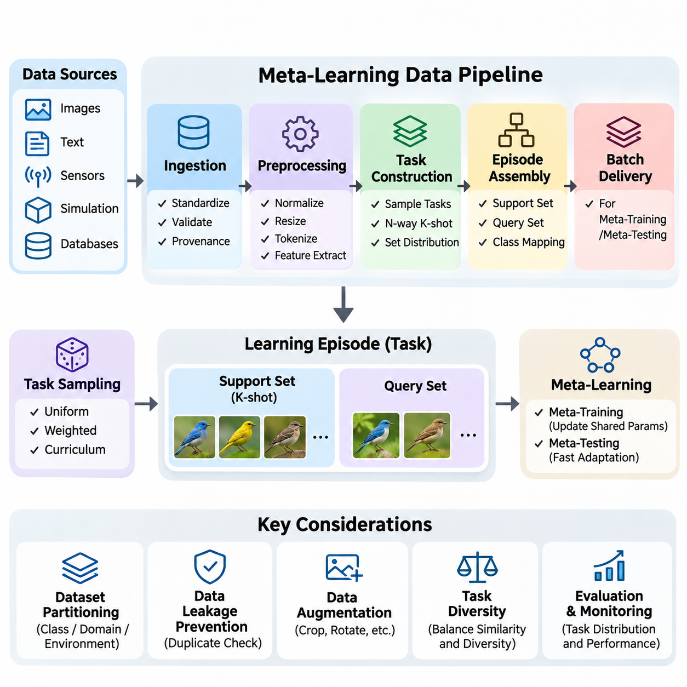
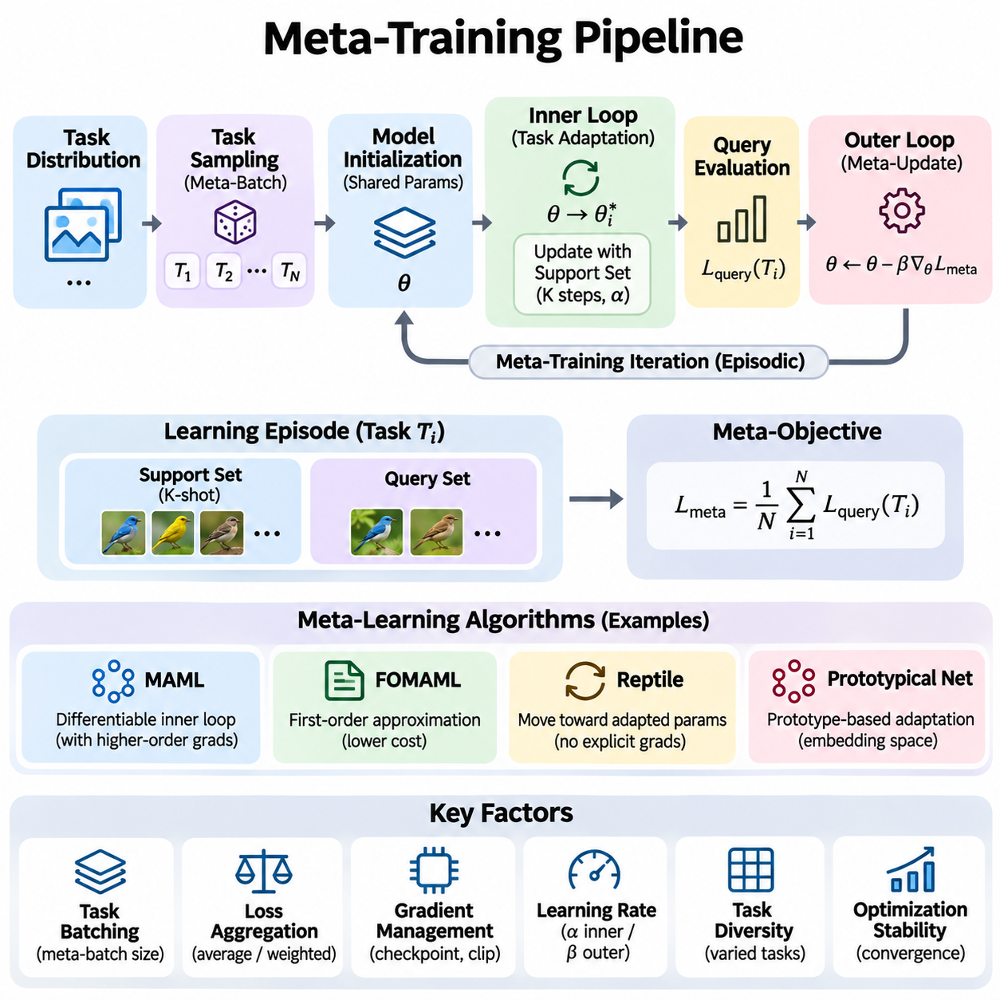
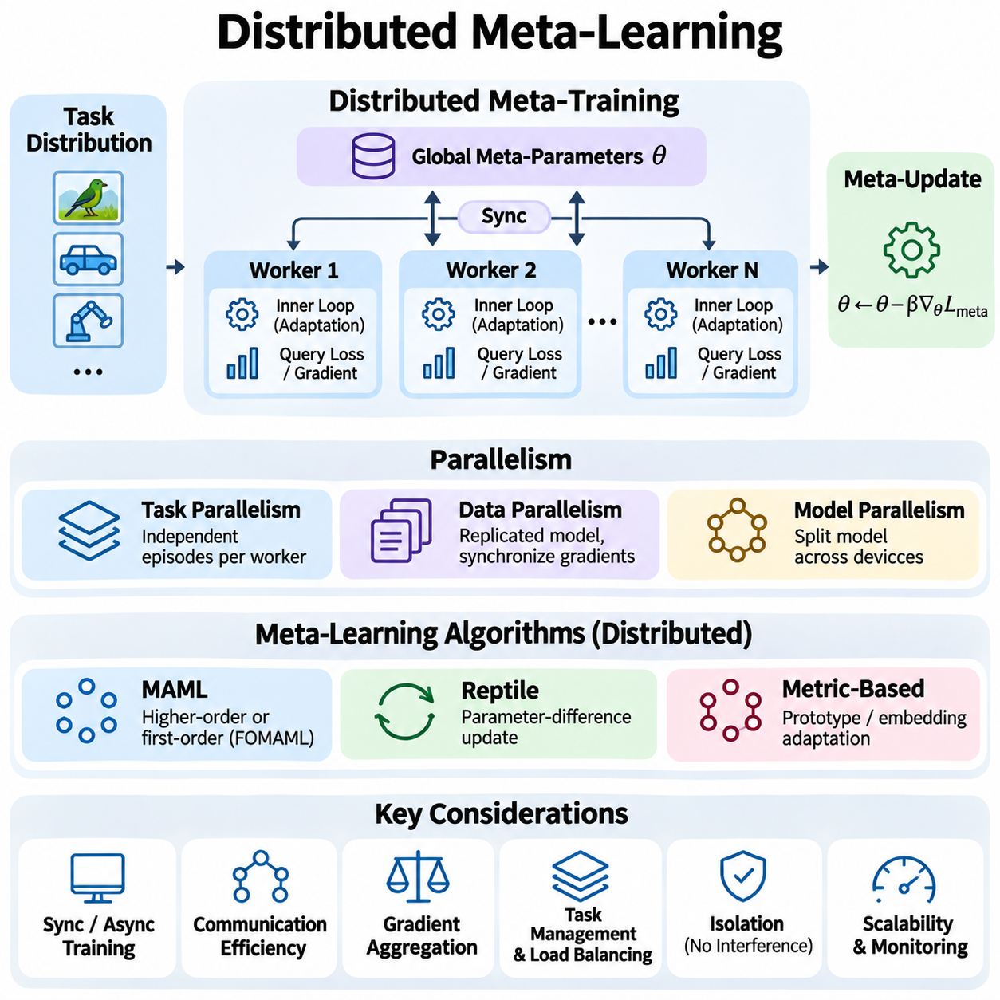
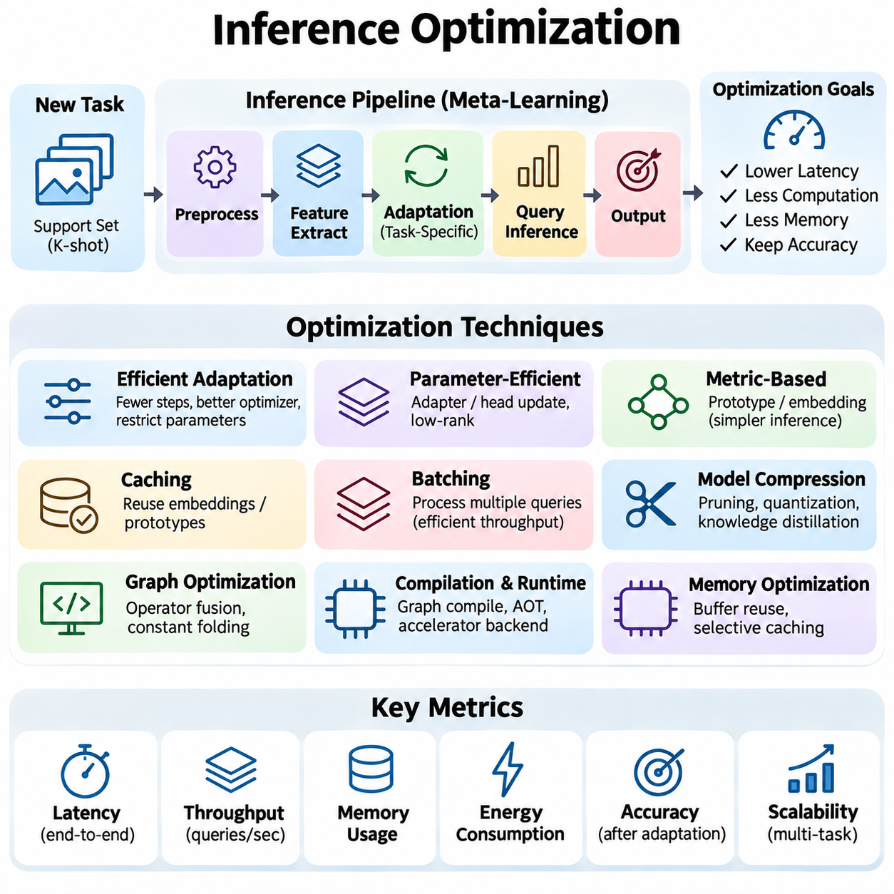
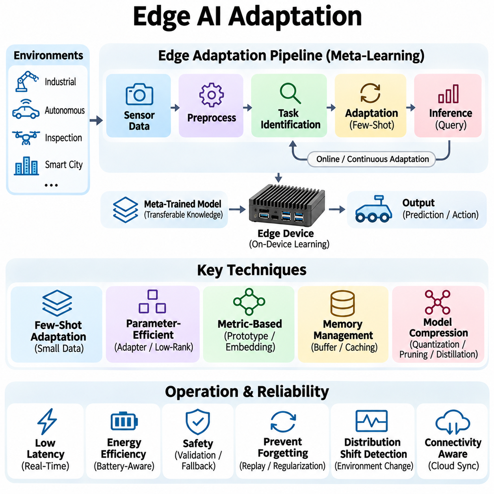
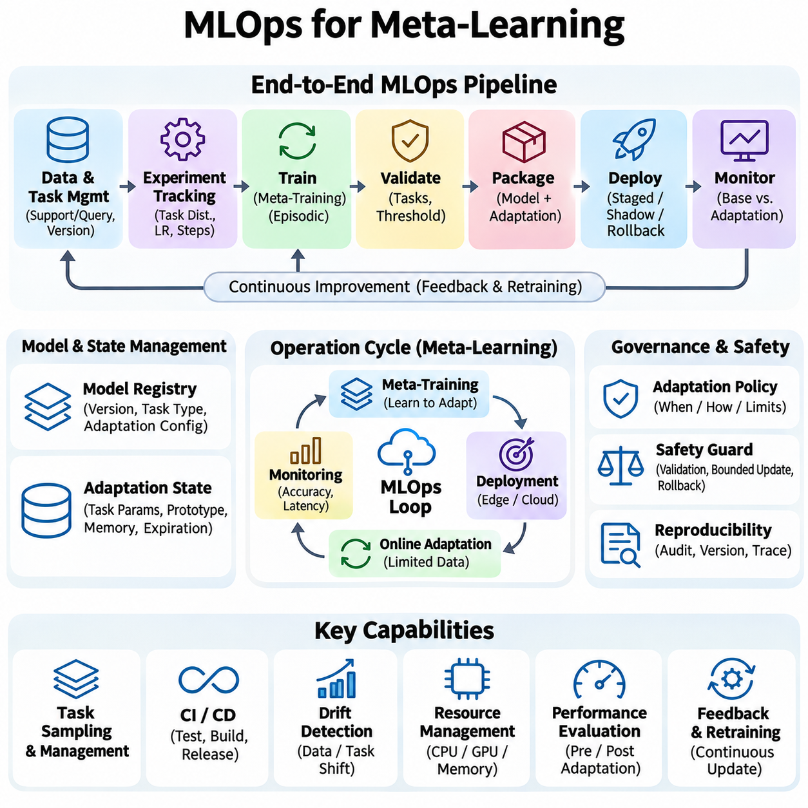

**Volume 36. Meta Learning and Few Shot Adaptation**

# 08. Engineering and Deployment

## 08.01 Data Pipeline [w/Code]

{width="7.268055555555556in" height="7.268055555555556in"}

A data pipeline for meta-learning provides the infrastructure required to collect, transform, organize, and deliver datasets for learning across multiple tasks. Unlike conventional machine learning, where samples are generally processed as independent observations, meta-learning requires task-oriented data structures that support rapid adaptation. The pipeline must preserve relationships among tasks, support examples, and query examples throughout training and evaluation.

The fundamental responsibility of the pipeline is to convert raw observations into a consistent collection of learning episodes. Each episode represents a task sampled from a broader task distribution and contains the information necessary for adaptation and evaluation. This organization allows the meta-learning algorithm to discover transferable knowledge while maintaining clear boundaries between task-specific learning and cross-task optimization.

Data ingestion begins with collecting information from sources such as image repositories, text corpora, sensor networks, simulation environments, and industrial databases. These sources may differ in format, sampling frequency, labeling conventions, and reliability. A robust ingestion layer standardizes metadata, validates file integrity, records data provenance, and ensures that observations can be traced to their original acquisition conditions.

Preprocessing transforms heterogeneous observations into representations suitable for machine learning models. Typical operations include normalization, resizing, tokenization, missing-value handling, and feature extraction. Although these transformations resemble conventional preprocessing, meta-learning pipelines must apply them consistently across tasks while preventing information from evaluation examples from influencing adaptation procedures.

Task construction is a defining characteristic of meta-learning data engineering. Instead of producing only fixed training batches, the pipeline generates tasks according to a specified probability distribution. A task may represent a classification problem, regression function, robotic environment, or domain adaptation scenario. Its structure determines what the model must learn quickly and which transferable properties can emerge during meta-training.

In few-shot classification, episodes are commonly organized using an N-way K-shot configuration. The N-way parameter specifies the number of classes within an episode, while K-shot specifies the number of labeled support examples per class. Additional query examples are selected to evaluate the adapted model. Episode generation must maintain correct class mappings and avoid accidental overlap between support and query observations.

Support and query datasets serve different purposes within each learning episode. The support set provides the limited observations used to adapt the model to the current task, while the query set measures its performance after adaptation. During meta-training, query losses may contribute to updating shared parameters. During meta-testing, query labels must remain unavailable to the adaptation procedure until predictions have been generated.

Dataset partitioning requires particular attention because ordinary random sample splitting may produce misleading results. Meta-learning experiments frequently separate training, validation, and testing tasks by class, domain, environment, or acquisition source. Class-disjoint partitions are especially important in standard few-shot classification benchmarks. Other applications may require separation by device, user, location, or chronological period.

Data leakage can occur when related observations appear in supposedly independent partitions. Duplicate images, neighboring video frames, repeated sensor measurements, and shared source documents may reveal information across task boundaries. Preventing leakage requires source-aware partitioning, duplicate detection, and explicit tracking of relationships among observations. Reliable generalization measurements depend on these safeguards.

Data augmentation increases diversity by applying transformations that preserve task-relevant information. Image pipelines may use cropping, rotation, color adjustment, and geometric transformations, while text pipelines may employ carefully validated paraphrasing or token-level perturbations. Augmentation must respect the semantics of each task because inappropriate transformations can change labels or distort the intended adaptation problem.

Episode sampling strategies strongly influence the behavior of meta-learning algorithms. Uniform sampling treats eligible tasks equally, whereas weighted sampling can emphasize rare categories, difficult environments, or operationally important conditions. Curriculum-based sampling gradually changes task complexity during training. These strategies should be configurable and monitored because the sampled task distribution defines the effective learning objective.

Task diversity is essential for developing transferable adaptation mechanisms. If episodes contain nearly identical classes or environmental conditions, a model may memorize recurring patterns rather than learn how to adapt. Conversely, excessively heterogeneous tasks can make optimization unstable or encourage overly generic representations. Pipeline designers must balance task similarity and diversity according to the intended deployment distribution.

A practical implementation separates dataset indexing, task sampling, episode assembly, transformation, and batch delivery into independent components. Dataset indexes store observation identifiers, labels, and metadata, while task samplers select eligible classes or environments. Episode assemblers then construct support and query partitions. This modular organization simplifies debugging, experimentation, and replacement of individual pipeline components.

Frameworks such as PyTorch provide dataset abstractions and data loaders that can support episodic sampling. Custom samplers can generate task specifications, while dataset classes retrieve observations and apply transformations. Collation functions organize episodes into tensors containing task, sample, and feature dimensions. Careful handling of tensor shapes is necessary when multiple tasks are processed simultaneously during meta-training.

Efficient loading becomes increasingly important when meta-training requires thousands or millions of episodes. Repeatedly decoding the same observations can create substantial computational overhead. Caching, asynchronous prefetching, parallel loading, and suitable storage formats can reduce latency. However, caching policies must preserve sampling diversity and avoid excessive memory consumption, particularly when datasets contain large images or sequential observations.

Distributed data pipelines extend episodic processing across multiple accelerators or computing nodes. Each worker may generate independent tasks using coordinated random seeds and partitioned sampling streams. Proper synchronization prevents unintended duplication and maintains reproducible experiments. Throughput should be measured in completed episodes per second rather than only individual samples because task assembly introduces additional overhead.

Reproducibility requires controlling randomness at several stages, including dataset partitioning, task selection, support-query assignment, augmentation, and worker initialization. Recording a single global random seed is often insufficient when asynchronous workers or distributed processes are involved. Experiment configurations should preserve sampler parameters, dataset versions, preprocessing settings, and software dependencies so that results can be reconstructed.

Dataset versioning establishes a stable relationship between experimental results and the observations used to produce them. Changes in labels, preprocessing rules, task definitions, or source data can alter adaptation performance even when model parameters remain unchanged. Versioned manifests and content checksums help identify these differences. Each training run should reference an immutable dataset snapshot and an explicitly defined episode-generation configuration.

Data quality monitoring must operate at both observation and task levels. Observation-level checks identify corrupted files, missing labels, invalid values, and inconsistent metadata. Task-level checks examine class balance, support-query separation, episode difficulty, and sampling coverage. These measurements reveal failures that conventional dataset validation may overlook because individual observations can be valid while their assembled tasks are unsuitable.

Class imbalance creates additional challenges when constructing few-shot episodes. Some classes may contain too few observations to provide the requested support and query examples. The pipeline must define whether such classes are excluded, sampled with replacement, or handled using alternative task configurations. Sampling with replacement requires particular care because repeated observations can undermine assumptions about independent adaptation and evaluation examples.

For sequential and reinforcement-learning applications, the pipeline must preserve temporal dependencies rather than treating every observation as exchangeable. A task may consist of trajectories containing states, actions, rewards, and subsequent states. Episode assembly must maintain transition ordering, trajectory boundaries, and environment identifiers. Incorrect shuffling can destroy the contextual information required for policy adaptation or task inference.

In robotic and industrial systems, data pipelines frequently integrate observations from cameras, depth sensors, force sensors, and operational logs. Timestamp alignment and calibration metadata are necessary to maintain consistency across modalities. Task definitions may correspond to different objects, operating conditions, machines, or physical environments. Reliable synchronization allows meta-learning models to distinguish meaningful environmental changes from measurement artifacts.

Online adaptation introduces requirements for processing newly arriving observations without interrupting inference. Streaming pipelines may maintain bounded support buffers containing recent labeled or otherwise informative experiences. Buffer management determines which observations remain available for adaptation and when older information is discarded. These decisions affect adaptation speed, computational cost, and vulnerability to distribution shifts.

Privacy and security must be considered when task data originates from users, organizations, or connected devices. Access controls, encryption, retention policies, and audit records protect sensitive observations throughout the pipeline. Data minimization can reduce unnecessary exposure, while task-level permissions restrict which examples may be combined. Such safeguards are especially important when adaptation occurs across organizational or device boundaries.

Deployment-oriented pipelines should distinguish offline meta-training data from runtime adaptation data. Offline processing can perform expensive validation and augmentation, whereas runtime processing must satisfy strict latency, memory, and reliability constraints. The two paths should share compatible feature definitions and normalization procedures. Otherwise, training-serving inconsistencies may degrade adaptation performance despite strong benchmark results.

Pipeline observability connects data engineering with the broader MLOps lifecycle. Operational metrics include ingestion failures, preprocessing latency, episode-generation throughput, class coverage, cache efficiency, and distribution drift. Monitoring these measurements helps identify whether declining model performance originates from data changes or learning algorithms. Automated alerts can support timely investigation before unreliable adaptations affect production systems.

A well-engineered meta-learning data pipeline ultimately provides more than efficient data transportation. It defines the statistical structure of learning tasks, protects evaluation integrity, enables reproducible experimentation, and supports adaptation under practical deployment constraints. Its design directly influences whether a meta-learning system develops robust transferable knowledge or merely performs well on narrowly constructed episodes.

## 08.02 Meta Training Pipeline [w/Code]

{width="7.268055555555556in" height="7.268055555555556in"}

A meta-training pipeline provides the computational workflow through which a model learns to adapt efficiently across a distribution of tasks. Unlike conventional training, which optimizes performance on individual examples, meta-training optimizes the learning process itself. The pipeline coordinates task sampling, model initialization, task-specific adaptation, cross-task evaluation, and parameter updates to produce transferable learning capabilities.

The central principle of meta-training is to expose a model to many related but distinct learning problems. Each task represents a possible adaptation scenario drawn from a task distribution. By repeatedly adapting to different tasks, the model learns shared parameters or representations that improve future learning efficiency. Successful meta-training therefore depends on both the diversity of sampled tasks and the consistency of the optimization procedure.

A typical meta-training iteration begins by sampling a batch of tasks from the training task distribution. Each task contains a support set for adaptation and a query set for evaluating the adapted model. The pipeline processes these tasks independently during adaptation before combining their evaluation signals. This episodic structure approximates the conditions encountered when a deployed model must learn a new task from limited observations.

Model initialization determines the starting point for each task-specific adaptation process. In optimization-based meta-learning, shared parameters are copied or functionally referenced to create task-specific parameter states. Every task begins from the same meta-initialization, while its adaptation trajectory remains independent. This separation prevents updates from one sampled task from unintentionally contaminating another task\'s adaptation process.

The inner loop performs task-specific learning using observations from the support set. Depending on the algorithm, adaptation may involve gradient descent, representation adjustment, or updates to a small subset of model parameters. The number of adaptation steps and the learning rate strongly influence performance. Short adaptation sequences encourage rapid learning, whereas excessive updates may increase computational cost and overfitting.

The outer loop evaluates how effectively the model adapts across the sampled tasks. After inner-loop adaptation, predictions are generated using each task\'s query set, and the resulting losses are aggregated into a meta-objective. The meta-optimizer updates shared parameters to improve performance after future adaptation. This distinction between task-level learning and cross-task optimization defines the architecture of many meta-learning algorithms.

Model-Agnostic Meta-Learning, or MAML, implements this structure through differentiable inner-loop optimization. The meta-gradient measures how the query loss changes with respect to the original shared parameters through the adaptation steps. Exact computation may require second-order derivatives, increasing memory and processing demands. Nevertheless, this mechanism directly optimizes an initialization for effective adaptation.

First-Order MAML reduces computational complexity by ignoring certain higher-order derivative terms. This approximation can substantially decrease memory consumption and improve training throughput, although its behavior depends on the task distribution and optimization settings. Reptile offers another approach by moving shared parameters toward parameters obtained after task-specific training, avoiding explicit differentiation through the entire adaptation trajectory.

Metric-based meta-learning uses a different training structure because adaptation may occur through representation-based computations rather than gradient updates. Prototypical Networks, for example, construct class prototypes from support embeddings and classify query observations according to distances in the embedding space. Their meta-training pipeline optimizes the feature extractor across episodes, encouraging representations that support reliable few-shot classification.

Task batching determines how many adaptation problems contribute to each meta-update. Larger meta-batches can reduce gradient variance and improve optimization stability, but they increase memory requirements and computation time. Smaller batches are easier to process and may support more frequent updates. The appropriate configuration depends on task complexity, model architecture, available hardware, and the desired balance between efficiency and convergence.

Loss aggregation converts task-level evaluation signals into a shared optimization objective. A simple implementation averages query losses across tasks, while more advanced approaches assign different weights according to task importance or difficulty. Normalization is necessary when tasks contain different numbers of query examples. Otherwise, tasks with larger query sets may dominate the objective regardless of their intended importance.

Gradient management is particularly important in optimization-based meta-training. Differentiating through multiple adaptation steps can create large computational graphs and substantial memory overhead. Gradient checkpointing, first-order approximations, and restricted adaptation parameters can reduce these costs. Gradient clipping may improve numerical stability, while careful optimizer configuration helps prevent unstable updates across heterogeneous tasks.

Learning-rate selection involves both inner-loop and outer-loop optimization. The inner-loop learning rate controls how quickly task-specific parameters change, whereas the outer-loop learning rate determines the evolution of transferable model parameters. These rates interact and should not be tuned independently without evaluation. Some approaches learn adaptation rates directly, allowing different parameters to respond differently to limited task-specific evidence.

Meta-training stability depends on the statistical properties of sampled tasks and the sensitivity of adaptation procedures. Highly variable task difficulties may produce noisy meta-gradients, while poorly chosen adaptation steps can cause divergence or ineffective learning. Monitoring support losses, query losses, gradient norms, and adaptation improvements helps identify instability. Validation should emphasize performance after adaptation rather than initial model accuracy alone.

Meta-validation evaluates whether learned adaptation capabilities generalize beyond the tasks used during optimization. Validation episodes should be sampled from held-out tasks or classes according to the intended generalization setting. The same adaptation protocol used during meta-training should be applied consistently. Performance across multiple episodes provides a more reliable estimate than evaluating a small number of arbitrarily selected tasks.

Early stopping and model selection should rely on meta-validation performance rather than training loss alone. A model may achieve low query loss on frequently sampled training tasks while failing to adapt to unfamiliar tasks. Validation measurements can include post-adaptation accuracy, adaptation speed, calibration, and variability across tasks. Selecting checkpoints using these measurements encourages transferable rather than narrowly specialized learning.

Efficient implementations often use functional model representations that allow task-specific parameters to be manipulated without repeatedly creating complete model instances. Vectorized computation can process multiple tasks in parallel when their tensor structures are compatible. Framework capabilities such as automatic differentiation and functional transformations simplify implementation, although memory usage and gradient correctness require careful verification.

Mixed-precision training can improve throughput and reduce accelerator memory consumption, especially for large neural networks. However, inner-loop optimization introduces additional numerical sensitivity because small errors may accumulate across adaptation steps. Appropriate precision policies, gradient scaling, and numerical checks are therefore important. Performance improvements should be verified against a stable full-precision reference configuration.

Distributed meta-training extends task processing across multiple devices or computing nodes. Workers can independently perform inner-loop adaptation on assigned tasks and contribute gradients or parameter differences to a shared update. Synchronization ensures that the outer-loop optimizer receives consistent information. Communication overhead and uneven task execution times may reduce scaling efficiency, particularly when task complexities vary substantially.

Checkpoint management preserves the state required to resume meta-training reliably. A complete checkpoint may include shared model parameters, optimizer states, learning-rate schedules, random number generator states, and training progress. Configuration metadata should identify dataset versions and task sampling policies. Restoring only model weights may be insufficient for reproducing the subsequent optimization trajectory.

Experiment tracking provides visibility into how meta-learning performance changes throughout training. Useful records include meta-loss, adaptation improvement, query accuracy, task sampling statistics, computational throughput, and memory utilization. Comparing these measurements across experiments helps distinguish algorithmic improvements from changes in data processing or hardware configuration. Consistent logging is essential for reproducible engineering decisions.

Production-oriented meta-training pipelines must also consider deployment constraints during optimization. A model requiring many adaptation steps or large support buffers may be impractical for edge devices or real-time applications. Training configurations can therefore incorporate limits on adaptation computation, memory usage, and inference latency. These constraints encourage models that remain useful when transferred from research environments to operational systems.

The final output of meta-training is not merely a conventional pretrained model but a model equipped with an effective adaptation mechanism. Depending on the algorithm, this capability may be encoded in initialization parameters, learned representations, update rules, or contextual inference mechanisms. A reliable pipeline must preserve these components and document the adaptation protocol required to use them correctly.

A well-designed meta-training pipeline integrates statistical task design, differentiable optimization, efficient computation, validation, and reproducible experiment management. Its success is measured by how reliably a model improves on previously unseen tasks using limited evidence. By connecting algorithmic principles with practical engineering requirements, the pipeline transforms meta-learning from an experimental technique into a deployable adaptive learning system.

## 08.03 Distributed Meta Learning [w/Code]

{width="7.268055555555556in" height="7.268055555555556in"}

Distributed meta-learning extends meta-training across multiple computing devices or nodes to improve scalability, computational efficiency, and task diversity. Unlike conventional distributed learning, it must coordinate both task-specific adaptation and cross-task optimization. Each worker processes sampled learning tasks while maintaining consistency with shared model parameters, allowing the system to learn transferable adaptation strategies from large task distributions.

The motivation for distributed meta-learning arises from the substantial computational demands of episodic training. Optimization-based methods repeatedly execute inner-loop updates before calculating outer-loop gradients, creating additional processing and memory requirements. As model size, task complexity, and meta-batch size increase, a single accelerator may become insufficient. Distributed execution divides these workloads across available computing resources.

A distributed architecture typically consists of multiple workers, a communication mechanism, and a shared optimization process. Workers receive task batches, perform local adaptation, and calculate evaluation signals using query examples. Their results are combined to update global meta-parameters. Depending on the implementation, coordination may use collective communication, centralized parameter servers, or decentralized synchronization mechanisms.

Task-level parallelism is particularly suitable for meta-learning because individual adaptation episodes can often be processed independently. Each worker receives a subset of tasks sampled from the training distribution and performs the corresponding inner-loop computations. Once adaptation finishes, workers calculate task-specific query losses or gradients. These independent computations can execute simultaneously before their results are aggregated.

Data parallelism distributes different meta-training tasks across multiple devices while maintaining replicated model architectures. Each device begins with the same shared initialization and processes its assigned episodes. Local meta-gradients are then synchronized to construct a global update. This approach is relatively straightforward when tasks have similar computational requirements and the model fits within each device\'s memory.

Model parallelism becomes relevant when neural networks are too large to fit on individual accelerators. Different layers or parameter partitions may be placed across devices, requiring communication during forward and backward computations. Combining model parallelism with task parallelism can support large-scale meta-learning, although communication dependencies and complex adaptation graphs introduce additional engineering challenges.

The inner-loop optimization process requires careful isolation between tasks. Each adaptation episode must maintain its own temporary parameter state without modifying the shared initialization used by other workers. Functional parameter representations and independent optimizer states can enforce this separation. Incorrect handling of shared parameters may introduce cross-task interference and invalidate the intended meta-learning objective.

Outer-loop synchronization combines information obtained from independently adapted tasks. In synchronous training, workers complete their assigned computations before a global meta-update occurs. Aggregation may involve averaging task gradients, weighted losses, or parameter differences, depending on the algorithm. Consistent normalization is important because workers may process different numbers of tasks or query examples.

Synchronous distributed meta-learning offers predictable optimization behavior because every global update uses a coordinated collection of task results. However, the system must wait for slower workers before continuing. This straggler problem becomes significant when tasks require different adaptation steps, sequence lengths, or model execution times. Load balancing and task grouping can reduce idle time across accelerators.

Asynchronous distributed meta-learning allows workers to submit updates without waiting for every participant. This can improve resource utilization when task execution times vary substantially. However, workers may calculate updates using outdated shared parameters, creating gradient staleness and inconsistent adaptation conditions. Version tracking, bounded staleness, and carefully selected update schedules help control these effects.

Communication efficiency strongly influences distributed meta-training performance. Exchanging full parameter vectors or gradients after every adaptation operation can overwhelm available network bandwidth. Systems therefore attempt to keep inner-loop computations local and communicate primarily during outer-loop updates. Gradient compression, reduced-precision communication, and larger local task batches may further decrease communication overhead.

Gradient aggregation must preserve the mathematical meaning of the meta-objective. When tasks contribute equally, gradients should be normalized by the total number of sampled tasks rather than the number of workers. If query-level averaging is intended, the weighting must account for query counts. Incorrect aggregation can change the effective optimization objective and introduce systematic bias into training.

Distributed implementations of Model-Agnostic Meta-Learning require additional attention to automatic differentiation. Exact MAML computes gradients through task-specific optimization steps, potentially creating large computational graphs on every worker. First-order approximations reduce these requirements by avoiding selected higher-order derivatives. The appropriate method depends on available memory, computational resources, and required adaptation accuracy.

Reptile and related parameter-difference methods can simplify distributed execution because workers may communicate adapted parameter differences rather than differentiating through complete inner-loop trajectories. Each worker performs local task training and reports the resulting parameter displacement. The global process combines these displacements to update the shared initialization, reducing some computational complexity associated with higher-order meta-gradients.

Distributed metric-based meta-learning often has different computational characteristics. Methods such as Prototypical Networks construct task-specific representations or class prototypes from support examples and evaluate query predictions. Workers can process independent episodes without maintaining extensive differentiable optimization trajectories. This structure can make parallel execution simpler, although embedding computation and communication still require optimization.

Task distribution management is essential for ensuring that distributed workers collectively represent the intended learning environment. Random sampling without coordination may oversample common tasks or repeatedly select similar episodes. Deterministic task partitioning, distributed samplers, and controlled random seeds can improve coverage. Sampling policies should preserve statistical diversity while supporting reproducible execution.

Load balancing becomes difficult when episodes differ substantially in computational cost. Image classification tasks may have relatively uniform execution times, while reinforcement-learning tasks can require variable trajectory lengths and environment interactions. Dynamic scheduling assigns new tasks to available workers based on capacity. Grouping tasks by approximate complexity can also reduce synchronization delays and inefficient accelerator utilization.

Distributed reinforcement-learning environments introduce additional infrastructure requirements. Workers may execute simulations, collect trajectories, and adapt policies under different environmental conditions. Simulation throughput, environment reset costs, and trajectory storage can become major bottlenecks. Separating experience collection from meta-optimization may improve scalability, provided that task identities and data consistency are preserved.

Fault tolerance is necessary when meta-training operates across large clusters or long execution periods. Worker failures, network interruptions, and accelerator errors should not require restarting the entire experiment. Periodic checkpoints preserve global model parameters, optimizer states, and training progress. Recovery procedures must also restore task sampling states when exact reproducibility is required.

Reproducibility in distributed meta-learning extends beyond setting a global random seed. Each worker may maintain independent random number generators for task selection, augmentation, and adaptation. Differences in execution order or collective reduction operations can introduce numerical variation. Recording worker configurations, communication settings, dataset versions, and software environments improves experimental traceability.

Performance monitoring should distinguish computational efficiency from learning effectiveness. Useful system metrics include episodes processed per second, accelerator utilization, communication time, synchronization delays, and memory consumption. Learning metrics include meta-loss, query accuracy, adaptation improvement, and task-level variance. Evaluating both categories helps determine whether increased hardware resources produce meaningful training improvements.

Scaling efficiency generally decreases when communication and synchronization costs grow faster than useful computation. Strong scaling measures how execution time changes when a fixed workload is distributed across additional devices. Weak scaling examines performance when workload size increases with computing resources. These measurements help identify whether task parallelism, communication strategies, or workload scheduling require further optimization.

Security and privacy become important when distributed workers operate across organizational boundaries or geographically separated infrastructure. Task data may contain proprietary information or sensitive observations that cannot be transferred freely. Federated meta-learning addresses some of these constraints by performing local adaptation or meta-training on participating devices. However, model updates may still reveal information, requiring additional privacy protections.

Deployment-oriented distributed meta-learning should consider the relationship between centralized meta-training and decentralized adaptation. Large computing clusters can learn transferable initializations or representations, while deployed edge devices perform lightweight adaptation using local observations. This separation enables computationally demanding training without requiring continuous cloud connectivity during inference. Model compatibility and adaptation protocols must remain consistent.

A well-engineered distributed meta-learning system combines independent task processing, reliable synchronization, efficient communication, and reproducible optimization. Its primary objective is not simply to increase computational throughput but to preserve the statistical integrity of meta-learning while expanding training capacity. Effective distributed design enables adaptive models to learn from broader task distributions and supports their transition into scalable real-world applications.

## 08.04 Inference Optimization [w/Code]

{width="7.268055555555556in" height="7.268055555555556in"}

Inference optimization in meta-learning focuses on reducing the computational cost, latency, and memory requirements of predictions after task adaptation. Unlike conventional inference, meta-learning systems may need to update parameters or construct task-specific representations before generating outputs. An optimized inference pipeline must therefore consider both adaptation overhead and prediction efficiency while preserving accuracy across unfamiliar tasks.

The inference process typically begins when a new task is introduced with a limited support dataset. The system processes these examples to establish task-specific parameters, prototypes, or contextual representations. Query observations are then evaluated using the adapted model. Optimization must address the complete sequence because a fast prediction stage provides limited practical benefit when the preceding adaptation process is computationally expensive.

Latency is a critical performance metric for real-time meta-learning applications. Total response time includes support data preprocessing, feature extraction, adaptation, query processing, and output generation. In robotics or autonomous systems, delayed predictions may reduce control stability or operational safety. Engineers should measure end-to-end latency rather than relying exclusively on isolated neural network execution times.

Adaptation efficiency depends on the number and complexity of operations required to specialize the model. Gradient-based methods may execute several forward and backward passes before inference begins. Reducing adaptation steps, selecting efficient optimizers, and restricting trainable parameters can lower computational demands. These changes must be evaluated carefully because excessive simplification may weaken the model\'s ability to generalize to new tasks.

Parameter-efficient adaptation offers a practical alternative to updating an entire neural network. A pretrained feature extractor can remain frozen while only classification heads, lightweight adapters, or selected parameter groups are modified. Low-rank adaptation techniques can further reduce the number of trainable parameters. Such approaches decrease memory consumption and update costs, particularly when many tasks must be processed independently.

Metric-based meta-learning often enables efficient inference by replacing iterative gradient adaptation with direct computations in an embedding space. Support examples are encoded into feature vectors, and task-specific prototypes are constructed through aggregation. Query examples are classified using similarity or distance measurements. This structure can reduce adaptation latency, although feature extraction may remain computationally demanding.

Caching reusable representations can significantly improve inference performance. When support examples remain unchanged across multiple queries, their embeddings or prototypes can be computed once and reused. Cached features reduce redundant processing and enable faster responses. Cache invalidation becomes necessary when support data, model parameters, preprocessing rules, or task definitions change, since outdated representations may produce incorrect predictions.

Batching improves hardware utilization by processing multiple query observations simultaneously. Modern accelerators generally execute larger tensor operations more efficiently than many small independent computations. However, large batches increase waiting time and memory consumption. Real-time systems may require dynamic batching that balances throughput against response deadlines, while interactive applications often prioritize low single-request latency.

Model compression reduces inference resource requirements by decreasing the size or computational complexity of neural networks. Pruning removes selected parameters or structures, while quantization represents weights and activations using reduced numerical precision. Knowledge distillation transfers useful behavior from a larger teacher model into a smaller student model. Compression should preserve adaptation capability, not merely accuracy on familiar tasks.

Quantization requires particular attention in meta-learning because adaptation can be sensitive to numerical precision. Reduced-precision weights may perform adequately during prediction but become unstable when gradients are calculated. Mixed-precision strategies can retain higher precision for sensitive adaptation operations while using lower precision for feature extraction and inference. Calibration should include representative tasks and post-adaptation evaluations.

Computational graph optimization can eliminate unnecessary operations and improve execution efficiency. Operator fusion combines compatible operations to reduce memory transfers and execution overhead. Constant folding simplifies calculations involving fixed parameters, while optimized execution engines select efficient computational kernels. These techniques are especially valuable when task adaptation produces predictable computation patterns that can be reused across episodes.

Compilation and runtime optimization can further accelerate inference by converting model operations into hardware-efficient execution plans. Frameworks may support graph compilation, ahead-of-time optimization, or specialized accelerator backends. Dynamic task sizes and changing parameter states can complicate compilation. Systems should distinguish reusable static computations from task-dependent operations to minimize recompilation and runtime overhead.

Memory optimization is essential when meta-learning models operate on devices with limited resources. Task-specific parameters, support embeddings, intermediate activations, and temporary adaptation states can consume substantial memory. Buffer reuse, selective caching, and careful tensor lifetime management reduce peak allocation. Memory profiling should include the adaptation phase because its requirements may exceed those of ordinary inference.

Multi-task serving introduces additional complexity because different requests may require different adapted model states. Maintaining a complete model copy for every active task can become prohibitively expensive. Shared backbone parameters combined with compact task-specific states provide a more scalable alternative. Efficient state switching and isolation prevent interference between tasks while reducing redundant memory allocation.

Inference scheduling determines how adaptation and prediction workloads share computational resources. Some systems perform adaptation immediately when new support data arrives, while others delay updates until sufficient evidence is available. Background adaptation can reduce user-facing latency, but predictions must remain consistent with the intended model version. Scheduling policies should account for deadlines, task priority, and available processing capacity.

Early-exit mechanisms can reduce average computation by allowing confident predictions to bypass later network layers. Adaptive computation methods allocate additional processing only when an observation or task appears difficult. These techniques may improve efficiency under variable workloads, but confidence estimates must be calibrated. Premature termination can be especially harmful when unfamiliar tasks produce misleadingly confident predictions.

Inference optimization must also consider the statistical quality of adaptation. A configuration that minimizes latency may produce unacceptable performance under domain shifts or limited support data. Evaluation should examine accuracy, calibration, robustness, and adaptation consistency across diverse tasks. Performance comparisons must use identical task distributions and support-query protocols to avoid attributing differences in evaluation conditions to optimization methods.

Hardware-aware optimization aligns model architecture and execution strategies with available computing platforms. GPUs favor parallel tensor operations, while CPUs may perform efficiently on smaller models with limited batching. Specialized neural accelerators can provide substantial improvements when operators and numerical formats are supported. Profiling on the actual deployment hardware is necessary because theoretical operation counts do not reliably predict runtime latency.

For edge and robotic systems, inference efficiency must be evaluated alongside power consumption and thermal constraints. Sustained adaptation and prediction can increase energy demand and cause thermal throttling. Optimized models should maintain acceptable performance under realistic operating temperatures and battery conditions. Energy per adaptation and energy per prediction provide useful measurements beyond conventional throughput metrics.

Runtime monitoring helps detect changes in inference performance after deployment. Important metrics include adaptation time, prediction latency, peak memory usage, cache hit rate, and computational utilization. Task-level performance measurements can reveal whether optimization choices remain effective under changing data distributions. Monitoring also supports identifying regressions introduced by software updates, hardware changes, or new adaptation policies.

A reliable inference optimization strategy balances computational efficiency with the ability to adapt accurately to unseen tasks. Improvements should be measured across the entire support-to-query workflow rather than individual model operations. By combining efficient adaptation, representation reuse, model compression, hardware-aware execution, and systematic validation, meta-learning systems can deliver responsive and scalable predictions under practical deployment constraints.

## 08.05 Edge AI Adaptation

{width="7.268055555555556in" height="7.268055555555556in"}

Edge AI adaptation enables machine learning models to adjust to new tasks and changing environments directly on resource-constrained devices. In meta-learning, this capability relies on transferable knowledge acquired during prior training, allowing rapid specialization from limited observations. Unlike cloud-dependent approaches, edge adaptation performs essential learning operations locally, reducing communication latency and supporting autonomous operation when connectivity is unreliable.

The primary challenge of edge adaptation is balancing learning flexibility with limited computational resources. Embedded processors, mobile accelerators, and industrial controllers often provide restricted memory, processing capacity, and energy budgets. Meta-learning algorithms must therefore minimize adaptation complexity while maintaining sufficient accuracy. Efficient implementations prioritize compact representations, lightweight parameter updates, and predictable execution times.

A typical edge adaptation pipeline begins with a meta-trained model deployed to a local device. Incoming sensor observations are preprocessed and organized into task-specific support examples. The model then adjusts selected parameters or constructs contextual representations before processing new queries. This workflow allows the device to respond to unfamiliar conditions without requiring complete retraining or continuous communication with centralized infrastructure.

Task identification is an important component of autonomous edge adaptation. A device must determine whether incoming observations belong to an existing task or indicate a meaningful environmental change. Task inference mechanisms may analyze feature distributions, prediction uncertainty, or contextual sensor information. Incorrect task identification can trigger unnecessary adaptation or apply an unsuitable model state, reducing reliability.

Few-shot adaptation is particularly valuable when collecting large labeled datasets is impractical. Industrial robots may encounter unfamiliar objects, while inspection devices may observe new defect patterns or changing illumination. Meta-trained models can use a small number of representative examples to update decision boundaries or task representations. However, adaptation quality depends on whether the available observations adequately describe the new operating conditions.

Parameter-efficient adaptation reduces the computational burden of learning on embedded hardware. Instead of updating the entire network, systems may modify small classification heads, adapter modules, or low-rank parameter components. The main feature extractor remains fixed, preserving previously learned representations. This approach reduces gradient computation, optimizer memory, and update latency while supporting task-specific specialization.

Metric-based meta-learning provides another efficient adaptation strategy for edge deployment. Support examples are transformed into embeddings, and class prototypes are calculated using simple aggregation operations. New observations are classified by comparing their representations with stored prototypes. Because adaptation may avoid iterative gradient descent, prototype-based methods can be attractive for devices with limited processing power.

Memory management is essential because edge devices must store model weights, sensor buffers, intermediate activations, and task-specific information within constrained capacity. Compact support memories and selective feature caching reduce repeated computation. Old examples may be discarded using recency, diversity, or importance criteria. Buffer policies should preserve representative information without allowing outdated observations to dominate adaptation.

Quantization and model compression can further reduce the resource requirements of edge meta-learning. Lower-precision weights decrease storage and memory bandwidth demands, while pruning removes unnecessary computations. Knowledge distillation can transfer adaptation-related behavior into smaller models. Compression must be evaluated after adaptation because a model that performs well before updating may lose sensitivity to new tasks.

Latency constraints are particularly important in robotics, autonomous vehicles, and industrial automation. Adaptation must not interrupt safety-critical control loops or delay time-sensitive predictions. Systems can separate real-time inference from lower-priority learning processes, using asynchronous adaptation and controlled model-state switching. New parameters should become active only after consistency and performance checks have been completed.

Energy efficiency influences the practical feasibility of continuous adaptation. Repeated gradient updates, sensor processing, and memory transfers can consume substantial power and reduce battery operating time. Adaptation schedules may therefore depend on available energy, task urgency, and environmental changes. Event-triggered learning avoids unnecessary updates by initiating adaptation only when meaningful distribution shifts or performance degradation are detected.

Online adaptation introduces the risk of catastrophic forgetting, where learning new conditions degrades performance on previously encountered tasks. Replay buffers, regularization, and constrained parameter updates can help preserve earlier knowledge. Meta-learning initializations may also encourage updates that require fewer examples and smaller parameter changes. Long-term reliability requires evaluating both newly acquired capabilities and retention of existing behavior.

Distribution shift detection helps determine when edge adaptation is necessary. Changes in sensor statistics, feature embeddings, prediction confidence, or reconstruction errors may indicate unfamiliar conditions. However, ordinary measurement noise should not automatically trigger retraining. Robust systems combine multiple signals and use thresholds or temporal filtering to distinguish persistent environmental changes from transient disturbances.

Safety assurance is essential when adaptive models influence physical actions. An updated model may produce unexpected predictions even when its training loss decreases. Safety-critical systems should maintain independent constraints, validated operating limits, and fallback behaviors. Adaptation can be restricted to noncritical components until sufficient evidence demonstrates that the updated model meets operational requirements.

Connectivity-aware architectures allow edge devices to operate independently while benefiting from centralized learning resources when available. A cloud or local server may periodically distribute improved meta-trained models, while devices perform immediate adaptation using local data. Synchronization should account for network interruptions and version compatibility. Local inference must remain functional even when model updates cannot be downloaded.

Privacy considerations also favor local adaptation because sensitive observations may remain on the device rather than being transmitted to remote servers. However, stored support examples, adaptation logs, and model updates still require protection. Encryption, access controls, and retention policies reduce exposure. Federated meta-learning may support collaborative improvement across devices, although update sharing introduces additional privacy and security risks.

Hardware-aware deployment requires matching adaptation algorithms to the capabilities of specific processors and accelerators. GPUs and neural processing units can efficiently execute supported tensor operations, while CPUs may be preferable for small adaptation modules. Some accelerators support inference but provide limited training functionality. Engineers must verify whether required gradient operations, precision formats, and dynamic parameter updates are supported.

Runtime monitoring connects edge adaptation with operational reliability. Useful measurements include adaptation latency, inference time, memory utilization, energy consumption, task-switching frequency, and prediction uncertainty. Monitoring should also identify repeated unsuccessful adaptations and unexpected performance regressions. These signals can trigger rollback to validated model states or request additional observations before further learning.

Evaluation of edge adaptation must extend beyond conventional few-shot accuracy. Tests should include cold-start adaptation, repeated task switching, limited memory, changing sensor conditions, and prolonged autonomous operation. Hardware-in-the-loop experiments can reveal timing and resource problems that software simulations overlook. Reliability should be measured across diverse operating conditions rather than isolated benchmark episodes.

A successful edge AI adaptation architecture combines transferable meta-learned representations with efficient local learning, resource-aware scheduling, and robust operational safeguards. Its objective is to deliver useful adaptation without sacrificing responsiveness, energy efficiency, or system safety. By integrating these capabilities, edge devices can maintain intelligent behavior in dynamic environments while reducing dependence on centralized computing infrastructure.

## 08.06 MLOps for Meta Learning

{width="7.268055555555556in" height="7.268055555555556in"}

MLOps for meta-learning establishes the engineering practices required to develop, deploy, monitor, and maintain adaptive machine learning systems. Unlike conventional MLOps, which primarily manages relatively stable trained models, meta-learning operations must also manage task-specific adaptation after deployment. This introduces additional requirements for tracking learning episodes, adaptation states, model versions, and performance across changing task distributions.

The operational lifecycle begins with reproducible data and task management. Meta-learning datasets must preserve support-query relationships, task definitions, and separation between training and evaluation environments. Versioned dataset manifests record source information, preprocessing configurations, and sampling policies. These records allow engineers to reproduce experiments and identify whether performance changes originate from data revisions or algorithm modifications.

Experiment tracking must capture more than conventional training losses and accuracy measurements. Each meta-training run should record task distributions, inner-loop learning rates, adaptation steps, meta-batch sizes, and outer-loop optimizer configurations. Task-level metrics reveal variation hidden by aggregate results. Consistent experiment metadata enables meaningful comparisons between optimization-based, metric-based, and other meta-learning approaches.

Pipeline orchestration coordinates data preparation, episodic sampling, meta-training, validation, model packaging, and deployment. Automated workflows reduce manual configuration errors and establish repeatable execution procedures. Each stage should validate its inputs and outputs before subsequent processing begins. Clear dependencies between stages make it easier to identify failures and restart interrupted operations without repeating completed work.

Continuous integration practices help maintain the reliability of meta-learning implementations. Automated tests should verify task sampling correctness, support-query separation, gradient calculations, adaptation behavior, and model serialization. Integration tests examine whether preprocessing, training, and inference components remain compatible. Regression tests detect unexpected changes in adaptation performance after software updates or modifications to learning algorithms.

Continuous delivery extends these controls to model deployment. A release pipeline packages shared parameters, adaptation configurations, preprocessing rules, and runtime dependencies into a consistent artifact. Before promotion, candidate models should pass predefined validation thresholds on held-out tasks. Deployment strategies may include staged rollouts, shadow evaluation, and rollback mechanisms to reduce the operational impact of unsuccessful updates.

Model registries provide centralized management of meta-trained models and their associated adaptation protocols. Each registered version should identify the base architecture, learned parameters, supported task types, and required inference procedures. Adaptation settings must be treated as part of the model specification rather than optional metadata. Without this information, identical weights may produce different results under different runtime configurations.

Adaptation state management introduces challenges that are uncommon in conventional model serving. A deployed meta-learning system may maintain separate task-specific parameters, prototypes, or support memories for multiple users or environments. These states require explicit ownership, versioning, expiration, and isolation policies. Reliable state management prevents unintended information sharing and supports consistent predictions when tasks are revisited.

Monitoring must distinguish between base-model performance and performance after task adaptation. Useful measurements include pre-adaptation accuracy, post-adaptation accuracy, adaptation latency, support-set quality, and query prediction uncertainty. Aggregate metrics alone may conceal failures affecting rare or difficult tasks. Task-level monitoring enables operators to detect when an adaptive system performs poorly under particular environmental conditions.

Data drift and task distribution shifts require continuous attention because deployed environments rarely remain statistically stationary. Changes in sensor characteristics, user behavior, operating conditions, or class frequencies can reduce adaptation effectiveness. Drift detectors may analyze feature distributions, confidence scores, and task-level error patterns. Alerts should trigger investigation rather than automatically initiating unrestricted model updates.

Online adaptation policies determine when deployed models are permitted to learn from newly arriving observations. Some systems adapt immediately, while others require sufficient evidence or explicit approval before updating task-specific states. Policies should define support-data eligibility, adaptation frequency, computational limits, and validation requirements. Controlled adaptation reduces the risk of learning from noisy, mislabeled, or malicious observations.

Operational safeguards are particularly important when adaptive models influence physical systems or consequential decisions. Updated parameters may improve performance on recent observations while degrading behavior elsewhere. Production architectures should support validation gates, bounded parameter changes, and restoration of previously approved states. Safety-critical constraints must remain enforceable independently of the adaptive learning component.

Reproducibility requires recording the complete relationship between a deployed prediction and the model state that produced it. Audit records may include model version, task identifier, adaptation configuration, support-data version, and relevant execution metadata. Sensitive information should be minimized or protected. Such traceability supports debugging, incident investigation, compliance reviews, and systematic evaluation of adaptation failures.

Resource monitoring connects meta-learning operations with infrastructure management. Adaptation workloads may introduce unpredictable CPU, GPU, memory, and energy demands beyond ordinary inference requirements. Scheduling policies should allocate resources according to task priority and service-level objectives. Monitoring adaptation throughput and peak resource usage helps prevent learning processes from interfering with time-sensitive production workloads.

Automated evaluation should include both standard benchmark episodes and deployment-oriented scenarios. Tests may examine unfamiliar classes, limited support data, repeated task switching, distribution shifts, and long-term adaptation behavior. Performance should be measured across multiple random seeds and task samples. Confidence intervals and task-level variability provide stronger evidence than a single average accuracy value.

A mature MLOps architecture also supports feedback-driven improvement. Production observations, adaptation outcomes, and verified failure cases can inform future task sampling and meta-training. Feedback data must pass quality checks before entering training datasets. Controlled retraining and validation prevent temporary operational anomalies from becoming permanent weaknesses in subsequent model versions.

Effective MLOps for meta-learning integrates reproducible experimentation, automated deployment, adaptation governance, continuous monitoring, and operational safety. Its purpose is not simply to maintain a trained model but to manage a system whose behavior can evolve after deployment. By preserving traceability and enforcing controlled adaptation, organizations can operate meta-learning systems reliably across changing tasks and environments.
