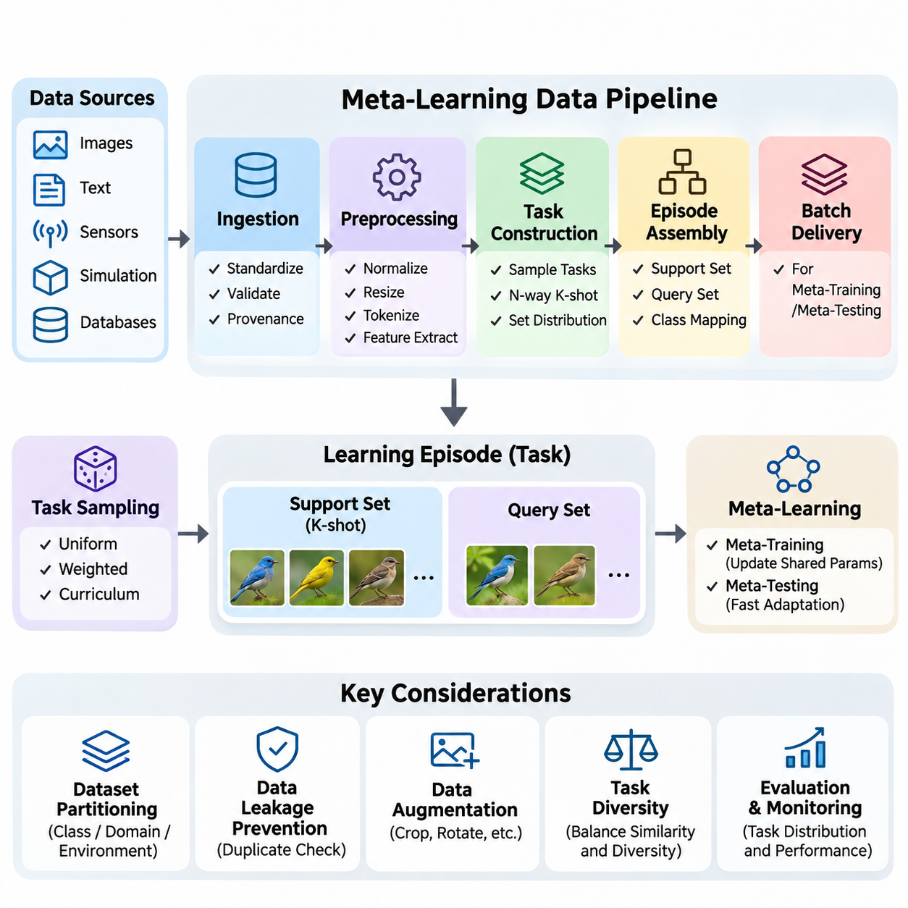
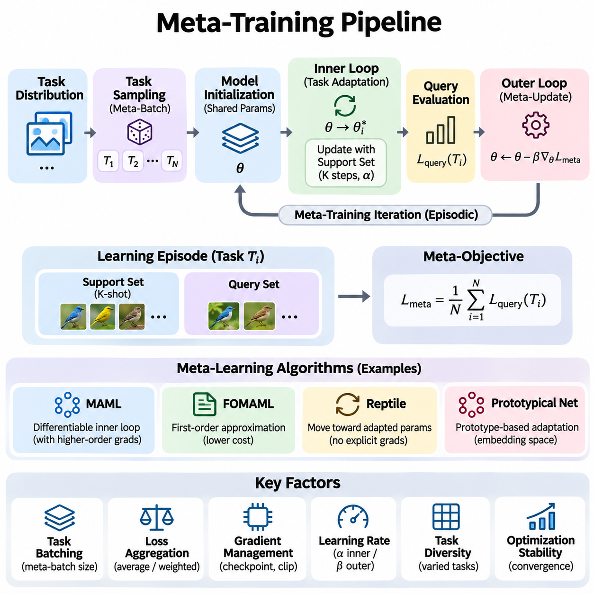
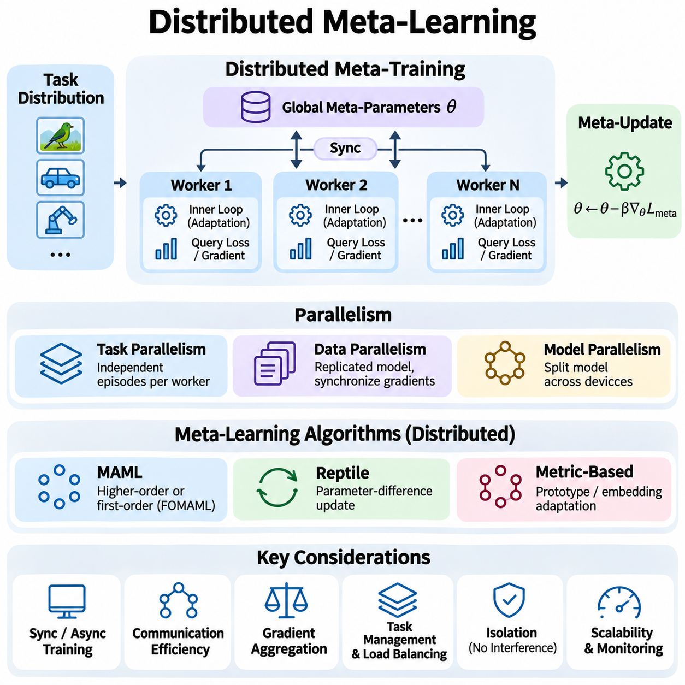
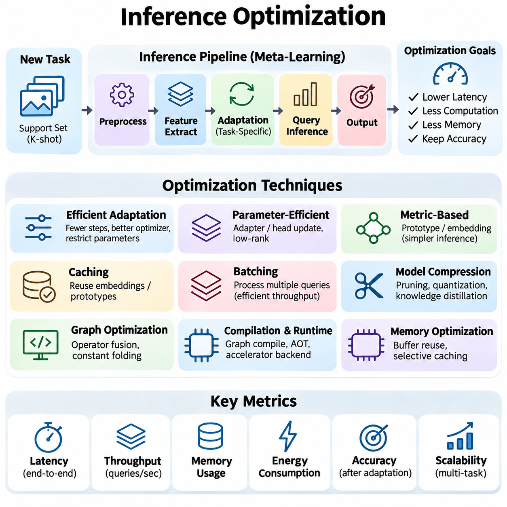
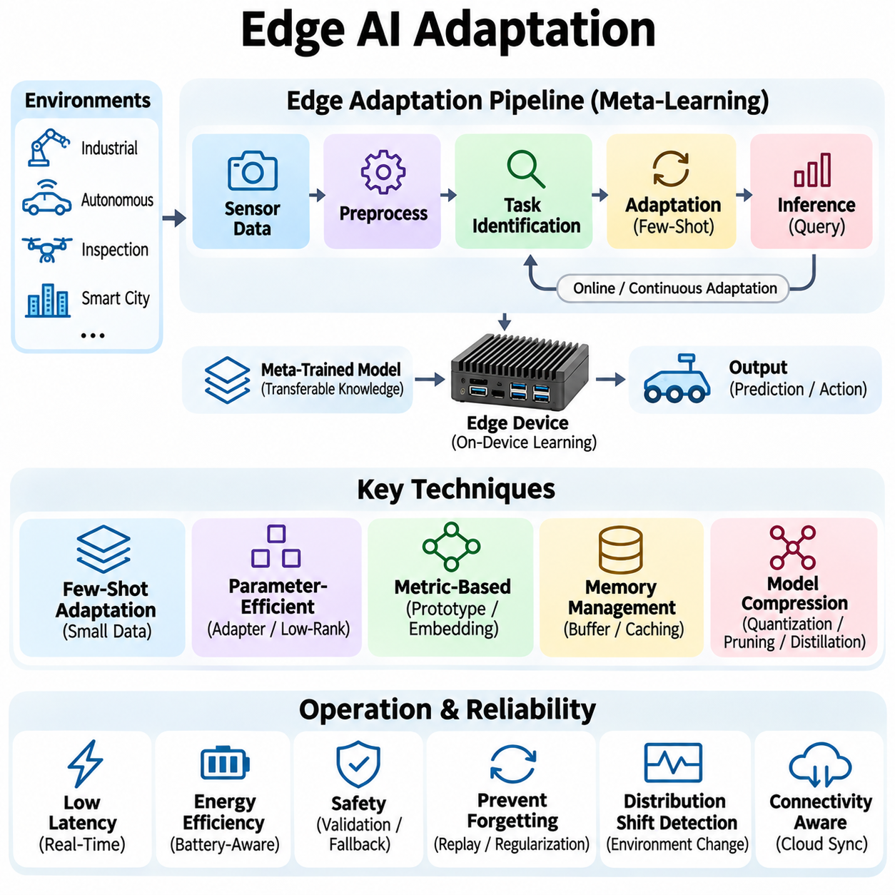
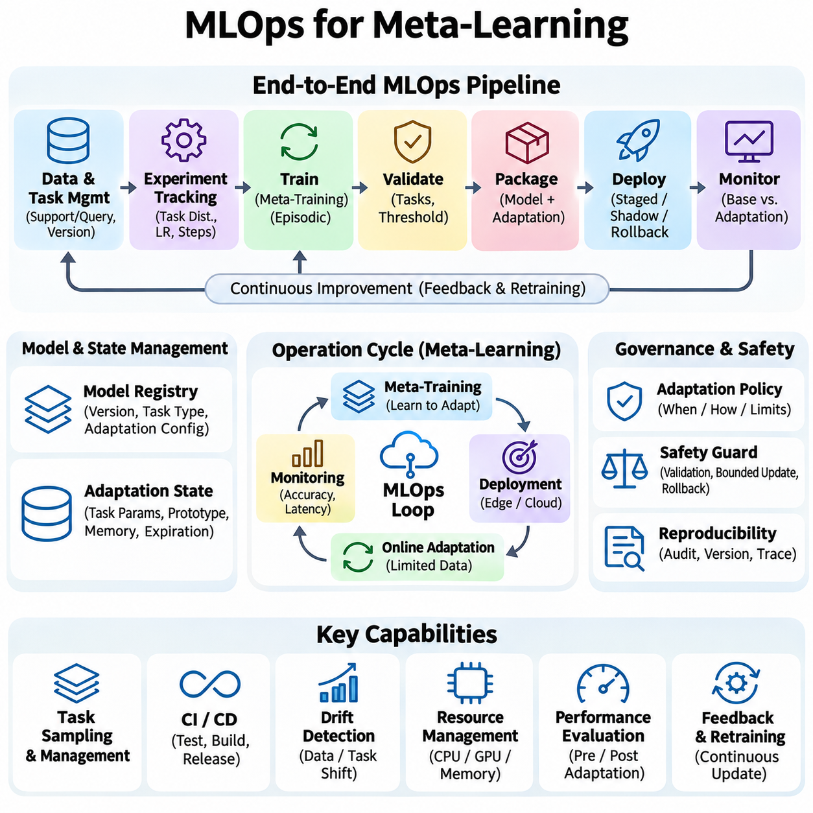

**Volume 36. Meta Learning and Few Shot Adaptation**

# 08. Engineering and Deployment

## 08.01 Data Pipeline [w/Code]

{width="7.268055555555556in" height="7.268055555555556in"}

메타 학습(Meta-Learning)을 위한 데이터 파이프라인(Data Pipeline)은 여러 작업(Task)에 걸친 학습에 필요한 데이터셋(Dataset)을 수집, 변환, 구성 및 전달하는 인프라(Infrastructure)를 제공한다. 샘플(Sample)을 일반적으로 독립적인 관측값(Observation)으로 처리하는 기존 기계 학습(Machine Learning)과 달리, 메타 학습은 빠른 적응(Fast Adaptation)을 지원하는 작업 중심 데이터 구조(Task-Oriented Data Structure)를 필요로 한다. 파이프라인은 학습과 평가 전반에서 작업 간 관계와 지원 예제(Support Example), 질의 예제(Query Example)의 구분을 유지해야 한다.

파이프라인의 기본적인 역할은 원시 관측값(Raw Observation)을 일관된 학습 에피소드(Learning Episode) 집합으로 변환하는 것이다. 각 에피소드는 더 넓은 작업 분포(Task Distribution)에서 샘플링(Sampling)된 작업을 나타내며, 적응과 평가에 필요한 정보를 포함한다. 이러한 구성은 메타 학습 알고리즘(Meta-Learning Algorithm)이 작업별 학습(Task-Specific Learning)과 작업 간 최적화(Cross-Task Optimization)의 경계를 명확하게 유지하면서 전이 가능한 지식(Transferable Knowledge)을 발견하도록 한다.

데이터 수집(Data Ingestion)은 이미지 저장소(Image Repository), 텍스트 말뭉치(Text Corpus), 센서 네트워크(Sensor Network), 시뮬레이션 환경(Simulation Environment), 산업용 데이터베이스(Industrial Database)와 같은 다양한 소스(Source)에서 정보를 확보하는 것으로 시작한다. 이러한 소스는 형식, 샘플링 주파수(Sampling Frequency), 레이블링 규칙(Labeling Convention), 신뢰성(Reliability)이 서로 다를 수 있다. 견고한 데이터 수집 계층(Ingestion Layer)은 메타데이터(Metadata)를 표준화하고 파일 무결성(File Integrity)을 검증하며, 데이터 출처(Data Provenance)를 기록하여 관측값을 원래의 수집 조건까지 추적할 수 있도록 한다.

전처리(Preprocessing)는 이질적인 관측값을 기계 학습 모델(Machine Learning Model)에 적합한 표현(Representation)으로 변환한다. 일반적인 작업에는 정규화(Normalization), 크기 조정(Resizing), 토큰화(Tokenization), 결측값 처리(Missing-Value Handling), 특징 추출(Feature Extraction)이 포함된다. 이러한 변환은 기존 전처리와 유사하지만, 메타 학습 파이프라인은 평가 예제(Evaluation Example)의 정보가 적응 절차(Adaptation Procedure)에 영향을 미치지 않도록 방지하면서 작업 전반에 일관되게 적용해야 한다.

작업 구성(Task Construction)은 메타 학습 데이터 엔지니어링(Meta-Learning Data Engineering)의 핵심적인 특징이다. 파이프라인은 고정된 학습 배치(Training Batch)만 생성하는 대신 지정된 확률 분포(Probability Distribution)에 따라 작업을 생성한다. 작업은 분류 문제(Classification Problem), 회귀 함수(Regression Function), 로봇 환경(Robotic Environment), 도메인 적응 시나리오(Domain Adaptation Scenario)를 나타낼 수 있다. 작업 구조는 모델이 빠르게 학습해야 하는 대상과 메타 학습 과정에서 형성될 수 있는 전이 가능한 특성을 결정한다.

소수 샷 분류(Few-Shot Classification)에서는 일반적으로 N-방향 K-샷(N-Way K-Shot) 구성을 사용하여 에피소드를 조직한다. N-방향 매개변수(N-Way Parameter)는 에피소드 내 클래스(Class)의 수를 지정하고, K-샷 매개변수(K-Shot Parameter)는 클래스별 레이블이 지정된 지원 예제의 수를 결정한다. 적응된 모델(Adapted Model)을 평가하기 위해 추가적인 질의 예제가 선택된다. 에피소드 생성 과정에서는 올바른 클래스 매핑(Class Mapping)을 유지하고 지원 관측값과 질의 관측값 사이의 의도하지 않은 중복을 방지해야 한다.

지원 데이터셋(Support Dataset)과 질의 데이터셋(Query Dataset)은 각 학습 에피소드에서 서로 다른 역할을 수행한다. 지원 집합(Support Set)은 현재 작업에 모델을 적응시키는 데 사용되는 제한된 관측값을 제공하며, 질의 집합(Query Set)은 적응 이후의 성능을 측정한다. 메타 학습 훈련(Meta-Training) 중에는 질의 손실(Query Loss)이 공유 매개변수(Shared Parameter)의 업데이트에 기여할 수 있다. 반면 메타 테스트(Meta-Testing)에서는 예측이 생성될 때까지 질의 레이블(Query Label)이 적응 절차에 제공되지 않아야 한다.

데이터셋 분할(Dataset Partitioning)은 일반적인 무작위 샘플 분할(Random Sample Splitting)이 잘못된 평가 결과를 생성할 수 있기 때문에 특별한 주의가 필요하다. 메타 학습 실험에서는 클래스, 도메인(Domain), 환경(Environment), 데이터 수집 소스(Acquisition Source)를 기준으로 학습, 검증, 테스트 작업을 분리하는 경우가 많다. 클래스가 겹치지 않는 분할(Class-Disjoint Partition)은 표준 소수 샷 분류 벤치마크(Few-Shot Classification Benchmark)에서 특히 중요하다. 다른 응용 분야에서는 장치, 사용자, 위치 또는 시간 순서에 따른 분리가 필요할 수 있다.

데이터 누출(Data Leakage)은 서로 관련된 관측값이 독립적이어야 하는 데이터 분할에 동시에 포함될 때 발생할 수 있다. 중복 이미지(Duplicate Image), 인접 비디오 프레임(Adjacent Video Frame), 반복된 센서 측정값(Repeated Sensor Measurement), 공유 원본 문서(Shared Source Document)는 작업 경계를 넘어 정보를 노출할 수 있다. 이를 방지하려면 소스 인식 분할(Source-Aware Partitioning), 중복 탐지(Duplicate Detection), 관측값 간 관계에 대한 명시적인 추적이 필요하다. 신뢰할 수 있는 일반화 측정(Generalization Measurement)은 이러한 보호 장치에 의존한다.

데이터 증강(Data Augmentation)은 작업과 관련된 정보를 보존하는 변환을 적용하여 데이터 다양성(Data Diversity)을 높인다. 이미지 파이프라인(Image Pipeline)은 자르기(Cropping), 회전(Rotation), 색상 조정(Color Adjustment), 기하학적 변환(Geometric Transformation)을 사용할 수 있으며, 텍스트 파이프라인(Text Pipeline)은 신중하게 검증된 바꿔 쓰기(Paraphrasing) 또는 토큰 수준 교란(Token-Level Perturbation)을 활용할 수 있다. 부적절한 변환은 레이블을 변경하거나 의도된 적응 문제를 왜곡할 수 있으므로 데이터 증강은 각 작업의 의미적 특성(Semantics)을 존중해야 한다.

에피소드 샘플링 전략(Episode Sampling Strategy)은 메타 학습 알고리즘의 동작에 큰 영향을 미친다. 균등 샘플링(Uniform Sampling)은 적격 작업을 동일하게 취급하는 반면, 가중 샘플링(Weighted Sampling)은 희귀 클래스(Rare Class), 어려운 환경(Difficult Environment), 운영상 중요한 조건을 강조할 수 있다. 커리큘럼 기반 샘플링(Curriculum-Based Sampling)은 학습 중 작업의 복잡도를 점진적으로 변화시킨다. 샘플링된 작업 분포가 실질적인 학습 목적(Learning Objective)을 정의하므로 이러한 전략은 설정 가능해야 하며 지속적으로 모니터링되어야 한다.

작업 다양성(Task Diversity)은 전이 가능한 적응 메커니즘(Transferable Adaptation Mechanism)을 개발하는 데 필수적이다. 에피소드가 거의 동일한 클래스나 환경 조건만 포함하면 모델은 적응 방법을 학습하기보다 반복되는 패턴을 암기할 수 있다. 반대로 지나치게 이질적인 작업은 최적화(Optimization)를 불안정하게 만들거나 지나치게 일반적인 표현을 유도할 수 있다. 파이프라인 설계자는 목표 배포 분포(Target Deployment Distribution)에 따라 작업 간 유사성과 다양성의 균형을 조정해야 한다.

실용적인 구현(Practical Implementation)에서는 데이터셋 인덱싱(Dataset Indexing), 작업 샘플링(Task Sampling), 에피소드 조립(Episode Assembly), 변환(Transformation), 배치 전달(Batch Delivery)을 독립적인 구성 요소로 분리한다. 데이터셋 인덱스(Dataset Index)는 관측값 식별자(Observation Identifier), 레이블, 메타데이터를 저장하며, 작업 샘플러(Task Sampler)는 적격 클래스나 환경을 선택한다. 이후 에피소드 조립기(Episode Assembler)가 지원 집합과 질의 집합을 구성한다. 이러한 모듈형 구성(Modular Organization)은 디버깅(Debugging), 실험, 개별 파이프라인 구성 요소의 교체를 단순화한다.

파이토치(PyTorch)와 같은 프레임워크(Framework)는 에피소드 샘플링(Episodic Sampling)을 지원하는 데이터셋 추상화(Dataset Abstraction)와 데이터 로더(Data Loader)를 제공한다. 사용자 정의 샘플러(Custom Sampler)는 작업 명세(Task Specification)를 생성하고, 데이터셋 클래스(Dataset Class)는 관측값을 검색하여 변환을 적용한다. 병합 함수(Collation Function)는 에피소드를 작업, 샘플, 특징 차원(Feature Dimension)을 포함하는 텐서(Tensor)로 구성한다. 메타 학습 훈련 중 여러 작업을 동시에 처리할 때는 텐서 형태(Tensor Shape)를 신중하게 관리해야 한다.

메타 학습 훈련에서 수천 또는 수백만 개의 에피소드가 필요할 경우 효율적인 데이터 로딩(Efficient Data Loading)이 더욱 중요해진다. 동일한 관측값을 반복적으로 디코딩(Decoding)하면 상당한 계산 오버헤드(Computational Overhead)가 발생할 수 있다. 캐싱(Caching), 비동기 사전 가져오기(Asynchronous Prefetching), 병렬 로딩(Parallel Loading), 적절한 저장 형식(Storage Format)은 지연 시간(Latency)을 줄일 수 있다. 그러나 캐싱 정책(Caching Policy)은 샘플링 다양성을 유지하면서 특히 대용량 이미지나 순차 관측값을 포함하는 데이터셋에서 과도한 메모리 소비를 방지해야 한다.

분산 데이터 파이프라인(Distributed Data Pipeline)은 에피소드 처리를 여러 가속기(Accelerator) 또는 컴퓨팅 노드(Computing Node)로 확장한다. 각 작업자(Worker)는 조정된 난수 시드(Random Seed)와 분할된 샘플링 스트림(Sampling Stream)을 사용하여 독립적인 작업을 생성할 수 있다. 적절한 동기화(Synchronization)는 의도하지 않은 중복을 방지하고 재현 가능한 실험(Reproducible Experiment)을 유지한다. 작업 조립 과정에서 추가적인 오버헤드가 발생하므로 처리량(Throughput)은 개별 샘플뿐 아니라 초당 완료된 에피소드(Episodes per Second)를 기준으로 측정해야 한다.

재현성(Reproducibility)을 확보하려면 데이터셋 분할, 작업 선택, 지원 집합과 질의 집합의 할당, 데이터 증강, 작업자 초기화(Worker Initialization) 등 여러 단계에서 무작위성(Randomness)을 제어해야 한다. 비동기 작업자(Asynchronous Worker)나 분산 프로세스(Distributed Process)가 포함되면 하나의 전역 난수 시드(Global Random Seed)를 기록하는 것만으로는 충분하지 않을 수 있다. 실험 설정(Experiment Configuration)은 결과를 재구성할 수 있도록 샘플러 매개변수, 데이터셋 버전(Dataset Version), 전처리 설정, 소프트웨어 의존성(Software Dependency)을 보존해야 한다.

데이터셋 버전 관리(Dataset Versioning)는 실험 결과와 해당 결과를 생성하는 데 사용된 관측값 사이에 안정적인 관계를 설정한다. 레이블, 전처리 규칙, 작업 정의(Task Definition), 원본 데이터의 변경은 모델 매개변수가 동일하더라도 적응 성능(Adaptation Performance)을 변화시킬 수 있다. 버전이 지정된 매니페스트(Versioned Manifest)와 콘텐츠 체크섬(Content Checksum)은 이러한 차이를 식별하는 데 도움이 된다. 각 학습 실행(Training Run)은 변경 불가능한 데이터셋 스냅샷(Immutable Dataset Snapshot)과 명시적으로 정의된 에피소드 생성 설정을 참조해야 한다.

데이터 품질 모니터링(Data Quality Monitoring)은 관측값 수준(Observation Level)과 작업 수준(Task Level) 모두에서 수행되어야 한다. 관측값 수준 검사는 손상된 파일(Corrupted File), 누락된 레이블(Missing Label), 유효하지 않은 값(Invalid Value), 일관되지 않은 메타데이터를 식별한다. 작업 수준 검사는 클래스 균형(Class Balance), 지원 집합과 질의 집합의 분리, 에피소드 난이도(Episode Difficulty), 샘플링 범위(Sampling Coverage)를 확인한다. 개별 관측값은 유효하더라도 조립된 작업이 부적절할 수 있으므로 이러한 측정은 기존 데이터셋 검증(Dataset Validation)이 놓칠 수 있는 문제를 발견한다.

클래스 불균형(Class Imbalance)은 소수 샷 에피소드를 구성할 때 추가적인 문제를 발생시킨다. 일부 클래스에는 요청된 지원 예제와 질의 예제를 제공할 만큼 충분한 관측값이 없을 수 있다. 파이프라인은 이러한 클래스를 제외할지, 복원 추출(Sampling with Replacement)을 사용할지, 대체 작업 구성(Alternative Task Configuration)을 적용할지 정의해야 한다. 복원 추출은 반복된 관측값이 독립적인 적응 및 평가 예제에 대한 가정을 훼손할 수 있으므로 특별한 주의가 필요하다.

순차 학습(Sequential Learning)과 강화 학습(Reinforcement Learning) 응용 분야에서는 모든 관측값을 서로 교환 가능한 데이터로 취급하지 않고 시간적 의존성(Temporal Dependency)을 보존해야 한다. 작업은 상태(State), 행동(Action), 보상(Reward), 다음 상태(Next State)를 포함하는 궤적(Trajectory)으로 구성될 수 있다. 에피소드 조립 과정에서는 상태 전이 순서(Transition Ordering), 궤적 경계(Trajectory Boundary), 환경 식별자(Environment Identifier)를 유지해야 한다. 잘못된 셔플링(Shuffling)은 정책 적응(Policy Adaptation)이나 작업 추론(Task Inference)에 필요한 문맥 정보(Contextual Information)를 파괴할 수 있다.

로봇 및 산업 시스템(Robotic and Industrial System)에서 데이터 파이프라인은 카메라(Camera), 깊이 센서(Depth Sensor), 힘 센서(Force Sensor), 운영 로그(Operational Log)의 관측값을 통합하는 경우가 많다. 여러 모달리티(Modality) 사이의 일관성을 유지하려면 타임스탬프 정렬(Timestamp Alignment)과 보정 메타데이터(Calibration Metadata)가 필요하다. 작업 정의는 서로 다른 물체, 작동 조건, 기계 또는 물리적 환경에 대응할 수 있다. 신뢰할 수 있는 동기화는 메타 학습 모델이 의미 있는 환경 변화와 측정 오류(Measurement Artifact)를 구별하도록 한다.

온라인 적응(Online Adaptation)은 추론(Inference)을 중단하지 않고 새롭게 도착하는 관측값을 처리할 수 있어야 한다. 스트리밍 파이프라인(Streaming Pipeline)은 최근의 레이블이 지정된 경험이나 유용한 경험을 포함하는 제한된 크기의 지원 버퍼(Bounded Support Buffer)를 유지할 수 있다. 버퍼 관리(Buffer Management)는 어떤 관측값을 적응에 계속 사용할지, 오래된 정보를 언제 제거할지 결정한다. 이러한 결정은 적응 속도(Adaptation Speed), 계산 비용(Computational Cost), 분포 변화(Distribution Shift)에 대한 취약성에 영향을 미친다.

개인정보 보호(Privacy)와 보안(Security)은 작업 데이터가 사용자, 조직 또는 연결된 장치에서 생성될 때 반드시 고려해야 한다. 접근 제어(Access Control), 암호화(Encryption), 보존 정책(Retention Policy), 감사 기록(Audit Record)은 파이프라인 전반에서 민감한 관측값을 보호한다. 데이터 최소화(Data Minimization)는 불필요한 정보 노출을 줄일 수 있으며, 작업 수준 권한(Task-Level Permission)은 결합할 수 있는 예제를 제한한다. 이러한 보호 조치는 조직이나 장치의 경계를 넘어 적응이 수행될 때 특히 중요하다.

배포 중심 파이프라인(Deployment-Oriented Pipeline)은 오프라인 메타 학습 데이터(Offline Meta-Training Data)와 실행 시점 적응 데이터(Runtime Adaptation Data)를 구분해야 한다. 오프라인 처리(Offline Processing)는 비용이 높은 검증과 데이터 증강을 수행할 수 있지만, 실행 시점 처리(Runtime Processing)는 엄격한 지연 시간, 메모리, 신뢰성 제약을 충족해야 한다. 두 경로는 호환 가능한 특징 정의(Feature Definition)와 정규화 절차(Normalization Procedure)를 공유해야 한다. 그렇지 않으면 학습과 서빙 간 불일치(Training-Serving Inconsistency)로 인해 벤치마크 성능이 우수하더라도 실제 적응 성능이 저하될 수 있다.

파이프라인 관측 가능성(Pipeline Observability)은 데이터 엔지니어링과 더 넓은 기계 학습 운영(MLOps) 생명주기(Lifecycle)를 연결한다. 운영 지표(Operational Metric)에는 데이터 수집 실패(Ingestion Failure), 전처리 지연 시간(Preprocessing Latency), 에피소드 생성 처리량(Episode-Generation Throughput), 클래스 포함 범위(Class Coverage), 캐시 효율(Cache Efficiency), 분포 드리프트(Distribution Drift)가 포함된다. 이러한 지표를 모니터링하면 모델 성능 저하가 데이터 변화에서 비롯되는지 학습 알고리즘에서 비롯되는지 파악할 수 있다. 자동 경고(Automated Alert)는 신뢰할 수 없는 적응이 운영 시스템에 영향을 미치기 전에 적시에 문제를 조사하도록 지원한다.

잘 설계된 메타 학습 데이터 파이프라인은 궁극적으로 효율적인 데이터 전달 이상의 기능을 제공한다. 이는 학습 작업의 통계적 구조(Statistical Structure)를 정의하고, 평가 무결성(Evaluation Integrity)을 보호하며, 재현 가능한 실험을 가능하게 하고, 실제 배포 제약(Deployment Constraint) 아래에서 적응을 지원한다. 파이프라인 설계는 메타 학습 시스템이 견고한 전이 가능 지식(Robust Transferable Knowledge)을 개발할 수 있는지, 아니면 제한적으로 구성된 에피소드에서만 우수한 성능을 발휘하는지를 직접적으로 결정한다.

## 08.02 Meta Training Pipeline [w/Code]

{width="7.268055555555556in" height="7.268055555555556in"}

메타 학습 훈련 파이프라인(Meta-Training Pipeline)은 모델(Model)이 작업 분포(Task Distribution) 전반에서 효율적으로 적응하는 방법을 학습하도록 지원하는 계산 작업 흐름(Computational Workflow)을 제공한다. 개별 예제(Example)에 대한 성능을 최적화하는 기존 학습(Conventional Training)과 달리, 메타 학습 훈련(Meta-Training)은 학습 과정(Learning Process) 자체를 최적화한다. 파이프라인은 작업 샘플링(Task Sampling), 모델 초기화(Model Initialization), 작업별 적응(Task-Specific Adaptation), 작업 간 평가(Cross-Task Evaluation), 매개변수 업데이트(Parameter Update)를 조정하여 전이 가능한 학습 능력(Transferable Learning Capability)을 형성한다.

메타 학습 훈련의 핵심 원리는 서로 관련되어 있지만 구별되는 다양한 학습 문제(Learning Problem)에 모델을 반복적으로 노출하는 것이다. 각 작업(Task)은 작업 분포에서 추출된 가능한 적응 시나리오(Adaptation Scenario)를 나타낸다. 모델은 서로 다른 작업에 반복적으로 적응하면서 향후 학습 효율성(Learning Efficiency)을 향상시키는 공유 매개변수(Shared Parameter) 또는 표현(Representation)을 학습한다. 따라서 성공적인 메타 학습 훈련은 샘플링된 작업의 다양성(Task Diversity)과 최적화 절차(Optimization Procedure)의 일관성에 모두 의존한다.

일반적인 메타 학습 훈련 반복(Meta-Training Iteration)은 학습 작업 분포(Training Task Distribution)에서 작업 배치(Task Batch)를 샘플링하는 것으로 시작한다. 각 작업에는 적응을 위한 지원 집합(Support Set)과 적응된 모델을 평가하기 위한 질의 집합(Query Set)이 포함된다. 파이프라인은 적응 과정에서 이러한 작업을 독립적으로 처리한 후 평가 신호(Evaluation Signal)를 결합한다. 이러한 에피소드 구조(Episodic Structure)는 배포된 모델이 제한된 관측값(Observation)으로 새로운 작업을 학습해야 하는 상황을 근사적으로 재현한다.

모델 초기화(Model Initialization)는 각 작업별 적응 과정의 시작점을 결정한다. 최적화 기반 메타 학습(Optimization-Based Meta-Learning)에서는 공유 매개변수를 복사하거나 함수적으로 참조하여 작업별 매개변수 상태(Task-Specific Parameter State)를 생성한다. 모든 작업은 동일한 메타 초기화(Meta-Initialization)에서 시작하지만, 각 작업의 적응 경로(Adaptation Trajectory)는 독립적으로 유지된다. 이러한 분리는 하나의 샘플링된 작업에서 발생한 업데이트가 다른 작업의 적응 과정에 의도하지 않게 영향을 미치는 것을 방지한다.

내부 루프(Inner Loop)는 지원 집합의 관측값을 사용하여 작업별 학습(Task-Specific Learning)을 수행한다. 알고리즘(Algorithm)에 따라 적응 과정에는 경사 하강법(Gradient Descent), 표현 조정(Representation Adjustment), 모델 매개변수 일부의 업데이트가 포함될 수 있다. 적응 단계 수(Adaptation Steps)와 학습률(Learning Rate)은 성능에 큰 영향을 미친다. 짧은 적응 과정은 빠른 학습을 촉진하지만, 지나치게 많은 업데이트는 계산 비용(Computational Cost)과 과적합(Overfitting)을 증가시킬 수 있다.

외부 루프(Outer Loop)는 샘플링된 작업 전반에서 모델이 얼마나 효과적으로 적응하는지 평가한다. 내부 루프 적응이 완료되면 각 작업의 질의 집합을 사용하여 예측(Prediction)을 생성하고, 그 결과로 얻은 손실(Loss)을 통합하여 메타 목적 함수(Meta-Objective)를 구성한다. 메타 최적화기(Meta-Optimizer)는 향후 적응 이후의 성능을 개선하도록 공유 매개변수를 업데이트한다. 작업 수준 학습(Task-Level Learning)과 작업 간 최적화(Cross-Task Optimization)의 이러한 구분은 많은 메타 학습 알고리즘의 기본 구조를 정의한다.

모델 불가지론적 메타 학습(Model-Agnostic Meta-Learning, MAML)은 미분 가능한 내부 루프 최적화(Differentiable Inner-Loop Optimization)를 통해 이러한 구조를 구현한다. 메타 기울기(Meta-Gradient)는 적응 단계를 거쳐 질의 손실이 원래 공유 매개변수에 대해 어떻게 변화하는지 측정한다. 정확한 계산에는 이차 미분(Second-Order Derivative)이 필요할 수 있으며, 이로 인해 메모리 사용량(Memory Consumption)과 처리 요구량(Processing Demand)이 증가한다. 그러나 이러한 메커니즘은 효과적인 적응을 위한 초기화 상태를 직접 최적화한다.

일차 모델 불가지론적 메타 학습(First-Order MAML, FOMAML)은 특정 고차 미분 항(Higher-Order Derivative Term)을 무시하여 계산 복잡도(Computational Complexity)를 줄인다. 이러한 근사는 메모리 소비를 상당히 감소시키고 학습 처리량(Training Throughput)을 개선할 수 있지만, 실제 동작은 작업 분포와 최적화 설정에 따라 달라진다. 렙타일(Reptile)은 작업별 학습 이후 얻어진 매개변수 방향으로 공유 매개변수를 이동시키는 또 다른 접근법으로, 전체 적응 경로에 대한 명시적인 미분을 피한다.

거리 기반 메타 학습(Metric-Based Meta-Learning)은 적응이 기울기 업데이트(Gradient Update)가 아닌 표현 기반 계산(Representation-Based Computation)을 통해 이루어질 수 있으므로 다른 학습 구조를 사용한다. 예를 들어 프로토타입 네트워크(Prototypical Networks)는 지원 임베딩(Support Embedding)으로 클래스 프로토타입(Class Prototype)을 구성하고, 임베딩 공간(Embedding Space)의 거리를 기준으로 질의 관측값을 분류한다. 이 방식의 메타 학습 훈련 파이프라인은 에피소드 전반에서 특징 추출기(Feature Extractor)를 최적화하여 신뢰할 수 있는 소수 샷 분류(Few-Shot Classification)를 지원하는 표현을 형성한다.

작업 배치 구성(Task Batching)은 각 메타 업데이트(Meta-Update)에 기여하는 적응 문제의 수를 결정한다. 큰 메타 배치(Meta-Batch)는 기울기 분산(Gradient Variance)을 줄이고 최적화 안정성(Optimization Stability)을 개선할 수 있지만, 메모리 요구량과 계산 시간을 증가시킨다. 작은 배치는 처리하기 쉽고 더 빈번한 업데이트를 지원할 수 있다. 적절한 구성은 작업 복잡도(Task Complexity), 모델 아키텍처(Model Architecture), 사용 가능한 하드웨어(Hardware), 효율성과 수렴(Convergence) 사이의 균형에 따라 결정된다.

손실 집계(Loss Aggregation)는 작업 수준의 평가 신호를 공유 최적화 목적 함수(Shared Optimization Objective)로 변환한다. 단순한 구현에서는 작업 전반의 질의 손실(Query Loss)을 평균화하지만, 더 발전된 접근법은 작업 중요도(Task Importance)나 난이도(Task Difficulty)에 따라 서로 다른 가중치(Weight)를 부여한다. 작업마다 질의 예제의 수가 다를 경우 정규화(Normalization)가 필요하다. 그렇지 않으면 질의 집합이 큰 작업이 의도된 중요도와 관계없이 목적 함수를 지배할 수 있다.

기울기 관리(Gradient Management)는 최적화 기반 메타 학습 훈련에서 특히 중요하다. 여러 적응 단계를 거쳐 미분하면 대규모 계산 그래프(Computational Graph)가 생성되고 상당한 메모리 오버헤드(Memory Overhead)가 발생할 수 있다. 기울기 체크포인팅(Gradient Checkpointing), 일차 근사(First-Order Approximation), 제한된 적응 매개변수(Restricted Adaptation Parameter)는 이러한 비용을 줄일 수 있다. 기울기 클리핑(Gradient Clipping)은 수치적 안정성(Numerical Stability)을 개선할 수 있으며, 신중한 최적화기 설정(Optimizer Configuration)은 이질적인 작업 전반에서 불안정한 업데이트를 방지하는 데 도움이 된다.

학습률 선택(Learning-Rate Selection)은 내부 루프와 외부 루프의 최적화를 모두 포함한다. 내부 루프 학습률(Inner-Loop Learning Rate)은 작업별 매개변수가 얼마나 빠르게 변화하는지 제어하며, 외부 루프 학습률(Outer-Loop Learning Rate)은 전이 가능한 모델 매개변수의 변화 과정을 결정한다. 두 학습률은 상호작용하므로 평가 없이 독립적으로 조정해서는 안 된다. 일부 접근법은 적응 학습률(Adaptation Rate)을 직접 학습하여 서로 다른 매개변수가 제한된 작업별 증거(Task-Specific Evidence)에 다르게 반응하도록 한다.

메타 학습 훈련 안정성(Meta-Training Stability)은 샘플링된 작업의 통계적 특성(Statistical Property)과 적응 절차의 민감도(Sensitivity)에 따라 달라진다. 작업 난이도의 변동이 크면 잡음이 많은 메타 기울기(Noisy Meta-Gradient)가 생성될 수 있으며, 부적절한 적응 단계는 발산(Divergence)이나 비효율적인 학습을 유발할 수 있다. 지원 손실(Support Loss), 질의 손실, 기울기 노름(Gradient Norm), 적응 개선 정도(Adaptation Improvement)를 모니터링하면 불안정성을 식별하는 데 도움이 된다. 검증은 초기 모델 정확도(Initial Model Accuracy)보다 적응 이후 성능(Post-Adaptation Performance)을 중점적으로 평가해야 한다.

메타 검증(Meta-Validation)은 학습된 적응 능력이 최적화에 사용된 작업을 넘어 일반화(Generalization)되는지 평가한다. 검증 에피소드(Validation Episode)는 의도된 일반화 설정에 따라 학습에서 제외된 작업(Held-Out Task)이나 클래스에서 샘플링해야 한다. 메타 학습 훈련에서 사용한 적응 프로토콜(Adaptation Protocol)을 일관되게 적용해야 한다. 여러 에피소드에 걸친 성능 측정은 임의로 선택된 소수의 작업만 평가하는 것보다 신뢰할 수 있는 추정값을 제공한다.

조기 종료(Early Stopping)와 모델 선택(Model Selection)은 학습 손실만이 아니라 메타 검증 성능(Meta-Validation Performance)에 기반해야 한다. 모델은 자주 샘플링되는 학습 작업에서 낮은 질의 손실을 달성하더라도 익숙하지 않은 작업에 적응하지 못할 수 있다. 검증 지표(Validation Metric)에는 적응 이후 정확도(Post-Adaptation Accuracy), 적응 속도(Adaptation Speed), 보정(Calibration), 작업 간 변동성(Task Variability)이 포함될 수 있다. 이러한 지표를 기준으로 체크포인트(Checkpoint)를 선택하면 제한적으로 특화된 학습보다 전이 가능한 학습을 촉진할 수 있다.

효율적인 구현에서는 전체 모델 인스턴스(Model Instance)를 반복적으로 생성하지 않고 작업별 매개변수를 조작할 수 있는 함수형 모델 표현(Functional Model Representation)을 사용하는 경우가 많다. 벡터화 연산(Vectorized Computation)은 텐서 구조(Tensor Structure)가 호환되는 경우 여러 작업을 병렬로 처리할 수 있다. 자동 미분(Automatic Differentiation)과 함수형 변환(Functional Transformation)과 같은 프레임워크 기능은 구현을 단순화하지만, 메모리 사용량과 기울기 계산의 정확성(Gradient Correctness)은 신중하게 검증해야 한다.

혼합 정밀도 학습(Mixed-Precision Training)은 특히 대규모 신경망(Neural Network)에서 처리량을 개선하고 가속기 메모리 사용량(Accelerator Memory Consumption)을 줄일 수 있다. 그러나 내부 루프 최적화는 작은 수치 오차(Numerical Error)가 여러 적응 단계에 걸쳐 누적될 수 있으므로 추가적인 수치적 민감도(Numerical Sensitivity)를 발생시킨다. 따라서 적절한 정밀도 정책(Precision Policy), 기울기 스케일링(Gradient Scaling), 수치 검증(Numerical Check)이 중요하다. 성능 개선은 안정적인 전체 정밀도 기준 구성(Full-Precision Reference Configuration)과 비교하여 검증해야 한다.

분산 메타 학습 훈련(Distributed Meta-Training)은 작업 처리를 여러 장치(Device) 또는 컴퓨팅 노드(Computing Node)로 확장한다. 작업자(Worker)는 할당된 작업에서 독립적으로 내부 루프 적응을 수행하고, 기울기나 매개변수 차이(Parameter Difference)를 공유 업데이트에 제공할 수 있다. 동기화(Synchronization)는 외부 루프 최적화기가 일관된 정보를 수신하도록 보장한다. 특히 작업 복잡도가 크게 달라지는 경우 통신 오버헤드(Communication Overhead)와 불균등한 작업 실행 시간(Task Execution Time)이 확장 효율성(Scaling Efficiency)을 감소시킬 수 있다.

체크포인트 관리(Checkpoint Management)는 메타 학습 훈련을 안정적으로 재개하는 데 필요한 상태를 보존한다. 완전한 체크포인트에는 공유 모델 매개변수, 최적화기 상태(Optimizer State), 학습률 스케줄(Learning-Rate Schedule), 난수 생성기 상태(Random Number Generator State), 학습 진행 상태(Training Progress)가 포함될 수 있다. 설정 메타데이터(Configuration Metadata)는 데이터셋 버전(Dataset Version)과 작업 샘플링 정책(Task Sampling Policy)을 식별해야 한다. 모델 가중치(Model Weight)만 복원하는 것으로는 이후 최적화 경로(Optimization Trajectory)를 재현하기에 충분하지 않을 수 있다.

실험 추적(Experiment Tracking)은 학습 과정에서 메타 학습 성능이 어떻게 변화하는지 파악할 수 있도록 한다. 유용한 기록에는 메타 손실(Meta-Loss), 적응 개선 정도, 질의 정확도(Query Accuracy), 작업 샘플링 통계(Task Sampling Statistics), 계산 처리량(Computational Throughput), 메모리 사용률(Memory Utilization)이 포함된다. 여러 실험에서 이러한 지표를 비교하면 알고리즘 개선 효과와 데이터 처리 또는 하드웨어 설정 변화의 영향을 구분할 수 있다. 일관된 로깅(Logging)은 재현 가능한 엔지니어링 의사결정(Engineering Decision)에 필수적이다.

운영 환경 중심의 메타 학습 훈련 파이프라인(Production-Oriented Meta-Training Pipeline)은 최적화 과정에서 배포 제약(Deployment Constraint)도 고려해야 한다. 많은 적응 단계나 대규모 지원 버퍼(Support Buffer)가 필요한 모델은 엣지 장치(Edge Device) 또는 실시간 응용 분야(Real-Time Application)에 적합하지 않을 수 있다. 따라서 학습 설정에는 적응 계산량(Adaptation Computation), 메모리 사용량, 추론 지연 시간(Inference Latency)에 대한 제한을 포함할 수 있다. 이러한 제약은 연구 환경(Research Environment)에서 운영 시스템(Operational System)으로 이전한 이후에도 유용성을 유지하는 모델을 개발하도록 유도한다.

메타 학습 훈련의 최종 결과물은 단순한 기존 사전 학습 모델(Pretrained Model)이 아니라 효과적인 적응 메커니즘(Adaptation Mechanism)을 갖춘 모델이다. 알고리즘에 따라 이러한 능력은 초기화 매개변수(Initialization Parameter), 학습된 표현(Learned Representation), 업데이트 규칙(Update Rule), 문맥 기반 추론 메커니즘(Contextual Inference Mechanism)에 인코딩(Encoding)될 수 있다. 신뢰할 수 있는 파이프라인은 이러한 구성 요소를 보존하고 올바르게 사용하는 데 필요한 적응 프로토콜을 문서화해야 한다.

잘 설계된 메타 학습 훈련 파이프라인은 통계적 작업 설계(Statistical Task Design), 미분 가능한 최적화(Differentiable Optimization), 효율적인 계산(Efficient Computation), 검증(Validation), 재현 가능한 실험 관리(Reproducible Experiment Management)를 통합한다. 성공 여부는 모델이 제한된 증거를 사용하여 이전에 경험하지 못한 작업(Unseen Task)에서 얼마나 안정적으로 성능을 개선하는지에 따라 평가된다. 알고리즘 원리(Algorithmic Principle)와 실제 엔지니어링 요구사항(Engineering Requirement)을 연결함으로써 파이프라인은 메타 학습을 실험적 기법(Experimental Technique)에서 배포 가능한 적응형 학습 시스템(Deployable Adaptive Learning System)으로 발전시킨다.

## 08.03 Distributed Meta Learning [w/Code]

{width="7.268055555555556in" height="7.268055555555556in"}

분산 메타 학습(Distributed Meta-Learning)은 확장성(Scalability), 계산 효율성(Computational Efficiency), 작업 다양성(Task Diversity)을 개선하기 위해 메타 학습 훈련(Meta-Training)을 여러 컴퓨팅 장치(Computing Device) 또는 노드(Node)로 확장한다. 기존 분산 학습(Distributed Learning)과 달리 작업별 적응(Task-Specific Adaptation)과 작업 간 최적화(Cross-Task Optimization)를 모두 조정해야 한다. 각 작업자(Worker)는 공유 모델 매개변수(Shared Model Parameter)와의 일관성을 유지하면서 샘플링된 학습 작업(Learning Task)을 처리하여, 시스템이 대규모 작업 분포(Task Distribution)에서 전이 가능한 적응 전략(Transferable Adaptation Strategy)을 학습하도록 한다.

분산 메타 학습의 필요성은 에피소드 기반 학습(Episodic Training)의 상당한 계산 요구량(Computational Demand)에서 비롯된다. 최적화 기반 방법(Optimization-Based Method)은 외부 루프 기울기(Outer-Loop Gradient)를 계산하기 전에 내부 루프 업데이트(Inner-Loop Update)를 반복적으로 수행하므로 추가적인 처리 및 메모리 자원이 필요하다. 모델 크기(Model Size), 작업 복잡도(Task Complexity), 메타 배치 크기(Meta-Batch Size)가 증가하면 단일 가속기(Accelerator)만으로는 충분하지 않을 수 있다. 분산 실행(Distributed Execution)은 이러한 작업 부하(Workload)를 사용 가능한 컴퓨팅 자원(Computing Resource)에 분배한다.

분산 아키텍처(Distributed Architecture)는 일반적으로 여러 작업자, 통신 메커니즘(Communication Mechanism), 공유 최적화 프로세스(Shared Optimization Process)로 구성된다. 작업자는 작업 배치(Task Batch)를 수신하고 로컬 적응(Local Adaptation)을 수행하며 질의 예제(Query Example)를 사용하여 평가 신호(Evaluation Signal)를 계산한다. 이후 결과를 결합하여 전역 메타 매개변수(Global Meta-Parameter)를 업데이트한다. 구현 방식에 따라 집합 통신(Collective Communication), 중앙 집중식 매개변수 서버(Centralized Parameter Server), 분산형 동기화 메커니즘(Decentralized Synchronization Mechanism)을 사용할 수 있다.

작업 수준 병렬 처리(Task-Level Parallelism)는 개별 적응 에피소드(Adaptation Episode)를 독립적으로 처리할 수 있는 경우가 많기 때문에 메타 학습에 특히 적합하다. 각 작업자는 학습 분포(Training Distribution)에서 샘플링된 작업의 일부를 할당받아 해당 내부 루프 계산(Inner-Loop Computation)을 수행한다. 적응이 완료되면 작업자는 작업별 질의 손실(Task-Specific Query Loss) 또는 기울기(Gradient)를 계산한다. 이러한 독립적인 계산은 결과가 집계(Aggregation)되기 전에 동시에 실행될 수 있다.

데이터 병렬 처리(Data Parallelism)는 복제된 모델 아키텍처(Replicated Model Architecture)를 유지하면서 서로 다른 메타 학습 작업을 여러 장치에 분배한다. 각 장치는 동일한 공유 초기화(Shared Initialization)에서 시작하여 할당된 에피소드를 처리한다. 이후 로컬 메타 기울기(Local Meta-Gradient)를 동기화하여 전역 업데이트(Global Update)를 구성한다. 이러한 접근법은 작업의 계산 요구량이 비슷하고 모델이 각 장치의 메모리에 들어갈 수 있을 때 비교적 간단하게 구현할 수 있다.

모델 병렬 처리(Model Parallelism)는 신경망(Neural Network)이 너무 커서 개별 가속기에 저장할 수 없을 때 중요해진다. 서로 다른 계층(Layer)이나 매개변수 분할(Parameter Partition)을 여러 장치에 배치할 수 있으며, 순전파(Forward Computation)와 역전파(Backward Computation) 과정에서 통신이 필요하다. 모델 병렬 처리와 작업 병렬 처리를 결합하면 대규모 메타 학습을 지원할 수 있지만, 통신 의존성(Communication Dependency)과 복잡한 적응 계산 그래프(Adaptation Computation Graph)는 추가적인 엔지니어링 문제를 발생시킨다.

내부 루프 최적화(Inner-Loop Optimization)는 작업 간의 신중한 격리(Isolation)를 필요로 한다. 각 적응 에피소드는 다른 작업자가 사용하는 공유 초기화를 수정하지 않으면서 자체적인 임시 매개변수 상태(Temporary Parameter State)를 유지해야 한다. 함수형 매개변수 표현(Functional Parameter Representation)과 독립적인 최적화기 상태(Independent Optimizer State)는 이러한 분리를 보장할 수 있다. 공유 매개변수를 잘못 처리하면 작업 간 간섭(Cross-Task Interference)이 발생하여 의도된 메타 학습 목적 함수(Meta-Learning Objective)의 유효성이 손상될 수 있다.

외부 루프 동기화(Outer-Loop Synchronization)는 독립적으로 적응된 작업에서 얻은 정보를 결합한다. 동기식 학습(Synchronous Training)에서는 전역 메타 업데이트가 수행되기 전에 작업자들이 할당된 계산을 완료한다. 알고리즘에 따라 집계 과정에는 작업 기울기(Task Gradient)의 평균, 가중 손실(Weighted Loss), 매개변수 차이(Parameter Difference)가 사용될 수 있다. 작업자마다 처리하는 작업이나 질의 예제의 수가 다를 수 있으므로 일관된 정규화(Normalization)가 중요하다.

동기식 분산 메타 학습(Synchronous Distributed Meta-Learning)은 모든 전역 업데이트가 조정된 작업 결과 집합을 사용하기 때문에 예측 가능한 최적화 동작(Optimization Behavior)을 제공한다. 그러나 시스템은 다음 단계로 진행하기 전에 느린 작업자가 완료될 때까지 기다려야 한다. 이러한 지연 작업자 문제(Straggler Problem)는 작업마다 적응 단계(Adaptation Step), 시퀀스 길이(Sequence Length), 모델 실행 시간(Model Execution Time)이 다를 때 중요해진다. 부하 분산(Load Balancing)과 작업 그룹화(Task Grouping)는 가속기 간 유휴 시간(Idle Time)을 줄일 수 있다.

비동기식 분산 메타 학습(Asynchronous Distributed Meta-Learning)은 모든 참여자를 기다리지 않고 작업자가 업데이트를 제출하도록 허용한다. 이는 작업 실행 시간이 크게 달라지는 환경에서 자원 활용률(Resource Utilization)을 개선할 수 있다. 그러나 작업자는 오래된 공유 매개변수를 사용하여 업데이트를 계산할 수 있으며, 이로 인해 기울기 지연(Gradient Staleness)과 일관되지 않은 적응 조건(Inconsistent Adaptation Condition)이 발생한다. 버전 추적(Version Tracking), 제한된 지연 허용(Bounded Staleness), 신중하게 선택된 업데이트 일정(Update Schedule)은 이러한 영향을 제어하는 데 도움이 된다.

통신 효율성(Communication Efficiency)은 분산 메타 학습 훈련의 성능에 큰 영향을 미친다. 모든 적응 연산(Adaptation Operation) 이후 전체 매개변수 벡터(Parameter Vector)나 기울기를 교환하면 사용 가능한 네트워크 대역폭(Network Bandwidth)을 초과할 수 있다. 따라서 시스템은 내부 루프 계산을 가능한 한 로컬에서 유지하고 주로 외부 루프 업데이트 시점에 통신하도록 설계한다. 기울기 압축(Gradient Compression), 저정밀도 통신(Reduced-Precision Communication), 더 큰 로컬 작업 배치(Local Task Batch)는 통신 오버헤드(Communication Overhead)를 추가로 감소시킬 수 있다.

기울기 집계(Gradient Aggregation)는 메타 목적 함수(Meta-Objective)의 수학적 의미를 보존해야 한다. 작업이 동일한 비중으로 기여하는 경우 기울기는 작업자 수가 아니라 샘플링된 전체 작업 수를 기준으로 정규화해야 한다. 질의 수준 평균(Query-Level Averaging)을 의도한 경우에는 가중치 계산에서 질의 예제 수를 고려해야 한다. 잘못된 집계는 실질적인 최적화 목적 함수를 변경하고 학습 과정에 체계적인 편향(Systematic Bias)을 도입할 수 있다.

모델 불가지론적 메타 학습(Model-Agnostic Meta-Learning, MAML)의 분산 구현에서는 자동 미분(Automatic Differentiation)에 추가적인 주의가 필요하다. 정확한 MAML은 작업별 최적화 단계를 거쳐 기울기를 계산하므로 각 작업자에서 대규모 계산 그래프(Computational Graph)가 생성될 수 있다. 일차 근사(First-Order Approximation)는 일부 고차 미분(Higher-Order Derivative)을 피함으로써 이러한 요구량을 줄인다. 적절한 방법은 사용 가능한 메모리, 계산 자원, 요구되는 적응 정확도(Adaptation Accuracy)에 따라 결정된다.

렙타일(Reptile)과 관련된 매개변수 차이 기반 방법(Parameter-Difference Method)은 전체 내부 루프 경로(Inner-Loop Trajectory)를 미분하는 대신 적응된 매개변수 차이를 전달할 수 있으므로 분산 실행을 단순화할 수 있다. 각 작업자는 로컬 작업 학습(Local Task Training)을 수행하고 결과로 얻은 매개변수 변위(Parameter Displacement)를 보고한다. 전역 프로세스(Global Process)는 이러한 변위를 결합하여 공유 초기화를 업데이트하며, 고차 메타 기울기(Higher-Order Meta-Gradient)와 관련된 계산 복잡도의 일부를 줄인다.

분산 거리 기반 메타 학습(Distributed Metric-Based Meta-Learning)은 일반적으로 다른 계산 특성을 가진다. 프로토타입 네트워크(Prototypical Networks)와 같은 방법은 지원 예제(Support Example)에서 작업별 표현(Task-Specific Representation)이나 클래스 프로토타입(Class Prototype)을 구성하고 질의 예측(Query Prediction)을 평가한다. 작업자는 광범위한 미분 가능한 최적화 경로를 유지하지 않고도 독립적인 에피소드를 처리할 수 있다. 이러한 구조는 병렬 실행(Parallel Execution)을 단순화할 수 있지만, 임베딩 계산(Embedding Computation)과 통신에는 여전히 최적화가 필요하다.

작업 분포 관리(Task Distribution Management)는 분산 작업자들이 전체적으로 의도된 학습 환경(Learning Environment)을 대표하도록 보장하는 데 필수적이다. 조정되지 않은 무작위 샘플링(Random Sampling)은 일반적인 작업을 과도하게 선택하거나 유사한 에피소드를 반복적으로 선택할 수 있다. 결정론적 작업 분할(Deterministic Task Partitioning), 분산 샘플러(Distributed Sampler), 제어된 난수 시드(Random Seed)는 작업 포함 범위(Task Coverage)를 개선할 수 있다. 샘플링 정책(Sampling Policy)은 재현 가능한 실행을 지원하면서 통계적 다양성(Statistical Diversity)을 유지해야 한다.

에피소드의 계산 비용이 크게 다를 경우 부하 분산(Load Balancing)이 어려워진다. 이미지 분류 작업(Image Classification Task)은 실행 시간이 비교적 일정할 수 있지만, 강화 학습 작업(Reinforcement Learning Task)은 가변적인 궤적 길이(Trajectory Length)와 환경 상호작용(Environment Interaction)을 필요로 할 수 있다. 동적 스케줄링(Dynamic Scheduling)은 사용 가능한 작업자에게 처리 용량에 따라 새로운 작업을 할당한다. 대략적인 복잡도에 따라 작업을 그룹화하면 동기화 지연(Synchronization Delay)과 비효율적인 가속기 활용(Accelerator Utilization)을 줄일 수 있다.

분산 강화 학습 환경(Distributed Reinforcement-Learning Environment)은 추가적인 인프라(Infrastructure)를 필요로 한다. 작업자는 시뮬레이션(Simulation)을 실행하고 궤적(Trajectory)을 수집하며 서로 다른 환경 조건에서 정책(Policy)을 적응시킬 수 있다. 시뮬레이션 처리량(Simulation Throughput), 환경 초기화 비용(Environment Reset Cost), 궤적 저장(Trajectory Storage)은 주요 병목 현상(Bottleneck)이 될 수 있다. 작업 식별 정보(Task Identity)와 데이터 일관성(Data Consistency)이 유지된다면 경험 수집(Experience Collection)과 메타 최적화(Meta-Optimization)를 분리하여 확장성을 개선할 수 있다.

장애 허용(Fault Tolerance)은 메타 학습 훈련이 대규모 클러스터(Cluster) 또는 장기간 실행되는 환경에서 필요하다. 작업자 장애(Worker Failure), 네트워크 중단(Network Interruption), 가속기 오류(Accelerator Error)가 발생하더라도 전체 실험을 처음부터 다시 시작할 필요가 없어야 한다. 주기적인 체크포인트(Checkpoint)는 전역 모델 매개변수(Global Model Parameter), 최적화기 상태(Optimizer State), 학습 진행 상태(Training Progress)를 보존한다. 정확한 재현성(Reproducibility)이 필요한 경우 복구 절차(Recovery Procedure)는 작업 샘플링 상태(Task Sampling State)도 복원해야 한다.

분산 메타 학습의 재현성은 단순히 전역 난수 시드(Global Random Seed)를 설정하는 것 이상을 요구한다. 각 작업자는 작업 선택(Task Selection), 데이터 증강(Data Augmentation), 적응을 위한 독립적인 난수 생성기(Random Number Generator)를 유지할 수 있다. 실행 순서(Execution Order)나 집합 축약 연산(Collective Reduction Operation)의 차이는 수치적 변동(Numerical Variation)을 발생시킬 수 있다. 작업자 설정(Worker Configuration), 통신 설정(Communication Setting), 데이터셋 버전(Dataset Version), 소프트웨어 환경(Software Environment)을 기록하면 실험 추적 가능성(Experimental Traceability)이 개선된다.

성능 모니터링(Performance Monitoring)은 계산 효율성(Computational Efficiency)과 학습 효과(Learning Effectiveness)를 구분해야 한다. 유용한 시스템 지표(System Metric)에는 초당 처리 에피소드 수(Episodes per Second), 가속기 활용률, 통신 시간(Communication Time), 동기화 지연, 메모리 사용량(Memory Consumption)이 포함된다. 학습 지표(Learning Metric)에는 메타 손실(Meta-Loss), 질의 정확도(Query Accuracy), 적응 개선 정도(Adaptation Improvement), 작업 수준 분산(Task-Level Variance)이 포함된다. 두 범주의 지표를 함께 평가하면 하드웨어 자원 증가가 의미 있는 학습 개선으로 이어지는지 판단할 수 있다.

확장 효율성(Scaling Efficiency)은 통신 및 동기화 비용이 유효한 계산량보다 빠르게 증가할 때 일반적으로 감소한다. 강한 확장성(Strong Scaling)은 고정된 작업 부하(Fixed Workload)를 추가 장치에 분산할 때 실행 시간이 어떻게 변화하는지 측정한다. 약한 확장성(Weak Scaling)은 컴퓨팅 자원과 함께 작업 부하의 크기를 증가시킬 때 성능을 평가한다. 이러한 측정은 작업 병렬 처리(Task Parallelism), 통신 전략(Communication Strategy), 작업 부하 스케줄링(Workload Scheduling) 중 어떤 부분에 추가적인 최적화가 필요한지 식별하는 데 도움이 된다.

보안(Security)과 개인정보 보호(Privacy)는 분산 작업자가 조직의 경계를 넘거나 지리적으로 분리된 인프라에서 작동할 때 중요해진다. 작업 데이터에는 자유롭게 전송할 수 없는 독점 정보(Proprietary Information)나 민감한 관측값(Sensitive Observation)이 포함될 수 있다. 연합 메타 학습(Federated Meta-Learning)은 참여 장치에서 로컬 적응이나 메타 학습 훈련을 수행함으로써 이러한 제약의 일부를 해결한다. 그러나 모델 업데이트(Model Update)를 통해서도 정보가 노출될 수 있으므로 추가적인 개인정보 보호 조치(Privacy Protection)가 필요하다.

배포 중심 분산 메타 학습(Deployment-Oriented Distributed Meta-Learning)은 중앙 집중식 메타 학습 훈련(Centralized Meta-Training)과 분산형 적응(Decentralized Adaptation) 사이의 관계를 고려해야 한다. 대규모 컴퓨팅 클러스터는 전이 가능한 초기화(Transferable Initialization)나 표현을 학습할 수 있으며, 배포된 엣지 장치(Edge Device)는 로컬 관측값(Local Observation)을 사용하여 경량 적응(Lightweight Adaptation)을 수행할 수 있다. 이러한 분리는 추론(Inference) 중 지속적인 클라우드 연결(Cloud Connectivity) 없이도 계산 집약적인 학습(Computationally Intensive Training)을 가능하게 한다. 모델 호환성(Model Compatibility)과 적응 프로토콜(Adaptation Protocol)은 일관되게 유지되어야 한다.

잘 설계된 분산 메타 학습 시스템(Distributed Meta-Learning System)은 독립적인 작업 처리(Independent Task Processing), 신뢰할 수 있는 동기화(Reliable Synchronization), 효율적인 통신(Efficient Communication), 재현 가능한 최적화(Reproducible Optimization)를 통합한다. 주요 목적은 단순히 계산 처리량(Computational Throughput)을 증가시키는 것이 아니라 학습 용량(Training Capacity)을 확장하면서 메타 학습의 통계적 무결성(Statistical Integrity)을 보존하는 것이다. 효과적인 분산 설계(Distributed Design)는 적응형 모델(Adaptive Model)이 더 넓은 작업 분포에서 학습하도록 하며, 확장 가능한 실제 응용 분야(Scalable Real-World Application)로 전환하는 과정을 지원한다.

## 08.04 Inference Optimization [w/Code]

{width="7.268055555555556in" height="7.268055555555556in"}

메타 학습(Meta-Learning)의 추론 최적화(Inference Optimization)는 작업 적응(Task Adaptation) 이후 예측(Prediction)에 필요한 계산 비용(Computational Cost), 지연 시간(Latency), 메모리 요구량(Memory Requirement)을 줄이는 데 중점을 둔다. 기존 추론(Conventional Inference)과 달리 메타 학습 시스템은 출력을 생성하기 전에 매개변수(Parameter)를 업데이트하거나 작업별 표현(Task-Specific Representation)을 구성해야 할 수 있다. 따라서 최적화된 추론 파이프라인(Inference Pipeline)은 익숙하지 않은 작업(Unfamiliar Task)에 대한 정확도(Accuracy)를 유지하면서 적응 오버헤드(Adaptation Overhead)와 예측 효율성(Prediction Efficiency)을 모두 고려해야 한다.

추론 과정(Inference Process)은 일반적으로 제한된 지원 데이터셋(Support Dataset)과 함께 새로운 작업(Task)이 도입될 때 시작된다. 시스템은 이러한 예제를 처리하여 작업별 매개변수(Task-Specific Parameter), 프로토타입(Prototype), 문맥적 표현(Contextual Representation)을 설정한다. 이후 적응된 모델(Adapted Model)을 사용하여 질의 관측값(Query Observation)을 평가한다. 이전 적응 과정의 계산 비용이 높다면 빠른 예측 단계(Prediction Stage)만으로는 실질적인 이점이 제한되므로 최적화는 전체 처리 과정을 대상으로 해야 한다.

지연 시간(Latency)은 실시간 메타 학습 응용 분야(Real-Time Meta-Learning Application)에서 중요한 성능 지표(Performance Metric)이다. 전체 응답 시간(Total Response Time)에는 지원 데이터 전처리(Support Data Preprocessing), 특징 추출(Feature Extraction), 적응(Adaptation), 질의 처리(Query Processing), 출력 생성(Output Generation)이 포함된다. 로봇공학(Robotics)이나 자율 시스템(Autonomous System)에서는 예측 지연이 제어 안정성(Control Stability)이나 운영 안전성(Operational Safety)을 저하시킬 수 있다. 엔지니어는 개별 신경망(Neural Network)의 실행 시간에만 의존하지 않고 종단 간 지연 시간(End-to-End Latency)을 측정해야 한다.

적응 효율성(Adaptation Efficiency)은 모델을 특정 작업에 특화하는 데 필요한 연산의 수와 복잡도에 따라 결정된다. 기울기 기반 방법(Gradient-Based Method)은 추론을 시작하기 전에 여러 차례 순전파(Forward Pass)와 역전파(Backward Pass)를 실행할 수 있다. 적응 단계(Adaptation Step)를 줄이고 효율적인 최적화기(Optimizer)를 선택하며 학습 가능한 매개변수(Trainable Parameter)를 제한하면 계산 요구량을 낮출 수 있다. 그러나 지나친 단순화는 새로운 작업에 대한 모델의 일반화 능력(Generalization Capability)을 약화시킬 수 있으므로 이러한 변경 사항은 신중하게 평가해야 한다.

매개변수 효율적 적응(Parameter-Efficient Adaptation)은 전체 신경망을 업데이트하는 방식에 대한 실용적인 대안을 제공한다. 사전 학습된 특징 추출기(Pretrained Feature Extractor)를 고정한 상태에서 분류 헤드(Classification Head), 경량 어댑터(Lightweight Adapter), 선택된 매개변수 그룹(Parameter Group)만 수정할 수 있다. 저랭크 적응(Low-Rank Adaptation) 기법은 학습 가능한 매개변수의 수를 추가로 줄일 수 있다. 이러한 접근법은 특히 여러 작업을 독립적으로 처리해야 하는 경우 메모리 소비(Memory Consumption)와 업데이트 비용(Update Cost)을 감소시킨다.

거리 기반 메타 학습(Metric-Based Meta-Learning)은 반복적인 기울기 적응(Iterative Gradient Adaptation)을 임베딩 공간(Embedding Space)의 직접 계산으로 대체하여 효율적인 추론을 가능하게 하는 경우가 많다. 지원 예제(Support Example)는 특징 벡터(Feature Vector)로 인코딩(Encoding)되고, 집계(Aggregation)를 통해 작업별 프로토타입(Task-Specific Prototype)이 구성된다. 질의 예제(Query Example)는 유사도(Similarity) 또는 거리 측정(Distance Measurement)을 사용하여 분류된다. 이러한 구조는 적응 지연 시간(Adaptation Latency)을 줄일 수 있지만, 특징 추출에는 여전히 상당한 계산 자원이 필요할 수 있다.

재사용 가능한 표현(Reusable Representation)을 캐싱(Caching)하면 추론 성능(Inference Performance)을 크게 개선할 수 있다. 여러 질의에 걸쳐 지원 예제가 변경되지 않는 경우 임베딩(Embedding)이나 프로토타입을 한 번만 계산하여 재사용할 수 있다. 캐시된 특징(Cached Feature)은 중복 처리를 줄이고 더 빠른 응답을 가능하게 한다. 그러나 지원 데이터, 모델 매개변수, 전처리 규칙(Preprocessing Rule), 작업 정의(Task Definition)가 변경되면 오래된 표현이 잘못된 예측을 생성할 수 있으므로 캐시 무효화(Cache Invalidation)가 필요하다.

배치 처리(Batching)는 여러 질의 관측값을 동시에 처리하여 하드웨어 활용률(Hardware Utilization)을 개선한다. 최신 가속기(Accelerator)는 일반적으로 작은 독립 연산을 여러 번 수행하는 것보다 큰 텐서 연산(Tensor Operation)을 효율적으로 실행한다. 그러나 큰 배치는 대기 시간(Waiting Time)과 메모리 소비를 증가시킨다. 실시간 시스템(Real-Time System)은 처리량(Throughput)과 응답 마감 시간(Response Deadline)의 균형을 맞추는 동적 배치 처리(Dynamic Batching)가 필요할 수 있으며, 대화형 응용 프로그램(Interactive Application)은 개별 요청 지연 시간(Single-Request Latency)을 우선시하는 경우가 많다.

모델 압축(Model Compression)은 신경망의 크기나 계산 복잡도(Computational Complexity)를 줄여 추론 자원 요구량(Inference Resource Requirement)을 감소시킨다. 가지치기(Pruning)는 선택된 매개변수나 구조를 제거하고, 양자화(Quantization)는 가중치(Weight)와 활성화 값(Activation)을 낮은 수치 정밀도(Numerical Precision)로 표현한다. 지식 증류(Knowledge Distillation)는 큰 교사 모델(Teacher Model)의 유용한 동작을 작은 학생 모델(Student Model)로 전달한다. 압축은 익숙한 작업에 대한 정확도뿐 아니라 적응 능력(Adaptation Capability)도 보존해야 한다.

양자화(Quantization)는 메타 학습의 적응 과정이 수치 정밀도에 민감할 수 있으므로 특별한 주의가 필요하다. 낮은 정밀도의 가중치(Reduced-Precision Weight)는 예측 과정에서 적절하게 작동하더라도 기울기(Gradient)를 계산할 때 불안정해질 수 있다. 혼합 정밀도 전략(Mixed-Precision Strategy)은 민감한 적응 연산(Adaptation Operation)에 높은 정밀도를 유지하면서 특징 추출과 추론에는 낮은 정밀도를 사용할 수 있다. 보정(Calibration) 과정에는 대표적인 작업(Representative Task)과 적응 이후 평가(Post-Adaptation Evaluation)가 포함되어야 한다.

계산 그래프 최적화(Computational Graph Optimization)는 불필요한 연산을 제거하고 실행 효율성(Execution Efficiency)을 개선할 수 있다. 연산자 융합(Operator Fusion)은 호환 가능한 연산을 결합하여 메모리 전송(Memory Transfer)과 실행 오버헤드(Execution Overhead)를 줄인다. 상수 접기(Constant Folding)는 고정된 매개변수가 포함된 계산을 단순화하며, 최적화된 실행 엔진(Optimized Execution Engine)은 효율적인 계산 커널(Computational Kernel)을 선택한다. 이러한 기법은 작업 적응이 에피소드(Episode) 전반에서 재사용할 수 있는 예측 가능한 계산 패턴(Computation Pattern)을 생성할 때 특히 유용하다.

컴파일(Compilation)과 런타임 최적화(Runtime Optimization)는 모델 연산을 하드웨어 효율적인 실행 계획(Execution Plan)으로 변환하여 추론을 추가로 가속할 수 있다. 프레임워크(Framework)는 그래프 컴파일(Graph Compilation), 사전 컴파일 최적화(Ahead-of-Time Optimization), 특수 가속기 백엔드(Specialized Accelerator Backend)를 지원할 수 있다. 동적인 작업 크기(Dynamic Task Size)와 변화하는 매개변수 상태(Parameter State)는 컴파일을 복잡하게 만들 수 있다. 시스템은 재사용 가능한 정적 계산(Static Computation)과 작업 의존적 연산(Task-Dependent Operation)을 구분하여 재컴파일(Recompilation)과 런타임 오버헤드를 최소화해야 한다.

메모리 최적화(Memory Optimization)는 자원이 제한된 장치에서 메타 학습 모델을 실행할 때 필수적이다. 작업별 매개변수, 지원 임베딩(Support Embedding), 중간 활성화 값(Intermediate Activation), 임시 적응 상태(Temporary Adaptation State)는 상당한 메모리를 소비할 수 있다. 버퍼 재사용(Buffer Reuse), 선택적 캐싱(Selective Caching), 신중한 텐서 수명 관리(Tensor Lifetime Management)는 최대 메모리 할당량(Peak Memory Allocation)을 줄인다. 적응 단계의 메모리 요구량이 일반적인 추론보다 클 수 있으므로 메모리 프로파일링(Memory Profiling)에는 적응 과정도 포함되어야 한다.

다중 작업 서빙(Multi-Task Serving)은 서로 다른 요청이 각기 다른 적응 모델 상태(Adapted Model State)를 필요로 할 수 있기 때문에 추가적인 복잡성을 발생시킨다. 활성 작업(Active Task)마다 완전한 모델 복사본(Model Copy)을 유지하면 비용이 지나치게 커질 수 있다. 공유 백본 매개변수(Shared Backbone Parameter)와 압축된 작업별 상태(Compact Task-Specific State)를 결합하면 확장성이 높은 대안을 제공할 수 있다. 효율적인 상태 전환(State Switching)과 격리(Isolation)는 작업 간 간섭(Interference)을 방지하면서 중복 메모리 할당(Redundant Memory Allocation)을 줄인다.

추론 스케줄링(Inference Scheduling)은 적응 작업 부하(Adaptation Workload)와 예측 작업 부하(Prediction Workload)가 계산 자원을 공유하는 방식을 결정한다. 일부 시스템은 새로운 지원 데이터가 도착하면 즉시 적응을 수행하지만, 다른 시스템은 충분한 증거(Evidence)가 확보될 때까지 업데이트를 지연한다. 백그라운드 적응(Background Adaptation)은 사용자에게 나타나는 지연 시간(User-Facing Latency)을 줄일 수 있지만, 예측은 의도된 모델 버전(Model Version)과 일관성을 유지해야 한다. 스케줄링 정책(Scheduling Policy)은 마감 시간(Deadline), 작업 우선순위(Task Priority), 사용 가능한 처리 용량(Processing Capacity)을 고려해야 한다.

조기 종료 메커니즘(Early-Exit Mechanism)은 확신도가 높은 예측(Confident Prediction)이 신경망의 후반 계층(Later Network Layer)을 통과하지 않도록 하여 평균 계산량(Average Computation)을 줄일 수 있다. 적응형 계산 방법(Adaptive Computation Method)은 관측값이나 작업이 어려운 것으로 판단될 때만 추가적인 처리를 할당한다. 이러한 기법은 가변적인 작업 부하(Variable Workload)에서 효율성을 개선할 수 있지만, 신뢰도 추정값(Confidence Estimate)은 보정되어야 한다. 익숙하지 않은 작업에서 잘못된 높은 신뢰도를 가진 예측이 발생하면 성급한 계산 종료(Premature Termination)가 특히 해로울 수 있다.

추론 최적화는 적응의 통계적 품질(Statistical Quality)도 고려해야 한다. 지연 시간을 최소화하는 구성이 도메인 변화(Domain Shift)나 제한된 지원 데이터(Limited Support Data) 환경에서 허용할 수 없는 성능을 생성할 수 있다. 평가에서는 다양한 작업에 걸쳐 정확도, 보정, 강건성(Robustness), 적응 일관성(Adaptation Consistency)을 검토해야 한다. 평가 조건의 차이를 최적화 방법의 효과로 잘못 해석하지 않도록 성능 비교에는 동일한 작업 분포(Task Distribution)와 지원-질의 프로토콜(Support-Query Protocol)을 사용해야 한다.

하드웨어 인식 최적화(Hardware-Aware Optimization)는 모델 아키텍처(Model Architecture)와 실행 전략(Execution Strategy)을 사용 가능한 컴퓨팅 플랫폼(Computing Platform)에 맞춘다. 그래픽 처리 장치(Graphics Processing Unit, GPU)는 병렬 텐서 연산(Parallel Tensor Operation)에 유리하며, 중앙 처리 장치(Central Processing Unit, CPU)는 배치 처리가 제한된 소형 모델에서 효율적으로 작동할 수 있다. 특수 신경망 가속기(Specialized Neural Accelerator)는 연산자(Operator)와 수치 형식(Numerical Format)이 지원될 때 상당한 성능 향상을 제공할 수 있다. 이론적인 연산 횟수(Operation Count)만으로 실제 실행 지연 시간을 정확하게 예측할 수 없으므로 실제 배포 하드웨어(Deployment Hardware)에서 프로파일링해야 한다.

엣지 시스템(Edge System)과 로봇 시스템(Robotic System)에서는 추론 효율성을 전력 소비(Power Consumption) 및 열 제약(Thermal Constraint)과 함께 평가해야 한다. 지속적인 적응과 예측은 에너지 요구량(Energy Demand)을 증가시키고 열 스로틀링(Thermal Throttling)을 유발할 수 있다. 최적화된 모델은 실제 작동 온도(Operating Temperature)와 배터리 조건(Battery Condition)에서도 허용 가능한 성능을 유지해야 한다. 적응당 에너지(Energy per Adaptation)와 예측당 에너지(Energy per Prediction)는 기존 처리량 지표 이상의 유용한 측정 기준을 제공한다.

런타임 모니터링(Runtime Monitoring)은 배포 이후 추론 성능의 변화를 탐지하는 데 도움이 된다. 중요한 지표에는 적응 시간(Adaptation Time), 예측 지연 시간(Prediction Latency), 최대 메모리 사용량(Peak Memory Usage), 캐시 적중률(Cache Hit Rate), 계산 자원 활용률(Computational Utilization)이 포함된다. 작업 수준 성능 측정(Task-Level Performance Measurement)은 데이터 분포(Data Distribution)가 변화하는 상황에서도 최적화 선택이 효과적으로 유지되는지 보여줄 수 있다. 모니터링은 소프트웨어 업데이트(Software Update), 하드웨어 변경(Hardware Change), 새로운 적응 정책(Adaptation Policy)으로 인해 발생한 성능 회귀(Performance Regression)를 식별하는 데도 도움이 된다.

신뢰할 수 있는 추론 최적화 전략(Inference Optimization Strategy)은 계산 효율성과 이전에 경험하지 못한 작업(Unseen Task)에 정확하게 적응하는 능력 사이의 균형을 유지해야 한다. 개선 효과는 개별 모델 연산이 아니라 지원 집합에서 질의 집합까지 이어지는 전체 작업 흐름(Support-to-Query Workflow)을 기준으로 측정해야 한다. 효율적인 적응(Efficient Adaptation), 표현 재사용(Representation Reuse), 모델 압축, 하드웨어 인식 실행(Hardware-Aware Execution), 체계적인 검증(Systematic Validation)을 결합하면 메타 학습 시스템은 실제 배포 제약(Practical Deployment Constraint) 아래에서도 빠른 응답성과 확장성을 갖춘 예측을 제공할 수 있다.

## 08.05 Edge AI Adaptation

{width="7.268055555555556in" height="7.268055555555556in"}

엣지 인공지능 적응(Edge AI Adaptation)은 자원이 제한된 장치(Resource-Constrained Device)에서 기계 학습 모델(Machine Learning Model)이 새로운 작업(Task)과 변화하는 환경(Environment)에 직접 적응하도록 한다. 메타 학습(Meta-Learning)에서 이러한 능력은 이전 학습에서 획득한 전이 가능한 지식(Transferable Knowledge)을 기반으로 하며, 제한된 관측값(Observation)만으로 빠른 특화(Rapid Specialization)를 가능하게 한다. 클라우드 의존적 접근법(Cloud-Dependent Approach)과 달리 엣지 적응(Edge Adaptation)은 핵심 학습 연산을 로컬에서 수행하여 통신 지연(Communication Latency)을 줄이고 연결이 불안정한 상황에서도 자율 운영(Autonomous Operation)을 지원한다.

엣지 적응의 주요 과제는 학습 유연성(Learning Flexibility)과 제한된 계산 자원(Computational Resource) 사이의 균형을 유지하는 것이다. 임베디드 프로세서(Embedded Processor), 모바일 가속기(Mobile Accelerator), 산업용 제어기(Industrial Controller)는 일반적으로 메모리(Memory), 처리 용량(Processing Capacity), 에너지 예산(Energy Budget)에 제약이 있다. 따라서 메타 학습 알고리즘(Meta-Learning Algorithm)은 충분한 정확도(Accuracy)를 유지하면서 적응 복잡도(Adaptation Complexity)를 최소화해야 한다. 효율적인 구현(Efficient Implementation)은 압축된 표현(Compact Representation), 경량 매개변수 업데이트(Lightweight Parameter Update), 예측 가능한 실행 시간(Predictable Execution Time)을 우선시한다.

일반적인 엣지 적응 파이프라인(Edge Adaptation Pipeline)은 로컬 장치(Local Device)에 배포된 메타 학습 훈련 모델(Meta-Trained Model)에서 시작된다. 입력되는 센서 관측값(Sensor Observation)은 전처리(Preprocessing)를 거쳐 작업별 지원 예제(Task-Specific Support Example)로 구성된다. 이후 모델은 새로운 질의(Query)를 처리하기 전에 선택된 매개변수(Parameter)를 조정하거나 문맥적 표현(Contextual Representation)을 구성한다. 이러한 작업 흐름(Workflow)은 전체 재학습(Complete Retraining)이나 중앙 집중식 인프라(Centralized Infrastructure)와의 지속적인 통신 없이도 장치가 익숙하지 않은 조건에 대응하도록 한다.

작업 식별(Task Identification)은 자율 엣지 적응(Autonomous Edge Adaptation)의 중요한 구성 요소이다. 장치는 입력되는 관측값이 기존 작업에 속하는지 또는 의미 있는 환경 변화(Environmental Change)를 나타내는지 판단해야 한다. 작업 추론 메커니즘(Task Inference Mechanism)은 특징 분포(Feature Distribution), 예측 불확실성(Prediction Uncertainty), 문맥적 센서 정보(Contextual Sensor Information)를 분석할 수 있다. 잘못된 작업 식별은 불필요한 적응을 유발하거나 부적절한 모델 상태(Model State)를 적용하여 신뢰성(Reliability)을 저하시킬 수 있다.

소수 샷 적응(Few-Shot Adaptation)은 대규모 레이블 데이터셋(Labeled Dataset)을 수집하기 어려운 상황에서 특히 유용하다. 산업용 로봇(Industrial Robot)은 익숙하지 않은 물체(Object)를 마주할 수 있으며, 검사 장치(Inspection Device)는 새로운 결함 패턴(Defect Pattern)이나 변화하는 조명 조건(Illumination Condition)을 관측할 수 있다. 메타 학습 훈련 모델은 소수의 대표 예제(Representative Example)를 사용하여 결정 경계(Decision Boundary)나 작업 표현(Task Representation)을 업데이트할 수 있다. 그러나 적응 품질(Adaptation Quality)은 사용 가능한 관측값이 새로운 작동 조건(Operating Condition)을 얼마나 충분히 설명하는지에 따라 달라진다.

매개변수 효율적 적응(Parameter-Efficient Adaptation)은 임베디드 하드웨어(Embedded Hardware)에서 학습에 필요한 계산 부담(Computational Burden)을 줄인다. 전체 신경망(Neural Network)을 업데이트하는 대신 작은 분류 헤드(Classification Head), 어댑터 모듈(Adapter Module), 저랭크 매개변수 구성 요소(Low-Rank Parameter Component)만 수정할 수 있다. 주요 특징 추출기(Feature Extractor)는 고정된 상태로 유지되어 이전에 학습한 표현을 보존한다. 이러한 접근법은 작업별 특화(Task-Specific Specialization)를 지원하면서 기울기 계산(Gradient Computation), 최적화기 메모리(Optimizer Memory), 업데이트 지연 시간(Update Latency)을 줄인다.

거리 기반 메타 학습(Metric-Based Meta-Learning)은 엣지 배포(Edge Deployment)를 위한 또 다른 효율적인 적응 전략(Adaptation Strategy)을 제공한다. 지원 예제(Support Example)는 임베딩(Embedding)으로 변환되고, 간단한 집계 연산(Aggregation Operation)을 사용하여 클래스 프로토타입(Class Prototype)이 계산된다. 새로운 관측값은 저장된 프로토타입과 표현을 비교하여 분류된다. 적응 과정에서 반복적인 경사 하강법(Iterative Gradient Descent)을 피할 수 있으므로 프로토타입 기반 방법(Prototype-Based Method)은 처리 능력이 제한된 장치에 적합할 수 있다.

메모리 관리(Memory Management)는 엣지 장치(Edge Device)가 제한된 용량 안에서 모델 가중치(Model Weight), 센서 버퍼(Sensor Buffer), 중간 활성화 값(Intermediate Activation), 작업별 정보(Task-Specific Information)를 저장해야 하므로 필수적이다. 압축된 지원 메모리(Compact Support Memory)와 선택적 특징 캐싱(Selective Feature Caching)은 반복 계산을 줄인다. 오래된 예제는 최신성(Recency), 다양성(Diversity), 중요도(Importance) 기준에 따라 제거할 수 있다. 버퍼 정책(Buffer Policy)은 오래된 관측값이 적응을 지배하지 않도록 하면서 대표적인 정보를 보존해야 한다.

양자화(Quantization)와 모델 압축(Model Compression)은 엣지 메타 학습(Edge Meta-Learning)의 자원 요구량(Resource Requirement)을 추가로 줄일 수 있다. 저정밀도 가중치(Lower-Precision Weight)는 저장 공간(Storage Space)과 메모리 대역폭(Memory Bandwidth) 요구량을 줄이며, 가지치기(Pruning)는 불필요한 연산을 제거한다. 지식 증류(Knowledge Distillation)는 적응과 관련된 동작(Adaptation-Related Behavior)을 더 작은 모델로 전달할 수 있다. 업데이트 이전에 우수한 성능을 보이는 모델도 새로운 작업에 대한 민감도(Sensitivity)를 잃을 수 있으므로 압축은 적응 이후에 평가해야 한다.

지연 시간 제약(Latency Constraint)은 로봇공학(Robotics), 자율주행차(Autonomous Vehicle), 산업 자동화(Industrial Automation)에서 특히 중요하다. 적응 과정은 안전 필수 제어 루프(Safety-Critical Control Loop)를 중단하거나 시간에 민감한 예측(Time-Sensitive Prediction)을 지연시켜서는 안 된다. 시스템은 비동기 적응(Asynchronous Adaptation)과 제어된 모델 상태 전환(Controlled Model-State Switching)을 사용하여 실시간 추론(Real-Time Inference)을 우선순위가 낮은 학습 프로세스(Learning Process)와 분리할 수 있다. 새로운 매개변수는 일관성 검사(Consistency Check)와 성능 검사(Performance Check)가 완료된 후에만 활성화되어야 한다.

에너지 효율성(Energy Efficiency)은 지속적인 적응(Continuous Adaptation)의 실질적인 실행 가능성(Practical Feasibility)에 영향을 미친다. 반복적인 기울기 업데이트(Gradient Update), 센서 처리(Sensor Processing), 메모리 전송(Memory Transfer)은 상당한 전력을 소비하고 배터리 작동 시간(Battery Operating Time)을 줄일 수 있다. 따라서 적응 일정(Adaptation Schedule)은 사용 가능한 에너지(Available Energy), 작업 긴급도(Task Urgency), 환경 변화에 따라 결정될 수 있다. 이벤트 기반 학습(Event-Triggered Learning)은 의미 있는 분포 변화(Distribution Shift)나 성능 저하(Performance Degradation)가 탐지될 때만 적응을 시작하여 불필요한 업데이트를 방지한다.

온라인 적응(Online Adaptation)은 새로운 조건을 학습하면서 이전에 경험한 작업의 성능이 저하되는 파국적 망각(Catastrophic Forgetting)의 위험을 발생시킨다. 재생 버퍼(Replay Buffer), 정규화(Regularization), 제한된 매개변수 업데이트(Constrained Parameter Update)는 기존 지식을 보존하는 데 도움이 된다. 메타 학습 초기화(Meta-Learning Initialization)는 더 적은 예제와 작은 매개변수 변화(Parameter Change)만으로 적응하도록 유도할 수도 있다. 장기적인 신뢰성(Long-Term Reliability)을 확보하려면 새롭게 획득한 능력과 기존 동작의 유지(Retention of Existing Behavior)를 모두 평가해야 한다.

분포 변화 탐지(Distribution Shift Detection)는 엣지 적응이 필요한 시점을 결정하는 데 도움이 된다. 센서 통계(Sensor Statistics), 특징 임베딩(Feature Embedding), 예측 신뢰도(Prediction Confidence), 재구성 오차(Reconstruction Error)의 변화는 익숙하지 않은 조건을 나타낼 수 있다. 그러나 일반적인 측정 잡음(Measurement Noise)이 자동으로 재학습(Retraining)을 유발해서는 안 된다. 견고한 시스템(Robust System)은 여러 신호를 결합하고 임계값(Threshold)이나 시간적 필터링(Temporal Filtering)을 사용하여 지속적인 환경 변화와 일시적인 교란(Transient Disturbance)을 구별한다.

안전 보증(Safety Assurance)은 적응형 모델(Adaptive Model)이 물리적 동작(Physical Action)에 영향을 미칠 때 필수적이다. 업데이트된 모델은 학습 손실(Training Loss)이 감소하더라도 예상하지 못한 예측을 생성할 수 있다. 안전 필수 시스템(Safety-Critical System)은 독립적인 제약 조건(Independent Constraint), 검증된 작동 한계(Validated Operating Limit), 대체 동작(Fallback Behavior)을 유지해야 한다. 업데이트된 모델이 운영 요구사항(Operational Requirement)을 충족한다는 충분한 증거가 확보될 때까지 적응을 비핵심 구성 요소(Noncritical Component)로 제한할 수 있다.

연결 상태 인식 아키텍처(Connectivity-Aware Architecture)는 엣지 장치가 독립적으로 작동하면서 연결이 가능할 때 중앙 집중식 학습 자원(Centralized Learning Resource)의 이점을 활용하도록 한다. 클라우드(Cloud) 또는 로컬 서버(Local Server)는 개선된 메타 학습 훈련 모델을 주기적으로 배포할 수 있으며, 장치는 로컬 데이터(Local Data)를 사용하여 즉각적인 적응을 수행한다. 동기화(Synchronization)는 네트워크 중단(Network Interruption)과 버전 호환성(Version Compatibility)을 고려해야 한다. 모델 업데이트를 다운로드할 수 없는 상황에서도 로컬 추론(Local Inference)은 정상적으로 작동해야 한다.

개인정보 보호(Privacy) 측면에서도 민감한 관측값(Sensitive Observation)을 원격 서버(Remote Server)로 전송하지 않고 장치에 유지할 수 있으므로 로컬 적응(Local Adaptation)이 유리하다. 그러나 저장된 지원 예제, 적응 로그(Adaptation Log), 모델 업데이트(Model Update)는 여전히 보호가 필요하다. 암호화(Encryption), 접근 제어(Access Control), 데이터 보존 정책(Retention Policy)은 정보 노출을 줄인다. 연합 메타 학습(Federated Meta-Learning)은 장치 간 협력적 개선(Collaborative Improvement)을 지원할 수 있지만, 업데이트 공유(Update Sharing)는 추가적인 개인정보 보호 및 보안 위험(Security Risk)을 발생시킨다.

하드웨어 인식 배포(Hardware-Aware Deployment)는 적응 알고리즘을 특정 프로세서(Processor)와 가속기(Accelerator)의 기능에 맞추어야 한다. 그래픽 처리 장치(Graphics Processing Unit, GPU)와 신경망 처리 장치(Neural Processing Unit, NPU)는 지원되는 텐서 연산(Tensor Operation)을 효율적으로 실행할 수 있으며, 중앙 처리 장치(Central Processing Unit, CPU)는 소규모 적응 모듈(Small Adaptation Module)에 더 적합할 수 있다. 일부 가속기는 추론을 지원하지만 학습 기능(Training Functionality)은 제한적이다. 엔지니어는 필요한 기울기 연산, 정밀도 형식(Precision Format), 동적 매개변수 업데이트(Dynamic Parameter Update)가 지원되는지 확인해야 한다.

런타임 모니터링(Runtime Monitoring)은 엣지 적응과 운영 신뢰성(Operational Reliability)을 연결한다. 유용한 측정 지표에는 적응 지연 시간(Adaptation Latency), 추론 시간(Inference Time), 메모리 활용률(Memory Utilization), 에너지 소비(Energy Consumption), 작업 전환 빈도(Task-Switching Frequency), 예측 불확실성(Prediction Uncertainty)이 포함된다. 모니터링은 반복적으로 실패하는 적응과 예상하지 못한 성능 회귀(Performance Regression)도 식별해야 한다. 이러한 신호는 검증된 모델 상태(Validated Model State)로의 롤백(Rollback)을 실행하거나 추가 학습 전에 더 많은 관측값을 요청하도록 할 수 있다.

엣지 적응의 평가는 기존 소수 샷 정확도(Few-Shot Accuracy)를 넘어 확장되어야 한다. 시험에는 콜드 스타트 적응(Cold-Start Adaptation), 반복적인 작업 전환(Repeated Task Switching), 제한된 메모리(Limited Memory), 변화하는 센서 조건(Changing Sensor Condition), 장시간 자율 운영(Prolonged Autonomous Operation)이 포함되어야 한다. 하드웨어 인 더 루프 실험(Hardware-in-the-Loop Experiment)은 소프트웨어 시뮬레이션(Software Simulation)이 놓치는 타이밍 문제(Timing Problem)와 자원 문제(Resource Problem)를 발견할 수 있다. 신뢰성은 고립된 벤치마크 에피소드(Benchmark Episode)가 아니라 다양한 작동 조건 전반에서 측정해야 한다.

성공적인 엣지 인공지능 적응 아키텍처(Edge AI Adaptation Architecture)는 전이 가능한 메타 학습 표현(Transferable Meta-Learned Representation), 효율적인 로컬 학습(Efficient Local Learning), 자원 인식 스케줄링(Resource-Aware Scheduling), 견고한 운영 안전장치(Robust Operational Safeguard)를 결합한다. 주요 목표는 응답성(Responsiveness), 에너지 효율성, 시스템 안전성(System Safety)을 희생하지 않으면서 유용한 적응을 제공하는 것이다. 이러한 기능을 통합하면 엣지 장치는 중앙 집중식 컴퓨팅 인프라(Centralized Computing Infrastructure)에 대한 의존도를 줄이면서 동적인 환경(Dynamic Environment)에서도 지능적인 동작(Intelligent Behavior)을 유지할 수 있다.

## 08.06 MLOps for Meta Learning

{width="7.268055555555556in" height="7.268055555555556in"}

메타 학습을 위한 머신러닝 운영(MLOps for Meta-Learning)은 적응형 기계 학습 시스템(Adaptive Machine Learning System)을 개발, 배포, 모니터링 및 유지관리하는 데 필요한 엔지니어링 실무(Engineering Practice)를 확립한다. 상대적으로 안정적인 학습 완료 모델(Trained Model)을 주로 관리하는 기존 머신러닝 운영(Conventional MLOps)과 달리, 메타 학습 운영(Meta-Learning Operations)은 배포 이후의 작업별 적응(Task-Specific Adaptation)도 관리해야 한다. 이에 따라 학습 에피소드(Learning Episode), 적응 상태(Adaptation State), 모델 버전(Model Version), 변화하는 작업 분포(Task Distribution)에 따른 성능을 추적하기 위한 추가적인 요구사항이 발생한다.

운영 수명주기(Operational Lifecycle)는 재현 가능한 데이터 및 작업 관리(Reproducible Data and Task Management)에서 시작된다. 메타 학습 데이터셋(Meta-Learning Dataset)은 지원-질의 관계(Support-Query Relationship), 작업 정의(Task Definition), 학습 환경(Training Environment)과 평가 환경(Evaluation Environment)의 분리를 유지해야 한다. 버전이 관리되는 데이터셋 명세(Versioned Dataset Manifest)는 데이터 출처 정보(Source Information), 전처리 구성(Preprocessing Configuration), 샘플링 정책(Sampling Policy)을 기록한다. 이러한 기록을 통해 엔지니어는 실험을 재현하고 성능 변화가 데이터 개정(Data Revision)에서 발생했는지 또는 알고리즘 수정(Algorithm Modification)에서 발생했는지 식별할 수 있다.

실험 추적(Experiment Tracking)은 기존의 학습 손실(Training Loss)과 정확도(Accuracy) 측정 이상의 정보를 수집해야 한다. 각 메타 학습 훈련 실행(Meta-Training Run)에서는 작업 분포, 내부 루프 학습률(Inner-Loop Learning Rate), 적응 단계(Adaptation Step), 메타 배치 크기(Meta-Batch Size), 외부 루프 최적화기 구성(Outer-Loop Optimizer Configuration)을 기록해야 한다. 작업 수준 지표(Task-Level Metric)는 집계 결과(Aggregate Result)에 가려진 변동성을 드러낸다. 일관된 실험 메타데이터(Experiment Metadata)는 최적화 기반(Optimization-Based), 거리 기반(Metric-Based), 기타 메타 학습 접근법 사이의 의미 있는 비교를 가능하게 한다.

파이프라인 오케스트레이션(Pipeline Orchestration)은 데이터 준비(Data Preparation), 에피소드 샘플링(Episodic Sampling), 메타 학습 훈련(Meta-Training), 검증(Validation), 모델 패키징(Model Packaging), 배포(Deployment)를 조정한다. 자동화된 작업 흐름(Automated Workflow)은 수동 구성 오류(Manual Configuration Error)를 줄이고 반복 가능한 실행 절차(Repeatable Execution Procedure)를 확립한다. 각 단계는 다음 처리가 시작되기 전에 입력과 출력을 검증해야 한다. 단계 간 명확한 의존 관계(Dependency)는 오류를 식별하고 이미 완료된 작업을 반복하지 않으면서 중단된 작업을 재시작하기 쉽게 만든다.

지속적 통합(Continuous Integration, CI)은 메타 학습 구현(Meta-Learning Implementation)의 신뢰성을 유지하는 데 도움이 된다. 자동화된 테스트(Automated Test)는 작업 샘플링의 정확성(Task Sampling Correctness), 지원-질의 분리(Support-Query Separation), 기울기 계산(Gradient Calculation), 적응 동작(Adaptation Behavior), 모델 직렬화(Model Serialization)를 검증해야 한다. 통합 테스트(Integration Test)는 전처리, 학습, 추론 구성 요소 사이의 호환성이 유지되는지 확인한다. 회귀 테스트(Regression Test)는 소프트웨어 업데이트(Software Update)나 학습 알고리즘(Learning Algorithm) 수정 이후 발생하는 예상하지 못한 적응 성능 변화를 탐지한다.

지속적 전달(Continuous Delivery, CD)은 이러한 관리 체계를 모델 배포까지 확장한다. 릴리스 파이프라인(Release Pipeline)은 공유 매개변수(Shared Parameter), 적응 구성(Adaptation Configuration), 전처리 규칙(Preprocessing Rule), 런타임 의존성(Runtime Dependency)을 일관된 산출물(Artifact)로 패키징한다. 배포 승격(Promotion) 이전에 후보 모델(Candidate Model)은 학습에 사용하지 않은 작업(Held-Out Task)에 대해 사전에 정의된 검증 임계값(Validation Threshold)을 통과해야 한다. 배포 전략(Deployment Strategy)에는 단계적 배포(Staged Rollout), 섀도 평가(Shadow Evaluation), 롤백 메커니즘(Rollback Mechanism)이 포함될 수 있으며, 이를 통해 실패한 업데이트가 운영에 미치는 영향을 줄일 수 있다.

모델 레지스트리(Model Registry)는 메타 학습 훈련 모델(Meta-Trained Model)과 관련 적응 프로토콜(Adaptation Protocol)을 중앙에서 관리한다. 등록된 각 버전은 기본 아키텍처(Base Architecture), 학습된 매개변수(Learned Parameter), 지원 작업 유형(Supported Task Type), 필요한 추론 절차(Inference Procedure)를 식별할 수 있어야 한다. 적응 설정(Adaptation Setting)은 선택적인 메타데이터(Optional Metadata)가 아니라 모델 명세(Model Specification)의 일부로 취급해야 한다. 이러한 정보가 없으면 동일한 가중치(Weight)를 사용하더라도 서로 다른 런타임 구성(Runtime Configuration)에서 다른 결과가 생성될 수 있다.

적응 상태 관리(Adaptation State Management)는 기존 모델 서빙(Conventional Model Serving)에서는 흔하지 않은 문제를 발생시킨다. 배포된 메타 학습 시스템은 여러 사용자 또는 환경에 대해 서로 다른 작업별 매개변수(Task-Specific Parameter), 프로토타입(Prototype), 지원 메모리(Support Memory)를 유지할 수 있다. 이러한 상태에는 명시적인 소유권(Ownership), 버전 관리(Versioning), 만료 정책(Expiration Policy), 격리 정책(Isolation Policy)이 필요하다. 신뢰할 수 있는 상태 관리는 의도하지 않은 정보 공유(Information Sharing)를 방지하고 이전 작업을 다시 수행할 때 일관된 예측을 지원한다.

모니터링(Monitoring)은 기본 모델 성능(Base-Model Performance)과 작업 적응 이후 성능(Post-Adaptation Performance)을 구분해야 한다. 유용한 측정 항목에는 적응 이전 정확도(Pre-Adaptation Accuracy), 적응 이후 정확도(Post-Adaptation Accuracy), 적응 지연 시간(Adaptation Latency), 지원 집합 품질(Support-Set Quality), 질의 예측 불확실성(Query Prediction Uncertainty)이 포함된다. 집계 지표(Aggregate Metric)만으로는 드물거나 어려운 작업에 영향을 미치는 실패를 발견하지 못할 수 있다. 작업 수준 모니터링(Task-Level Monitoring)을 통해 운영자는 특정 환경 조건에서 적응형 시스템의 성능이 저하되는 시점을 탐지할 수 있다.

데이터 드리프트(Data Drift)와 작업 분포 변화(Task Distribution Shift)는 배포 환경이 통계적으로 정상 상태(Statistically Stationary)를 유지하는 경우가 드물기 때문에 지속적인 관리가 필요하다. 센서 특성(Sensor Characteristic), 사용자 행동(User Behavior), 작동 조건(Operating Condition), 클래스 빈도(Class Frequency)의 변화는 적응 효과(Adaptation Effectiveness)를 저하시킬 수 있다. 드리프트 탐지기(Drift Detector)는 특징 분포(Feature Distribution), 신뢰도 점수(Confidence Score), 작업 수준 오류 패턴(Task-Level Error Pattern)을 분석할 수 있다. 경고(Alert)는 제한 없는 모델 업데이트를 자동으로 시작하는 대신 원인 조사(Investigation)를 유도해야 한다.

온라인 적응 정책(Online Adaptation Policy)은 배포된 모델이 새롭게 입력되는 관측값으로부터 언제 학습할 수 있는지를 결정한다. 일부 시스템은 즉시 적응하지만, 다른 시스템은 작업별 상태를 업데이트하기 전에 충분한 증거(Evidence)나 명시적인 승인(Explicit Approval)을 요구한다. 정책은 지원 데이터 적격성(Support-Data Eligibility), 적응 빈도(Adaptation Frequency), 계산 한계(Computational Limit), 검증 요구사항(Validation Requirement)을 정의해야 한다. 통제된 적응(Controlled Adaptation)은 잡음이 많거나 잘못 레이블링되었거나 악의적으로 조작된 관측값으로부터 학습할 위험을 줄인다.

운영 안전장치(Operational Safeguard)는 적응형 모델이 물리적 시스템(Physical System)이나 중대한 의사결정(Consequential Decision)에 영향을 미칠 때 특히 중요하다. 업데이트된 매개변수는 최근 관측값에 대한 성능을 개선하면서 다른 상황에서의 동작을 저하시킬 수 있다. 운영 환경 아키텍처(Production Architecture)는 검증 게이트(Validation Gate), 제한된 매개변수 변경(Bounded Parameter Change), 이전에 승인된 상태(Previously Approved State)의 복원을 지원해야 한다. 안전 필수 제약 조건(Safety-Critical Constraint)은 적응형 학습 구성 요소(Adaptive Learning Component)와 독립적으로 강제될 수 있어야 한다.

재현성(Reproducibility)을 확보하려면 배포된 예측과 해당 예측을 생성한 모델 상태 사이의 완전한 관계를 기록해야 한다. 감사 기록(Audit Record)에는 모델 버전, 작업 식별자(Task Identifier), 적응 구성, 지원 데이터 버전(Support-Data Version), 관련 실행 메타데이터(Execution Metadata)가 포함될 수 있다. 민감한 정보(Sensitive Information)는 최소화하거나 보호해야 한다. 이러한 추적 가능성(Traceability)은 디버깅(Debugging), 사고 조사(Incident Investigation), 규정 준수 검토(Compliance Review), 적응 실패(Adaptation Failure)에 대한 체계적인 평가를 지원한다.

자원 모니터링(Resource Monitoring)은 메타 학습 운영과 인프라 관리(Infrastructure Management)를 연결한다. 적응 작업 부하(Adaptation Workload)는 일반적인 추론 요구사항(Inference Requirement)을 넘어 예측하기 어려운 중앙 처리 장치(Central Processing Unit, CPU), 그래픽 처리 장치(Graphics Processing Unit, GPU), 메모리, 에너지 수요를 발생시킬 수 있다. 스케줄링 정책(Scheduling Policy)은 작업 우선순위(Task Priority)와 서비스 수준 목표(Service-Level Objective)에 따라 자원을 할당해야 한다. 적응 처리량(Adaptation Throughput)과 최대 자원 사용량(Peak Resource Usage)을 모니터링하면 학습 프로세스가 시간에 민감한 운영 작업을 방해하는 것을 방지할 수 있다.

자동화된 평가(Automated Evaluation)에는 표준 벤치마크 에피소드(Standard Benchmark Episode)와 배포 지향 시나리오(Deployment-Oriented Scenario)가 모두 포함되어야 한다. 시험에서는 익숙하지 않은 클래스(Unfamiliar Class), 제한된 지원 데이터(Limited Support Data), 반복적인 작업 전환(Repeated Task Switching), 분포 변화(Distribution Shift), 장기 적응 동작(Long-Term Adaptation Behavior)을 검토할 수 있다. 성능은 여러 무작위 시드(Random Seed)와 작업 샘플(Task Sample)에 걸쳐 측정해야 한다. 신뢰구간(Confidence Interval)과 작업 수준 변동성(Task-Level Variability)은 단일 평균 정확도(Average Accuracy)보다 강력한 평가 근거를 제공한다.

성숙한 머신러닝 운영 아키텍처(Mature MLOps Architecture)는 피드백 기반 개선(Feedback-Driven Improvement)도 지원한다. 운영 환경의 관측값(Production Observation), 적응 결과(Adaptation Outcome), 검증된 실패 사례(Verified Failure Case)는 향후 작업 샘플링(Task Sampling)과 메타 학습 훈련을 개선하는 데 활용될 수 있다. 피드백 데이터(Feedback Data)는 학습 데이터셋(Training Dataset)에 포함되기 전에 품질 검사(Quality Check)를 통과해야 한다. 통제된 재학습(Controlled Retraining)과 검증은 일시적인 운영 이상(Operational Anomaly)이 후속 모델 버전의 영구적인 약점(Permanent Weakness)으로 이어지는 것을 방지한다.

효과적인 메타 학습을 위한 머신러닝 운영(MLOps for Meta-Learning)은 재현 가능한 실험(Reproducible Experimentation), 자동화된 배포(Automated Deployment), 적응 거버넌스(Adaptation Governance), 지속적인 모니터링(Continuous Monitoring), 운영 안전성(Operational Safety)을 통합한다. 그 목적은 단순히 학습된 모델을 유지하는 것이 아니라 배포 이후에도 동작이 변화할 수 있는 시스템을 관리하는 데 있다. 추적 가능성을 유지하고 통제된 적응을 시행함으로써 조직은 변화하는 작업과 환경 전반에서 메타 학습 시스템을 신뢰성 있게 운영할 수 있다.
