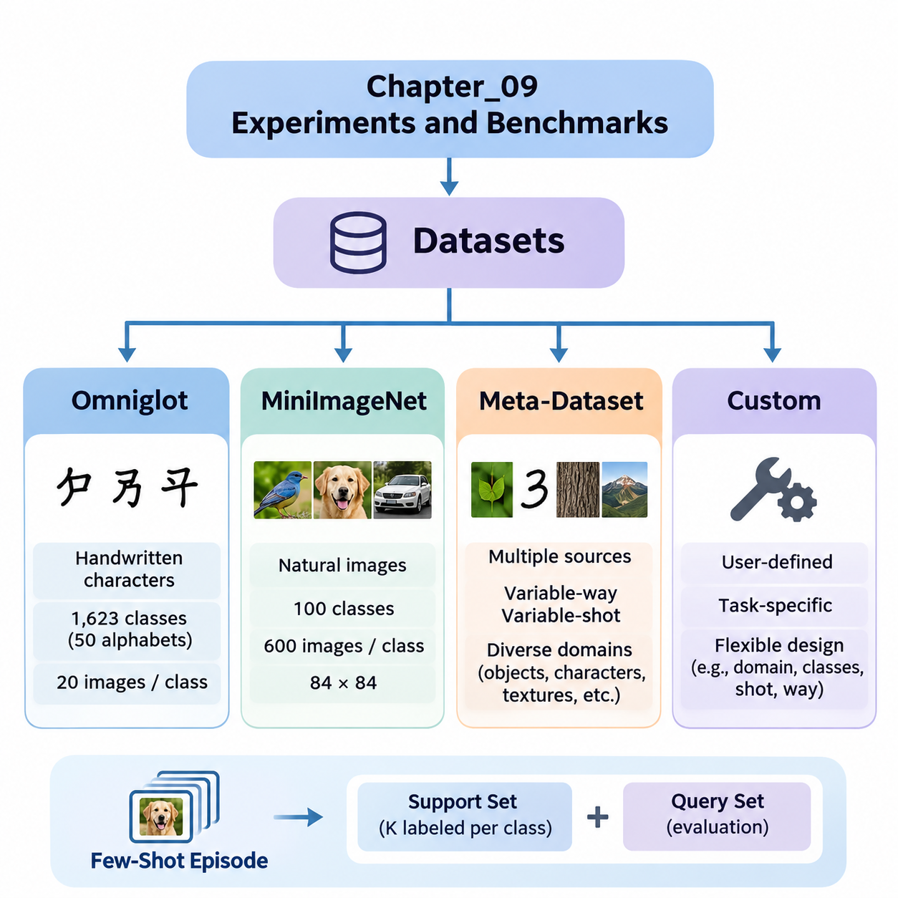
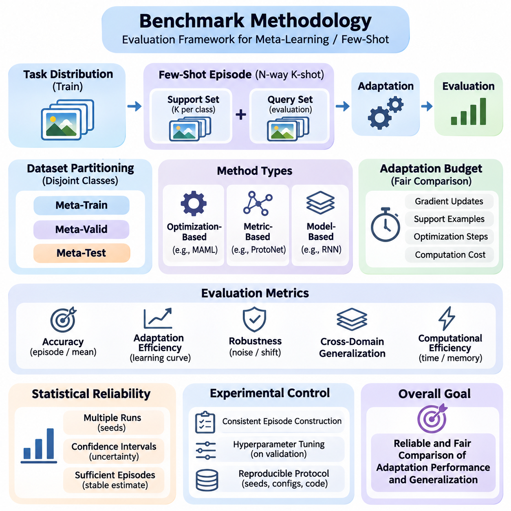
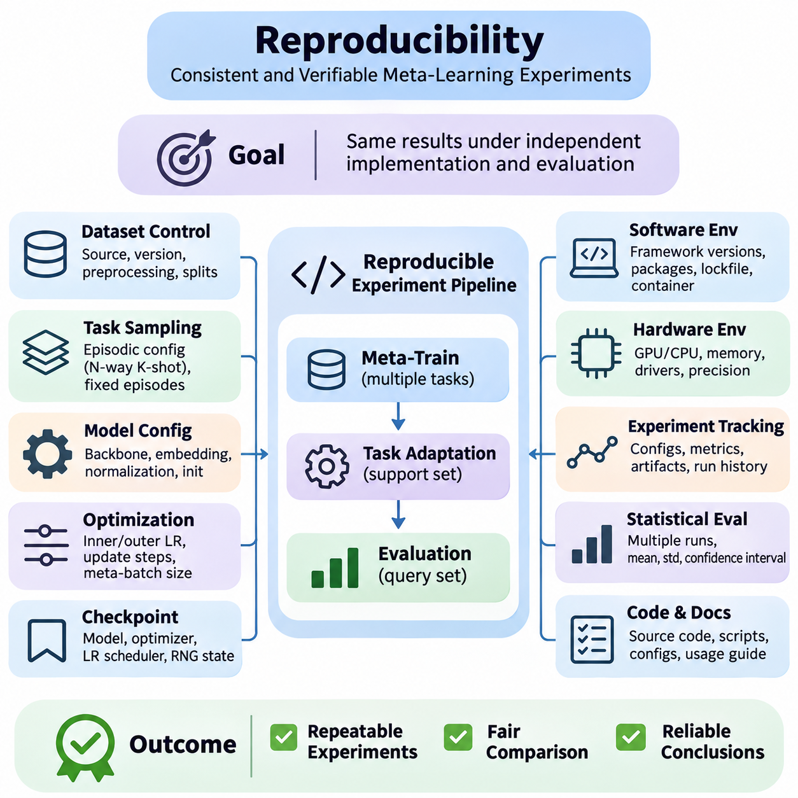
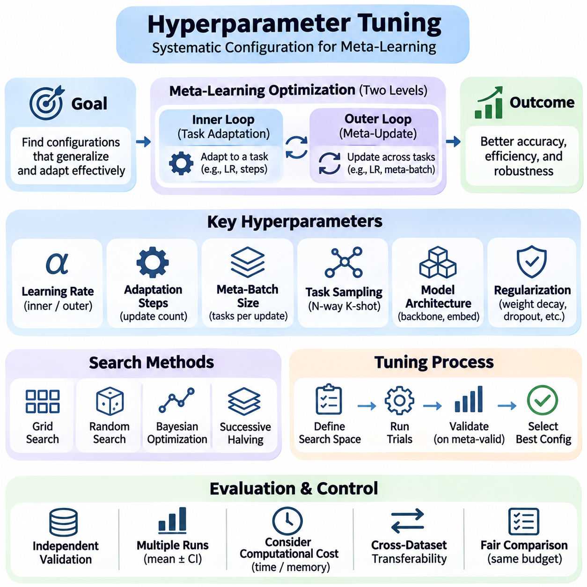
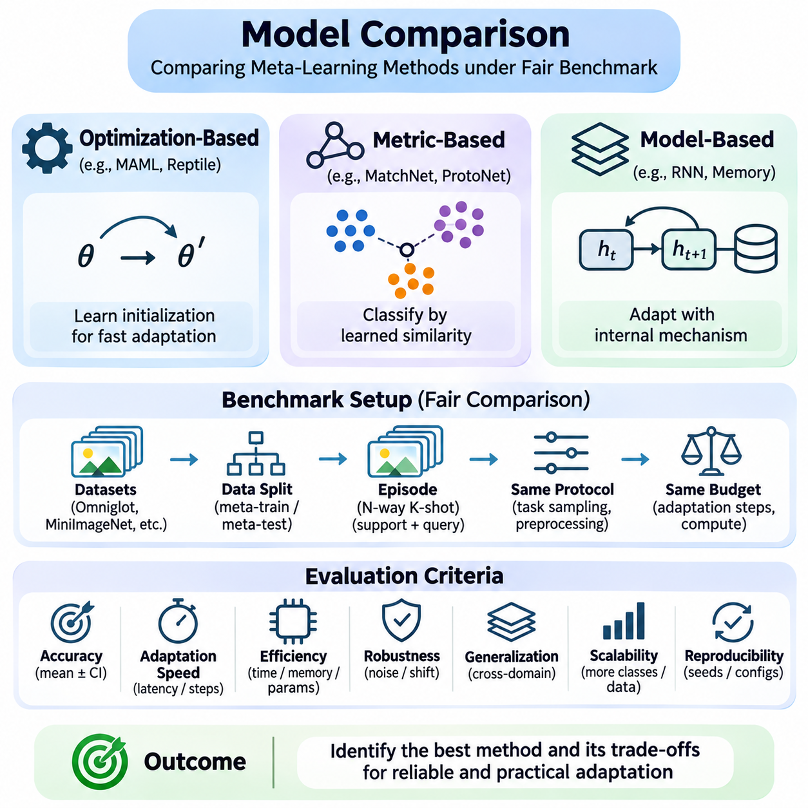

**Volume 36. Meta Learning and Few Shot Adaptation**


# 09. Experiments and Benchmarks

## 09.01 Datasets

{width="7.268055555555556in" height="7.268055555555556in"}

Datasets form the experimental foundation of meta-learning and few-shot adaptation because they determine how effectively models can acquire transferable knowledge and generalize to unfamiliar tasks. Unlike conventional supervised learning, meta-learning organizes examples into task-specific episodes that simulate adaptation under limited supervision. Dataset selection therefore influences both learning behavior and the reliability of benchmark conclusions.

A typical few-shot classification episode contains a support set and a query set. The support set provides a small number of labeled examples for adaptation, while the query set measures performance on additional samples from the same task. In an N-way K-shot experiment, each episode includes N classes and K labeled support examples per class. Repeated episodes estimate how consistently a model adapts across different class combinations.

Dataset partitions require particular attention because meta-learning evaluates generalization across tasks rather than merely across individual samples. Meta-training, meta-validation, and meta-testing typically use disjoint classes to prevent direct memorization of evaluation categories. This organization encourages transferable representations and adaptation strategies while reducing the risk that benchmark results reflect information leakage.

Omniglot is a foundational benchmark for few-shot learning that contains handwritten characters collected from numerous alphabets. Its relatively simple grayscale images make it suitable for investigating rapid adaptation, similarity learning, and optimization-based meta-learning. Researchers frequently use Omniglot to examine whether models can recognize previously unseen character classes after observing only one or several labeled examples.

The original Omniglot collection contains 1,623 character classes drawn from 50 alphabets, with 20 handwritten examples per class. Its class diversity supports episodic experiments involving different combinations of characters. Common evaluations include 5-way and 20-way classification under one-shot or five-shot conditions, although exact protocols depend on the benchmark implementation and selected data partitions.

Omniglot experiments often apply image resizing, normalization, and rotational augmentation. Rotations can create additional classification categories under certain established protocols, but their use must be documented because they change the effective task distribution. Researchers must also ensure that augmentation does not introduce unintended overlap between training and evaluation classes or otherwise compromise experimental independence.

The simplicity of Omniglot provides advantages for algorithm development and debugging. Model-Agnostic Meta-Learning, Matching Networks, Prototypical Networks, and related approaches can be evaluated without the computational demands of large natural-image datasets. However, high accuracy on handwritten characters does not necessarily demonstrate equivalent adaptation capabilities in complex visual environments.

MiniImageNet introduces a more challenging benchmark based on natural images selected from ImageNet. It contains 100 classes with 600 images per class, commonly resized to 84 by 84 pixels. The dataset is widely used to evaluate whether meta-learning algorithms can distinguish unfamiliar visual categories despite substantial variation in object appearance, background complexity, lighting, and viewpoint.

A commonly adopted MiniImageNet partition assigns 64 classes to meta-training, 16 to meta-validation, and 20 to meta-testing. These class-disjoint partitions support controlled comparisons of generalization to unseen categories. Nevertheless, published implementations may differ in image preprocessing, partition definitions, and evaluation procedures, making explicit protocol documentation essential for reproducible comparisons.

MiniImageNet evaluations commonly use 5-way 1-shot and 5-way 5-shot classification tasks. Each episode samples five classes and provides either one or five labeled examples per class, followed by query images used to measure classification accuracy. Repeating this procedure across many independently sampled episodes produces estimates of expected performance and reveals variation associated with task composition.

Compared with Omniglot, MiniImageNet places greater demands on representation quality and feature transfer. Models must learn embeddings that preserve meaningful semantic distinctions while remaining adaptable to new categories. Performance can depend strongly on backbone architecture, pretraining, augmentation, and optimization settings, so improvements should not automatically be attributed to the meta-learning algorithm alone.

Meta-Dataset extends few-shot evaluation beyond a single source dataset by combining multiple image classification datasets into a unified benchmarking framework. Its purpose is to investigate whether meta-learning systems can adapt across substantially different visual domains. Instead of concentrating exclusively on fixed classification settings, it introduces variability in class selection, available examples, and task difficulty.

Meta-Dataset includes image sources representing diverse recognition problems, such as natural objects, handwritten characters, textures, and specialized visual categories. This diversity challenges models to learn transferable adaptation mechanisms rather than strategies tailored to one dataset. Evaluation across multiple sources helps reveal whether a method depends excessively on particular image statistics or semantic structures.

An important characteristic of Meta-Dataset is its variable-way and variable-shot episodic configuration. The number of classes and available support examples can change between tasks, producing evaluation conditions that more closely resemble heterogeneous real-world learning problems. Models must therefore accommodate changing task dimensions and potentially imbalanced support sets without relying on one fixed episode structure.

Meta-Dataset also enables comparisons between adaptation within familiar domains and adaptation to domains not encountered during meta-training. These settings expose different forms of generalization difficulty. A model may perform well when evaluation tasks resemble training tasks yet struggle when image characteristics, class relationships, or available supervision change substantially.

Because Meta-Dataset integrates heterogeneous sources, experimental fairness requires careful control of preprocessing, feature extraction, and training resources. Different input resolutions, class distributions, and dataset sizes can influence measured performance. Researchers should report source-specific results alongside aggregate statistics so that improvements on one domain do not conceal significant degradation on another.

Custom datasets become essential when standard academic benchmarks do not represent the intended deployment environment. Industrial inspection, medical imaging, robotics, autonomous systems, and specialized document recognition may involve unfamiliar categories, limited annotations, or continuously changing operating conditions. A custom benchmark allows researchers to evaluate adaptation under constraints directly related to the target application.

Constructing a custom meta-learning dataset begins with defining the task distribution and identifying meaningful units of adaptation. Tasks may correspond to product categories, equipment types, operating environments, individual users, or newly encountered object classes. The dataset should contain sufficient variation across these units to distinguish genuine adaptation capabilities from memorization of recurring patterns.

Data collection must preserve representative examples of both normal operating conditions and difficult cases. Variations in sensor characteristics, environmental conditions, acquisition time, and annotation quality can significantly affect adaptation performance. Dataset documentation should describe sampling procedures, label definitions, class frequencies, and known limitations to support reliable interpretation of experimental results.

For industrial visual inspection, a custom benchmark might contain images from different production lines, material surfaces, or defect categories. A few-shot task could require recognizing a newly introduced defect using only a small labeled support set. Evaluation should distinguish performance on unfamiliar defect types from performance on familiar defects observed under altered lighting or camera conditions.

Robotics-oriented custom datasets may organize episodes around different terrains, payloads, manipulation objects, or sensor configurations. Such datasets can test whether learned representations and adaptation mechanisms remain effective when environmental dynamics change. Where sequential interaction matters, static classification accuracy should be supplemented with task completion, adaptation latency, and operational reliability measurements.

Custom benchmark construction also introduces risks of data leakage and misleading generalization claims. Images collected from the same physical object, production batch, recording session, or individual subject may be strongly correlated. Splitting these examples randomly can inflate performance estimates, so grouping strategies should reflect the intended generalization boundary between training and deployment.

Across Omniglot, MiniImageNet, Meta-Dataset, and custom datasets, benchmark design should specify the task distribution, class partitions, support and query sampling, preprocessing procedures, and evaluation metrics. Multiple random seeds and sufficiently many evaluation episodes help quantify uncertainty. Confidence intervals, adaptation costs, and computational requirements provide additional context beyond average classification accuracy.

A comprehensive experimental strategy uses complementary datasets rather than relying on one benchmark. Omniglot supports controlled algorithm investigation, MiniImageNet evaluates natural-image few-shot recognition, Meta-Dataset examines broader cross-domain adaptability, and custom datasets measure application-specific relevance. Together, these resources provide stronger evidence about the capabilities, limitations, and practical transferability of meta-learning systems.

데이터셋(Dataset)은 모델이 전이 가능한 지식(Transferable Knowledge)을 얼마나 효과적으로 습득하고 익숙하지 않은 작업(Unfamiliar Tasks)에 일반화(Generalization)할 수 있는지를 결정하므로 메타 학습(Meta-Learning)과 소수 샷 적응(Few-Shot Adaptation)의 실험적 기반을 형성한다. 기존 지도 학습(Supervised Learning)과 달리 메타 학습은 제한된 지도 정보(Limited Supervision)에서 적응 과정을 모의하도록 예제를 작업별 에피소드(Task-Specific Episodes)로 구성한다. 따라서 데이터셋 선택은 학습 동작과 벤치마크(Benchmark) 결론의 신뢰성 모두에 영향을 미친다.

일반적인 소수 샷 분류(Few-Shot Classification) 에피소드는 지원 집합(Support Set)과 질의 집합(Query Set)으로 구성된다. 지원 집합은 적응에 필요한 소수의 레이블이 지정된 예제(Labeled Examples)를 제공하며, 질의 집합은 동일한 작업에 속하는 추가 샘플을 사용하여 성능을 측정한다. N-방향 K-샷(N-Way K-Shot) 실험에서 각 에피소드는 N개의 클래스(Class)와 클래스당 K개의 레이블이 지정된 지원 예제를 포함한다. 반복적인 에피소드 평가를 통해 모델이 다양한 클래스 조합에 얼마나 일관되게 적응하는지 추정할 수 있다.

메타 학습은 개별 샘플 사이의 일반화뿐 아니라 작업 사이의 일반화를 평가하므로 데이터셋 분할(Dataset Partitioning)에 특별한 주의가 필요하다. 메타 훈련(Meta-Training), 메타 검증(Meta-Validation), 메타 테스트(Meta-Testing)는 일반적으로 서로 겹치지 않는 클래스(Disjoint Classes)를 사용하여 평가 범주의 직접적인 암기를 방지한다. 이러한 구성은 전이 가능한 표현(Transferable Representations)과 적응 전략(Adaptation Strategies)의 학습을 촉진하며, 벤치마크 결과가 정보 누출(Data Leakage)에 의해 왜곡될 위험을 줄인다.

옴니글롯(Omniglot)은 다양한 문자 체계(Alphabets)에서 수집한 손글씨 문자(Handwritten Characters)를 포함하는 소수 샷 학습(Few-Shot Learning)의 대표적인 기초 벤치마크이다. 비교적 단순한 회색조 이미지(Grayscale Images)를 사용하므로 빠른 적응(Rapid Adaptation), 유사도 학습(Similarity Learning), 최적화 기반 메타 학습(Optimization-Based Meta-Learning)을 연구하기에 적합하다. 연구자들은 하나 또는 소수의 레이블이 지정된 예제만 관찰한 후 이전에 보지 못한 문자 클래스를 인식할 수 있는지 평가하는 데 옴니글롯을 자주 활용한다.

원본 옴니글롯 데이터셋은 50개 문자 체계에서 추출한 1,623개 문자 클래스(Character Classes)를 포함하며, 각 클래스에는 20개의 손글씨 예제가 존재한다. 다양한 클래스 구성은 서로 다른 문자 조합을 사용하는 에피소드 기반 실험(Episodic Experiments)을 지원한다. 일반적인 평가에는 5-방향(5-Way) 및 20-방향(20-Way) 분류와 원샷(One-Shot) 또는 파이브샷(Five-Shot) 조건이 포함되지만, 정확한 실험 프로토콜(Experimental Protocol)은 벤치마크 구현과 선택한 데이터 분할 방식에 따라 달라진다.

옴니글롯 실험에서는 이미지 크기 조정(Image Resizing), 정규화(Normalization), 회전 기반 데이터 증강(Rotational Augmentation)을 자주 적용한다. 특정 표준 프로토콜에서는 회전된 이미지를 추가적인 분류 범주로 사용할 수 있지만, 이러한 방식은 실질적인 작업 분포(Task Distribution)를 변경하므로 반드시 명시해야 한다. 또한 데이터 증강이 훈련 클래스와 평가 클래스 사이에 의도하지 않은 중복을 발생시키거나 실험의 독립성(Experimental Independence)을 훼손하지 않도록 관리해야 한다.

옴니글롯의 단순성은 알고리즘 개발(Algorithm Development)과 디버깅(Debugging)에 유리하다. 모델 불가지론적 메타 학습(Model-Agnostic Meta-Learning, MAML), 매칭 네트워크(Matching Networks), 프로토타입 네트워크(Prototypical Networks) 및 관련 접근법을 대규모 자연 이미지 데이터셋의 높은 계산 부담 없이 평가할 수 있다. 그러나 손글씨 문자에서 높은 정확도(Accuracy)를 달성했다고 해서 복잡한 시각 환경(Complex Visual Environments)에서도 동일한 적응 능력을 보장하는 것은 아니다.

미니이미지넷(MiniImageNet)은 이미지넷(ImageNet)에서 선택한 자연 이미지(Natural Images)를 기반으로 더욱 어려운 벤치마크를 제공한다. 이 데이터셋은 100개 클래스와 클래스당 600개 이미지로 구성되며, 일반적으로 이미지를 84×84픽셀로 조정한다. 객체 외형(Object Appearance), 배경 복잡성(Background Complexity), 조명(Lighting), 시점(Viewpoint)의 상당한 변화에도 불구하고 메타 학습 알고리즘이 익숙하지 않은 시각 범주를 구별할 수 있는지 평가하는 데 널리 사용된다.

일반적으로 사용되는 미니이미지넷 분할 방식은 메타 훈련에 64개 클래스, 메타 검증에 16개 클래스, 메타 테스트에 20개 클래스를 할당한다. 이러한 클래스 비중복 분할(Class-Disjoint Partitioning)은 보지 못한 범주(Unseen Categories)에 대한 일반화 성능을 통제된 조건에서 비교할 수 있도록 한다. 그러나 공개된 구현마다 이미지 전처리(Image Preprocessing), 분할 정의(Split Definitions), 평가 절차(Evaluation Procedures)가 다를 수 있으므로 재현 가능한 비교(Reproducible Comparison)를 위해 실험 프로토콜을 명확히 문서화해야 한다.

미니이미지넷 평가는 일반적으로 5-방향 1-샷(5-Way 1-Shot)과 5-방향 5-샷(5-Way 5-Shot) 분류 작업을 사용한다. 각 에피소드에서는 다섯 개 클래스를 선택하고 클래스당 하나 또는 다섯 개의 레이블이 지정된 예제를 제공한 다음, 질의 이미지(Query Images)를 이용하여 분류 정확도를 측정한다. 독립적으로 샘플링한 다수의 에피소드에서 이 과정을 반복하면 기대 성능(Expected Performance)을 추정하고 작업 구성(Task Composition)에 따른 성능 변동을 확인할 수 있다.

옴니글롯과 비교하면 미니이미지넷은 표현 품질(Representation Quality)과 특징 전이(Feature Transfer)에 더 높은 요구사항을 부과한다. 모델은 의미 있는 의미론적 차이(Semantic Distinctions)를 유지하면서 새로운 범주에 적응할 수 있는 임베딩(Embeddings)을 학습해야 한다. 성능은 백본 아키텍처(Backbone Architecture), 사전 학습(Pretraining), 데이터 증강(Data Augmentation), 최적화 설정(Optimization Settings)에 크게 의존할 수 있으므로 성능 향상을 메타 학습 알고리즘 자체의 효과로만 해석해서는 안 된다.

메타 데이터셋(Meta-Dataset)은 여러 이미지 분류 데이터셋(Image Classification Datasets)을 통합된 벤치마킹 프레임워크(Unified Benchmarking Framework)로 결합하여 단일 데이터셋을 넘어 소수 샷 평가를 확장한다. 이 프레임워크의 목적은 메타 학습 시스템이 상당히 다른 시각 도메인(Visual Domains)에 걸쳐 적응할 수 있는지 조사하는 것이다. 고정된 분류 설정에만 집중하는 대신 클래스 선택, 사용 가능한 예제 수, 작업 난이도(Task Difficulty)에 변화를 도입한다.

메타 데이터셋에는 자연 객체(Natural Objects), 손글씨 문자, 텍스처(Textures), 특수 시각 범주(Specialized Visual Categories) 등 다양한 인식 문제를 나타내는 이미지 소스(Image Sources)가 포함된다. 이러한 다양성은 모델이 특정 데이터셋에 맞춰진 전략이 아니라 전이 가능한 적응 메커니즘(Transferable Adaptation Mechanisms)을 학습하도록 요구한다. 여러 소스에 걸친 평가는 특정 이미지 통계(Image Statistics)나 의미론적 구조(Semantic Structures)에 대한 방법론의 과도한 의존성을 드러내는 데 도움이 된다.

메타 데이터셋의 중요한 특징은 가변 방향 및 가변 샷 에피소드 구성(Variable-Way and Variable-Shot Episodic Configuration)이다. 클래스 수와 사용 가능한 지원 예제 수가 작업마다 달라질 수 있어 이질적인 실제 학습 문제(Heterogeneous Real-World Learning Problems)에 가까운 평가 조건을 제공한다. 따라서 모델은 하나의 고정된 에피소드 구조에 의존하지 않고 변화하는 작업 차원(Task Dimensions)과 불균형한 지원 집합(Imbalanced Support Sets)을 처리할 수 있어야 한다.

메타 데이터셋은 익숙한 도메인 내 적응(Within-Domain Adaptation)과 메타 훈련 과정에서 접하지 못한 도메인에 대한 적응(Unseen-Domain Adaptation)을 비교할 수 있도록 한다. 이러한 설정은 서로 다른 일반화 난이도(Generalization Difficulty)를 드러낸다. 모델이 훈련 작업과 유사한 평가 작업에서는 높은 성능을 보이더라도 이미지 특성, 클래스 관계(Class Relationships), 사용 가능한 지도 정보가 크게 달라지면 적응에 어려움을 겪을 수 있다.

메타 데이터셋은 이질적인 소스를 통합하므로 실험적 공정성(Experimental Fairness)을 확보하기 위해 전처리, 특징 추출(Feature Extraction), 훈련 자원(Training Resources)을 신중하게 통제해야 한다. 서로 다른 입력 해상도(Input Resolutions), 클래스 분포(Class Distributions), 데이터셋 크기는 측정된 성능에 영향을 줄 수 있다. 연구자는 전체 집계 통계(Aggregate Statistics)와 함께 소스별 결과(Source-Specific Results)를 보고하여 한 도메인의 성능 향상이 다른 도메인의 심각한 성능 저하를 가리지 않도록 해야 한다.

맞춤형 데이터셋(Custom Datasets)은 표준 학술 벤치마크(Standard Academic Benchmarks)가 실제 배포 환경(Deployment Environment)을 충분히 대표하지 못할 때 필수적이다. 산업 검사(Industrial Inspection), 의료 영상(Medical Imaging), 로보틱스(Robotics), 자율 시스템(Autonomous Systems), 특수 문서 인식(Specialized Document Recognition)에서는 익숙하지 않은 범주, 제한된 주석(Annotations), 지속적으로 변화하는 운영 조건(Operating Conditions)이 나타날 수 있다. 맞춤형 벤치마크는 목표 응용 분야의 제약조건을 직접 반영하여 적응 성능을 평가할 수 있도록 한다.

맞춤형 메타 학습 데이터셋을 구축하려면 먼저 작업 분포를 정의하고 적응의 의미 있는 단위(Units of Adaptation)를 식별해야 한다. 작업은 제품 범주(Product Categories), 장비 유형(Equipment Types), 운영 환경(Operating Environments), 개별 사용자(Individual Users), 새롭게 발견된 객체 클래스 등에 대응할 수 있다. 데이터셋은 실제 적응 능력(Genuine Adaptation Capabilities)과 반복되는 패턴의 암기(Memorization)를 구별할 수 있도록 이러한 단위 사이에 충분한 다양성을 포함해야 한다.

데이터 수집(Data Collection)은 정상적인 운영 조건과 어려운 사례(Difficult Cases)를 모두 대표하는 예제를 보존해야 한다. 센서 특성(Sensor Characteristics), 환경 조건(Environmental Conditions), 데이터 획득 시점(Acquisition Time), 주석 품질(Annotation Quality)의 변화는 적응 성능에 상당한 영향을 줄 수 있다. 데이터셋 문서화(Dataset Documentation)에는 샘플링 절차(Sampling Procedures), 레이블 정의(Label Definitions), 클래스 빈도(Class Frequencies), 알려진 한계(Known Limitations)를 기술하여 실험 결과를 신뢰성 있게 해석할 수 있도록 해야 한다.

산업용 시각 검사(Industrial Visual Inspection)를 위한 맞춤형 벤치마크에는 서로 다른 생산 라인(Production Lines), 재료 표면(Material Surfaces), 결함 범주(Defect Categories)에서 수집한 이미지가 포함될 수 있다. 소수 샷 작업은 소수의 레이블이 지정된 지원 집합만으로 새롭게 도입된 결함을 인식하도록 요구할 수 있다. 평가에서는 익숙하지 않은 결함 유형(Unfamiliar Defect Types)에 대한 성능과 조명 또는 카메라 조건이 변경된 기존 결함에 대한 성능을 구분해야 한다.

로보틱스 중심 맞춤형 데이터셋(Robotics-Oriented Custom Datasets)은 서로 다른 지형(Terrains), 적재 하중(Payloads), 조작 대상 물체(Manipulation Objects), 센서 구성(Sensor Configurations)을 기준으로 에피소드를 구성할 수 있다. 이러한 데이터셋은 환경 동역학(Environmental Dynamics)이 변화할 때 학습된 표현과 적응 메커니즘이 효과적으로 유지되는지 검증한다. 순차적 상호작용(Sequential Interaction)이 중요한 경우 정적인 분류 정확도 외에도 작업 완료율(Task Completion), 적응 지연시간(Adaptation Latency), 운영 신뢰성(Operational Reliability)을 함께 측정해야 한다.

맞춤형 벤치마크 구축에는 데이터 누출과 잘못된 일반화 주장(Misleading Generalization Claims)의 위험도 존재한다. 동일한 물리적 객체(Physical Object), 생산 배치(Production Batch), 기록 세션(Recording Session), 개별 피험자(Individual Subject)에서 수집한 이미지는 높은 상관관계(Correlation)를 가질 수 있다. 이러한 예제를 무작위로 분할하면 성능 추정치가 과대평가될 수 있으므로 그룹화 전략(Grouping Strategies)은 훈련과 실제 배포 사이에서 요구되는 일반화 경계(Generalization Boundary)를 반영해야 한다.

옴니글롯, 미니이미지넷, 메타 데이터셋, 맞춤형 데이터셋 전반에서 벤치마크 설계(Benchmark Design)는 작업 분포, 클래스 분할, 지원 및 질의 샘플링(Support and Query Sampling), 전처리 절차, 평가 지표(Evaluation Metrics)를 명확히 정의해야 한다. 여러 무작위 시드(Random Seeds)와 충분한 수의 평가 에피소드는 불확실성(Uncertainty)을 정량화하는 데 도움이 된다. 신뢰구간(Confidence Intervals), 적응 비용(Adaptation Costs), 계산 자원 요구사항(Computational Requirements)은 평균 분류 정확도 이상의 추가적인 평가 정보를 제공한다.

포괄적인 실험 전략(Comprehensive Experimental Strategy)은 하나의 벤치마크에 의존하지 않고 상호 보완적인 데이터셋(Complementary Datasets)을 활용한다. 옴니글롯은 통제된 알고리즘 연구를 지원하고, 미니이미지넷은 자연 이미지 소수 샷 인식을 평가하며, 메타 데이터셋은 광범위한 교차 도메인 적응성(Cross-Domain Adaptability)을 검증하고, 맞춤형 데이터셋은 응용 분야별 실질적 적합성(Application-Specific Relevance)을 측정한다. 이러한 자원을 함께 활용하면 메타 학습 시스템의 능력(Capabilities), 한계(Limitations), 실제 전이 가능성(Practical Transferability)에 대해 더욱 강력한 실험적 근거를 확보할 수 있다.

## 09.02 Benchmark Methodology

{width="7.268055555555556in" height="7.268055555555556in"}

Benchmark methodology provides a systematic framework for evaluating meta-learning and few-shot adaptation algorithms under controlled and reproducible conditions. Unlike conventional machine learning benchmarks, which typically measure performance on fixed test datasets, meta-learning benchmarks examine how effectively models adapt to previously unseen tasks. A rigorous methodology must therefore evaluate both predictive accuracy and the efficiency of adaptation.

The central principle of meta-learning evaluation is task-level generalization. Models are trained on a distribution of tasks and evaluated on new tasks sampled from a related or deliberately different distribution. Each evaluation task contains a limited support set for adaptation and a separate query set for performance measurement. This distinction ensures that reported results reflect learning from limited examples rather than memorization of training categories.

Episodic evaluation is the standard methodology for few-shot classification benchmarks. Each episode represents an independent classification problem containing a selected number of classes and labeled examples. An N-way K-shot configuration specifies N candidate classes and K support examples per class. Query samples are then used to measure how accurately the model recognizes previously unseen examples after adaptation.

Episode construction significantly influences benchmark difficulty and comparability. Class sampling procedures, support set sizes, query set sizes, and class balance must be explicitly defined. Sampling tasks with different class combinations can reveal variations in adaptation performance. Researchers should avoid selecting only favorable episodes because this introduces evaluation bias and produces misleading estimates of generalization capability.

Dataset partitioning establishes the boundary between information available during training and information reserved for evaluation. Meta-training, meta-validation, and meta-testing should use disjoint classes when measuring adaptation to unseen categories. In cross-domain experiments, entire datasets or domains may be reserved for testing. These separation rules prevent information leakage and provide stronger evidence of genuine task-level generalization.

Benchmark protocols must distinguish between meta-training and task-specific adaptation. Meta-training develops transferable representations, initialization parameters, or adaptation strategies across multiple tasks. During meta-testing, the model receives limited information from a new task and applies its learned adaptation mechanism. Query labels must remain inaccessible until predictions have been generated and evaluation is performed.

Adaptation budgets are essential for fair algorithm comparison. Different methods may require different numbers of gradient updates, support examples, optimization steps, or computational operations. A benchmark should specify these resources and evaluate methods under comparable constraints. Reporting accuracy without adaptation cost can favor computationally expensive approaches that may be impractical in latency-sensitive applications.

Optimization-based meta-learning methods require careful evaluation of inner-loop adaptation. Algorithms such as Model-Agnostic Meta-Learning modify model parameters using task-specific support examples before measuring query performance. Important experimental variables include adaptation learning rate, update count, optimizer selection, and trainable parameter subsets. These settings can substantially influence the measured effectiveness of learned initializations.

Metric-based meta-learning approaches follow a different evaluation process because adaptation may occur without explicit gradient updates. Prototypical Networks construct class representations from support embeddings, while Matching Networks compare query representations with labeled examples. Fair benchmarking should account for embedding computation, similarity calculations, memory requirements, and any task-specific processing performed during inference.

Classification accuracy remains the most widely reported metric in few-shot learning experiments. Episode accuracy measures the proportion of correctly classified query examples, while mean accuracy summarizes performance across multiple evaluation episodes. However, accuracy alone cannot describe uncertainty, computational efficiency, or sensitivity to task difficulty. Additional metrics are therefore necessary for comprehensive assessment.

Statistical reliability depends on evaluating a sufficiently large collection of independently sampled tasks. Researchers commonly report mean episode accuracy together with confidence intervals derived from evaluation results. Multiple training seeds are also important because initialization and stochastic optimization can produce substantial performance variation. Confidence intervals over episodes do not automatically capture variability between independently trained models.

Confidence interval estimation should reflect the experimental sampling structure. When episodes share examples, classes, or trained model parameters, their outcomes may be statistically dependent. Bootstrap procedures or hierarchical analyses can account for appropriate sources of variation. Reporting the number of training runs, evaluation episodes, and uncertainty estimation method makes benchmark conclusions easier to interpret.

Adaptation efficiency measures how quickly a model reaches acceptable performance after receiving limited task-specific information. Learning curves can describe accuracy as a function of support set size, gradient updates, or adaptation time. Such measurements distinguish methods that achieve high final accuracy from methods that adapt rapidly. This distinction is especially important for robotics, autonomous systems, and edge AI applications.

Robustness evaluation examines whether adaptation remains effective when task conditions differ from those encountered during meta-training. Experiments may introduce image corruption, sensor noise, class imbalance, distribution shifts, or reduced support quality. Measuring performance under these conditions reveals whether an algorithm has learned transferable adaptation principles or relies on narrow assumptions about its training environment.

Cross-domain benchmarking evaluates generalization when training and testing tasks originate from different data distributions. A model trained on natural images may be evaluated on textures, handwritten symbols, or specialized industrial imagery. Such experiments should distinguish adaptation to unseen classes within familiar domains from adaptation to entirely unfamiliar domains, since these settings represent different levels of generalization difficulty.

Baseline selection is another critical component of benchmark methodology. Meta-learning methods should be compared against conventional supervised learning, transfer learning, pretrained feature extractors, and simple fine-tuning strategies where appropriate. Strong baselines help determine whether additional meta-learning complexity produces meaningful improvements. Comparisons must control backbone capacity, training data, preprocessing, and available computational resources.

Hyperparameter selection must rely on validation tasks rather than final test performance. Learning rates, adaptation steps, regularization strengths, and architecture choices should be optimized using predefined validation protocols. Repeatedly adjusting configurations after examining test results creates implicit information leakage. A reliable benchmark separates model development decisions from final performance estimation.

Reproducibility requires detailed documentation of experimental configurations and computational environments. Dataset versions, random seeds, software dependencies, hardware specifications, preprocessing operations, and training schedules should be recorded. Evaluation scripts must implement consistent task sampling and metric computation. Publicly available configurations and executable procedures help independent researchers verify reported results.

Computational benchmarking should measure both training and adaptation costs. Relevant quantities include GPU memory consumption, training duration, inference latency, parameter count, and energy usage when measurable. These measurements become particularly important when comparing optimization-based and metric-based methods. Resource reporting should identify the hardware and measurement conditions to prevent misleading efficiency comparisons.

Ablation studies isolate the contribution of individual algorithmic components. Researchers may remove task conditioning, modify adaptation steps, replace embedding architectures, or disable regularization mechanisms. Comparing these controlled variants reveals which design choices contribute to performance improvements. Ablation experiments should preserve other relevant conditions so that observed differences can be attributed to the component under investigation.

Benchmark interpretation must consider practical significance alongside statistical significance. Small accuracy improvements may not justify substantial increases in training cost, adaptation latency, or implementation complexity. Conversely, a method with slightly lower accuracy may be preferable when it offers greater robustness or faster adaptation. Evaluation conclusions should therefore reflect the intended operational requirements.

A rigorous benchmark methodology integrates controlled task construction, independent dataset partitions, standardized adaptation budgets, reliable statistical estimation, and transparent computational reporting. Combining accuracy, efficiency, robustness, and cross-domain generalization produces a more complete understanding of meta-learning performance. This multidimensional approach supports credible scientific comparisons and informed decisions about real-world deployment.

벤치마크 방법론(Benchmark Methodology)은 통제되고 재현 가능한 조건에서 메타 학습(Meta-Learning)과 소수 샷 적응(Few-Shot Adaptation) 알고리즘을 평가하기 위한 체계적인 프레임워크(Systematic Framework)를 제공한다. 일반적으로 고정된 테스트 데이터셋(Test Dataset)에서 성능을 측정하는 기존 기계 학습(Machine Learning) 벤치마크와 달리, 메타 학습 벤치마크는 모델이 이전에 경험하지 못한 작업(Unseen Tasks)에 얼마나 효과적으로 적응하는지를 평가한다. 따라서 엄격한 평가 방법론은 예측 정확도(Predictive Accuracy)와 적응 효율성(Adaptation Efficiency)을 모두 검증해야 한다.

메타 학습 평가의 핵심 원칙은 작업 수준 일반화(Task-Level Generalization)이다. 모델은 작업 분포(Task Distribution)에서 학습하고, 관련되거나 의도적으로 다른 분포에서 추출한 새로운 작업을 대상으로 평가된다. 각 평가 작업은 적응을 위한 제한된 지원 집합(Support Set)과 성능 측정을 위한 별도의 질의 집합(Query Set)을 포함한다. 이러한 구분은 보고된 결과가 훈련 범주(Training Categories)의 암기가 아니라 제한된 예제로부터 학습하는 능력을 반영하도록 보장한다.

에피소드 기반 평가(Episodic Evaluation)는 소수 샷 분류(Few-Shot Classification) 벤치마크의 표준 방법론이다. 각 에피소드(Episode)는 선택된 수의 클래스(Class)와 레이블이 지정된 예제(Labeled Examples)를 포함하는 독립적인 분류 문제를 나타낸다. N-방향 K-샷(N-Way K-Shot) 구성은 N개의 후보 클래스와 클래스당 K개의 지원 예제를 지정한다. 이후 질의 샘플(Query Samples)을 사용하여 적응 후 모델이 이전에 보지 못한 예제를 얼마나 정확하게 인식하는지 측정한다.

에피소드 구성(Episode Construction)은 벤치마크 난이도(Benchmark Difficulty)와 비교 가능성(Comparability)에 상당한 영향을 미친다. 클래스 샘플링 절차(Class Sampling Procedures), 지원 집합 크기(Support Set Size), 질의 집합 크기(Query Set Size), 클래스 균형(Class Balance)을 명확하게 정의해야 한다. 서로 다른 클래스 조합으로 작업을 샘플링하면 적응 성능의 변화를 확인할 수 있다. 연구자는 유리한 에피소드만 선택하는 것을 피해야 하며, 이러한 선택은 평가 편향(Evaluation Bias)을 유발하고 일반화 능력에 대한 잘못된 추정치를 생성하기 때문이다.

데이터셋 분할(Dataset Partitioning)은 훈련 과정에서 사용할 수 있는 정보와 평가를 위해 보존되는 정보 사이의 경계를 설정한다. 새로운 범주에 대한 적응을 측정할 때 메타 훈련(Meta-Training), 메타 검증(Meta-Validation), 메타 테스트(Meta-Testing)는 서로 겹치지 않는 클래스(Disjoint Classes)를 사용해야 한다. 교차 도메인 실험(Cross-Domain Experiments)에서는 전체 데이터셋이나 도메인을 테스트용으로 분리할 수 있다. 이러한 분리 규칙은 정보 누출(Information Leakage)을 방지하고 실제 작업 수준 일반화에 대한 더욱 강력한 근거를 제공한다.

벤치마크 프로토콜(Benchmark Protocols)은 메타 훈련과 작업별 적응(Task-Specific Adaptation)을 구분해야 한다. 메타 훈련은 여러 작업에 걸쳐 전이 가능한 표현(Transferable Representations), 초기화 매개변수(Initialization Parameters), 적응 전략(Adaptation Strategies)을 개발한다. 메타 테스트 과정에서 모델은 새로운 작업으로부터 제한된 정보를 제공받고 학습된 적응 메커니즘(Adaptation Mechanism)을 적용한다. 질의 레이블(Query Labels)은 예측이 생성되고 평가가 수행될 때까지 접근할 수 없어야 한다.

적응 예산(Adaptation Budgets)은 공정한 알고리즘 비교(Fair Algorithm Comparison)에 필수적이다. 서로 다른 방법은 상이한 수의 경사 갱신(Gradient Updates), 지원 예제(Support Examples), 최적화 단계(Optimization Steps), 계산 연산(Computational Operations)을 요구할 수 있다. 벤치마크는 이러한 자원을 명시하고 비교 가능한 제약조건에서 방법들을 평가해야 한다. 적응 비용(Adaptation Cost)을 고려하지 않고 정확도만 보고하면 지연시간에 민감한 응용 분야(Latency-Sensitive Applications)에서 비현실적인 고비용 접근법이 유리하게 평가될 수 있다.

최적화 기반 메타 학습(Optimization-Based Meta-Learning) 방법은 내부 루프 적응(Inner-Loop Adaptation)을 신중하게 평가해야 한다. 모델 불가지론적 메타 학습(Model-Agnostic Meta-Learning, MAML)과 같은 알고리즘은 질의 성능을 측정하기 전에 작업별 지원 예제를 사용하여 모델 매개변수를 수정한다. 중요한 실험 변수에는 적응 학습률(Adaptation Learning Rate), 갱신 횟수(Update Count), 최적화기 선택(Optimizer Selection), 학습 가능한 매개변수 부분집합(Trainable Parameter Subsets)이 포함된다. 이러한 설정은 학습된 초기화의 효과에 상당한 영향을 미칠 수 있다.

거리 기반 메타 학습(Metric-Based Meta-Learning) 접근법은 명시적인 경사 갱신 없이 적응이 이루어질 수 있으므로 다른 평가 절차를 따른다. 프로토타입 네트워크(Prototypical Networks)는 지원 임베딩(Support Embeddings)으로 클래스 표현(Class Representations)을 구성하고, 매칭 네트워크(Matching Networks)는 질의 표현(Query Representations)을 레이블이 지정된 예제와 비교한다. 공정한 벤치마킹에서는 임베딩 계산(Embedding Computation), 유사도 계산(Similarity Calculations), 메모리 요구사항(Memory Requirements), 추론 중 수행되는 작업별 처리(Task-Specific Processing)를 고려해야 한다.

분류 정확도(Classification Accuracy)는 소수 샷 학습 실험에서 가장 널리 보고되는 평가 지표(Evaluation Metric)이다. 에피소드 정확도(Episode Accuracy)는 올바르게 분류된 질의 예제의 비율을 측정하며, 평균 정확도(Mean Accuracy)는 여러 평가 에피소드에 걸친 성능을 요약한다. 그러나 정확도만으로는 불확실성(Uncertainty), 계산 효율성(Computational Efficiency), 작업 난이도에 대한 민감도(Sensitivity)를 설명할 수 없다. 따라서 포괄적인 평가를 위해 추가적인 지표가 필요하다.

통계적 신뢰성(Statistical Reliability)은 충분히 많은 독립적으로 샘플링된 작업을 평가하는 데 달려 있다. 연구자들은 일반적으로 평가 결과에서 도출한 신뢰구간(Confidence Intervals)과 함께 평균 에피소드 정확도를 보고한다. 초기화(Initialization)와 확률적 최적화(Stochastic Optimization)가 상당한 성능 변동을 유발할 수 있으므로 여러 훈련 시드(Training Seeds)를 사용하는 것도 중요하다. 에피소드에 대한 신뢰구간이 독립적으로 훈련된 모델 사이의 변동성까지 자동으로 반영하는 것은 아니다.

신뢰구간 추정(Confidence Interval Estimation)은 실험의 샘플링 구조(Sampling Structure)를 반영해야 한다. 에피소드가 예제, 클래스 또는 훈련된 모델 매개변수를 공유하는 경우 결과 사이에 통계적 의존성(Statistical Dependence)이 존재할 수 있다. 부트스트랩 절차(Bootstrap Procedures)나 계층적 분석(Hierarchical Analysis)을 사용하면 적절한 변동 요인(Sources of Variation)을 고려할 수 있다. 훈련 실행 횟수(Training Runs), 평가 에피소드 수(Evaluation Episodes), 불확실성 추정 방법(Uncertainty Estimation Method)을 보고하면 벤치마크 결론을 더 쉽게 해석할 수 있다.

적응 효율성(Adaptation Efficiency)은 제한된 작업별 정보를 제공받은 후 모델이 허용 가능한 성능(Acceptable Performance)에 얼마나 빠르게 도달하는지를 측정한다. 학습 곡선(Learning Curves)은 지원 집합 크기, 경사 갱신 횟수 또는 적응 시간(Adaptation Time)에 따른 정확도를 나타낼 수 있다. 이러한 측정은 높은 최종 정확도(Final Accuracy)를 달성하는 방법과 빠르게 적응하는 방법을 구분한다. 이러한 차이는 로보틱스(Robotics), 자율 시스템(Autonomous Systems), 엣지 인공지능(Edge AI) 응용 분야에서 특히 중요하다.

강건성 평가(Robustness Evaluation)는 작업 조건이 메타 훈련에서 경험한 조건과 달라질 때도 적응이 효과적으로 유지되는지를 검증한다. 실험에서는 이미지 손상(Image Corruption), 센서 잡음(Sensor Noise), 클래스 불균형(Class Imbalance), 분포 이동(Distribution Shifts), 지원 데이터 품질 저하(Reduced Support Quality)를 도입할 수 있다. 이러한 조건에서 성능을 측정하면 알고리즘이 전이 가능한 적응 원칙(Transferable Adaptation Principles)을 학습했는지, 아니면 훈련 환경에 대한 제한적인 가정에 의존하는지 확인할 수 있다.

교차 도메인 벤치마킹(Cross-Domain Benchmarking)은 훈련 작업과 테스트 작업이 서로 다른 데이터 분포(Data Distributions)에서 생성될 때 일반화 성능을 평가한다. 자연 이미지로 훈련된 모델을 텍스처(Textures), 손글씨 기호(Handwritten Symbols), 특수 산업 이미지(Specialized Industrial Imagery)에서 평가할 수 있다. 이러한 실험에서는 익숙한 도메인 내 새로운 클래스에 대한 적응과 완전히 익숙하지 않은 도메인에 대한 적응을 구분해야 하며, 두 설정은 서로 다른 수준의 일반화 난이도를 나타내기 때문이다.

기준 모델 선택(Baseline Selection)은 벤치마크 방법론의 또 다른 핵심 요소이다. 메타 학습 방법은 적절한 경우 기존 지도 학습(Supervised Learning), 전이 학습(Transfer Learning), 사전 학습된 특징 추출기(Pretrained Feature Extractors), 단순 미세 조정 전략(Simple Fine-Tuning Strategies)과 비교해야 한다. 강력한 기준 모델(Strong Baselines)은 메타 학습의 추가적인 복잡성이 의미 있는 성능 향상을 제공하는지 판단하는 데 도움이 된다. 비교에서는 백본 용량(Backbone Capacity), 훈련 데이터, 전처리, 사용 가능한 계산 자원을 통제해야 한다.

하이퍼파라미터 선택(Hyperparameter Selection)은 최종 테스트 성능이 아니라 검증 작업(Validation Tasks)을 기반으로 이루어져야 한다. 학습률(Learning Rates), 적응 단계(Adaptation Steps), 정규화 강도(Regularization Strengths), 아키텍처 선택(Architecture Choices)은 사전에 정의된 검증 프로토콜(Validation Protocols)을 사용하여 최적화해야 한다. 테스트 결과를 확인한 후 반복적으로 설정을 조정하면 암묵적인 정보 누출(Implicit Information Leakage)이 발생한다. 신뢰할 수 있는 벤치마크는 모델 개발 의사결정과 최종 성능 추정(Final Performance Estimation)을 분리한다.

재현성(Reproducibility)을 확보하려면 실험 구성(Experimental Configurations)과 계산 환경(Computational Environments)을 상세히 문서화해야 한다. 데이터셋 버전(Dataset Versions), 무작위 시드(Random Seeds), 소프트웨어 의존성(Software Dependencies), 하드웨어 사양(Hardware Specifications), 전처리 작업(Preprocessing Operations), 훈련 일정(Training Schedules)을 기록해야 한다. 평가 스크립트(Evaluation Scripts)는 일관된 작업 샘플링과 지표 계산(Metric Computation)을 구현해야 한다. 공개된 설정과 실행 가능한 절차는 독립적인 연구자가 보고된 결과를 검증하는 데 도움이 된다.

계산 성능 벤치마킹(Computational Benchmarking)은 훈련 비용(Training Costs)과 적응 비용을 모두 측정해야 한다. 관련 지표에는 GPU 메모리 사용량(GPU Memory Consumption), 훈련 시간(Training Duration), 추론 지연시간(Inference Latency), 매개변수 수(Parameter Count), 측정 가능한 경우 에너지 사용량(Energy Usage)이 포함된다. 이러한 측정은 최적화 기반 방법과 거리 기반 방법을 비교할 때 특히 중요하다. 자원 사용 보고(Resource Reporting)에서는 잘못된 효율성 비교를 방지하기 위해 하드웨어와 측정 조건(Measurement Conditions)을 명시해야 한다.

절제 연구(Ablation Studies)는 개별 알고리즘 구성요소(Algorithmic Components)의 기여도를 분리하여 분석한다. 연구자는 작업 조건화(Task Conditioning)를 제거하거나, 적응 단계를 변경하거나, 임베딩 아키텍처(Embedding Architectures)를 교체하거나, 정규화 메커니즘(Regularization Mechanisms)을 비활성화할 수 있다. 이러한 통제된 변형(Controlled Variants)을 비교하면 어떤 설계 선택이 성능 향상에 기여하는지 확인할 수 있다. 절제 실험에서는 다른 관련 조건을 유지하여 관찰된 차이를 조사 대상 구성요소에 귀속할 수 있도록 해야 한다.

벤치마크 결과 해석(Benchmark Interpretation)은 통계적 유의성(Statistical Significance)과 함께 실용적 유의성(Practical Significance)을 고려해야 한다. 작은 정확도 향상이 훈련 비용, 적응 지연시간 또는 구현 복잡성(Implementation Complexity)의 상당한 증가를 정당화하지 못할 수 있다. 반대로 정확도가 약간 낮은 방법이라도 더 높은 강건성이나 빠른 적응을 제공한다면 선호될 수 있다. 따라서 평가 결론은 목표 운영 요구사항(Operational Requirements)을 반영해야 한다.

엄격한 벤치마크 방법론은 통제된 작업 구성(Controlled Task Construction), 독립적인 데이터셋 분할(Independent Dataset Partitions), 표준화된 적응 예산(Standardized Adaptation Budgets), 신뢰할 수 있는 통계적 추정(Reliable Statistical Estimation), 투명한 계산 자원 보고(Transparent Computational Reporting)를 통합한다. 정확도, 효율성, 강건성, 교차 도메인 일반화(Cross-Domain Generalization)를 함께 평가하면 메타 학습 성능을 더욱 완전하게 이해할 수 있다. 이러한 다차원적 접근법(Multidimensional Approach)은 신뢰할 수 있는 과학적 비교(Scientific Comparisons)와 실제 배포(Real-World Deployment)에 관한 합리적인 의사결정을 지원한다.

## 09.03 Reproducibility [w/Code]

{width="7.268055555555556in" height="7.268055555555556in"}

Reproducibility is a fundamental requirement of reliable meta-learning research because experimental results must remain consistent when algorithms are independently implemented and evaluated. Few-shot learning introduces additional sources of variability through task sampling, adaptation procedures, and limited support examples. A reproducible experiment therefore requires precise control over datasets, computational environments, optimization settings, and evaluation protocols.

The reproducibility challenge in meta-learning differs from conventional supervised learning because training and evaluation involve distributions of tasks rather than fixed collections of examples. Each sampled episode may contain different classes, support examples, and query samples. Even when model parameters remain unchanged, evaluation accuracy can fluctuate across episodes. Researchers must document how tasks are generated and how experimental randomness is controlled.

Random seed management is essential for controlling stochastic behavior throughout the experimental pipeline. Randomness influences model initialization, dataset shuffling, task sampling, data augmentation, and optimization. A reproducible implementation should initialize the random number generators used by Python, NumPy, and the selected deep learning framework. Separate seeds may be assigned to training, validation, and evaluation processes.

Setting random seeds does not automatically guarantee identical results across hardware platforms or software versions. GPU kernels, parallel execution, floating-point arithmetic, and nondeterministic operations can introduce numerical differences. Frameworks such as PyTorch provide deterministic algorithm settings, although some operations may become slower or unavailable. Researchers should distinguish exact determinism from statistical reproducibility.

Dataset version control establishes a stable foundation for repeatable experiments. Researchers should record dataset sources, download versions, preprocessing procedures, class mappings, and partition definitions. For benchmarks such as Omniglot and MiniImageNet, alternative splits or preprocessing conventions can produce different results. Dataset checksums and stored split manifests help verify that independent experiments use identical data.

Task sampling must be implemented consistently across training and evaluation. An episodic sampler selects classes, support examples, and query examples according to a predefined configuration. Sampling with or without replacement, balancing classes, and controlling query counts can affect measured performance. Recording sampler parameters and random states allows researchers to reconstruct experimental episodes and investigate unexpected results.

A useful reproducibility strategy is to generate fixed evaluation episode manifests before model comparison. Each manifest identifies the classes and sample indices used in a particular episode. Competing algorithms can then be evaluated on identical tasks, reducing variability caused by different evaluation samples. Fixed episodes improve paired comparisons, although additional independently sampled episodes may be necessary to estimate broader task-distribution performance.

Model configuration management ensures that architectural differences do not unintentionally influence experimental conclusions. Researchers should record backbone structures, embedding dimensions, normalization layers, activation functions, and parameter initialization methods. In meta-learning, seemingly minor architectural choices can substantially affect adaptation behavior. Configuration files provide a structured mechanism for preserving these decisions.

Optimization settings require equally detailed documentation because meta-learning commonly involves nested learning procedures. Inner-loop learning rates, adaptation steps, outer-loop optimizers, meta-batch sizes, and learning-rate schedules must be specified. Algorithms such as MAML are particularly sensitive to these settings. Reproducing only the model architecture without the optimization procedure may lead to significantly different experimental outcomes.

Checkpoint management supports reliable recovery and comparison of experimental runs. A complete training checkpoint should preserve model parameters, optimizer states, learning-rate scheduler states, and relevant random number generator states. For exact continuation, additional information such as the current episode position and sampler state may be necessary. Checkpoints should include identifiers linking them to their original configurations.

Software environment reproducibility requires recording framework versions, dependency packages, compiler settings, and relevant accelerator libraries. Differences between PyTorch releases, CUDA implementations, or numerical kernels may alter execution behavior. Dependency lockfiles and container images can reduce environmental inconsistencies. However, containerization alone does not eliminate hardware-dependent numerical variation or nondeterministic execution.

Hardware documentation is particularly important when evaluating computational efficiency and adaptation latency. GPU models, CPU specifications, memory capacity, accelerator drivers, and precision settings influence measured performance. Mixed-precision training may improve throughput while introducing numerical differences. Benchmark reports should identify these conditions so that runtime comparisons are interpreted within their actual computational environments.

Experiment tracking systems provide a centralized record of configurations, metrics, artifacts, and execution histories. Tools such as MLflow, TensorBoard, and Weights & Biases can associate training curves and evaluation results with specific runs. Effective tracking should also preserve source-code revisions and dataset identifiers. These records help distinguish genuine algorithmic improvements from accidental changes in experimental settings.

Statistical reproducibility requires evaluating models across multiple independent training runs rather than relying on a single favorable result. Different initialization seeds and task sequences may produce substantially different outcomes. Reporting means, standard deviations, and confidence intervals provides a more informative assessment of performance stability. Researchers should distinguish variation between training runs from variation among evaluation episodes.

Evaluation scripts should remain independent of model development decisions and enforce consistent measurement procedures. The same query-label handling, adaptation budgets, accuracy calculations, and aggregation methods should apply to competing algorithms. Validation data should guide hyperparameter selection, while test data should remain reserved for final evaluation. This separation reduces the risk of implicit benchmark overfitting.

Reproducibility testing should include automated verification of critical pipeline components. Unit tests can confirm correct support-query separation, class remapping, tensor dimensions, and gradient update behavior. Integration tests can verify that complete episodes execute correctly and produce valid metrics. Deterministic reference cases are especially useful for detecting implementation errors after software or architecture changes.

For optimization-based meta-learning, gradient correctness is an important reproducibility concern. Higher-order differentiation, parameter cloning, and computational graph retention can be implemented differently across frameworks. Numerical gradient checks and comparisons against trusted reference implementations help identify errors. Researchers should document whether full second-order gradients, first-order approximations, or implicit differentiation methods are used.

Metric-based learning systems require verification of embedding extraction and similarity calculations. Differences in feature normalization, distance functions, prototype construction, and query processing can change benchmark outcomes. Reproducible implementations should explicitly define these operations and their numerical precision. Cached embeddings must also be associated with the exact model checkpoint and preprocessing configuration that produced them.

A practical reproducibility workflow begins by establishing immutable dataset partitions and version-controlled experiment configurations. Each run then records its random seeds, software environment, model checkpoint, and evaluation protocol. Automated scripts should reconstruct the complete training and testing pipeline from these records. Successful reproduction should be assessed using predefined numerical tolerances and statistical criteria.

Open research practices further strengthen reproducibility by making source code, configuration files, evaluation scripts, and experiment documentation accessible. When datasets cannot be distributed because of licensing or privacy restrictions, researchers can provide acquisition instructions, metadata schemas, and preprocessing specifications. Clear documentation enables independent verification without requiring access to confidential information.

Reproducibility should ultimately be treated as an engineering property of the entire meta-learning system rather than a final reporting requirement. Reliable experiments combine controlled randomness, traceable datasets, documented optimization, verified implementations, and statistically sound evaluation. These practices improve scientific credibility, accelerate debugging, and support dependable comparisons when meta-learning methods transition from research benchmarks to practical deployment.

재현성(Reproducibility)은 알고리즘을 독립적으로 구현하고 평가하더라도 실험 결과가 일관되게 유지되어야 하므로 신뢰할 수 있는 메타 학습(Meta-Learning) 연구의 기본 요구사항이다. 소수 샷 학습(Few-Shot Learning)은 작업 샘플링(Task Sampling), 적응 절차(Adaptation Procedures), 제한된 지원 예제(Support Examples)를 통해 추가적인 변동 요인(Sources of Variability)을 발생시킨다. 따라서 재현 가능한 실험을 위해서는 데이터셋(Datasets), 계산 환경(Computational Environments), 최적화 설정(Optimization Settings), 평가 프로토콜(Evaluation Protocols)을 정밀하게 통제해야 한다.

메타 학습의 재현성 문제는 훈련과 평가가 고정된 예제 집합이 아니라 작업 분포(Task Distributions)를 기반으로 이루어진다는 점에서 기존 지도 학습(Supervised Learning)과 차이가 있다. 샘플링된 각 에피소드(Episode)는 서로 다른 클래스(Classes), 지원 예제, 질의 샘플(Query Samples)을 포함할 수 있다. 모델 매개변수(Model Parameters)가 변경되지 않더라도 에피소드에 따라 평가 정확도(Evaluation Accuracy)가 달라질 수 있다. 연구자는 작업이 생성되는 방식과 실험의 무작위성(Experimental Randomness)을 제어하는 방법을 문서화해야 한다.

무작위 시드 관리(Random Seed Management)는 전체 실험 파이프라인(Experimental Pipeline)에서 확률적 동작(Stochastic Behavior)을 제어하는 데 필수적이다. 무작위성은 모델 초기화(Model Initialization), 데이터셋 셔플링(Dataset Shuffling), 작업 샘플링, 데이터 증강(Data Augmentation), 최적화(Optimization)에 영향을 미친다. 재현 가능한 구현에서는 파이썬(Python), 넘파이(NumPy), 선택한 딥러닝 프레임워크(Deep Learning Framework)에서 사용하는 난수 생성기(Random Number Generators)를 초기화해야 한다. 훈련, 검증, 평가 과정에는 서로 다른 시드를 할당할 수 있다.

무작위 시드를 설정한다고 해서 서로 다른 하드웨어 플랫폼(Hardware Platforms)이나 소프트웨어 버전(Software Versions)에서 동일한 결과가 자동으로 보장되는 것은 아니다. GPU 커널(GPU Kernels), 병렬 실행(Parallel Execution), 부동소수점 연산(Floating-Point Arithmetic), 비결정적 연산(Nondeterministic Operations)은 수치적 차이(Numerical Differences)를 발생시킬 수 있다. 파이토치(PyTorch)와 같은 프레임워크는 결정적 알고리즘 설정(Deterministic Algorithm Settings)을 제공하지만 일부 연산은 느려지거나 사용할 수 없게 될 수 있다. 연구자는 완전한 결정성(Exact Determinism)과 통계적 재현성(Statistical Reproducibility)을 구분해야 한다.

데이터셋 버전 관리(Dataset Version Control)는 반복 가능한 실험을 위한 안정적인 기반을 구축한다. 연구자는 데이터셋 출처(Dataset Sources), 다운로드 버전(Download Versions), 전처리 절차(Preprocessing Procedures), 클래스 매핑(Class Mappings), 분할 정의(Partition Definitions)를 기록해야 한다. 옴니글롯(Omniglot)과 미니이미지넷(MiniImageNet) 같은 벤치마크에서는 서로 다른 분할 방식이나 전처리 관례(Preprocessing Conventions)가 다른 결과를 생성할 수 있다. 데이터셋 체크섬(Dataset Checksums)과 저장된 분할 명세 파일(Split Manifests)은 독립적인 실험에서 동일한 데이터를 사용하는지 검증하는 데 도움이 된다.

작업 샘플링(Task Sampling)은 훈련과 평가 전반에서 일관되게 구현되어야 한다. 에피소드 샘플러(Episodic Sampler)는 사전에 정의된 구성(Predefined Configuration)에 따라 클래스, 지원 예제, 질의 예제를 선택한다. 복원 또는 비복원 샘플링(Sampling With or Without Replacement), 클래스 균형 조정(Class Balancing), 질의 수 제어(Query Count Control)는 측정된 성능에 영향을 줄 수 있다. 샘플러 매개변수(Sampler Parameters)와 난수 상태(Random States)를 기록하면 실험 에피소드를 재구성하고 예상하지 못한 결과를 조사할 수 있다.

유용한 재현성 전략은 모델 비교 이전에 고정된 평가 에피소드 명세(Fixed Evaluation Episode Manifests)를 생성하는 것이다. 각 명세는 특정 에피소드에서 사용되는 클래스와 샘플 인덱스(Sample Indices)를 식별한다. 경쟁 알고리즘(Competing Algorithms)을 동일한 작업에서 평가하면 서로 다른 평가 샘플로 인해 발생하는 변동성을 줄일 수 있다. 고정된 에피소드는 대응 비교(Paired Comparisons)의 신뢰성을 높이지만, 더 광범위한 작업 분포의 성능을 추정하려면 추가로 독립적으로 샘플링한 에피소드가 필요할 수 있다.

모델 구성 관리(Model Configuration Management)는 아키텍처 차이(Architectural Differences)가 의도하지 않게 실험 결론에 영향을 미치는 것을 방지한다. 연구자는 백본 구조(Backbone Structures), 임베딩 차원(Embedding Dimensions), 정규화 계층(Normalization Layers), 활성화 함수(Activation Functions), 매개변수 초기화 방법(Parameter Initialization Methods)을 기록해야 한다. 메타 학습에서는 사소해 보이는 아키텍처 선택도 적응 동작(Adaptation Behavior)에 상당한 영향을 미칠 수 있다. 구성 파일(Configuration Files)은 이러한 설계 결정을 체계적으로 보존하는 수단을 제공한다.

메타 학습은 일반적으로 중첩된 학습 절차(Nested Learning Procedures)를 포함하므로 최적화 설정도 상세하게 문서화해야 한다. 내부 루프 학습률(Inner-Loop Learning Rates), 적응 단계(Adaptation Steps), 외부 루프 최적화기(Outer-Loop Optimizers), 메타 배치 크기(Meta-Batch Sizes), 학습률 스케줄(Learning-Rate Schedules)을 명시해야 한다. 모델 불가지론적 메타 학습(Model-Agnostic Meta-Learning, MAML)과 같은 알고리즘은 이러한 설정에 특히 민감하다. 최적화 절차 없이 모델 아키텍처만 재현하면 실험 결과가 상당히 달라질 수 있다.

체크포인트 관리(Checkpoint Management)는 실험 실행의 안정적인 복구와 비교를 지원한다. 완전한 훈련 체크포인트(Training Checkpoint)는 모델 매개변수, 최적화기 상태(Optimizer States), 학습률 스케줄러 상태(Learning-Rate Scheduler States), 관련 난수 생성기 상태를 보존해야 한다. 정확한 학습 재개(Exact Continuation)를 위해서는 현재 에피소드 위치(Current Episode Position)와 샘플러 상태(Sampler State) 같은 추가 정보가 필요할 수 있다. 체크포인트에는 원래 실험 구성과 연결되는 식별자(Identifiers)를 포함해야 한다.

소프트웨어 환경 재현성(Software Environment Reproducibility)을 확보하려면 프레임워크 버전(Framework Versions), 의존성 패키지(Dependency Packages), 컴파일러 설정(Compiler Settings), 관련 가속기 라이브러리(Accelerator Libraries)를 기록해야 한다. 파이토치 릴리스(PyTorch Releases), 쿠다 구현(CUDA Implementations), 수치 연산 커널(Numerical Kernels)의 차이는 실행 동작에 영향을 미칠 수 있다. 의존성 잠금 파일(Dependency Lockfiles)과 컨테이너 이미지(Container Images)는 환경 불일치를 줄일 수 있다. 그러나 컨테이너화(Containerization)만으로 하드웨어에 따른 수치적 차이나 비결정적 실행을 완전히 제거할 수는 없다.

하드웨어 문서화(Hardware Documentation)는 계산 효율성(Computational Efficiency)과 적응 지연시간(Adaptation Latency)을 평가할 때 특히 중요하다. GPU 모델(GPU Models), CPU 사양(CPU Specifications), 메모리 용량(Memory Capacity), 가속기 드라이버(Accelerator Drivers), 정밀도 설정(Precision Settings)은 측정 성능에 영향을 미친다. 혼합 정밀도 훈련(Mixed-Precision Training)은 처리량(Throughput)을 향상시키는 동시에 수치적 차이를 발생시킬 수 있다. 벤치마크 보고서는 실행시간 비교(Runtime Comparisons)를 실제 계산 환경에 맞게 해석할 수 있도록 이러한 조건을 명시해야 한다.

실험 추적 시스템(Experiment Tracking Systems)은 구성, 평가 지표(Metrics), 산출물(Artifacts), 실행 이력(Execution Histories)을 중앙에서 관리한다. 엠엘플로우(MLflow), 텐서보드(TensorBoard), 웨이츠 앤 바이어시스(Weights & Biases)와 같은 도구는 훈련 곡선(Training Curves)과 평가 결과를 특정 실행 기록(Runs)에 연결할 수 있다. 효과적인 추적에는 소스 코드 리비전(Source-Code Revisions)과 데이터셋 식별자(Dataset Identifiers)도 포함되어야 한다. 이러한 기록은 실제 알고리즘 개선과 실험 설정의 우발적인 변경을 구분하는 데 도움이 된다.

통계적 재현성(Statistical Reproducibility)을 확보하려면 하나의 유리한 결과에 의존하지 않고 여러 독립적인 훈련 실행(Independent Training Runs)을 통해 모델을 평가해야 한다. 서로 다른 초기화 시드(Initialization Seeds)와 작업 시퀀스(Task Sequences)는 상당히 다른 결과를 생성할 수 있다. 평균(Means), 표준편차(Standard Deviations), 신뢰구간(Confidence Intervals)을 보고하면 성능 안정성(Performance Stability)을 더욱 정확하게 평가할 수 있다. 연구자는 훈련 실행 사이의 변동과 평가 에피소드 사이의 변동을 구분해야 한다.

평가 스크립트(Evaluation Scripts)는 모델 개발 의사결정(Model Development Decisions)과 독립적으로 유지되어야 하며 일관된 측정 절차(Measurement Procedures)를 적용해야 한다. 동일한 질의 레이블 처리(Query-Label Handling), 적응 예산(Adaptation Budgets), 정확도 계산(Accuracy Calculations), 집계 방법(Aggregation Methods)을 경쟁 알고리즘에 적용해야 한다. 검증 데이터(Validation Data)는 하이퍼파라미터 선택(Hyperparameter Selection)에 사용하고 테스트 데이터(Test Data)는 최종 평가를 위해 보존해야 한다. 이러한 분리는 암묵적인 벤치마크 과적합(Implicit Benchmark Overfitting)의 위험을 줄인다.

재현성 테스트(Reproducibility Testing)에는 핵심 파이프라인 구성요소(Critical Pipeline Components)에 대한 자동화된 검증(Automated Verification)이 포함되어야 한다. 단위 테스트(Unit Tests)는 지원 집합과 질의 집합의 올바른 분리(Support-Query Separation), 클래스 재매핑(Class Remapping), 텐서 차원(Tensor Dimensions), 경사 갱신 동작(Gradient Update Behavior)을 확인할 수 있다. 통합 테스트(Integration Tests)는 전체 에피소드가 올바르게 실행되고 유효한 평가 지표를 생성하는지 검증한다. 결정적 참조 사례(Deterministic Reference Cases)는 소프트웨어나 아키텍처 변경 이후 구현 오류를 발견하는 데 특히 유용하다.

최적화 기반 메타 학습(Optimization-Based Meta-Learning)에서는 경사 계산의 정확성(Gradient Correctness)이 중요한 재현성 문제이다. 고차 미분(Higher-Order Differentiation), 매개변수 복제(Parameter Cloning), 계산 그래프 유지(Computational Graph Retention)는 프레임워크마다 다르게 구현될 수 있다. 수치적 경사 검사(Numerical Gradient Checks)와 신뢰할 수 있는 참조 구현(Reference Implementations)과의 비교는 오류를 식별하는 데 도움이 된다. 연구자는 완전한 2차 경사(Full Second-Order Gradients), 1차 근사(First-Order Approximations), 암묵적 미분(Implicit Differentiation) 중 어떤 방법을 사용하는지 문서화해야 한다.

거리 기반 학습 시스템(Metric-Based Learning Systems)은 임베딩 추출(Embedding Extraction)과 유사도 계산(Similarity Calculations)의 검증이 필요하다. 특징 정규화(Feature Normalization), 거리 함수(Distance Functions), 프로토타입 구성(Prototype Construction), 질의 처리(Query Processing)의 차이는 벤치마크 결과를 변경할 수 있다. 재현 가능한 구현에서는 이러한 연산과 수치 정밀도(Numerical Precision)를 명확히 정의해야 한다. 캐시된 임베딩(Cached Embeddings)도 이를 생성한 정확한 모델 체크포인트(Model Checkpoint) 및 전처리 구성(Preprocessing Configuration)과 연결되어야 한다.

실용적인 재현성 워크플로(Practical Reproducibility Workflow)는 변경 불가능한 데이터셋 분할(Immutable Dataset Partitions)과 버전 관리되는 실험 구성(Version-Controlled Experiment Configurations)을 확립하는 것에서 시작한다. 이후 각 실행은 무작위 시드, 소프트웨어 환경, 모델 체크포인트, 평가 프로토콜을 기록한다. 자동화 스크립트(Automated Scripts)는 이러한 기록을 기반으로 전체 훈련 및 테스트 파이프라인을 재구성할 수 있어야 한다. 재현 성공 여부는 사전에 정의된 수치 허용오차(Numerical Tolerances)와 통계적 기준(Statistical Criteria)을 사용하여 평가해야 한다.

개방형 연구 관행(Open Research Practices)은 소스 코드(Source Code), 구성 파일, 평가 스크립트, 실험 문서(Experiment Documentation)에 대한 접근성을 높여 재현성을 더욱 강화한다. 라이선스(Licensing)나 개인정보 보호 제한(Privacy Restrictions)으로 인해 데이터셋을 배포할 수 없는 경우 연구자는 데이터 획득 지침(Acquisition Instructions), 메타데이터 스키마(Metadata Schemas), 전처리 사양(Preprocessing Specifications)을 제공할 수 있다. 명확한 문서화는 기밀 정보(Confidential Information)에 접근하지 않고도 독립적인 검증(Independent Verification)을 수행할 수 있도록 한다.

재현성은 최종 보고 요구사항(Final Reporting Requirement)이 아니라 전체 메타 학습 시스템의 공학적 특성(Engineering Property)으로 다루어져야 한다. 신뢰할 수 있는 실험은 통제된 무작위성(Controlled Randomness), 추적 가능한 데이터셋(Traceable Datasets), 문서화된 최적화(Documented Optimization), 검증된 구현(Verified Implementations), 통계적으로 타당한 평가(Statistically Sound Evaluation)를 결합한다. 이러한 관행은 과학적 신뢰성(Scientific Credibility)을 높이고 디버깅(Debugging)을 가속화하며, 메타 학습 방법이 연구 벤치마크에서 실제 배포(Practical Deployment)로 전환될 때 신뢰할 수 있는 비교를 지원한다.

## 09.04 Hyperparameter Tuning [w/Code]

{width="7.268055555555556in" height="7.268055555555556in"}

Hyperparameter tuning is a critical component of meta-learning because model performance depends on both the learning process across tasks and the adaptation process within individual tasks. Unlike conventional supervised learning, meta-learning introduces interacting optimization settings that influence transferability, convergence, and adaptation efficiency. A systematic tuning strategy is necessary to identify configurations that generalize beyond the tasks used during development.

Hyperparameters determine how models acquire transferable knowledge and respond to limited task-specific supervision. Important settings include learning rates, meta-batch sizes, adaptation steps, regularization strengths, and network architecture choices. Their effects are often interdependent, meaning that optimizing one parameter independently may produce misleading conclusions. Effective tuning must consider interactions between training stability and adaptation performance.

Meta-learning commonly involves two optimization levels with distinct hyperparameter requirements. The inner loop adapts model parameters to a sampled task, while the outer loop updates shared parameters using information collected across tasks. Inner-loop settings determine the speed and stability of adaptation, whereas outer-loop settings influence the quality of transferable initialization or representations. Both levels must be coordinated during tuning.

The inner-loop learning rate controls the magnitude of task-specific parameter updates. Excessively large values may cause unstable adaptation or overshooting, while very small values can prevent meaningful learning from limited support examples. The optimal rate depends on model architecture, support set size, and the number of adaptation steps. Researchers should evaluate learning rates across multiple tasks rather than selecting values from a single episode.

The number of inner-loop adaptation steps introduces a tradeoff between computational cost and task-specific accuracy. Additional updates may improve performance when sufficient support information is available, but excessive adaptation can overfit small support sets. Few-shot settings are particularly sensitive to this effect. Tuning should therefore examine how accuracy changes with update count and whether improvements justify additional computation.

Outer-loop learning rates determine how quickly meta-parameters change across training episodes. Large updates may accelerate initial progress but introduce instability, while conservative updates can require longer training. Learning-rate schedules, warmup strategies, and adaptive optimizers can influence convergence. Validation performance should guide these choices because low training loss does not necessarily indicate strong generalization to unseen tasks.

Meta-batch size specifies how many tasks contribute to each outer-loop optimization update. Larger meta-batches can reduce gradient variance and stabilize training, but they increase memory consumption and computational requirements. Smaller meta-batches provide more frequent updates but may produce noisy optimization trajectories. The appropriate configuration depends on task diversity, hardware capacity, and the selected meta-learning algorithm.

Task sampling itself introduces important hyperparameters that are sometimes overlooked. The number of classes per episode, support examples per class, query examples, and sampling probabilities determine the training task distribution. These choices influence the adaptation strategies learned by the model. Training episodes should reflect intended evaluation conditions while preserving sufficient diversity to encourage transferable representations.

Model architecture tuning affects both representation quality and adaptation complexity. Backbone depth, embedding dimensionality, normalization layers, and activation functions can change few-shot performance substantially. Larger networks may extract richer features but require more data and computation to adapt effectively. Architecture comparisons should control training resources and distinguish improvements from increased model capacity.

Regularization hyperparameters help prevent overfitting during meta-training and task-specific adaptation. Weight decay, dropout, data augmentation, and early stopping can improve generalization when appropriately configured. However, excessive regularization may suppress useful task-specific learning. Validation experiments should examine whether regularization improves performance across unfamiliar classes rather than merely reducing training loss.

Metric-based meta-learning methods introduce additional tuning considerations related to representation geometry. Distance metrics, embedding normalization, temperature scaling, and prototype construction can affect classification decisions. For Prototypical Networks, the embedding space must support meaningful class centroids. Matching-based approaches may require tuning similarity functions and attention mechanisms to maintain reliable comparisons.

Optimization-based approaches such as MAML require careful coordination between inner-loop and outer-loop settings. Their performance can depend on second-order gradient computation, parameter initialization, adaptation depth, and optimizer selection. First-order approximations may reduce computational cost but alter optimization behavior. Hyperparameter comparisons should account for these methodological differences rather than treating all configurations as equivalent.

Hyperparameter search methods range from manual exploration to automated optimization. Grid search evaluates predefined combinations, while random search samples configurations from specified distributions. Bayesian optimization uses previous evaluations to guide subsequent trials. Successive halving and related resource-allocation methods terminate weak configurations early, reducing the cost of exploring large search spaces.

Search-space design is as important as the optimization algorithm itself. Learning rates and regularization coefficients are often better explored on logarithmic scales, while discrete parameters such as adaptation steps require explicit candidate sets. Search ranges should be justified by algorithm characteristics and preliminary experiments. Excessively narrow ranges may exclude effective configurations, whereas broad ranges waste computational resources.

Validation protocols must preserve the separation between hyperparameter selection and final testing. Meta-validation tasks should contain classes or domains excluded from meta-training, depending on the generalization objective. Every candidate configuration should be evaluated using a consistent episodic protocol. Final test performance must remain unavailable during tuning to prevent benchmark overfitting and overly optimistic conclusions.

Evaluation noise creates additional challenges because few-shot accuracy varies across sampled episodes and random initializations. Comparing configurations using only a small number of tasks can lead to unstable rankings. Fixed validation episodes support controlled comparisons, while repeated seeds provide evidence of robustness. Promising configurations should be reevaluated with larger task samples before final selection.

Computational budgets should be incorporated into hyperparameter optimization from the beginning. A configuration that achieves slightly higher accuracy after substantially more training may not be preferable in practical applications. Researchers can optimize accuracy subject to constraints on memory, adaptation latency, or energy consumption. Multi-objective tuning provides a framework for balancing predictive performance with deployment requirements.

Automated experiment tracking improves tuning reliability by preserving configurations, validation results, training histories, and computational costs. Each trial should be associated with a unique identifier and reproducible random seed. Recording failed experiments is also important because instability reveals weaknesses in particular parameter regions. Structured records allow researchers to analyze parameter sensitivity and identify recurring performance patterns.

Sensitivity analysis examines how strongly performance changes when individual hyperparameters vary around a selected configuration. Flat performance regions indicate that an algorithm is relatively robust to parameter choices, while narrow optima suggest sensitivity and potential reproducibility problems. Interaction analysis can reveal dependencies between learning rates, adaptation steps, and model capacity that isolated parameter studies might overlook.

Transferability of tuned hyperparameters should be evaluated across different datasets and task distributions. Settings optimized on Omniglot may not remain effective on MiniImageNet or Meta-Dataset because image complexity and task characteristics differ. Reusing a configuration without validation can produce misleading comparisons. Cross-dataset experiments help determine whether an algorithm is intrinsically robust or requires extensive environment-specific tuning.

Fair benchmarking requires comparable hyperparameter search effort across competing algorithms. Providing one method with a substantially larger tuning budget can create an artificial performance advantage. Researchers should report search ranges, trial counts, validation criteria, and computational resources. Transparent tuning procedures make it easier to distinguish genuine algorithmic improvements from advantages produced by more extensive experimentation.

A rigorous hyperparameter tuning strategy combines structured search spaces, independent validation tasks, statistical evaluation, computational constraints, and reproducible experiment tracking. Inner-loop and outer-loop parameters must be optimized jointly when their interactions influence adaptation behavior. The ultimate objective is not merely maximum benchmark accuracy, but a stable configuration that supports efficient and reliable generalization to unfamiliar tasks.

하이퍼파라미터 튜닝(Hyperparameter Tuning)은 모델 성능이 여러 작업에 걸친 학습 과정과 개별 작업 내부의 적응 과정 모두에 의존하므로 메타 학습(Meta-Learning)의 핵심 구성요소이다. 기존 지도 학습(Supervised Learning)과 달리 메타 학습은 전이 가능성(Transferability), 수렴성(Convergence), 적응 효율성(Adaptation Efficiency)에 영향을 미치는 상호작용하는 최적화 설정(Optimization Settings)을 포함한다. 따라서 개발 과정에서 사용한 작업을 넘어 일반화할 수 있는 구성을 식별하려면 체계적인 튜닝 전략(Systematic Tuning Strategy)이 필요하다.

하이퍼파라미터(Hyperparameters)는 모델이 전이 가능한 지식(Transferable Knowledge)을 습득하고 제한된 작업별 지도 정보(Task-Specific Supervision)에 반응하는 방식을 결정한다. 중요한 설정에는 학습률(Learning Rates), 메타 배치 크기(Meta-Batch Sizes), 적응 단계(Adaptation Steps), 정규화 강도(Regularization Strengths), 네트워크 아키텍처 선택(Network Architecture Choices)이 포함된다. 이러한 설정의 효과는 서로 의존하는 경우가 많으므로 하나의 매개변수를 독립적으로 최적화하면 잘못된 결론을 얻을 수 있다. 효과적인 튜닝은 훈련 안정성(Training Stability)과 적응 성능(Adaptation Performance) 사이의 상호작용을 고려해야 한다.

메타 학습은 일반적으로 서로 다른 하이퍼파라미터 요구사항을 갖는 두 수준의 최적화(Optimization Levels)를 포함한다. 내부 루프(Inner Loop)는 샘플링된 작업에 맞게 모델 매개변수(Model Parameters)를 적응시키고, 외부 루프(Outer Loop)는 여러 작업에서 수집한 정보를 사용하여 공유 매개변수(Shared Parameters)를 갱신한다. 내부 루프 설정은 적응 속도와 안정성을 결정하는 반면, 외부 루프 설정은 전이 가능한 초기화(Transferable Initialization) 또는 표현(Representations)의 품질에 영향을 미친다. 튜닝 과정에서는 두 수준의 설정을 조정해야 한다.

내부 루프 학습률(Inner-Loop Learning Rate)은 작업별 매개변수 갱신(Task-Specific Parameter Updates)의 크기를 제어한다. 지나치게 큰 값은 불안정한 적응(Unstable Adaptation)이나 목표값 초과(Overshooting)를 유발할 수 있으며, 지나치게 작은 값은 제한된 지원 예제(Support Examples)에서 의미 있는 학습이 이루어지는 것을 방해할 수 있다. 최적 학습률은 모델 아키텍처(Model Architecture), 지원 집합 크기(Support Set Size), 적응 단계 수에 따라 달라진다. 연구자는 단일 에피소드(Episode)에서 값을 선택하기보다 여러 작업에서 학습률을 평가해야 한다.

내부 루프 적응 단계 수(Number of Inner-Loop Adaptation Steps)는 계산 비용(Computational Cost)과 작업별 정확도(Task-Specific Accuracy) 사이의 절충 관계(Tradeoff)를 형성한다. 충분한 지원 정보가 제공되면 추가 갱신을 통해 성능을 개선할 수 있지만, 과도한 적응은 작은 지원 집합에 대한 과적합(Overfitting)을 유발할 수 있다. 소수 샷 설정(Few-Shot Settings)은 이러한 영향에 특히 민감하다. 따라서 튜닝에서는 갱신 횟수에 따라 정확도가 어떻게 변화하는지, 그리고 성능 향상이 추가 계산 비용을 정당화하는지 검토해야 한다.

외부 루프 학습률(Outer-Loop Learning Rates)은 훈련 에피소드 전반에서 메타 매개변수(Meta-Parameters)가 얼마나 빠르게 변화하는지를 결정한다. 큰 갱신은 초기 학습 진행을 가속화할 수 있지만 불안정성을 유발할 수 있으며, 보수적인 갱신은 더 긴 훈련 시간을 요구할 수 있다. 학습률 스케줄(Learning-Rate Schedules), 워밍업 전략(Warmup Strategies), 적응형 최적화기(Adaptive Optimizers)는 수렴에 영향을 미친다. 낮은 훈련 손실(Training Loss)이 반드시 새로운 작업에 대한 강력한 일반화를 의미하지는 않으므로 검증 성능(Validation Performance)을 기준으로 이러한 설정을 결정해야 한다.

메타 배치 크기(Meta-Batch Size)는 각 외부 루프 최적화 갱신에 기여하는 작업의 수를 지정한다. 큰 메타 배치는 경사 분산(Gradient Variance)을 줄이고 훈련을 안정화할 수 있지만 메모리 사용량(Memory Consumption)과 계산 요구사항(Computational Requirements)을 증가시킨다. 작은 메타 배치는 더 빈번한 갱신을 제공하지만 잡음이 많은 최적화 궤적(Noisy Optimization Trajectories)을 생성할 수 있다. 적절한 구성은 작업 다양성(Task Diversity), 하드웨어 용량(Hardware Capacity), 선택한 메타 학습 알고리즘에 따라 달라진다.

작업 샘플링(Task Sampling) 자체에도 간과하기 쉬운 중요한 하이퍼파라미터가 존재한다. 에피소드당 클래스 수(Number of Classes per Episode), 클래스당 지원 예제 수(Support Examples per Class), 질의 예제(Query Examples), 샘플링 확률(Sampling Probabilities)은 훈련 작업 분포(Training Task Distribution)를 결정한다. 이러한 선택은 모델이 학습하는 적응 전략(Adaptation Strategies)에 영향을 미친다. 훈련 에피소드는 의도한 평가 조건(Evaluation Conditions)을 반영하면서 전이 가능한 표현(Transferable Representations)의 학습을 촉진할 수 있도록 충분한 다양성을 유지해야 한다.

모델 아키텍처 튜닝(Model Architecture Tuning)은 표현 품질(Representation Quality)과 적응 복잡성(Adaptation Complexity)에 모두 영향을 미친다. 백본 깊이(Backbone Depth), 임베딩 차원(Embedding Dimensionality), 정규화 계층(Normalization Layers), 활성화 함수(Activation Functions)는 소수 샷 성능을 크게 변화시킬 수 있다. 큰 네트워크는 더 풍부한 특징(Features)을 추출할 수 있지만 효과적인 적응을 위해 더 많은 데이터와 계산을 요구할 수 있다. 아키텍처 비교에서는 훈련 자원(Training Resources)을 통제하고 모델 용량(Model Capacity) 증가에 따른 성능 향상을 구분해야 한다.

정규화 하이퍼파라미터(Regularization Hyperparameters)는 메타 훈련(Meta-Training)과 작업별 적응(Task-Specific Adaptation) 과정에서 과적합을 방지하는 데 도움이 된다. 가중치 감쇠(Weight Decay), 드롭아웃(Dropout), 데이터 증강(Data Augmentation), 조기 종료(Early Stopping)는 적절하게 구성하면 일반화 성능(Generalization Performance)을 개선할 수 있다. 그러나 과도한 정규화는 유용한 작업별 학습을 억제할 수 있다. 검증 실험(Validation Experiments)에서는 정규화가 단순히 훈련 손실을 줄이는 것이 아니라 익숙하지 않은 클래스(Unfamiliar Classes)에 대한 성능을 개선하는지 확인해야 한다.

거리 기반 메타 학습(Metric-Based Meta-Learning) 방법에는 표현 공간의 기하학적 구조(Representation Geometry)와 관련된 추가적인 튜닝 요소가 존재한다. 거리 측정 방식(Distance Metrics), 임베딩 정규화(Embedding Normalization), 온도 스케일링(Temperature Scaling), 프로토타입 구성(Prototype Construction)은 분류 결정(Classification Decisions)에 영향을 미칠 수 있다. 프로토타입 네트워크(Prototypical Networks)에서는 임베딩 공간(Embedding Space)이 의미 있는 클래스 중심점(Class Centroids)을 형성할 수 있어야 한다. 매칭 기반 접근법(Matching-Based Approaches)은 신뢰할 수 있는 비교를 유지하기 위해 유사도 함수(Similarity Functions)와 어텐션 메커니즘(Attention Mechanisms)의 튜닝이 필요할 수 있다.

모델 불가지론적 메타 학습(Model-Agnostic Meta-Learning, MAML)과 같은 최적화 기반 접근법(Optimization-Based Approaches)은 내부 루프와 외부 루프 설정 사이의 신중한 조정이 필요하다. 성능은 2차 경사 계산(Second-Order Gradient Computation), 매개변수 초기화(Parameter Initialization), 적응 깊이(Adaptation Depth), 최적화기 선택(Optimizer Selection)에 의존할 수 있다. 1차 근사(First-Order Approximations)는 계산 비용을 줄일 수 있지만 최적화 동작(Optimization Behavior)을 변경할 수 있다. 하이퍼파라미터 비교에서는 모든 구성을 동등하게 취급하지 않고 이러한 방법론적 차이(Methodological Differences)를 고려해야 한다.

하이퍼파라미터 탐색 방법(Hyperparameter Search Methods)은 수동 탐색(Manual Exploration)부터 자동화된 최적화(Automated Optimization)까지 다양하다. 격자 탐색(Grid Search)은 사전에 정의된 조합을 평가하고, 무작위 탐색(Random Search)은 지정된 분포에서 구성을 샘플링한다. 베이지안 최적화(Bayesian Optimization)는 이전 평가 결과를 활용하여 후속 실험을 선택한다. 연속적 절반 제거(Successive Halving)와 관련 자원 할당 방법(Resource-Allocation Methods)은 성능이 낮은 구성을 조기에 중단하여 대규모 탐색 공간(Search Spaces)을 조사하는 비용을 줄인다.

탐색 공간 설계(Search-Space Design)는 최적화 알고리즘 자체만큼 중요하다. 학습률과 정규화 계수(Regularization Coefficients)는 로그 척도(Logarithmic Scales)에서 탐색하는 것이 효과적인 경우가 많으며, 적응 단계와 같은 이산 매개변수(Discrete Parameters)는 명시적인 후보 집합(Candidate Sets)이 필요하다. 탐색 범위(Search Ranges)는 알고리즘 특성과 예비 실험(Preliminary Experiments)을 근거로 설정해야 한다. 지나치게 좁은 범위는 효과적인 구성을 제외할 수 있고, 지나치게 넓은 범위는 계산 자원을 낭비한다.

검증 프로토콜(Validation Protocols)은 하이퍼파라미터 선택과 최종 테스트(Final Testing) 사이의 분리를 유지해야 한다. 메타 검증 작업(Meta-Validation Tasks)은 일반화 목표(Generalization Objective)에 따라 메타 훈련에서 제외된 클래스나 도메인(Domains)을 포함해야 한다. 모든 후보 구성(Candidate Configurations)은 일관된 에피소드 기반 프로토콜(Episodic Protocol)을 사용하여 평가해야 한다. 벤치마크 과적합(Benchmark Overfitting)과 지나치게 낙관적인 결론을 방지하려면 튜닝 과정에서 최종 테스트 성능을 확인하지 않아야 한다.

소수 샷 정확도(Few-Shot Accuracy)는 샘플링된 에피소드와 무작위 초기화(Random Initializations)에 따라 달라지므로 평가 잡음(Evaluation Noise)은 추가적인 문제를 발생시킨다. 적은 수의 작업만 사용하여 구성을 비교하면 불안정한 순위(Unstable Rankings)가 나타날 수 있다. 고정된 검증 에피소드(Fixed Validation Episodes)는 통제된 비교를 지원하며, 반복적인 무작위 시드(Repeated Random Seeds)는 강건성(Robustness)에 대한 근거를 제공한다. 유망한 구성은 최종 선택 이전에 더 많은 작업 샘플을 사용하여 재평가해야 한다.

계산 예산(Computational Budgets)은 하이퍼파라미터 최적화 초기부터 고려해야 한다. 상당히 긴 훈련을 거쳐 정확도가 약간 향상되는 구성이 실제 응용 분야에서 반드시 더 유리한 것은 아니다. 연구자는 메모리(Memory), 적응 지연시간(Adaptation Latency), 에너지 소비(Energy Consumption)에 대한 제약조건을 충족하면서 정확도를 최적화할 수 있다. 다목적 튜닝(Multi-Objective Tuning)은 예측 성능(Predictive Performance)과 배포 요구사항(Deployment Requirements) 사이의 균형을 조정하는 프레임워크를 제공한다.

자동화된 실험 추적(Automated Experiment Tracking)은 구성, 검증 결과(Validation Results), 훈련 이력(Training Histories), 계산 비용을 보존하여 튜닝의 신뢰성을 높인다. 각 실험 시도(Trial)는 고유 식별자(Unique Identifier)와 재현 가능한 무작위 시드(Reproducible Random Seed)에 연결되어야 한다. 불안정성은 특정 매개변수 영역(Parameter Regions)의 약점을 드러내므로 실패한 실험(Failed Experiments)을 기록하는 것도 중요하다. 구조화된 기록(Structured Records)을 활용하면 매개변수 민감도(Parameter Sensitivity)를 분석하고 반복적으로 나타나는 성능 패턴(Performance Patterns)을 식별할 수 있다.

민감도 분석(Sensitivity Analysis)은 선택한 구성 주변에서 개별 하이퍼파라미터를 변경할 때 성능이 얼마나 크게 달라지는지 조사한다. 평탄한 성능 영역(Flat Performance Regions)은 알고리즘이 매개변수 선택에 비교적 강건함을 나타내며, 좁은 최적 영역(Narrow Optima)은 높은 민감도와 잠재적인 재현성 문제(Reproducibility Problems)를 시사한다. 상호작용 분석(Interaction Analysis)은 개별 매개변수 연구에서 놓칠 수 있는 학습률, 적응 단계, 모델 용량 사이의 의존 관계(Dependencies)를 밝혀낼 수 있다.

튜닝된 하이퍼파라미터의 전이 가능성(Transferability)은 서로 다른 데이터셋과 작업 분포에서 평가해야 한다. 옴니글롯(Omniglot)에서 최적화된 설정은 이미지 복잡성(Image Complexity)과 작업 특성(Task Characteristics)이 다르기 때문에 미니이미지넷(MiniImageNet)이나 메타 데이터셋(Meta-Dataset)에서 효과적으로 유지되지 않을 수 있다. 검증 없이 구성을 재사용하면 잘못된 비교 결과가 발생할 수 있다. 교차 데이터셋 실험(Cross-Dataset Experiments)은 알고리즘 자체가 강건한지 또는 광범위한 환경별 튜닝(Environment-Specific Tuning)이 필요한지 판단하는 데 도움이 된다.

공정한 벤치마킹(Fair Benchmarking)을 위해서는 경쟁 알고리즘(Competing Algorithms)에 비교 가능한 하이퍼파라미터 탐색 노력(Hyperparameter Search Effort)을 제공해야 한다. 특정 방법에 상당히 더 큰 튜닝 예산(Tuning Budget)을 제공하면 인위적인 성능 우위(Artificial Performance Advantage)가 발생할 수 있다. 연구자는 탐색 범위, 실험 시도 횟수(Trial Counts), 검증 기준(Validation Criteria), 계산 자원(Computational Resources)을 보고해야 한다. 투명한 튜닝 절차(Transparent Tuning Procedures)는 실제 알고리즘 개선과 더 광범위한 실험으로 얻은 이점을 구분하기 쉽게 한다.

엄격한 하이퍼파라미터 튜닝 전략(Rigorous Hyperparameter Tuning Strategy)은 구조화된 탐색 공간(Structured Search Spaces), 독립적인 검증 작업(Independent Validation Tasks), 통계적 평가(Statistical Evaluation), 계산 제약조건(Computational Constraints), 재현 가능한 실험 추적(Reproducible Experiment Tracking)을 결합한다. 내부 루프와 외부 루프 매개변수는 상호작용이 적응 동작에 영향을 미치는 경우 공동으로 최적화해야 한다. 궁극적인 목표는 단순히 최대 벤치마크 정확도(Maximum Benchmark Accuracy)를 달성하는 것이 아니라 익숙하지 않은 작업에 대해 효율적이고 신뢰할 수 있는 일반화를 지원하는 안정적인 구성(Stable Configuration)을 확보하는 것이다.

## 09.05 Model Comparison

{width="7.268055555555556in" height="7.268055555555556in"}

Model comparison is a fundamental component of meta-learning research because different algorithms achieve adaptation through distinct mechanisms, computational requirements, and assumptions about task distributions. A meaningful comparison must examine more than classification accuracy on a single benchmark. It should evaluate generalization, adaptation efficiency, robustness, scalability, and reproducibility under consistent experimental conditions.

Meta-learning algorithms can be broadly categorized into optimization-based, metric-based, and model-based approaches. Optimization-based methods learn parameters that support rapid task-specific updates, while metric-based methods classify examples using learned similarity representations. Model-based approaches employ architectures with internal adaptation mechanisms. Comparing these families reveals how different learning principles influence performance.

Optimization-based approaches such as Model-Agnostic Meta-Learning and Reptile emphasize transferable parameter initialization. MAML optimizes an initialization that supports effective gradient-based adaptation, whereas Reptile uses repeated task-specific optimization to encourage transferable parameters. Their comparison should consider adaptation accuracy, gradient computation, memory consumption, and sensitivity to optimization settings.

Metric-based approaches such as Matching Networks, Prototypical Networks, and Relation Networks learn representations that support classification from limited examples. Matching Networks compare query embeddings with labeled support examples, while Prototypical Networks represent classes through embedding-space prototypes. Relation Networks learn similarity functions. Their performance depends strongly on representation quality and distance modeling.

Model-based meta-learning approaches incorporate adaptation into architectural mechanisms such as recurrent networks, external memory, or learned parameter generators. These systems may update internal states rather than perform conventional gradient-based fine-tuning. Their evaluation should examine memory capacity, task sequence sensitivity, adaptation speed, and computational overhead. Architectural flexibility can improve adaptation but may complicate training and interpretation.

Fair comparison requires identical or carefully matched dataset partitions, task sampling procedures, and evaluation protocols. Models should be evaluated on the same meta-training, meta-validation, and meta-testing distributions whenever possible. Support set sizes, query counts, class selection, and preprocessing must be documented. Otherwise, apparent performance differences may reflect experimental design rather than algorithmic capability.

Backbone architecture is a major source of confounding in few-shot benchmarks. A method using a powerful pretrained feature extractor may outperform another method because of representation capacity rather than superior adaptation. Comparisons should distinguish algorithmic contributions from backbone improvements. Shared architectures and matched pretraining conditions provide stronger evidence about the effectiveness of different meta-learning mechanisms.

Classification accuracy remains an important comparison metric, particularly for standard N-way K-shot tasks. Common protocols include 5-way 1-shot and 5-way 5-shot evaluation on datasets such as MiniImageNet. Results should be averaged across many independently sampled episodes and accompanied by uncertainty estimates. A small difference in mean accuracy may not represent a reliable improvement when experimental variability is substantial.

Adaptation speed provides another important dimension of comparison. Optimization-based methods may require several gradient updates, whereas metric-based approaches can often classify queries after constructing support representations. However, embedding extraction and similarity computation also consume resources. Measuring total adaptation latency and inference time provides a more meaningful comparison than counting gradient steps alone.

Computational efficiency should be evaluated using consistent hardware and software environments. Relevant measurements include training duration, GPU memory usage, parameter count, inference throughput, and energy consumption when available. Higher-order gradient methods may impose substantial memory and computation costs. Efficient alternatives can be preferable when deployment constraints outweigh marginal improvements in benchmark accuracy.

Few-shot performance should be compared across different support set sizes because algorithms may respond differently to increasing supervision. A method optimized for one-shot classification may not remain competitive when five or ten labeled examples become available. Performance curves across support sizes reveal adaptation efficiency and data utilization. These comparisons help identify whether improvements arise from better representations or stronger task-specific learning.

Cross-domain generalization tests whether methods retain their effectiveness when evaluation tasks differ from training tasks. Models trained on natural images may be evaluated on textures, handwritten symbols, or industrial imagery. Strong performance within a familiar domain does not guarantee transfer to unfamiliar environments. Cross-domain comparisons reveal dependencies on training distributions and the flexibility of learned adaptation mechanisms.

Robustness comparisons examine performance under noise, class imbalance, corrupted inputs, and distribution shifts. Metric-based methods may be sensitive to distorted embedding geometry, while optimization-based methods may overfit noisy support examples. Model-based approaches can exhibit sensitivity to task ordering or internal memory states. Controlled perturbation experiments help identify these distinct failure mechanisms.

Statistical testing is necessary when comparing algorithms with similar benchmark results. Multiple independent training runs should be used to capture variability from initialization and stochastic optimization. Evaluating models on matched episodes supports paired statistical comparisons. Confidence intervals and effect sizes help determine whether observed improvements are meaningful rather than consequences of random experimental variation.

Hyperparameter tuning effort must be considered when interpreting model comparisons. Algorithms with larger search budgets may achieve better reported accuracy without possessing inherently stronger adaptation capabilities. Fair evaluations should document tuning ranges, validation criteria, trial counts, and computational budgets. Comparisons should distinguish improvements resulting from algorithm design from those produced by extensive optimization.

Ablation studies help explain why one model outperforms another. Researchers can remove adaptation steps, replace similarity functions, alter embedding architectures, or disable task-conditioning mechanisms. These controlled modifications isolate the contribution of individual components. Ablation results provide stronger explanatory evidence than aggregate benchmark rankings because they connect observed performance to specific design choices.

Scalability becomes important when moving beyond small academic classification tasks. Increasing the number of classes, support examples, task diversity, or input dimensions can affect algorithms differently. Metric-based methods may face growing comparison costs, while optimization-based approaches may require additional adaptation computation. Scalability experiments should report how accuracy, memory usage, and latency change with task complexity.

Practical deployment introduces requirements that standard benchmarks may not capture. Robotics, autonomous systems, industrial inspection, and edge AI applications often impose strict latency, memory, reliability, and power constraints. A model with slightly lower classification accuracy may provide greater operational value if it adapts quickly and runs consistently on limited hardware. Application-specific evaluation is therefore essential.

Reproducibility strengthens model comparison by ensuring that results can be independently verified. Researchers should release implementation details, random seeds, dataset partitions, evaluation scripts, and relevant configuration files whenever possible. Differences between published results and reproduced results should be investigated systematically. Transparent reporting reduces the risk of misleading conclusions caused by implementation inconsistencies.

Benchmark rankings should not be interpreted as universal indicators of algorithm superiority. Performance depends on task distributions, feature representations, adaptation budgets, and evaluation conditions. An algorithm that excels on Omniglot may perform differently on MiniImageNet or Meta-Dataset. Comprehensive comparison requires multiple datasets and complementary metrics rather than reliance on a single numerical ranking.

A multidimensional comparison framework integrates predictive accuracy, adaptation latency, computational cost, robustness, scalability, and cross-domain generalization. These dimensions reveal tradeoffs that are hidden by conventional benchmark tables. Researchers should identify Pareto-efficient methods that offer favorable balances among competing objectives. Such analysis supports informed algorithm selection for different operational environments.

Ultimately, model comparison should determine which meta-learning approaches provide reliable and efficient adaptation under clearly defined constraints. Controlled experiments, strong baselines, transparent tuning, and statistically sound evaluation establish credible evidence of performance differences. Combining academic benchmarks with application-specific testing produces a more complete understanding of algorithm capabilities and practical suitability.

모델 비교(Model Comparison)는 서로 다른 알고리즘이 각기 다른 적응 메커니즘(Adaptation Mechanisms), 계산 요구사항(Computational Requirements), 작업 분포(Task Distributions)에 대한 가정을 통해 적응을 수행하므로 메타 학습(Meta-Learning) 연구의 핵심 구성요소이다. 의미 있는 비교는 단일 벤치마크(Benchmark)의 분류 정확도(Classification Accuracy)만을 평가해서는 안 된다. 일관된 실험 조건(Experimental Conditions)에서 일반화(Generalization), 적응 효율성(Adaptation Efficiency), 강건성(Robustness), 확장성(Scalability), 재현성(Reproducibility)을 종합적으로 평가해야 한다.

메타 학습 알고리즘(Meta-Learning Algorithms)은 크게 최적화 기반(Optimization-Based), 거리 기반(Metric-Based), 모델 기반(Model-Based) 접근법으로 분류할 수 있다. 최적화 기반 방법은 빠른 작업별 갱신(Task-Specific Updates)을 지원하는 매개변수를 학습하며, 거리 기반 방법은 학습된 유사도 표현(Similarity Representations)을 사용하여 예제를 분류한다. 모델 기반 접근법은 내부 적응 메커니즘(Internal Adaptation Mechanisms)을 갖춘 아키텍처(Architectures)를 활용한다. 이러한 계열을 비교하면 서로 다른 학습 원리가 성능에 미치는 영향을 확인할 수 있다.

모델 불가지론적 메타 학습(Model-Agnostic Meta-Learning, MAML)과 렙타일(Reptile) 같은 최적화 기반 접근법(Optimization-Based Approaches)은 전이 가능한 매개변수 초기화(Transferable Parameter Initialization)를 강조한다. MAML은 효과적인 경사 기반 적응(Gradient-Based Adaptation)을 지원하는 초기화를 최적화하는 반면, 렙타일은 반복적인 작업별 최적화(Task-Specific Optimization)를 통해 전이 가능한 매개변수 학습을 촉진한다. 두 방법을 비교할 때는 적응 정확도(Adaptation Accuracy), 경사 계산(Gradient Computation), 메모리 사용량(Memory Consumption), 최적화 설정에 대한 민감도(Sensitivity)를 고려해야 한다.

매칭 네트워크(Matching Networks), 프로토타입 네트워크(Prototypical Networks), 관계 네트워크(Relation Networks) 같은 거리 기반 접근법(Metric-Based Approaches)은 제한된 예제로부터 분류를 수행할 수 있는 표현(Representations)을 학습한다. 매칭 네트워크는 질의 임베딩(Query Embeddings)을 레이블이 지정된 지원 예제(Labeled Support Examples)와 비교하고, 프로토타입 네트워크는 임베딩 공간의 프로토타입(Embedding-Space Prototypes)을 통해 클래스를 표현한다. 관계 네트워크는 유사도 함수(Similarity Functions)를 학습한다. 이들의 성능은 표현 품질(Representation Quality)과 거리 모델링(Distance Modeling)에 크게 의존한다.

모델 기반 메타 학습(Model-Based Meta-Learning) 접근법은 순환 신경망(Recurrent Networks), 외부 메모리(External Memory), 학습된 매개변수 생성기(Learned Parameter Generators)와 같은 아키텍처 메커니즘을 통해 적응 기능을 통합한다. 이러한 시스템은 기존의 경사 기반 미세 조정(Gradient-Based Fine-Tuning)을 수행하는 대신 내부 상태(Internal States)를 갱신할 수 있다. 평가에서는 메모리 용량(Memory Capacity), 작업 순서 민감도(Task Sequence Sensitivity), 적응 속도(Adaptation Speed), 계산 오버헤드(Computational Overhead)를 검토해야 한다. 아키텍처 유연성(Architectural Flexibility)은 적응 능력을 향상시킬 수 있지만 훈련과 해석을 복잡하게 만들 수 있다.

공정한 비교(Fair Comparison)를 위해서는 동일하거나 신중하게 일치시킨 데이터셋 분할(Dataset Partitions), 작업 샘플링 절차(Task Sampling Procedures), 평가 프로토콜(Evaluation Protocols)이 필요하다. 가능한 경우 모델은 동일한 메타 훈련(Meta-Training), 메타 검증(Meta-Validation), 메타 테스트(Meta-Testing) 분포에서 평가해야 한다. 지원 집합 크기(Support Set Sizes), 질의 수(Query Counts), 클래스 선택(Class Selection), 전처리(Preprocessing)를 문서화해야 한다. 그렇지 않으면 관찰된 성능 차이가 알고리즘 능력보다 실험 설계(Experimental Design)의 차이를 반영할 수 있다.

백본 아키텍처(Backbone Architecture)는 소수 샷 벤치마크(Few-Shot Benchmarks)에서 주요한 교란 요인(Confounding Factor)이다. 강력한 사전 학습 특징 추출기(Pretrained Feature Extractor)를 사용하는 방법은 우수한 적응 능력보다 표현 용량(Representation Capacity)의 차이로 다른 방법보다 높은 성능을 보일 수 있다. 비교에서는 알고리즘 자체의 기여(Algorithmic Contributions)와 백본 개선(Backbone Improvements)을 구분해야 한다. 동일한 아키텍처와 일치하는 사전 학습 조건(Pretraining Conditions)은 서로 다른 메타 학습 메커니즘의 효과에 대한 더욱 강력한 근거를 제공한다.

분류 정확도(Classification Accuracy)는 특히 표준 N-방향 K-샷(N-Way K-Shot) 작업에서 중요한 비교 지표(Comparison Metric)이다. 일반적인 프로토콜에는 미니이미지넷(MiniImageNet)과 같은 데이터셋에서 수행하는 5-방향 1-샷(5-Way 1-Shot) 및 5-방향 5-샷(5-Way 5-Shot) 평가가 포함된다. 결과는 독립적으로 샘플링한 다수의 에피소드(Episodes)에 걸쳐 평균을 계산하고 불확실성 추정치(Uncertainty Estimates)와 함께 보고해야 한다. 실험 변동성(Experimental Variability)이 큰 경우 평균 정확도의 작은 차이는 신뢰할 수 있는 성능 향상을 의미하지 않을 수 있다.

적응 속도(Adaptation Speed)는 모델 비교의 또 다른 중요한 차원이다. 최적화 기반 방법은 여러 차례의 경사 갱신(Gradient Updates)이 필요할 수 있지만, 거리 기반 접근법은 지원 표현(Support Representations)을 구성한 후 질의 예제를 분류할 수 있는 경우가 많다. 그러나 임베딩 추출(Embedding Extraction)과 유사도 계산(Similarity Computation)에도 계산 자원이 소모된다. 따라서 경사 갱신 횟수만 계산하기보다 전체 적응 지연시간(Total Adaptation Latency)과 추론 시간(Inference Time)을 측정하는 것이 더욱 의미 있는 비교를 제공한다.

계산 효율성(Computational Efficiency)은 일관된 하드웨어 및 소프트웨어 환경(Hardware and Software Environments)에서 평가해야 한다. 관련 측정 항목에는 훈련 시간(Training Duration), GPU 메모리 사용량(GPU Memory Usage), 매개변수 수(Parameter Count), 추론 처리량(Inference Throughput), 측정 가능한 경우 에너지 소비(Energy Consumption)가 포함된다. 고차 경사 방법(Higher-Order Gradient Methods)은 상당한 메모리 및 계산 비용을 발생시킬 수 있다. 배포 제약조건(Deployment Constraints)이 벤치마크 정확도의 작은 향상보다 중요한 경우 효율적인 대안이 더 적합할 수 있다.

소수 샷 성능(Few-Shot Performance)은 지원 집합 크기(Support Set Sizes)에 따라 알고리즘의 반응이 달라질 수 있으므로 서로 다른 지원 예제 수에서 비교해야 한다. 원샷 분류(One-Shot Classification)에 최적화된 방법이 다섯 개 또는 열 개의 레이블이 지정된 예제를 사용할 수 있을 때도 경쟁력을 유지하는 것은 아니다. 지원 집합 크기에 따른 성능 곡선(Performance Curves)은 적응 효율성과 데이터 활용도(Data Utilization)를 보여준다. 이러한 비교는 성능 향상이 더 나은 표현에서 비롯되는지, 더 강력한 작업별 학습(Task-Specific Learning)에서 비롯되는지 식별하는 데 도움이 된다.

교차 도메인 일반화(Cross-Domain Generalization)는 평가 작업이 훈련 작업과 다를 때도 방법의 효과가 유지되는지를 검증한다. 자연 이미지(Natural Images)로 훈련된 모델을 텍스처(Textures), 손글씨 기호(Handwritten Symbols), 산업 이미지(Industrial Imagery)에서 평가할 수 있다. 익숙한 도메인(Familiar Domain)에서 높은 성능을 달성했다고 해서 익숙하지 않은 환경(Unfamiliar Environments)으로의 전이가 보장되는 것은 아니다. 교차 도메인 비교는 훈련 분포(Training Distributions)에 대한 의존성과 학습된 적응 메커니즘의 유연성을 드러낸다.

강건성 비교(Robustness Comparisons)는 잡음(Noise), 클래스 불균형(Class Imbalance), 손상된 입력(Corrupted Inputs), 분포 이동(Distribution Shifts) 조건에서 성능을 검토한다. 거리 기반 방법은 왜곡된 임베딩 기하 구조(Distorted Embedding Geometry)에 민감할 수 있으며, 최적화 기반 방법은 잡음이 포함된 지원 예제(Noisy Support Examples)에 과적합할 수 있다. 모델 기반 접근법은 작업 순서(Task Ordering)나 내부 메모리 상태(Internal Memory States)에 민감하게 반응할 수 있다. 통제된 교란 실험(Controlled Perturbation Experiments)은 이러한 서로 다른 실패 메커니즘(Failure Mechanisms)을 식별하는 데 도움이 된다.

통계적 검정(Statistical Testing)은 벤치마크 결과가 유사한 알고리즘을 비교할 때 필요하다. 초기화(Initialization)와 확률적 최적화(Stochastic Optimization)에 따른 변동성을 파악하기 위해 여러 독립적인 훈련 실행(Independent Training Runs)을 사용해야 한다. 동일한 에피소드에서 모델을 평가하면 대응 통계 비교(Paired Statistical Comparisons)를 수행할 수 있다. 신뢰구간(Confidence Intervals)과 효과 크기(Effect Sizes)는 관찰된 성능 향상이 의미 있는 차이인지, 아니면 무작위 실험 변동(Random Experimental Variation)의 결과인지 판단하는 데 도움이 된다.

모델 비교 결과를 해석할 때는 하이퍼파라미터 튜닝 노력(Hyperparameter Tuning Effort)을 고려해야 한다. 더 큰 탐색 예산(Search Budgets)을 제공받은 알고리즘은 본질적으로 더 강한 적응 능력을 갖추지 않았더라도 더 높은 정확도를 보고할 수 있다. 공정한 평가에서는 튜닝 범위(Tuning Ranges), 검증 기준(Validation Criteria), 실험 시도 횟수(Trial Counts), 계산 예산(Computational Budgets)을 문서화해야 한다. 비교에서는 알고리즘 설계(Algorithm Design)로 인한 성능 향상과 광범위한 최적화(Extensive Optimization)로 얻은 향상을 구분해야 한다.

절제 연구(Ablation Studies)는 한 모델이 다른 모델보다 우수한 성능을 보이는 이유를 설명하는 데 도움이 된다. 연구자는 적응 단계(Adaptation Steps)를 제거하거나, 유사도 함수(Similarity Functions)를 교체하거나, 임베딩 아키텍처(Embedding Architectures)를 변경하거나, 작업 조건화 메커니즘(Task-Conditioning Mechanisms)을 비활성화할 수 있다. 이러한 통제된 변경(Controlled Modifications)은 개별 구성요소(Individual Components)의 기여도를 분리한다. 절제 연구 결과는 관찰된 성능을 특정 설계 선택과 연결하므로 전체 벤치마크 순위보다 강력한 설명적 근거(Explanatory Evidence)를 제공한다.

확장성(Scalability)은 소규모 학술 분류 작업(Small Academic Classification Tasks)을 넘어서는 경우 중요해진다. 클래스 수, 지원 예제 수, 작업 다양성(Task Diversity), 입력 차원(Input Dimensions)의 증가는 알고리즘마다 서로 다른 영향을 미칠 수 있다. 거리 기반 방법은 비교 비용(Comparison Costs)이 증가할 수 있으며, 최적화 기반 접근법은 추가적인 적응 계산(Adaptation Computation)이 필요할 수 있다. 확장성 실험(Scalability Experiments)은 작업 복잡성(Task Complexity)에 따라 정확도, 메모리 사용량, 지연시간(Latency)이 어떻게 변화하는지 보고해야 한다.

실제 배포(Practical Deployment)에서는 표준 벤치마크가 충분히 반영하지 못하는 요구사항이 발생한다. 로보틱스(Robotics), 자율 시스템(Autonomous Systems), 산업 검사(Industrial Inspection), 엣지 인공지능(Edge AI) 응용 분야는 지연시간, 메모리, 신뢰성(Reliability), 전력(Power)에 엄격한 제약조건을 부과하는 경우가 많다. 분류 정확도가 약간 낮은 모델이라도 빠르게 적응하고 제한된 하드웨어(Limited Hardware)에서 일관되게 실행된다면 더 높은 운영 가치(Operational Value)를 제공할 수 있다. 따라서 응용 분야별 평가(Application-Specific Evaluation)가 필수적이다.

재현성(Reproducibility)은 결과를 독립적으로 검증할 수 있도록 하여 모델 비교의 신뢰성을 강화한다. 연구자는 가능한 경우 구현 세부사항(Implementation Details), 무작위 시드(Random Seeds), 데이터셋 분할, 평가 스크립트(Evaluation Scripts), 관련 구성 파일(Configuration Files)을 공개해야 한다. 발표된 결과(Published Results)와 재현된 결과(Reproduced Results) 사이의 차이는 체계적으로 조사해야 한다. 투명한 보고(Transparent Reporting)는 구현 불일치(Implementation Inconsistencies)로 인해 잘못된 결론이 도출될 위험을 줄인다.

벤치마크 순위(Benchmark Rankings)를 알고리즘 우수성(Algorithm Superiority)의 보편적인 지표로 해석해서는 안 된다. 성능은 작업 분포, 특징 표현(Feature Representations), 적응 예산(Adaptation Budgets), 평가 조건(Evaluation Conditions)에 따라 달라진다. 옴니글롯(Omniglot)에서 우수한 알고리즘이 미니이미지넷(MiniImageNet)이나 메타 데이터셋(Meta-Dataset)에서는 다른 성능을 보일 수 있다. 포괄적인 비교(Comprehensive Comparison)를 위해서는 하나의 수치적 순위(Numerical Ranking)에 의존하기보다 여러 데이터셋과 상호 보완적인 평가 지표(Complementary Metrics)를 활용해야 한다.

다차원 비교 프레임워크(Multidimensional Comparison Framework)는 예측 정확도(Predictive Accuracy), 적응 지연시간(Adaptation Latency), 계산 비용(Computational Cost), 강건성, 확장성, 교차 도메인 일반화를 통합한다. 이러한 차원은 기존 벤치마크 표(Benchmark Tables)에서 드러나지 않는 절충 관계(Tradeoffs)를 보여준다. 연구자는 서로 경쟁하는 목표 사이에서 유리한 균형을 제공하는 파레토 효율적 방법(Pareto-Efficient Methods)을 식별해야 한다. 이러한 분석은 서로 다른 운영 환경(Operational Environments)에 적합한 알고리즘을 합리적으로 선택하도록 지원한다.

궁극적으로 모델 비교는 명확하게 정의된 제약조건(Defined Constraints)에서 어떤 메타 학습 접근법이 신뢰할 수 있고 효율적인 적응(Reliable and Efficient Adaptation)을 제공하는지 판단해야 한다. 통제된 실험(Controlled Experiments), 강력한 기준 모델(Strong Baselines), 투명한 튜닝(Transparent Tuning), 통계적으로 타당한 평가(Statistically Sound Evaluation)는 성능 차이에 대한 신뢰할 수 있는 근거를 확립한다. 학술 벤치마크(Academic Benchmarks)와 응용 분야별 테스트(Application-Specific Testing)를 결합하면 알고리즘의 능력(Capabilities)과 실제 적용 적합성(Practical Suitability)을 더욱 완전하게 이해할 수 있다.
