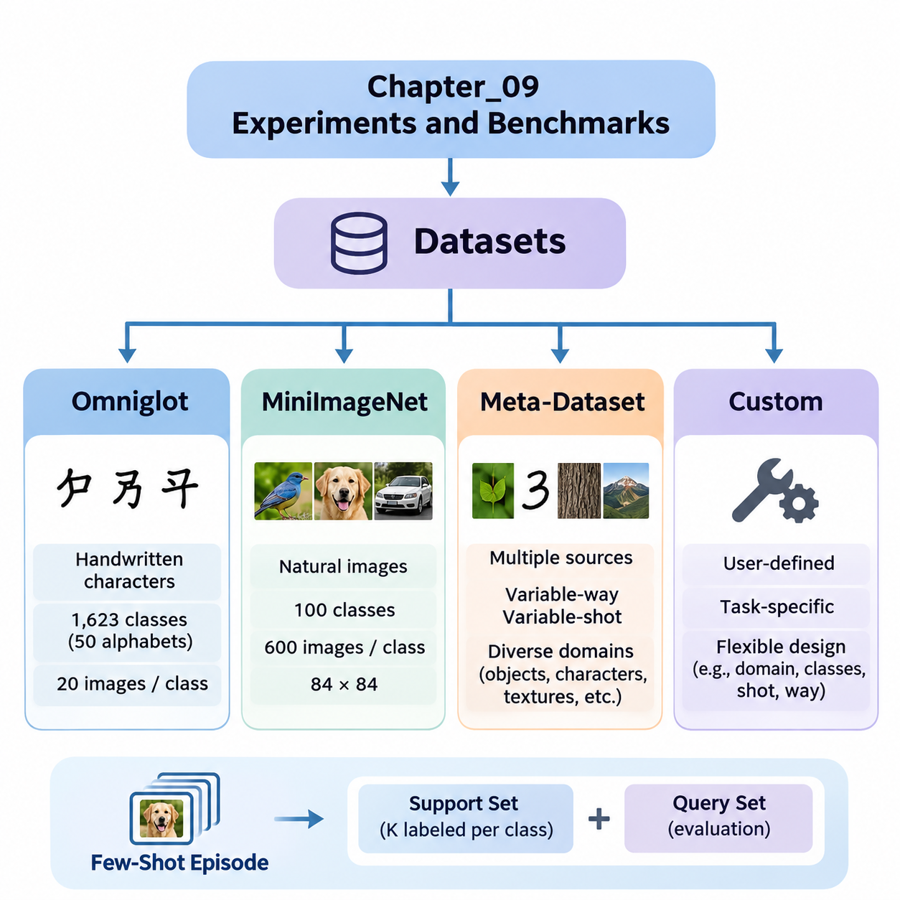
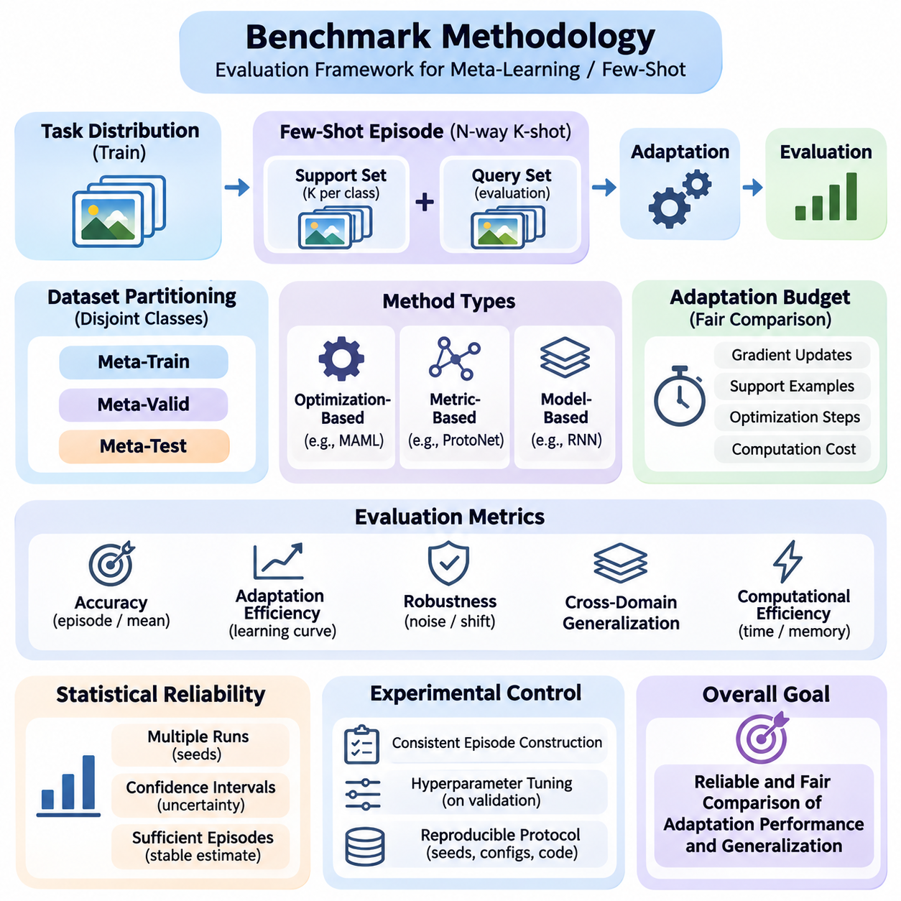
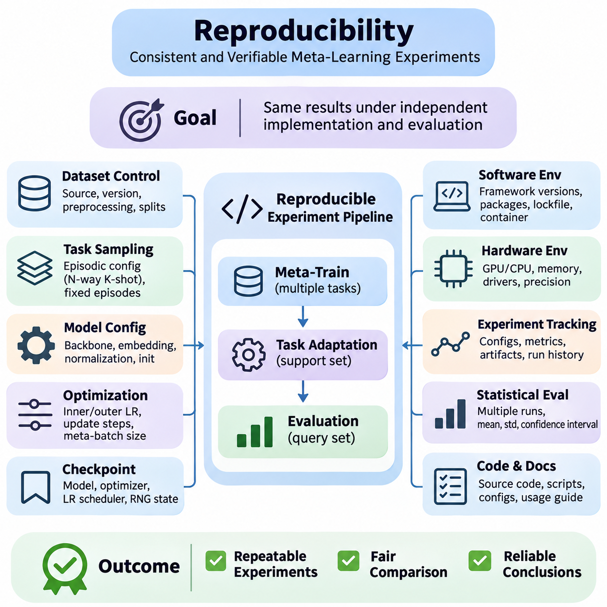
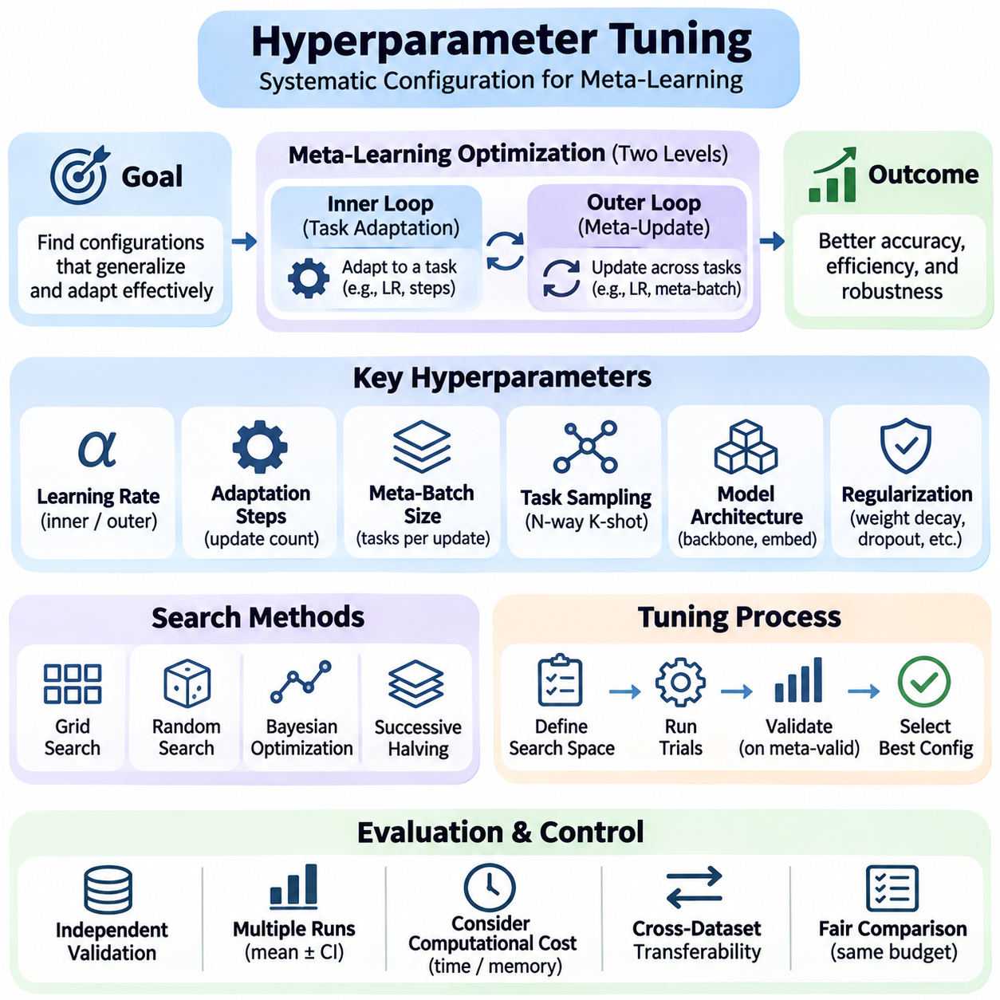
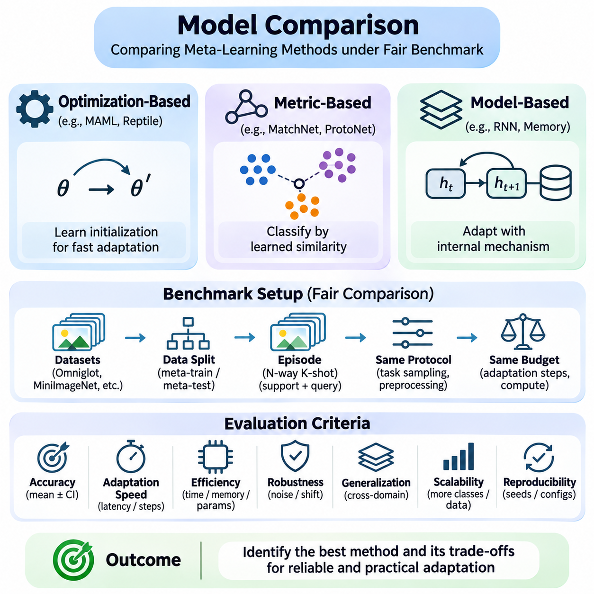

**Volume 36. Meta Learning and Few Shot Adaptation**

# 09. Experiments and Benchmarks

## 09.01 Datasets

{width="7.268055555555556in" height="7.268055555555556in"}

Datasets form the experimental foundation of meta-learning and few-shot adaptation because they determine how effectively models can acquire transferable knowledge and generalize to unfamiliar tasks. Unlike conventional supervised learning, meta-learning organizes examples into task-specific episodes that simulate adaptation under limited supervision. Dataset selection therefore influences both learning behavior and the reliability of benchmark conclusions.

A typical few-shot classification episode contains a support set and a query set. The support set provides a small number of labeled examples for adaptation, while the query set measures performance on additional samples from the same task. In an N-way K-shot experiment, each episode includes N classes and K labeled support examples per class. Repeated episodes estimate how consistently a model adapts across different class combinations.

Dataset partitions require particular attention because meta-learning evaluates generalization across tasks rather than merely across individual samples. Meta-training, meta-validation, and meta-testing typically use disjoint classes to prevent direct memorization of evaluation categories. This organization encourages transferable representations and adaptation strategies while reducing the risk that benchmark results reflect information leakage.

Omniglot is a foundational benchmark for few-shot learning that contains handwritten characters collected from numerous alphabets. Its relatively simple grayscale images make it suitable for investigating rapid adaptation, similarity learning, and optimization-based meta-learning. Researchers frequently use Omniglot to examine whether models can recognize previously unseen character classes after observing only one or several labeled examples.

The original Omniglot collection contains 1,623 character classes drawn from 50 alphabets, with 20 handwritten examples per class. Its class diversity supports episodic experiments involving different combinations of characters. Common evaluations include 5-way and 20-way classification under one-shot or five-shot conditions, although exact protocols depend on the benchmark implementation and selected data partitions.

Omniglot experiments often apply image resizing, normalization, and rotational augmentation. Rotations can create additional classification categories under certain established protocols, but their use must be documented because they change the effective task distribution. Researchers must also ensure that augmentation does not introduce unintended overlap between training and evaluation classes or otherwise compromise experimental independence.

The simplicity of Omniglot provides advantages for algorithm development and debugging. Model-Agnostic Meta-Learning, Matching Networks, Prototypical Networks, and related approaches can be evaluated without the computational demands of large natural-image datasets. However, high accuracy on handwritten characters does not necessarily demonstrate equivalent adaptation capabilities in complex visual environments.

MiniImageNet introduces a more challenging benchmark based on natural images selected from ImageNet. It contains 100 classes with 600 images per class, commonly resized to 84 by 84 pixels. The dataset is widely used to evaluate whether meta-learning algorithms can distinguish unfamiliar visual categories despite substantial variation in object appearance, background complexity, lighting, and viewpoint.

A commonly adopted MiniImageNet partition assigns 64 classes to meta-training, 16 to meta-validation, and 20 to meta-testing. These class-disjoint partitions support controlled comparisons of generalization to unseen categories. Nevertheless, published implementations may differ in image preprocessing, partition definitions, and evaluation procedures, making explicit protocol documentation essential for reproducible comparisons.

MiniImageNet evaluations commonly use 5-way 1-shot and 5-way 5-shot classification tasks. Each episode samples five classes and provides either one or five labeled examples per class, followed by query images used to measure classification accuracy. Repeating this procedure across many independently sampled episodes produces estimates of expected performance and reveals variation associated with task composition.

Compared with Omniglot, MiniImageNet places greater demands on representation quality and feature transfer. Models must learn embeddings that preserve meaningful semantic distinctions while remaining adaptable to new categories. Performance can depend strongly on backbone architecture, pretraining, augmentation, and optimization settings, so improvements should not automatically be attributed to the meta-learning algorithm alone.

Meta-Dataset extends few-shot evaluation beyond a single source dataset by combining multiple image classification datasets into a unified benchmarking framework. Its purpose is to investigate whether meta-learning systems can adapt across substantially different visual domains. Instead of concentrating exclusively on fixed classification settings, it introduces variability in class selection, available examples, and task difficulty.

Meta-Dataset includes image sources representing diverse recognition problems, such as natural objects, handwritten characters, textures, and specialized visual categories. This diversity challenges models to learn transferable adaptation mechanisms rather than strategies tailored to one dataset. Evaluation across multiple sources helps reveal whether a method depends excessively on particular image statistics or semantic structures.

An important characteristic of Meta-Dataset is its variable-way and variable-shot episodic configuration. The number of classes and available support examples can change between tasks, producing evaluation conditions that more closely resemble heterogeneous real-world learning problems. Models must therefore accommodate changing task dimensions and potentially imbalanced support sets without relying on one fixed episode structure.

Meta-Dataset also enables comparisons between adaptation within familiar domains and adaptation to domains not encountered during meta-training. These settings expose different forms of generalization difficulty. A model may perform well when evaluation tasks resemble training tasks yet struggle when image characteristics, class relationships, or available supervision change substantially.

Because Meta-Dataset integrates heterogeneous sources, experimental fairness requires careful control of preprocessing, feature extraction, and training resources. Different input resolutions, class distributions, and dataset sizes can influence measured performance. Researchers should report source-specific results alongside aggregate statistics so that improvements on one domain do not conceal significant degradation on another.

Custom datasets become essential when standard academic benchmarks do not represent the intended deployment environment. Industrial inspection, medical imaging, robotics, autonomous systems, and specialized document recognition may involve unfamiliar categories, limited annotations, or continuously changing operating conditions. A custom benchmark allows researchers to evaluate adaptation under constraints directly related to the target application.

Constructing a custom meta-learning dataset begins with defining the task distribution and identifying meaningful units of adaptation. Tasks may correspond to product categories, equipment types, operating environments, individual users, or newly encountered object classes. The dataset should contain sufficient variation across these units to distinguish genuine adaptation capabilities from memorization of recurring patterns.

Data collection must preserve representative examples of both normal operating conditions and difficult cases. Variations in sensor characteristics, environmental conditions, acquisition time, and annotation quality can significantly affect adaptation performance. Dataset documentation should describe sampling procedures, label definitions, class frequencies, and known limitations to support reliable interpretation of experimental results.

For industrial visual inspection, a custom benchmark might contain images from different production lines, material surfaces, or defect categories. A few-shot task could require recognizing a newly introduced defect using only a small labeled support set. Evaluation should distinguish performance on unfamiliar defect types from performance on familiar defects observed under altered lighting or camera conditions.

Robotics-oriented custom datasets may organize episodes around different terrains, payloads, manipulation objects, or sensor configurations. Such datasets can test whether learned representations and adaptation mechanisms remain effective when environmental dynamics change. Where sequential interaction matters, static classification accuracy should be supplemented with task completion, adaptation latency, and operational reliability measurements.

Custom benchmark construction also introduces risks of data leakage and misleading generalization claims. Images collected from the same physical object, production batch, recording session, or individual subject may be strongly correlated. Splitting these examples randomly can inflate performance estimates, so grouping strategies should reflect the intended generalization boundary between training and deployment.

Across Omniglot, MiniImageNet, Meta-Dataset, and custom datasets, benchmark design should specify the task distribution, class partitions, support and query sampling, preprocessing procedures, and evaluation metrics. Multiple random seeds and sufficiently many evaluation episodes help quantify uncertainty. Confidence intervals, adaptation costs, and computational requirements provide additional context beyond average classification accuracy.

A comprehensive experimental strategy uses complementary datasets rather than relying on one benchmark. Omniglot supports controlled algorithm investigation, MiniImageNet evaluates natural-image few-shot recognition, Meta-Dataset examines broader cross-domain adaptability, and custom datasets measure application-specific relevance. Together, these resources provide stronger evidence about the capabilities, limitations, and practical transferability of meta-learning systems.

## 09.02 Benchmark Methodology

{width="7.268055555555556in" height="7.268055555555556in"}

Benchmark methodology provides a systematic framework for evaluating meta-learning and few-shot adaptation algorithms under controlled and reproducible conditions. Unlike conventional machine learning benchmarks, which typically measure performance on fixed test datasets, meta-learning benchmarks examine how effectively models adapt to previously unseen tasks. A rigorous methodology must therefore evaluate both predictive accuracy and the efficiency of adaptation.

The central principle of meta-learning evaluation is task-level generalization. Models are trained on a distribution of tasks and evaluated on new tasks sampled from a related or deliberately different distribution. Each evaluation task contains a limited support set for adaptation and a separate query set for performance measurement. This distinction ensures that reported results reflect learning from limited examples rather than memorization of training categories.

Episodic evaluation is the standard methodology for few-shot classification benchmarks. Each episode represents an independent classification problem containing a selected number of classes and labeled examples. An N-way K-shot configuration specifies N candidate classes and K support examples per class. Query samples are then used to measure how accurately the model recognizes previously unseen examples after adaptation.

Episode construction significantly influences benchmark difficulty and comparability. Class sampling procedures, support set sizes, query set sizes, and class balance must be explicitly defined. Sampling tasks with different class combinations can reveal variations in adaptation performance. Researchers should avoid selecting only favorable episodes because this introduces evaluation bias and produces misleading estimates of generalization capability.

Dataset partitioning establishes the boundary between information available during training and information reserved for evaluation. Meta-training, meta-validation, and meta-testing should use disjoint classes when measuring adaptation to unseen categories. In cross-domain experiments, entire datasets or domains may be reserved for testing. These separation rules prevent information leakage and provide stronger evidence of genuine task-level generalization.

Benchmark protocols must distinguish between meta-training and task-specific adaptation. Meta-training develops transferable representations, initialization parameters, or adaptation strategies across multiple tasks. During meta-testing, the model receives limited information from a new task and applies its learned adaptation mechanism. Query labels must remain inaccessible until predictions have been generated and evaluation is performed.

Adaptation budgets are essential for fair algorithm comparison. Different methods may require different numbers of gradient updates, support examples, optimization steps, or computational operations. A benchmark should specify these resources and evaluate methods under comparable constraints. Reporting accuracy without adaptation cost can favor computationally expensive approaches that may be impractical in latency-sensitive applications.

Optimization-based meta-learning methods require careful evaluation of inner-loop adaptation. Algorithms such as Model-Agnostic Meta-Learning modify model parameters using task-specific support examples before measuring query performance. Important experimental variables include adaptation learning rate, update count, optimizer selection, and trainable parameter subsets. These settings can substantially influence the measured effectiveness of learned initializations.

Metric-based meta-learning approaches follow a different evaluation process because adaptation may occur without explicit gradient updates. Prototypical Networks construct class representations from support embeddings, while Matching Networks compare query representations with labeled examples. Fair benchmarking should account for embedding computation, similarity calculations, memory requirements, and any task-specific processing performed during inference.

Classification accuracy remains the most widely reported metric in few-shot learning experiments. Episode accuracy measures the proportion of correctly classified query examples, while mean accuracy summarizes performance across multiple evaluation episodes. However, accuracy alone cannot describe uncertainty, computational efficiency, or sensitivity to task difficulty. Additional metrics are therefore necessary for comprehensive assessment.

Statistical reliability depends on evaluating a sufficiently large collection of independently sampled tasks. Researchers commonly report mean episode accuracy together with confidence intervals derived from evaluation results. Multiple training seeds are also important because initialization and stochastic optimization can produce substantial performance variation. Confidence intervals over episodes do not automatically capture variability between independently trained models.

Confidence interval estimation should reflect the experimental sampling structure. When episodes share examples, classes, or trained model parameters, their outcomes may be statistically dependent. Bootstrap procedures or hierarchical analyses can account for appropriate sources of variation. Reporting the number of training runs, evaluation episodes, and uncertainty estimation method makes benchmark conclusions easier to interpret.

Adaptation efficiency measures how quickly a model reaches acceptable performance after receiving limited task-specific information. Learning curves can describe accuracy as a function of support set size, gradient updates, or adaptation time. Such measurements distinguish methods that achieve high final accuracy from methods that adapt rapidly. This distinction is especially important for robotics, autonomous systems, and edge AI applications.

Robustness evaluation examines whether adaptation remains effective when task conditions differ from those encountered during meta-training. Experiments may introduce image corruption, sensor noise, class imbalance, distribution shifts, or reduced support quality. Measuring performance under these conditions reveals whether an algorithm has learned transferable adaptation principles or relies on narrow assumptions about its training environment.

Cross-domain benchmarking evaluates generalization when training and testing tasks originate from different data distributions. A model trained on natural images may be evaluated on textures, handwritten symbols, or specialized industrial imagery. Such experiments should distinguish adaptation to unseen classes within familiar domains from adaptation to entirely unfamiliar domains, since these settings represent different levels of generalization difficulty.

Baseline selection is another critical component of benchmark methodology. Meta-learning methods should be compared against conventional supervised learning, transfer learning, pretrained feature extractors, and simple fine-tuning strategies where appropriate. Strong baselines help determine whether additional meta-learning complexity produces meaningful improvements. Comparisons must control backbone capacity, training data, preprocessing, and available computational resources.

Hyperparameter selection must rely on validation tasks rather than final test performance. Learning rates, adaptation steps, regularization strengths, and architecture choices should be optimized using predefined validation protocols. Repeatedly adjusting configurations after examining test results creates implicit information leakage. A reliable benchmark separates model development decisions from final performance estimation.

Reproducibility requires detailed documentation of experimental configurations and computational environments. Dataset versions, random seeds, software dependencies, hardware specifications, preprocessing operations, and training schedules should be recorded. Evaluation scripts must implement consistent task sampling and metric computation. Publicly available configurations and executable procedures help independent researchers verify reported results.

Computational benchmarking should measure both training and adaptation costs. Relevant quantities include GPU memory consumption, training duration, inference latency, parameter count, and energy usage when measurable. These measurements become particularly important when comparing optimization-based and metric-based methods. Resource reporting should identify the hardware and measurement conditions to prevent misleading efficiency comparisons.

Ablation studies isolate the contribution of individual algorithmic components. Researchers may remove task conditioning, modify adaptation steps, replace embedding architectures, or disable regularization mechanisms. Comparing these controlled variants reveals which design choices contribute to performance improvements. Ablation experiments should preserve other relevant conditions so that observed differences can be attributed to the component under investigation.

Benchmark interpretation must consider practical significance alongside statistical significance. Small accuracy improvements may not justify substantial increases in training cost, adaptation latency, or implementation complexity. Conversely, a method with slightly lower accuracy may be preferable when it offers greater robustness or faster adaptation. Evaluation conclusions should therefore reflect the intended operational requirements.

A rigorous benchmark methodology integrates controlled task construction, independent dataset partitions, standardized adaptation budgets, reliable statistical estimation, and transparent computational reporting. Combining accuracy, efficiency, robustness, and cross-domain generalization produces a more complete understanding of meta-learning performance. This multidimensional approach supports credible scientific comparisons and informed decisions about real-world deployment.

## 09.03 Reproducibility [w/Code]

{width="7.268055555555556in" height="7.268055555555556in"}

Reproducibility is a fundamental requirement of reliable meta-learning research because experimental results must remain consistent when algorithms are independently implemented and evaluated. Few-shot learning introduces additional sources of variability through task sampling, adaptation procedures, and limited support examples. A reproducible experiment therefore requires precise control over datasets, computational environments, optimization settings, and evaluation protocols.

The reproducibility challenge in meta-learning differs from conventional supervised learning because training and evaluation involve distributions of tasks rather than fixed collections of examples. Each sampled episode may contain different classes, support examples, and query samples. Even when model parameters remain unchanged, evaluation accuracy can fluctuate across episodes. Researchers must document how tasks are generated and how experimental randomness is controlled.

Random seed management is essential for controlling stochastic behavior throughout the experimental pipeline. Randomness influences model initialization, dataset shuffling, task sampling, data augmentation, and optimization. A reproducible implementation should initialize the random number generators used by Python, NumPy, and the selected deep learning framework. Separate seeds may be assigned to training, validation, and evaluation processes.

Setting random seeds does not automatically guarantee identical results across hardware platforms or software versions. GPU kernels, parallel execution, floating-point arithmetic, and nondeterministic operations can introduce numerical differences. Frameworks such as PyTorch provide deterministic algorithm settings, although some operations may become slower or unavailable. Researchers should distinguish exact determinism from statistical reproducibility.

Dataset version control establishes a stable foundation for repeatable experiments. Researchers should record dataset sources, download versions, preprocessing procedures, class mappings, and partition definitions. For benchmarks such as Omniglot and MiniImageNet, alternative splits or preprocessing conventions can produce different results. Dataset checksums and stored split manifests help verify that independent experiments use identical data.

Task sampling must be implemented consistently across training and evaluation. An episodic sampler selects classes, support examples, and query examples according to a predefined configuration. Sampling with or without replacement, balancing classes, and controlling query counts can affect measured performance. Recording sampler parameters and random states allows researchers to reconstruct experimental episodes and investigate unexpected results.

A useful reproducibility strategy is to generate fixed evaluation episode manifests before model comparison. Each manifest identifies the classes and sample indices used in a particular episode. Competing algorithms can then be evaluated on identical tasks, reducing variability caused by different evaluation samples. Fixed episodes improve paired comparisons, although additional independently sampled episodes may be necessary to estimate broader task-distribution performance.

Model configuration management ensures that architectural differences do not unintentionally influence experimental conclusions. Researchers should record backbone structures, embedding dimensions, normalization layers, activation functions, and parameter initialization methods. In meta-learning, seemingly minor architectural choices can substantially affect adaptation behavior. Configuration files provide a structured mechanism for preserving these decisions.

Optimization settings require equally detailed documentation because meta-learning commonly involves nested learning procedures. Inner-loop learning rates, adaptation steps, outer-loop optimizers, meta-batch sizes, and learning-rate schedules must be specified. Algorithms such as MAML are particularly sensitive to these settings. Reproducing only the model architecture without the optimization procedure may lead to significantly different experimental outcomes.

Checkpoint management supports reliable recovery and comparison of experimental runs. A complete training checkpoint should preserve model parameters, optimizer states, learning-rate scheduler states, and relevant random number generator states. For exact continuation, additional information such as the current episode position and sampler state may be necessary. Checkpoints should include identifiers linking them to their original configurations.

Software environment reproducibility requires recording framework versions, dependency packages, compiler settings, and relevant accelerator libraries. Differences between PyTorch releases, CUDA implementations, or numerical kernels may alter execution behavior. Dependency lockfiles and container images can reduce environmental inconsistencies. However, containerization alone does not eliminate hardware-dependent numerical variation or nondeterministic execution.

Hardware documentation is particularly important when evaluating computational efficiency and adaptation latency. GPU models, CPU specifications, memory capacity, accelerator drivers, and precision settings influence measured performance. Mixed-precision training may improve throughput while introducing numerical differences. Benchmark reports should identify these conditions so that runtime comparisons are interpreted within their actual computational environments.

Experiment tracking systems provide a centralized record of configurations, metrics, artifacts, and execution histories. Tools such as MLflow, TensorBoard, and Weights & Biases can associate training curves and evaluation results with specific runs. Effective tracking should also preserve source-code revisions and dataset identifiers. These records help distinguish genuine algorithmic improvements from accidental changes in experimental settings.

Statistical reproducibility requires evaluating models across multiple independent training runs rather than relying on a single favorable result. Different initialization seeds and task sequences may produce substantially different outcomes. Reporting means, standard deviations, and confidence intervals provides a more informative assessment of performance stability. Researchers should distinguish variation between training runs from variation among evaluation episodes.

Evaluation scripts should remain independent of model development decisions and enforce consistent measurement procedures. The same query-label handling, adaptation budgets, accuracy calculations, and aggregation methods should apply to competing algorithms. Validation data should guide hyperparameter selection, while test data should remain reserved for final evaluation. This separation reduces the risk of implicit benchmark overfitting.

Reproducibility testing should include automated verification of critical pipeline components. Unit tests can confirm correct support-query separation, class remapping, tensor dimensions, and gradient update behavior. Integration tests can verify that complete episodes execute correctly and produce valid metrics. Deterministic reference cases are especially useful for detecting implementation errors after software or architecture changes.

For optimization-based meta-learning, gradient correctness is an important reproducibility concern. Higher-order differentiation, parameter cloning, and computational graph retention can be implemented differently across frameworks. Numerical gradient checks and comparisons against trusted reference implementations help identify errors. Researchers should document whether full second-order gradients, first-order approximations, or implicit differentiation methods are used.

Metric-based learning systems require verification of embedding extraction and similarity calculations. Differences in feature normalization, distance functions, prototype construction, and query processing can change benchmark outcomes. Reproducible implementations should explicitly define these operations and their numerical precision. Cached embeddings must also be associated with the exact model checkpoint and preprocessing configuration that produced them.

A practical reproducibility workflow begins by establishing immutable dataset partitions and version-controlled experiment configurations. Each run then records its random seeds, software environment, model checkpoint, and evaluation protocol. Automated scripts should reconstruct the complete training and testing pipeline from these records. Successful reproduction should be assessed using predefined numerical tolerances and statistical criteria.

Open research practices further strengthen reproducibility by making source code, configuration files, evaluation scripts, and experiment documentation accessible. When datasets cannot be distributed because of licensing or privacy restrictions, researchers can provide acquisition instructions, metadata schemas, and preprocessing specifications. Clear documentation enables independent verification without requiring access to confidential information.

Reproducibility should ultimately be treated as an engineering property of the entire meta-learning system rather than a final reporting requirement. Reliable experiments combine controlled randomness, traceable datasets, documented optimization, verified implementations, and statistically sound evaluation. These practices improve scientific credibility, accelerate debugging, and support dependable comparisons when meta-learning methods transition from research benchmarks to practical deployment.

## 09.04 Hyperparameter Tuning [w/Code]

{width="7.268055555555556in" height="7.268055555555556in"}

Hyperparameter tuning is a critical component of meta-learning because model performance depends on both the learning process across tasks and the adaptation process within individual tasks. Unlike conventional supervised learning, meta-learning introduces interacting optimization settings that influence transferability, convergence, and adaptation efficiency. A systematic tuning strategy is necessary to identify configurations that generalize beyond the tasks used during development.

Hyperparameters determine how models acquire transferable knowledge and respond to limited task-specific supervision. Important settings include learning rates, meta-batch sizes, adaptation steps, regularization strengths, and network architecture choices. Their effects are often interdependent, meaning that optimizing one parameter independently may produce misleading conclusions. Effective tuning must consider interactions between training stability and adaptation performance.

Meta-learning commonly involves two optimization levels with distinct hyperparameter requirements. The inner loop adapts model parameters to a sampled task, while the outer loop updates shared parameters using information collected across tasks. Inner-loop settings determine the speed and stability of adaptation, whereas outer-loop settings influence the quality of transferable initialization or representations. Both levels must be coordinated during tuning.

The inner-loop learning rate controls the magnitude of task-specific parameter updates. Excessively large values may cause unstable adaptation or overshooting, while very small values can prevent meaningful learning from limited support examples. The optimal rate depends on model architecture, support set size, and the number of adaptation steps. Researchers should evaluate learning rates across multiple tasks rather than selecting values from a single episode.

The number of inner-loop adaptation steps introduces a tradeoff between computational cost and task-specific accuracy. Additional updates may improve performance when sufficient support information is available, but excessive adaptation can overfit small support sets. Few-shot settings are particularly sensitive to this effect. Tuning should therefore examine how accuracy changes with update count and whether improvements justify additional computation.

Outer-loop learning rates determine how quickly meta-parameters change across training episodes. Large updates may accelerate initial progress but introduce instability, while conservative updates can require longer training. Learning-rate schedules, warmup strategies, and adaptive optimizers can influence convergence. Validation performance should guide these choices because low training loss does not necessarily indicate strong generalization to unseen tasks.

Meta-batch size specifies how many tasks contribute to each outer-loop optimization update. Larger meta-batches can reduce gradient variance and stabilize training, but they increase memory consumption and computational requirements. Smaller meta-batches provide more frequent updates but may produce noisy optimization trajectories. The appropriate configuration depends on task diversity, hardware capacity, and the selected meta-learning algorithm.

Task sampling itself introduces important hyperparameters that are sometimes overlooked. The number of classes per episode, support examples per class, query examples, and sampling probabilities determine the training task distribution. These choices influence the adaptation strategies learned by the model. Training episodes should reflect intended evaluation conditions while preserving sufficient diversity to encourage transferable representations.

Model architecture tuning affects both representation quality and adaptation complexity. Backbone depth, embedding dimensionality, normalization layers, and activation functions can change few-shot performance substantially. Larger networks may extract richer features but require more data and computation to adapt effectively. Architecture comparisons should control training resources and distinguish improvements from increased model capacity.

Regularization hyperparameters help prevent overfitting during meta-training and task-specific adaptation. Weight decay, dropout, data augmentation, and early stopping can improve generalization when appropriately configured. However, excessive regularization may suppress useful task-specific learning. Validation experiments should examine whether regularization improves performance across unfamiliar classes rather than merely reducing training loss.

Metric-based meta-learning methods introduce additional tuning considerations related to representation geometry. Distance metrics, embedding normalization, temperature scaling, and prototype construction can affect classification decisions. For Prototypical Networks, the embedding space must support meaningful class centroids. Matching-based approaches may require tuning similarity functions and attention mechanisms to maintain reliable comparisons.

Optimization-based approaches such as MAML require careful coordination between inner-loop and outer-loop settings. Their performance can depend on second-order gradient computation, parameter initialization, adaptation depth, and optimizer selection. First-order approximations may reduce computational cost but alter optimization behavior. Hyperparameter comparisons should account for these methodological differences rather than treating all configurations as equivalent.

Hyperparameter search methods range from manual exploration to automated optimization. Grid search evaluates predefined combinations, while random search samples configurations from specified distributions. Bayesian optimization uses previous evaluations to guide subsequent trials. Successive halving and related resource-allocation methods terminate weak configurations early, reducing the cost of exploring large search spaces.

Search-space design is as important as the optimization algorithm itself. Learning rates and regularization coefficients are often better explored on logarithmic scales, while discrete parameters such as adaptation steps require explicit candidate sets. Search ranges should be justified by algorithm characteristics and preliminary experiments. Excessively narrow ranges may exclude effective configurations, whereas broad ranges waste computational resources.

Validation protocols must preserve the separation between hyperparameter selection and final testing. Meta-validation tasks should contain classes or domains excluded from meta-training, depending on the generalization objective. Every candidate configuration should be evaluated using a consistent episodic protocol. Final test performance must remain unavailable during tuning to prevent benchmark overfitting and overly optimistic conclusions.

Evaluation noise creates additional challenges because few-shot accuracy varies across sampled episodes and random initializations. Comparing configurations using only a small number of tasks can lead to unstable rankings. Fixed validation episodes support controlled comparisons, while repeated seeds provide evidence of robustness. Promising configurations should be reevaluated with larger task samples before final selection.

Computational budgets should be incorporated into hyperparameter optimization from the beginning. A configuration that achieves slightly higher accuracy after substantially more training may not be preferable in practical applications. Researchers can optimize accuracy subject to constraints on memory, adaptation latency, or energy consumption. Multi-objective tuning provides a framework for balancing predictive performance with deployment requirements.

Automated experiment tracking improves tuning reliability by preserving configurations, validation results, training histories, and computational costs. Each trial should be associated with a unique identifier and reproducible random seed. Recording failed experiments is also important because instability reveals weaknesses in particular parameter regions. Structured records allow researchers to analyze parameter sensitivity and identify recurring performance patterns.

Sensitivity analysis examines how strongly performance changes when individual hyperparameters vary around a selected configuration. Flat performance regions indicate that an algorithm is relatively robust to parameter choices, while narrow optima suggest sensitivity and potential reproducibility problems. Interaction analysis can reveal dependencies between learning rates, adaptation steps, and model capacity that isolated parameter studies might overlook.

Transferability of tuned hyperparameters should be evaluated across different datasets and task distributions. Settings optimized on Omniglot may not remain effective on MiniImageNet or Meta-Dataset because image complexity and task characteristics differ. Reusing a configuration without validation can produce misleading comparisons. Cross-dataset experiments help determine whether an algorithm is intrinsically robust or requires extensive environment-specific tuning.

Fair benchmarking requires comparable hyperparameter search effort across competing algorithms. Providing one method with a substantially larger tuning budget can create an artificial performance advantage. Researchers should report search ranges, trial counts, validation criteria, and computational resources. Transparent tuning procedures make it easier to distinguish genuine algorithmic improvements from advantages produced by more extensive experimentation.

A rigorous hyperparameter tuning strategy combines structured search spaces, independent validation tasks, statistical evaluation, computational constraints, and reproducible experiment tracking. Inner-loop and outer-loop parameters must be optimized jointly when their interactions influence adaptation behavior. The ultimate objective is not merely maximum benchmark accuracy, but a stable configuration that supports efficient and reliable generalization to unfamiliar tasks.

## 09.05 Model Comparison

{width="7.268055555555556in" height="7.268055555555556in"}

Model comparison is a fundamental component of meta-learning research because different algorithms achieve adaptation through distinct mechanisms, computational requirements, and assumptions about task distributions. A meaningful comparison must examine more than classification accuracy on a single benchmark. It should evaluate generalization, adaptation efficiency, robustness, scalability, and reproducibility under consistent experimental conditions.

Meta-learning algorithms can be broadly categorized into optimization-based, metric-based, and model-based approaches. Optimization-based methods learn parameters that support rapid task-specific updates, while metric-based methods classify examples using learned similarity representations. Model-based approaches employ architectures with internal adaptation mechanisms. Comparing these families reveals how different learning principles influence performance.

Optimization-based approaches such as Model-Agnostic Meta-Learning and Reptile emphasize transferable parameter initialization. MAML optimizes an initialization that supports effective gradient-based adaptation, whereas Reptile uses repeated task-specific optimization to encourage transferable parameters. Their comparison should consider adaptation accuracy, gradient computation, memory consumption, and sensitivity to optimization settings.

Metric-based approaches such as Matching Networks, Prototypical Networks, and Relation Networks learn representations that support classification from limited examples. Matching Networks compare query embeddings with labeled support examples, while Prototypical Networks represent classes through embedding-space prototypes. Relation Networks learn similarity functions. Their performance depends strongly on representation quality and distance modeling.

Model-based meta-learning approaches incorporate adaptation into architectural mechanisms such as recurrent networks, external memory, or learned parameter generators. These systems may update internal states rather than perform conventional gradient-based fine-tuning. Their evaluation should examine memory capacity, task sequence sensitivity, adaptation speed, and computational overhead. Architectural flexibility can improve adaptation but may complicate training and interpretation.

Fair comparison requires identical or carefully matched dataset partitions, task sampling procedures, and evaluation protocols. Models should be evaluated on the same meta-training, meta-validation, and meta-testing distributions whenever possible. Support set sizes, query counts, class selection, and preprocessing must be documented. Otherwise, apparent performance differences may reflect experimental design rather than algorithmic capability.

Backbone architecture is a major source of confounding in few-shot benchmarks. A method using a powerful pretrained feature extractor may outperform another method because of representation capacity rather than superior adaptation. Comparisons should distinguish algorithmic contributions from backbone improvements. Shared architectures and matched pretraining conditions provide stronger evidence about the effectiveness of different meta-learning mechanisms.

Classification accuracy remains an important comparison metric, particularly for standard N-way K-shot tasks. Common protocols include 5-way 1-shot and 5-way 5-shot evaluation on datasets such as MiniImageNet. Results should be averaged across many independently sampled episodes and accompanied by uncertainty estimates. A small difference in mean accuracy may not represent a reliable improvement when experimental variability is substantial.

Adaptation speed provides another important dimension of comparison. Optimization-based methods may require several gradient updates, whereas metric-based approaches can often classify queries after constructing support representations. However, embedding extraction and similarity computation also consume resources. Measuring total adaptation latency and inference time provides a more meaningful comparison than counting gradient steps alone.

Computational efficiency should be evaluated using consistent hardware and software environments. Relevant measurements include training duration, GPU memory usage, parameter count, inference throughput, and energy consumption when available. Higher-order gradient methods may impose substantial memory and computation costs. Efficient alternatives can be preferable when deployment constraints outweigh marginal improvements in benchmark accuracy.

Few-shot performance should be compared across different support set sizes because algorithms may respond differently to increasing supervision. A method optimized for one-shot classification may not remain competitive when five or ten labeled examples become available. Performance curves across support sizes reveal adaptation efficiency and data utilization. These comparisons help identify whether improvements arise from better representations or stronger task-specific learning.

Cross-domain generalization tests whether methods retain their effectiveness when evaluation tasks differ from training tasks. Models trained on natural images may be evaluated on textures, handwritten symbols, or industrial imagery. Strong performance within a familiar domain does not guarantee transfer to unfamiliar environments. Cross-domain comparisons reveal dependencies on training distributions and the flexibility of learned adaptation mechanisms.

Robustness comparisons examine performance under noise, class imbalance, corrupted inputs, and distribution shifts. Metric-based methods may be sensitive to distorted embedding geometry, while optimization-based methods may overfit noisy support examples. Model-based approaches can exhibit sensitivity to task ordering or internal memory states. Controlled perturbation experiments help identify these distinct failure mechanisms.

Statistical testing is necessary when comparing algorithms with similar benchmark results. Multiple independent training runs should be used to capture variability from initialization and stochastic optimization. Evaluating models on matched episodes supports paired statistical comparisons. Confidence intervals and effect sizes help determine whether observed improvements are meaningful rather than consequences of random experimental variation.

Hyperparameter tuning effort must be considered when interpreting model comparisons. Algorithms with larger search budgets may achieve better reported accuracy without possessing inherently stronger adaptation capabilities. Fair evaluations should document tuning ranges, validation criteria, trial counts, and computational budgets. Comparisons should distinguish improvements resulting from algorithm design from those produced by extensive optimization.

Ablation studies help explain why one model outperforms another. Researchers can remove adaptation steps, replace similarity functions, alter embedding architectures, or disable task-conditioning mechanisms. These controlled modifications isolate the contribution of individual components. Ablation results provide stronger explanatory evidence than aggregate benchmark rankings because they connect observed performance to specific design choices.

Scalability becomes important when moving beyond small academic classification tasks. Increasing the number of classes, support examples, task diversity, or input dimensions can affect algorithms differently. Metric-based methods may face growing comparison costs, while optimization-based approaches may require additional adaptation computation. Scalability experiments should report how accuracy, memory usage, and latency change with task complexity.

Practical deployment introduces requirements that standard benchmarks may not capture. Robotics, autonomous systems, industrial inspection, and edge AI applications often impose strict latency, memory, reliability, and power constraints. A model with slightly lower classification accuracy may provide greater operational value if it adapts quickly and runs consistently on limited hardware. Application-specific evaluation is therefore essential.

Reproducibility strengthens model comparison by ensuring that results can be independently verified. Researchers should release implementation details, random seeds, dataset partitions, evaluation scripts, and relevant configuration files whenever possible. Differences between published results and reproduced results should be investigated systematically. Transparent reporting reduces the risk of misleading conclusions caused by implementation inconsistencies.

Benchmark rankings should not be interpreted as universal indicators of algorithm superiority. Performance depends on task distributions, feature representations, adaptation budgets, and evaluation conditions. An algorithm that excels on Omniglot may perform differently on MiniImageNet or Meta-Dataset. Comprehensive comparison requires multiple datasets and complementary metrics rather than reliance on a single numerical ranking.

A multidimensional comparison framework integrates predictive accuracy, adaptation latency, computational cost, robustness, scalability, and cross-domain generalization. These dimensions reveal tradeoffs that are hidden by conventional benchmark tables. Researchers should identify Pareto-efficient methods that offer favorable balances among competing objectives. Such analysis supports informed algorithm selection for different operational environments.

Ultimately, model comparison should determine which meta-learning approaches provide reliable and efficient adaptation under clearly defined constraints. Controlled experiments, strong baselines, transparent tuning, and statistically sound evaluation establish credible evidence of performance differences. Combining academic benchmarks with application-specific testing produces a more complete understanding of algorithm capabilities and practical suitability.
